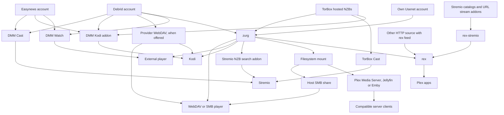
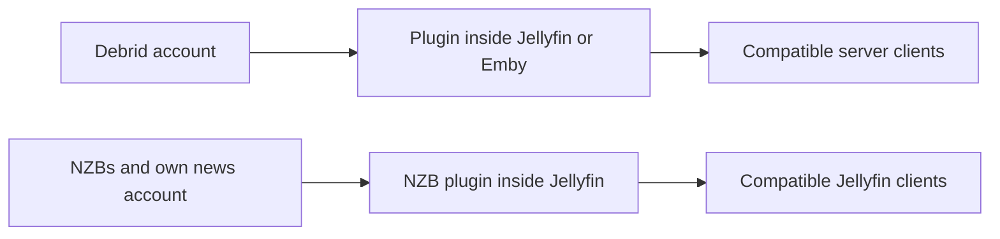
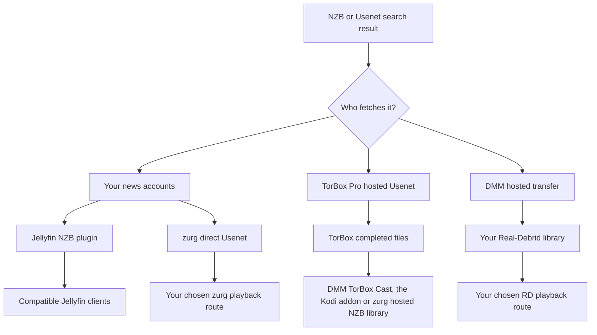

# どの構成を使えばいいですか？ {#which-setup-should-i-use}

**[インタラクティブなアンケートで自分に合ったセットアップを探す](https://debridmediamanager.com/choose-your-setup)**。プレイヤーのアカウントやホスティングについていくつか質問に答えてください。おすすめのルート、必要なもの、セットアップのリンクが表示されます。ログインは不要です。

名前の意味がわからない場合は、[各パーツの役割](glossary.md)で一行ずつ説明しています。

**まず、視聴に使うアプリから決めましょう。** すべてのパーツが必要なわけではありません。DMM はリリースを選ぶのを手伝います。プロバイダーがファイルを用意します。zurg はそれを共有ライブラリにまとめられます。rex は Plex 系アプリにライブラリを見せます。一部のルートでは、いくつかのパーツを省きます。

この図は **2026年11月10日** に確認した、対応済みのルートを扱っています。手順を一つ減らす外部の代替手段も含みます。サードパーティのアドオンやデバイスは、動作が異なる場合があります。リンク先のガイドと、そこに書かれた検証済みの制限に従ってください。

## 今使っているものから選ぶ {#pick-by-what-you-already-use}

スマホでは、表を横にスワイプするとすべての列が見られます。

| 持っているもの・やりたいこと… | 選ぶルート | 選ぶ理由 | 必要なこと |
|---|---|---|---|
| Stremio または Nuvio と、debrid または Easynews のアカウント。サーバーの管理は不要 | **[DMM Cast](../dmm/stremio.md) → Stremio または Nuvio**、または既存のストリームアドオン | zurg、rex、メディアサーバーを動かさずに、アカウント経由で視聴できる | アドオンとプロバイダーが再生可能なストリームを提供する必要がある。再生はデバイスが行う |
| Kodi と、debrid、Easynews、または TorBox Pro のアカウント | **DMM の Kodi アドオン → 自分のアカウント** | Kodi の中で閲覧、検索、再生ができる。スマホからペアリングできる。アドオンの TorBox ライブラリには、ホストされた NZB のダウンロードも含まれる | 再生は Kodi が行う。スポンサー向けの Wanted list のリクエストを処理するには、依然として zurg が必要 |
| 普段使っているプレーヤーで 1 本の映画を見たい | **DMM Watch → 外部プレーヤー** | ライブラリサーバーが不要 | 対応プレーヤーをインストールし、再生できるファイルを選ぶ |
| Infuse、Kodi、またはその他の WebDAV プレーヤー | ホストなしの **プロバイダーの WebDAV**、またはホストを起動したままにできる場合は **zurg → WebDAV プレーヤー** | Plex、Jellyfin、Emby、rex を使わずにクラウドライブラリを閲覧できる | Real-Debrid、AllDebrid、Premiumize、TorBox、Debrid-Link は、それぞれ独自のフォルダー構成で独自の WebDAV を提供する。Offcloud には WebDAV がないため zurg が必要。zurg を使うには、視聴中ずっと稼働しているホストが必要 |
| すでに動いている Plex Media Server | **zurg → マウントしたフォルダー → Plex Media Server → Plex アプリ** | 既存のサーバー、ライブラリ、いつもの運用をそのまま維持できる | zurg とファイルシステムのマウントをサーバーと並行して動かす。スキャンではリモートのファイルが読み込まれる |
| Plex アプリは使いたいが、マウントしたライブラリの管理はしたくない | **zurg → rex → Plex アプリ** | zurg が、マウントや Plex Media Server なしでライブラリを rex に供給する | 両方のサービスを動かし続ける。rex のアプリ互換性とアカウントの案内を確認する |
| Stremio のアドオンを使いたいが、Plex アプリの方が好み | **アドオン → rex-stremio → rex → Plex アプリ** | アドオンのカタログを Plex ライブラリに変換できる。zurg は任意 | rex と rex-stremio を動かす。ストリームアドオンは、生の torrent ではなく再生可能な URL を返す必要がある |
| Jellyfin 経由でプレーヤーからライブラリにアクセスしている | **Jellyfin 内のプロバイダープラグイン → 対応クライアント** | 別途の zurg サービスやマウントが不要 | Jellyfin 12 と対応するプラグイン。プラグインには独自のアーカイブ制限がある |
| Emby 経由でプレーヤーからライブラリにアクセスしている | **Emby 内のプロバイダープラグイン → 対応クライアント** | 既存の Emby サーバー内ですべて完結する | 対応する Emby のバージョンを使う。この 6 つのプラグインがカバーするのは debrid のみで、ダイレクトの Usenet は対象外 |
| Jellyfin/Emby に加え、独自のファイルシステムや WebDAV でアクセスする利用者がいる | **zurg → マウント → Jellyfin/Emby** | 1 つのライブラリを複数の利用者に提供できる | マウントとサーバー側のパスを管理する。ほかの利用者は zurg を直接使える |
| NZB ファイル、自分の Usenet アカウント、Jellyfin を使っている | **Jellyfin 内の NZB プラグイン → 対応クライアント** | 別途の zurg サービスなしで NZB をストリーミングできる | NNTP アクセスと対応する Jellyfin のバージョンが必要。このプラグインは圧縮・暗号化されたアーカイブのメンバーを除外し、PAR2 による修復は行わない |
| SMB 共有を読み込むハードウェアプレーヤー | **zurg → マウント → ホストの SMB 共有 → プレーヤー** | プレーヤー本来のファイルブラウザーと再生機能を維持できる | SMB はホストが提供する。zurg 自体が提供するのは WebDAV で、SMB サーバーではない |
| 自分の Usenet アカウントと Stremio を使っている | **Newznab インデクサー → zurg の Stremio アドオン → Stremio** | 再生時に検索し、自分のニュースアカウントを通してストリーミングできる | 稼働中の zurg、インデクサーへのアクセス、NNTP の認証情報が必要。別のデバイスからは、到達可能な HTTPS のアドオンアドレスが必要 |
| 別のコンピューターなしの Android/Google TV デバイス | **Android 上の zurg+rex → そのデバイス上のプレーヤー、またはそのデバイス上や家の中の Plex アプリ** | Android デバイス上で zurg と rex を動かし、その画面で、また家の中の Plex アプリで、自分の Plex サーバーを使える。Plex サーバーはスマホやテレビのボックスで動かせる | スポンサーのアクセス、サイドロード、バックグラウンド動作が必要。Usenet には 64 ビットの Android が必要。TorBox のホスト型 NZB は Android では利用できない |
| Android/Google TV デバイスと、Stremio のアドオン、YouTube、Spotify、または NAS 上のファイル | **Android 向け rex → そのデバイス上や家の中の Plex アプリ** | rex とそのアドオンを、無料で、コンピューターなしでデバイス上に置ける | サイドロードとバックグラウンド動作が必要。ストリームアドオンは生の torrent ではなく再生可能な URL を返す必要がある。NAS 上のファイルには、自分で作るアドオンが必要。debrid と Usenet のライブラリには、スポンサーは zurg+rex を使う（上の行） |
| ファイルがすでにディスクや NAS にある | **既存のメディアサーバーまたはネットワークプレーヤー**。rex を使いたい場合は **HTTP ソース → rex** | 所有しているファイルをそのまま使える。debrid や Usenet のアカウントは不要 | rex には、フィードの API を通じて送られるメタデータと、ファイルへの HTTP アクセスが必要。フィードの提供元とファイルサーバーは別々でもよい。rex はディスクをスキャンしない |
| ストリーミング可能な HTTP メディア、または自分の HTTP サーバー | **HTTP ソース + rex フィード → rex → Plex アプリ**、または対応プレーヤーに直接接続 | debrid や zurg なしで既存のソースを使える | rex には、識別情報とメディアの詳細を送るフィードの提供元が必要。URL だけでは、そのメタデータは得られない |

まずはここから: [DMM Cast](https://debridmediamanager.com/stremio/) · [Kodi](https://debridmediamanager.com/kodi) · [DMMの設定](https://debridmediamanager.com/settings) · [zurgのセットアップ](../zurg/setup/index.md) · [zurgと一緒にrex](../rex/with-zurg.md) · [Stremioアドオンと一緒にrex](../rex/stremio.md) · [Jellyfinプラグイン](https://debridmediamanager.com/jellyfin) · [Embyプラグイン](https://debridmediamanager.com/emby) · [zurgのStremioアドオン](../zurg/guides/stremio.md) · [AndroidでのZurg+rex](../zurg/guides/android.md) · [Android向けrex](../rex/android.md) · [任意のソースでのrex](../rex/any-source.md)。

Cast のリンクは Real-Debrid から始まります。[TorBox](https://debridmediamanager.com/stremio-torbox/)、[AllDebrid](https://debridmediamanager.com/stremio-alldebrid/)、[Premiumize](https://debridmediamanager.com/stremio-premiumize/)、[Offcloud](https://debridmediamanager.com/stremio-offcloud/)、[Debrid-Link](https://debridmediamanager.com/stremio-debridlink/)、[Easynews](https://debridmediamanager.com/stremio-easynews/) を使う場合は、そのアカウントのセットアップページを使ってください。ここでの Cast とは **DMM アドオン**のことです。Chromecast や画面ミラーリングのことではありません。Nuvio も同じアドオンを使います。Cast ページのアドオンのリンクを Nuvio に貼り付けてください。

## 再生の全体像 {#the-playback-map}

矢印は「ライブラリまたは再生可能なストリームを提供する先」を意味します。パケットのルーティング図ではありません。ルートによっては、プレーヤーがプロバイダーから直接取得することもあれば、サーバーがデータを中継することもあります。

[再生マップを全画面で開く](../assets/setup-routes/playback.svg)と、拡大表示や保存ができます。

Stremio の NZB 検索ルートには、`nzb` アカウント（TorBox がすでに保持しているリリースの場合は `torbox_nzb`）と Newznab インデクサーが必要です。TorBox でホストされている NZB は、zurg を使わなくても TorBox Cast または Kodi アドオン経由で再生できます。マウントから SMB へのルートには、ホスト側で別途設定した共有フォルダーが必要です。

ほかに、分けて考えておきたい小さなルートが2つあります。

[プラグインマップを全画面で開く](../assets/setup-routes/plugins.svg)。

プラグインは別々の連携機能です。プラグイン名に含まれる「zurg」は、zurg アプリケーションを実行しなければならないという意味では **ありません**。また、同じ機能が使えることも保証されません。TorBox プラグインのトレントライブラリは、zurg のホスト型 NZB バックエンドとは別物です。

## ファイルの取得元を選ぶ {#choose-where-the-files-come-from}

**インデクサー**はリリースを探します。**torrent または NZB** は、そのリリースをどう取得するかを説明します。**プロバイダー**が実際のデータ（バイト列）を提供します。**プレーヤー**がそれをデコードします。どれか1つにアクセスできても、他のものまで使えるわけではありません。

| 入力 | 動画を取得・配信するのは？ | 必要なもの | 役立つ場面 |
|---|---|---|---|
| キャッシュ済みの torrent、magnet、torrent ファイル | あなたのデブリッドプロバイダー | 選んだ連携に対応したアカウント | 目的のリリースがすでに利用可能な場合、待ち時間が最も短いことが多いです |
| キャッシュされていない torrent | デブリッドプロバイダーが先にダウンロードします | torrent を受け付けるアカウント、利用可能なソース、制限内の空き容量 | 見たいリリースがキャッシュされていない場合。待ち時間が発生し、失敗することもあります |
| NZB（自分のニュースアカウントを使用） | zurg の **direct Usenet** バックエンド、または Jellyfin の NZB プラグインが、必要に応じて記事を読み込みます | NZB、NNTP アクセス、選んだ連携。検索したい場合はインデクサーへのアクセス | プロバイダーやバックボーンを選び、予備のアカウントを使い、動画全体をローカルに保存しないようにします |
| NZB（TorBox のホスティングサービスを使用） | **TorBox が取得と修復を行い**、完成したファイルを配信します | TorBox Pro。DMM または zurg の **TorBox hosted NZB** バックエンドから送信 | ニュースサーバーの認証情報やローカルでのデコードを管理せずに NZB を使いたい場合 |
| DMM の Usenet 結果を Real-Debrid に送信 | DMM のホスト型転送サービスが取得し、**あなたの Real-Debrid ライブラリ**に渡します | Real-Debrid と、利用可能な DMM 転送枠 | すでに RD で視聴していて、そのリリースをそこに入れたい場合。個人の NNTP アカウントは不要です |
| Easynews の検索結果 | Easynews が直接 HTTP のダウンロード/ストリームを配信します | 自分の Easynews アカウント | NZB ライブラリを作らずに、DMM から視聴や Cast をする場合、または Easynews の Cast/Kodi ルートを使う場合 |
| 直接の HTTP(S) ダウンロードリンク | 対応するプレーヤーや HTTP ソース、またはそのダウンロードに対応するプロバイダー | 実際のメディア URL へのアクセス。そこでインポートや unrestrict をする場合は適切なプロバイダーアカウント | torrent や NZB ではなく、すでにファイルの URL を持っている場合 |
| ディスクや NAS 上のファイル | ファイル／メディアサーバー | ローカルストレージと、それに接続できるプレーヤー | オフラインで所有しているファイル、ホームビデオ、既存のコレクションを残したい場合 |

zurg は **Real-Debrid、AllDebrid、TorBox、Premiumize、Offcloud、Debrid-Link** に対応しています。1つのライブラリに複数のアカウントを組み合わせられます。ただし、キャッシュの上限やファイルの利用可能性はプロバイダーごとに異なります。キャッシュ済みのバッジは目安であり、再生が保証されるわけではありません。詳しくは [プロバイダー](../zurg/providers/index.md) を参照してください。

### 「Usenetアカウントなしのusenet」：どのルートを使う？ {#usenet-without-a-usenet-account-which-route}

[Usenetの図を原寸で開く](../assets/setup-routes/usenet.svg)

**TorBox hosted NZBs を選ぶ**と、ダウンロードと修復はTorBoxが行います。DMMはNZBをTorBoxに送ります。現在のzurgのnightlyでは、プロバイダータイプ`torbox_nzb`を使い、watch directoryとSABnzbdインターフェースから取得したNZBを受け付けます。[TorBox でホストされている Usenet](../zurg/providers/torbox-nzb.md)にzurgの設定方法があります。キャッシュにない場合は、再生の前にダウンロードが完了している必要があります。ダウンロードはtorrentとスロットを共有します。保存されたファイルは期限切れになることがあり、zurgは期限切れのリリースを再取得することを保証しません。別の取得に備えて、NZBは保存しておいてください。

**直接のUsenetを選ぶ**と、自分のニュースアカウント（フォールバックやブロックのアカウントを含む）を通してzurgに読み込ませられます。これは、NNTPの認証情報とともに`nzb`を使います。TorBoxのニュースサーバーのログインもここに含まれます。TorBox hosted NZBsとは別物です。[TorBox NNTP](../zurg/providers/torbox-news-server.md)と[その料金プラン](https://torbox.app/pricing)を参照してください。

**1つのzurgインスタンスは`nzb`か`torbox_nzb`のどちらか一方を使います。** どちらもNZBのwatch directoryを占有します。両方を使うなら、インスタンスと作業ディレクトリを分けて別々に実行してください。両方で`dmm_api_key`を設定している場合は、[片方の`dmm-wanted`ソースをオフにしてください](../zurg/guides/dmm-wanted.md#two-zurgs-on-one-key)。そうしないと、すべてのWantedタイトルが2回取得されてしまいます。どちらのオプションも、torrentプロバイダーと併用できます。zurgのStremioアドオンは、選んだリリースを、そのインスタンスが持つNZBアカウントに送信します。`torbox_nzb`の場合、TorBoxがすでに保持しているリリースだけが、アドオンの待機時間内に開始されます。しかも、ほかのNZBの投稿が待機中でないときに限られます。

**DMM → Real-Debridを選ぶ**と、リリースをReal-Debridのライブラリに入れられます。これはキューと割り当て量のあるホスト型の転送です。キャッシュにないジョブには時間がかかります。Real-Debridやほかのdebridプロバイダーに、ネイティブのNNTPサポートが追加されるわけではありません。DMMの結果と[転送ページ](https://debridmediamanager.com/transfers)で進行状況を確認できます。

Easynewsでは、**Watch**と**Cast**でそのHTTPファイルを再生し、**Download NZB**でリリースのNZBを保存できます。**Send to zurg**を押すと、そのNZBをスポンサー向けのWantedリストに追加します。これには、設定済みのNZBバックエンドが必要です。DMMにEasynewsのログインをしても、zurgのNZBアカウントは設定されません。

### HTTPリンクの場合は？ {#what-about-http-links}

DMMのTorBoxの**Add**ダイアログは、直接のHTTP(S)リンクをウェブダウンロードとして受け付けます。zurgはそれを`__downloads__`に表示します。ただし、そこにあるアイテムは自動的に識別済みのrexライブラリアイテムになるわけではありません。Real-Debridの無制限ダウンロードも、そこに表示されることがあります。DMM TorBox Castには、完了したウェブおよびUsenetのダウンロードとトレントが含まれます。ウェブページでは、ログインの有効期限切れ、URLの期限切れ、DRM、独自のプレーヤーなどの理由で、別の連携が必要になる場合があります。

**rexは、フィードAPIを通じてストリーミング可能なHTTP(S)メディアに対応しています。** [ソースまたはアドオン](../rex/any-source.md)がメディアのアドレスとメタデータを送信します。すると、rexがそれをPlexアプリで利用できるようにします。ファイルサーバーとフィード提供元は別々にすることもできます。zurgやデブリッドのアカウントは不要です。[rex-stremio](../rex/stremio.md)は、対応しているStremioアドオンでこれを行います。生のマグネットリンクやトレント専用のストリームは動作しません。HLSにはrexのFFmpeg設定が必要です。rexは、ソースが提供するIDをそのまま使います。

## タイトルの追加方法を決める {#decide-how-titles-get-added}

取得と再生は別々に選べます。作品のリクエスト方法を変えても、視聴に使うアプリを替える必要はありません。

| 作品の選び方 | ルート | 使う理由 |
|---|---|---|
| 正確なリリースを選ぶ | DMM search/library → provider; または NZB → 選択した NZB バックエンド | エディション、サイズ、リリースを自分で管理できる |
| Want を押す、または Trakt/MDBList のリストをフォローする | [DMM Wanted](../zurg/guides/dmm-wanted.md) → zurg acquisition | Sonarr/Radarr を動かさずに映画と新しいエピソードを自動取得できる。スポンサーシップが必要 |
| Seerr/Overseerr/Jellyseerr で家族からリクエストを受ける | [Seerr を DMM 経由で使う](../dmm/seerr.md) → Wanted → zurg | arr サーバーなしで、使い慣れたリクエスト UI を使える。スポンサーシップが必要。Seerr の接続先として Plex、Jellyfin、Emby サーバーのセットアップが必要 |
| 既に Plex のウォッチリストやリクエストの仕組みがある | [zurg acquisition](../zurg/guides/acquisition.md) | 既存のリクエスト元を維持できる。検索先とプロバイダーの設定を行う |
| Sonarr/Radarr で詳細な監視と品質プロファイルを使いたい | DMM またはインデクサー → arr → zurg のダウンロードクライアントインターフェース → ライブラリ | arr の判断とインポートの流れを維持できる。サービスとパスの設定が増える |
| 再生ボタンを押したときだけ選びたい | DMM Cast/Kodi、別のストリームアドオン、または zurg の Stremio 検索 | すべての作品を事前に管理ライブラリとして用意する必要がない |

おすすめの DMM + zurg arr ルートでは、**DMM がインデクサー、zurg がダウンロードクライアント**になります。DMM は [Torznab](https://debridmediamanager.com/torznab) と [Newznab](https://debridmediamanager.com/newznab) を提供しています。どちらも有効なスポンサーシップが必要です。Prowlarr は任意です。zurg は [qBittorrent](../zurg/guides/sonarr-radarr-torrents.md) と [SABnzbd](../zurg/guides/sonarr-radarr.md) のインターフェースを提供します。zurg と並べてこれらのダウンロードアプリを用意する必要はありません。[zurg は arr 向けの検索もできます](../zurg/guides/sonarr-radarr-fetch.md)。

**完全なローカルコピー**がほしい場合は、プロバイダーまたは zurg からファイルをダウンロードしてください。プレイヤーのオフラインダウンロード機能や、通常のダウンローダーとディスクライブラリを使うこともできます。クォータを確認してから、ネットワークなしで保存したファイルを再生してください。zurg の仮想ファイル、`.strm` リンク、[ローカル debrid カタログ](../zurg/guides/local-libraries.md) はオフラインコピーではありません。ローカルカタログはレコードだけを保存します。再生には引き続きプロバイダーが必要です。

## インストール前に知っておくべきトレードオフ {#the-tradeoffs-that-matter-before-installing}

| 質問 | 選択を変える要素 |
|---|---|
| 別のマシンを起動したままにする必要がありますか？ | ホスト型の Cast/Kodi ルート、プロバイダーの WebDAV、DMM Watch は、自分のサーバーが不要です。zurg、rex、rex-stremio、メディアサーバープラグインは、視聴中にそのホストを動かしておく必要があります。Android デバイスでは、zurg+rex で zurg と rex が動き、rex for Android では rex とそのアドオン（Stremio アドオンを含む）が動きます。rex-stremio とメディアサーバープラグインは、引き続き通常のホストが必要です。レンタルや管理型のホストは運用する主体を変えるだけで、基になるルートは変わりません。 |
| テレビでそのファイルを再生できますか？ | WebDAV やアドオンのルートは、プレーヤーのコーデック、音声、字幕に依存します。zurg はバイト列を配信するだけで、動画のトランスコードは行いません。必要に応じて、適切なハードウェアとサーバー/アプリの機能があれば、Plex Media Server、Jellyfin、Emby、または FFmpeg を使う rex で変換できます。 |
| ディスク容量はどのくらい必要ですか？ | ストリーミングなら、コレクション全体を保存する必要はありません。ただし、データベース、アートワーク、キャッシュ、修復やトランスコード、オフラインダウンロードの作業用に容量を確保してください。「先に全部ダウンロードしない」ことは、ディスクをまったく使わないという意味ではありません。 |
| 通信量の料金は誰が負担しますか？ | プロバイダーの通信量制限は引き続き適用されます。サーバー経由のプロキシでは再生の通信がサーバーを通り、その送信帯域を使います。直接再生の場合は、接続が視聴者側に移ります。ライブラリの解析でもリモートのファイルを読むことがあります。 |
| 外出先でも使えますか？ | ホスト型のアドオンなら、自分のサーバーを公開せずに済みます。自前でホストするサービスには、安全にアクセスできるアドレスが必要です。LAN のアドレスだけでは、外部から接続できません。[rex のリモートアクセス](../rex/any-source.md#use-it-outside-your-home-optional)と[Stremio の HTTPS ガイド](../zurg/guides/stremio.md#installing-it-on-another-device)を参照してください。 |
| 家族が同時に使えますか？ | プロバイダーの IP や同時接続のルール、サーバーの共有の仕組みを確認してください。Real-Debrid の利用は、1 つのパブリック IP に固定しておく必要があります。中央のライブラリが提供したものでも、別の世帯への直接リンクはこの条件に違反することがあります。ダウンロード元を理解しないままリダイレクトを有効にしないでください。 |
| 何に料金を払うのですか？ | プロバイダーの契約、インデクサーへのアクセス、DMM のスポンサー、ホスティング、プレーヤーやサーバーの購入は、それぞれ別に考えてください。DMM の基本的な Web サイトと個人利用の rex は無料です。[Android 版 rex](../rex/android.md) も無料です。zurg+rex は、Android 上の rex に debrid と Usenet のライブラリを接続するもので、スポンサー向けです。最新の zurg nightly と DMM のプラグイン配布はスポンサー特典です。Wanted や DMM のインデクサー API も、スポンサーシップが必要です。rex-stremio はスポンサーシップが不要です。[スポンサー特典の内容](sponsorship.md)で、すべての特典と設定方法を確認できます。 |
| カタログに載っていれば、再生できる保証はありますか？ | いいえ。アドオンのカタログはタイトルを表示しているだけです。クラウド上のファイルは期限切れになることがあり、torrent はソースが見つからないことがあり、Usenet の記事は欠けていることがあります。失敗時の挙動や待ち時間に納得できるルートを選んでください。 |

互換性のあるサーバークライアントとして、サードパーティ製のアプリを使うこともできます。[Infuse は Plex、Emby、Jellyfin に接続できます](https://support.firecore.com/hc/en-us/articles/360006462093-Streaming-from-Plex-Emby-and-Jellyfin)。その場合、別途 zurg のマウントは不要かもしれません。プラグインとクライアントは必ず一緒に確認してください。

Infuse は [WebDAV などのネットワーク共有](https://support.firecore.com/hc/en-us/articles/215090977-Streaming-From-a-Mac-PC-or-NAS)に対応しています。`.strm` ファイルを使うと、Kodi のような互換プレーヤーに URL を渡せます。ただし、あらゆるマウントの代わりになるものではありません。クライアントを確認し、プロキシやフェイルオーバーの挙動が異なることを想定してください。通常の Plex Media Server の設定に `.strm` を使わないでください。

[旧版の無料 zurg リリース](https://github.com/debridmediamanager/zurg-public/releases)もあります。これは Real-Debrid のみに対応し、設定形式も異なります。ここで説明している複数プロバイダーの Usenet や Android のルートは、スポンサー向けの nightly を使います。

**rex には独自の互換性の境界があります。** rex は独立した Plex アプリサーバーです。Plex Media Server でも Plex プラグインでもありません。テスト済みのデバイス、リモート利用時のトランスコード、新規アカウントの推奨事項については、[FAQ](../rex/faq.md) を参照してください。従来の Plex サーバーを rex と並べて動かすこともできます。

## ルートを変える可能性のある条件 {#needs-that-can-change-the-route}

| 他に必要なこと… | 選ぶ・確認すること |
|---|---|
| ローカルファイルとクラウドのタイトルを一緒に使う | 今使っている Plex/Jellyfin/Emby サーバーはそのまま使い、マウントまたは対応するプラグインを追加してください。rex は複数のフィードソースをまとめられます。ローカルファイル用の HTTP ソースも使えます。ただし、メタデータは各サーバー側で必要です。 |
| 字幕ファイルを自動で用意する | プレーヤーが提供する字幕や、動画に埋め込まれた字幕で足りることもあります。arr のワークフローを使う場合は、[zurg と組み合わせた Bazarr](../zurg/guides/subtitles.md) が仮想ビデオの横にローカルのサイドカーファイルを書き出します。ただし、そのサイドカーファイルは DMM Cast、Kodi アドオン、DMM Watch、zurg の Stremio アドオンには届きません。Kodi には zurg の WebDAV ソースとして届きます。Bazarr を使わなくても、rex には Search Subtitles があります。 |
| サーバーを変えるときの視聴履歴 | 切り替える前に [Plex からの移行](../rex/from-plex.md)と[視聴状況のインポート](../rex/import-watched.md)を読んでください。ソースを変えても、すべてのアプリの履歴が自動で移行されるわけではありません。 |
| 自分のアカウントを持つ人と選択内容を共有する | DMM の hashlist では、リリースの選択内容を共有して、相手が自分のアカウントに追加できます。相手に自分の認証情報を渡すことも、再生をホストすることもありません。サーバーを共有するのは別の方法で、そのサービスの共有ルールやプロバイダーのルールに従う必要があります。 |
| 帯域幅が限られた VPS やリモートホスト | 再生がプロキシされているか、リダイレクトされているかを確認してください。[rex のダイレクトダウンロード設定](../rex/direct-download.md)にオプションの説明があります。リダイレクトすると、ダウンローダーの公開IPが変わり、プロバイダーの URL が露出することがあります。 |

## その他のメディアと既存の構成 {#other-media-and-existing-setups}

- **音楽:** [rex の音楽ソース](../rex/music.md)は Plexamp と対応する Plex アプリに届けられます。ソースは音楽用に設定したアドオンや zurg で用意できます。映画・TV 用のアドオンが音楽も提供しているとは思い込まないでください。[DMM Music](https://debridmediamanager.com/music) は Real-Debrid 専用の概念実証(PoC)で、フル機能の音楽アプリではありません。
- **ライブ TV:** [rex のライブ TV ルート](../rex/live-tv.md)では、対応するアプリでチャンネルとガイドを使えます。rex-stremio のライブチャンネルは、チャンネルのライブラリとして表示されます。これは同じガイドのインターフェースではありません。ソースが利用可能か確認してください。rex は DVR 録画には対応していません。
- **ホームビデオ、録画、写真:** 既存のメディアサーバーを使うか、[自分で管理する rex ソース](../rex/addons.md)を使ってください。後者の例は[ホームビデオのチュートリアル](../rex/addon-home-videos.md)にあります。zurg は、コミックを写真として rex に渡すこともできます。ただし、アプリごとの対応状況は異なります。
- **既存の Kodi/Stremio アドオン:** すでに求める体験が得られているなら、そのまま使い続けてください。DMM は、プレーヤーを置き換えなくてもリリースを選んで管理する場所として使えます。プロバイダー、Usenet、HTTP のアドオン対応はまちまちです。DMM のルートがすべてのアドオンで動く保証はありません。
- **すでに導入済みの別の debrid マウント/ダウンローダー:** 切り替える前に[移行の選択肢](../zurg/migrate/index.md)を確認してください。動いている環境は、存在するというだけで別のレイヤーを追加する必要はありません。
- **開発中のネイティブアプリ:** Usenet TV は、ここで推奨できるような公開済みのアプリストア向けセットアップではありません。Yomu TV は読書・オーディオブック向けの別プロジェクトで、この映画・TV のスタックのルートではありません。どちらも、上記のルートに必要ではありません。

## よくある5つの出発点 {#five-common-starting-points}

1. **「Stremio か Nuvio と RD があります。」** まず DMM Cast から始めてください。共有ライブラリ、自動化、または別のコンシューマーが必要な場合にだけ zurg を追加します。
2. **「TorBox Pro があり、その投稿の NZB がほしいです。」** DMM を通して NZB を TorBox に送ります。Stremio や Nuvio で視聴するなら TorBox Cast、Kodi で視聴するなら Kodi アドオン、選んだライブラリやプレーヤーのルートにつなぐなら zurg のホスト型 NZB バックエンドを使います。
3. **「すでに Jellyfin があります。」** まず、使っているプロバイダー用のプラグインから始めてください。共有ファイルシステム、自動化、より広いバックエンド機能が必要になったら、別の zurg を選びます。
4. **「Plex のアプリを使いたく、マウントは不要で、既存のアドオンもそのまま使いたいです。」** rex と一緒に rex-stremio を使います。公開したいものが管理中のデブリッド/Usenet ライブラリの場合は、代わりに zurg をソースとして使います。どちらのソースも同じ rex に供給できます。
5. **「ニュースサーバーのアカウントがあり、Sonarr/Radarr を使いたいです。」** DMM Newznab か既存のインデクサー、zurg の NZB/SABnzbd ルート、そして最初の表にある再生ルートを使います。ローカルに永続的なファイルを残したい場合は、通常のダウンローダーを選ぶか、完全なコピーを明示的に保存してください。仮想インポートだけではオフラインのファイルにはなりません。

まだ迷っている場合は、**お使いのデバイスやプレーヤー、既存のアカウント、ホストを常時起動しておけるかどうか、そしてオンデマンド再生と自動ライブラリのどちらを望むか**を教えてください。たいていこの答えでルートが決まります。質問先については [ヘルプの入手方法](remote-help.md) を参照してください。
