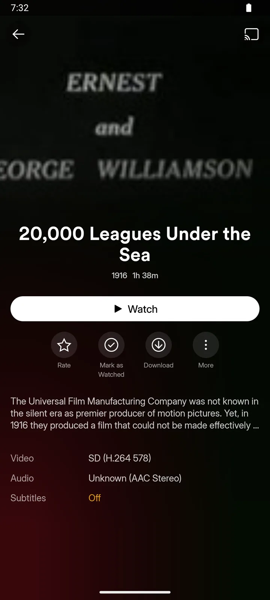

# rex for Android

rex は、Plex アプリ向けのメディアサーバーです。ファイルは一切持ちません。rex for Android を使えば、スマートフォン、タブレット、Android TV、Google TV、Fire TV などで、パソコンなしで動かせます。お使いの機器の Plex アプリは、rex を他の Plex サーバーと同じように見つけて、そこから再生します。

再生する内容は **addons** から来ます。最初から入っているのは Internet Archive のパブリックドメイン映画です。Stremio のアドオンや YouTube、Spotify などのアドオンは、リポジトリを追加すれば、アプリ内からインストールできます。

rex for Android は無料です。debrid アカウントや Usenet も使いたいですか？ それなら zurg+rex がおすすめです。zurg を内蔵した Plex サーバーをスマートフォンで動かせて、スポンサー特典が付いています: [zurg+rex for Android](../zurg/guides/android.md)

## 始める前に {#before-you-start}

| 必要なもの | 理由 |
|---|---|
| Android 8.0 以降のデバイス | スマホ、タブレット、Android TV、Google TV、Fire TV など。Vega OS を使う Fire TV Stick 4K Select などの Fire TV では Android アプリは動きません |
| Plex アカウント | rex は、そのアカウントでサインインした Plex アプリに表示されます。無料アカウントで十分です |
| 視聴に使うデバイスの Plex アプリ | Plex for Android、Android TV、iPhone、スマートテレビ、Plex Web、Plexamp |

## ステップ 1. アプリを入手する {#step-1-get-the-app}

選べる方法は1つです。それぞれ独自の方法で rex を最新の状態に保ちます。

| 方法 | 向いている用途 |
|---|---|
| Google Play | スマートフォン、タブレット、Android TV、Google TV。近日公開 |
| Amazon Appstore | Fire TV と Fire タブレット。近日公開 |
| [Obtainium](#with-obtainium) | スマートフォンとタブレット。アップデートが出ると知らせてくれます |
| [Downloader](#with-downloader-on-fire-tv) | Fire TV とテレビボックス |
| [GitHub のファイルを使う](#the-file-from-github) | どのデバイスでも。アップデートは自分でインストールします |

**方法は混ぜて使えません。** Google Play、Amazon Appstore、GitHub のファイル（Obtainium と Downloader もこれをインストールします）は署名の仕組みが異なるため、ある方法でインストールしたものを別の方法で更新することはできません。方法を切り替えるには、rex をアンインストールし、手順 2 と 3 をやり直してから、アドオンをもう一度インストールしてください。

**最初から入っているアドオンが異なります。** GitHub のファイルでは、[rex-addons](https://github.com/debridmediamanager/rex-addons) リポジトリが最初から追加されています。ストア版では Internet Archive アドオンだけが最初から入っています。rex-addons も使いたい場合は、自分で追加してください（[アドオン](#addons)を参照）。

### Obtainium を使う {#with-obtainium}

[Obtainium](https://obtainium.imranr.dev/)は、GitHubからアプリをインストールし、常に最新の状態に保ってくれます。

1. Obtainiumをインストールして、一度開いてください。
2. 同じデバイスで、[rex.debridmediamanager.com/obtainium](https://rex.debridmediamanager.com/ja/obtainium)を開きます。Obtainiumが開き、**Import app**を確認してきます。**Continue**を押してください。
3. **rex**を押してから、**Install**を押します。Obtainiumがお使いのデバイスのプロセッサに合ったファイルを選びます。
4. 初回は、Androidが Obtainium 用の**Install unknown apps**を開きます。**Allow from this source**をオンにして、戻ってください。
5. **Install**を押します。Play Protectに**App scan recommended**と表示されたら、**Scan app**を押してから、**Install**を押してください。

新しいバージョンが出ると、rexの横にObtainiumが**Update**を表示します。

### Fire TV の Downloader を使う {#with-downloader-on-fire-tv}

1. Fire TV で、Appstore から AFTVnews の **Downloader** をインストールします。
2. 開いて、アドレスボックスを選択し、`rex.debridmediamanager.com/tv` と入力します。**Next** を押します。`rex-android-armeabi-v7a.apk` がダウンロードされます。
3. **Install** を押します。初回は、代わりに Fire TV の **Developer options** が開きます。**Install unknown apps** を選択し、**Downloader** を選んで **ON** と表示されるようにします。Back を 2 回押して、もう一度 **Install** を押します。
4. **Install** を押してから **Open** を押します。

更新するときは、手順 2 から 4 をもう一度行ってください。短い Downloader コードが近日公開されます。

### GitHub のファイルを使う {#the-file-from-github}

デバイスで、お使いのプロセッサー向けのファイルをダウンロードしてください。各リンクは常に最新バージョンを指します。

| お使いのデバイス | ダウンロード |
|---|---|
| ほとんどのスマホ、タブレット、TVボックス（64ビット） | [rex-android-arm64-v8a.apk](https://github.com/debridmediamanager/rex-android/releases/latest/download/rex-android-arm64-v8a.apk) |
| Fire TV、および古い、または安価な32ビットのボックス | [rex-android-armeabi-v7a.apk](https://github.com/debridmediamanager/rex-android/releases/latest/download/rex-android-armeabi-v7a.apk) |
| PC上のエミュレーター | [rex-android-x86_64.apk](https://github.com/debridmediamanager/rex-android/releases/latest/download/rex-android-x86_64.apk) |

すべてのバージョンとその変更内容は[リリースページ](https://github.com/debridmediamanager/rex-android/releases)にあります。どれか分からない場合は、まず `arm64-v8a` を試してください。1つのファイルでスマホもTVも動作します。

ダウンロードしたファイルを開いてください。Androidから**このソースからの不明なアプリのインストールは許可されていません**と表示されます。**Settings**を押し、**Allow from this source**をオンにして、戻ってから**Install**を押してください。

更新するには、新しいファイルを古いものの上からインストールしてください。rexは自動的に再起動し、サインインとアドオンはそのまま残ります。

**表示されれば成功です。** アプリの一覧に**rex**が表示されます。

## ステップ 2. rex を起動する {#step-2-start-rex}

**rex** を開きます。最初の画面には **Welcome to rex.** と表示されます。

1. **Allow notifications** を押し、次に **Allow** を押します。rex は通知を表示しながらバックグラウンドで動きます。その通知から停止できます。
2. **Let rex keep running in the background** を押します。開いたリストで **rex** を選び、**Don't optimize** を選びます。新しい Android では **Allow background usage** を押してから **Unrestricted** を選びます。rex に戻ると、両方のボタンの先頭に ✓ が付いています。
3. **Name** は Plex アプリでこのサーバーを表示する名前です。必要なら変更してください。
4. **Port** は `32400` のままにします。同じ端末で別の Plex サーバーがすでに動いている場合、rex は **Another app here already uses this port, maybe a Plex server. Try 32500.** と表示します。その場合は `32500` と入力します。
5. **Start rex** を押します。

**表示されるはずの画面。** **2 / 2** と **Sign in to Plex.** が表示されます。

| 最初の画面 | Plex アプリでの映画のページ（手順 4） |
|---|---|
|  |  |

## ステップ 3. Plex にサインインする {#step-3-sign-in-to-plex}

**Sign in to Plex** を押します。rex にコードが表示されます。**On any phone or computer, go to plex.tv/link and enter** it.

- **On a phone or tablet** ブラウザーでも Plex のページが開きます。そこには **rex for Android would like to sign in to your Plex account** と表示されるので、そこでサインインしてください。
- **On a TV** スマートフォンかパソコンで [plex.tv/link](https://plex.tv/link) を開き、サインインしてコードを入力してください。

Plex アプリにサインインしているのと同じアカウントを使ってください。**Skip for now** を押せば、あとで **Status** からサインインすることもできます。

**表示されるはずの内容。** **Signed in. rex shows up in the Plex apps as** のあとにサーバー名が表示されます。**Done** を押してください。**Status** には **RUNNING** と **Ready for the Plex apps.** が表示されます。

## ステップ 4. Plex アプリで視聴する {#step-4-watch-in-a-plex-app}

Plexの同じアカウントでサインインしているアプリを開きます。Plexがこのデバイスにある場合、**Status**に**Open Plex**ボタンがあります。

Plex for Androidでは、**Libraries**、**All Libraries**の順に開き、サーバー名の下にある**Movies**を選びます。他のPlexアプリでも、サーバー名の下に表示されます。

Internet Archiveの最初の同期には時間がかかります。テスト用のデバイスでは約30分でした。rexが各映画を確認するためです。**Status**には、完了するまで**Syncing**と表示され、完了すると**Ready · 97 titles**のように件数が表示されます。好きな映画で再生を押してください。

## アドオン {#addons}

**Addons** には、インストール済みのアドオンが一覧で表示されます。各アドオンには、そのタイトル数と最後に同期した日時が表示されます。ボタンは **Sync now**、**Settings**、**Log**、**Remove** の4つです。スマートフォンでは、ボタンの並んだ行を横にスワイプすると、すべて表示できます。**Enabled** スイッチを使うと、アドオンを削除せずにオフにできます。

アドオンは **repositories** から入手します。repositories とは、アドオンを収めた git リポジトリのことです。Internet Archive アドオンは最初からインストールされています。その他を使うには、[rex-community-addons](https://github.com/debridmediamanager/rex-community-addons) を追加してください（下の **Add a repository** を参照）。このリポジトリでは、次のアドオンが使えます。

| アドオン | 提供される内容 |
|---|---|
| Stremio addons | Stremio アドオンの映画とシリーズのカタログ。ストリームアドオンが提供するストリームで再生します |
| YouTube | YouTube のプレイリスト。コードを使ってサインインします |
| Spotify | Spotify ライブラリを Plex と Plexamp で聴ける音楽として提供します。YouTube アドオンにサインインしておく必要があります |

**インストールする。** **Repositories** で、リポジトリの横にある **Addons** を押し、次にアドオンの下にある **Install** を押します。rex は、そのアドオンがアクセスできるウェブサイトを表示し、もう一度確認してから同期を始めます。

**サインインする。** アカウントが必要なアドオンには **Sign in to start.** と表示されます。その **Sign in** ボタンを押し、表示されたページをどの端末でも開いて、表示されたコードを入力してください。

**リポジトリを追加する。** **Add a repository** の下に、リポジトリのリンクを入力します（`github.com/user/repo` だけで大丈夫です）。そして **Add** を押します。信頼できる人が作ったものだけをインストールしてください。自分でアドオンを作りたい場合は [rex-addons](https://github.com/debridmediamanager/rex-addons) を参照してください。

## 自宅の他のデバイスで視聴する {#watch-on-other-devices-at-home}

Plex に同じアカウントでサインインしているアプリはすべて、ホームネットワーク上で rex を名前で見つけられます。テレビ、別のスマートフォン、パソコンの Plex Web などです。**Status** には、ホームでの rex のアドレスが `http://192.168.1.20:32400` のように表示されます。

ご家族が自分の Plex アカウントで一緒に見られるようにしたい場合は、[家族や友達と rex を共有する](sharing.md) をご覧ください。

## 実行し続ける {#keep-it-running}

- rex は端末の電源が入っている間ずっと動きます。通知の **Stop** で停止できます。**Status** には **Start**、**Stop**、**Restart** があります。
- **Settings** で **Start when this device turns on** をオンにしてください。オンにしていない場合は、再起動後に rex を開いて **Start** を押す必要があります。
- 端末によっては、バックグラウンドのアプリを止めてしまうことがあります。必要な設定は [Don't kill my app](https://dontkillmyapp.com/) で確認できます。
- サーバーの名前を変えたいときは、Plex アプリで **Settings**、**General** を開き、**Friendly name** を変更してください。

## 制限 {#limits}

- **自宅では再生できます。** 自宅の外からPlexアプリを使うには、デバイスに届くHTTPSアドレスが必要です。そのためには、ルーターでデバイスへのポート転送を設定する必要があります。[自宅の外で使う](any-source.md#use-it-outside-your-home-optional)を参照してください。
- **デバイス自体がサーバーになります。** 電源を入れたままにし、Wi-FiまたはEthernetで接続し、電源につないでおいてください。再生できないファイルを再生できる形式に変換する処理はデバイスのハードウェアを使うため、安価な機器では遅くなることがあります。
- **アドオンが提供するものだけ。** デバイス自体にはファイルのライブラリがありません。

## トラブルシューティング {#troubleshooting}

| 表示される内容 | やること |
|---|---|
| **App not installed as app isn't compatible with your phone.** | プロセッサに合わないファイルを選んでしまっています。表にある別のファイルを [GitHub のファイル](#the-file-from-github) から選び直してください |
| **Another app here already uses this port, maybe a Plex server. Try 32500.** | ポートとして `32500` と入力してください |
| **Use a number from 1024 to 65535** | ポートは 1024 から 65535 までの数字にしてください |
| Plex アプリにサーバーが表示されない | Step 3 で使ったのと同じアカウントで Plex アプリにサインインし、両方の端末を同じホームネットワークに接続したままにしてください |
| ライブラリが空っぽ | 最初の同期がまだ実行中です。**Status** に作品数が表示されるまで待ってください |
| アドオンの下に **Sign in needed** と表示される | そのアドオンの **Sign in** ボタンを押して、コードを入力してください |
| アドオンの下に **Needs an update** と表示される | このバージョンのアプリでは、そのアドオンのコピーをもう動かせません。リポジトリを更新してから **Update** を押してください。その間も作品は残ります |
| **That isn't a repository link. Try github.com/user/repo.** | `github.com/user/repo` のように、リポジトリのリンクを入力してください |
| **no public git repository there (it asks for a login)** | リンクが間違っているか、リポジトリが非公開です。ブラウザで確認してください |
| 画面を消すと rex が止まる | Step 2 のバックグラウンド設定をやり直してください。あわせて [Don't kill my app](https://dontkillmyapp.com/) も確認してください |

**Logs** には、rex とアドオンが最近出力した内容が表示されます。キーやパスワードは隠されています。サポートからログを求められたら、**Send logs to support** を押してください。送信前に中身をすべて確認できます。そのあと **Send** を押し、表示されたコードを投稿してください。

アプリが送信する内容と送信先は、[プライバシーポリシー](android-privacy.md) に書かれています。

困ったときは、[Discord](https://discord.com/invite/7u4YjMThXP) の **rex-support** フォーラムで聞いてください。
