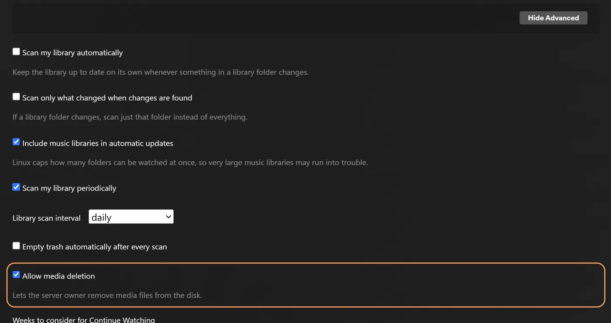

# rex で自作アプリを使う {#rex-with-your-own-app}

[rex](https://rex.debridmediamanager.com/ja/) は、公式の Plex アプリ向けのメディアサーバーで、ファイルを一切持ちません。公式の Plex アプリからは、普通の Plex サーバーとして見えます。このページで **your app** と呼んでいるもう一つのプログラムが、あなたのライブラリに何があるかを rex に伝え、ファイルを配信します。再生を押すと、rex はファイルをあなたのアプリから直接ストリーミングします。先にダウンロードすることはありません。

このページでは、何もない状態から映画を再生するまでを、一歩ずつ説明します。特定のアプリを前提にはしていません。rex がアプリに何を期待しているかを正確に示すので、お使いのアプリがそれに対応しているか確認したり、自分で作ったりできます。各ステップでは、何をするのか、なぜ重要なのか、次に進む前に何が表示されるはずかを説明します。

始める前に知っておいてほしいことが 4 つあります。

- **ファイルを配信するのはあなたのアプリです。** rex は、ブラウザがファイルをダウンロードするのと同じように、HTTP または HTTPS で、すべてのデータをあなたのアプリから取得します。rex はファイルを保存せず、メディア用のディスクやマウントも必要ありません。
- **あなたのアプリが、何を持っているかを rex に伝えます。** rex の feed API を使って、ファイルの一覧と、その後のすべての変更を rex に送ります。rex がフォルダを一覧表示したり、スキャンしたりすることはありません。
- **ファイルが何であるかを決めるのはあなたのアプリです。** そのファイルが映画かエピソードか、どのタイトルに属するか（IMDb と TMDB の ID で）、エピソードの場合はシーズンと話数を指定します。rex がファイル名から推測することはありません。
- **Plex が情報を提供します。** rex を Plex アカウントに接続すると、各タイトルについて、その ID に対して Plex 自身のメタデータが持つ名前、ポスター、あらすじ、エピソード名を表示します。どの Plex エージェントも知らないものは、あなたのアプリが自分で名前を付けます。詳しくは [Building rex addons](addons.md) を参照してください。

rex は個人利用であれば無料です（PolyForm Noncommercial）。スポンサー向けの階層や、ダウンロードにアカウントは必要ありません。詳しくは [rex.debridmediamanager.com](https://rex.debridmediamanager.com/ja/) をご覧ください。スマートフォンや TV ボックスしか持っていませんか？ [rex for Android](android.md) では、その端末上で rex とそのアドオンを動かせます。スポンサー向けには、スマートフォン上で Plex サーバーを動かす [zurg+rex](../zurg/guides/android.md) もあり、debrid と Usenet のライブラリを rex に接続できます。

## 始める前に {#before-you-start}

| 必要なもの | 理由 |
|---|---|
| rex の nightly 2026.10.25 以降のビルド | ステップ 1 で最新版をダウンロードします |
| 常時起動しているマシン: Linux (Ubuntu 22.04 以降)、macOS、または Windows (64 bit) | rex はサーバーです。Plex のアプリは再生ボタンを押すたびに rex に接続します。コマンドが OS によって違う場合、ステップごとに OS 別のタブがあります。[Docker](#run-rex-in-docker) は Linux 向けに後ろで説明しています |
| メモリ 1 GB | 4,062 本の映画と 656 本のシリーズ (34,678 エピソード) の場合、rex は起動中に 500 MB 未満、ライブラリを閲覧中に約 730 MB を使いました。動画の変換にはさらに多くのメモリと、より多くのコア、またはグラフィックチップが必要です |
| [What your app must do](#what-your-app-must-do) に記載の動作をするアプリ | ライブラリはここから取得されます |
| このマシン、自宅のネットワーク、または Tailscale からアプリがフィードを送信すること | rex はそこからのフィードだけを受け付けます ([Keep the port private](#keep-the-port-private))。シードボックスやクラウドサーバー上のアプリは、そのサーバーが tailnet に参加していない限り rex にプッシュできません。ファイル自体は rex が到達できる場所であればどこからでも配信できます |
| このマシンのディスク上のファイル? それらを HTTP で配信してプッシュするもの | rex はディスクを直接読み込みません。[ステップ 2](#step-2-see-it-work-by-hand) では 1 つのファイルを手動で試せます。それ以外は、それらのファイルには Plex を使い続けてください |
| Usenet? それを読み取るソース (zurg など) | rex は Usenet プロバイダーとは直接通信しません。Usenet を扱うソースとして zurg があります。詳しくは [rex with zurg](with-zurg.md) を参照してください |
| rex 専用に作った新しい Plex アカウント | [Plex アカウントに追加](#step-3-add-it-to-a-plex-account) された後、rex はすべてのタイトル、ポスター、概要、エピソード名を Plex から取得します。それまでは、タイトルはファイル名のままで、ポスターはありません |

## アプリに必要なこと {#what-your-app-must-do}

このリストをアプリの開発者に渡してください。rex 自身の API リファレンスは [docs/feed-api.md](https://github.com/debridmediamanager/rex/blob/main/docs/feed-api.md) にあります。

| アプリがやるべきこと | 方法 | できない場合 |
|---|---|---|
| 各ファイルを HTTP で配信する | `GET <address>/<path>` でファイルを返します。`Range` リクエストならシークが速くなります。リダイレクトも追従されます。Basic 認証または bearer トークンも使えます | 何も再生されません: rex のログに 502 が出ます |
| rex に登録する | `PUT /rex/sources/<name>` を (英字、数字、`-`、`_` 使用可) `{"url": ...}` 付きで送ります。ログインが必要なら `"user"` と `"password"` または `"bearer"` を入れます。ただし url の中には絶対に入れないでください。起動するたびに毎回送り直してください | rex が読み込み先を見つけられません |
| 持っているファイルをすべて送る | `POST /rex/feed/<name>/items` で、1 リクエストあたり数百ファイルずつ送ります | rex が空のままになります |
| 各ファイルの ffprobe の出力を送る | ffprobe の `-show_format -show_streams` の JSON を丸ごと、`media_info` として送ります | ファイルは**保留**になります: 保存はされますが表示されません。Plex アプリはこれがないファイルの再生を拒否するためです |
| 各ファイルの種類を伝える | `kind`（`movie`、`episode`、`extra` のいずれか）と `ids` を入れます。`ids` には映画の `imdb` または `tmdb`、もしくは**番組**の `imdb` または `tmdb` を入れます（どちらか一方で十分です）。エピソードのものは入れないでください。エピソードの場合は、アイテム自体に `season` と `episode` を入れます（`kind` と同じ階層で、`ids` の中には入れません）。番号は TMDB の付け方に合わせてください。1 つのファイルに複数話が入っている場合は `episode_end` を使います | ファイルが一致しなくなります: 映画はファイル名のままのタイトルになり、エピソードはリリース名の番組に入り、ファイルの並び順で番号が振られます |
| ファイルの `id` を永遠に同じに保つ | ファイル名を変えたときも同じです | 名前を変えたファイルは新しいタイトルとして扱われ、視聴履歴が失われます |
| 変更があったらすぐ送る | 新規または変更されたファイルには同じ `POST` を使い、削除されたファイルには `DELETE /rex/feed/<name>/items` を使います | ライブラリが古い状態のままになります |
| ときどきライブラリ全体を送る | `PUT /rex/feed/<name>/snapshot` を使います。スナップショットに含まれていないものは rex が削除します | アプリが見失ったファイルが rex に残ったままになります |
| ファイルへの WebDAV `DELETE` を受け付ける | Plex アプリでタイトルが削除されると、rex はまずアプリにファイルの削除を依頼します | タイトルが残り、Plex アプリには削除できなかったと表示されます |

## ステップ 1. rex をインストール {#step-1-install-rex}

**何をするか。** rex を `~/rex`（Windows では `$HOME\rex`）にダウンロードして、サービスとして起動します。後の手順に必要なものはすべて揃います。この後の手順では再起動は不要です。再起動が必要なのは、下のオプションのセクションだけです。

**なぜ大切か。** rex は Plex アプリが通信する相手です。最初に起動すると `rex.db` が作られます。このファイルには、ライブラリ、アプリから送られてくるすべてのデータ、視聴履歴が入ります。

Linux では、代わりに rex の Docker イメージを使うこともできます。[Docker で rex を動かす](#run-rex-in-docker) を見てください。

+++ Linux と macOS
```bash
mkdir -p ~/rex && cd ~/rex
TAG=$(curl -fsSL 'https://api.github.com/repos/debridmediamanager/rex/releases?per_page=1' | sed -n 's/.*"tag_name": *"\([^"]*\)".*/\1/p' | head -1)
P=$(uname -s | tr A-Z a-z)-$(uname -m | sed 's/x86_64/amd64/;s/aarch64/arm64/')
curl -fL "https://github.com/debridmediamanager/rex/releases/download/$TAG/rex-$TAG-$P.tar.gz" | tar xz --strip-components=1
```
+++ Windows
PowerShell で次を実行します:

```powershell
New-Item -ItemType Directory -Force $HOME\rex | Out-Null; cd $HOME\rex
$tag = (Invoke-RestMethod 'https://api.github.com/repos/debridmediamanager/rex/releases?per_page=1')[0].tag_name
curl.exe -fLO "https://github.com/debridmediamanager/rex/releases/download/$tag/rex-$tag-windows-amd64.zip"
tar -xf "rex-$tag-windows-amd64.zip" --strip-components=1; Remove-Item "rex-$tag-windows-amd64.zip"
```
+++

これで、お使いのマシン向けの rex の最新ビルド（通常はナイトリービルド）が取得されます。

rex の LAN IP、つまりご自宅ネットワーク上のアドレスを調べます。Linux では `hostname -I` がいくつか表示します。ご自宅ネットワーク用のものを選んでください。`172.17.`（Docker）や `100.`（Tailscale）で始まるものは選ばないでください。macOS では `ipconfig getifaddr en0` で表示されます（何も表示されなければ `en1`）。Windows では `ipconfig` の出力に、Wi-Fi または Ethernet のアダプターの下で **IPv4 Address** として表示されます。**このページでは、すべての箇所で `192.168.1.20` と書いています。ご自身のアドレスに置き換えてください。** Plex アプリ、お使いのアプリ、そして手元のコマンドは、すべてそのアドレスで rex に接続します。

**同じマシンで Plex Media Server も動かしていますか？** 下の rex の起動コマンドの末尾に `--port 32500` を付け、コマンドや設定で `32400` と書いてある箇所はすべて `32500` にしてください。Windows のファイアウォールルールも同様です。Plex はすでにポート 32400 と、アプリがサーバーを探すのに使うポートを確保しています。別のポートなら、rex はそれらを Plex に任せます。その後、アプリにはマシン名の付いたサーバーが2つ表示されます。共有されているのが rex で、その横に新しいアカウントの名前が表示されます。rex が Plex アカウントに登録されたら（[手順 3](#step-3-add-it-to-a-plex-account)）、名前を変更できます。そのアカウントで Plex にサインインした状態で、rex の **Settings** → **General** を開き、**Friendly name** を変更して保存してください。その後、下の方法で rex を再起動します。再起動後、Plex アプリには新しい名前で表示されます。

では、サービスとして登録します:

+++ Linux
`~/.config/systemd/user/rex.service` を作成します:

```bash
mkdir -p ~/.config/systemd/user
nano ~/.config/systemd/user/rex.service
```

```ini
[Unit]
Description=rex
After=network-online.target

[Service]
WorkingDirectory=%h/rex
EnvironmentFile=-%h/rex/rex.env
ExecStart=%h/rex/rex
Restart=always
RestartSec=5

[Install]
WantedBy=default.target
```

```bash
systemctl --user daemon-reload
systemctl --user enable --now rex
sudo loginctl enable-linger "$USER"
journalctl --user -u rex -f
```

rex の**起動コマンド**は `ExecStart` の行です。キーは `~/rex/rex.env` に、1行に1つ `NAME=value` の形式で書きます。変更後は `systemctl --user daemon-reload && systemctl --user restart rex` で rex を再起動します。`journalctl --user -u rex -f` でログを表示できます。`loginctl enable-linger` を実行すると、ログアウトしても rex が動き続けます。
+++ macOS
`run.sh` は rex をそのフォルダー内で起動します。LaunchAgent がログイン時に `run.sh` を起動します:

```bash
cp ~/rex/examples/run.sh.example ~/rex/run.sh
mkdir -p ~/Library/LaunchAgents
cat > ~/Library/LaunchAgents/com.rex.plist <<PLIST
<?xml version="1.0" encoding="UTF-8"?>
<!DOCTYPE plist PUBLIC "-//Apple//DTD PLIST 1.0//EN" "http://www.apple.com/DTDs/PropertyList-1.0.dtd">
<plist version="1.0"><dict>
  <key>Label</key><string>com.rex</string>
  <key>ProgramArguments</key><array><string>/bin/bash</string><string>$HOME/rex/run.sh</string></array>
  <key>RunAtLoad</key><true/><key>KeepAlive</key><true/>
  <key>StandardOutPath</key><string>$HOME/rex/rex.log</string>
  <key>StandardErrorPath</key><string>$HOME/rex/rex.log</string>
</dict></plist>
PLIST
launchctl load ~/Library/LaunchAgents/com.rex.plist
tail -F ~/rex/rex.log
```

rex の**起動コマンド**は `~/rex/run.sh` の最終行です。キーは `~/rex/rex.env` に、1行に1つ `NAME=value` の形式で書きます。変更後は `launchctl kickstart -k gui/$(id -u)/com.rex` で rex を再起動します。`tail -f ~/rex/rex.log` でログを表示できます。

rex は Mac にログインしている間は動作します。自動的に再起動する Mac の場合は、自動ログインをオンにしてください（**System Settings**、**Users & Groups**）。macOS のファイアウォールが有効なら、macOS から確認されたときに rex を許可するか、ファイアウォールの **Options** に `~/rex/rex` を追加してください。
+++ Windows
PowerShell を**管理者として**開き、`cd $HOME\rex` で rex のフォルダーに移動します。まず `run.cmd` を作ります。これは rex をそのフォルダー内で起動し、ログを `rex.log` に書き出します。メモ帳がファイルの作成を提案してきます:

```powershell
notepad run.cmd
```

```bat
@echo off
cd /d "%~dp0"
rex.exe 2>> rex.log
```

保存してください。次に、rex のポートと 2 つの検出用ポートへの通信を Windows Firewall で許可し、今すぐ、そして今後ログインするたびに rex を起動するようにします:

```powershell
New-NetFirewallRule -DisplayName rex -Protocol TCP -LocalPort 32400
New-NetFirewallRule -DisplayName "rex discovery" -Protocol UDP -LocalPort 32410,32414
$settings = New-ScheduledTaskSettingsSet -ExecutionTimeLimit 0 -AllowStartIfOnBatteries -DontStopIfGoingOnBatteries
Register-ScheduledTask rex -Action (New-ScheduledTaskAction -Execute "$HOME\rex\run.cmd") -Trigger (New-ScheduledTaskTrigger -AtLogOn -User $env:USERNAME) -Settings $settings
Start-ScheduledTask rex; Start-Sleep 3
Get-Content rex.log -Wait
```

rex の**起動コマンド**は `run.cmd` の `rex.exe` の行です。キーはその上に、1行に1つ `set NAME=value` の形式で書きます。変更後は `Stop-Process -Name rex; Start-Sleep 1; Start-ScheduledTask rex` で rex を再起動します。`Get-Content $HOME\rex\rex.log -Wait` でログを表示できます。

PowerShell で手動で rex を起動しましたか？ その場合、ログはそのウィンドウにだけ表示され、`rex.log` は作られません。また、再起動後に自動で起動するタスクもありません。rex はデータベースと登録情報を、起動したフォルダーに保存します。そのため、別のフォルダーから起動した rex は、新しい未登録のサーバーになってしまいます。Ctrl+C で停止し、同じフラグを付けて rex のフォルダーから再度起動してください。できれば、上のタスクを設定するのがおすすめです。

rex は Windows にログインしている間、専用のウィンドウで動作します。ウィンドウは開いたままにしてください。PowerShell では、このページで `curl` と書かれている箇所にはすべて `curl.exe` と入力してください。Windows PowerShell 標準の `curl` は別のコマンドです。
+++

**表示されるはずの内容。** 最初の行の中に次が出ます:

```
INFO    seeded rex.db: an empty library named yourhost, machine=...
INFO    no source yet: a source registers itself once pointed at this server (PUT /rex/sources/{name}, docs/feed-api.md)
INFO    claim state: unclaimed
INFO    rex on http://192.168.1.20:32400  machine=...  items=0  parts=proxy
```

rex は自分の名前をマシン名から取ります。Plex アプリにはその名前が表示されます。`no source yet` で正常です。まだアプリが登録されていないためです。ログは開いたままにしてください。

## ステップ 2. 手動で動作を確認 {#step-2-see-it-work-by-hand}

**何をするか。** 使い捨てのファイルサーバーと2つの `curl` コマンドを使い、1本の映画に対してあなたのアプリの役割を果たします。

**なぜ重要か。** アプリを関わらせる前に、このマシンでrexが動いているかを確かめられます。この手順がうまくいってアプリがうまくいかない場合、問題はアプリ側にあります。アプリがすでに設定済みなら、この手順は飛ばして構いません。

`ffprobe`、小さなWebサーバー、そして動画ファイル1つが必要です。ファイルのあるフォルダを `test` という名前でrexに登録し、そのファイルがSintel（IMDb `tt1727587`、TMDB `45745`）の映画であることを、ffprobeの出力とあわせてrexに送ります。

+++ Linux と macOS
`ffprobe` と `jq` をインストールします（Linuxでは `sudo apt install -y ffmpeg jq`、macOSでは `brew install ffmpeg jq`）。小さなWebサーバーで配信できる場所にファイルを置きます。

```bash
mkdir -p ~/rex-test/movies/Sintel.2010
cp /path/to/any-video.mkv ~/rex-test/movies/Sintel.2010/Sintel.2010.mkv
cd ~/rex-test
python3 -m http.server 8099 --bind 127.0.0.1 &
```

rexに登録します。

```bash
curl -s -X PUT http://192.168.1.20:32400/rex/sources/test \
  -H 'Content-Type: application/json' -d '{"url": "http://127.0.0.1:8099"}'
```

rexにファイルを送ります。

```bash
P=movies/Sintel.2010/Sintel.2010.mkv
jq -n --arg p "$P" \
  --argjson probe "$(ffprobe -v quiet -print_format json -show_format -show_streams "$P")" \
  '{items: [{id: $p, path: $p, kind: "movie", ids: {imdb: "tt1727587", tmdb: 45745}, media_info: $probe}]}' \
| curl -s -X POST http://192.168.1.20:32400/rex/feed/test/items \
    -H 'Content-Type: application/json' --data-binary @-
```
+++ Windows
`winget install Gyan.FFmpeg` と `winget install Python.Python.3.13` で `ffprobe` とPythonをインストールしてから、新しいPowerShellウィンドウを開きます。小さなWebサーバーで配信できる場所にファイルを置きます。

```powershell
New-Item -ItemType Directory -Force $HOME\rex-test\movies\Sintel.2010 | Out-Null
Copy-Item C:\path\to\any-video.mkv $HOME\rex-test\movies\Sintel.2010\Sintel.2010.mkv
cd $HOME\rex-test
$server = Start-Process py '-m http.server 8099 --bind 127.0.0.1' -WindowStyle Hidden -PassThru
```

rexに登録します。

```powershell
Invoke-RestMethod -Method Put http://192.168.1.20:32400/rex/sources/test -ContentType application/json -Body '{"url": "http://127.0.0.1:8099"}'
```

rexにファイルを送ります。

```powershell
$p = 'movies/Sintel.2010/Sintel.2010.mkv'
$probe = ffprobe -v quiet -print_format json -show_format -show_streams $p | Out-String | ConvertFrom-Json
$item = @{ id = $p; path = $p; kind = 'movie'; ids = @{ imdb = 'tt1727587'; tmdb = 45745 }; media_info = $probe }
Invoke-RestMethod -Method Post http://192.168.1.20:32400/rex/feed/test/items -ContentType application/json -Body (ConvertTo-Json @{ items = @($item) } -Depth 20)
```

PowerShellでは、rexの応答がJSONではなくリストとして表示されます。
+++

**表示されるはずの結果。** 応答は `{"created":1,"updated":0,"held":0,"unchanged":0}` になり、rexのログには次が表示されます。

```
INFO    FEED identified "Sintel.2010" -> movie tmdb:45745 (placed)
INFO    FEED test upsert: 1 created, 0 updated, 0 held, 0 unchanged, 0 rejected
```

Sintelが**Movies**に追加され、小さなWebサーバーから再生できるようになります。[ステップ3](#step-3-add-it-to-a-plex-account)より前にPlexアプリからrexを開くことはできないので、この手順ではフィードの確認だけを行います。

**後片付け。** 先へ進む前に、テスト用のソースを削除してください。ソースを削除すると、そこから送ったものはすべて消えます。最初のリクエストは `confirm` パスで応答するので、5分以内にそのパスへ `DELETE` を送ってください。

+++ Linux と macOS
```bash
curl -s -X DELETE http://192.168.1.20:32400/rex/sources/test
curl -s -X DELETE "http://192.168.1.20:32400/rex/sources/test/confirm/<code from the answer>"
kill %1
```
+++ Windows
```powershell
Invoke-RestMethod -Method Delete http://192.168.1.20:32400/rex/sources/test
Invoke-RestMethod -Method Delete "http://192.168.1.20:32400/rex/sources/test/confirm/<code from the answer>"
Stop-Process -InputObject $server
```
+++

**うまくいかない場合。**

- `"held":1`：`media_info` がないか、ストリームがありません。`ffprobe` がそのファイルのJSONを出力しているか確認してください。
- `rejected` を含む応答：ファイルの拡張子から見て動画ではない、サンプルである、`id` または `path` がない、パスの形式が不正である、または別の `id` がすでにそのパスを持っている、のいずれかです。応答とrexのログに、それぞれの理由が書かれています。
- `404 no such source`：先に `PUT /rex/sources/test` が実行されていません。

## ステップ 3. Plex アカウントに追加 {#step-3-add-it-to-a-plex-account}

**何をするか。** 本物の Plex Media Server を登録するのと同じ手順で、rex を Plex アカウントに登録し、自分のアカウントと共有します。

**なぜ重要か。** rex は、すべてのタイトルの名前、ポスター、あらすじ、エピソード名を Plex 自身のメタデータから取得します。Plex にはアカウントに登録されてからしか問い合わせできないことがあります。登録前にアプリが送ったものは、届いた時点で名前が付けられるので、それまで Fix Match には何も表示されません。また、この登録で "unclaimed" の通知も消え、[自宅の外で rex を使う](#use-it-outside-your-home-optional)ためにも必要です。

**このためには、自分のアカウントではなく新しい Plex アカウントを使ってください。** rex は Plex が作ったものではなく、rex を登録したアカウントに対して Plex が措置を取る可能性があります。そこで、視聴履歴、友達、Plex Pass を含む本来のアカウントは守ってください。[plex.tv](https://www.plex.tv) で、ほかで使っていないメールアドレスを使って無料の新しいアカウントを作成し、そのアカウントに rex を登録して、rex を自分のアカウントと共有します。こうすると、友達のサーバーを見るのと同じように、自分のアカウントでサインインして視聴できます。この手順を終えるまで、rex は何も再生しません。

### 新しいアカウントに rex を登録 {#register-rex-on-the-fresh-account}

1. Melde dich bei [plex.tv](https://www.plex.tv) **mit dem frischen Konto** an, öffne [plex.tv/claim](https://www.plex.tv/claim) und kopiere den Code. Er läuft nach etwa fünf Minuten ab.
2. Auf dem rex-Rechner (`curl.exe` unter Windows):

   ```bash
   curl -X POST "http://192.168.1.20:32400/myplex/claim?token=claim-xxxxxxxxxxxx"
   curl -s http://192.168.1.20:32400/identity
   ```

**Was du sehen solltest.** Der zweite Befehl zeigt `claimed="1"`, und in rex's Ordner existiert `claim_state.json`. Sichere diese Datei: Ohne sie muss rex neu beansprucht werden, und rex verweigert einen zweiten Claim, solange die Datei vorhanden ist. Ab jetzt kommen Titel mit Namen und Postern an, ohne Neustart.

**Falls nicht.**

- Der erste Befehl antwortet mit `409` und `rex: already claimed`: rex hängt bereits an einem Plex-Konto.
- Er antwortet mit `500 Internal Server Error`, und rex protokolliert `claim exchange failed`: Der Code ist abgelaufen oder wurde schon benutzt. Hol dir einen neuen unter [plex.tv/claim](https://www.plex.tv/claim).

### 自分のアカウントと共有 {#share-it-with-your-own-account}

1. Du bist noch mit dem frischen Account angemeldet. Öffne [app.plex.tv](https://app.plex.tv), dann **Settings** (der Schraubenschlüssel), **Manage Library Access** und **Grant Library Access**.
2. Gib den Benutzernamen oder die E-Mail-Adresse deines eigenen Accounts ein, wähle den rex-Server und beide Bibliotheken, **Movies** und **TV Shows**, und schick die Einladung ab.
3. Melde dich ab, dann mit **deinem eigenen** Account an und nimm die Einladung an. Sie kommt per E-Mail und in app.plex.tv an.


**Das solltest du sehen.** Wenn du mit deinem eigenen Account angemeldet bist, zeigen die Plex-Apps den rex-Server neben deinen eigenen Servern an, mit beiden Bibliotheken. Dein Wiedergabeverlauf auf rex gehört dir: Er wird getrennt vom frischen Account gespeichert. Teile ihn genauso mit allen anderen in deinem Haushalt.

## ステップ 4. アプリを接続 {#step-4-connect-your-app}

**何をするか。** アプリを rex に接続します。アプリは登録したあと、ライブラリ全体を送り、その後は変更が起きるたびに送信します。

**なぜ大切か。** これが両者をつなぐ唯一の経路です。rex にはアプリ用の設定がありません。アプリが rex を見つけるのであって、その逆ではありません。

アプリに rex のアドレス `http://192.168.1.20:32400` を入力してください。入力方法はアプリによって異なります。

**正しく動いているときの表示。** rex のログには、アプリが登録した名前の下に次の行が出力されます:

```
INFO    SOURCES myapp registered at http://192.168.1.20:8080
INFO    SOURCES PUT /rex/sources/myapp -> 200
INFO    FEED myapp upsert: 0 created, 0 updated, 200 held, 0 unchanged, 0 rejected
INFO    FEED identified "Some.Movie.2019.1080p" -> movie tmdb:12345 (placed)
INFO    FEED myapp upsert: 180 created, 0 updated, 20 held, 0 unchanged, 0 rejected
```

rex は `registered at` の行に書かれたアドレスからすべてのファイルを読み取るため、rex がそのアドレスに到達できる必要があります。rex がこの行を再度出力するのは、アドレスが変わったときだけです。`held` のファイルは ffprobe の出力を待っている状態で、アプリがその出力を送ると表示されます。いつでも rex がアプリから受け取った内容を確認できます (Windows では `| head -c 600` を付けずに `curl.exe` を使います):

```bash
curl -s http://192.168.1.20:32400/rex/sources                # the apps that registered, and their addresses
curl -s http://192.168.1.20:32400/rex/feed/myapp/items | head -c 600   # what is shown
curl -s http://192.168.1.20:32400/rex/feed/myapp/held  | head -c 600   # what waits for ffprobe output
```

**うまくいかないとき。**

- rex のログに何も出ない: アプリが rex に到達できていません。アプリに入力したアドレスと、両マシン間で rex のポートが開いているかを確認してください。
- ファイルは届くが `identified` の行が出ない: アプリが `kind` と `ids` を送っていません (`held` のファイルや、変更のない再送信でも行は出力されません)。送られるまで、そのタイトルは一致しないままです。新しいアカウントでサインインした Plex アプリで **Fix Match** を使えば、手動で修正できます。rex を共有している自分のアカウントは拒否されます。
- タイトルは表示されるが再生できない: rex が `registered at` のアドレスにあるアプリへ到達できていません。[問題が起きたとき](#when-something-is-wrong) の `upstream failed` の項目で確認できます。

## ステップ 5. 何か視聴してみる {#step-5-watch-something}

**何をするか。** Plex アプリで rex を開きます。ほかの Plex サーバーを開くのとまったく同じ方法です。

**なぜ大事か。** これがこの設定全体の目的です。また、最後のつながりも確認できます。つまり、見ている最中に rex がアプリからファイルを読み込めているかどうかです。

Plex アプリを、スマホ、テレビ、パソコンのどれかで開いてください。ただし **同じホームネットワーク** につながっている必要があります。マシン名の下に rex が表示され、**Movies** と **TV Shows** が並んでいます。映画を選んで再生を押しましょう。


自宅ならほかに必要なものはありません。Plex アプリは Plex 独自のローカル検出機能で rex を見つけ、ネットワーク経由で接続します。そのためには、デバイスが rex と同じネットワーク上にある必要があります（ゲスト Wi-Fi や別の VLAN では不可です）。検出には UDP ポート 32410 と 32414 を使うので、rex のマシンのファイアウォールでこれらを通す必要があります（Windows では、手順 1 のファイアウォールルールで設定されます）。rex がポート 32400 を使っている場合、rex は検出に応答します。Plex と同じマシンで動いているため rex を 32500 に変えた場合は、検出は Plex 側が担当します。その場合、アプリは [共有先のアカウント](#share-it-with-your-own-account) を通じて rex を見つけます。Web ブラウザで app.plex.tv を開いても、自宅では使えます。rex に名前を付けた後は、[rex-direct](#rex-direct) が rex に与える HTTPS アドレスで使えます（rex nightly 2026.11.02 以降）。初回は、Chrome から app.plex.tv がローカルネットワーク上のデバイスにアクセスすることを許可するか聞かれるので、許可してください。`http://192.168.1.20:32400/web` は Plex Web ではありません。rex には独自の Web アプリがなく、そのページは rex が要求済みかどうかと、どこで見ればよいかを示すだけです。

**見えるはずのもの。** どの Plex サーバーとも同じように、ポスター、タイトル、公開年が表示されます。再生は数秒以内に始まります。

見かけることがある表示は次の 2 つです。

- **"yourhost server is unclaimed and not secure"**。Plex アプリは、Plex アカウントに紐付いていないサーバーに対してこの表示を出します。紐付けるまで、rex は何も再生しません。[手順 3](#step-3-add-it-to-a-plex-account) を実行してください。
- **"This server is not powerful enough to convert video"**。すべてのデバイスですべてのタイトルが失敗する場合は、再生を押した直後の rex のログを確認してください。そこに `upstream failed` や `502` があれば、rex がアプリに到達できていません。この場合、FFmpeg では直りません。[When something is wrong](#when-something-is-wrong) の `upstream failed` の行に対処法が書かれています。一部のファイルだけが失敗する場合（特に Web ブラウザで多い場合）は、デバイスがそのままでは再生できないファイルです。AC3 や DTS の音声であることが多いです。テレビやスマホの Plex アプリは、ほとんどのファイルをそのまま再生できます。どの環境でもすべて再生したい場合は、[Converting video](#converting-video-optional) を設定してください。

**削除はアプリ側で行われます。** 新しく作ったアカウントでサインインした状態で、Plex アプリのタイトルで **Delete** を押すと、rex は [What your app must do](#what-your-app-must-do) に書かれているとおり、アプリにそのファイルの削除を依頼します。rex を共有しているほかのアカウントでは削除できません。削除を無効にするには、新しいアカウントで app.plex.tv を開き、**Settings**、rex サーバーの **Library**、**Show Advanced** の順に進みます。**Allow media deletion** のチェックを外して保存してください。



アプリがファイルを削除すると、Plex と同じようにライブラリのゴミ箱に移動します。ファイルは利用不可の状態で残り、視聴履歴も保持されます。アプリが再度送ってくると、元どおりに戻ります。ライブラリの **Empty Trash** を押すと完全に消えます。**Empty trash automatically after every scan**（Settings、Library にあり、初期値はオフ）をオンにすると、これも自動で行われます。

各ファイルは、アプリが送ってきた `kind` によって **Movies** か **TV Shows** に振り分けられます。`kind` がないファイルは、最初のフォルダで判断します。`shows` なら TV Shows、それ以外は Movies になります。

フォルダごとに独自のライブラリを作るには、アプリが登録時に `directories` を追加します。これはファイルパスの最初のフォルダ名と、ライブラリのタイトルを指定するものです。例は `{"url": ..., "directories": [{"name": "anime", "shows": "Anime", "movies": "Anime Movies"}]}` です。タイトルはどちらか一方だけでも構いません。rex は、アプリが登録したときにそのライブラリを作成し、そのフォルダにすでにあるものをそのまま移動します。視聴履歴、Fix Match、編集内容も含まれます。不正な項目はスキップされ、その理由とともに回答の `ignored` に表示されます。ライブラリ名は Plex アプリで自由に変更できます。ライブラリを削除しても、そのまま削除された状態が続き、ファイルは Movies や TV Shows に戻ります。**Add Library** で追加し直すと、フォルダの一覧にアプリのフォルダが表示されます。ルールについては [Libraries a source declares](https://github.com/debridmediamanager/rex/blob/main/docs/feed-api.md#libraries-a-source-declares) を参照してください。

**バックアップ**を取るには、rex のフォルダにある `rex.db`（ライブラリ、視聴履歴、アプリのログイン情報が入っているため、取り扱いに注意してください）、`claim_state.json`、そして rex-direct が rex に名前を付けた後は `rex-direct.json`（証明書の秘密鍵）をコピーします。

+++ Linux and macOS
```bash
sudo apt install -y sqlite3    # once, on Linux; macOS has it
mkdir -p ~/rex-backup
sqlite3 ~/rex/rex.db ".backup $HOME/rex-backup/rex.db"
cp ~/rex/*.json ~/rex-backup/
```
+++ Windows
Windows には `sqlite3` がないため、いったん rex を停止し、`rex.db` と、同じ名前で始まる 2 つのファイルをコピーしてください。

```powershell
Stop-Process -Name rex; Start-Sleep 1
New-Item -ItemType Directory -Force $HOME\rex-backup | Out-Null
Copy-Item $HOME\rex\rex.db*, $HOME\rex\*.json $HOME\rex-backup
Start-ScheduledTask rex
```
+++

Docker では、ファイルは `~/rex/config` にあり、root だけが読めます。コンテナ内から `docker exec rex sqlite3 /config/rex.db ".backup /config/rex.db.bak"` でバックアップを取り、その後 `mkdir -p ~/rex-backup && sudo cp ~/rex/config/rex.db.bak ~/rex/config/*.json ~/rex-backup/` を実行します。

元に戻すには [Restore a backup](#restore-a-backup) を見てください。

これで完了です。以下のセクションは任意です。

## 家の外から使う (任意) {#use-it-outside-your-home-optional}

**これは何をするか。** rex に、家の外にいる Plex アプリから届く HTTPS アドレスを与え、その情報を plex.tv に伝えます。

**なぜ重要か。** 家の外では、app.plex.tv は HTTPS アドレスにしか接続できず、他の Plex アプリも HTTPS を優先します。本物の Plex サーバーなら Plex のリレーに切り替えられますが、rex はそれができません。そのため、接続方法は自分で選ぶ必要があります。rex は先に [claimed](#step-3-add-it-to-a-plex-account) しておいてください。インターネットに面したプロキシを使う場合は、`/rex/` をブロックしてください。詳しくは [Keep the port private](#keep-the-port-private) を見てください。

**Plex Pass。** Plex Web は、どちらのアカウントにも Plex Pass や Remote Watch Pass がなくても、家の外で再生できます。他の Plex アプリは、家の外での動作をまだテストしていません。

どの方法を選んでも、家の外で見るデータはすべて、自宅回線の**アップロード**速度を通ります。目安として、20 Mbit/s のアップロードで 1080p WEB-DL 1本は流せますが、リミックスは無理です。

| 自分の環境 | 使う方法 | 理由 |
|---|---|---|
| ルーターがパブリック IP を持っていて、ポート転送ができる | **[rex-direct](#rex-direct)**（一番簡単） | デフォルトで有効です。ポート転送は1つだけです。DMM が rex に名前と証明書を用意し、その名前を自宅の IP に向け続けます |
| 視聴する端末に Tailscale を入れられる | **[Tailscale serve](#tailscale-serve)**（一番おすすめ） | ルーターで開けるポートはありません。どんなインターネット回線の後ろでも動きます。証明書は自動で更新され、tailnet の外からは rex に届きません |
| Tailscale を入れられない端末（友人のテレビ、ホテルなど）で見る必要があり、ルーターがパブリック IP を持っている | **[Caddy](#caddy)**（自分のドメイン、または無料の `sslip.io` 名で） | 間に誰も入らない直接接続で、無料の証明書は自動で更新されます。ポート 443 を転送します |
| 回線にパブリック IPv4 がない（CGNAT や DS-Lite。ケーブル、モバイル、一部の光回線でよくある）が、IPv6 はある | **[rex-direct over IPv6](#rex-direct-over-ipv6)** | ポート転送も、何かを借りる必要もありません。IPv6 でポート 32400 を通すだけです。視聴する端末も IPv6 が必要ですが、ほとんどのモバイル回線では使えます |
| 回線にパブリック IP がまったくない、または視聴するネットワークが IPv6 に対応していない。そして Tailscale を入れられない端末で見る | **[小さな VPS](#a-small-vps)** | rex にはリレーがなく、今後も提供されません。レンタルした VPS がパブリック IP を持ち、トンネルが全データを rex まで運びます。速度は VPS の帯域そのままです |

おすすめしないもの:

- **Cloudflare tunnel。** すべてのデータが Cloudflare を通ります。さらに、ファイルの最初の読み込みで使われる `Range` が落とされるため、再生を始めるたびにアプリがファイル全体を取り直します。
- **Tailscale Funnel、ngrok などのホスト型トンネル。** 帯域や月間データ量に上限があり、映画1本でもすぐに使い切ってしまいます。また Tailscale Funnel は、フィード API を含む rex 全体を公開します。インターネット上の誰もがライブラリに追加したり削除したりできてしまいます。
- **rex-direct や自分の証明書なしでポート 32400 を転送する。** Plex アプリは平文の HTTP アドレスを受け取ることになり、app.plex.tv はそれを拒否します。

### rex-direct

rex-direct は DMM 版の plex.direct で、デフォルトで有効になっています。ルーターで、ポート 32400 (TCP) を rex のマシンに転送してください。それだけで完了です。再起動は不要です。

rex が DMM でクレームされると、2 つの名前が割り当てられます。1 つ目は `<hash>.rex-direct.debridmediamanager.com` で、自宅の公開 IP を指します。2 つ目は `lan.<hash>.rex-direct.debridmediamanager.com` で、rex の LAN IP を指します。両方の名前に証明書が発行されます。最初の証明書は発行まで数分かかります。rex のログには発行中であることが表示され、その後 `rex-direct:` の行で各名前が表示されます。新しい自宅の IP や証明書の更新は自動で反映されます。1 つの Plex アカウントには最大 10 個の rex-direct 名を登録できます。

自宅では、app.plex.tv を含む Plex アプリが `lan.` の名前を使えます。この名前はネットワーク経由で直接 rex に接続するので、ポート転送が必要なのは外出先からのアクセスだけです。app.plex.tv では、Chrome が確認を求めてきたらローカルネットワーク上のデバイスへのアクセスを許可してください。許可しないと公開名に切り替わり、その場合はポート転送が必要になります。[期待どおりに動いているか確認する](#what-you-should-see) で両方の名前を確認できます。

ルーターが rex に別の外部ポートを転送している場合は、[手順 1](#step-1-install-rex) に示すシステムごとの方法で `REX_DIRECT_PORT=<that port>` キーを追加し、rex を再起動してください。ポート転送でフィード API が開くわけではありません。[ポートを非公開に保つ](#keep-the-port-private) を参照してください。

### rex-direct over IPv6

ご自宅の回線にパブリックIPv4がなく(CGNATやDS-Lite)、IPv6は使える場合向けの設定です。DMMがIPv6アドレスでrexに接続して同じサーバーだと確認できたら、rexのrex-directの名前もそのアドレスに向けます。rex nightly 2026.11.08以降が必要で、Dockerを使う場合はホストネットワークにしてください。

IPv6にはポート転送もポートマッピングもありません。rexは内側と外側で同じポートを使う必要があるので、`REX_DIRECT_PORT`は未設定のままにしてください。ルーターのファイアウォールで、ポート32400へのTCP接続を、IPv6経由でrexのマシンに許可します。rexは起動(またはclaim)から1分後にIPv6を通知し、その後は6時間ごとに通知します。ですので、ルールを追加してからrexを起動するか、追加後にrexを再起動してください。1分ほどすると、ログに両方のアドレスが表示されます:

```
rex-direct: https://<hash>.rex-direct.debridmediamanager.com:32400 -> <IPv4> and <IPv6>
```

数分たっても`and <IPv6>`を含む行が出ない場合、DMMはIPv6経由でrexに到達できていません。ファイアウォールのルールと、Dockerのrexがホストネットワークを使っているかを確認してください。Windowsでは、rexはWindowsの一時的なIPv6アドレスを通知します。このアドレスはおおむね毎日置き換えられます。一時アドレスを無効にするには、管理者権限のPowerShellで`netsh interface ipv6 set privacy state=disabled`を実行し、その後rexを再起動して固定のアドレスを通知させてください。

この行の`<IPv4>`はプロバイダーの共有アドレスで、rexには届きません。視聴に使うデバイスもIPv6に対応している必要があります。ほとんどのモバイル回線はIPv6に対応しています。IPv4だけのホテルやオフィスのネットワークでは、この方法でrexには接続できません。

### Tailscale serve

[Tailscale](https://tailscale.com/download) を rex を動かすマシンと、視聴に使うデバイスの両方にインストールして、同じアカウントでサインインしてください。その後、rex のマシンで次を実行します:

```bash
sudo tailscale serve --bg 32400
```

Windows では、`sudo` を付けずに PowerShell を管理者として実行してください。macOS では、`sudo` を付けずに Tailscale アプリの[コマンドラインツール](https://tailscale.com/kb/1080/cli)を使います。

アドレスが表示されます。例は `https://myhost.tailnet.ts.net` です。このアドレスに `:443` を付けて rex に渡します。[手順1](#step-1-install-rex) で使った rex の起動コマンドの末尾に `--announce-url https://myhost.tailnet.ts.net:443` を追加して、rex を再起動してください。

tailnet 上の全員が、このマシンの rex のフィード API を使えます。マシンを共有する相手も含まれます。信頼できる人とだけ共有してください。

### Caddy

ルーターでポート 443 を rex のマシンに転送し、自宅の IP アドレスに名前を付ける必要があります。

- **自分のドメインがある場合:** `rex.example.com` などの `A` レコードを作成し、自宅の IP を指すようにします。
- **ドメインがない場合:** 公開 IP の数字を使って `1-2-3-4.sslip.io` を使います (`curl -s ifconfig.me` で確認できます)。IP が変わったら、この名前も更新してください。

[Caddy](https://caddyserver.com/docs/install) をインストールし、次の Caddyfile を設定します (Linux パッケージの場合は `/etc/caddy/Caddyfile`。macOS と Windows では、専用フォルダに `Caddyfile` という名前のファイルを置き、そのフォルダで `caddy run` を実行すると読み込まれます)。

```
rex.example.com {
	respond /rex/* 403
	reverse_proxy 192.168.1.20:32400
}
```

`respond /rex/* 403` は、フィード API をインターネットから見えないようにします。アプリは引き続き rex に直接接続できます。その後、Caddy を再読み込みします (Linux パッケージの場合は `sudo systemctl reload caddy`)。macOS と Windows では、代わりにフォルダで `caddy run` を起動し、[手順 1](#step-1-install-rex) で rex を動かし続けたのと同じ方法で実行し続けてください。Windows では、手順 1 で 32400 番に行ったのと同様に、TCP ポート 443 もファイアウォールで許可してください。最後に、rex の起動コマンドの末尾に `--announce-url https://rex.example.com:443` を追加し、rex を再起動します。

### 小さな VPS {#a-small-vps}

接続に公開IPがまったくない場合や、IPv6が使えないネットワークで視聴する場合は、すべてのストリームをVPSが中継します。これは[IPv6経由のrex-direct](#rex-direct-over-ipv6)の代わりになります。rexには中継機能がなく、今後も追加される予定はありません。そのため、レンタルしたサーバーがルーターの役割を果たします。公開IPを持ち、rexマシンからのトンネルがすべての通信をrexへ届けます。公開IPv4があるVPSなら何でも使えて、月数ユーロで済みます。**自宅の外で視聴する分の月間トラフィックをカバーできるプランを選んでください。** すべてのデータがこのVPSを通るため、データ量の上限が少ないプランだとすぐに使い切ってしまいます。

必要なものは、VPSのIP(以下では`1.2.3.4`)、VPSで開放するポート443、80、7000、そしてトンネル用の長いランダム文字列(`openssl rand -hex 32`で生成)です。

**VPSでの作業**では、[frp](https://github.com/fatedier/frp/releases)(`frps`プログラム)と[Caddy](https://caddyserver.com/docs/install)をインストールします。次に`frps.toml`を作成します。

```toml
bindPort = 7000
auth.token = "your-long-random-string"
proxyBindAddr = "127.0.0.1"
```

`proxyBindAddr`により、トンネルの終端はVPSのループバックに留まります。そのため、インターネットからrexへはCaddy経由でしかアクセスできません。`/etc/caddy/Caddyfile`を作成してください。ここでは、VPSのIPを指す`1-2-3-4.sslip.io`(常にそのIPを指す無料の名前)か、そのIPに向けた自分のドメインを使います。

```
1-2-3-4.sslip.io {
	respond /rex/* 403
	reverse_proxy 127.0.0.1:32400
}
```

`respond /rex/* 403`により、フィードAPIがインターネットから見えないようになります。`frps -c frps.toml`をサービスとして起動し、`sudo systemctl reload caddy`を実行してください。

**rexマシンでの作業**では、frpもインストールします(`frpc`プログラム)。そして`frpc.toml`を作成します。

```toml
serverAddr = "1.2.3.4"
serverPort = 7000
auth.token = "your-long-random-string"

[[proxies]]
name = "rex"
type = "tcp"
localIP = "192.168.1.20"
localPort = 32400
remotePort = 32400
```

サービスとして実行します。Linuxなら、たとえば`~/.config/systemd/user/frpc.service`を作り、`ExecStart=%h/frp/frpc -c %h/frp/frpc.toml`と`Restart=always`を設定します。macOSとWindowsでは、[ステップ1](#step-1-install-rex)でrexを起動するのと同じ方法で`frpc -c frpc.toml`を起動してください。次に、rexの起動コマンドの末尾に`--announce-url https://1-2-3-4.sslip.io:443`を追加し、キー`REX_DIRECT_URL=off`を追加して、rexを再起動します。CGNATの背後ではrex-directの名前のIPv4がrexに届かないため、plex.tvにそのアドレスを載せないようにするための設定です。これで、自宅のapp.plex.tvもVPS経由で接続します。自宅の他のPlexアプリは、引き続きrexに直接接続します。

### 期待される結果 {#what-you-should-see}

```bash
curl -s https://lan.<hash>.rex-direct.debridmediamanager.com:32400/identity
```

は、家のコンピュータ上で rex の `machineIdentifier` を示す短い XML ページを表示します。`curl` は、アドレスまたはその証明書が間違っていると何も表示しません。自分のアドレスを使ってください。rex は起動時に `rex-direct: https://lan.<hash>.rex-direct.debridmediamanager.com:32400 -> 192.168.1.20 (LAN)` のように記録します（`REX_DIRECT_URL=off` の場合は表示されません）。外のアドレスに `/identity` を付けて、Wi-Fi をオフにしたスマホのブラウザで開いてください。rex-direct の場合は、rex のもう一方の `rex-direct:` 行のアドレスを使います。Tailscale serve の場合は `https://myhost.tailnet.ts.net` で、スマホで Tailscale をオンにしたときだけ開けます。証明書の警告なしに、短い XML ページが表示されれば成功です。

スマホで開けない場合は、ポートが転送されていないか（または [IPv6 経由](#rex-direct-over-ipv6) で受け付けられていない）、接続が IPv6 なしの CGNAT の背後にあるか、rex が IPv6 経由でしか届かず、スマホのネットワークに IPv6 がないか、rex-direct の証明書がまだ発行中か（発行中は rex のログにその旨が出ます）を確認してください。

rex のログには、通知しているアドレスが書かれています。

```
INFO    heartbeat every 600s for machine ... -> https://myhost.tailnet.ts.net:443,http://192.168.1.20:32400
```

rex は起動するたびこれを表示します。問題は後から `heartbeat failed` や `announced but NOT visible` として現れます。そうでなければ、サーバーはこれらのアドレスを plex.tv に登録し、外出先の Plex アプリが到達できるものを選びます。rex が `waiting for a claim` と記録している場合は、先に [ステップ3](#step-3-add-it-to-a-plex-account) を行ってください。

## 別の Plex サーバーの視聴履歴 (任意) {#your-watch-history-from-another-plex-server-optional}

ほかの Plex サーバーで視聴したことがありますか？ ライブラリを rex に入れたら、[視聴履歴を持ってくる](import-watched.md)で、視聴したもの、どこまで見たか、星の評価を、ユーザーごとに別々にコピーできます。

## 動画の変換 (任意) {#converting-video-optional}

**何をするか。** Plex と同じように、デバイスが再生できないものを rex が変換できるようにします。

**なぜ重要か。** このツールがないと、そのままでは再生できないファイルに対して「This server is not powerful enough to convert video」と表示されます。特にウェブブラウザでよく起きます。たとえば AC3 や DTS の音声がその例です。すべてのタイトルがすべてのデバイスで失敗する場合は、原因が別にあります。[ステップ5](#step-5-watch-something)を見てください。

**jellyfin-ffmpeg** 8 をインストールしてください。システムの `ffmpeg` ではありません。rex の性能測定に使われているのがこのビルドで、すべての Dolby Vision ファイルを変換できる唯一のものです。さらに、HDR をグラフィックスチップでトーンマッピングし、字幕もそこで描画します。ほかの FFmpeg でも普通の動画は変換できますが、足りない機能は rex のログに表示されます。Ubuntu 22.04 標準の FFmpeg は、数秒ずれてシークする問題もあります。rex は自動でこれを見つけます。

+++ Linux
パッケージは `/usr/lib/jellyfin-ffmpeg` に、既存のほかの FFmpeg と並べて置かれます。最初の行で、お使いのシステムに合ったビルドが選ばれます。Ubuntu 22.04、24.04、26.04、Debian 12、13 向けのビルドがあり、amd64 と arm64 に対応しています。それ以外の環境では `curl` がエラーで止まります。

```bash
DEB=jellyfin-ffmpeg8_8.1.3-1-$(. /etc/os-release; echo "$VERSION_CODENAME")_$(dpkg --print-architecture).deb
curl -fLO "https://github.com/jellyfin/jellyfin-ffmpeg/releases/download/v8.1.3-1/$DEB"
sudo apt install -y "./$DEB" && rm "$DEB"
systemctl --user restart rex
```

ほかの Linux を使っている場合は、jellyfin-ffmpeg のポータブル版を `~/rex/ffmpeg` に展開してください。rex はこの場所を探します。展開後、rex を再起動します。このビルドはシステムにあるグラフィックスドライバーを使うため、古いシステムではプロセッサーだけで変換されます。パッケージが用意されている環境では、そちらを使ってください。

```bash
B=$( [ "$(uname -m)" = aarch64 ] && echo linuxarm64 || echo linux64 )
mkdir -p ~/rex/ffmpeg && curl -fL "https://github.com/jellyfin/jellyfin-ffmpeg/releases/download/v8.1.3-1/jellyfin-ffmpeg_8.1.3-1_portable_${B}-gpl.tar.xz" | tar xJ -C ~/rex/ffmpeg
```

Intel または AMD のグラフィックスチップを使っている場合は、`sudo usermod -aG render "$USER"` も実行し、サービスがそのグループを持てるように再起動してください。LXC の場合は、GPU をパススルーしてください。チップがあると変換は速くなります。チップがなければ、rex はプロセッサーを使います。Intel でも AMD でもない場合、rex は NVIDIA カードのエンコーダーも試します。Intel の場合、`sudo apt install intel-opencl-icd` を実行すると、HDR と Dolby Vision もチップ上で変換できます。小型の Intel なら、4K でおおよそリアルタイムで変換できます。入れなければ、それらはプロセッサーで変換されます。低消費電力の Intel では、4K をリアルタイムで変換するのは難しいです。
+++ macOS
ポータブル版は `~/rex/ffmpeg` に置いてください。rex はこの場所を探します。

```bash
B=$( [ "$(uname -m)" = arm64 ] && echo macarm64 || echo mac64 )
mkdir -p ~/rex/ffmpeg && curl -fL "https://github.com/jellyfin/jellyfin-ffmpeg/releases/download/v8.1.3-1/jellyfin-ffmpeg_8.1.3-1_portable_${B}-gpl.tar.xz" | tar xJ -C ~/rex/ffmpeg
launchctl kickstart -k gui/$(id -u)/com.rex
```

Mac では、rex は常にプロセッサーで変換します。Mac のグラフィックスチップを使う方法がないためです。
+++ Windows
ポータブル版は、rex のフォルダー内の `ffmpeg` フォルダーに置いてください。rex はこの場所を探します。

```powershell
cd $HOME\rex
curl.exe -fLO https://github.com/jellyfin/jellyfin-ffmpeg/releases/download/v8.1.3-1/jellyfin-ffmpeg_8.1.3-1_portable_win64-clang-gpl.zip
Expand-Archive jellyfin-ffmpeg_8.1.3-1_portable_win64-clang-gpl.zip ffmpeg
Remove-Item jellyfin-ffmpeg_8.1.3-1_portable_win64-clang-gpl.zip
Stop-Process -Name rex; Start-Sleep 1; Start-ScheduledTask rex
```

Windows では、NVIDIA カードがあればそのエンコーダーで変換します。なければプロセッサーで変換します。
+++

**表示される内容。** rex のログには、見つかった FFmpeg とハードウェアを示す `transcoder:` の行があります。`hardware none` はプロセッサーを使うという意味です。起動時に `transcoder off` と表示された場合は、FFmpeg が見つからなかったという意味です。前に失敗していたファイルが再生できるようになります。ログには、何が変換されたかが表示されます。たとえば `video=copy h264 audio=ac3->aac` のように出ます。

変換されたファイルの字幕について: 画像字幕は映像に焼き込まれます。アップロードした字幕は、そのまま一緒に付いてきます。Plex の Android 版と iOS 版では、テキスト字幕もトラックとして残ります。ほかのアプリでは、映像に描画されます。変換済みのオフラインダウンロードには、テキスト字幕が引き続き含まれません。

## 字幕 {#subtitles}

**何ができるか。** rex を Plex で認証すると、Plex アプリの Search Subtitles が Plex 独自の提供元から字幕を探してくれます。rex は選んだ字幕をファイルに照らして確認し、字幕が遅れていたり別のフレームレート向けに作られていたりすると、タイミングを直します。Plex アカウントで字幕を表示する設定にしていて、ある作品に自分の言語の字幕がない場合、再生を始める前の最大 3 秒間、rex が字幕を探します。

**なぜ大事か。** Plex 独自の最初の検索結果は、ファイルとずれていることがよくあります。


設定は特に必要ありません。rex は、ファイル内にテキスト字幕があれば、その字幕を使って字幕を確認します。テキスト字幕がないファイルは、再生ボタンを押したときに音声を使って確認します。これには [Converting video](#converting-video-optional) の設定が必要で、ファイルの 90 秒の区間を 6 か所読み込みます。

**見えるはずのもの。** rex のログには、確認した字幕ごとに `SUBTITLE measured` の行が出ます。修正したときは `SUBTITLE applied ... corrected by` の行が出ます。

## 映画と TV の機能 {#movie-and-tv-capabilities}

Downloads、イントロとクレジットの検出、シークサムネイル、その他の Plex サーバー機能と、その設定は、[rexのセットアップガイド](https://github.com/debridmediamanager/rex/blob/main/docs/setup.md#movie-and-tv-capabilities)に載っています。音楽とライブ TV は、それを送ってくれるソースから届きます（[rexの制限事項](https://github.com/debridmediamanager/rex#limits)）。たとえばライブチャンネルなら[rex-live-sports](https://github.com/debridmediamanager/rex-live-sports)を使います。DVR はないので、録画はできません。写真は、写真を送ってくるソースからのみ届きます（[フィード API](https://github.com/debridmediamanager/rex/blob/main/docs/feed-api.md#photos)）。たとえば zurg 経由のコミックブックです。Plex Web では表示されますが、Plex for Android には写真ライブラリが表示されません。

共有 debrid 再生では、デフォルトのプロキシモードのままにしてください。Real-Debrid は、ダウンロードを行う各ダウンローダーのパブリック IP を追跡します。1 つのアカウントを複数の IP から使うと、ダウンロードが成功していても共有に関する警告が出ることがあります。TorBox のダウンロード URL には API キー全体が含まれています。そのためリダイレクトすると、すべてのクライアントと共有ユーザーアカウントがアクセスでき、削除もできてしまいます。アプリにプロバイダーからダウンロードさせる前に、[リダイレクトのリスクとセットアップ](direct-download.md#before-you-start)を必ず読んでください。

## Docker で rex を実行 {#run-rex-in-docker}

この手順は Linux マシン向けです。
macOS と Windows では、Docker Desktop がコンテナを仮想マシンの中で動かします。そのため、ホストネットワーキング、LAN 検出、グラフィックチップは Linux と同じようには動きません。その場合は上の手順を使ってください。

フォルダーを作ります（例: `~/rex`）。その中に、この `compose.yml` を置いてください:

```yaml
services:
  rex:
    image: ghcr.io/debridmediamanager/rex:nightly
    container_name: rex
    restart: unless-stopped
    network_mode: host
    volumes:
      - ./config:/config
```

- Intel か AMD のグラフィックチップを使っていますか? そうなら `devices: ["/dev/dri:/dev/dri"]` を追加してください。これで rex がそのチップで動画を変換できるようになります。
- `network_mode: host` を設定すると、ネットワーク上の Plex アプリが rex を自動で見つけられます。また、rex は登録されたアドレスで、マシン自身からアクセスするのと同じようにアプリへ接続できます。
- `./config` には `rex.db` と、あとで `claim_state.json` が作られます。どちらも root だけが読めます。`rex.db` にはアプリのログイン情報が入っているためです。
- 同じマシンで Plex Media Server を動かしていますか? そうなら `command: --port 32500` を追加し、コマンドや設定で `32400` と書かれている箇所はすべて `32500` にしてください。

```bash
docker compose up -d
docker compose logs -f rex
```

[手順 1](#step-1-install-rex) と同じログが表示されるはずです。そのあとは、上と同じように手順 2 から 5 を進めてください。アプリもコンテナで動かしている場合は、rex がマシンから到達できるアドレスを登録する必要があります。他のコンテナからしか見えないアドレスではだめです。

更新するには `docker compose pull && docker compose up -d` を実行します。イメージには jellyfin-ffmpeg が含まれているので、[動画の変換](#converting-video-optional) にはグラフィックチップを渡すだけで済みます。HTTPS も上と同じように使えます。Tailscale、Caddy、frp はマシン上で動かし、`--announce-url ...` は compose ファイルの `command:` に書きます。

## ポートを非公開にする {#keep-the-port-private}

rex はフィード API にパスワードを求めません。この API には、このマシン、ホームネットワーク（10.x、172.16-31.x、192.168.x、169.254.x およびプライベート IPv6 アドレス）、Tailscale（100.64-127.x）からの接続にだけ応答します。それ以外からのアクセスには、API が存在しないかのように応答します。そのため、[rex-direct](#rex-direct) のために rex のポートを転送しても、IPv6 経由で通しても、API は外部に公開されません。外部からの訪問者にルーター自身のアドレスを割り当てるルーターでは、その訪問者がローカルからのアクセスに見えてしまい、フィードがインターネットに公開されてしまいます。そのため、アプリは上記のいずれかのネットワークからプッシュする必要があります。家庭用ルーターの背後では、ホームネットワークの範囲内の IPv6 アドレスを持つデバイスも対象になります。そのため、rex の IPv6 に名前解決されるホスト名は家庭内で使えます。VPS の場合は、プライベートネットワーク上のアドレスで rex を指定してください。rex のマシン上にあるプロキシは、rex からはローカルに見えます。そのため、インターネットに面したプロキシでは、[Caddy](#caddy) の例のように `/rex/*` を必ずブロックしたままにしてください。

## アップデート {#updating}

[ステップ1](#step-1-install-rex)のダウンロードブロックをもう一度実行してください。プログラムと`data/`は置き換えられますが、`rex.db`、キー、`claim_state.json`、`rex-direct.json`はそのまま残ります。その後、ステップ1に書いてあるとおりにrexを再起動してください。rexは自分で更新されません。

Windowsの場合は、ダウンロードブロックの前に`Stop-Process -Name rex`を実行してください。Windowsでは実行中の`rex.exe`を置き換えられないためです。ダウンロードのあとには`Start-ScheduledTask rex`を実行します。

その後rexが`unrecognized arguments`で終了した場合は、rexの起動コマンドからエラーに出てくるフラグを削除してください。rexにはもうそのフラグがありません。

## あとで: 復元、移動、削除 {#later-restore-move-remove}

### バックアップを復元 {#restore-a-backup}

rex を停止し、その横にある `rex.db`、`rex.db-wal`、`rex.db-shm` を削除してください。バックアップのファイルを rex のフォルダに入れてから、rex を起動します。古い `rex.db-wal` を残したままにすると、復元が元に戻ってしまいます。

+++ Linux
```bash
systemctl --user stop rex
rm -f ~/rex/rex.db ~/rex/rex.db-wal ~/rex/rex.db-shm
cp ~/rex-backup/* ~/rex/
systemctl --user start rex
```
+++ macOS
```bash
launchctl unload ~/Library/LaunchAgents/com.rex.plist
rm -f ~/rex/rex.db ~/rex/rex.db-wal ~/rex/rex.db-shm
cp ~/rex-backup/* ~/rex/
launchctl load ~/Library/LaunchAgents/com.rex.plist
```
+++ Windows
```powershell
Stop-Process -Name rex; Start-Sleep 1
Remove-Item $HOME\rex\rex.db*
Copy-Item $HOME\rex-backup\* $HOME\rex
Start-ScheduledTask rex
```
+++ Docker
```bash
cd ~/rex && docker compose down
sudo rm -f config/rex.db config/rex.db-wal config/rex.db-shm
sudo cp ~/rex-backup/rex.db.bak config/rex.db && sudo cp ~/rex-backup/*.json config/
docker compose up -d
```
+++

### rex を別のマシンに移動 {#move-rex-to-another-machine}

[ステップ5](#step-5-watch-something)のとおりにバックアップを取ります。次に、[Remove rex](#remove-rex)の最初のブロックにあるとおりに、古いマシンの rex を完全に停止します。新しいマシンでは[ステップ1](#step-1-install-rex)を実行しますが、rex のサービスとして登録する前に、バックアップしたファイルを rex のフォルダーにコピーしてください。Plex アプリから見ると、同じサーバーのままです。引き続きクレーム済みで、共有もされています。そのうえで:

- アプリには、[ステップ4](#step-4-connect-your-app)のとおりに新しい LAN IP を設定します。
- ルーターのポート転送を新しいマシンに向け直します。または、rex が新しいマシンで起動する前に、その IPv6 のファイアウォールルールを設定します。rex-direct の名前はそのままで、パブリック IP が変わっても自動的に追従します。Tailscale serve と Caddy は、新しいマシンで設定し直します。

### rex を別の Plex アカウントに移動 {#move-rex-to-another-plex-account}

元のアカウントが使えなくなったり、banされたり、rexを別のアカウントで使いたくなったりしたら、新しいアカウントを作ってください。rexを停止し、rexのフォルダ内の`claim_state.json`を削除してから、rexを起動し直します。そのあと[ステップ3](#step-3-add-it-to-a-plex-account)をもう一度行ってください。つまり、claimしてから、改めて全員に共有します。古いアカウントにまだサインインできるなら、そこでもrexを削除しておきましょう。app.plex.tvを開き、**Settings**、**Authorized Devices**の順に進んで、**Servers**でフィルターをかけてからrexを削除します。この2つの手順がunclaimのすべてです。rexにはサインアウト機能がありません。Plexのサインアウトのリクエスト（`DELETE /myplex/account`）は200を返しますが、rexはclaimされたままになります。ライブラリ、Fix Match、編集内容、rex-directの名前はそのまま残ります。また、各ユーザーの視聴履歴は、rexをそのユーザーのアカウントに再び共有すると戻ってきます。

### どの rex を実行すればいい? {#which-rex-do-i-run}

rex にはバージョンを表示するコマンドがありません。nightly のバージョンは、ダウンロードの名前に含まれる日付で確認できます（`2026.10.30.0040-nightly`）。プログラムファイルにも同じ日付が入っています。確認するには `ls -l ~/rex/rex` を実行してください（Windows では `(Get-Item $HOME\rex\rex.exe).LastWriteTime`）。アプリに表示される Plex のバージョンは rex のものではありません。rex はあえて現在の Plex Media Server のバージョンを報告するため、アプリはそれを最新版として扱います。そのため **Check for Updates** は、いつも最新だと表示します。

### rex を削除 {#remove-rex}

rexを完全に停止する:

+++ Linux
```bash
systemctl --user disable --now rex && rm ~/.config/systemd/user/rex.service
```
+++ macOS
```bash
launchctl unload ~/Library/LaunchAgents/com.rex.plist && rm ~/Library/LaunchAgents/com.rex.plist
```
+++ Windows
管理者としてPowerShellで:

```powershell
Unregister-ScheduledTask rex -Confirm:$false; Stop-Process -Name rex
Remove-NetFirewallRule -DisplayName rex, "rex discovery"
```
+++ Docker
```bash
cd ~/rex && docker compose down
```
+++

次に、お使いのアプリがrexにpushしないようにします。新しく作ったアカウントでapp.plex.tvを開き、**Settings**、**Authorized Devices**の順に進みます。**Servers**でフィルターをかけて、rexを削除してください。ルーターのポート転送（またはIPv6のファイアウォールルール）も削除して、最後にrexのフォルダーも消しましょう。

### ヘルプを求める {#getting-help}

DMM [Discord](https://discord.com/invite/7u4YjMThXP) の **rex-support** フォーラムで質問してください。何を含めればよいかは [Getting help](../guides/remote-help.md) に書いてあり、スポンサーがリモートサポートを受ける方法も載っています。

## 問題が起きたとき {#when-something-is-wrong}

| 表示される内容 | 対処法 |
|---|---|
| `/rex/sources` が `{"size":0}` のまま | アプリが登録されていません。アプリに渡されたアドレスと、rexのポートに届くかを確認してください |
| プッシュが `404 no such source` を返す | アプリが登録より先にプッシュしています。先に `PUT /rex/sources/<name>` で登録する必要があります |
| rexのログに `held ... no media_info yet` と出る | アプリがffprobeの出力なしでファイルを送っています。その情報が届くと表示されます |
| タイトルがファイル名で表示され、ポスターがない | rexがPlexアカウントに追加されていません。[手順3](#step-3-add-it-to-a-plex-account)を行ってください。アプリがライブラリを送った後にrexをclaimした場合、claimが完了すると自動的に名前が付きます |
| タイトルが別の番組に入っている、または映画がファイル名のままになっている | アプリがそのタイトルに `kind` と `ids` を送っていないか、誤った値を送っています。アプリ側で修正するか、新しいアカウントでサインインしたPlexアプリで **Fix Match** を使ってください。Fix Matchで設定した内容はそのまま残ります |
| どのデバイスでもすべてのタイトルが失敗し、多くの場合 "This server is not powerful enough to convert video" と表示される。Playを押した直後にrexのログに `upstream failed` または `502` が出る（FFmpegを設定している場合は、接続拒否またはタイムアウトによる `TRANSCODE ... exited`） | rexはアプリが登録したアドレスに到達できません。FFmpegではこれは解決しません。`curl -s http://192.168.1.20:32400/rex/sources` を実行すると、アプリの `url` としてそのアドレスが表示されます。rexのマシン上で、そのアドレスに対して `curl -I` を実行してください。`401` を含め、HTTPの応答が返ればOKです。`Failed to connect` と出る場合、rexはそこにあるアプリへ到達できません。アプリは、rexのマシンから到達できるアドレスを登録する必要があります。`172.` のアドレスはコンテナ自身のアドレスで、同じLinuxマシン上からしか届きません。新しいビルドでは、rexのログに `SOURCES <name>: cannot reach ... from this machine` と明示されます |
| rexのログに `upstream failed: no source ... configured` と出る | rexにはアプリからの登録がありません。アプリに再登録させてください。rexを再起動してください |
| rexのログに `part ... is unavailable upstream` と出る | アプリがそのファイルに対して404を返しています。アプリは現在そのファイルを持っていません |
| 何も再生されず、401 または 403 が出る | アプリが自身のログインを拒否しています。現在のログイン情報で再登録させてください |
| スナップショットが 409 `would remove more than half` を返す | rexは、読み込みが途中のライブラリを送ってくるアプリに対するガードです。削除が本当に必要なら、アプリはパート0から全スナップショットを送り直し、最後のパートに `"force": true` を付けてください。最後のパートだけを再送すると拒否されます。また、それを単独の新しいスナップショットとして `force` 付きで送ると、以前のパートで指定されたものがすべて削除されてしまいます |
| Plexアプリでの削除が失敗し、rexのログに `DELETE refused by the source` と出る | アプリはファイルの `DELETE` を受け付けません。代わりにアプリ側で削除してください |
| 一部のファイルだけが "This server is not powerful enough to convert video" で失敗する。多くはWebブラウザでだけ起こる | デバイスがそのファイルをそのままでは再生できません。テレビやスマートフォンのPlexアプリを試すか、[動画の変換](#converting-video-optional)を設定してください |
| Dolby Visionのファイルが失敗し、rexのログに `DoVi (Profile 5) color space is not supported` と出る | rexにFFmpegがないか、jellyfin-ffmpeg以外のFFmpegが入っています。[動画の変換](#converting-video-optional)に示されているとおりjellyfin-ffmpegをインストールし、(Settings、Transcoder) の **Enable HDR tone mapping** をオンのままにしてください |
| rexが `cannot bind ...:32400 (another rex or Plex on this port? ...)` で終了する | 別のプログラムがポートを使用しています。このマシンでPlex Media Serverが動いている場合は、[手順1](#step-1-install-rex)にあるとおり `--port 32500` を使ってください。別のrex（手動で起動したものなど）の場合は、そちらを停止してください |
| 家庭内のデバイスが接続できず、rexの `heartbeat ... ->` の行に `http://192.168.1.20:32400` が表示されない | rexは、インターネットに接続しているネットワークのプライベートアドレスを通知します。VPNやTailscaleの出口ノード経由では、それが自宅のネットワークではありません。rexの起動コマンド（[手順1](#step-1-install-rex)）の末尾に `--announce-url http://192.168.1.20:32400` を付けて、rexを再起動してください |
| 自宅で app.plex.tv からrexに届かず、[表示される内容](#what-you-should-see)の `lan.` アドレスも応答しない | 一部のルーターやDNSフィルターは、家庭内のアドレスを指す公開名をブロックします（DNSリバインド保護）。そこで `rex-direct.debridmediamanager.com` を許可してください。Plexユーザーが `plex.direct` を許可するのと同じです |
| Windowsで、手順1のファイアウォールルールがあるのに別のマシンからrexに接続できない | Windowsがrexの許可を尋ねた時に **Cancel** を押したことがあると、Windowsはrexをブロックするルールを保存します。このルールはポートのルールより優先されます。管理者としてPowerShellで次を実行して削除してください: <code>Get-NetFirewallApplicationFilter -Program "$HOME\rex\rex.exe" &#124; Get-NetFirewallRule &#124; Where-Object Action -eq Block &#124; Remove-NetFirewallRule</code>（rexが別の場所にある場合は、そのパスを指定してください） |
| 外出先のPlexアプリでrexが表示されない | 未claimであるか、デバイスがHTTPSアドレスに到達できません（[IPv6経由のrex-direct](#rex-direct-over-ipv6)には、そのデバイスのネットワークでIPv6が必要です） |
| rexが `argument --announce-url: '...' is not an http:// or https:// address` で終了する | `--announce-url` にはアドレスだけを渡してください（例: `https://myhost.tailnet.ts.net:443`）。角かっこ、引用符、リンクで囲まないでください |
| ログアウトするとrexが止まる | Linuxでは、`sudo loginctl enable-linger "$USER"` を実行してください（手順1）。macOSとWindowsでは、手順1で設定したrexは、ログインしている間だけ動作します |
