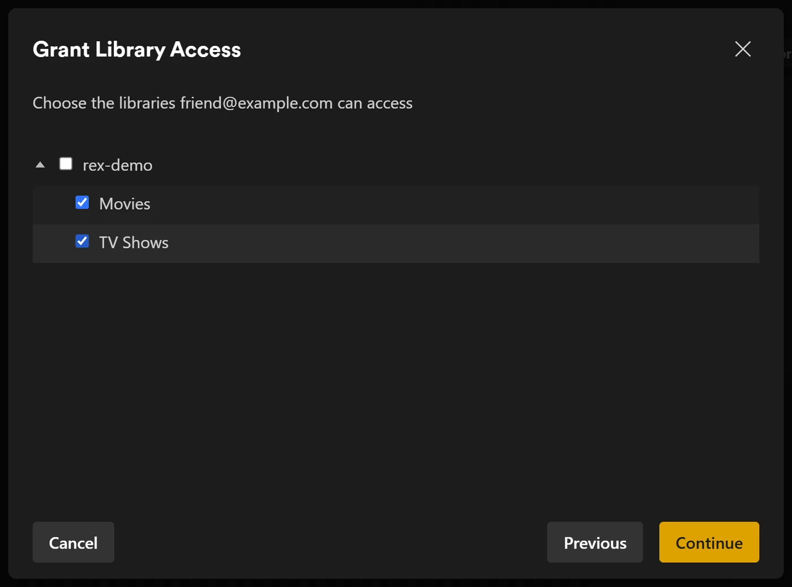
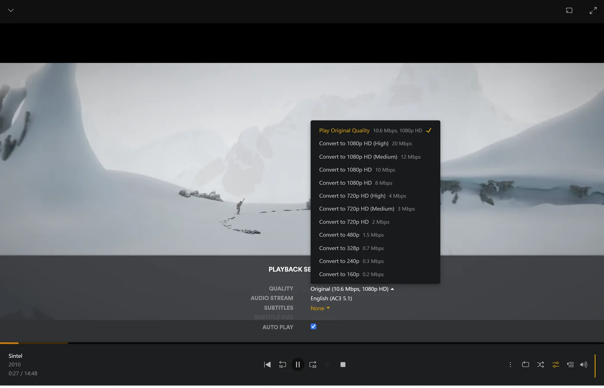
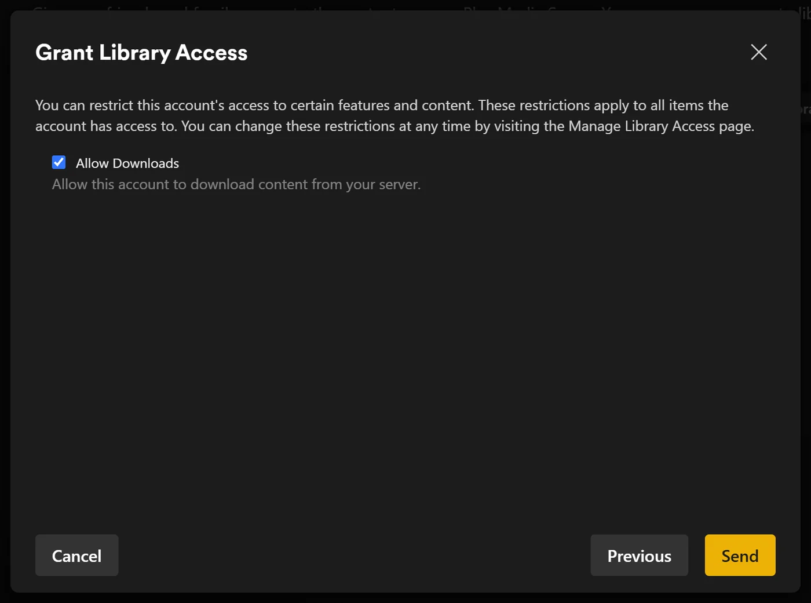
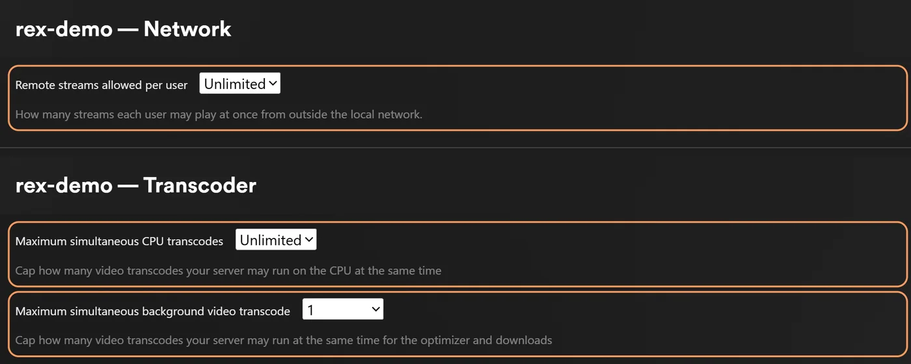

# 家族や友達と rex を共有する {#share-rex-with-family-and-friends}

Plex の **Manage Library Access** から、登録済みアカウントの rex を共有します。各ユーザーは自分の Plex にサインインし、他のサーバーと並んで rex を見られます。視聴履歴もそれぞれ別々に残ります。

まず新しい Plex アカウントで rex をセットアップします。方法は [rex with your own app](any-source.md)、[rex with your Stremio addons](stremio.md)、[rex with zurg](with-zurg.md) から選んでください。以下で **the owner** と書いたときは、そのアカウントを指します。

## 登場人物と役割 {#who-is-who}

| アカウント | 用途 |
|---|---|
| オーナー、rex を登録した新しいアカウント | 共有、設定、**Fix Match**、削除。これらの操作のときだけこのアカウントでサインインします |
| 自分のアカウント | 視聴に使うアカウント。rex は他の人と同じように共有されます |
| 家族や友人 | 本人の Plex アカウント、または子ども向けの管理対象ユーザー（下記参照） |

自分のアカウントに与えられる権限は、共有する他の人と同じ範囲を超えません。理由は次のとおりです: [Is my Plex account at risk?](faq.md#is-my-plex-account-at-risk)

## 招待する {#invite-someone}

1. **オーナーとして** [app.plex.tv](https://app.plex.tv) にサインインし、**Settings**(レンチのアイコン)、**Manage Library Access**、**Grant Library Access** の順に開きます。
2. 相手の Plex ユーザー名またはメールアドレスを入力し、rex サーバーと共有するライブラリを選んで、招待を送ります。
3. 相手は自分のアカウントでサインインして招待を承諾します。招待はメールと app.plex.tv の両方に届きます。招待は1件ずつ個別に承諾する必要があります。

**あとから追加したライブラリ**(ソースが宣言した **Anime** ライブラリや rex-stremio カタログのライブラリ、**Add Library** で作ったライブラリなど)は、まだ誰の共有にも入っていません。それぞれの共有に対して、Manage Library Access から追加してください。

**相手に見えるもの。** 本人としてサインインすると、Plex アプリには自分のサーバーと並んで rex が表示されます。自宅内で使うならこれで十分です。外出先でも使いたい場合は、次を読んでください。

## 自宅でも外出先でも {#at-home-and-away}

**自宅にいるとき**は、rex がポート 32400 を使っていれば、Plex アプリが自動的にネットワーク上で rex を見つけます。

**外出先からは**(友達が別の家にいる場合は、いつもこの状態です)、アプリは rex の HTTPS アドレスが必要です。rex にはリレーがありません。いちばん簡単な方法は rex-direct です。ルーターのポート 32400 を rex のマシンに転送します。パブリック IPv4 がなく IPv6 だけの場合は、代わりに[IPv6 経由で受け入れ](any-source.md#rex-direct-over-ipv6)てください。その場合、友達のネットワークも IPv6 が必要です。[自宅の外で使う](any-source.md#use-it-outside-your-home-optional)には、これらを含む他の方法が載っています。

**アップロード速度が上限になります。** 外出先で見られるストリームはすべて、自宅回線のアップロードを通ります。変換しない限り、ファイル本来のビットレートのままです。そのため、2人が同時に見るとアップロードは両方の分が必要になります。次の3つが助けになります。

- **画質を下げる。** プレイヤーで Original より低い画質を選ぶと、小さく変換されたストリームになります。これには rex のマシンに FFmpeg が必要です([動画の変換](any-source.md#converting-video-optional))。モバイルデータ通信中の Plex スマホアプリは画質を 720p・4 Mbps に制限します。そのため FFmpeg がないと、モバイルの画質を Original に設定するまで 1080p のタイトルは拒否されます。
  

- **アプリはプロバイダーから直接ダウンロードする。** Plezy と Android 版 Plex は、ソースが提供するリンク(デブリッドサービスのものなど)からファイルを取得できます。そのため、回線はそのデータを一切通しません([プロバイダーから直接ダウンロード](direct-download.md))。ただし、その場合、プロバイダーからは各人が自分のアドレスからダウンロードしているように見えます。その方法で共有する前に、プロバイダーのルールを確認してください。
- **1人ごとの上限**(下記)。

**Plex Pass は不要です。** 外出先から見るために、友達は Plex Pass や Remote Watch Pass は必要ありません。これは、両側とも無料アカウントの Plex Web で確認しました。他のアプリでは外出先からの動作はテストしていません。

## 子ども: 管理されたユーザー {#children-managed-users}

オーナーが管理対象ユーザー付きの **Plex Home** を使っている場合、管理対象ユーザーも Plex サーバーと同じように rex を使えます。他のユーザーと同じように Manage Library Access から rex を共有してから、下記の方法で見られる内容を制限してください。視聴履歴はユーザーごとに別々に保存されます。rex は、管理対象ユーザーに対して次の条件で共有した場合も動作を確認済みです。Movies のみ、レーティングが G と PG のタイトルのみ、ダウンロードなし。

## 各ユーザーができること・見られるもの {#what-each-person-may-see-and-do}

Plex の共有設定（Manage Library Access）で、ユーザーごとに設定します。Plex サーバーのどれでも同じです。rex はこれらの設定をすべての場所で守ります。ライブラリ一覧、検索、ホーム画面の行、タイトルページなどです。

| Setting | rex での動作 |
|---|---|
| Libraries | 共有したライブラリだけが見えます。それ以外のライブラリは相手には存在しないものとして扱われます |
| Ratings | 許可したレーティングのタイトルだけが表示されます（G や PG など）。レーティングがないタイトルも非表示になります |
| Labels | ラベルを付けたタイトルを非表示にするか、そのタイトルだけを表示するかを選べます |
| Downloads | 相手の Plex アプリでオフライン視聴用のダウンロードを許可するかどうかです |

Plex では、共有設定に **Ratings** と **Labels** が表示されるのは、オーナーアカウントが Plex Pass に加入しているときだけです。無料の新規アカウントでは、共有設定に **Allow Downloads** しか表示されません。その場合でも、下記の rex 独自の制限を使えば、レーティングとラベルを設定できます。

設定を変更すると、rex は plex.tv から変更を受け取ります。反映されない場合は、rex を再起動してください。

rex では、Plex の制限とは別に、共有ごとに独自の制限を設定することもできます。これらは Plex の制限を狭めることしかできません。Plex アプリではなくコマンドで設定します。詳しくは [ローカルオーナー制御](https://github.com/debridmediamanager/rex/blob/main/docs/setup.md#local-owner-controls) を参照してください。

## 誰が何をできるか {#who-can-do-what}

| | オーナー | それ以外の全員（あなたも含む） |
|---|---|---|
| 視聴（視聴状況は各自のもの）、Continue Watching、評価、プレイリスト | はい | はい |
| オフライン視聴用にダウンロード | はい | 共有設定で許可されている場合のみ |
| **Fix Match** とタイトルの編集 | はい | いいえ |
| タイトルを削除（元データからも削除され、全員に影響します） | はい | いいえ |
| サーバー設定、および現在視聴中のユーザーの確認 | はい | いいえ |

コレクションとポスターはサーバーのものなので、全員が同じものを見られます。

## 各ユーザーの履歴を引き継ぐ {#bring-each-persons-history}

Plexサーバーで視聴した内容と評価を、共有している全員が別のPlexサーバーへコピーできます。各自のトークンを使います: [視聴履歴を持ってくる](import-watched.md)。実行しても、他の人の視聴履歴は変わりません。

## 同時に何人まで {#how-many-at-once}

rex 自体には、同時に視聴できる人数の上限はありません。上限を決めるのは、アップロード速度、お使いのマシン、そしてソースです。

変換のたびに rex のマシン上で FFmpeg が動きます。同時に何本まで処理できるかはマシン次第で、2本同時の場合はまだ測定していません。映像をコピーするだけの場合（音声だけ変換）は、ほとんど負荷がかかりません。

上限を設定するには、オーナーとしてサインインし、サーバーの設定を開いてください：

| Setting | Where | Default |
|---|---|---|
| **Remote streams allowed per user** | Network、詳細設定の中 | 0、上限なし。自宅以外からのストリームのみカウント |
| **Maximum simultaneous CPU transcodes** | Transcoder | 0、上限なし。すべての映像変換をカウント（グラフィックチップでの変換も含む）。映像のコピーは一切カウントされません |

上限を超えた再生は rex が拒否します。

