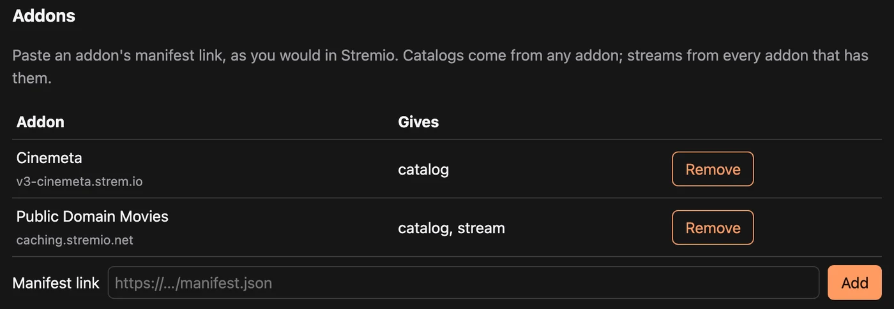

# Stremioのアドオンでrexを使う {#rex-with-your-stremio-addons}

[rex-stremio](https://github.com/debridmediamanager/rex-stremio) は、Stremio のアドオンカタログを rex のライブラリに変換します。映画、シリーズ、ライブチャンネルを Plex のアプリで再生できます。何もダウンロードしません。再生ボタンを押すと、rex-stremio がストリームアドオンにリンクを問い合わせ、rex がそのリンクを再生します。

DMM のスポンサーシップは不要です。rex と rex-stremio は無料です。リンクを返すストリームアドオンを用意してください。通常は、ご自分の debrid アカウント経由になります。

できること:

- **ライブラリ。** 映画は **Stremio Films**、シリーズは **Stremio Shows**、ライブ TV アドオンのチャンネルは **Live TV** というライブラリに入ります。ただし、カタログごとに自分でライブラリ名を指定することもできます。このライブラリはチャンネルの一覧であり、Plex アプリの Live TV ガイドには表示されません。
- **コレクション。** 複数の映画カタログに同じライブラリを指定し、**Catalogs as collections** にチェックを入れてください。ライブラリは 1 つになり、カタログごとにコレクションが作られます。複数のカタログに載っている映画は、1 つだけ表示されます。
- **Plex が知っている名前を使います。** 映画とエピソードは IMDb ID とともに rex に渡されるので、rex を Plex アカウントに接続すると、アプリに通常のタイトル、ポスター、あらすじが表示されます。アドオンしか知らないタイトルとライブチャンネルは、アドオンの名前と画像のままになります。

## 始める前に {#before-you-start}

| 必要なもの | 理由 |
|---|---|
| rex と rex-stremio を一緒に動かす、常時起動のマシン（Linux または macOS） | rex-stremio は rex と並んで動く Python プログラムです。下のサービス設定は Linux 向けですが、[Docker](#in-docker) でも動きます |
| Python 3.9 以降、`git`、`ffprobe` | rex は再生前にファイルの中身を知る必要があるため、rex-stremio は各タイトルのストリームを ffprobe で一度チェックします。DMM API キーがあれば、DMM がすでにプローブ結果を持っているトレントのデバッドストリームはこのチェックを省略します。それ以外はプローブされます。 |
| トレントではなく、リンクを返すストリームアドオン | rex はファイルを再生します。アドオンでデバッドサービスを設定して、リンクを返すようにしてください。 |
| rex 専用に作った新しい Plex アカウント | rex のセットアップと同じく、rex はこのアカウントに登録され、自分の Plex アカウントと共有されます。 |

## ステップ 1. rex をインストールして Plex アカウントに追加する {#step-1-install-rex-and-add-it-to-a-plex-account}

[rex を自分のアプリで使う](any-source.md)の手順に従ってください。

1. [ステップ 1. rex のインストール](any-source.md#step-1-install-rex)（rex の LAN IP の確認を含みます）。以降のすべてのコマンドで、その名前を使ってください。
2. [ステップ 3. Plex アカウントに追加](any-source.md#step-3-add-it-to-a-plex-account)：新しいアカウントに rex を登録し、自分のアカウントと共有します。

そこではステップ 2 と 4 は飛ばしてください。rex-stremio はあなたのアプリです。

ライブチャンネルや、ストリームが `.m3u8` プレイリストのアドオンは、rex の動画変換を通してのみ再生できます。その場合は、rex を動かしているマシンで [動画変換](any-source.md#converting-video-optional)も設定してください。ファイルとして配信される映画やエピソード（`.mkv`、`.mp4`）は、これ以上の設定は不要です。

## ステップ2. rex-stremioをインストールする {#step-2-install-rex-stremio}

**What it does.** Downloads rex-stremio into `~/rex-stremio` on the rex machine and starts it as a service.

+++ Linux
```bash
sudo apt install -y git python3 ffmpeg
cd ~ && git clone https://github.com/debridmediamanager/rex-stremio
mkdir -p ~/.config/systemd/user
cp ~/rex-stremio/rex-stremio.service ~/.config/systemd/user/
systemctl --user daemon-reload && systemctl --user enable --now rex-stremio
journalctl --user -u rex-stremio -f
```
+++ macOS
```bash
brew install ffmpeg
cd ~ && git clone https://github.com/debridmediamanager/rex-stremio
cd ~/rex-stremio && python3 rex_stremio.py
```

It runs while that Terminal window stays open.
+++

**What you should see.** A line like:

```
... INFO relay and settings on http://127.0.0.1:9982/, 0 catalog(s), rex at http://127.0.0.1:32400
```

rex-stremio's settings page and the address rex reads videos from are both on `127.0.0.1:9982`, so only this machine reaches them.

## ステップ3. アドオンを追加する {#step-3-add-your-addons}

rex のマシンでブラウザを開き、`http://127.0.0.1:9982/` にアクセスしてください。画面がない場合は、お使いのパソコンから `ssh -L 9982:127.0.0.1:9982 you@<rex's LAN IP>` を実行し、SSH を開いたままにして、同じアドレスを開いてください。

1. **Addons** の下で、Stremio と同じようにアドオンのマニフェストリンクを貼り付け、**Add** を押します。次のものをそれぞれ追加してください。
   - **Catalogs**: 例として Cinemeta を使う場合 `https://v3-cinemeta.strem.io/manifest.json` を入力します。
   - **Streams**: リリースを見つけて、debrid サービス経由で再生するアドオンです。そのアドオンの設定ページを開き、debrid サービスを選んで、API キーを貼り付け、作成されたマニフェストリンクをコピーします。キャッシュ済みの結果だけを表示するオプションがあれば、それを選んでください。このリンクには debrid のキーが含まれているので、人に教えないようにしてください。

   

2. **Catalogs** の下で、使いたいカタログにチェックを入れます。それぞれのカタログを入れるライブラリの名前を付け、**How many** で取り込む映画、エピソード、チャンネルの数を設定します。1 つのライブラリにカタログごとのコレクションを作りたい場合は、カタログすべてに同じライブラリを指定して、**Catalogs as collections** にチェックを入れてください。
3. **Streams** の下で、再生したい **Highest resolution** と **Largest file** を設定します。特に指定しない場合は any のままで構いません。
4. **rex** の下で、アドレスを `http://<rex's LAN IP>:32400` に設定します。
5. DMM のスポンサーになっている場合は、**DMM** の下に DMM の API キーを貼り付けてください（スポンサーになると [gatekeeper](https://gatekeeper.debridmediamanager.com/) に一度だけ表示されます）。DMM がすでにプローブを持っているトレントの debrid ストリームは、チェックをスキップします。それ以外はチェックされます。rex-stremio がトレントのファイルに対して行ったチェックの結果（通常の HTTP ストリームや HLS プレイリストは除く）は、次のスポンサーのために DMM に送り返されます。送りたくない場合は `config.json` で `share_probes: false` を設定してください。最後に **Save and sync** を押します。


**表示される内容。** rex のログには、[rex を自分のアプリで使う場合の手順4](any-source.md#step-4-connect-your-app) と同じように次のように表示されます。

```
INFO    SOURCES PUT /rex/sources/stremio -> 200
INFO    FEED stremio upsert: ...
```

タイトルは、カタログ全体のチェックが終わるのを待たず、1 件ごとのチェックが終わるたびに rex に表示されます。rex-stremio は複数のタイトルを同時にチェックします。6 時間ごとと、設定を保存するたびに再度同期されます。

## ステップ4. 新しいライブラリを共有して視聴する {#step-4-share-the-new-libraries-and-watch}

rex-stremio が作るライブラリは新しいので、自分のアカウントからはまだ見えません。[手順 3](any-source.md#share-it-with-your-own-account) のとおりに、新しく作ったアカウントでサインインして共有し、rex を共有したい人全員にも共有してください。

そのあと、自分の Plex アプリを開いて、何か再生ボタンを押します。その瞬間に rex-stremio がストリームアドオンにリンクを問い合わせ、rex がそれを再生します。外出先で見たいときや app.plex.tv で見たいときは、rex 専用のアドレスを用意してください: [家の外で使う (任意)](any-source.md#use-it-outside-your-home-optional)。

## Dockerで使う場合 {#in-docker}

rex-stremio の [README](https://github.com/debridmediamanager/rex-stremio#set-up) に Docker のコマンドが載っています。コンテナ内では、rex は `127.0.0.1` ではなく、ネットワーク上にあるコンテナのアドレスから動画を読み込みます。その設定方法も README に書かれています。

## アップデート {#updating}

```bash
cd ~/rex-stremio && git pull && systemctl --user restart rex-stremio
```

macOSでは、Ctrl+Cで止めて、`~/rex-stremio`で`git pull`を実行してから、もう一度起動してください。

## できないこと {#what-it-cannot-do}

- **エピソードの番号は Cinemeta の付け方に従います。** 一部の番組では TMDB の番号付けと異なり、rex は TMDB に従うため、エピソードが違う場所に入ってしまうことがあります。
- **件数はシリーズのカタログでは、番組数ではなくエピソード数で数えられます。**
- **Catalogs as collections をオン/オフに切り替えると**、タイトルが新規として rex に再度送られるため、視聴済みの情報が引き継がれないことがあります。視聴を始める前に決めておいてください。
- **表示されるのは映画、シリーズ、チャンネルのカタログのみです。** 検索やジャンルの選択が必要なものは含まれません。
- **ライブチャンネル**は、遠くまで巻き戻したり、後で再開したり、視聴済みにしたりすることはできません。rex に変換を依頼するアプリ（Plex アプリと Plezy）でのみ再生できます。Plex Web は未テストです。動作するストリームがないチャンネルや、DRM のあるチャンネルは除外されています。
- **rex-stremio のアドレスにアクセスできる人は誰でも、それを通じて再生できます。** rex を別の場所で動かしていない限り、`127.0.0.1` のままにしておいてください。

README には[その他の制限](https://github.com/debridmediamanager/rex-stremio#limits)と、`config.json` のすべての設定が載っています。自分でアドオンを作りたい場合は、[rex アドオンの作り方](addons.md)を見てください。rex-stremio の内部の仕組みも、そこで説明しています。
