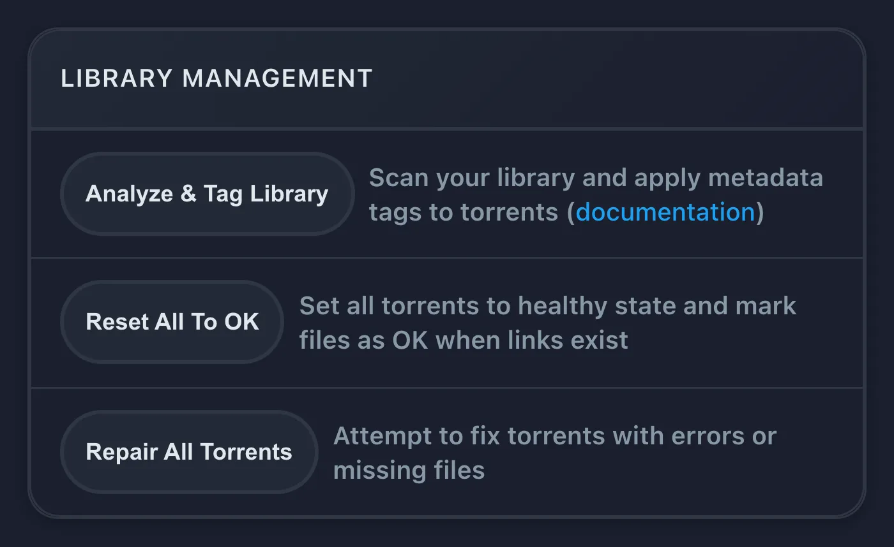

# rex と zurg {#rex-with-zurg}

[rex](https://rex.debridmediamanager.com/ja/) は、ファイルを一切持たない公式 Plex アプリ向けのメディアサーバーです。公式 Plex アプリからは、普通の Plex サーバーに見えます。どのアプリからでも中身を入れられます（[rex を自分のアプリで使う](any-source.md)）。このページでは zurg と組み合わせて設定します。zurg がデバッグサービスのライブラリを rex に送り、再生するとき rex は zurg からファイルを直接ストリーミングします。先にダウンロードすることはありません。

このページでは、何もない状態から映画を再生するまでを、一歩ずつ説明します。各ステップで、何をするのか、なぜ大切なのか、次に進む前に何が見えるべきかを書いています。画面の表示が一致しない場合は、そこで止めてください。次のステップを進めても直りません。


始める前に知っておいてほしいことが 4 つあります。

- **zurg は、デバッグサービスと通信する部分です。** アカウントにあるものを一覧にして、ファイルを配信します。
- **rex は、Plex アプリが話しかける部分です。** メディア用のファイルは持たず、ディスクも必要としません。rclone やマウントも不要です。
- **zurg が rex に自分のことを知らせます。** rex のアドレスを zurg に教えれば、あとは zurg が自動でやります。zurg の情報を rex に入力する必要はありません。
- **zurg と DMM が、各ファイルが何かを判断し、Plex がそれを説明します。** zurg は、各ファイルがどの映画やエピソードかを DMM に問い合わせます。rex は、rex を Plex アカウントに接続した後、Plex 自身のメタデータが付けるポスターとあらすじを使って、そのタイトルを表示します。rex がファイル名から推測することはありません。

rex は個人利用であれば無料です（PolyForm Noncommercial）。スポンサー階層はなく、ダウンロードにアカウントも要りません。このガイドで使う zurg のナイトリー版は、引き続きスポンサー向けリリースです。[rex を自分のアプリで使う](any-source.md) では、zurg なしで rex を動かせます。スマホやテレビボックスしかない場合は、zurg+rex（スマホ上で Plex サーバーを動かす構成）があり、zurg と rex を 1 台で一緒に動かせます。詳しくは [Android ガイド](../zurg/guides/android.md) をご覧ください。

## 始める前に {#before-you-start}

| 必要なもの | 理由 |
|---|---|
| 電源を入れっぱなしにできるマシン: Linux (Ubuntu 22.04 以降)、macOS、または Windows (64 ビット)。Proxmox LXC でも動きます。特権なしのコンテナで問題ありません。ただし、FUSE を有効にする必要があります (Options > Features > FUSE)。FUSE がないと zurg のインストーラーが `/dev/fuse` の不足で止まります | rex と zurg はサーバーです。Plex アプリは再生を押すたびにこれらにアクセスします。コマンドがシステムによって違う場合は、手順ごとにタブがあります。Linux 向けの [Docker](#run-rex-in-docker) は下のほうで説明しています |
| 1 GB の RAM | 4,062 本の映画と 656 本の番組 (34,678 エピソード) の場合、rex は起動中に 500 MB 未満、ライブラリを閲覧中は約 730 MB を使いました。動画の変換を行うとさらに多く必要です。zurg はあまり必要としません |
| debrid アカウント (Real-Debrid、TorBox、AllDebrid、Premiumize、Debrid-Link、Offcloud) または Usenet | 映画や番組の実体はここにあります |
| zurg のスポンサー向けリリースにアクセスできる GitHub アカウント | zurg のナイトリーは非公開の GitHub リリースです。スポンサーになると [gatekeeper](https://gatekeeper.debridmediamanager.com/) がアカウントにアクセス権を付与します。zurg のインストーラーで一度サインインします |
| DMM の API キー。スポンサーになった後に [gatekeeper](https://gatekeeper.debridmediamanager.com/) から取得します (任意) | zurg は各ファイルが何かを DMM に問い合わせます。キーがない場合、zurg はリリース名から判断し、DMM の無料のタイトル検索を使います。一致するタイトルが減り、シリーズ全体で通し番号が付いたアニメは、ファイルの順番のままになります |
| rex 専用に作った新しい Plex アカウント | rex は [Plex アカウントに追加された](#step-3-add-it-to-a-plex-account)後に、Plex からすべてのタイトル、ポスター、概要、エピソード名を取得します。それまでは、タイトルはファイル名のままで、ポスターも表示されません |

このページは rex nightly **2026.10.25 以降**、zurg nightly **2026.10.27 以降** が必要です。

## ステップ 1. zurg をインストールする {#step-1-install-zurg}

**何をするか。** zurg をダウンロードして、debrid アカウントの情報を尋ね、再起動後も自動で立ち上がるサービスとして zurg を起動します。

**なぜ重要か。** rex に表示されるものはすべて zurg から来ています。zurg がライブラリを見られなければ、rex も表示できません。

**Windows と macOS では、Docker Desktop ではなく、下のインストーラーで zurg をインストールしてください。** rex は zurg が指定するアドレスからすべてのファイルを読み込みますが、Docker Desktop の中にある zurg には接続できません。タイトルは表示されても、何も再生できなくなります。

+++ Linux
```bash
curl -fsSL https://raw.githubusercontent.com/debridmediamanager/zurg-site/main/public/install.sh | bash
sudo loginctl enable-linger "$USER"
```

zurg は `~/zurg` にインストールされます。2 行目のコマンドは、ログアウトしてもサービスを動かし続けます。
+++ macOS
```bash
curl -fsSL https://raw.githubusercontent.com/debridmediamanager/zurg-site/main/public/install.sh | bash
```

zurg は `~/zurg` にインストールされます。インストーラーは macFUSE もインストールします。macOS から許可を求められた場合は、**System Settings** の **Privacy & Security** で許可してから再起動してください: [macOS での zurg](../zurg/setup/macos.md)。
+++ Windows
PowerShell で:

```powershell
irm https://raw.githubusercontent.com/debridmediamanager/zurg-site/main/public/install.ps1 | iex
```

zurg は `$HOME\zurg`（`C:\Users\you\zurg`）にインストールされます。インストーラーは WinFsp もインストールします。その際に管理者の承認を求められます。また、Windows にログインするたびに zurg が起動します: [Windows での zurg](../zurg/setup/windows.md)。
+++

インストーラーはどのサービスを使っているか尋ねます（Real-Debrid の場合は `1` と入力）。その後 API token を尋ねます。貼り付けている間、token は表示されません。

**表示されるもの。** インストーラーは `PASS` の行が並び、最後に `==> zurg is installed in` と zurg のフォルダーが表示されて終わります。その後 zurg がライブラリを読み込みます。小さいアカウントなら数秒、Real-Debrid に 1,000 件のリリースがあるアカウントならおよそ 10 分です。`http://<this machine>:9999` で zurg のダッシュボードを開いてください。読み込みが終わると、**Library Size** にアイテム数が表示されます。

すでに zurg を使っていますか？ 次のコマンドで更新して再起動してください: `cd ~/zurg && ./zurg update && ./zurg service restart`（Windows の場合は `cd $HOME\zurg; .\zurg.exe update; .\zurg.exe service restart`）。

## ステップ 2. rex をインストールする {#step-2-install-rex}

**概要。** rex を `~/rex`（Windows では `$HOME\rex`）にダウンロードして、サービスとして起動します。後の手順に必要なものはすべて揃います。この後の手順では再起動は不要です。再起動が必要なのは、下のオプションのセクションだけです。

**重要な理由。** rex は Plex アプリがつながる先です。最初に起動すると `rex.db` が作られ、ここにライブラリ、zurg から送られてきたもの、視聴履歴がすべて保存されます。

Linux では、代わりに Docker で zurg と rex を動かすこともできます。[Docker で rex を動かす](#run-rex-in-docker)を見てください。

+++ Linux and macOS
```bash
mkdir -p ~/rex && cd ~/rex
TAG=$(curl -fsSL 'https://api.github.com/repos/debridmediamanager/rex/releases?per_page=1' | sed -n 's/.*"tag_name": *"\([^"]*\)".*/\1/p' | head -1)
P=$(uname -s | tr A-Z a-z)-$(uname -m | sed 's/x86_64/amd64/;s/aarch64/arm64/')
curl -fL "https://github.com/debridmediamanager/rex/releases/download/$TAG/rex-$TAG-$P.tar.gz" | tar xz --strip-components=1
```
+++ Windows
PowerShell で:

```powershell
New-Item -ItemType Directory -Force $HOME\rex | Out-Null; cd $HOME\rex
$tag = (Invoke-RestMethod 'https://api.github.com/repos/debridmediamanager/rex/releases?per_page=1')[0].tag_name
curl.exe -fLO "https://github.com/debridmediamanager/rex/releases/download/$tag/rex-$tag-windows-amd64.zip"
tar -xf "rex-$tag-windows-amd64.zip" --strip-components=1; Remove-Item "rex-$tag-windows-amd64.zip"
```
+++

このコマンドは、お使いのマシン向けの rex の最新ビルドを取得します。通常はナイトリービルドです。

rex の LAN IP、つまり自宅ネットワーク上のアドレスを調べてください。Linux では `hostname -I` がいくつか表示します。自宅ネットワーク側のものを選び、`172.17.`（Docker）や `100.`（Tailscale）で始まるものは選ばないでください。macOS では `ipconfig getifaddr en0` で表示できます（何も出なければ `en1`）。Windows では `ipconfig` の Wi-Fi または Ethernet アダプターの下に **IPv4 Address** として出ます。**このページでは、どこでも `192.168.1.20` と書いています。ご自身のアドレスに置き換えてください。** Plex アプリ、zurg、自分で打つコマンドは、すべてこのアドレスで rex に接続します。

**Plex Media Server も同じマシンで動いていますか?** 下の rex の起動コマンドの末尾に `--port 32500` を付けてください。コマンドや設定で `32400` となっている箇所は、すべて `32500` に読み替えます。Windows ファイアウォールのルールも同じです。Plex はすでにポート 32400 と、アプリがサーバーを探すためのポートを使っています。rex は別のポートを使うことで、それらを Plex に任せられます。そうすると、アプリには同じマシン名のサーバーが2つ表示されます。共有されているほうが rex で、その隣に新しいアカウントの名前が出ます。rex を Plex アカウントに紐付けたら（[ステップ3](#step-3-add-it-to-a-plex-account)）、名前を変更できます。そのアカウントで Plex にサインインした状態で、rex の **Settings** の **General** を開き、**Friendly name** を変更して保存してください。その後、下の方法で rex を再起動します。再起動後、Plex アプリには新しい名前が表示されます。

では、サービスとして登録しましょう。

+++ Linux
`~/.config/systemd/user/rex.service` を作成します:

```bash
mkdir -p ~/.config/systemd/user
nano ~/.config/systemd/user/rex.service
```

```ini
[Unit]
Description=rex
After=network-online.target

[Service]
WorkingDirectory=%h/rex
EnvironmentFile=-%h/rex/rex.env
ExecStart=%h/rex/rex
Restart=always
RestartSec=5

[Install]
WantedBy=default.target
```

```bash
systemctl --user daemon-reload
systemctl --user enable --now rex
journalctl --user -u rex -f
```

rex の **start command** は `ExecStart` の行です。キーは `~/rex/rex.env` に、1行に1つずつ `NAME=value` の形で書きます。変更したら `systemctl --user daemon-reload && systemctl --user restart rex` で rex を再起動できます。`journalctl --user -u rex -f` でログを確認できます。
+++ macOS
`run.sh` は自分のフォルダ内で rex を起動します。LaunchAgent はログインしたときに `run.sh` を起動します:

```bash
cp ~/rex/examples/run.sh.example ~/rex/run.sh
mkdir -p ~/Library/LaunchAgents
cat > ~/Library/LaunchAgents/com.rex.plist <<PLIST
<?xml version="1.0" encoding="UTF-8"?>
<!DOCTYPE plist PUBLIC "-//Apple//DTD PLIST 1.0//EN" "http://www.apple.com/DTDs/PropertyList-1.0.dtd">
<plist version="1.0"><dict>
  <key>Label</key><string>com.rex</string>
  <key>ProgramArguments</key><array><string>/bin/bash</string><string>$HOME/rex/run.sh</string></array>
  <key>RunAtLoad</key><true/><key>KeepAlive</key><true/>
  <key>StandardOutPath</key><string>$HOME/rex/rex.log</string>
  <key>StandardErrorPath</key><string>$HOME/rex/rex.log</string>
</dict></plist>
PLIST
launchctl load ~/Library/LaunchAgents/com.rex.plist
tail -F ~/rex/rex.log
```

rex の **start command** は `~/rex/run.sh` の最終行です。キーは `~/rex/rex.env` に、1行に1つずつ `NAME=value` の形で書きます。変更したら `launchctl kickstart -k gui/$(id -u)/com.rex` で rex を再起動できます。`tail -f ~/rex/rex.log` でログを確認できます。

rex は Mac にログインしている間だけ動きます。Mac が自動で再起動する場合は、自動ログインをオンにしてください（**System Settings** の **Users & Groups**）。macOS のファイアウォールが有効なら、macOS が聞いてきたときに rex を許可してください。または、ファイアウォールの **Options** に `~/rex/rex` を追加します。
+++ Windows
PowerShell を**管理者として**開き、`cd $HOME\rex` で rex のフォルダに移動します。まず `run.cmd` を作ります。これは自分のフォルダ内で rex を起動し、ログを `rex.log` に書き出すファイルです。メモ帳がファイルの作成を提案してくるので、それに従ってください:

```powershell
notepad run.cmd
```

```bat
@echo off
cd /d "%~dp0"
rex.exe 2>> rex.log
```

保存します。次に、Windows ファイアウォールで rex のポートと2つのディスカバリー用ポートを通します。そのうえで、rex を今すぐ起動し、ログインするたびに起動するようにします:

```powershell
New-NetFirewallRule -DisplayName rex -Protocol TCP -LocalPort 32400
New-NetFirewallRule -DisplayName "rex discovery" -Protocol UDP -LocalPort 32410,32414
$settings = New-ScheduledTaskSettingsSet -ExecutionTimeLimit 0 -AllowStartIfOnBatteries -DontStopIfGoingOnBatteries
Register-ScheduledTask rex -Action (New-ScheduledTaskAction -Execute "$HOME\rex\run.cmd") -Trigger (New-ScheduledTaskTrigger -AtLogOn -User $env:USERNAME) -Settings $settings
Start-ScheduledTask rex; Start-Sleep 3
Get-Content rex.log -Wait
```

rex の **start command** は `run.cmd` の `rex.exe` の行です。キーはその上に、1行に1つずつ `set NAME=value` の形で書きます。変更したら `Stop-Process -Name rex; Start-Sleep 1; Start-ScheduledTask rex` で rex を再起動できます。`Get-Content $HOME\rex\rex.log -Wait` でログを確認できます。

PowerShell で rex を手動で起動した場合は、ログはそのウィンドウにしか出ず、`rex.log` はできません。また、再起動後にそれを起動するタスクもありません。rex はデータベースと紐付けの情報を、起動したフォルダに保存します。そのため、別のフォルダから起動した rex は、紐付けのない新しいサーバーになります。Ctrl+C で停止し、rex のフォルダから同じフラグを付けて起動し直してください。できれば、上で設定したタスクを使うのがおすすめです。

rex は Windows にログインしている間、専用のウィンドウで動きます。そのウィンドウは開いたままにしてください。PowerShell で、このページに `curl` と書かれている箇所には `curl.exe` と入力してください。Windows PowerShell 独自の `curl` は別のコマンドです。
+++

**表示される内容。** 最初のほうの行には、次のようなものが出ます:

```
INFO    seeded rex.db: an empty library named yourhost, machine=...
INFO    no source yet: a source registers itself once pointed at this server (PUT /rex/sources/{name}, docs/feed-api.md)
INFO    claim state: unclaimed
INFO    rex on http://192.168.1.20:32400  machine=...  items=0  parts=proxy
```

rex は自分をマシン名で名乗ります。Plex アプリにはその名前が表示されます。`no source yet` と出るのは正常です。zurg にはまだ rex のことを伝えていないためです。ログは開いたままにしておいてください。

## ステップ 3. Plex アカウントに追加 {#step-3-add-it-to-a-plex-account}

**Was es macht.** Registriert rex bei einem Plex-Konto, so wie man einen echten Plex Media Server registrieren würde, und teilt ihn mit deinem eigenen Konto.

**Warum es wichtig ist.** rex holt sich den Namen, das Poster, die Zusammenfassung und die Episodennamen aller Titel aus den eigenen Metadaten von Plex, und das darf es erst, wenn es an einem Konto hängt. Titel, die zurg vor der Registrierung gesendet hat, bekommen ihre Namen, sobald sie fertig ist. Außerdem funktioniert damit Fix Match, der Hinweis „unclaimed“ verschwindet, und es ist nötig, bevor du [rex außerhalb deines Zuhauses nutzt](#use-it-outside-your-home-optional).

**Nimm dafür ein neues Plex-Konto, nicht dein eigenes.** rex wird nicht von Plex gemacht, und Plex könnte gegen ein Konto vorgehen, das rex registriert. Halte dein echtes Konto mit Wiedergabeverlauf, Freunden und eventuellem Plex Pass da raus: Erstelle auf [plex.tv](https://www.plex.tv) ein neues kostenloses Konto mit einer E-Mail-Adresse, die du sonst nirgends verwendest, registriere rex damit und teile rex mit deinem eigenen Konto. Dann schaust du angemeldet als du selbst, so wie du den Server eines Freundes nutzen würdest. Solange dieser Schritt nicht erledigt ist, spielt rex nichts ab.

### 新しいアカウントに rex を登録 {#register-rex-on-the-fresh-account}

1. [plex.tv](https://www.plex.tv) に **新しく作ったアカウントで** サインインし、[plex.tv/claim](https://www.plex.tv/claim) を開いてコードをコピーします。コードの有効期限は約5分です。
2. rex のマシンで（Windows では `curl.exe`）:

   ```bash
   curl -X POST "http://192.168.1.20:32400/myplex/claim?token=claim-xxxxxxxxxxxx"
   curl -s http://192.168.1.20:32400/identity
   ```

**表示されるはずの内容。** 2つ目のコマンドは `claimed="1"` と表示され、rex のフォルダに `claim_state.json` ができています。このファイルはバックアップしておいてください。これがないと、新しいコードでもう一度 claim する必要があります。このファイルが存在する間、rex は2回目の claim を受け付けません。

### 自分のアカウントと共有 {#share-it-with-your-own-account}

1. まだ新しいアカウントでサインインした状態で、[app.plex.tv](https://app.plex.tv) を開き、**Settings**（レンチのアイコン）、**Manage Library Access**、**Grant Library Access** の順にクリックします。
2. 自分のアカウントのユーザー名またはメールアドレスを入力し、rex サーバーと、**Movies** と **TV Shows** の両方のライブラリを選んで、招待を送ります。
3. サインアウトして、**自分自身の**アカウントでサインインし、招待を承諾します。招待はメールと app.plex.tv の両方に届きます。


**表示されるもの。** 自分のアカウントでサインインすると、Plex アプリの自分のサーバーの横に rex サーバーが表示され、両方のライブラリが並びます。次のステップまでは中身は空っぽです。rex での視聴履歴は自分だけのものになり、新しいアカウントの履歴とは別に保存されます。家族など他の人と共有したい場合も、同じ手順で進めてください。

## ステップ 4. zurg を rex に接続する {#step-4-connect-zurg-to-rex}

**何をするか。** zurg に rex の場所を教えます。zurg は自分を rex に紹介し、ライブラリ全体を送ります。各ファイルの映像と音声の詳細も読み取って送り、その後は変更があるたびに送信します。

**なぜ重要か。** これは両者をつなぐ唯一のリンクです。rex には zurg 用の設定がありません。`rex_url` がないと rex は空のままです。`rex_url` は常に、ネットワーク上の rex の素の `http://` アドレスにしてください。[自宅の外から使う](#use-it-outside-your-home-optional) で説明している HTTPS のアドレスは使えません。rex は、自分のネットワークからの zurg の送信だけを受け付けるためです（[ポートを非公開にする](#keep-the-port-private)）。DMM キーがあれば、zurg は DMM に各ファイルがどの映画やエピソードかを問い合わせられます。キーがなくても zurg は名前から推測しますが、一致する作品は少なくなります。

zurg は同じキーで二重に起動しません。また、ダッシュボードにキーを入力すると、zurg は `dmm_api_key` を設定ファイルに書き込みます。DMM キーがない場合は、`dmm_api_key` を書かないでください。

+++ Linux and macOS
まず、zurg の設定にどちらかの行がすでにあるか確認します:

```bash
grep -n '^rex_url:\|^dmm_api_key:' ~/zurg/config.yml
```

行が表示されたら、そのキーはすでに設定されています。`nano ~/zurg/config.yml` で書き換え、下の `printf` からは外してください。

```bash
printf '\nrex_url: http://192.168.1.20:32400\ndmm_api_key: your_dmm_key\n' >> ~/zurg/config.yml
cd ~/zurg && ./zurg service restart
```
+++ Windows
`notepad $HOME\zurg\config.yml` で zurg の設定を開きます。すでに `rex_url:` または `dmm_api_key:` の行がある場合は、その行を書き換えます。足りないものは末尾に追加してください:

```yaml
rex_url: http://192.168.1.20:32400
dmm_api_key: your_dmm_key
```

保存して zurg を再起動します:

```powershell
cd $HOME\zurg; .\zurg.exe service restart
```
+++

**表示されるもの。** zurg がライブラリを再読み込みすると、zurg のログ（`~/zurg/logs/zurg.log`、Windows では `$HOME\zurg\logs\zurg.log`）に `DMM placed N releases` と表示されます（DMM キーがない場合は `Placed N releases by their names (no DMM sponsor key)`）。rex のログには次のように出力されます:

```
INFO    SOURCES zurg registered at http://192.168.1.20:9999/dav
INFO    SOURCES PUT /rex/sources/zurg -> 200
INFO    FEED zurg upsert: 0 created, 0 updated, 200 held, 0 unchanged, 0 rejected
INFO    FEED identified "Sintel.mp4" -> movie tmdb:45745 (placed)
INFO    FEED zurg upsert: 2 created, 0 updated, 0 held, 0 unchanged, 0 rejected
```

rex は `registered at` の行にあるアドレスから各ファイルを読み取るため、そのアドレスで zurg に到達できる必要があります。rex がこの行を再度出力するのは、アドレスが変わったときだけです。

`held` は、zurg がそのファイルの詳細をまだ読み取っていないことを意味します。zurg はライブラリの読み込みが終わるとすぐに、一度に1つのリリースずつ詳細の読み取りを始めます。シーズンパックのエピソードはまとめて届きます。DMM キーがあれば、DMM が保存している詳細から1分あたり最大約20リリースが届きます。大きなライブラリでは、読み込みが完了するまで数時間かかることがあります。各タイトルは、詳細が届くたびに rex に表示されます。後から debrid サービスのアカウントに追加したものは、zurg が読み取ると自動的に表示されます。

**うまくいかない場合。**

- rex のログに何も出ていない場合: zurg がまだライブラリを読み込んでいるか、zurg が古いか（[ステップ1](#step-1-install-zurg) のとおり更新してください）、`rex_url` にタイプミスがあります。`grep 'rex feed' ~/zurg/logs/zurg.log | tail -n 5` で zurg 側の状況を確認できます（Windows では `Select-String 'rex feed' $HOME\zurg\logs\zurg.log | Select-Object -Last 5`）。`rex feed: pushing the library to ...` の行がなければ、zurg は `rex_url` を読めていません。`rex feed: snapshot failed, retrying in ...` と出ている場合は、そのアドレスに rex が届いていません。
- タイトルが `held` のままで、zurg が `Cannot probe file ...` と記録する場合: debrid サービスからの最初の読み取りに失敗しています。zurg は自動で再試行します。すぐに試したい場合は、zurg のダッシュボードの **Utilities** にある **Analyze & Tag Library**（下の画面）を使ってください。

  

- タイトルは届くのに `identified` の行が出ない場合: zurg は名前で一致させられませんでした。`dmm_api_key` を設定していて、そのキーがスポンサーのものでない場合、zurg は `DMM refused the API key for placement` と記録します。その場合、zurg は名前による一致を使い、翌日（または再起動時にすぐ）キーを再試行します。
- タイトルは表示されるのに再生できない場合: rex は `registered at` のアドレスで zurg に到達できません。[問題が起きたとき](#when-something-is-wrong) の `upstream failed` の行で確認できます。

複数の zurg を動かしている場合（debrid サービスごとに1つずつ）は、追加の行 `rex_source: rd`、`rex_source: tb` などで、それぞれに個別の名前を付けてください。同じライブラリに反映されます。

### DMM がファイルを配置する理由 {#why-dmm-places-the-files}

| Release | Named | Where it really is |
|---|---|---|
| `[Erai-raws] Hibike Euphonium 3 - 01` | シーズン1、エピソード1 | 響け!ユーフォニアム シーズン3、エピソード1 |
| `[HorribleSubs] One Piece - 486` | エピソード486 | シーズン13、エピソード486 |
| `Firefly.S01E02.The.Train.Job` (DVD order) | エピソード2 | エピソード1、「The Train Job」 |

zurgが配置できないファイルは未マッチのままになります。ファイル名がそのままタイトルになっている映画や、リリース名がそのままタイトルになっている番組のエピソードで、ファイルの順番で番号が振られたものです。DMMキーを設定していると、zurgは1日後にもう一度DMMに問い合わせます。また、Plexアプリで**Fix Match**を使って自分で直すこともできます。その際は、rexを所有している新しいアカウントでサインインしてください（rexは共有先のアカウントでは拒否されます）。Fix Matchで直したタイトルは、設定したままの状態が維持されます。


zurgのダッシュボードには、各リリースに対して何をしたかが表示されます。**Torrent Manager**でリリースを開き、**Placement**を確認してください。**Place again**を押すと、もう一度DMMに問い合わせます。**External ID**にIMDb IDを入力すると、そのIDをもとに配置されます。


## ステップ 5. 何か視聴してみる {#step-5-watch-something}

**何をするか。** Plex サーバーを開くのと同じ方法で、Plex アプリから rex を開きます。

**なぜ大事か。** ここがセットアップ全体のポイントです。最後のつながりも確認できます。映画を見ている間に、rex が zurg からファイルを読み込んでいるということです。

**同じ自宅ネットワーク**につないだ状態で、スマホ、テレビ、パソコンの Plex アプリ（Web ブラウザではなく）を開いてください。rex はマシン名の下に **Movies** と **TV Shows** と一緒に表示されます。映画を選んで再生を押してください。


自宅では他に必要なものはありません。Plex アプリは Plex 独自のローカル検出機能で rex を見つけ、ネットワーク経由で接続します。そのためには、デバイスが rex と同じネットワーク上にある必要があります（ゲスト Wi-Fi や別の VLAN ではだめです）。検出は UDP ポート 32410 と 32414 で動くので、rex のマシンのファイアウォールでこれらを通す必要があります（Windows なら手順 2 のファイアウォールルールで設定されます）。rex はポート 32400 を使っているときに検出に応答します。Plex が同じマシンで動いているため rex を 32500 に変えた場合、検出は Plex に任されます。そのとき、アプリは [共有されている](#share-it-with-your-own-account) Plex アカウント経由で rex を見つけます。Web ブラウザで app.plex.tv を開いても、自宅ならうまくいきます。rex に [rex-direct](#rex-direct) が一度割り当てられたら（rex nightly 2026.11.02 以降）、その HTTPS アドレス経由で動きます。初回は Chrome が app.plex.tv にローカルネットワーク上のデバイスへのアクセスを許可するか聞いてくるので、許可してください。`http://192.168.1.20:32400/web` は Plex Web ではありません。rex には独自の Web アプリがなく、そのページは rex が要求済みかどうかと、どこで見ればいいかを表示するだけです。

**見えるはず。** ほかの Plex サーバーと同じように、ポスター、タイトル、公開年が表示され、映画が再生されます。

注意が必要な表示が 2 つあります。

- **"yourhost server is unclaimed and not secure".** Plex アカウントに紐づいていないサーバーに対して、Plex アプリはこの表示を出します。rex は紐づくまで何も再生しません。[手順 3](#step-3-add-it-to-a-plex-account) を実行してください。自分のアカウントでサインインした状態で **Claim it now** を押さないでください。そうすると rex が自分のアカウントに登録されてしまいます。
- **"This server is not powerful enough to convert video".** どの端末でもすべてのタイトルが失敗するなら、Play を押した直後に rex のログを見てください。そこに `upstream failed` や `502` があれば、rex が zurg に接続できていないということです。FFmpeg では直りません。[問題が起きたとき](#when-something-is-wrong) の `upstream failed` の行に対処法が書いてあります。一部のファイルだけが失敗する場合（多くはウェブブラウザで）、そのデバイスではそのままの形式では再生できません。多くは AC3 や DTS の音声です。テレビやスマホの Plex アプリは、ほとんどのファイルをそのまま再生できます。どの端末でもすべて再生したい場合は、[動画の変換（任意）](#converting-video-optional)を設定してください。

zurg のフォルダのうち `movies` と `shows` 以外（`anime` など）は、何も設定不要です。各ファイルは、zurg が何であると示したかによって **Movies** または **TV Shows** に入ります。エピソードかどうか zurg が判断できないファイルは **Movies** で待機します。

それらのフォルダにライブラリを個別に持たせたい場合は、zurg の `config.yml` でそのフォルダ内のフィルターの横に、映画のフォルダには `rex_movies`、シリーズのフォルダには `rex_shows` を追加してください。両方を含むフォルダだけ両方を追加します。その後、[手順 4](#step-4-connect-zurg-to-rex) と同じように zurg を再起動します。それぞれがライブラリを作ります（空でも作ります）。たとえば、映画のフォルダに `rex_shows` を付けると、空の TV ライブラリができます。DMM はフォルダ内のファイルを映画として配置するものとエピソードとして配置するものに分けます。自分のタイトルを持たない種類のものは **Movies** または **TV Shows** に入ります。

```yaml
directories:
  anime:
    rex_shows: Anime
    rex_movies: Anime Movies
  films:
    rex_movies: Films
```

zurg が読み込まれると、rex は **Anime**、**Anime Movies**、**Films** を作り、`anime` にあったものをそのままこれらに移します。視聴履歴、Fix Match、編集内容もそのまま引き継がれます。Plex Web を開いていれば、サイドバーの **More** の下にすぐ表示されるので、ピン留めできます。[手順 3](#share-it-with-your-own-account) と同じように自分のアカウントと共有してください。名前は Plex アプリで自由に変更できます。ライブラリを削除すると削除されたままになり、そのファイルは **Movies** または **TV Shows** に戻ります。**Add Library** で再度追加するまでその状態です。**Add Library** のフォルダ一覧には zurg のフォルダが表示されます。


後から zurg の設定から `rex_shows` や `rex_movies` を削除しても、rex がそのために作ったライブラリは残ります。空でも残ります。削除したい場合は、新しく作ったアカウントでサインインして、Plex アプリから削除してください。ライブラリが表示されない場合は、zurg のログか rex のログに理由が書かれています。

!!!warning Plex アプリでの削除は debrid アカウントからも削除されます
新しく作ったアカウント（fresh account）でサインインしている場合、映画やエピソードの **Delete** は zurg 上のファイルも削除します。そして、そのトレントのファイルが一つも残っていなければ、zurg は debrid アカウントからそのトレントを削除します。rex を共有している他のアカウント（自分のものも含む）は削除できません。削除を無効にするには、app.plex.tv に fresh account でサインインし、**Settings** を開いて、rex サーバーの **Library**、**Show Advanced** の順に進み、**Allow media deletion** のチェックを外して保存してください。そうすると rex はすべての削除を拒否します。
!!!


debrid アカウントから、削除によってでも zurg によってでもタイトルが消えた場合、Plex と同じように rex のライブラリのゴミ箱に入ります。利用不可の状態で、視聴履歴とともに残ります。zurg が再び持つようになれば、元どおりに戻ります。ライブラリの **Empty Trash** を押すと完全に削除されます。**Empty trash automatically after every scan**（Settings、Library）を有効にすると、自動で行われます。初期状態では無効です。

**バックアップ**: rex のフォルダにある `rex.db`（ライブラリ、視聴履歴、zurg のログイン情報が入っているので、非公開にしてください）と、用意できていれば `claim_state.json` と `rex-direct.json`（アカウント紐づけ情報と rex-direct の証明書鍵）を保存してください。

+++ Linux と macOS
```bash
sudo apt install -y sqlite3    # once, on Linux; macOS has it
mkdir -p ~/rex-backup
sqlite3 ~/rex/rex.db ".backup $HOME/rex-backup/rex.db"
cp ~/rex/*.json ~/rex-backup/
```
+++ Windows
Windows には `sqlite3` がないので、rex を一度停止し、同じ名前で始まる 2 つのファイルと一緒に `rex.db` をコピーしてください:

```powershell
Stop-Process -Name rex; Start-Sleep 1
New-Item -ItemType Directory -Force $HOME\rex-backup | Out-Null
Copy-Item $HOME\rex\rex.db*, $HOME\rex\*.json $HOME\rex-backup
Start-ScheduledTask rex
```
+++

Docker では、ファイルは `~/rex/config` にあり、root だけが読めます。コンテナの中からバックアップしてください: `docker exec rex sqlite3 /config/rex.db ".backup /config/rex.db.bak"` を実行したあと、`mkdir -p ~/rex-backup && sudo cp ~/rex/config/rex.db.bak ~/rex/config/*.json ~/rex-backup/` を実行します。

[バックアップからの復元](#restore-a-backup)で元に戻せます。

以上で完了です。以下のセクションは任意です。

## 家の外から使う (任意) {#use-it-outside-your-home-optional}

**Was es macht.** Gibt rex eine HTTPS-Adresse, die Plex-Apps unterwegs erreichen können, und meldet diese Adresse an plex.tv.

**Warum das wichtig ist.** Unterwegs verbindet sich app.plex.tv nur mit einer HTTPS-Adresse, und die anderen Plex-Apps bevorzugen ebenfalls eine solche. Ein echter Plex-Server kann auf Plex' Relay zurückfallen; rex kann das nicht. Deshalb musst du selbst festlegen, wie rex erreichbar ist. rex muss zuerst [beansprucht](#step-3-add-it-to-a-plex-account) werden, und ein Proxy, der zum Internet hin offen ist, muss `/rex/` blockieren ([Keep the port private](#keep-the-port-private)).

**Plex Pass.** Plex Web spielt unterwegs ab, ohne dass auf einem der beiden Konten ein Plex Pass oder Remote Watch Pass nötig ist. Andere Plex-Apps wurden unterwegs noch nicht getestet.

Egal, welche Option du wählst: Jedes Byte, das du unterwegs streamst, läuft über die **Upload**-Geschwindigkeit deines Heimanschlusses. Ein Upload von 20 Mbit/s reicht locker für ein 1080p-WEB-DL, aber nicht für ein Remux.

### どちらを使うか {#which-one-to-use}

| 今の状況 | 使うもの | 理由 |
|---|---|---|
| ルーターにグローバルIPがあり、ポート転送できる | **[rex-direct](#rex-direct)**（一番簡単） | デフォルトで有効です。ポート転送を1つ設定するだけです。DMM が rex に名前と証明書を割り当て、その名前が自宅のIPを指し続けるように管理します |
| 視聴する機器に Tailscale を入れられる | **[Tailscale serve](#tailscale-serve)**（一番おすすめ） | ルーターで開けるポートはありません。どんなインターネット回線の後ろでも動きます。証明書は自動で更新され、tailnet の外からは rex に接続できません |
| Tailscale を入れられない機器（友人のテレビ、ホテルの機器など）があり、ルーターにグローバルIPがある | **[Caddy](#caddy)**（自分のドメイン、または無料の `sslip.io` 名を使用） | 間に誰も挟まず直接つながります。無料の証明書は自動で更新されます。ポート443を転送します |
| 回線にグローバルIPv4がない（CGNAT や DS-Lite。ケーブル、モバイル、一部の光回線で多い）が、IPv6はある | **[rex-direct over IPv6](#rex-direct-over-ipv6)** | ポート転送も、何かを借りる必要もありません。IPv6 でポート32400を通すだけです。視聴する機器も IPv6 が必要ですが、ほとんどのモバイル回線では使えます |
| 回線にグローバルIPがまったくない、または視聴先のネットワークが IPv6 に対応していない。さらに Tailscale を入れられない機器もある | **[小さな VPS](#a-small-vps)** | rex は中継サーバーを持っておらず、今後も用意しません。借りた VPS がグローバルIPを持ち、トンネルで rex まで通信を運びます。帯域は VPS の最大速度まで使えます |

おすすめしないもの:

- **Cloudflare tunnel。** すべての通信が Cloudflare を通ります。さらに、ファイルの最初の読み込みで使われる `Range` が捨てられるため、再生を始めるたびにファイル全体がデブリッドサービスから取得されてしまいます。
- **Tailscale Funnel、ngrok などのホスト型トンネル。** 帯域や月間データ量に上限があり、映画はすぐにその上限に達します。さらに Tailscale Funnel は、zurg が送信先とする API を含め rex 全体を公開してしまいます。インターネット上の誰でもライブラリに追加したり削除したりできてしまいます。
- **rex-direct も自分の証明書もなしにポート32400を転送すること。** Plex のアプリは平文の HTTP アドレスを受け取ることになりますが、app.plex.tv はそれを拒否します。

### rex-direct

rex-direct は、plex.direct に対する DMM の答えで、初期状態で有効になっています。ルーターで、ポート 32400 (TCP) を rex のマシンに転送してください。それだけで済みます。再起動は必要ありません。

rex の紐付けが済むと、DMM から 2 つの名前が割り当てられます。1 つ目は `<hash>.rex-direct.debridmediamanager.com` で、お宅のグローバル IP を指します。2 つ目は `lan.<hash>.rex-direct.debridmediamanager.com` で、rex の LAN IP を指します。どちらの名前にも証明書が付きます。最初の証明書の発行には数分かかります。rex のログには、発行中であることが表示され、その後 `rex-direct:` の行に各名前が表示されます。お宅の IP が変わったときや証明書を更新したときも、自動的に反映されます。1 つの Plex アカウントに持てる rex-direct 名は最大 10 個です。

自宅では、app.plex.tv を含む Plex アプリから `lan.` の名前を使えます。この名前はネットワーク内で直接 rex に届くので、ポート転送が必要なのは外出先からのアクセスだけです。app.plex.tv では、Chrome から確認されたらローカルネットワーク上のデバイスへのアクセスを許可してください。許可しないと、ポート転送が必要なグローバル名にフォールバックしてしまいます。[表示されるはずの内容](#what-you-should-see) で両方の名前を確認できます。

ルーターが rex へ別の外部ポートを転送している場合は、お使いのシステム向けの [手順 2](#step-2-install-rex) に示すとおりに、キー `REX_DIRECT_PORT=<that port>` を追加して rex を再起動してください。ポート転送では、zurg がプッシュする API は開放されません。[ポートを非公開に保つ](#keep-the-port-private) を参照してください。

### rex-direct over IPv6

ご自宅の回線にパブリックIPv4がなく(CGNATやDS-Lite)、IPv6は使える場合向けの設定です。DMMがIPv6アドレスでrexに接続して同じサーバーだと確認できたら、rexのrex-directの名前もそのアドレスに向けます。rex nightly 2026.11.08以降が必要で、Dockerを使う場合はホストネットワークにしてください。

IPv6にはポート転送もポートマッピングもありません。rexは内側と外側で同じポートを使う必要があるので、`REX_DIRECT_PORT`は未設定のままにしてください。ルーターのファイアウォールで、ポート32400へのTCP接続を、IPv6経由でrexのマシンに許可します。rexは起動(またはclaim)から1分後にIPv6を通知し、その後は6時間ごとに通知します。ですので、ルールを追加してからrexを起動するか、追加後にrexを再起動してください。1分ほどすると、ログに両方のアドレスが表示されます:

```
rex-direct: https://<hash>.rex-direct.debridmediamanager.com:32400 -> <IPv4> and <IPv6>
```

数分たっても`and <IPv6>`を含む行が出ない場合、DMMはIPv6経由でrexに到達できていません。ファイアウォールのルールと、Dockerのrexがホストネットワークを使っているかを確認してください。Windowsでは、rexはWindowsの一時的なIPv6アドレスを通知します。このアドレスはおおむね毎日置き換えられます。一時アドレスを無効にするには、管理者権限のPowerShellで`netsh interface ipv6 set privacy state=disabled`を実行し、その後rexを再起動して固定のアドレスを通知させてください。

この行の`<IPv4>`はプロバイダーの共有アドレスで、rexには届きません。視聴に使うデバイスもIPv6に対応している必要があります。ほとんどのモバイル回線はIPv6に対応しています。IPv4だけのホテルやオフィスのネットワークでは、この方法でrexには接続できません。

### Tailscale serve

[Tailscale](https://tailscale.com/download) を rex のマシンと、視聴に使うデバイスの両方にインストールして、同じアカウントでサインインしてください。そのあと rex のマシンで:

```bash
sudo tailscale serve --bg 32400
```

Windows では、`sudo` を付けずに PowerShell を管理者として実行してください。macOS では、`sudo` を付けずに Tailscale アプリの[コマンドラインツール](https://tailscale.com/kb/1080/cli)を使ってください。

アドレスが表示されます。例えば `https://myhost.tailnet.ts.net` のような形式です。これに `:443` を付けて rex に渡します。[ステップ2](#step-2-install-rex) の rex の起動コマンドの末尾に `--announce-url https://myhost.tailnet.ts.net:443` を追加して、rex を再起動してください。

Tailscale はデバイス同士を直接つなぐので、ストリームは（そうした通信をブロックするネットワーク上を除き）Tailscale のサーバーを経由しません。

### Caddy

rex のマシンへ、ルーターのポート 443 を転送する必要があります。そして、自宅の IP アドレスに名前を付けます：

- **独自ドメインがある場合:** `rex.example.com` などの `A` レコードを、自宅の IP を指すように設定します。
- **ドメインがない場合:** グローバル IP の数字を使って `1-2-3-4.sslip.io` を使います（`curl -s ifconfig.me` で確認できます）。この名前は常にその IP に解決されます。IP が変わったら、名前も更新してください。

[Caddy](https://caddyserver.com/docs/install) をインストールし、この Caddyfile を用意します（Linux パッケージの場合は `/etc/caddy/Caddyfile`。macOS と Windows では、専用のフォルダに `Caddyfile` という名前のファイルを置きます。そのフォルダで `caddy run` を実行すると読み込まれます）：

```
rex.example.com {
	respond /rex/* 403
	reverse_proxy 192.168.1.20:32400
}
```

`respond /rex/* 403` により、zurg がプッシュ先にしている API はインターネットからアクセスできなくなります。zurg は引き続き `http://192.168.1.20:32400` でアクセスできます。その後、Caddy を再読み込みします（Linux パッケージなら `sudo systemctl reload caddy`）。macOS と Windows では、代わりにフォルダ内で `caddy run` を起動し、[ステップ 2](#step-2-install-rex) で rex を動かし続けているのと同じ方法で、起動したままにしてください。Windows では、ステップ 2 で 32400 に行ったのと同様に、TCP ポート 443 もファイアウォールで許可してください。

Caddy は、ファイルを読み込むときに証明書を取得し、自動で更新します。rex の起動コマンドの末尾に `--announce-url https://rex.example.com:443` を付けて、rex を再起動してください。

### 小さな VPS {#a-small-vps}

公開IPがまったくない接続や、IPv6のないネットワークで見る場合は、[IPv6経由のrex-direct](#rex-direct-over-ipv6)の代わりに、VPSがすべてのストリームを中継します。rexには中継機能がなく、今後も追加されません。そのため、レンタルしたサーバーがルーターの代わりになります。公開IPを持ち、rexのマシンからそこへトンネルをつなぐことで、すべての通信をrexに届けます。公開IPv4のあるVPSなら何でも使えて、月に数ユーロほどです。**月間トラフィックが、外出先で見る量をまかなえるプランを選んでください。** すべてのデータがこのVPSを通るため、データ量の上限が小さいプランだとすぐに使い切ってしまいます。

必要なものは、VPSのIP(以下では`1.2.3.4`)、VPSで開放するポート443、80、7000、そしてトンネル用の長いランダム文字列(`openssl rand -hex 32`で作れます)です。

**VPSで**、[frp](https://github.com/fatedier/frp/releases)(`frps`プログラム)と[Caddy](https://caddyserver.com/docs/install)をインストールします。`frps.toml`を作成してください:

```toml
bindPort = 7000
auth.token = "your-long-random-string"
proxyBindAddr = "127.0.0.1"
```

`proxyBindAddr`により、トンネルの終端はVPSのloopbackに留まります。そのため、インターネットからrexに届くのはCaddy経由だけになります。`/etc/caddy/Caddyfile`を作成し、VPSのIPを`1-2-3-4.sslip.io`(常にそのIPを指す無料のドメイン名)か、そこに向けた自分のドメインで指定します:

```
1-2-3-4.sslip.io {
	respond /rex/* 403
	reverse_proxy 127.0.0.1:32400
}
```

`respond /rex/* 403`により、zurgが送信先にしているAPIはインターネットからアクセスできなくなります。`frps -c frps.toml`をサービスとして起動し、`sudo systemctl reload caddy`を実行してください。

**rexのマシンで**も、frp(`frpc`プログラム)をインストールし、`frpc.toml`を作成します:

```toml
serverAddr = "1.2.3.4"
serverPort = 7000
auth.token = "your-long-random-string"

[[proxies]]
name = "rex"
type = "tcp"
localIP = "192.168.1.20"
localPort = 32400
remotePort = 32400
```

サービスとして実行します。Linuxなら、たとえば`~/.config/systemd/user/frpc.service`に`ExecStart=%h/frp/frpc -c %h/frp/frpc.toml`と`Restart=always`を書きます。macOSやWindowsでは、[ステップ2](#step-2-install-rex)でrexを起動するときと同じ要領で`frpc -c frpc.toml`を起動してください。そのあと、rexの起動コマンドの末尾に`--announce-url https://1-2-3-4.sslip.io:443`を付け、キー`REX_DIRECT_URL=off`を追加して、rexを再起動します。CGNAT環境では、rex-directの名前のIPv4がrexに届かないため、plex.tvにそれを載せないようにする必要があります。これで、自宅にあるapp.plex.tvも VPSを経由するようになります。自宅のほかのPlexアプリは、引き続きrexに直接接続します。

### 期待される結果 {#what-you-should-see}

```bash
curl -s https://lan.<hash>.rex-direct.debridmediamanager.com:32400/identity
```

は、家のコンピュータ上で rex の `machineIdentifier` を示す短い XML ページを表示します。`curl` は、アドレスまたはその証明書が間違っていると何も表示しません。自分のアドレスを使ってください。rex は起動時に `rex-direct: https://lan.<hash>.rex-direct.debridmediamanager.com:32400 -> 192.168.1.20 (LAN)` のように記録します（`REX_DIRECT_URL=off` の場合は表示されません）。外のアドレスに `/identity` を付けて、Wi-Fi をオフにしたスマホのブラウザで開いてください。rex-direct の場合は、rex のもう一方の `rex-direct:` 行のアドレスを使います。Tailscale serve の場合は `https://myhost.tailnet.ts.net` で、スマホで Tailscale をオンにしたときだけ開けます。証明書の警告なしに、短い XML ページが表示されれば成功です。

スマホで開けない場合は、ポートが転送されていないか（または [IPv6 経由](#rex-direct-over-ipv6) で受け付けられていない）、接続が IPv6 なしの CGNAT の背後にあるか、rex が IPv6 経由でしか届かず、スマホのネットワークに IPv6 がないか、rex-direct の証明書がまだ発行中か（発行中は rex のログにその旨が出ます）を確認してください。

rex のログには、通知しているアドレスが書かれています。

```
INFO    heartbeat every 600s for machine ... -> https://myhost.tailnet.ts.net:443,http://192.168.1.20:32400
```

rex は起動するたびこれを表示します。問題は後から `heartbeat failed` や `announced but NOT visible` として現れます。そうでなければ、サーバーはこれらのアドレスを plex.tv に登録し、外出先の Plex アプリが到達できるものを選びます。rex が `waiting for a claim` と記録している場合は、先に [ステップ3](#step-3-add-it-to-a-plex-account) を行ってください。

## 別の Plex サーバーの視聴履歴 (任意) {#your-watch-history-from-another-plex-server-optional}

ほかの Plex サーバーで視聴したことがありますか？ ライブラリを rex に入れたら、[視聴履歴を持ってくる](import-watched.md)で、視聴したもの、どこまで見たか、星の評価を、ユーザーごとに別々にコピーできます。

## Sonarr、Radarr、Bazarr（任意） {#sonarr-radarr-and-bazarr-optional}

rex にはマウントは不要ですが、Sonarr と Radarr は必要です。これらは zurg のマウント（`__magic__` 配下）にインポートします。設定は [トレント向けの Sonarr & Radarr](../zurg/guides/sonarr-radarr-torrents.md) または [Usenet 向けの Sonarr & Radarr](../zurg/guides/sonarr-radarr.md) の手順に従ってください。取得したものは、他のものと同じく zurg 経由で rex に届きます。

Bazarr がそれらのインポートファイルの横に保存する字幕は、約1分以内に rex に表示されます。詳しくは [Bazarr で字幕を扱う](../zurg/guides/subtitles.md) を参照してください。

1つの zurg で、debrid アカウントと Usenet を1つのライブラリにまとめられます（[Usenet](../zurg/guides/usenet.md)）。同じ映画の2つのコピーは、rex では1つのタイトルとして表示され、それぞれがバージョンとして扱われます。

## 動画の変換 (任意) {#converting-video-optional}

**何をするか。** 機器が再生できないファイルを、Plex と同じように rex が変換できるようにします。

**なぜ重要か。** これがないと、そのままでは再生できない機器で "This server is not powerful enough to convert video" と表示されます。特に Web ブラウザでよく起きます。たとえば AC3 や DTS の音声の場合です。どの作品もどの機器でも失敗する場合は、原因が別にあります。[手順 5](#step-5-watch-something) を見てください。

**jellyfin-ffmpeg** 8 をインストールしてください。システムが提供する `ffmpeg` ではありません。これは rex が計測に使っているビルドで、すべての Dolby Vision ファイルを変換できる唯一のものです。さらに、HDR をグラフィックチップでトーンマッピングし、字幕もそこで描画します。他の FFmpeg でも通常の動画は変換できます。その場合、rex のログに不足している機能が表示されます（Ubuntu 22.04 標準のものでは、数秒ずれたシークも起きます）。rex は自動で見つけます。

+++ Linux
パッケージは `/usr/lib/jellyfin-ffmpeg` に、他の FFmpeg と並んで入ります。最初の行で、お使いのシステム向けのビルドが選ばれます。Ubuntu 22.04、24.04、26.04 と Debian 12、13 向けのビルドがあり、amd64 と arm64 に対応しています。それ以外のシステムでは、`curl` がエラーで止まります。

```bash
DEB=jellyfin-ffmpeg8_8.1.3-1-$(. /etc/os-release; echo "$VERSION_CODENAME")_$(dpkg --print-architecture).deb
curl -fLO "https://github.com/jellyfin/jellyfin-ffmpeg/releases/download/v8.1.3-1/$DEB"
sudo apt install -y "./$DEB" && rm "$DEB"
systemctl --user restart rex
```

他の Linux では、jellyfin-ffmpeg のポータブル版を rex が探す `~/rex/ffmpeg` に展開し、rex を再起動してください。システムのグラフィックドライバーを使うため、古いシステムではプロセッサーだけで変換します。パッケージがある環境では、パッケージを使ってください。

```bash
B=$( [ "$(uname -m)" = aarch64 ] && echo linuxarm64 || echo linux64 )
mkdir -p ~/rex/ffmpeg && curl -fL "https://github.com/jellyfin/jellyfin-ffmpeg/releases/download/v8.1.3-1/jellyfin-ffmpeg_8.1.3-1_portable_${B}-gpl.tar.xz" | tar xJ -C ~/rex/ffmpeg
```

Intel か AMD のグラフィックチップがある場合は、`sudo usermod -aG render "$USER"` も実行し、サービスがグループを取得できるように再起動してください。LXC では GPU をパススルーしてください。チップがあると変換が速くなります。ない場合、rex はプロセッサーを使います。Intel でも AMD でもないチップの場合、rex は NVIDIA カードのエンコーダーも試します。Intel では、`sudo apt install intel-opencl-icd` を実行すると、HDR と Dolby Vision もチップで変換できます。小型の Intel では 4K でほぼリアルタイムになります。これがないと、それらはプロセッサーで変換されます。省電力型の Intel では、4K をプロセッサーでリアルタイム変換できません。
+++ macOS
ポータブル版を、rex が探す `~/rex/ffmpeg` に入れてください:

```bash
B=$( [ "$(uname -m)" = arm64 ] && echo macarm64 || echo mac64 )
mkdir -p ~/rex/ffmpeg && curl -fL "https://github.com/jellyfin/jellyfin-ffmpeg/releases/download/v8.1.3-1/jellyfin-ffmpeg_8.1.3-1_portable_${B}-gpl.tar.xz" | tar xJ -C ~/rex/ffmpeg
launchctl kickstart -k gui/$(id -u)/com.rex
```

Mac では、rex は常にプロセッサーで変換します。Mac のグラフィックチップは使えないためです。
+++ Windows
ポータブル版を、rex のフォルダー内にある `ffmpeg` フォルダーに入れてください。rex はそこを探します:

```powershell
cd $HOME\rex
curl.exe -fLO https://github.com/jellyfin/jellyfin-ffmpeg/releases/download/v8.1.3-1/jellyfin-ffmpeg_8.1.3-1_portable_win64-clang-gpl.zip
Expand-Archive jellyfin-ffmpeg_8.1.3-1_portable_win64-clang-gpl.zip ffmpeg
Remove-Item jellyfin-ffmpeg_8.1.3-1_portable_win64-clang-gpl.zip
Stop-Process -Name rex; Start-Sleep 1; Start-ScheduledTask rex
```

Windows では、NVIDIA カードがあればそのエンコーダーで変換し、なければプロセッサーで変換します。
+++

**見え方。** rex のログに、見つけた FFmpeg とハードウェアを示す `transcoder:` の行が出ます（`hardware none` はプロセッサーを意味します）。起動時に `transcoder off` と出ていれば、FFmpeg は見つからなかったということです。以前失敗していたファイルが再生できるようになります。ログには何が変換されたかが表示されます。例: `video=copy h264 audio=ac3->aac 6ch`。

変換したファイルの字幕: 画像字幕は映像に焼き込まれ、アップロードした字幕はそのまま付いてきます。Plex for Android と iOS では、テキスト字幕もトラックとして残ります。他のアプリでは、映像に描画されます。変換したオフライン ダウンロードでは、テキスト字幕は引き続き含まれません。

## 字幕 {#subtitles}

**何ができるか。** rex を Plex で認証すると、Plex アプリの Search Subtitles が Plex 独自の提供元から字幕を探してくれます。rex は選んだ字幕をファイルに照らして確認し、字幕が遅れていたり別のフレームレート向けに作られていたりすると、タイミングを直します。Plex アカウントで字幕を表示する設定にしていて、ある作品に自分の言語の字幕がない場合、再生を始める前の最大 3 秒間、rex が字幕を探します。

**なぜ大事か。** Plex 独自の最初の検索結果は、ファイルとずれていることがよくあります。


設定は特に必要ありません。rex は、ファイル内にテキスト字幕があれば、その字幕を使って字幕を確認します。テキスト字幕がないファイルは、再生ボタンを押したときに音声を使って確認します。これには [Converting video](#converting-video-optional) の設定が必要で、ファイルの 90 秒の区間を 6 か所読み込みます。

**見えるはずのもの。** rex のログには、確認した字幕ごとに `SUBTITLE measured` の行が出ます。修正したときは `SUBTITLE applied ... corrected by` の行が出ます。

## 映画と TV の機能 {#movie-and-tv-capabilities}

rexのセットアップガイド（[movie and TV capabilities](https://github.com/debridmediamanager/rex/blob/main/docs/setup.md#movie-and-tv-capabilities)）に、ダウンロード、イントロ・エンディングのスキップ、シーク時のサムネイル、その他のサーバー設定が書かれています。音楽とライブTVは、それらを送ってくるソースから届きます（[rexの制限事項](https://github.com/debridmediamanager/rex#limits)）。ライブチャンネルには、たとえば[rex-live-sports](https://github.com/debridmediamanager/rex-live-sports)を使います。DVR機能はないため、何も録画されません。

写真は、写真を送ってくるソースからのみ届きます。zurgでは、[`rex_photos`](../zurg/reference/config.md#directory-options)を指定したフォルダからコミックを送れます。写真はPlex Webに表示されますが、Plex for Androidでは写真ライブラリは表示されません。

共有のデブリッドプレイバックでは、デフォルトのproxyモードのままにしてください。Real-Debridは、ダウンロードする各端末のパブリックIPを追跡しています。1つのアカウントを複数のIPから使うと、ダウンロードが成功している場合でも共有に関する警告を受けることがあります。TorBoxのダウンロードURLには完全なAPIキーが含まれているため、リダイレクトすると、接続しているすべてのクライアントと共有ユーザーアカウントがアクセスできてしまいます。削除も含まれます。アプリにプロバイダーからダウンロードさせる前に、[リダイレクトのリスクとセットアップ](direct-download.md#before-you-start)をお読みください。

## Docker で rex を実行 {#run-rex-in-docker}

同じ構成を、1台の Linux マシン上でコンテナとして zurg と rex を動かします。手順は上の内容と同じで、各パーツの起動方法だけが違います。macOS と Windows では、Docker Desktop がコンテナを仮想マシンの中で動かします。そのため、ホストネットワーク、LAN の検出、GPU は Linux と同じようには動きません。rex からも zurg に接続できません（[手順 1](#step-1-install-zurg)）。その場合は、上の手順を使ってください。

### D1. Docker に zurg をインストールする {#d1-install-zurg-in-docker}

**何をするか。** zurg をコンテナで実行し、そのマウントをマシン上の `/zurg_mnt/zurg` に表示させます。

**なぜ重要か。** ステップ 1 と同じく、rex に表示されるものはすべて zurg から来ています。

[zurg の Docker セットアップ](../zurg/setup/docker.md)に従ってください。そこにある 1 行のインストーラーで全部できます。最初に、ブラウザで一度だけ使えるコードを使って、GitHub サインインに `read:packages` と `repo` のスコープを承認するよう求められることがあります。同じページにある手動の手順でも、同じことを手作業でできます。

**確認すること。** `docker compose exec zurg /app/zurg doctor --working-dir /config` の出力が `PASS` の行で終われば成功です。`WARN service zurg is not installed` は想定内です。zurg を再起動するのは systemd ではなく Docker だからです。そして、

```bash
ls /zurg_mnt/zurg/movies /zurg_mnt/zurg/shows
```

にライブラリの一覧が表示されます。

すでに Docker で zurg を動かしている場合は、更新してください。`cd ~/zurg && docker compose pull zurg && docker compose up -d zurg` を実行します。`~/zurg/.env` の `ZURG_TAG` が日付付きのビルドを指している場合は、先に `latest` に変更してください。

### D2. Docker で rex を起動する {#d2-start-rex-in-docker}

**これは何をするか。** イメージから rex を起動し、保存するものはすべて compose ファイルの横のフォルダに入れます。

**なぜ大事か。** これは 1 つのファイルで行う [ステップ 2](#step-2-install-rex) です。イメージがプログラム本体で、Docker がそれを動かし続けてくれます。

`docker ps` で permission denied と出る場合は、このページにある `docker` コマンドの前にすべて `sudo` を付けてください。

`~/rex` などのフォルダを作り、次の `compose.yml` を置いてください:

```yaml
services:
  rex:
    image: ghcr.io/debridmediamanager/rex:nightly
    container_name: rex
    restart: unless-stopped
    network_mode: host
    volumes:
      - ./config:/config
```

- `network_mode: host` を指定すると、同じネットワーク上の Plex アプリが rex を自動で見つけられます。また、rex が zurg のコンテナに接続できるようになります。
- Intel または AMD の GPU を使っていますか? `devices: ["/dev/dri:/dev/dri"]` を追加すると、rex がその GPU で動画を変換します。
- `./config` には `rex.db` と、後で作られる `claim_state.json` が入ります。`rex.db` には zurg のログイン情報が入っているため、読めるのは root だけになっています。
- 同じマシンで Plex Media Server も動かしていますか? `command: --port 32500` を追加し、コマンドや設定で `32400` と書かれている箇所はすべて `32500` に置き換えてください。

```bash
docker compose up -d
docker compose logs -f rex
```

**表示されるはずのもの。** [ステップ 2](#step-2-install-rex) と同じ行が出ますが、`seeded /config/rex.db` と `no source yet` も表示されます。ログはそのまま開いておいてください。

### D3. Plex アカウントに追加する {#d3-add-it-to-a-plex-account}

**何をするか。** [ステップ3](#step-3-add-it-to-a-plex-account)で説明しているコンテナの設定です。zurgが何かを送信する前に行うので、タイトルがポスター付きで届きます。

ステップ3の手順に従ってください。`curl`コマンドはこのマシンでそのまま動きます。`claim_state.json`は`~/rex/config`に作成されます。

### D4. zurg を rex に接続する {#d4-connect-zurg-to-rex}

**What it does.** [step 4](#step-4-connect-zurg-to-rex) と同じです。zurg の設定は zurg の compose フォルダにあり、所有者は root です。step 4 と同じように、まず確認してください:

```bash
cd ~/zurg
sudo grep -n '^rex_url:\|^dmm_api_key:' config.yml
```

行が表示されたら、`sudo nano config.yml` でそのキーを変更し、`printf` からは外してください。そのうえで:

```bash
printf '\nrex_url: http://192.168.1.20:32400\ndmm_api_key: your_dmm_key\n' | sudo tee -a config.yml >/dev/null
docker compose restart zurg
```

**What you should see.** rex のログに `SOURCES PUT /rex/sources/zurg -> 200` と表示されます。また `curl -s http://192.168.1.20:32400/rex/sources` を実行すると、zurg が **container** のアドレス(たとえば `http://172.18.0.2:9999/dav`)で表示されます。Linux ではこれで正常です。rex と zurg は同じマシン上で動いていて、rex はそのコンテナにそのまま届くからです。

**zurg and rex on different machines?** rex はそのコンテナアドレスには届きません。zurg のコンテナに `network_mode: host` を設定し(`ports:` の行は削除してください)、マシンの LAN IP で登録されるようにしてください。

### D5. 視聴する {#d5-watch}

rexのログには、zurgが読み取った各タイトルの名前が表示されます。たとえば[step 4](#step-4-connect-zurg-to-rex)のように。ネットワーク上のPlexアプリを開くには、[step 5](#step-5-watch-something)を見てください。

**正しく動いていれば見える画面。** タイトルが**Movies**と**TV Shows**に表示されます。`docker compose restart rex`を実行しても、`state file /config/rex.db: restored`と`source zurg: registered`が出ていればOKです。

### D6. アップデートする {#d6-update}

```bash
cd ~/rex && docker compose pull && docker compose up -d
```

rex は同じライブラリを返します。zurg については [zurg の管理と更新](../zurg/setup/docker.md#managing-and-updating-zurg) を参照してください。

このイメージには jellyfin-ffmpeg が含まれているので、[動画の変換](#converting-video-optional) にはグラフィックチップを渡すだけで済みます。HTTPS は上で説明したとおりに動きます。Tailscale、Caddy、frp はマシン上で動作し、`--announce-url ...` は compose ファイルの `command:` に記述します。

## ポートを非公開にする {#keep-the-port-private}

rex のフィード API（zurg がプッシュする先）はパスワードを必要としません。このマシン、ご自宅のネットワーク、Tailscale からのアクセスにしか応答しないので、rex のポートを [rex-direct](#rex-direct) 用に転送しても、IPv6 経由で受け入れても、外部には開きません。ただし、外部の訪問者に自分のアドレスを与えるルーターだと、その訪問者がローカルのアクセスに見えてしまい、フィードがインターネットに公開されてしまいます。rex マシン上のプロキシは rex からはローカルに見えるので、インターネットに面したプロキシでは、[Caddy](#caddy) の例のように `/rex/*` をブロックしたままにしてください。

## アップデート {#updating}

- **zurg:** [手順1](#step-1-install-zurg) を参照してください。
- **rex:** rex は自分でアップデートしません。[手順2](#step-2-install-rex) のダウンロードブロックをもう一度実行してください（プログラムと `data/` が置き換わりますが、`rex.db`、キー、`claim_state.json`、`rex-direct.json` はそのまま残ります）。その後、手順2に示したとおりに rex を再起動します。Windows では、実行中の `rex.exe` は置き換えられないため、ダウンロードブロックの前に `Stop-Process -Name rex` を実行し、後に `Start-ScheduledTask rex` を実行してください。それでも rex が `unrecognized arguments` で終了する場合は、rex の起動コマンドから、エラーで指摘されたフラグを削除してください。rex にはそのフラグがもうありません。

## あとで: 復元、移動、削除 {#later-restore-move-remove}

### バックアップを復元 {#restore-a-backup}

rex を停止し、その横にある `rex.db`、`rex.db-wal`、`rex.db-shm` を削除してください。バックアップのファイルを rex のフォルダに入れてから、rex を起動します。古い `rex.db-wal` を残したままにすると、復元が元に戻ってしまいます。

+++ Linux
```bash
systemctl --user stop rex
rm -f ~/rex/rex.db ~/rex/rex.db-wal ~/rex/rex.db-shm
cp ~/rex-backup/* ~/rex/
systemctl --user start rex
```
+++ macOS
```bash
launchctl unload ~/Library/LaunchAgents/com.rex.plist
rm -f ~/rex/rex.db ~/rex/rex.db-wal ~/rex/rex.db-shm
cp ~/rex-backup/* ~/rex/
launchctl load ~/Library/LaunchAgents/com.rex.plist
```
+++ Windows
```powershell
Stop-Process -Name rex; Start-Sleep 1
Remove-Item $HOME\rex\rex.db*
Copy-Item $HOME\rex-backup\* $HOME\rex
Start-ScheduledTask rex
```
+++ Docker
```bash
cd ~/rex && docker compose down
sudo rm -f config/rex.db config/rex.db-wal config/rex.db-shm
sudo cp ~/rex-backup/rex.db.bak config/rex.db && sudo cp ~/rex-backup/*.json config/
docker compose up -d
```
+++

### rex を別のマシンに移動 {#move-rex-to-another-machine}

バックアップは[ステップ5](#step-5-watch-something)の手順で取ってください。そのあと、[rexを削除](#remove-rex)の最初のブロックにあるとおり、古いマシンのrexを完全に停止します。新しいマシンでは[ステップ2](#step-2-install-rex)を実行しますが、サービスとして登録する前に、バックアップのファイルをrexのフォルダーにコピーしてください。Plexアプリから見ると同じサーバーのままで、クレームと共有もそのまま引き継がれています。その後:

- zurgの`rex_url`に新しいマシンのLAN IPを設定して、zurgを再起動します([ステップ4](#step-4-connect-zurg-to-rex))。
- ルーターのポート転送を新しいマシンに移すか、rexが起動する前にIPv6のファイアウォールルールを更新してください。rex-directの名前は変わらず、新しいパブリックIPにも自動で追従します。Tailscale serveとCaddyは、新しいマシンで設定し直してください。

### rex を別の Plex アカウントに移動 {#move-rex-to-another-plex-account}

元のアカウントが使えなくなったり、banされたり、rexを別のアカウントで使いたくなったりしたら、新しいアカウントを作ってください。rexを停止し、rexのフォルダ内の`claim_state.json`を削除してから、rexを起動し直します。そのあと[ステップ3](#step-3-add-it-to-a-plex-account)をもう一度行ってください。つまり、claimしてから、改めて全員に共有します。古いアカウントにまだサインインできるなら、そこでもrexを削除しておきましょう。app.plex.tvを開き、**Settings**、**Authorized Devices**の順に進んで、**Servers**でフィルターをかけてからrexを削除します。この2つの手順がunclaimのすべてです。rexにはサインアウト機能がありません。Plexのサインアウトのリクエスト（`DELETE /myplex/account`）は200を返しますが、rexはclaimされたままになります。ライブラリ、Fix Match、編集内容、rex-directの名前はそのまま残ります。また、各ユーザーの視聴履歴は、rexをそのユーザーのアカウントに再び共有すると戻ってきます。

### どの rex を実行すればいい? {#which-rex-do-i-run}

rex にはバージョンを表示するコマンドがありません。nightly のバージョンは、ダウンロードの名前に含まれる日付で確認できます（`2026.10.30.0040-nightly`）。プログラムファイルにも同じ日付が入っています。確認するには `ls -l ~/rex/rex` を実行してください（Windows では `(Get-Item $HOME\rex\rex.exe).LastWriteTime`）。アプリに表示される Plex のバージョンは rex のものではありません。rex はあえて現在の Plex Media Server のバージョンを報告するため、アプリはそれを最新版として扱います。そのため **Check for Updates** は、いつも最新だと表示します。

### 最初からやり直す {#start-over}

zurgのライブラリを、クレームと共有設定を残したまま再び埋めるには、まずzurgをソースから削除します（`curl -s -X DELETE http://192.168.1.20:32400/rex/sources/zurg`）。そのあと、応答で返された`confirm`パスへ5分以内に`DELETE`を送ってください。最後にzurgを再起動します。この方法では、zurgが送っていたものの視聴履歴は消えます。

ゼロから始めるには、rexを停止し、`rex.db`、`rex.db-wal`、`rex.db-shm`、`claim_state.json`、`rex-direct.json`を削除してから、rexを起動します。次に、以下の手順で新しいアカウントから古いサーバーを削除し、[手順3](#step-3-add-it-to-a-plex-account)を行ってから、zurgを再起動します。

### rex を削除 {#remove-rex}

rexを完全に停止する:

+++ Linux
```bash
systemctl --user disable --now rex && rm ~/.config/systemd/user/rex.service
```
+++ macOS
```bash
launchctl unload ~/Library/LaunchAgents/com.rex.plist && rm ~/Library/LaunchAgents/com.rex.plist
```
+++ Windows
管理者としてPowerShellで実行します:

```powershell
Unregister-ScheduledTask rex -Confirm:$false; Stop-Process -Name rex
Remove-NetFirewallRule -DisplayName rex, "rex discovery"
```
+++ Docker
```bash
cd ~/rex && docker compose down
```
+++

その後、zurgの`config.yml`から`rex_url`の行を削除して、zurgを再起動します。新しく作ったアカウントでapp.plex.tvを開き、**Settings**、**Authorized Devices**の順に進みます。**Servers**でフィルターをかけて、rexを削除してください。ルーターのポート転送（またはIPv6のファイアウォールルール）も削除して、rexのフォルダーも削除します。

### ヘルプを求める {#getting-help}

DMM [Discord](https://discord.com/invite/7u4YjMThXP) の **rex-support** フォーラムで質問してください。何を含めればよいかは [Getting help](../guides/remote-help.md) に書いてあり、スポンサーがリモートサポートを受ける方法も載っています。

## 問題が起きたとき {#when-something-is-wrong}

| 見えるもの | やること |
|---|---|
| `/rex/sources` が `{"size":0}` のまま | zurg が古いか、`rex_url` が間違っているか、zurg のライブラリがまだ読み込み中です。[ステップ 1](#step-1-install-zurg) のとおり zurg を更新し、zurg のログの末尾を確認してください（[ステップ 4](#step-4-connect-zurg-to-rex)）。 |
| rex のログに `held ... no media_info yet` と出て、ライブラリが空のまま | zurg がまだファイルを読んでいません。zurg のライブラリの読み込みが終わるまで待ってください。zurg のログに `segmentation fault` と出る場合は、[ステップ 1](#step-1-install-zurg) のとおり zurg を更新して再起動してください。 |
| タイトルがファイル名で表示され、ポスターが出ない | rex が Plex アカウントに追加されていません。[ステップ 3](#step-3-add-it-to-a-plex-account) を行ってください。zurg が項目を送った後に claim した場合は、claim が完了すると自動で正しい名前になります。 |
| 映画がファイル名のタイトルになる、またはエピソードがリリース名のついた番組に入ってしまう | zurg が配置できませんでした。`dmm_api_key` がない場合は、タイトル検索で見つからなかった名前です。ある場合は、DMM がまだ配置していないため、zurg が 1 日後に再度問い合わせます。zurg のダッシュボードで理由が分かります。**Torrent Manager** のそのリリースのページにある **Placement** の行（**Unplaced**、**Not asked yet**）と **Place again** を確認してください。配置されていないリリースには、そこで IMDb id を設定することもできます。手動で直すには **Fix Match** を使います。 |
| タイトルが違う番組や映画に紐づいている | DMM が誤って配置しました。`dmm_api_key` を設定していれば、zurg は 1 週間ごとに DMM へ再度問い合わせます。DMM が学習すれば直ります。それまで、また鍵がない場合は常に、rex を所有している新しいアカウントでサインインした Plex アプリで **Fix Match** を使ってください。rex は共有先のアカウントからの操作を拒否します（403）。 |
| すべてのタイトルがすべてのデバイスで失敗する。多くの場合「This server is not powerful enough to convert video」と表示され、Play を押した直後に rex のログに `upstream failed` または `502` が出る（FFmpeg を設定している場合は、接続拒否またはタイムアウトの `TRANSCODE ... exited`） | rex が、zurg が渡したアドレスで zurg に接続できません。FFmpeg ではこれは直りません。`curl -s http://192.168.1.20:32400/rex/sources` を実行すると、そのアドレスが zurg の `url` として表示されます。rex のマシンで `curl -I` を実行してください。`401` を含め、HTTP の応答が返れば問題ありません。`Failed to connect` と表示される場合、rex はそこで zurg に接続できません。`172.` で始まるアドレスはコンテナのものです。Windows または macOS の Docker Desktop で zurg を動かしている場合は、それを削除して、[ステップ 1](#step-1-install-zurg) のとおり zurg をインストールし直してください。rex を別のマシンで動かしている Linux の Docker で zurg を動かしている場合は、[D4](#d4-connect-zurg-to-rex) のとおりコンテナに `network_mode: host` を設定してください。新しいビルドでは、そのものずばり表示されます。rex のログに `SOURCES zurg: cannot reach ... from this machine`、zurg のログに `rex feed: rex cannot reach zurg at ...` と出ます。 |
| rex のログに `upstream failed: no source ... configured` と出る | rex は zurg からの登録を受けていません。zurg を再起動（[ステップ 4](#step-4-connect-zurg-to-rex)）して、再び登録させてください。 |
| rex のログに `part ... is unavailable upstream` と出る | zurg にそのファイルがありません。ライブラリをまだ読み込み中か、そのリリースが debrid アカウントから消えています。 |
| 何も再生されず、rex のログに `PART ... upstream 401` または `403` と出る | zurg が自分のログインを拒否されました。zurg を再起動（[ステップ 4](#step-4-connect-zurg-to-rex)）して、現在のログインを rex に送り直させてください。 |
| 一部のファイルだけ「This server is not powerful enough to convert video」で失敗する。多くは Web ブラウザでだけ起こる | デバイスはそのままではファイルを再生できません。テレビやスマートフォンの Plex アプリを試すか、[動画の変換](#converting-video-optional)を設定してください。 |
| Dolby Vision のファイルが失敗し、rex のログに `DoVi (Profile 5) color space is not supported` と出る | rex に FFmpeg がないか、jellyfin-ffmpeg ではない FFmpeg が入っています。[動画の変換](#converting-video-optional)に示されているとおり jellyfin-ffmpeg をインストールし、設定（Transcoder）の **Enable HDR tone mapping** をオンのままにしてください。 |
| rex が `cannot bind ...:32400 (another rex or Plex on this port? ...)` で終了する | 別のプログラムがポートを使用しています。このマシンで Plex Media Server が動いている場合は、[ステップ 2](#step-2-install-rex) のとおり `--port 32500` を使ってください。別の rex（手動で起動したものなど）の場合は、そちらを停止してください。 |
| 家の中のデバイスが接続できず、rex の `heartbeat ... ->` の行に `http://192.168.1.20:32400` が表示されない | rex は、インターネットに接続しているネットワークのプライベートアドレスを通知します。VPN や Tailscale の出口ノードの背後では、それがご自宅のネットワークではありません。[ステップ 2](#step-2-install-rex) の起動コマンドの末尾に `--announce-url http://192.168.1.20:32400` を付けて、rex を再起動してください。 |
| 自宅で app.plex.tv から rex に届かず、[見える内容](#what-you-should-see) の `lan.` アドレスにも応答がない | 一部のルーターや DNS フィルターは、家庭内のアドレスを指す公開名をブロックします（DNS rebind protection）。Plex のユーザーが `plex.direct` を許可するように、そこで `rex-direct.debridmediamanager.com` を許可してください。 |
| 別のマシンから Windows 上の rex に接続できない（ステップ 2 のファイアウォールルールはある） | Windows に rex の許可を求められたときに **Cancel** を押したことがあると、Windows は rex をブロックするルールを保存します。そのルールがポートのルールより優先されます。管理者として PowerShell で次を実行して削除してください：<code>Get-NetFirewallApplicationFilter -Program "$HOME\rex\rex.exe" &#124; Get-NetFirewallRule &#124; Where-Object Action -eq Block &#124; Remove-NetFirewallRule</code>（rex を別の場所に置いている場合は、その場所のパスを使ってください）。 |
| 外出先の Plex アプリに rex が表示されない | Claim されていないか、デバイスが HTTPS アドレスに接続できません（tailnet のみのアドレスには、そのデバイスに Tailscale が必要です。[IPv6 経由の rex-direct](#rex-direct-over-ipv6) は、そのデバイスのネットワークに IPv6 が必要です）。 |
| ログに `waiting for a claim` と出る | [ステップ 3](#step-3-add-it-to-a-plex-account) を行ってください。 |
| rex が `argument --announce-url: '...' is not an http:// or https:// address` で終了する | `--announce-url` には、アドレスだけを渡してください（例：`https://myhost.tailnet.ts.net:443`）。前後に角かっこ、引用符、リンクを付けないでください。 |
| ログアウトすると zurg が止まる | Linux では、`sudo loginctl enable-linger "$USER"` を実行してください（ステップ 1）。 |
| `config.yml` を編集した後、zurg が起動しない | キーがすでにファイルにあり、zurg が `mapping key "..." already defined` と報告しています。どちらか一方を削除してください。 |
