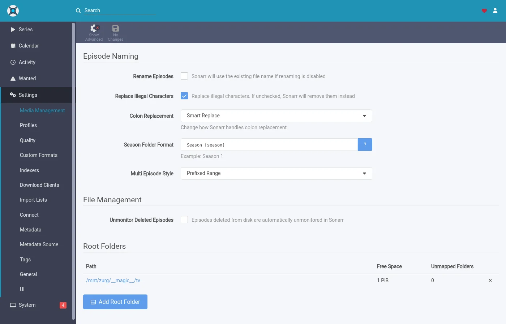
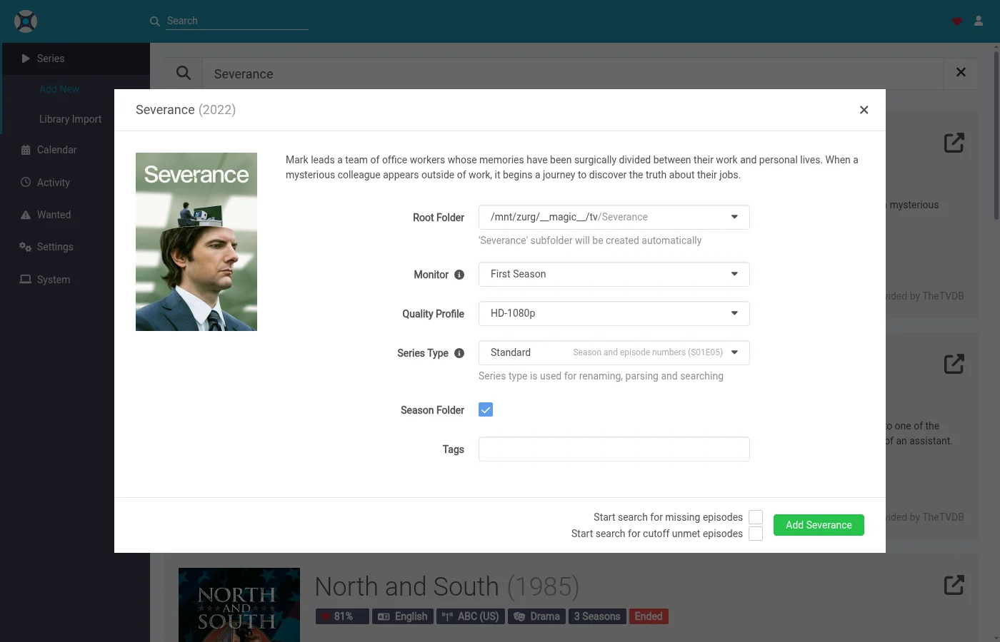

# zurgにSonarrとRadarrが欲しいものを取ってこさせる {#let-zurg-fetch-what-sonarr-and-radarr-want}

Sonarr と Radarr を zurg と使う方法は3つあります。本当の選択は、検索を行うのが zurg か \*arrs かです。[どちらを選ぶか](#which-one-to-pick)で比較しています。

| ガイド | 検索するのは | zurg の役割 | 必要なもの |
|---|---|---|---|
| [Usenet](sonarr-radarr.md) | Sonarr と Radarr | SABnzbd | Usenet アカウント（`torbox_nzb` バックエンドを使う場合は TorBox Pro）と、Prowlarr または \*arrs 内の Usenet インデクサー |
| [Torrents](sonarr-radarr-torrents.md) | Sonarr と Radarr | qBittorrent | デブリッドアカウントと、Prowlarr または \*arrs 内のトレントインデクサー |
| [zurg による検索](sonarr-radarr-fetch.md) | zurg | ダウンロードクライアントは一切不要 | Usenet、TorBox Pro、またはデブリッドのアカウントと、zurg 自身の設定内の Newznab または Torznab インデクサー |

最初の2つは並べて実行できます。どちらも同じ `__magic__` フォルダを共有します。

### どちらを選ぶか {#which-one-to-pick}

| | zurg で検索 | Sonarr と Radarr で検索 |
|---|---|---|
| インデクサーの設定先 | zurg の `config.yml`。変更するには再起動が必要です | いつも通り Prowlarr または \*arr 側 |
| \*arr 側に必要なもの | `__magic__` 内のルートフォルダーだけで十分です | ダウンロードクライアントとして zurg を設定し、ダウンロードフォルダーとルートフォルダーを同じボリュームに置きます |
| 最初に取得されるファイル | プロファイルで許可されていて、最も早く確認できるファイルです。後からカットオフまでアップグレードされます | プロファイル内で *arr が最も高く評価するファイルです |
| アニメ、デイリー番組、スペシャル | 2026年11月5日のナイトリービルドから対応します | 対応済み |
| 手動検索、キュー、履歴、ブロックリスト | なし。ファイルが表示され、*arr が再スキャンします | いつも通り動作します |
| zurg の [`exclude_words`](acquisition.md#excluding-releases-by-name) | 適用されます | 適用されません。同じ単語を *arr 側でブロックしてください |

どちらも、*arr がインポートする前にリリースを確認します。期限切れの Usenet 投稿や、アカウントに既に入っていないトレントは、決して配置されません。

新規インストールなら、まず zurg の検索から始めましょう。設定する項目が少なく、ボリュームのレイアウトを気にする必要もありません。リリースを手動で選びたい場合は、ダウンロードクライアントの方法を使ってください。すぐに届く最初のファイルよりも、プロファイルで最も良いリリースを待ちたい場合は、[`best_first`](acquisition.md#taking-the-profiles-best-first) を有効にしてください。

Radarr と Sonarr はリストとライブラリを管理します。取得は zurg が行います。映画やシリーズは、いつも通り追加してください。zurg がインデクサーからリリースを探します。NZB がまだニュースサーバーにあるか（`torbox_nzb` アカウントの場合は、TorBox が取得済みかどうか）、または debrid アカウントにトレントが既にあるかを確認します。次に、`__magic__` 内のフォルダーにファイルを配置し、Radarr または Sonarr に再スキャンを依頼します。インポートのためにダウンロードされるものも、コピーされるものもありません。

このために Radarr と Sonarr にインデクサーもダウンロードクライアントも必要ありません。検索も取得も一切しません。品質プロファイルが、zurg が取得できるものを引き続き決めます。

スクリーンショットは、2026年9月26日のナイトリービルドとして提供された zurg ビルドで撮影したものです。Docker 上の Radarr 6.3.0.10514 と Sonarr 4.0.20.3014 を使用しています。両方とも、コンテナ内で zurg のマウント `/mnt/zurg` を認識していました。画像は一切加工していません。

## 始める前に {#before-you-start}

1. **zurg には Usenet またはデブリッドのアカウントと、少なくとも1つの Newznab または Torznab インデクサーが必要です。** インデクサーは zurg の設定の `acquisition.indexers` に書きます。その設定ブロックについては [ウォッチリストと Seerr](acquisition.md) のページで説明しています。

2. **`magic.enabled` を `true` にします。** これがないと Radarr と Sonarr のソースは起動せず、ログにもその旨が出ます。[`__magic__`](magic.md) を参照してください。

3. **Radarr と Sonarr から zurg のマウントが見えるようにします。** 通常のアプリとしてインストールする場合、どちらにも注意点が1つあり、[Usenet ガイド](sonarr-radarr.md#before-you-start) に書かれています。Linux ホスト上の Docker では、マウントをそれぞれのコンテナにバインドする必要があります。マウントの親ディレクトリを一度バインドすれば、その下のすべてにアクセスできます。両方が zurg からダウンロードクライアントとして grab も受け取る場合、ダウンロードフォルダーとルートフォルダー用に2つのボリュームを使うと、インポートのたびにコピーが発生します。[1つのボリューム](sonarr-radarr.md#one-volume-for-the-download-folder-and-the-root-folders) を参照してください。

4. **2026年9月26日以降のナイトリービルドを使っています。** それより古いビルドは `radarr` と `sonarr` のソースを認識しません。

## 1. zurgにRadarrとSonarrを教える {#1-tell-zurg-about-radarr-and-sonarr}

`config.yml` の `acquisition` の下に `radarr` ソースと `sonarr` ソースを追加して、zurg を再起動してください。このブロックはまだダッシュボードのフォームがありません。使わない方は省いてください。

```yaml
acquisition:
  quality: best
  indexers:
    - name: my-indexer
      url: https://indexer.example
      api_key: YOUR_INDEXER_API_KEY
  sources:
    - name: radarr
      type: radarr
      enabled: true
      url: http://radarr:7878         # http://localhost:7878 when Radarr is an ordinary app beside zurg
      api_key: YOUR_RADARR_API_KEY
      library_path: /mnt/zurg/__magic__
      check_every_secs: 30
    - name: sonarr
      type: sonarr
      enabled: true
      url: http://sonarr:8989         # http://localhost:8989 likewise
      api_key: YOUR_SONARR_API_KEY
      library_path: /mnt/zurg/__magic__
      check_every_secs: 30
```

`url` と `api_key` はそれぞれのアプリの設定値です。API キーは両方とも **Settings > General** にあります。`check_every_secs` は、zurg がアプリに欲しいものを問い合わせる間隔です。ポーリング1回につき、リストを取得するリクエストが1件送られます。両方のソースに同じインデクサーが使われます。

`library_path` は、アプリから見た zurg の `__magic__` ディレクトリの場所です。zurg はこれを使って、Radarr のフォルダを `__magic__` 内の場所に変換します。上記の設定では、Radarr が `/mnt/zurg/__magic__/movies/Heat (1995)` に保存している映画は、zurg の `__magic__` 内の `movies/Heat (1995)` に配置されます。`Z:\__magic__` のような Windows のパスも同じように動作します。`library_path` を省略できるのは、アプリが zurg と同じホストで動いていて、zurg がマウントしている場所と同じマウントを見ている場合だけです。

`concurrency` は、zurg が同時に処理するタイトルの数で、デフォルトは 8 です。リストが大きくてもデフォルトのままで問題ありません。処理に時間がかかるだけです。

## 2. ルートフォルダを`__magic__`の中に置く {#2-put-the-root-folders-inside-__magic__}

ルートフォルダは `__magic__` の中、ひとつ下の階層に置く必要があります。Radarr は `/mnt/zurg/__magic__/movies`、Sonarr は `/mnt/zurg/__magic__/tv` の形を真似してください（macOS では `/Volumes/Zurg/__magic__/movies`、Windows では `Z:\__magic__\movies`）。`__magic__` そのものや `__magic__/__all__` は違います。それ以外の場所にあるフォルダのタイトルはスキップされ、zurg はそのことをログに一度だけ出力します。

Radarr で **Settings > Media Management** を開き、ルートフォルダを追加してください。


Sonarr も同じ画面があります。**Root Folders** の下にルートフォルダを追加してください。



Sonarr の画面にある **Season Folder Format** は、zurg が新しいシーズンフォルダに付ける名前です。すでにファイルがあるシーズンは、今あるフォルダをそのまま使います。どちらのアプリに表示される空き容量も、マウントが報告している値です。どちらのアプリもそこへは書き込みません。

## 3. 検索をオフにしてタイトルを追加する {#3-add-titles-with-search-off}

映画やシリーズは、今までと同じ方法で追加できます。手動で追加することも、リストから追加することも、リクエストアプリから追加することもできます。変えるのは検索だけです。検索は zurg が行うので、arrs は検索しないようにしてください。

### Radarr

このチュートリアルではインポートリストを使います。**Settings > Import Lists** を開いて、リストを追加または編集してください。


リストの設定では **Enable Automatic Add** をオンのままにして、**Search on Add** はオフにしてください。品質プロファイルとルートフォルダーは手順2で選んだものを指定します。**Minimum Availability** は好きなものに設定してください。zurg は Radarr が映画を利用可能と判断するまで待ってから、その映画を探します。


映画を1本ずつ手動で追加する場合は、同じスイッチが **Start search for missing movie** という名前になっています。こちらもオフのままにしてください。

### Sonarr

手動でシリーズを追加するときは、**Start search for missing episodes** と **Start search for cutoff unmet episodes** のチェックを外したままにしてください。**Monitor** で zurg が何を取りに行くかが決まります。このシリーズは最初のシーズンに設定されています。



Sonarr のインポートリストにも同じスイッチがあります。そちらの検索もオフにしてください。

## 4. インデクサーとダウンロードクライアントは空のままにする {#4-leave-indexers-and-download-clients-empty}

arr側の設定はこれで全部です。Indexersページは空のままで大丈夫です。


Download clientsページも空のままで大丈夫です。


Sonarrも同じです。以前の設定でどちらかのアプリにすでにIndexersとDownload clientがあれば、そのまま動き続けます。ただ、その場合は同じタイトルをzurgと両方で取りに行ってしまいます。zurgが管理しているタイトルについては、そのIndexerの自動検索をオフにするか、Indexerを削除してください。

## 5. 動作を確認する {#5-watch-it-work}

zurgのダッシュボードを開きます。クイックリンクに **Acquisition** が新しく追加されています。


このページには、zurgが処理中のすべてのタイトルと、それぞれが今何をしているかが表示されます。同じデータは、スクリプトから読みたい場合に `/acquisition/status.json` でも取得できます。

### 映画 {#movies}

これは Radarr が映画を追加してから約30秒後の、10本の映画のリストです。そのうち5本はファイルが揃っていて、Radarr にその情報を伝えています。残りはすべて完了しています。


各行が1本の映画です。**State** にはその映画の現在の状態が出ます。**Stage** には、zurg がいま何をしているかが出ます。まず indexer を読みます。次に候補を判定します。それから、リリースの NZB を読み、ニュースサーバーで投稿を確認します。最後にファイルを配置します。**Release** には、zurg が選んだ投稿と、Radarr のパーサーがそれをどう解釈したかが出ます。**Placed at** には、動画が今置かれている `__magic__` 内のパスが出ます。ニュースサーバーにもう残っていないタイトルは、すぐ次の候補に移ります。使えるものがないタイトルは、理由を添えて脇に置かれます。

その1分後には、すべてが完了しています。


### シリーズ {#series}

Sonarrのシーズンは同じページに表示されます。1行が1つのシーズン、またはzurgがアップグレード中の1つのエピソードファイルを表します。ここでは、追加から30秒後に最初のシーズンが監視対象になった2つのシリーズを例にします。どちらのシーズンも放送が終わっていてファイルがなかったため、zurgはそれぞれシーズンパックを探しました。Severanceのパックはそのシーズンのフォルダにあり、Sonarrに通知されています。Only Murdersのパックはニュースサーバーで確認中です。


追加から約2分後、両方のシーズンが完了します。Only Murdersのパックはニュースサーバー上でピースが欠けていました。zurgはそのパックを保留にして、代わりに10話を1話ずつ取得しました。その行には最後に配置されたエピソードが表示されます。


## 6. RadarrとSonarrに表示される内容 {#6-what-radarr-and-sonarr-show}

ライブラリはリスキャンが完了するたびに埋まっていきます。このリストの映画はすべてファイルがそろっています。


映画のページには、`__magic__` 内のフォルダにあるファイルと、Radarr がファイル名から読み取った画質が表示されます。


Sonarr では、10 話すべてのファイルがシーズンフォルダ内にあり、各話のファイル名から Sonarr が読み取った画質も表示されます。


両方とも **Activity** は空のままです。キューにエントリはなく、grab やインポートのイベントもありません。何も grab されていないからです。ファイルは突然フォルダに現れ、zurg が要求したリスキャンがそれを拾っただけです。


ここから次のことがわかります。Arr のブロックリストには何も書き込まれません。zurg は、ニュースサーバーにもう残っていない投稿の記録を独自に管理していて、それらを二度と選びません。また、Radarr や Sonarr で削除したタイトルは、アカウントからは削除されません。ファイルは他のリリースと同じように `__all__` に戻って表示されます。

## zurgがリリースを選ぶ仕組み {#how-zurg-picks-a-release}

品質プロファイルがゲートの役割を果たします。zurg が取り込もうとするリリースは、まずアプリ自身のパーサーを通ります。タイトルが正しくなければなりません。品質はプロファイルで許可されているものである必要があります。カスタムフォーマットのスコアはプロファイルの最低値に達している必要があります。サイズは **Settings > Quality** で設定された上限に収まっている必要があります。どれか一つでも失敗したリリースは取り込まれません。

### 映画 {#movies-1}

プロファイルで許可されているリリースの中から、zurg は最も早く確認できるものを選びます。単一の動画ファイルだけを含む投稿が最初に来るのは、Usenet サーバーにまだ完全な状態で残っていることが多いからです。同じ理由で、Web リリースは Blu-ray より前に来ます。複数ボリュームのアーカイブセットは、その次の候補になります。

プロファイルの優先順位は、代わりにアップグレードで反映されます。プロファイルでアップグレードが許可されていて、配置されたファイルがカットオフを下回っている場合、zurg は映画に対してより良いリリースがあるかを探します。厳密に良いリリースだけがファイルを置き換えます。画質が下がるものが選ばれることは決してありません。

公開日が未来の映画は、Radarr が利用可能だと判断するまで待機します。検索結果が別の映画を指していた場合、Radarr がそのタイトルをライブラリ内のどの映画にも一致させられないため、その検索は拒否されます。

### シリーズ {#series-1}

シーズンは、ひとまとまりの作業単位です。シーズン内のエピソードがすべて欠けていて、そのシーズンの放送が終わっている場合、zurgはまずシーズンパックを試します。そうでなければ、欠けているエピソードを一つずつ取りに行きます。

すでに一部のファイルがあるシーズンでは、パックは決して取得しません。取得するとフォルダーに同じエピソードの2つ目のコピーが入ってしまうためです。

リリースは、このシリーズとこのシーズンのものである必要があります。パックはシーズン全体である必要があります。エピソードのリリースは、その1話だけである必要があります。サイズ上限は、リリースに含まれるエピソードの再生時間に対するものです。

シーズン内の1話について、zurgが取得できるものがまだない場合でも、残りのエピソードは配置され、すぐにSonarrへ通知されます。欠けているエピソードは、通常の再試行スケジュールに従って後で再度検索されます。

プロファイルでアップグレードが許可されている場合、カットオフ未満のエピソードファイルはアップグレードの対象になります。カットオフ未満とは、カットオフの品質未満、またはカットオフのカスタムフォーマットスコア未満のことです。zurgは、この両方をSonarrのアップグレードルールと同じように数えます。Sonarr独自の **Cutoff Unmet** リストに表示されるのは品質のほうだけです。アップグレードは自分のエピソードだけを置き換え、シーズンフォルダーの残りはそのままの場所に残ります。

## 知っておきたいこと {#things-to-know}

- **`config.yml` の `acquisition` ブロックを変更したら、再起動が必要です。** zurg はファイルを起動時にしか読み込みません。
- **rescan は最後のステップで、アプリ自身の処理の後ろに並びます。** リストで多数の映画が追加された直後は、Radarr がまず一つずつ更新します。その間もファイルはすでに配置されています。
- **Analyse video files は、マウント越しに各ファイルの先頭部分を読み込みます。** 動作はしますが、大きなリストではもっとも遅い部分です。メディア情報が不要だと分かっていなければ、そのままオンにしておいてください。
- **監視されていないタイトルは対象外です。** 映画、シリーズ、シーズン、エピソードのすべてが該当します。フォルダーが `__magic__` の外にあるタイトルも対象外です。
- **アニメ、デイリー番組、スペシャルには、2026 年 11 月 5 日以降の nightly が必要です。** デイリー番組のエピソードは放送日で探されます。アニメのエピソードは、番組がその話数を数える番号で探されます（`Jujutsu Kaisen - 30` は 2 期の 6 話目です）。スペシャルはシーズン 00 として検索されます。アニメやデイリー番組のファイルは `JUJUTSU KAISEN - S02E06 - <the release's own name>` という名前で配置されます。Sonarr の rescan はファイル名だけを見て判断するため、`2nd Season - 06` のままだとシーズン 1 に振り分けられてしまうからです。`S00Exx` がなく、タイトルだけで名前が付いたスペシャルは、Sonarr でも照合できません。古いビルドでは、そのようなシリーズは一つずつログに 1 行だけ書き出されてスキップされます。

両方のソースの詳しい説明は [ウォッチリストとSeerr](acquisition.md) にあります。
