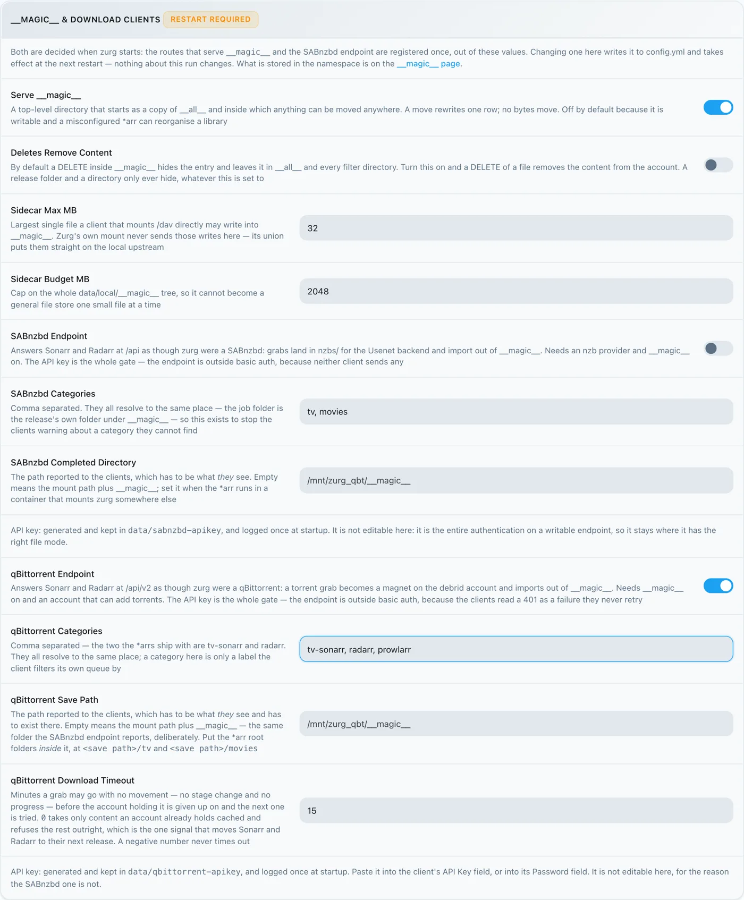
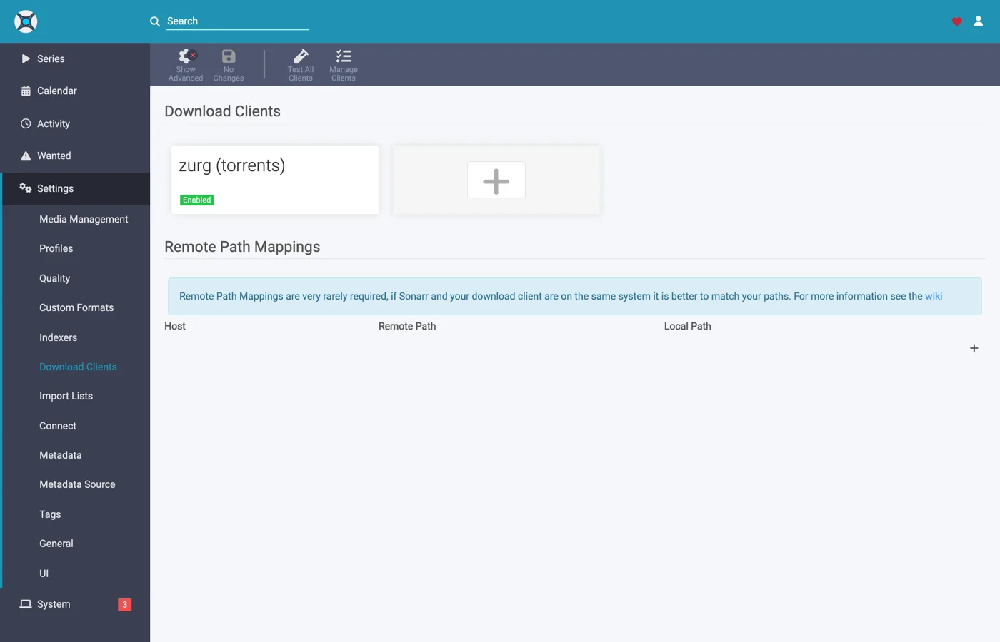
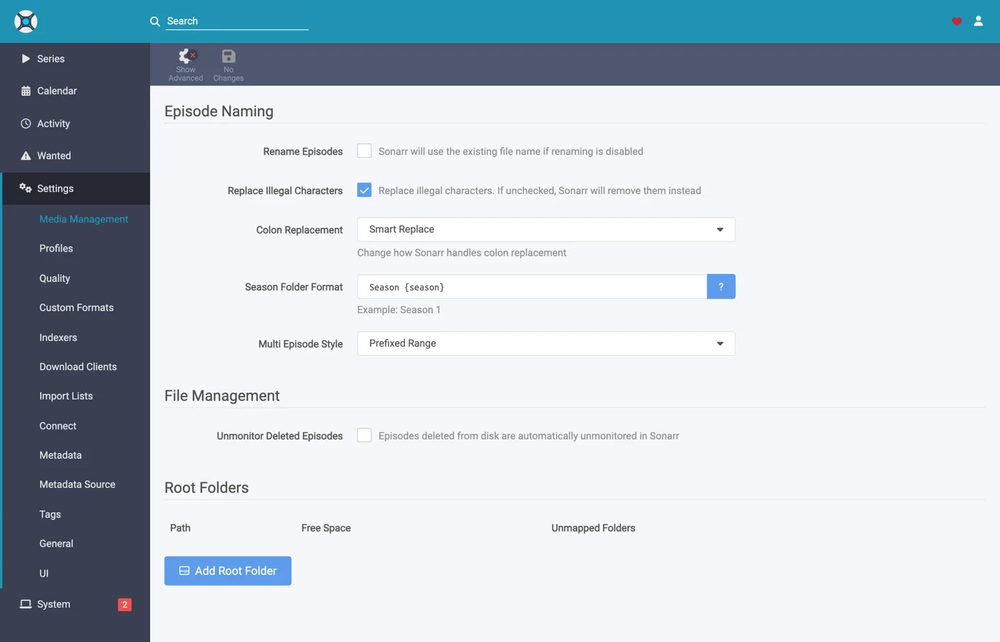
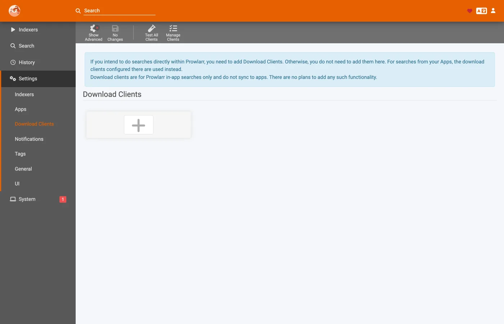
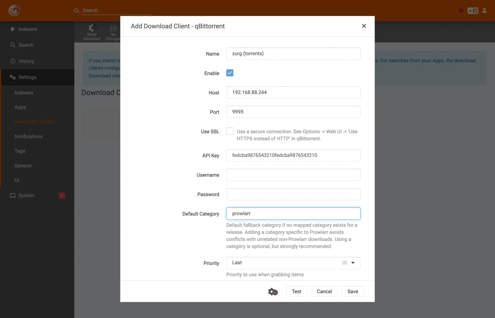
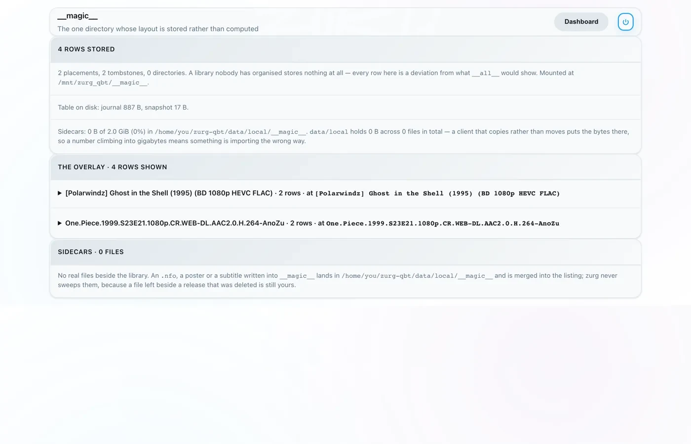

# Sonarr と Radarr をトレントで使う、ステップバイステップ {#sonarr-and-radarr-with-torrents-step-by-step}

三つの使い方があります。本当の選択は、検索を誰がするか、つまり zurg か \*arr かです。[どちらを選ぶか](sonarr-radarr-fetch.md#which-one-to-pick)で両者を比べています。

| ガイド | 検索するのは | zurg の役割 | 必要なもの |
|---|---|---|---|
| [Usenet](sonarr-radarr.md) | Sonarr と Radarr | SABnzbd として | Usenet アカウント(`torbox_nzb` バックエンドを使う場合は TorBox Pro)と、Prowlarr または \*arr 側の Usenet インデクサー |
| [Torrents](sonarr-radarr-torrents.md) | Sonarr と Radarr | qBittorrent として | debrid アカウントと、Prowlarr または \*arr 側のトレントインデクサー |
| [zurg で検索](sonarr-radarr-fetch.md) | zurg | ダウンロードクライアントは一切なし | Usenet、TorBox Pro、debrid のいずれかのアカウントと、zurg 自身の設定にある Newznab または Torznab インデクサー |

最初の二つは同時に使えます。どちらも同じ `__magic__` フォルダーを共有します。

[前のチュートリアル](sonarr-radarr.md)では、Usenet 向けに \*arr を zurg に向けました。zurg は SABnzbd として応答します。今回はその逆側です。zurg が **qBittorrent** として応答し、\*arr は NZB ではなくマグネットリンクか `.torrent` を渡します。リリースはニュースサーバーではなく debrid アカウントに入ります。インポートの仕組みは同じです。`__magic__` 内でのリネームだけで、インポートのためにダウンロードもコピーもしません。

**\*arr がどちらを送ってくるかは、見た目の問題ではありません。** 通常、`.torrent` はファイルそのものがアカウントにアップロードされます。マグネットだけが info hash だけで追加されます。デフォルトのキャッシュのみモードでは、TorBox と Debrid-Link は代わりに info hash を受け取ります。キャッシュにないリリースを、追加せずに断るにはその方法しかないからです。マグネットの場合、アカウント側はハッシュから中身を割り出そうとします。ですが、プライベートトラッカーのハッシュには割り出しに使える公開スウォームがありません。Real-Debrid は `magnet_error` になり、ファイルは何も得られません。TorBox は受け付けたあと `checking` のまま止まり、ファイル一覧もサイズもなく、推定は100日と表示されます。そのため、グラブは失敗もせず完了もしません。

`.torrent` ファイルは、アカウントのキャッシュ検索をハッシュで直接行わせます。そのため、アカウントに既にあるコンテンツはマグネットの解決をせず、すぐに追加されます。これがプライベートインデクサーをここで使える理由です。アカウントに既にあるコンテンツなら、リリースは確実に追加できます。コミュニティで共有されているものなら、これはよくあるケースです。\*arr は、マグネットではなく `.torrent` ファイルを配布するインデクサーに向けてください。プライベートインデクサーはそうしています。

以下はすべて、実際の AllDebrid アカウントを使った本番環境で、zurg `2026.08.30.0459-nightly-73-g5b4c9790`、Sonarr `4.0.19.2979`、Radarr `6.3.0.10514`、Prowlarr `2.5.2.5491` を使って取得しました。ホスト名とユーザー名は `you@zurg-server` に変更しています。インデクサー名は `my-indexer` としています。API キーとライブラリの件数はサンプルです。それ以外は、取得した出力を一切変えていません。

## 始める前に {#before-you-start}

1. **zurg に、トレントを追加できるアカウントが必要です。** Real-Debrid、AllDebrid、TorBox、Premiumize、Debrid-Link、Offcloud のどれかです。この6つはどれも、アップロードされた `.torrent` ファイルそのものを受け付けます。だから、プライベートトラッカーのリリースも追加できるんです。Usenet アカウントは、どちらの形式のトレントも受け付けません。プロバイダーが `nzb` だけのインストールは、すべての取得を受け付けてから拒否してしまいます。zurg は起動時にそう教えてくれます。
2. **`magic.enabled` が `true` になっていること。** これがないと保存パスが存在せず、すべてのインポートが失敗します。[`__magic__`](magic.md) を参照してください。
3. **マウントが、zurg の報告するパスで \*arr から見えること。** \*arr がコンテナで動いている場合は、設定を始める前に[手順 8](#8-if-your-arr-is-in-docker) を読んでください。同じマシンに通常のアプリとしてインストールされている場合は、zurg がマウントした場所でマウントが見えます。ただし、システムごとに注意点が1つあります:
   - **Linux:** zurg と別のユーザーで動いている \*arr は、`user_allow_other` を有効にするまで空のフォルダーしか見えません。[Linux のセットアップ](../setup/linux.md#1-install-fuse-3)を参照してください。
   - **macOS:** zurg と同じユーザーで実行してください。`mount_path` を変更していなければ、マウント先は `/Volumes/Zurg` です。
   - **Windows:** Sonarr と Radarr は、インストーラーが用意している トレイアプリ として実行してください。Windows サービスとしては実行しないでください。zurg の `Z:` ドライブはログイン中のセッションに属していて、サービスはそのセッションの外で動くため、ドライブが見えません。[セッションのルール](../setup/windows.md#keeping-it-running-the-session-rules)を参照してください。

最初の2つは、zurg の作業ディレクトリにある設定ファイルを直接見て確認してください。Windows では、代わりに Notepad で `config.yml` を開いてください。

```bash
$ grep -A3 '^providers:' config.yml
providers:
- type: alldebrid
  token: <redacted>

$ grep -A3 '^magic:' config.yml
magic:
  enabled: true
  allow_delete: false
```

**`providers:` リストの順番が重要です。** 取得は、トレントを受け付けるすべてのアカウントに、リストの順番どおりに提示されます。拒否したり止まったりしたアカウントは見限られ、次のアカウントが試されます。2つのアカウントを持っているなら、先に使いたいほうを上に置いてください。

2つのキーで、アカウントをこの順番から外せます。`watchlist: true` にすると、ファイル内のどこにあっても、そのアカウントが最優先になります。`add_torrents: false` にすると、ローテーションから完全に外れます。そのアカウントは、引き続きライブラリの配信と読み取りは行いますが、新しいものは一切追加されません。アーカイブ用のアカウントや、クォータが埋まっているアカウントに向いています。Usenet アカウントは、どちらの設定でも決してトレントを提示されません。両方とも[設定リファレンス](../reference/config.md#accounts)にあります。

## 1. エンドポイントを有効にする {#1-turn-the-endpoint-on}

2つの方法があり、結果は同じです。どちらも`config.yml`に書き込み、どちらも再起動が必要です。`__magic__`を提供するルートとqBittorrentのエンドポイントは、zurgの起動時に一度だけ登録されるためです。

### オプション A — ダッシュボード {#option-a--the-dashboard}

zurgのダッシュボードを開き、**Config**をクリックして、**\_\_magic\_\_ & Download Clients**までスクロールします。**Serve \_\_magic\_\_**と**qBittorrent Endpoint**をオンにします。


**Config**は設定を行う場所です。**Magic**は、後でgrabが届いたときに確認する場所です。



**qBittorrent Save Path**は、\*arrがzurgとは別の場所にzurgをマウントしている場合を除き、空のままにしてください。詳しくは[8番目のステップ](#8-if-your-arr-is-in-docker)を見てください。オレンジ色の**Restart Required**チップの表示は正しいです。ここでの設定は、zurgを再起動するまで反映されません。

### オプション B — `config.yml` {#option-b--configyml}

手作業でブロックを追加して、zurgを再起動してください。

```yaml
magic:
  enabled: true

qbittorrent:
  enabled: true
  api_key: ""                   # empty = zurg generates one and keeps it
  categories: [tv-sonarr, radarr]
  save_path: ""                 # empty = <mount_path>/__magic__/__all__
  cached_only: true             # the default: only take what an account already holds
```

**カテゴリはフォルダではありません。** どれも同じ場所に解決されます。つまり、リリース自身のフォルダ `__magic__/__all__` の下です。リストはカテゴリを前もって作るだけです。クライアントの **Test** は足りないカテゴリを作成し、zurgはそれを `data/qbittorrent-categories.json` に保存します。Prowlarrを使う場合は `prowlarr` が必要です。詳しくは [手順10](#10-prowlarr-manual-grabs) を見てください。

zurgを再起動して、エンドポイントが登録され、プロバイダーが反映されたか確認しましょう:


エンドポイントに必要なのは `alldebrid` の行1つだけです。対応する6種類のtorrentタイプのどれでも構いません。

起動ログにも同じ内容が出ているので、一度は読んでおく価値があります:

```
INFO  router.qbittorrent  qBittorrent API on /api/v2 and /qbittorrent/api/v2, save path /mnt/zurg_qbt/__magic__/__all__, categories tv-sonarr, radarr
INFO  router.qbittorrent  qBittorrent: cached-only, so a grab is only accepted onto an account that already holds the content; anything else is refused and the *arr takes its next release. Set qbittorrent.cached_only: false to let accounts download
INFO  router.qbittorrent  qBittorrent: torrents are offered to alldebrid, in that order
```

## 2. API キーを見つける {#2-find-the-api-key}

APIキーは、このエンドポイントの認証そのものです。一度きちんと設定して、公開の場には貼らないでください。

**`api_key` を空のままにした場合**、zurg は初回起動時にキーを生成して `data/qbittorrent-apikey` に書き込みます:

```bash
$ cat data/qbittorrent-apikey
fedcba9876543210fedcba9876543210

```

これは例のキーです。実際のキーは違う値になります。このファイルは再起動後も残るので、一度生成されたキーは変わりません。

**`api_key` を自分で設定した場合**、キーは `config.yml` に書かれていて、ファイルは作られません。

**このエンドポイントは zurg の基本認証の対象外です。** \*arrs はダウンロードクライアントに、そのクライアント独自の方法で認証します。\*arrs の HTTP 層は、基本認証の 401 を「unable to connect」と表示するだけで、対処のヒントが何も出ません。そのため zurg は `/api/v2` を意図的に除外しています。APIキーがこのエンドポイントを守る唯一の鍵になります。ポートの扱いは zurg の他の部分と同じように考えてください。信頼できるネットワーク内で使うか、それを守る仕組みの後ろに置いてください。

キーの渡し方は3種類あり、どれも使えます:

- **`Authorization: Bearer <key>`**: クライアントの **API Key** 欄にキーを入力したときに送られる形式です。おすすめの方法で、ログイン処理を丸ごと飛ばせます。
- **`auth/login` でパスワードとしてキーを使う**: ユーザー名は何でもかまいません。Username と Password の欄に入力したい場合はこちらを使ってください。
- **zurg 自身のダッシュボードのユーザー名とパスワード**: `config.yml` に `username:` と `password:` が設定されている場合に使えます。

## 3. 応答することを確認する {#3-prove-it-answers}

Sonarr に触る前に、これをやっておいてください。10秒で済み、そのあとの設定で「zurg の問題なのか、*arr の問題なのか」をはっきり切り分けられます。

+++ Linux と macOS

```bash
$ KEY=fedcba9876543210fedcba9876543210
$ ZURG=192.168.88.244:9995

$ curl -s "http://$ZURG/api/v2/app/webapiVersion"
Forbidden

$ curl -s -H "Authorization: Bearer $KEY" "http://$ZURG/api/v2/app/webapiVersion"
2.11.2

$ curl -s -H "Authorization: Bearer $KEY" "http://$ZURG/api/v2/app/version"
v5.0.4

$ curl -s -H "Authorization: Bearer $KEY" "http://$ZURG/api/v2/app/preferences" | jq .save_path
"/mnt/zurg_qbt/__magic__/__all__"
```

+++ Windows

PowerShell で実行してください。`curl` ではなく `curl.exe` と入力します。Windows PowerShell の `curl` は別のコマンドです。

```powershell
PS> $KEY = "fedcba9876543210fedcba9876543210"
PS> $ZURG = "192.168.88.244:9995"

PS> curl.exe -s "http://$ZURG/api/v2/app/webapiVersion"
Forbidden

PS> curl.exe -s -H "Authorization: Bearer $KEY" "http://$ZURG/api/v2/app/webapiVersion"
2.11.2

PS> curl.exe -s -H "Authorization: Bearer $KEY" "http://$ZURG/api/v2/app/version"
v5.0.4

PS> (Invoke-RestMethod "http://$ZURG/api/v2/app/preferences" -Headers @{ Authorization = "Bearer $KEY" }).save_path
Z:/__magic__/__all__
```

+++

**`Forbidden` だけが返ってきたら正常です。** クライアントが最初に送るプローブは、*未認証の* `GET /api/v2/app/webapiVersion` です。本物の qBittorrent も、API はあるがログインしていない場合にこれへ `403` を返します。zurg も同じ応答を返すので、クライアントは「v2 に対応している。今すぐ認証せよ」と解釈します。

代わりにプレーンな **404** が返ってきた場合は、`qbittorrent.enabled` がまだ false になっているか、設定を変えたあとに zurg を再起動していないことを意味します。

次に、間違ったキーが本当に拒否されるかを確認します:

+++ Linux と macOS

```bash
$ curl -s -o /dev/null -w "%{http_code}\n" -H "Authorization: Bearer wrongkey" \
    "http://$ZURG/api/v2/torrents/info"
403
```

+++ Windows

```powershell
PS> curl.exe -s -o NUL -w "%{http_code}\n" -H "Authorization: Bearer wrongkey" "http://$ZURG/api/v2/torrents/info"
403
```

+++

`save_path` は zurg がクライアントに渡すパスです。今のうちに、それが *クライアント側* で開けるパスかどうか確認しておきましょう。

どちらの URL 形式でも動作するので、クライアントの **URL Base** 欄にはどちらを入れても構いません:

| パス | Sonarr / Radarr での URL Base | 応答 |
|---|---|---|
| `/api/v2/…` | *(空欄のまま)* | はい |
| `/qbittorrent/api/v2/…` | `/qbittorrent` | はい |

## 4. ルートフォルダを作る {#4-make-the-root-folders}

先に作ってから追加してください。\*arr の Add Root Folder ダイアログは実際のファイルシステムを参照するため、存在しないフォルダは表示されません。

+++ Linux と macOS

```bash
$ mkdir -p /mnt/zurg_qbt/__magic__/tv /mnt/zurg_qbt/__magic__/movies

$ ls -d /mnt/zurg_qbt/__magic__/tv /mnt/zurg_qbt/__magic__/movies
/mnt/zurg_qbt/__magic__/movies
/mnt/zurg_qbt/__magic__/tv
```

+++ Windows

```powershell
PS> New-Item -ItemType Directory -Force Z:\__magic__\tv, Z:\__magic__\movies
```

または、エクスプローラーで 2 つのフォルダを作成してください。

+++

`/mnt/zurg_qbt` の部分は、ご自身の `mount_path` に置き換えてください。未設定の場合、Linux では `/mnt/zurg`、macOS では `/Volumes/Zurg`、Windows では `Z:` になります。

**ルートフォルダは保存パスの横に置いてください。保存パスの中にも、上にも置かないでください。** これは Usenet のチュートリアルと同じルールで、理由も同じです。zurg は保存パスとして `__magic__/__all__` を報告します。ルートフォルダがダウンロードクライアントの出力フォルダと同じ場合、両方のクライアントがヘルスチェックの警告を出します。ルートフォルダがその出力フォルダを*含んでいる*場合は、Radarr も警告を出します。横に並んでいれば、どちらの警告も出ません。間違えたときの画面例は [そのガイド](sonarr-radarr.md#4-make-the-root-folders) にあります。

トレントならではの理由もあります。移動先が `__magic__` の外にあると、2 つの異なるファイルシステム間の移動になります。これはコピーと同じ扱いになり、デビッドマウントからリリース全体をネットワーク越しに読み直すことになります。[下記](#if-the-import-copies-instead-of-moving) の `Remove Completed` をオンのままにしておけば、インポートはリネームのままになります。名前空間の外にルートフォルダを置くと、どのみちこの効果が失われてしまいます。

2 つのボリューム間の移動も、同様にコピーになります。これは Docker を使うときに重要です。その点は手順 8 で説明します。

(以前の翻訳は、マーカーが一致しないとして差し戻されました。構造はそのまま保ってください。)

## 5. Sonarr にクライアントを追加する {#5-add-the-client-in-sonarr}

ブランドニューの Sonarr は、最初の起動画面ですべてをブロックします。**Forms (Login Page)** を選び、ユーザー名とパスワードを設定して、**Save** をクリックしてください。


**Authentication Method** が None 以外になっていないと、先に進めません。


**Save** のあとは一度サインアウトされて、ログインページに移動します。


### Settings → Download Clients

**Settings → Download Clients** を開いてください。新規インストール直後は、**+** カードしか表示されていません。


「Download Clients」の下にある **+** をクリックしてください。「Remote Path Mappings」の下にある方ではありません。

**Torrents** 列から **qBittorrent** を選んでください。


zurg は qBittorrent を特に偽装するため、このリストの他のものは動作しません。どのガイドに従っているかは、2つの列を見ればわかります。SABnzbd は Usenet の下、qBittorrent は Torrents の下にあります。

ダイアログは qBittorrent の初期値で開きます。`localhost`、ポート `8080`、キーなしです。


### 各フィールドに入れる内容 {#what-to-put-in-each-field}

| 項目 | 値 | 理由 |
|---|---|---|
| Name | `zurg (torrents)` | 何でも構いません。ただのラベルです。 |
| Enable | on | チェックを入れたままにしてください。 |
| Host | `192.168.88.244` | zurg が動いているホストです。*arr から届くアドレスを指定します。*arr が同じマシン上の普通のアプリなら `localhost` でOKです。Docker の場合は下の警告を見てください。 |
| Port | `9995` | zurg の通常のポートです。デフォルトインストールでは `9999` です。 |
| Use SSL | off | zurg を自分で TLS の後ろに置いている場合のみ on にします。 |
| URL Base | empty | `/qbittorrent` でも動きます。手順 3 を参照。 |
| API Key | from step 2 | ここが要です。bearer token として送られます。 |
| Username / Password | empty | 両方空欄のままにしてください。キーがその代わりになります。 |
| Category | `tv-sonarr` | *arr のデフォルトです。zurg にはすでに登録されていて、**Test** は無いカテゴリを作成します。 |
| Initial State / Sequential / First-Last | defaults | ここには swarm がないので、どれも何の効果もありません。 |
| **Remove Completed** | **on** | **一番重要な項目です**。[インポートがコピーになる場合](#if-the-import-copies-instead-of-moving)を参照してください。 |


表示されている API キーはサンプルです。ご自身のキーを貼り付けてください。

**Dockerでは「localhost」もホスト名もどちらも当てになりません。** コンテナ内では `localhost` はそのコンテナ自身を指し、マシン自体のホスト名は通常 `127.0.1.1` に解決されます。これもコンテナ自身です。このリグのホストは `zurg-server` という名前ですが、Sonarr コンテナ内から `zurg-server` を引くと `127.0.1.1` に解決されました。同じ名前でもホストのシェルからは問題なく繋がりました。ホストの **LAN または Tailscale の IP** を使ってください。`localhost` もホスト名だけの指定もNGです。

**Test** をクリックします。緑のチェックマークは、クライアントのチェック（API バージョン、認証、カテゴリ、トレントリスト）が通ったことを示します。


次に **Save** をクリックします。



## 6. Sonarr でルートフォルダを追加する {#6-add-the-root-folder-in-sonarr}

**Settings → Media Management** を開いて、一番下までスクロールします。



**Add Root Folder** をクリックします。ファイルブラウザが開き、Sonarr のファイルシステムが表示されます。Docker を使っている場合は、コンテナ内のファイルシステムです。


パスを入力するか、フォルダをたどって移動します。マウントが Sonarr から本当に見えていれば、`__magic__` が開き、手順 4 で作ったフォルダと、zurg が自動で作る `__all__` が表示されます。マウントが正しいかを確かめる一番早い方法です。


ここが空だったり、エラーになったりする場合は、先に進まずマウントを直してください。


パスを `__magic__/tv` まで入力します（Windows では `Z:\__magic__\tv`）。そのあと **Ok** をクリックします。


**Free Space** に `1 PiB` と表示されるのは、zurg が実際のディスクではなく仮想ファイルシステムの容量を報告しているためです。これは想定どおりの動作です。この表示のおかげで、\*arr が grab の前に行う空き容量チェックを通過できます。

## 7. Radarr でも同じことをする {#7-do-the-same-in-radarr}

前回と同じです。ただし、変えるのは次の2つの値だけです。カテゴリは `radarr`、ルートフォルダは `__magic__/movies` です。


Radarr の初回起動も同じ流れです。まず Forms auth を設定してから、サインインします。


**Settings → Download Clients → +** を開き、Torrents の中から **qBittorrent** を選びます。


ホスト、ポート、キーは同じです。違うのは **Category** だけで、`tv-sonarr` ではなく `radarr` を入れます。

**Test** を押して緑のチェックマークが出たら、**Save** を押します。


次に **Settings → Media Management → Root Folders → Add Root Folder** を開いて、`/mnt/zurg_qbt/__magic__/movies` を追加します。

**zurg は1つ、クライアントは2つ、キューも1つです。** 各クライアントに表示されるトレントの一覧は、カテゴリだけで絞り込まれます。`tv-sonarr` を使う Sonarr が2つあると、お互いの grab が見えてしまいます。`tv-sonarr` の Sonarr と `radarr` の Radarr なら、互いの grab は見えません。カテゴリごとにクライアントを1つにしておけば、この問題は起きません。

## 8. *arr が Docker で動いている場合 {#8-if-your-arr-is-in-docker}

これは Linux ホスト上の Docker 向けの手順です。macOS と Windows では、[はじめに](#before-you-start) で説明しているとおり、\*arrs を通常のアプリとしてインストールしてください。その理由は Usenet ウォークスルーのステップ 8 に書かれています。

Usenet ウォークスルーと同じ 3 つの問題があり、修正方法も同じです。マウントはマウントなので、ここでは簡単に説明します。詳しくは [そのガイドのステップ8](sonarr-radarr.md#8-if-your-arr-is-in-docker) を見てください。

**zurg が報告するパスは、クライアントが開けるパスでなければなりません。** コンテナがライブラリを zurg とは別の場所にマウントしていると、インポートはすべて *download doesn't contain intermediate path* で失敗するか、remote-path health check で失敗します。`qbittorrent.save_path` には、*クライアント*から見えるパスを設定するか、remote path mapping を追加してください:

```yaml
qbittorrent:
  save_path: "/data/zurg/__magic__/__all__"   # what the *arr sees, not what zurg sees
```

**保存パスとルートフォルダには 1 つのボリュームを使ってください。** コンテナに `__magic__/__all__` と `__magic__/tv` を 2 つのボリュームとして渡さないでください。両者の間のリネームがコンテナ内で失敗します。すると、クライアントはあなたのアカウントからのインポートをすべてコピーし、そのことを知らせずに zurg のディスクへ書き込んでしまいます。zurg のマウント全体を含む 1 つのボリュームを渡し、そのボリューム経由で両方のフォルダにアクセスさせてください。下のバインドがそのボリュームです。

**マウントポイントそのものではなく、その親をバインドしてください。** zurg を再起動するとアンマウントと再マウントが行われます。マウントポイントそのものをバインドしたコンテナは、古くなった FUSE 接続を保持し続け、その後のすべての読み取りが `Socket not connected` を返します。両方のクライアントはグラブの前に空き容量を確認するため、*すべてのリリースが黙って拒否されます*。親を `rslave` 付きでバインドすれば、再マウントはサブマウントのイベントとして届き、コンテナがそれを追従します。このリグのコンテナは zurg がマウントする前に起動されていましたが、それでもマウントはコンテナ内に現れました:

```bash
$ docker exec sonarr df -h /mnt/zurg_qbt
Filesystem      Size  Used Avail Use% Mounted on
zurg{8amax}:    1.0P     0  1.0P   0% /mnt/zurg_qbt
```

## 9. 1 回のグラブが通る流れを見る {#9-watch-one-grab-go-through}

ひとつ追加して、手動でグラブし、最後まで追いかけてみてください。以下はすべて、上記の構成を通じた実際のグラブです：*Ghost in the Shell (1995)*、インデクサーから手動で取得したもの。

### Grab it

映画を開いて、**Interactive Search** をクリックし、リリースを1つ選びます。


**Source** 列には `torrent` と表示されています。これは、このエンドポイントが受け付けるプロトコルです。行の末尾にある、矢印の付いた丸いボタンをクリックすると取得できます。クライアントが先にマッピングの確認を求めてきた場合は、次の画面が出ます。


**Override and Grab** は、リリースがきれいに一致しないときに表示されます。マッピングを確認して、**Grab Release** をクリックしてください。通常の取得では、このダイアログは表示されません。

### アカウントがそれを取り込む {#the-account-takes-it}

zurg のログで 1 回の追加を確認するには、3 行すべてを見る必要があります。アカウントがジョブを受け取った行、ジョブが登録された行、そして `finished` の行です。下の出力は古いビルドのもので、最後の 2 行しか記録されていません:

```
INFO  router.qbittorrent  qBittorrent: [Polarwindz] Ghost in the Shell (1995) (BD 1080p HEVC FLAC) (0c5e4077…) added to alldebrid as 720824192
INFO  router.qbittorrent  qBittorrent: [Polarwindz] Ghost in the Shell (1995) (BD 1080p HEVC FLAC) (0c5e4077…) finished on alldebrid
```

ハッシュは、クライアントが送った info hash です。`added … as 720824192` の部分は、アカウントがそのジョブに付けた ID です。このリリースはすでにアカウントにキャッシュされていたので、約 1 秒後に `finished` が続きます。キャッシュされていないリリースの場合は、アカウントがダウンロードしている間、2 行の間に少し間が空きます。その間にアカウントが何をしているかは、クライアントのキューに表示されます:

| アカウントの状態 | キューの表示 |
|---|---|
| magnet の参照先を調べている | *Loading metadata*、まだ計測値なし |
| アカウントのキューで待機中 | *Queued* |
| ダウンロード中。速度、スワーム、残り時間はアカウント側の値です | *Downloading*、実際の進捗バー付き |
| すべてのアカウントが拒否したか、タイムアウトした | 理由付きの **警告**。[トラブルシューティング](#troubleshooting) を参照 |
| ライブラリ内にあり、インポート用のフォルダが準備できている | *Completed* |

スワームが停滞している場合、キューには停滞の警告ではなく **Downloading** と表示され、速度とシード数は 0 になります。`stalledDL` は \*arrs が失敗したダウンロードを処理するときに使う状態です。しかし、シードがないスワームは、そのリリースが駄目だという判定ではありません。

magnet はまるごとアカウントに渡ります。zurg は、クライアントが掴んだ表示名と、指定されたトラッカーをそのまま渡します。magnet だけを公開しているインデクサーでは、表示名がリリース名を知る唯一の手がかりです。表示名がないと、TorBox は未解決の grab を、メタデータが未解決のままの間は 40 文字のハッシュ名で一覧に出します。`.torrent` ファイルは自身の名前とトラッカーを持つため、何も追加されません。例外は、TorBox と Debrid-Link のキャッシュ専用モード（デフォルト）です。ここではハッシュだけで問い合わせます。キャッシュがヒットすると実際の名前で返されるからです。

### インポートが行われる {#the-import-happens}

**Activity → Queue**、次に **Activity → History** を開きます。数秒差で2つのイベントが記録されています。最初が **Grabbed**、次が **Movie Imported** です:


インポートされた行を展開して、パスを確認してください。**Source** は `/mnt/zurg_qbt/__magic__/__all__/[Polarwindz] …/[Polarwindz] ….mkv` で、**Imported To** は `/mnt/zurg_qbt/__magic__/movies/Ghost in the Shell (1995)/…` です。ファイルは `__magic__` の外に一度も出ていません。だからこのインポートは、実質的にリネームになります。このスクリーンショットは、ライブラリが `__all__` の中に移動する前に撮られたものです。そのため、ソースのパスは、あなたの環境で表示されるものより1階層上になっています。

クライアントがインポートしないと判断した grab は、代わりにキューに警告として残ります。このスクリーンショットのキューの行は、品質プロファイルが拒否したアップグレードです。表示されていて、*Remove* を1クリックで押せますが、それだけでは何も消えません:


**Status: Downloaded, Size 17.2 GiB** になります。でも、それを実現するために何もダウンロードはされていません。バイト列は、何かがそのファイルを再生したときに、アカウントから読み取られます。

### ファイルが本物か確認する {#prove-the-file-is-real}

ファイルはインポートでルートフォルダーに移動されました。ファイルの両端を読んで、ffprobe に中身を調べてもらいましょう:

+++ Linux and macOS

シェルで `ffprobe` が見つからない場合は、`~/zurg/bin/ffprobe` を使ってください。インストール時に ffprobe が入っていなければ、セットアップがそこに独自のコピーを置いています。

```bash
$ F="/mnt/zurg_qbt/__magic__/tv/One Piece/Season 23/[AnoZu] One Piece S23E21 1080p CR WEB-DL AAC 2.0 H.264.mkv"

$ ls -la "$F"
-rw-rw-r-- 1 you users 1446325722 Aug 31 00:44 …mkv

$ dd if="$F" bs=1M count=1 >/dev/null
1048576 bytes (1.0 MB, 1.0 MiB) copied, 0.00592934 s, 177 MB/s

$ ffprobe -v error -show_entries format=duration,size,format_name \
    -of default=noprint_wrappers=1 "$F"
format_name=matroska,webm
duration=1415.808000
size=1446325722
```

+++ Windows

PowerShell を開き、zurg のフォルダーから実行します。PATH に `ffprobe` がすでにない限り、セットアップが `bin\ffprobe.exe` を置いています。その場合は代わりに `ffprobe` と入力してください:

```powershell
PS> $F = Get-Item -LiteralPath "Z:\__magic__\tv\One Piece\Season 23\[AnoZu] One Piece S23E21 1080p CR WEB-DL AAC 2.0 H.264.mkv"
PS> $F.Length
1446325722

PS> bin\ffprobe.exe -v error -show_entries format=duration,size,format_name -of default=noprint_wrappers=1 $F.FullName
format_name=matroska,webm
duration=1415.808000
size=1446325722
```

+++

これは Sonarr の grab の例です。エピソードも同じ方法で取得され、`tv/One Piece/Season 23/` にインポートされたものです。23分の Matroska で、debrid アカウントから直接読み取っています。データは、何かがそれを読み込んだときに届くのであって、\*arr がインポートしたときではありません。

### Sonarr から見ると同じように見える {#from-sonarr-it-looks-the-same}


履歴に出る 2 つのイベントも、リネームによるインポートも同じです。キューはインポートが終わった瞬間に空になります。キャッシュ済みのリリースは、grab からインポート完了まで数秒で終わるので、ダウンロード途中のスクリーンショットはここには載せていません。

## 10. Prowlarr で手動グラブ {#10-prowlarr-manual-grabs}

Prowlarr も同じエンドポイントに接続します。他の2つと同じ qBittorrent クライアントのコードを共有していますが、インポーターではありません。ライブラリを持たず、何かをインポートすることもありません。できるのは、リリースを**手動でアカウントに送信すること**です。これはまさにダウンロードクライアントの役割です。

Prowlarr の初回起動画面も、他の2つと同じ Forms 認証の画面です。




**Settings → Download Clients → +** を開き、**qBittorrent** を選びます。Prowlarr の選択画面では、\*arr のように2列ではなく、すべてのクライアントが1つのアルファベット順リストに並んでいます。ホスト、ポート、API キーは同じです。\*arr と違うのは次の2つのフィールドです。


| フィールド | 値 | 理由 |
|---|---|---|
| Default Category | `prowlarr` | Prowlarr のデフォルト値です。ヘルプテキストも読んでおく価値があります: *adding a category specific to Prowlarr avoids conflicts with unrelated non-Prowlarr downloads*。**Test** を実行すると zurg にカテゴリが作成されるので、`qbittorrent.categories` に追加する必要はありません。 |
| Priority | `Last` | 適用先がないので、そのままで構いません。 |



**Test** を押して緑のチェックマークが出たら、**Save** を押します。


次に **Search** を開き、探したいものを入力して、行をクライアントに送信します。


リリースは \*arr の grab と全く同じ方法でアカウントに追加されます。同じ追加パス、同じカテゴリ、同じ `__magic__` フォルダーを使います。今回の例では、キャッシュ済みで、1秒以内に `finished` になりました。ただし、インポートはされません。リリースはアカウントに置かれ、マウントから配信されます。これがポイントです。Prowlarr の push は「今すぐデバッドアカウントに入れたい」ときに使うもので、自動の grab・インポート・クリーンアップのパイプラインのためのものではありません。そちらを使う場合は、Sonarr と Radarr をエンドポイントに向けたままにして、インデクサーの管理は Prowlarr に任せてください。

## 11. リリースを手動で追加する {#11-adding-a-release-by-hand}

+++ Linux と macOS

```bash
KEY=your-qbittorrent-api-key
curl -H "Authorization: Bearer $KEY" http://localhost:9999/api/v2/torrents/add \
  -F 'urls=magnet:?xt=urn:btih:<hash>&dn=Movie.Title.2012.1080p.WEB-DL' \
  -F category=radarr4k
```

+++ Windows

PowerShell で、`curl` ではなく `curl.exe` を使います:

```powershell
$KEY = "your-qbittorrent-api-key"
curl.exe -H "Authorization: Bearer $KEY" http://localhost:9999/api/v2/torrents/add `
  -F 'urls=magnet:?xt=urn:btih:<hash>&dn=Movie.Title.2012.1080p.WEB-DL' `
  -F category=radarr4k
```

+++

`.torrent` ファイルでも使えます。`urls` の代わりに `-F 'torrents=@Movie.Title.2012.1080p.WEB.torrent'` と送ってください。

アプリがインポートするかどうかは、次の4つで決まります。

1. **映画やドラマが、そのアプリにすでに登録されている必要があります。** アプリは、自分が管理しているものと対応づけられるものだけをインポートします。
2. **名前で中身がわかる必要があります。** マグネットリンクの名前は `dn` です。`.torrent` ファイルの名前はファイル名です。zurg は qBittorrent の `rename` フィールドを無視します。Radarr は `Sintel` を解析できず、*Unable to parse download* として保留にしました。`Sintel.2010.1080p.WEB-DL` はインポートされました。名前には年を付けてください。
3. **アプリが最初に見る前に、名前を正しくしておいてください。** Radarr がダウンロードを解析不能と判断すると、Radarr を再起動するまでその判断は変わりません。より良い名前で追加し直しても変わらなかった例があります。再起動後はインポートされました。
4. **カテゴリーは単なるラベルです。** `qbittorrent.categories` に含まれていないカテゴリーでも受け付けられます。ただ、カテゴリー一覧には表示されません。リリースは後から別のアプリに移せます。新しいカテゴリーを持つアプリは、次のチェックでそれをインポートします。

```bash
curl -H "Authorization: Bearer $KEY" http://localhost:9999/api/v2/torrents/setCategory \
  -F hashes=<hash> -F category=radarr
```

Windows では、`$KEY` を上と同じように設定したうえで、`curl.exe` を1行で実行します。

すでにアカウントにあるリリースも同じ方法で扱えます。DMM から送ったものも含みます。zurg はそれがライブラリにすでにあることを確認し、二重に追加せず、カテゴリーの下に記録します。このエンドポイント経由で追加しなかったリリースは、Sonarr と Radarr からは見えません。zurg が見せるのは、このエンドポイントを通ったものだけです。

検証は 2026-10-04 に、AllDebrid アカウントと Radarr 6.3 で行いました。各映画は `__magic__/movies` に名前を変えてインポートされ、コピーはされませんでした。別のカテゴリーに設定した Radarr は、それを一度も見ませんでした。Sonarr はテストしていません。

## 12. Plex は 1 セットのフォルダを読む {#12-plex-reads-one-set-of-folders}

インポートしても、zurg 自身のフォルダからリリースが取り出されるわけではありません。Radarr が `__magic__/movies` に置いた映画も、`movies` と `__all__` に今まで通り残ります。そのため、Plex はどちらか一方のフォルダセットだけを読み込み、両方を読み込まないようにしてください。

| Plex が読むフォルダ | 得られるもの |
|---|---|
| `movies` と `shows` | debrid アカウント上のすべてです。\*arr による取得分もここに表示されます。名前はリリースの名前そのままです。 |
| `__magic__/movies` と `__magic__/tv` | Sonarr と Radarr がインポートしたものだけです。名前とフォルダは \*arr が決めたものになります。 |

Plex のライブラリがすでに `movies` と `shows` を指しているなら、そのままにしておいてください。\*arr による取得分は、何も変更しなくてもそこに表示されます。`__magic__` フォルダを Plex に追加するのは、\*arr のインポートだけで構成されたライブラリが欲しい場合に限ってください。その後で、他のフォルダは外しましょう。両方を読み込むと、すべてのタイトルが 2 回ずつ見つかってしまいます。

`__magic__` のルートも追加しないでください。そこには `__magic__/__all__` があり、これはライブラリ全体がもう一度入ったものだからです。

## 13. インデクサーと、スポンサー向けの DMM {#13-indexers-and-dmm-for-sponsors}

Sonarr と Radarr は Prowlarr 経由で検索します。zurg がマグネットリンクを debrid アカウントに追加するので、公開トレントインデクサーならどれでも使えます。ただし一部の公開サイトは Cloudflare の裏側にあり、FlareSolverr がないと Prowlarr が追加を拒否します。そういうサイトは使わないでください。

zurg をスポンサーしているなら、DMM もインデクサーになります。DMM のライブラリ全体を検索し、すでにあなたの debrid アカウントにあるものを一番上にランク付けします。そのグラブは即座に完了します。

1. [gatekeeper](https://gatekeeper.debridmediamanager.com) で DMM API キーを取得します。**Connect GitHub** を押し、Patreon でスポンサーしている場合は、その後に Patreon をリンクします。表示される **DMM API key** をコピーします。これは [手順2](#2-find-the-api-key) の zurg キーではありません。DMM の Usenet インデクサーでも同じキーを使います。設定は [debridmediamanager.com/newznab](https://debridmediamanager.com/newznab) です。
2. Prowlarr で **Indexers → Add Indexer** を開き、**Generic Torznab** を選びます。
3. アカウントの URL とキーを入力します。**API Path** は `/api` のままにしてください。

| アカウント | URL |
|---|---|
| Real-Debrid | `https://debridmediamanager.com/api/torznab/rd` |
| AllDebrid | `https://debridmediamanager.com/api/torznab/ad` |
| TorBox | `https://debridmediamanager.com/api/torznab/tb` |
| Premiumize | `https://debridmediamanager.com/api/torznab/pm` |

TorBox と Premiumize では、先に DMM でそのサービスのキーをリンクしておく必要があります。場所は DMM のページに表示されます。アカウントにまだないものを除外したい場合は、URL の末尾に `/cached` を追加します。

Prowlarr はインデクサーを保存するときにテストします。キーが拒否された場合は、スポンサーシップが切れているかキーが間違っているので、エラーにその理由が表示されます。問題がなければ、Prowlarr が DMM を自動的に Sonarr と Radarr に渡します。1つのキーで、すべてのアプリを合わせて1分あたり20回まで検索できます。

## 14. Plex のウォッチリスト {#14-your-plex-watchlist}

Sonarr と Radarr は Plex のウォッチリストを追いかけられます。Plex に追加したものは、どれも追加されて検索され、ほかの取得と同じように zurg 経由で届きます。

各アプリで **Settings → Import Lists → + → Plex Watchlist** を開き、**Authenticate with Plex.tv** を押してください。Root folder は `__magic__` フォルダに設定し、**search on add** をオンにします。Radarr はリストの映画を、Sonarr はリストの番組を拾います。

zurg には、zurg 自身に指定したインデクサーから取得する [独自のウォッチリスト](plex-watchlist.md) もあります。どちらか一方を使ってください。両方を使うと、同じタイトルが二重に取得されてしまいます。

ジャンルのリストなど、ほかのリストを追いかけたい場合は [Sonarr と Radarr のリスト](import-lists.md) を見てください。

## インポートがコピーになる場合 {#if-the-import-copies-instead-of-moving}

上記のすべては、インポートが**名前の変更（rename）**であることに依存しています。それを決めるのは2つです。1つ目は、コンテナがマウントにどう接続しているかです。これはあなたしか変更できません。保存パスとルートフォルダーが2つの異なるボリュームにあると、他の設定に関係なく、インポートはすべてコピーになります。[手順 8](#8-if-your-arr-is-in-docker)で説明しています。もう1つは \*arr の設定のひとつです。

クライアントは、ダウンロードを後で削除しても問題ないと判断したときだけ、インポートされたファイルを移動します。その条件は3つ同時に満たすことです。**Remove Completed** が有効であること、完了して一時停止中のtorrentであること、そして終了したと確認できるシード制限に達していることです。zurg は後ろの2つを、あるべき通りに正確に報告します。完了したtorrentはすべて一時停止状態で、比率0に対して比率制限0として返されます。**Remove Completed** はあなたが設定する項目です。

これをオフにすると、代わりにクライアントはコピーします。debrid マウントからのコピーは、リリースのすべてのバイトをネットワーク越しに読み戻し、ローカルディスクに書き込むことを意味します。手順 9 のリリースは、何も移動せずに済む名前変更から、すでにあったファイルをインポートするためだけの 17 GiB のダウンロードへと変わってしまいます。

**zurg は自動的に再び有効にします。** \*arr の API キーを持っているとき、[Radarr または Sonarr のソース](acquisition.md)（`enabled: false` のものでも十分です）を通して、またはそれを求めるダッシュボードのバナーを通して有効にします。zurg は起動時、10分ごと、そして \*arr が初めて zurg を呼び出したときにチェックし、\*arr 自身の API を通して **Remove Completed** を有効にします。クライアントが自身の **Test** に失敗する場合は変更できず、zurg は理由とともに警告を残します。

**\*arr 側には、コピーされたという表示は一切ありません。** どちらの場合もインポートは成功として報告されます。移動は zurg のログに `MOVE __magic__` という1行として出ます。zurg 自身のマウントを経由したコピーは `data/local` に置かれ、zurg は約2分以内にそれを見つけ、配置情報に戻し、コピーを削除して、`A client copied …` とログに記録し、ダッシュボードにバナーを表示します。自分で用意したマウントを経由したコピーは、リリースのバイト数すべてを含む `PUT` になり、zurg はこれを拒否します。コピーのためにかかったダウンロードは取り消せません。

**Use Hardlinks instead of Copy** は代わりにはなりません。クライアントはこの設定を、すでにコピーすると決めた後にだけ参照するため、コピーを移動に戻すことはできません。

## タイムアウトと cached-only モード {#timeouts-and-cached-only-mode}

デフォルトでは、zurg はアカウントに既にキャッシュ済みで保持されている grab だけを受け付けます。これをオフにすると、キャッシュされていない grab はそのアカウント上でダウンロードされます。動かなくなった grab はそのアカウントから外され、次のアカウントに回されます。

```yaml
qbittorrent:
  cached_only: true
  download_timeout_mins: 15
```

| 設定 | 動作 |
|---|---|
| `cached_only: true` | デフォルトです。アカウントに既にそのコンテンツがある場合だけ grab を受け付け、なければ即座に拒否します。`download_timeout_mins` は使われません。 |
| `cached_only: false` | キャッシュされていない grab はアカウント上でダウンロードされます。`download_timeout_mins`(デフォルトは 15)の間まったく動かなければ諦めて、次のアカウントを試します。負の値にすると、タイムアウトしません。 |

**古い設定ファイル。** `cached_only` が登場する前は、キャッシュのみの指定を `download_timeout_mins: 0` と書いていました。`cached_only` がなく `download_timeout_mins` だけが書かれている設定は、従来どおりの意味になります。`0` はキャッシュのみ、それ以外の値はダウンロードです。両方が書かれていて食い違う場合は `cached_only` が優先され、zurg は起動時に警告をログに出します。

**「動いている」とみなす条件。** 段階が変わったか、進捗が上がったかで判断します。判断に使うのはアカウントが報告する生の割合で、整数のパーセントではありません。100 GB のリリースの 1% は 1 GB にあたるためです。アカウントがリリースを展開している段階はタイマーの対象外です。その段階の数値は、展開が終わるまで変わらないからです。

**15 分は選んだ値ではなく、計測した値です。** AllDebrid では、正常なジョブでもすべてのカウンターが 0 のまま自前のキューに置かれることがあります。試した 2 回のうち、どちらも 580 秒と 622 秒の間そのまま止まっていましたが、その後は数秒でダウンロードが進み、完了しました。デフォルトが 10 分だと、この 2 回とも諦められていたはずです。実際の観測結果と、各アカウント独自の表現を *arrs が理解する 5 つの状態に対応づける表は、[Torrent lifecycle](../internals/torrent-lifecycle.md) にあります。

**タイムアウトで削除されるもの。** 削除されるのは、そのアカウント上のインスタンスだけです。削除の対象になるのは、この grab のために zurg が自分で追加し、完了しなかったインスタンスに限られます。他のものには触れません。利用できるアカウントがなくなると、その grab はエラーとして報告されます。理由には、関係したすべてのアカウントと、それぞれで何が起きたかが書かれます。

**アカウント上で手動で削除した torrent。** 手動で削除すると、grab は直ちに次のアカウントに移ります。6 つのサービスすべてが、torrent がなくなったことをはっきり伝えてくれます。

**追加処理全体の制限時間は 75 秒です。** *arrs は 100 秒を過ぎると `torrents/add` をキャンセルし、その期限切れを接続失敗として報告します。この値は変更できません。すべてのアカウントが同じ期限を共有するので、3 つのアカウントなら余裕で収まります。4 つ目のアカウントには、最初の 3 つが使わなかった残りの時間だけが割り当てられます。

**キャッシュのみモード** では、追加処理の中で拒否判定を行います。*arrs が動作するきっかけになるのは、この追加処理での拒否だけです。拒否されると grab は失敗となり、*arrs はリストの次のリリースに移ります。追加処理の後の出来事は、すべて「ダウンロード中」という警告として *arrs に届きます。*arrs はこの警告を受けると、待機を続けます。各アカウントへの問い合わせ方法は次のとおりです。

| アカウント | zurg の問い合わせ方法 |
|---|---|
| TorBox | `add_only_if_cached=true` を付けた magnet を送ります。キャッシュがなければ何も追加されません。ただし、TorBox の「非キャッシュ追加」枠(1 時間あたり 60 回)は 1 回消費します。 |
| Debrid-Link | info hash だけを送ります。Debrid-Link は、コンテンツを持っていない場合は何も追加せずに拒否します。 |
| AllDebrid、Offcloud | 追加のリクエストそのものが答えになります。サービスはレスポンスで、既にそのコンテンツを持っていたかどうかを示します。持っていなかった場合は、すぐに削除されます。 |
| Real-Debrid、Premiumize | torrent を追加し、ファイルを選択してから、最大 5 秒間監視します。キャッシュ済みのコンテンツはほぼすぐに完了します(Real-Debrid ではファイル選択後 0.4〜1.5 秒)。5 秒経っても進行中のものは実際のダウンロードとみなされ、削除されます。 |

zurg は、TorBox の `checkcached` などのキャッシュ確認 API は使いません。これらの API が伝えるのは、サービスがそのコンテンツを持っているかどうかだけです。あなたのアカウントに実際に使えるコピーが残るかどうかは分かりません。

## 動くものと動かないもの {#what-works-and-what-does-not}

動くもの:

- 3つのクライアントすべての接続テスト（API バージョン、認証、カテゴリ、torrent リスト）。
- Sonarr と Radarr での取得、キュー、履歴、リネームによるインポート、インポート後のクリーンアップ。
- アカウントがすでに持っているリリースの再取得。\*arr は完了した torrent を受け取ってインポートします。アカウントに残るコピーは1つだけです。
- 複数アカウント: 取得は `providers:` の順にそれぞれのアカウントへ提示され、拒否されたりスタックしたりすると次のアカウントに移ります。
- Prowlarr から手動でリリースを送信。

動かないもの:

- **qBittorrent Web UI。** これは API だけです。開けるページはありません。
- **シーディング、キュー、優先度。** swarm はありません。一時停止、強制開始、優先度の変更、再チェック、移動、共有制限は受け付けますが、何もしません。
- **失敗を独立した状態として扱うこと。** qBittorrent の API にはダウンロードが失敗したと伝える方法がないため、どのアカウントも受け付けないリリースは \*arr に *warning* として届き、ブロックリストには載りません。理由付きでキューに表示され、*Remove → Blocklist and Search* をワンクリックで実行できますが、自動では解消されず、無人で再取得されることもありません。これが SABnzbd エンドポイントとの本質的な違いです。SABnzbd では失敗したジョブを報告でき、クライアントがそれに反応できます。
- **プレーンな HTTP URL による追加。** `torrents/add` が受け付けるのは magnet と、アップロードされた `.torrent` ファイルだけです。両方の \*arr はどちらかを送るので、むき出しの `http://…/x.torrent` は拒否されます。
- **エンドポイントでの zurg ダッシュボードのログインチャレンジ。** 適用されません。エンドポイントは API キー（ベアラートークン、ログインパスワード、または Basic ヘッダーとして）か、zurg ダッシュボードのユーザー名とパスワードを受け付けます。

**1回の取得がエラーとしてではなく、キューから消えることがあります。** どのアカウントもそのリリースを受け取らず、どれも取得中でない場合（どのアカウントもハッシュを持っていない場合）、10分後にエラーと報告され、1日後に torrent リストから削除されます。報告すべきダウンロードが存在せず、存在しないものを示すキューのエントリは無いほうがましだからです。それ以外の失敗はすべて表示されたままになります。

**Real-Debrid のみで禁止されるリリース名。** RD は名前だけで一部のリリースを拒否します。2026年10月14日以降、その文字列は11個あります。`WEB-DL`、`WEB.x264`、`WEB.H264` は、まさにその大文字小文字の並びのときだけ該当します。そのため `web-dl`、`Web-Dl`、シーン由来の `WEB.h264` は問題ありません。`WEBRip`、`BDRip`、`HDRip`、`DVDRip`、`HDTV.x264`、`HDTV.XviD`、`BluRay.x264`、`p.BluRay.DTS` は大文字小文字を問わず該当します。最後のものは `1080p.BluRay.DTS` のように直前に p が必要です。`2002.BluRay.DTS` のリリースは問題ありません。zurg はこれらのパターンを把握しており、そのような名前では Real-Debrid に問い合わせずにスキップし、次のアカウントに取得を提示します。Real-Debrid だけの場合、取得は即座に拒否され、クライアントは次のリリースに進みます。TorBox と AllDebrid では、同じリリースも通常どおり追加されます。

## トラブルシューティング {#troubleshooting}

| *arr が表示するもの | 意味 |
|---|---|
| "Unable to connect to qBittorrent" | そのホストとポートでzurgに届かないか、前段の何かが200以外を返しています。`qbittorrent.enabled` を確認してください。オフの間、`/api/v2` は単なる404になります。Dockerでは、`localhost` やホスト名だけを使っていないか確認してください。 |
| 接続テストは成功するが、grabが *Download client failed to add torrent* で失敗する | クライアントはzurgに届いていて、zurgが追加を拒否しています。zurgはすべての拒否をログに記録します。ログで `qBittorrent: refusing` をgrepしてください。その行に理由と、試行したすべてのアカウントが書かれています。 |
| zurgのログにある `every account that takes torrents refused or timed out` | このリリースを受け付けるアカウントがありませんでした。健全なはずのアカウントでレート制限と表示された場合は、同じトークンを使う *他の* zurgインスタンスを数えてください。このリグの最初のgrabは、まさにそれで失敗しました。同じReal-Debridアカウント上の2つ目のzurgが大きなライブラリを走査していて、二つがAPIの上限を共有していたのです。 |
| "Category … does not exist" | クライアントがまだカテゴリを作成していません。ダウンロードクライアントで **Test** をクリックしてください。これによりzurgにカテゴリが作成されます。 |
| grabが長い間 *Downloading* のまま | アカウントが実際にダウンロードしています。キューには、提供されていればアカウント自身のレートと残り時間が表示されます。シードのないリリースは両方ともゼロと表示されますが、これはエラーではありません。 |
| 完了したリリースがキューに警告として残っている | クライアントが取り込まないと判断したか（プロファイルが拒否するアップグレード）、すべてのアカウントが拒否したかのどちらかです。キューの行に理由が表示されます。自動では消えないので、手動で削除してください。リリースが不良なら **Blocklist and Search** を使ってください。 |
| "Download client zurg places downloads in …/__magic__/__all__ but Radarr cannot see this directory" | zurgがまだライブラリの読み込みを終えていません。マウントの最上位は一覧に出ますが、`__all__` と `__magic__/__all__` は出ず、Plexにも何も表示されません。zurgのログで `rejected the API key` をgrepしてください。キーやプランが使えなくなったアカウントが普通の原因です。無料プランについては [TorBox](../providers/torbox.md#when-it-goes-wrong) を参照してください。警告はライブラリが読み込まれると消えます。 |
| "Downloads in root folder" / "Remote path mapping" | Usenetエンドポイントと同じルートフォルダとパスのルールです。[手順4](#4-make-the-root-folders)と[手順8](#8-if-your-arr-is-in-docker)を参照してください。 |
| ルートフォルダのブラウザでzurgのマウントが空に表示される、または `Z:` ドライブがまったくない | *arrからマウントが見えていません。Linuxでは `user_allow_other` のない別ユーザーで動作しており、Windowsではサービスとして動作しています。[始める前に](#before-you-start)を参照してください。 |
| 拒否がすべてのリリースで起きていて、ログには何もない | 古いバインドマウントです。`docker exec <client> df -h <mount>` を実行してください。`Socket not connected` と表示されたら、親ディレクトリを `rslave` でバインドし、コンテナを作り直してください。 |
| 取り込みは成功するが、毎回リリース全体をダウンロードしてしまう | *arrは移動ではなくコピーしています。zurgはログに `A client copied …` と出力し、ダッシュボードにバナーを表示します。原因は、ダウンロードクライアントの **Remove Completed** がオフになっているか、コンテナでsave pathとルートフォルダが別々のボリュームに載っているかのどちらかです。[移動ではなくコピーされる場合](#if-the-import-copies-instead-of-moving)と[手順8](#8-if-your-arr-is-in-docker)を参照してください。 |

まだ解決しませんか？ [Discord](https://discord.com/invite/7u4YjMThXP) の **zurg-support** フォーラムで質問してください。[ヘルプを求める](../../guides/remote-help.md)には、何を含めるべきかが書かれています。

## 状態が保存される場所 {#where-the-state-lives}

| パス | 内容 |
|---|---|
| `data/qbittorrent-apikey` | 自動生成される API キーです。`qbittorrent.api_key` が設定されている場合は書き出されません。 |
| `data/qbittorrent-jobs.json` | クライアントがエンドポイントに渡したジョブの一覧です。各ジョブを保持しているアカウント、そのカテゴリ、そしてすでに試したアカウントがすべて記録されています。 |
| `data/magic.json` | `__magic__` テーブルです。インポートによって作られたすべての placement と tombstone が入っています。 |

zurg のダッシュボードにある `__magic__` ページには、インポートの結果が表示されます。placements はクライアントが移動したファイルで、tombstones はインポートの後にクライアントが削除したジョブフォルダーです。エンドポイントが受け取ったリリースは、インポート元のフォルダーに対応する行として並びます。




すべての `qbittorrent:` キーは [リファレンス](../reference/config.md#qbittorrent-the-torrent-download-client-sonarr-and-radarr-see) にまとめられています。[クライアントの契約仕様](../internals/qbittorrent-client-contract.md) は Sonarr と Radarr のソースを基に書かれており、エンドポイントが従う仕様です。各主張にはファイル名と行番号が付いています。
