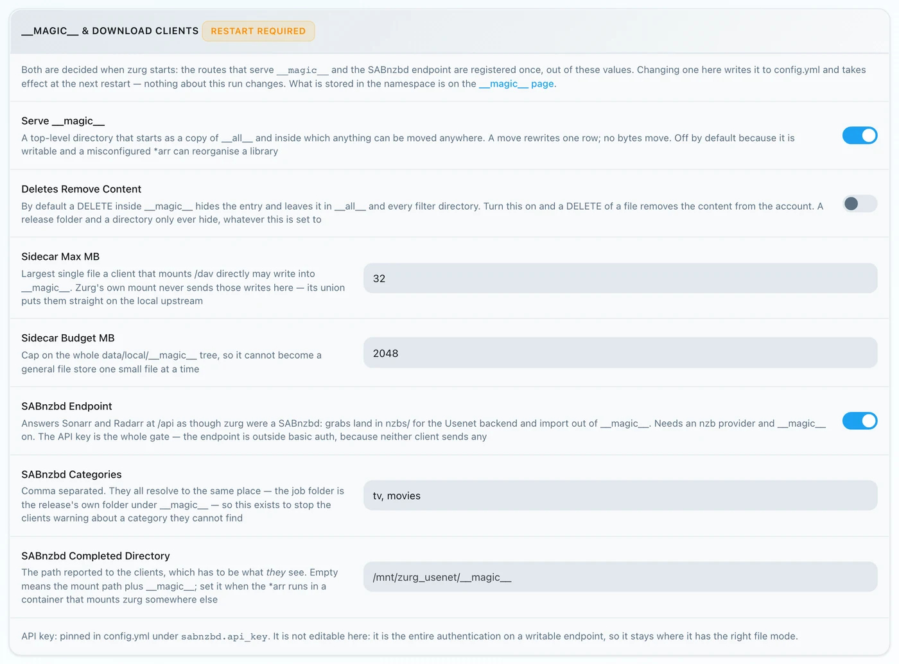
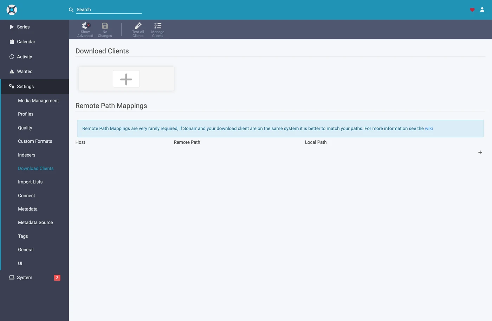
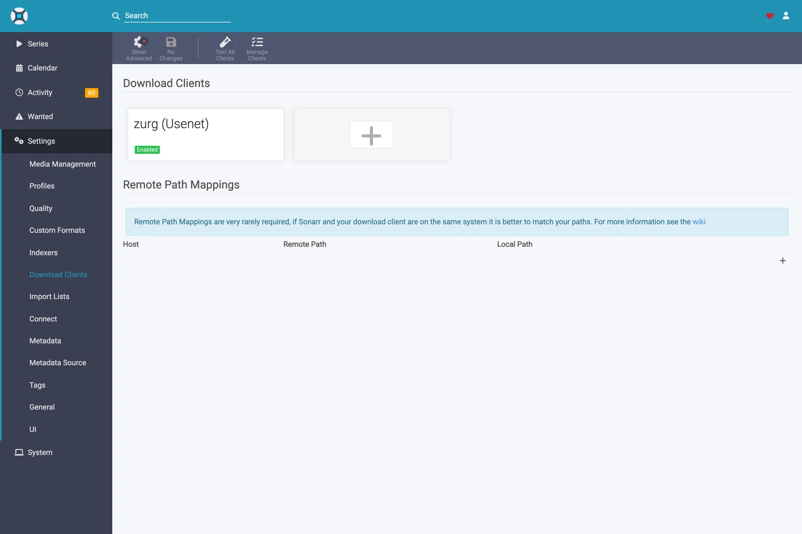
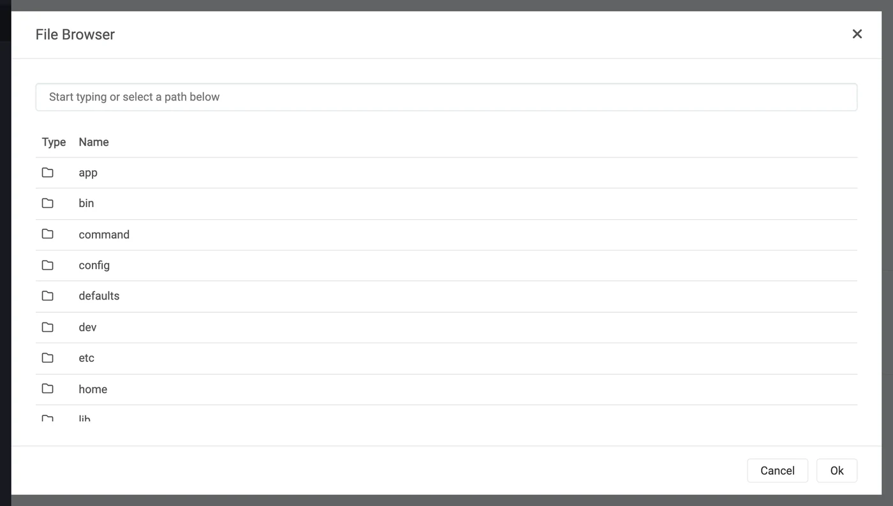
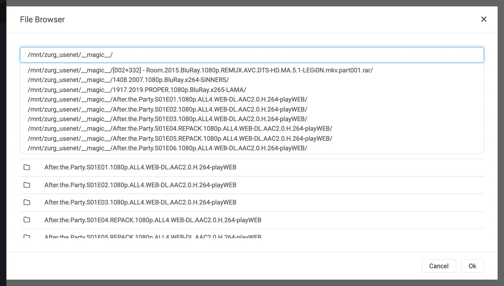

# Sonarr と Radarr のステップバイステップ {#sonarr-and-radarr-step-by-step}

Sonarr と Radarr を zurg と組み合わせる方法は 3 つあります。誰が検索するかで選んでください。詳しくは
[どれを選ぶか](sonarr-radarr-fetch.md#which-one-to-pick)を見てください。

| ガイド | 検索するのは | zurg の役割 | 必要なもの |
|---|---|---|---|
| [Usenet](sonarr-radarr.md) | Sonarr と Radarr | SABnzbd として動作 | Usenet アカウント（`torbox_nzb` バックエンドを使う場合は TorBox Pro）と、Prowlarr または \*arrs の Usenet インデクサー |
| [Torrents](sonarr-radarr-torrents.md) | Sonarr と Radarr | qBittorrent として動作 | デブリッドのアカウントと、Prowlarr または \*arrs のトレントインデクサー |
| [zurg が検索](sonarr-radarr-fetch.md) | zurg | ダウンロードクライアントは不要 | Usenet、TorBox Pro、またはデブリッドのアカウントと、zurg 自身の設定にある Newznab または Torznab インデクサー |

最初の 2 つは同時に使えます。どちらも同じ `__magic__` フォルダを共有します。

Sonarr と Radarr を zurg に向ければ、クライアントなしで Usenet から取得できます。取得中に動画全体をダウンロードしたり展開したりすることはありません。ただし NZB とキャッシュにはディスク容量を使います。このページでは Usenet を扱います。トレント用のエンドポイントも同じクライアントを使い、同じフォルダを共有します。詳しくは
[トレント向けの Sonarr と Radarr](sonarr-radarr-torrents.md)を見てください。

以下の内容はすべて、実際に動いている環境で、本物の Usenet アカウントを使って取得しました。対象は zurg `nightly-993-g99bcf9a4`、Sonarr `4.0.19.2979`、Radarr `6.3.0.10514` です。ホスト名とユーザー名は `you@zurg-server` に変えてあります。インデクサー名は `my-indexer` としています。API キーとライブラリの件数は例です。それ以外、取得した출力は変更していません。`torbox_nzb` のログ行は、2026-11-09 に zurg のソースコードから読み取ったもので、実際に取得したものではありません。

## 始める前に {#before-you-start}

3つの条件を先に確認しておきましょう。どれかが満たされていないと、あとで無関係に見える問題として表れます。

1. **zurgに `nzb` プロバイダーか、`torbox_nzb`（TorBox Pro）プロバイダーがあること。** どちらもないと、エンドポイントが書き込んだものを読み取る人がいないため、すべてのジョブが30分後に Failed と報告されます。zurgがライブラリに現れるのを待ちきれずに諦めるからです。[Usenet](usenet.md) を参照するか、`torbox_nzb` の場合は [TorBox でホストされる Usenet](../providers/torbox-nzb.md) を参照してください。
2. **`magic.enabled` が `true` であること。** これが無効だと completed ディレクトリが存在せず、すべてのインポートが失敗します。[`__magic__`](magic.md) を参照してください。
3. **\*arr から、zurgが報告するパスでマウントが見えること。** Sonarrをコンテナで動かしている場合は、設定を始める前に [手順8](#8-if-your-arr-is-in-docker) を読んでください。同じマシンに通常のアプリとしてインストールしている場合は、zurgがマウントした場所でマウントが見えます。ただし、各システムで注意点が1つずつあります。
   - **Linux:** zurgと別のユーザーで動いている \*arr は、`user_allow_other` を有効にするまで空のフォルダーしか見えません。[Linuxのセットアップ](../setup/linux.md#1-install-fuse-3) を参照してください。
   - **macOS:** zurgと同じユーザーで実行してください。`mount_path` を変更していなければ、マウント先は `/Volumes/Zurg` です。
   - **Windows:** Sonarr と Radarr は、インストーラーが提案するトレイアプリとして実行してください。Windowsのサービスとして実行しないでください。zurgの `Z:` ドライブはログイン中のセッションに属しており、サービスはそのセッションの外で動くため、ドライブが見えません。[セッションのルール](../setup/windows.md#keeping-it-running-the-session-rules) を参照してください。

最初の2つは、zurgの作業ディレクトリにある設定ファイルをそのまま確認できます。Windowsでは、代わりにメモ帳で `config.yml` を開いてください。

```bash
$ grep -A6 '^providers:' config.yml
providers:
- type: nzb
  nntp:
    host: news.example.com
    port: 563
    tls: true
    username: <redacted>
    password: <redacted>

$ grep -A4 '^magic:' config.yml
magic:
  enabled: true
  allow_delete: false
  sidecar_max_mb: 32
  sidecar_budget_mb: 2048
```

`allow_delete: false` は安全なデフォルトで、インポートには影響しません。`__magic__` 内での削除は、アカウントからコンテンツを消すのではなく、エントリーを非表示にするだけです。

## 1. エンドポイントを有効にする {#1-turn-the-endpoint-on}

2つの方法があり、結果は同じです。どちらも `config.yml` に書き込み、どちらも再起動が必要です。`__magic__` を提供するルートと SABnzbd のエンドポイントは、zurg の起動時に一度だけ登録されるためです。

### オプション A — ダッシュボード {#option-a--the-dashboard}

zurgのダッシュボードを開き、**Config**をクリックして、**\_\_magic\_\_ & Download Clients**までスクロールします。**Serve \_\_magic\_\_**と**SABnzbd Endpoint**をオンにしてから、**SABnzbd Categories**を`tv, movies`に設定します。


**Config**は設定がある場所で、**Magic**は後でgrabが届いたときに確認する場所です。



**SABnzbd Completed Directory**は、\*arrがzurgとは別の場所にマウントしている場合を除き、空のままにしてください。詳しくは[ステップ8](#8-if-your-arr-is-in-docker)を参照してください。オレンジ色の**Restart Required**チップの表示は正しいです。ここで行った設定は、zurgを再起動するまで反映されません。

### オプション B — `config.yml` {#option-b--configyml}

手動でブロックを追加して、zurg を再起動してください。

```yaml
magic:
  enabled: true

sabnzbd:
  enabled: true
  api_key: ""          # empty = zurg generates one and keeps it
  categories: [tv, movies]
  complete_dir: ""     # empty = <mount_path>/__magic__/__all__
```

**カテゴリはフォルダではありません。** どれも同じ場所に解決されます。ジョブのフォルダは、`__magic__/__all__` の下にあるリリース自身のフォルダです。このリストは、Sonarr と Radarr が見つけられないカテゴリについて警告しないようにするためだけにあります。Sonarr のカテゴリが `tv` なら、`tv` をこのリストに入れる必要があります。

zurg を再起動して、プロバイダーが反映されたか確認してください:


エンドポイントに必要なのは `nzb` か `torbox_nzb` の行が 1 つだけです。

## 2. API キーを見つける {#2-find-the-api-key}

APIキーはこのエンドポイントの認証そのものなので、一度きちんと設定し、どこにも公開で貼らないでください。

**`api_key` を空のままにした場合**、zurg は初回起動時にキーを自動生成して `data/sabnzbd-apikey` に書き込みます:

```bash
$ cat data/sabnzbd-apikey
0123456789abcdef0123456789abcdef

```

これは例のキーです。実際のキーは違います。このファイルは再起動後も残るので、一度生成されたキーは変わりません。

**`api_key` を自分で設定した場合**、キーは `config.yml` に入っていて、ファイルは作られません。どちらの状態かは、手順 1 のブロック下部でダッシュボードが教えてくれます。表示は *pinned in config.yml under `sabnzbd.api_key`* か *generated and kept in `data/sabnzbd-apikey`* のどちらかです。

**このエンドポイントは zurg のベーシック認証の対象外です。** Sonarr も Radarr も、ダウンロードクライアントにはベーシック認証を送りません。しかも HTTP 層は 401 を "unable to connect" として扱い、対処のヒントが出ません。そのため zurg は `/api` を意図的に除外しています。APIキーだけが唯一のアクセス制限です。zurg の他の部分と同じく、このポートも信頼できるネットワーク上で使うか、それを守る仕組みの背後に置いてください。

## 3. 応答することを確認する {#3-prove-it-answers}

Sonarr に触る前にこれをやってください。10秒で済み、その後の設定で「zurg の問題」か「\*arr の問題」かを切り分けられるようになります。

+++ Linux と macOS

```bash
$ SAB=0123456789abcdef0123456789abcdef
$ ZURG=192.168.88.245:9996

$ curl -s "http://$ZURG/api?mode=version&apikey=$SAB&output=json"
{"version":"4.5.1"}

$ curl -s "http://$ZURG/api?mode=get_config&apikey=$SAB&output=json" \
    | jq '.config.misc.complete_dir, [.config.categories[].name]'
"/mnt/zurg_usenet/__magic__/__all__"
[ "*", "tv", "movies" ]
```

+++ Windows

PowerShell で実行します。`curl` ではなく `curl.exe` と入力してください。Windows PowerShell の `curl` は別のコマンドです。

```powershell
PS> $SAB = "0123456789abcdef0123456789abcdef"
PS> $ZURG = "192.168.88.245:9996"

PS> curl.exe -s "http://$ZURG/api?mode=version&apikey=$SAB&output=json"
{"version":"4.5.1"}

PS> (Invoke-RestMethod "http://$ZURG/api?mode=get_config&apikey=$SAB&output=json").config.misc.complete_dir
Z:/__magic__/__all__
```

+++

`complete_dir` は、zurg がクライアントに渡すパスです。*そのクライアント*が開けるパスになっているか、今のうちに確認してください。

次に、間違ったキーが実際に拒否されるかを確認します(Windows では同じ URL を使って `curl.exe` で実行します)。

```bash
$ curl -s "http://$ZURG/api?mode=queue&apikey=wrongkey&output=json"
{"status":false,"error":"API Key Incorrect"}

$ curl -s "http://$ZURG/api?mode=queue&output=json"
{"status":false,"error":"API Key Required"}
```

**`mode=version` は認証のテストにはなりません。** 間違ったキーでも `{"version":"4.5.1"}` と応答します。これは本物の SABnzbd の動作で、zurg もそれを真似しています。キーを確かめたいときは `mode=queue` か `mode=get_config` を使ってください。

どちらの URL 形式も動作するので、クライアントの **URL Base** フィールドにはどちらを入れても構いません。

| パス | Sonarr / Radarr の URL Base | 応答するか |
|---|---|---|
| `/api` | *(空のまま)* | はい |
| `/sabnzbd/api` | `/sabnzbd` | はい |

`/api` で素の **404** が返ってくる場合は、`sabnzbd.enabled` がまだ false のままか、設定を変えた後に zurg を再起動していないかのどちらかです。

## 4. ルートフォルダを作る {#4-make-the-root-folders}

追加する前に先にフォルダーを作成してください。\*arr の Add Root Folder ダイアログは実際のファイルシステムを参照するため、存在しないフォルダーは候補に出てきません。

+++ Linux と macOS

```bash
$ mkdir -p /mnt/zurg_usenet/__magic__/tv /mnt/zurg_usenet/__magic__/movies

$ ls -d /mnt/zurg_usenet/__magic__/tv /mnt/zurg_usenet/__magic__/movies
/mnt/zurg_usenet/__magic__/movies
/mnt/zurg_usenet/__magic__/tv
```

+++ Windows

```powershell
PS> New-Item -ItemType Directory -Force Z:\__magic__\tv, Z:\__magic__\movies
```

または Explorer で 2 つのフォルダーを作成してください。

+++

`/mnt/zurg_usenet` の部分は、ご自身の `mount_path` に置き換えてください。未設定の場合、Linux では `/mnt/zurg`、macOS では `/Volumes/Zurg`、Windows では `Z:` になります。フォルダー名は自由に決められます。`tv` と `movies` はカテゴリに合わせただけです。

**ルートフォルダーは、完了ディレクトリの隣に置きます。その中や上には置きません。**

zurg はクライアントに `__magic__/__all__` を渡します。これは `__all__` が一覧にしているライブラリそのものです。ルートフォルダーは、その隣の `__magic__/tv` と `__magic__/movies` に置きます。**`__magic__/__all__` は不可**、**`__magic__` 自体も不可**、**`/mnt/zurg_usenet` も不可**です。ルートフォルダーがダウンロードクライアントの出力フォルダー *そのもの* の場合、両方のクライアントがヘルスチェックの警告を出します。また Radarr は、ルートフォルダーが出力フォルダーを *含んでいる* 場合にも警告を出します。兄弟のフォルダーであればどちらにも該当せず、完了ディレクトリを指定した手動インポートでは、ライブラリ全体ではなく1つのリリースだけを確認すれば済みます。

間違えるとこうなります。どちらも実際のスクリーンショットで、2 つのクライアントから取得したものです。撮影したのは、完了ディレクトリが `__magic__/__all__` に移動する前なので、画像内のパスはご自身のものより 1 階層上になっています。示されている 2 つのルールは同じものです。


完了ディレクトリそのものをルートフォルダーとして追加した Sonarr。ルートフォルダーが出力フォルダー *そのもの* なので警告が出ています。


`/mnt/zurg_usenet` を追加した Radarr。親フォルダーに対しても警告が出ます（Sonarr では出ません）。ルートフォルダーを完了ディレクトリの隣に移せば、両方の警告が消えます。

## 5. Sonarr にクライアントを追加する {#5-add-the-client-in-sonarr}

新しい Sonarr は、最初の起動時に表示される画面ですべてがブロックされています。**Forms (Login Page)** を選び、ユーザー名とパスワードを設定して、**Save** をクリックしてください。


**Authentication Method** が None 以外になっていないと、先に進めません。


Save のあとは一度ログアウトされ、ログインページに移動します。


### Settings → Download Clients

**Settings → Download Clients** を開きます。新規インストールの直後は、ここには **+** カードしかありません。



「Download Clients」の下にある **+** をクリックしてください。下のほうにある「Remote Path Mappings」の **+** ではありません。

**Usenet** の列から **SABnzbd** を選びます。


zurgはSABnzbdのふりをするので、このリストのほかのクライアントでは動きません。

ダイアログを開くと、SABnzbd本来のデフォルト値が入っています。`localhost`、ポート `8080`、キーなしです。


### 各フィールドに入れる内容 {#what-to-put-in-each-field}

| フィールド | 値 | 理由 |
|---|---|---|
| Name | `zurg (Usenet)` | 何でも構いません。ただのラベルです。 |
| Enable | on | チェックを入れたままにしてください。 |
| Host | `192.168.88.245` | zurg が動いているホストです。\*arr からこのホストに届く必要があります。\*arr が同じマシン上の普通のアプリの場合は `localhost` にします。Docker を使う場合は、下の警告を参照してください。 |
| Port | `9996` | zurg の通常のポートです。デフォルトのインストールでは `9999` です。 |
| Use SSL | off | zurg の前段で自分で TLS を設定している場合のみオンにしてください。 |
| API Key | 手順 2 で取得した値 | これがすべての鍵になります。 |
| Username | 空欄 | キーと同時には使えません。キーのみが受け付けられます。 |
| Password | 空欄 | 同上です。 |
| Category | `tv` | `sabnzbd.categories` に含まれている必要があります。 |
| Recent / Older Priority | Default | zurg は優先度を適用するものがないため、そのままにします。 |
| Remove Completed | on | クライアントが自分のジョブ記録を片付けられるようにします。オンのままにしてください。 |
| Remove Failed | on | 同上です。 |


表示されている API キーはあくまで例です。ご自分の値を貼り付けてください。

**Docker では、「localhost」もホスト名も当てになりません。** コンテナの中では、`localhost` はそのコンテナ自身を指します。また、マシンのホスト名は通常 `127.0.1.1` に解決されますが、これもコンテナ自身です。シェルからは両方とも問題なく動いて見えても、必ずホストの **LAN または Tailscale の IP** を使ってください。`localhost` やホスト名のみは使わないでください。

**Test** をクリックしてください。緑のチェックマークが表示されれば、クライアントの 4 つのチェック（バージョン、API キー、グローバル設定、カテゴリ）がすべて通ったという意味です。


次に **Save** をクリックします。



## 6. Sonarr でルートフォルダを追加する {#6-add-the-root-folder-in-sonarr}

**Settings → Media Management** を開いて、一番下までスクロールします。


**Add Root Folder** をクリックします。ファイルブラウザーが開きます。これは Sonarr のファイルシステムのもので、Docker では、コンテナ内のファイルシステムです。



上部のボックスにパスを入力します。マウントが本当に Sonarr から見えていれば、入力中に `__magic__` の中身が表示されます。`__all__` には全リリースが入っていて、その横に作ったものも表示されます。これが、バインドマウントが正しいことを確認する最も早い方法です。



空だったり、エラーになったりする場合は、先に進まず、マウントを直してください。


パスを `__magic__/tv`（Windows では `Z:\__magic__\tv`）まで入力して、**Ok** をクリックします。


**Free Space** に妥当な数値が表示されていれば、Sonarr はマウントの情報を取得できています。**Unmapped Folders** には、すでにそこにあるリリースの数が表示されます。

## 7. Radarr でも同じことをする {#7-do-the-same-in-radarr}

上と同じですが、2つの値を変えます: カテゴリは `movies`、ルートフォルダは `__magic__/movies` です。


Radarrの初回起動も同じ流れです。Forms auth を設定してから、サインインしてください。


**Settings → Download Clients → +** を開き、**Usenet** の下にある **SABnzbd** を選びます。


ホスト、ポート、キーは同じです。違うのは **Category** だけで、`tv` ではなく `movies` を入れてください。


**Test** を押して、緑のチェックマークが出たら **Save** を押します。


次に **Settings → Media Management → Root Folders → Add Root Folder** を開き、`/mnt/zurg_usenet/__magic__/movies` を追加します。

**zurgは1つ、クライアントは2つ、キューも1つです。** zurgのキューと履歴は、カテゴリでだけフィルタされます。`tv` を使う2つのSonarrは互いのジョブが見えてしまいますし、`tv` のSonarrと `movies` のRadarrなら見えません。カテゴリごとにクライアントを1つにしておけば、この問題は起きません。

## 8. *arr が Docker で動いている場合 {#8-if-your-arr-is-in-docker}

Este paso es para Docker en un host Linux. Docker Desktop en macOS y Windows ejecuta los contenedores dentro de una máquina virtual. El bind `rslave` de abajo depende de la propagación de montajes de Linux (ver [Docker setup](../setup/docker.md)), y pasarle el montaje de zurg a un contenedor en esos sistemas no se ha probado. En macOS y Windows, instala Sonarr y Radarr como aplicaciones normales, tal como describe [Before you start](#before-you-start).

Hay tres problemas separados. El segundo te cuesta una descarga en cada importación. El tercero no te afecta hasta la primera vez que zurg se reinicie.

### zurg が報告するパスは、クライアントが開けるパスである必要があります {#the-path-zurg-reports-must-be-a-path-the-client-can-open}

コンテナがライブラリを zurg とは別の場所にマウントしている場合、インポートがすべて *download doesn't contain intermediate path* または remote-path ヘルスチェックで失敗します。どちらの方法でも直せるので、好きな方を選んでください:

- **`sabnzbd.complete_dir` を設定する**: クライアントから見えるパスを指定します。クライアントが1つだけか、同じ場所にライブラリをマウントしている複数のクライアントがある場合に一番簡単です。
- **\*arr でリモートパスマッピングを追加する**: クライアントごとにマウントの場所が違うときに使います。

```yaml
sabnzbd:
  complete_dir: "/data/zurg/__magic__/__all__"   # what the *arr sees, not what zurg sees
```

2つ目の方法では、**Settings → Download Clients** を開き、ページ下側の **Remote Path Mappings** にある **+** を使います。手順5で使ったものではなく、下のほうのものです。


**Host** は、ダウンロードクライアントに入力したホスト文字列と完全に同じにしてください。**Remote Path** は zurg が報告するパスで、**Local Path** はクライアントから見えるパスです。

### ダウンロードフォルダとルートフォルダを 1 つのボリュームにまとめる {#one-volume-for-the-download-folder-and-the-root-folders}

`__magic__/__all__` から `__magic__/tv` へのインポートは、名前を変えるだけ（リネーム）なので無料です。リネームは同じマウント内でしか動きません。コンテナに2つのフォルダを2つのボリュームとして渡すと、コンテナからは2つのファイルシステムに見えます。どちらも下の zurg のマウントですが、それでも関係ありません。

```yaml
    volumes:                                        # do not do this
      - /mnt/zurg_usenet/__magic__/__all__:/downloads
      - /mnt/zurg_usenet/__magic__/tv:/tv
```

カーネルはコンテナ内でのリネームを拒否します。すると Sonarr と Radarr は、何も知らせずにファイルをコピーしてから元のファイルを削除します。インポートのたびに、リリース全体がアカウントからダウンロードされ、zurg のディスクに書き込まれることになります。インポートは成功しますが、遅いだけです。1.46 GB のエピソードでは、この方法だと 50 秒と 2.9 GB の転送量がかかりました。1つのボリュームにした場合は 1 秒で、読み込みも発生しませんでした。

zurg のマウント全体を含む1つのボリュームをコンテナに渡してください。ダウンロードフォルダとルートフォルダには、そのボリューム経由でアクセスします。次のセクションのバインドがまさにそれを行います。リモートパスマッピングまたは `complete_dir` で、クライアントを同じボリューム内の `__all__` に向けてください。

手動インポートで **Hardlink/Copy Files** を選ぶと、やはりコピーされます。**Move Files** を選んでください。

### マウントポイントではなく、その親をバインドする {#bind-the-mounts-parent-not-the-mountpoint}

これが一番午後がつぶれるやつです。上のセクションでも、ここが特に重要だと書いてあります。zurg を再起動すると `/mnt/zurg_usenet` がアンマウントされてから、またマウントされ直します。**マウントポイントそのもの**をバインドしていたコンテナは、起動時に使っていた FUSE 接続を保持し続けます。その接続はもう死んでいます。すると読み込みのたびに `Socket not connected` が返ってきます。そして両方のクライアントは、grab する前にルートフォルダの空き容量をチェックするので、**どのリリースもこっそり拒否されてしまいます**:

```
FreeSpaceSpecification: Socket not connected
```

どちらのクライアントも、マウントが古くなっているとは一言も言いません。コンテナの中ではフォルダがまだ見えていますし、クライアントに直接送った手動の grab は今でも動きます。見た目はただ、\*arr がいつの間にか検索をやめてしまったような状態になります。

**親ディレクトリ**を `rslave` でバインドしてください。そうすると、再マウントはサブマウントのイベントとして届き、コンテナがそれを追いかけてくれます:

```yaml
    volumes:
      - type: bind
        source: /mnt          # the parent, not /mnt/zurg_usenet
        target: /mnt
        bind:
          propagation: rslave
```

zurg を再起動したら、コンテナを必ず確認してください。エラーではなく、サイズが表示されていればOKです:

```bash
$ docker exec radarr df -h /mnt/zurg_usenet
Filesystem      Size  Used Avail Use% Mounted on
zurg{PGSq4}:    1.0P     0  1.0P   0% /mnt/zurg_usenet
```

ペタバイトと表示されるのは、zurg が仮想ファイルシステムを報告しているからです。ディスクではありません。これは想定どおりの動きで、\*arr の空き容量チェックを通すために必要な表示なんです。

## 9. 1 回のグラブが通る流れを見る {#9-watch-one-grab-go-through}

1つだけ追加して、手動で取得し、最後まで追いかけてみてください。以下はすべて、上記の設定を使った実際の取得です。

### Grab it

Ausgabe ist Japanese, so:

映画（またはエピソード）を開き、**Interactive Search** をクリックして、リリースを1つ選んでください。


**Source** 列には `nzb` と表示されます。これは zurg が扱えるプロトコルです。

行の末尾にある丸い矢印のボタンをクリックして、そのリリースを取得します。リリースがきれいに一致しない場合は、クライアントが先にマッピングの確認を求めてきます。


**Override and Grab** は、クライアントがそのリリースの内容を確認してほしいときに表示されます。マッピングを確認して **Grab Release** をクリックしてください。通常の自動取得では、このダイアログは表示されません。

### キューに入ります {#it-lands-in-the-queue}


グラブ直後の **Activity → Queue** です。プログレスバーが満タンになっていて、**Time Left** がダッシュ（-）になっている点に注目してください。計測すべきダウンロードがないので、ジョブはキューに入っているか完了しているかのどちらかで、その中間の状態はありません。*ここにある他の行は、同じ zurg の同じカテゴリを指している 2 つ目の Radarr のものです。* 手順 7 の注記を見てください。

### zurg が NZB を書き込み、それを読み取ります {#zurg-writes-the-nzb-and-reads-it}

```
Aug 25 14:44:03 zurg-server zurg[3034965]: INFO  nzb  Loaded NZB
  Last.Week.Tonight.with.John.Oliver.S13E22.480p.WEB.x264-RMTeam.nzb: 4 files
Aug 25 14:50:28 zurg-server zurg[3034965]: INFO  nzb  Loaded NZB
  Untold.The.Testimony.of.Vince.Young.2026.1080p.NF.WEB-DL.DD+5.1.Atmos.H.264-playWEB.nzb: 9 files
```

`Loaded NZB … : N files` は、NZB が正しく解析できたことを示す行です。ジョブが 30 分後に Failed と報告された場合、つまり zurg がライブラリに現れるのを待つのをあきらめた場合、この行が出ていないのが原因です。

### インポートが行われる {#the-import-happens}


**Activity → History** を開いてください。数秒差で2つのイベントが記録されています。**Grabbed** のあとに **Movie Imported** です。


**Status: Downloaded**、**Size 4.7 GiB** になっています。でも、実際には何もダウンロードされていません。

### ファイルが本物か確認する {#prove-the-file-is-real}

インポートでファイルがルートフォルダーに移動されました。ファイルの先頭と末尾の両方を読み取って、ffprobe に中身を確認してもらいましょう:

+++ Linux and macOS

シェルで `ffprobe` が見つからない場合は、`~/zurg/bin/ffprobe` を使ってください。インストールされていない場合、セットアップが自分のコピーをそこに置いてくれています。

```bash
$ ls -la "/mnt/zurg_usenet/__magic__/movies/Untold - The Testimony of Vince Young (2026)/"
-rw-r--r-- 1 you you 4920958828 Aug 25 14:53 Untold.The.Testimony…playWEB.mkv

$ dd if="$F" bs=1M count=1 >/dev/null
1048576 bytes (1.0 MB, 1.0 MiB) copied, 0.0429446 s, 24.4 MB/s

$ ffprobe -v error -show_entries format=duration,size,format_name \
    -of default=noprint_wrappers=1 "$F"
format_name=matroska,webm
duration=4709.440000
size=4920958828
```

+++ Windows

PowerShell で zurg のフォルダーから実行します。PATH に `ffprobe` がすでにない限り、セットアップが `bin\ffprobe.exe` をそこに置いています。その場合は代わりに `ffprobe` と入力してください:

```powershell
PS> $F = Get-Item "Z:\__magic__\movies\Untold - The Testimony of Vince Young (2026)\*.mkv"
PS> $F.Length
4920958828

PS> bin\ffprobe.exe -v error -show_entries format=duration,size,format_name -of default=noprint_wrappers=1 $F.FullName
format_name=matroska,webm
duration=4709.440000
size=4920958828
```

+++

78分の Matroska で、Usenet の記事からオンデマンドでストリーミングされています。データは何かがそれを読んだときに届くのであって、\*arr がインポートしたときではありません。

## 10. リリースを手動で追加する {#10-adding-a-release-by-hand}

Sonarr や Radarr がほしいリリースをまったく取得しないことがあります。検索しているインデクサーにそのリリースがないか、品質プロファイルやカスタムフォーマットで除外されている場合です。そのときは、インポートさせたいアプリのカテゴリで NZB を zurg に直接渡せます。そのアプリは、自分で取得したかのようにそれをインポートします。

リリースがアプリの検索対象のインデクサーにあるなら、まずアプリで試してください。**Interactive Search** では、除外されたリリースも表示されます。そこから取得すると、ほかの取得と同じように zurg に送られます。Radarr は、必須のカスタムフォーマットでスコア 0 となり、プロファイルで除外されていた IMAX リリースを取得してインポートしました。

+++ Linux and macOS

```bash
$ SAB=0123456789abcdef0123456789abcdef
$ ZURG=192.168.88.245:9996

# an NZB file you already have (the upload field is called name, as in SABnzbd)
$ curl -s "http://$ZURG/api?mode=addfile&apikey=$SAB&cat=movies" \
    -F 'name=@Movie.Title.2024.1080p.WEB-DL.nzb'
{"status":true,"nzo_ids":["SABnzbd_nzo_…"]}

# or a link to one, which zurg downloads itself
$ curl -s -G "http://$ZURG/api" \
    --data-urlencode mode=addurl --data-urlencode "apikey=$SAB" --data-urlencode cat=movies \
    --data-urlencode 'name=https://indexer.example/getnzb/<id>?r=<indexer-key>' \
    --data-urlencode nzbname=Movie.Title.2024.1080p.WEB-DL
{"status":true,"nzo_ids":["SABnzbd_nzo_…"]}
```

+++ Windows

PowerShell では `curl` ではなく `curl.exe` を使います。どちらも上記のとおり `{"status":true,"nzo_ids":[…]}` と返します。

```powershell
$SAB = "0123456789abcdef0123456789abcdef"
$ZURG = "192.168.88.245:9996"

# an NZB file you already have (the upload field is called name, as in SABnzbd)
curl.exe -s "http://$ZURG/api?mode=addfile&apikey=$SAB&cat=movies" -F "name=@Movie.Title.2024.1080p.WEB-DL.nzb"

# or a link to one, which zurg downloads itself
curl.exe -s -G "http://$ZURG/api" `
  --data-urlencode mode=addurl --data-urlencode "apikey=$SAB" --data-urlencode cat=movies `
  --data-urlencode "name=https://indexer.example/getnzb/<id>?r=<indexer-key>" `
  --data-urlencode nzbname=Movie.Title.2024.1080p.WEB-DL
```

+++

`--data-urlencode` を使うと、リンク自体の `?` と `&` が `name` の中でそのまま保たれます。ジョブは 1 分以内に、次のチェックでアプリのキューに表示されます。

次に何が起きるかは、次の 5 つで決まります。

1. **映画や番組がすでにそのアプリに登録されている必要があります。** アプリは、管理している作品に対応づけられるものだけをインポートします。
2. **名前から中身がわかる必要があります。** ジョブは NZB のファイル名を使います。`nzbname` を渡した場合は、その値を使います。`nzbname` がないと、`addurl` ではインデクサーが返すファイル名を使います。名前には年を入れてください。
3. **カテゴリでアプリが決まります。** `cat=movies` は、ダウンロードクライアントで `movies` を使っている Radarr に届きます。各アプリは自分のカテゴリだけを見ます。
4. **品質プロファイルでは止まりません。止まるのは、すでに持っているファイルです。** Radarr はインポート時に、許可された品質も、カスタムフォーマットの最低スコアも確認しません。2160p のみ許可し、スコア 100 を必須とするプロファイルに、スコア 0 の 720p BluRay をインポートしたことがあります。また、720p のみ許可するプロファイルの映画に、1080p WEBRip をインポートしたこともあります。その後、1080p BluRay をアップグレードとして上書きし、WEBRip を削除しました。その後に追加した WEB-DL は、Activity で *Not an upgrade for existing movie file* となって止まりました。**Activity → Queue → Manual Import** を使うと、それでも取り込まれ、ファイルが置き換わります。
5. **失敗したものは自分で片付けます。** アプリは、自分で取得していないダウンロードを、ブロックリストに入れたり削除したりすることはありません。ニュースサーバーから記事が消えていたリリースは、zurg から Failed として返され、Radarr のキューに *Download has failed wasn't grabbed by Radarr, skipping automatic download handling* として残りました。キューから削除して、別のリリースを選んでください。

2026-10-10 に、Radarr 6.3 で `addfile` と `addurl` の両方を使って測定しました。対象には、リリース名から作ったカスタムフォーマットを必須とするプロファイルも含みます。すべてのインポートは `__magic__/movies` への名前変更で、何もコピーされませんでした。Sonarr では試していません。

Discord で Usenet での方法を尋ねてくれた **.telmen** に感謝します。

## zurg 側から視聴する {#watching-from-zurgs-side}

`/magic/` ページには、エンドポイントに渡されたすべての NZB が一覧表示されます。Sonarr と Radarr は取得したジョブを削除しますが、その記録は削除後 1 週間残ります。そのため、ポーリングと削除が競合しても同じ応答になります。**Failed** や **Stuck**（1 時間以上キューに残っているジョブ）で、どのクライアントも削除しないものは、たとえば zurg をダウンロードクライアントとして使うのをやめた後などに、ここで **Clear** ボタンを長押しすればクリアできます。クリアすると、インポートがまだ使っていない限り、その NZB も削除されます。


**Placements** はクライアントが移動したファイルで、**tombstones** はその後クライアントが削除したジョブフォルダです。クライアントが移動ではなくコピーする場合、ページに赤い **Imports that were copies** テーブルが表示されます。zurg はそれらのコピーを placements に戻して削除しますが、どれも全体がダウンロードされているので、ボリュームの設定を見直してください。


**State** がすべてを表します。**Queued** は、ライブラリにまだ掲載されていない、ファイルサイズが確定していない、記事がまだ確認されていないなどの理由で、zurg の処理が終わっていない状態です。**Completed** はインポートできる状態です。**Release** は、クライアントがインポート元にするフォルダ名です。

**Release** 列は保存された値ではなく、ポーリングのたびにライブラリから読み取られます。zurg のダッシュボードでリリース名を変更したり、修復でフォルダを作り直したり、同じ名前のリリースが 2 つあるために zurg が接尾辞を付けたりしても、ジョブはそれに追従します。

## 動くものと動かないもの {#what-works-and-what-does-not}

動作するもの:

- 接続テスト（4つのチェックすべて）が、両方のクライアントで動作します。
- Grab、キュー、履歴、リネームによるインポート、インポート後のクリーンアップ。
- 同じリリースの再 grab。後続の各 grab は独自のジョブ ID を取得するため、クライアントは古いジョブの結果を再利用せず、そのジョブに対して動作します。下にあるリリースは同じままです。以前のインポートで空になったリリースを再 grab すると、**Failed** と報告されます。`__magic__/__all__` 配下のフォルダにはインポートするものが残っておらず、Failed によりクライアントはそれをブロックリストに入れ、別のものを取得します。空にした grab は、クライアントがそれを削除するまで Completed と報告し続けます。
- ジョブをキューから削除する（NZB の削除を伴う場合と伴わない場合の両方）。
- `mode=addurl`。人間または自動化が、アップロードではなく URL を渡す場合。どちらの \*arr もこれを使用しません。

動作しないもの:

- **進捗表示なし。** ジョブはキューに入っているか完了しているかのどちらかで、その間のパーセンテージはありません。測定するダウンロードが存在しないためです。キューには行が空白にならないよう、NZB が宣言したサイズを表示します。
- **一時停止、再開、速度制限、優先度、後処理スクリプトなし。** SABnzbd にはこれらすべてがありますが、zurg にはそれらを適用する対象がありません。
- **完了したジョブの履歴削除で `del_files` は無視されます。**（Failed ジョブの場合は、そこからインポートされたものがない時に NZB を削除します。）クライアントの意図は「ジョブフォルダはあなたに返す」ですが、インポートしたばかりのファイルは、その NZB から引き続き配信されます。クライアントが削除したかったフォルダは既になくなっています。マウント経由で、それ自身が削除したためです。
- **Basic 認証ではこのエンドポイントを保護できません。** API キーだけが唯一の防御策です。

**失敗のシグナル。** インポートできるものが何もないリリースは **Failed** と報告され、両方のクライアントがそれをブロックリストに入れ、代替を grab します。対象は、すべてのファイルが壊れている、削除されている、またはフィルタで除外されたリリース、`.par2`、`.sfv` とサイドカーファイルしか含まないリリース、すべてのファイルが再生できない形式であるリリース（難読化された投稿で RAR セットに `.z001`…`.z133` と名付けられた場合がこれに当たります）、そして開いてみてメディアが含まれていないと分かったアーカイブです。RAR セットは足場ではなくコンテンツです。zurg は RAR の中から直接ビデオをストリーミングします。もしリリースに zurg が拡張子を知らないものが本当に含まれている場合は、ブロックリストに入れるのではなく `addl_playable_extensions` を広げてください。

**ジョブが完了と報告される前に、記事を確認します。** zurg は、ライブラリがリリースを一覧表示し、そのファイルサイズが落ち着くまで待ちます。その後、各コンテンツファイルの先頭と末尾についてニュースサーバーに問い合わせます。つまり最初の16記事と最後の1記事です。さらに各ファイルの最初の記事をダウンロードします。合計で最大64記事、ファイル数が少ないリリースではさらに少し加わります。ニュースサーバーによっては、コンテンツが削除された後も記事が存在すると答えるものがあり、実際にダウンロードしてみないと分からないことがあります。ダウンロードした記事は、それが別の投稿ではなくこの投稿に属することも示します。ジョブは、この結果が返るまで **Queued** のままです。サンプルが届かない箇所の破損は、そこに到達する読み込みの時点で見つかります。記事が欠けているリリースは、まず PAR2 による修復を受け、修復が実行された後にもう一度チェックされます。完全な状態に戻ったものは処理を続けます。まだ記事が欠けているもの、または修復できないものは、欠けている数とともに **Failed** と報告されます。これは*ダウンロード*の失敗で、クライアントが対応するものです。再生できないものをインポートするのではなく、クライアントは無人でそれをブロックリストに入れ、代替を grab します。`torbox_nzb` を使う場合、ニュースサーバーも記事チェックもありません。grab は TorBox が取得したかどうかで確認されます。

**完了できないチェックは永遠に待ちません。** チェックがまったく完了できない場合があります。接続プールがダウンしている、アカウントがスロットルされている、または処理が制限時間を超えた、などです。これは回答ではありません。ジョブは **Queued** のままで、1分後に再び問い合わせられます。zurg はジョブの試行回数を数えるので、再起動しても忘れられることはありません。連続30回失敗し、その期間が少なくとも3時間にわたる場合、ジョブは **Failed** として履歴に移動します。メッセージには、回数、期間、最後のエラーが含まれます。明確な拒否による障害では、1時間以内に30回に達しますが、それによってキュー全体が失敗することはありません。

**ライブラリから消えたリリースはジョブを失敗させます。** リリースはダッシュボードから削除されたり、監視ディレクトリから NZB が取り除かれたり、すべてのアカウントから落とされたりすることがあります。そのジョブは15分間 **Queued** のままで、その後 **Failed** として履歴に移動します。クライアントはそれをブロックリストに入れ、別のものを grab します。この待機は再起動のためにあります。ライブラリは読み込み中にすべてのリリースを一覧から外すため、それを削除と見なしてはなりません。zurg の起動後最初の15分間は、この理由で失敗するものはありません。ライブラリが一度も一覧に表示していないリリースのジョブは、まだ到着中のためこの影響を受けません。

## トラブルシューティング {#troubleshooting}

| *arr が表示するメッセージ | 意味 |
|---|---|
| "Unable to connect to SABnzbd" | zurg にそのホストとポートで接続できないか、前段の何かが 200 以外を返しています。`sabnzbd.enabled` を確認してください。オフの間は `/api` が単純な 404 を返します。Docker では `localhost` やホスト名だけを指定していないか確認してください。 |
| "API Key Incorrect" / "API Key Required" | キーが一致していません。自分で設定した場合は `config.yml` に、zurg が生成した場合は `data/sabnzbd-apikey` にあります。 |
| "Test was aborted due to an error" | 認証の失敗以外のエラーです。zurg は拒否したリクエストをすべて記録しています。ログで `SABnzbd:` を検索してください。 |
| "Category … does not exist" | *arr のカテゴリが `sabnzbd.categories` にありません。追加して zurg を再起動してください。 |
| "Downloads in root folder" | ルートフォルダが完了フォルダと同じか、その上位にあります。完了フォルダの横に移動してください（例: `__magic__/tv`。`__magic__/__all__`、`__magic__`、`/mnt/zurg_usenet` は不可）。 |
| "Remote path mapping" / "download doesn't contain intermediate path" | zurg が報告するパスを、クライアントが開けません。[手順 8](#8-if-your-arr-is-in-docker) を参照してください。 |
| インポートは成功するものの、ダウンロードと同じくらい時間がかかり、zurg の `/magic/` ページで **Imports that were copies** に表示される | クライアントが `__magic__/__all__` から名前変更ではなくコピーしています。クライアントのコンテナでは、ダウンロードフォルダとルートフォルダが別々のボリュームになっています。または手動インポートがコピーに設定されていました。[ダウンロードフォルダとルートフォルダに1つのボリューム](#one-volume-for-the-download-folder-and-the-root-folders) を参照してください。 |
| ルートフォルダのブラウザで zurg のマウントが空に見える、または `Z:` ドライブがない | *arr からマウントが見えていません。Linux では `user_allow_other` なしで別のユーザーとして動いており、Windows ではサービスとして動いています。[始める前に](#before-you-start) を参照してください。 |
| すべてのリリースが拒否され、ログに何もない | 古いバインドマウントです。`docker exec <client> df -h <mount>` を実行してください。`Socket not connected` と表示されたら、親を `rslave` でバインドし、コンテナを作り直してください。 |
| リリースが表示されてから、ジョブが一度か二度のポーリングの間キューに残る | 想定どおりの動作です。リリースごとに一度だけ落ち着きます。NZB にはファイルの長さが書かれていないため、推定値は PAR2 インデックスか1つの記事自身のヘッダーからの正確な長さに置き換えられます。早すぎる Completed 報告は、クライアントが *File move incomplete, data loss may have occurred* を出す原因になります。`torbox_nzb` のジョブは記事を読まず、ニュースサーバーにも問い合わせません。TorBox がリリースの取得を終えるまでキューに残り、最大30分です（次の行を参照）。 |
| "zurg accepted the NZB but it never appeared in the library" | grab から、または zurg の起動から、どちらか遅い方から30分経ってもリリースがライブラリに現れなかったため、zurg は待つのをやめてジョブを **Failed** として報告しました。まず `nzb` または `torbox_nzb` プロバイダーが設定されているか確認してください。そのうえでログから NZB を探してください。`nzb` アカウントは解析が終わると `Loaded NZB <name>: N files` と書きます。`torbox_nzb` のリリースは TorBox が取得を終えてから初めて現れます。そのため、TorBox の取得が遅い（空きスロットを待つ、または zurg の1分1投稿の順番待ちで滞留する）と、30分を超えた時点でジョブは失敗します。`torbox_nzb` アカウントは `TorBox Usenet: posting <name>` と書き、続けて TorBox の応答を記録します。`TorBox answered <name> with download <id>` は、TorBox が取得中か、すでに保持していることを意味します。`TorBox queued <name> as <id> for want of a free slot` は、アカウントに空きスロットがないことを意味します。空くまで投稿は待機します。 |
| "The Usenet account could not fetch the NZB" | NZB を投稿したアカウントが取得を諦めたため、zurg は30分待たずにジョブを即座に失敗させます。`torbox_nzb` の場合、ログの `TorBox refused <name>, …` の末尾に TorBox の理由が書かれています。その NZB は zurg の再起動かファイルの変更があるまで再投稿されません。 |
| "The release holds no files that can be imported" | ライブラリにはリリースがありますが、クライアントがインポートできるものが入っていません。リカバリーボリュームだけの NZB がまさにこれで、RAR セットが `.z001`…`.z133` と名付けられた難読化投稿も同様です。リリースに本当に zurg が知らない拡張子のコンテンツが入っている場合は、`addl_playable_extensions` を広げてください。 |
| 大量の投入中、完了したリリースがキューに残ったまま | 同時に60件を超えるジョブが準備完了になっています。Sonarr と Radarr は履歴の新しい60件しか要求しないため、zurg は余ったものをキューに保持し、インポートで枠が空くたびに1件ずつ履歴に移します。想定どおりで、自然に解消されます。 |
| "The release could not be checked against the news servers" | 記事の確認が、少なくとも3時間にわたって連続30回失敗しました。欠落は見つかっていません。ニュースアカウントに問い合わせできなかっただけです。メッセージには最後のエラーが含まれます。まずアカウントを確認し、応答するようになったらリリースを再度 grab してください。`torbox_nzb` アカウントにはニュースサーバーも記事確認もないため、代わりに TorBox がリリースを取得したかどうかで grab を確認します。 |
| "The release was in the library and has since been removed from it" | ライブラリに一度は現れたものの、15分間リストに出てこなくなりました。何かが削除し、ログには `Release <name> is gone from every account` と出ています。戻ってこないフォルダを待つのではなく、クライアントがそのリリースをブロックリストに入れ、別のものを grab します。 |

まだ解決しない場合は、[Discord](https://discord.com/invite/7u4YjMThXP) の **zurg-support** フォーラムで質問してください。[サポートの受け方](../../guides/remote-help.md) に、含めるべき内容が書かれています。

### 状態が保存される場所 {#where-the-state-lives}

| パス | 役割 |
|---|---|
| `nzbs/<name>.nzb` | NZB 本体です。一度付けた名前は変えないでください。Usenet バックエンドはこのファイル名からリリースの識別情報を決めているので、名前を変えるとそのリリースと、そこから作られたすべての配置が孤立してしまいます。 |
| `data/sabnzbd-jobs.json` | どの NZB を、どのカテゴリで、いつ取得したかの記録です。 |
| `data/sabnzbd-apikey` | 自動生成される API キーです。`sabnzbd.api_key` が設定されている場合は書き込まれません。 |
| `data/magic.json` | `__magic__` テーブルです。インポートによって作られたすべての配置と削除マーカーが入っています。 |
