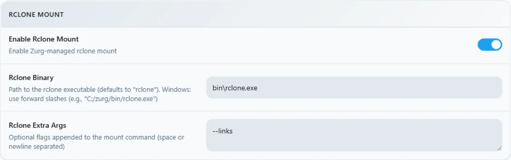

# Windows、バイナリから一から {#windows-the-binary-from-scratch}

## ワンライン オプション {#one-line-option}

PowerShell からオプションのスポンサー用ブートストラップを実行します。WinFsp を UAC 経由でインストールし、zurg をダウンロードして、provider chooser と diagnostics を実行します:

```powershell
irm https://raw.githubusercontent.com/debridmediamanager/zurg-site/main/public/install.ps1 | iex
```

GitHub のブラウザサインインを使い、`$HOME\zurg` にインストールします。既存のバイナリと設定はそのまま残ります。手動の手順は以下に続きます。

Docker も WSL も不要です。フォルダーに zurg の `.exe` を置き、一度だけ書く `config.yml` を用意すれば、エクスプローラーで `Z:` ドライブを使えます。
このページでは全体を2回に分けて説明します。まず **RealDebrid with the qBittorrent endpoint**、次に完全リセットして **Usenet with the SABnzbd endpoint** を扱います。実際によく使われる2つのインストール方法で、zurg の異なる半分を使うからです。

以下の内容はすべて実際のインストール環境で取得したものです: Windows 11 Pro 23H2 (ビルド 22631)、PowerShell 5.1、WinFsp 2.0.23075、zurg `2026.08.30.0459-nightly-73-g5b4c9790`、そして Real-Debrid アカウントと Usenet のニュースアカウント。ユーザー名は変更してあります。API キーとライブラリの件数はあくまで例です。認証情報も同様です。

## 必要なもの {#what-you-need}

- **zurg.exe** — [スポンサー限定リリース](https://github.com/debridmediamanager/zurg/releases)から入手できます。GitHubアカウントにアクセス権を付与するには、[gatekeeper](https://gatekeeper.debridmediamanager.com/)でスポンサーになってください。このページでは、zurg.exeをダウンロード済みであることを前提としています。
- **WinFsp** — zurgはライブラリをrcloneでマウントします。WindowsでドライブレターをLにするには、rcloneがWinFspを必要とします。サイレントインストールするか、[インストーラー](https://github.com/winfsp/winfsp/releases)からインストールしてください:

  ```powershell
  $url = "https://github.com/winfsp/winfsp/releases/download/v2.1/winfsp-2.1.25156.msi"
  Invoke-WebRequest -Uri $url -OutFile "$env:TEMP\winfsp.msi" -UseBasicParsing
  Start-Process msiexec.exe -ArgumentList "/i", "$env:TEMP\winfsp.msi", "/qn", "/norestart" -Wait
  ```

- **アカウント** — 最初のパスにはReal-DebridのAPIトークン、2つ目のパスにはニュースサーバーが必要です。

これ以外は不要です。内蔵インストーラーがrcloneをダウンロードします。ffprobeも、PATHにまだない場合はダウンロードされます。

## おすすめ: セットアップは zurg に任せる {#recommended-let-zurg-finish-the-setup}

フォルダーを作成し、その中に`zurg.exe`を置いて、PowerShellからインストーラーを実行します:

```powershell
New-Item -ItemType Directory -Force "$HOME\zurg" | Out-Null
Set-Location "$HOME\zurg"
# Copy the downloaded zurg.exe here, then:
.\zurg.exe setup
.\zurg.exe doctor
```

`setup`は、どのプロバイダーを設定するかを尋ねます。Real-Debrid、TorBox、AllDebrid、Usenet、Premiumize、Debrid-Link、Offcloudの中から、優先順位の順に1つ以上を選べます。選んだプロバイダーの認証情報だけを求められます。その後、次の処理を行います:

1. `config.yml`を作成し、検証します。
2. `config.yml`へのアクセス制御リスト(ACL)を、自分のユーザー、SYSTEM、Administratorsのみに制限します。
3. `bin\rclone.exe`をダウンロードします。ただしPATHにffprobeがすでにある場合は`bin\ffprobe.exe`をダウンロードせず、`config.yml`に`ffprobe_binary: ffprobe`と書き込みます。
4. `Z:`ドライブにrcloneマウントを有効にします。
5. `\Zurg\zurg`をインタラクティブなログオンタスクとして登録し、デスクトップユーザーがログインしたときに起動するようにします。

必要があれば、未使用の別のドライブレターを選べます:

```powershell
.\zurg.exe setup --mount-path "Y:"
```

セットアップは何度実行しても問題ありません。生成されたタスクは更新されますが、既存の`config.yml`は置き換えられません。

インタラクティブタスクにしているのは意図的な設計です。WinFspのドライブマウントは、それを作成したWindowsのログオンセッションに紐づきます。通常のWindowsサービスはセッション0で動作するため、そのドライブはPlexやデスクトップ上のExplorerからは見えません。このインストーラーの動作は、2026年9月4日にWindows 11で確認しています。

以下の手順では、インストーラーの裏側にあるファイルと設定を説明し、そのあとReal-DebridとUsenetのダウンロードクライアント構成を組み立てます。手動での初回実行とスケジュールタスクの手順は、これらの部品を自分で組み立てたいときに役立ちます。

## 1. 最初の手動起動: zurg が自分のホームを作る {#1-manual-first-run-zurg-builds-its-own-home}

フォルダを作って、バイナリをその中に入れてください。設定ファイルがない状態で一度実行します:

```powershell
PS C:\Users\you> mkdir C:\Users\you\zurg
PS C:\Users\you\zurg> .\zurg.exe
```

zurg は、プロバイダーに依存しないデフォルトの設定ファイルを作成し、次にやることを表示して終了します:

```
INFO  setup  Config file not found, creating default from config.simple.yml
INFO  zurg   Default config created at config.yml
INFO  zurg   Run zurg setup to choose provider(s), or add a providers block to config.yml, then rerun zurg.
```

`.\zurg.exe setup` を実行して、プロバイダーを選び、ヘルパーをダウンロードしてください。セットアップ後、フォルダの中身は次のようになります:

```
C:\Users\you\zurg\
├── bin\                rclone.exe, and ffprobe.exe unless ffprobe was on your PATH
├── data\               library cache, keys, the __magic__ table
├── dump\
├── logs\               zurg.log, rclone.log
├── nzbs\               the Usenet watch directory (second pass)
├── strm\
├── config.yml
└── zurg.exe
```

生成された `config.yml` は、プロバイダーのリストが空で、ディレクトリフィルターが2つ入っている状態で始まります。セットアップでは、選んだ内容をもとにリストが埋まります。以下の手動の例では、それぞれの手順用の設定に置き換えています。

## 2. Real-Debrid のパス {#2-the-realdebrid-pass}

### 設定 {#the-config}

`config.yml` をこの内容で上書きしてください。Real-Debrid トークン、qBittorrent エンドポイントの有効化、マウント先を `Z:` にする設定です:

```yaml
zurg: v1
providers:
  - type: realdebrid
    token: YOUR_RD_API_TOKEN

directories:
  shows:
    group: media
    group_order: 10
    filters:
      - has_episodes: true
  movies:
    group: media
    group_order: 20
    only_show_the_biggest_file: true

ffprobe_binary: bin\ffprobe.exe   # or ffprobe, if that is what setup wrote
rclone_binary: bin\rclone.exe

rclone_enabled: true
mount_path: "Z:"
rclone_extra_args:
  - "--links"

magic:
  enabled: true

qbittorrent:
  enabled: true
  api_key: ""          # empty = zurg generates one and keeps it
  categories: [tv-sonarr, radarr]
```

ここには Windows 固有の設定が3つあります:

- **`--links` は省略可能ですが、それでも付けておく価値があります。** zurg はライブラリを、ローカル側とリモート側を組み合わせた rclone union として提供します。ドライブが現れた瞬間、WinFsp がマウントルートに対してシンボリックリンクかどうかを問い合わせます。このフラグがないと、rclone はその問い合わせに `ERROR : symlinks not supported without the --links flag: /` と答えますが、それでもマウントは行われます。2026-08-31 に zurg `2026.08.31.0443-nightly` と rclone 1.74.2 および 1.75.0 で計測したところ、ドライブ、union の両半分、`__magic__` への書き込みは、フラグの有無にかかわらず同じ動作でした。フラグを付けると、同じ問い合わせは代わりに `NOTICE: union root '': Symlinks support enabled` をログに出します。また、`data\local` の下に実際のシンボリックリンクを置いた場合、rclone はそれを扱えるようになります。付けたままにしておけば、ログはすっきりした状態を保てます。
- **`mount_path: "Z:"`** はここではドライブ文字であり、POSIX パスではありません。空いている文字であれば何でも使えます。
- **`magic.enabled: true` はそのまま残してください。** このマシンから Sonarr や Radarr でインポートしたい場合に必要です。インポートは `__magic__` 内でのリネームになるため、これがないとインポートのたびに完全なダウンロードが発生してしまいます。下の Usenet の手順も同じです。

（以前の翻訳は却下されました: コードスパンが一致していませんでした。構造は完全に維持してください。）

### 起動してログを読む {#start-it-and-read-the-log}

とりあえず、シンプルな方法で zurg を起動しましょう。フォルダー内で PowerShell ウィンドウを開き、次を実行します。

```powershell
PS C:\Users\you\zurg> .\zurg.exe --config config.yml
```

最初に行われるのは Real-Debrid のネットワークテストです。各ダウンロードリージョンでテスト用リンクの制限を解除し、レイテンシを測定します。20秒ほどかかります。そのあと、重要なログ行が表示されます。

```
INFO  network_test  Network test completed!
INFO  zurg          Provider realdebrid ready (type=realdebrid)
INFO  router        __magic__ serves sidecar files from data\local\__magic__
INFO  router.qbittorrent  qBittorrent API on /api/v2 and /qbittorrent/api/v2, save path Z:/__magic__/__all__, categories tv-sonarr, radarr
INFO  router.qbittorrent  qBittorrent: generated an API key in data/qbittorrent-apikey — paste it into Sonarr or Radarr's API Key field, or pin one as qbittorrent.api_key in config.yml
INFO  zurg          Starting server on http://[::]:9999
INFO  rclone        rclone started with mount Z:, union local C:\Users\you\zurg\data\local
```

ログには API キーそのものは表示されません。キーは `data\qbittorrent-apikey` に保存されています。その後、ライブラリのスキャンが始まります。初回起動時はアカウント内のすべてのトレントを読み込むため、データ量が多いアカウントでは少し時間がかかります。このスキャンは、アカウント上の他の処理とプロバイダーの API 上限を共有します。

**スキャン中は、`__magic__` が *Library is still loading* と応答します。** これは想定どおりの動作で、不具合ではありません。

表示されることがある警告が一つあります。既知のもので、致命的ではありません。

| 警告 | 内容 |
|---|---|
| `Debug logging is enabled` | 生成される設定はデフォルトで詳細ログ（verbose）になっています。`log_level: INFO` を追加すると静かになります。 |


### ダッシュボード {#the-dashboard}

`http://localhost:9999/` では、スキャンが進むにつれてライブラリのサイズが増えていき、配信したトラフィックやメモリ使用量も見られます。UI は **Quick Links** だけで操作できます。Torrent Manager、Config、Directories、Magic、Logs の5つです。


**Config** は、初回起動後に設定がすべて集まる場所です。providers ブロックには、アカウントが1つ表示されます。


download-client ブロックでは、`config.yml` で設定するのと同じトグルをここで編集できます。変更するたびに **Restart Required** と表示されます。これは文字どおりの意味で、両方のエンドポイントはルートを起動時に一度だけ登録するため、変更を反映するには再起動が必要です。


マウントブロックには、ドライブレターと rclone の監視設定が表示されます。



### Z: ドライブ {#the-z-drive}

zurg が動いているとき、Explorer では `Z:` がペタバイト規模のファイルシステムとして見えます:


**ただし、zurg が Explorer から見える場所で動いている場合に限ります。これがこのセットアップで唯一、Windows 特有のルールです。** ドライブレターのマウントは、それを作成した *ログオンセッション* に属します。SSH 接続やサービスから zurg を起動すると、マウントは存在して動作しますが、デスクトップからは見えません。これは WinFsp や rclone のバグではありません。Windows がドライブレターを扱う仕組みがそうなっているだけです。[最後のセクション](#keeping-it-running-the-session-rules)に、動作する手順（対話型のスケジュールタスク）と、ほかの方法を試したときに測定した結果があります。

### qBittorrent エンドポイントを確認する {#prove-the-qbittorrent-endpoint}

PowerShell でも、他のプラットフォームと同じプローブを使えます。

```powershell
PS> $KEY = Get-Content data\qbittorrent-apikey
PS> Invoke-WebRequest "http://localhost:9999/api/v2/app/webapiVersion"

# the healthy unauthenticated answer is a 403 — "the API is here, log in"
PS> Invoke-RestMethod "http://localhost:9999/api/v2/app/version" -Headers @{ Authorization = "Bearer $KEY" }
v5.0.4
PS> (Invoke-RestMethod "http://localhost:9999/api/v2/app/preferences" -Headers @{ Authorization = "Bearer $KEY" }).save_path
Z:/__magic__/__all__
```

そのうえでトレントを追加します。`.torrent` ファイルは `curl.exe -F` でアップロードします（Windows PowerShell の `curl` は `Invoke-WebRequest` のエイリアスで、`-F` がないので注意してください）。もちろん、どのクライアントでも代わりにやってくれます。

```
INFO  router.qbittorrent  qBittorrent: added op1176 (dc98af37…) to realdebrid as W7FRRMVJWUOMS
```

このインストールが取得したリリースはアカウントにキャッシュされていなかったので、\*arr 形式のキューには実際のダウンロードが表示されました。Real-Debrid が報告したレートで、約6分かけて進捗が 2% → 10% → 50% → 75% → 99% と上がっていき、そのあと次のようになりました。

```
INFO  router.qbittorrent  qBittorrent: op1176 (dc98af37…) finished on realdebrid
```

トレントは完了と表示され、インポート元のフォルダも出てきました。

```
"content_path": "Z:/__magic__/__all__/[NanakoRaws] One Piece S01E1176 (THK TV 1080p HEVC AAC)"
```

`Z:` 経由でファイルを読むと、1MB がミリ秒単位で読めました。rclone の VFS read-ahead がプロバイダの前段に入っているので、一度読んだ部分はローカルディスク並みの速さで返ってきて、残りのアーティクルは後ろからストリームされます。

知っておくと良い拒否の例があります。このインストールが最初に試したリリースは `…WEBRip…` という名前で、Real-Debrid は一部のリリース名を完全にブロックします。zurg はそのパターンを把握していて、追加スロットを消費する前に拒否します。

```
WARN  router.qbittorrent  qBittorrent: realdebrid will not take op1176: it refuses that name outright, so the next account is tried
```

別の名前のリリースを選べば、無事に通ります。[トレントのチュートリアル](../guides/sonarr-radarr-torrents.md) では、タイムアウト、キャッシュのみモード、失敗時の挙動など、エンドポイント全体を詳しく解説しています。クライアントの設定は同じですが、Windows 特有の注意点が2つあります。\*arr が同じマシンで動いている場合は **Host** に `localhost` を指定してください。また、zurg が `Z:` を見られるように、\*arr は zurg と同じログオンセッションで実行する必要があります。詳しくは [セッションのルール](#keeping-it-running-the-session-rules) を参照してください。

## 3. リセット {#3-reset}

Real-Debrid から Usenet に切り替えるには、インストールをまっさらにする必要があります。zurg を停止し、最初のセットアップで作られたものをすべて削除します。ただし、バイナリと `bin\` は残しておきましょう。そうすれば、ヘルパーのダウンロードを繰り返さずに済みます。

```powershell
PS> cd C:\Users\you\zurg
PS> .\zurg.exe service uninstall      # removes the task setup made; or Unregister-ScheduledTask zurg for the manual one, or close the console window
PS> taskkill /IM zurg.exe /F ; taskkill /IM rclone.exe /F
PS> Get-ChildItem -Exclude zurg.exe, bin | Remove-Item -Recurse -Force
PS> Get-ChildItem

bin
zurg.exe
```

この `Get-ChildItem -Exclude … | Remove-Item` が、リセット作業のすべてです。`config.yml`、`data\`、`logs\`、`nzbs\` など、そのほかもすべてまとめて消えます。残るのは、新規インストールに必要なものだけです。

## 4. Usenet のパス {#4-the-usenet-pass}

### 設定 {#the-config-1}

同じ骨格ですが、プロバイダーが違います。debrid トークンの代わりにニュースアカウントを使い、qBittorrent の代わりに SABnzbd のエンドポイントを使います:

```yaml
zurg: v1
providers:
  - type: nzb
    nntp:
      host: news.example.usenet.com
      port: 563
      tls: true
      username: YOUR_NEWS_USERNAME
      password: YOUR_NEWS_PASSWORD
      connections: 8

directories:
  shows:
    group: media
    group_order: 10
    filters:
      - has_episodes: true
  movies:
    group: media
    group_order: 20
    only_show_the_biggest_file: true

ffprobe_binary: bin\ffprobe.exe   # or ffprobe, if that is what setup wrote
rclone_binary: bin\rclone.exe

rclone_enabled: true
mount_path: "Z:"
rclone_extra_args:
  - "--links"

magic:
  enabled: true

sabnzbd:
  enabled: true
  api_key: ""          # empty = zurg generates one and keeps it
  categories: [tv, movies]
```

ストリーミングには 8 接続あれば十分です。接続数の上限は、アカウントのプランに記載されています。

### 起動する {#start-it}

```powershell
PS C:\Users\you\zurg> .\zurg.exe --config config.yml
```

前回と違って、walk はありません。NZB のライブラリは空の状態から始まります。NZB を入れるまで、どこからも取得するものがないからです。そのため起動時に行うのは、ネットワークのテスト、エンドポイントの行の確認、そしてニュースサーバーへの接続だけです。

```
INFO  nzb       NZB articles are kept in memory for the life of the process (nzb_segments: resident)
INFO  zurg      Provider nzb ready (type=nzb)
INFO  router    __magic__ serves sidecar files from data\local\__magic__
INFO  router.sabnzbd  SABnzbd API on /api and /sabnzbd/api, completed directory Z:/__magic__/__all__, categories tv, movies
INFO  router.sabnzbd  SABnzbd: generated an API key in data/sabnzbd-apikey — paste it into Sonarr or Radarr, or pin one as sabnzbd.api_key in config.yml
INFO  zurg      Starting server on http://[::]:9999
INFO  rclone    rclone started with mount Z:, union local C:\Users\you\zurg\data\local
INFO  zurg      Usenet account nzb connected: nntps://news.example.com:563 (8 connections)
```

zurg は起動するとすぐにニュースサーバーへ接続し、TLS を含めて接続を維持します。SABnzbd の API キーは `data\sabnzbd-apikey` に保存されます。


ダッシュボードには空のライブラリが表示されます。これで正常です。


providers ブロックにはニュースアカウントが入り、download-client ブロックには SABnzbd 側の設定が表示されるようになりました:


### NZB を入れる {#drop-an-nzb-in}

`nzbs\` ディレクトリが取り込み口のすべてです。どのインデクサーからでもよいので NZB を 1 つそこに置くと、zurg が拾います。

```powershell
PS> Copy-Item .\lanterns.nzb C:\Users\you\zurg\nzbs\
```

```
INFO  nzb  Loaded NZB lanterns.nzb: 8 files
```

これが NZB の解析に成功したことを示す行です。リリースは마운트上の `__magic__\__all__` の下にフォルダとして現れます。Usenet のリリースではファイル名は投稿者が自由に付けているため、中のファイルは `J8AZfuVQCD4yPpRIF566Bv0xKoEpYa3M.mkv` のような名前になることがあります。リリースフォルダには NZB の名前が付き、ファイルには投稿者の名前が付く、と考えてください。


この時点では何もダウンロードされていません。ファイルを読む何かが現れるまで、ダウンロードは始まりません。エピソードの最初の読み込み（162 MB）では、要求された範囲をカバーする記事だけを取得し、yEnc デコードして応答しました。その後の読み込みは、VFS が周辺を先読みしていたため即座に終わりました。60 GB の remux を再生しても、Usenet にもデビッドにも、ディスクの容量は一切使われません。

SABnzbd のエンドポイントは、いつもどおり同じプローブに応答します。

```powershell
PS> $KEY = Get-Content data\sabnzbd-apikey
PS> Invoke-RestMethod "http://localhost:9999/api?mode=version&apikey=$KEY&output=json"
{"version":"4.5.1"}
PS> (Invoke-RestMethod "http://localhost:9999/api?mode=get_config&apikey=$KEY&output=json").config.misc.complete_dir
Z:/__magic__/__all__
```

間違ったキーは、HTTP 200 のままボディでエラーとして拒否されます。これは SABnzbd 本来の動作で、zurg もそれを踏襲しています。

```powershell
PS> Invoke-RestMethod "http://localhost:9999/api?mode=queue&apikey=wrong&output=json"
{"status":false,"error":"API Key Incorrect"}
```

クライアント側の設定（Sonarr、Radarr、カテゴリ、`Z:\__magic__` 配下のルートフォルダ）については、[Usenet の手順ガイド](../guides/sonarr-radarr.md)に手順が載っています。そこに出てくるパスはすべて、`/mnt/zurg/__magic__` を `Z:\__magic__` に置き換えれば対応します。アカウントのブロック、保持期間、リペアについては [Usenet ガイド](../guides/usenet.md)を参照してください。

## 実行を維持する: セッションのルール {#keeping-it-running-the-session-rules}

ドライブレターは、それをマウントしたログオンセッションに紐づきます。このページを取得したマシンでの実際の動作は次のとおりです。

| zurg の起動方法 | マウント |
|---|---|
| 自分で開いた PowerShell ウィンドウ | デスクトップに `Z:` が表示される |
| SSH (`ssh you@machine … zurg.exe`) | 動作してサービスは提供されるが、**デスクトップには表示されない** — SSH のログオンセッションはあなたのものではないため |
| SSH から `Invoke-CimMethod Win32_Process Create` | 同じ — 新しいプロセスは呼び出し元のログオンセッションを引き継ぐため |
| PsExec `-i 1` | 対話セッション上のプロセスだが、独自のログオンセッションで動作する — マウントはデスクトップからは依然として見えない |
| **対話型のスケジュールタスク** | **デスクトップに `Z:` が表示される** |

`zurg setup` は、動作する対話型タスクを自動で作成します。タスクは zurg のディレクトリから次のコマンドで管理できます:

```powershell
.\zurg.exe service status
.\zurg.exe service restart
.\zurg.exe service stop
.\zurg.exe service start
.\zurg.exe service uninstall
```

stop と restart は、まず zurg に正常終了を依頼し、rclone の子プロセスがドライブを解放できるようにします。`uninstall` はタスクを削除しますが、バイナリ、設定、データ、ログ、キャッシュは残します。

手動で同等のことをするには、ログオン中のみ実行され、あなたのアカウントで動作するスケジュールタスクを作成します:

```powershell
$wdir = "C:\Users\you\zurg"
Set-Content "$wdir\start-zurg.cmd" "@echo off`ncd /d $wdir`nzurg.exe --config config.yml"

$action    = New-ScheduledTaskAction -Execute "cmd.exe" -Argument "/c $wdir\start-zurg.cmd"
$trigger   = New-ScheduledTaskTrigger -Once -At (Get-Date).AddSeconds(5)
$principal = New-ScheduledTaskPrincipal -UserId $env:USERNAME -LogonType Interactive
$settings  = New-ScheduledTaskSettingsSet -AllowStartIfOnBatteries -ExecutionTimeLimit ([TimeSpan]::Zero)
Register-ScheduledTask -TaskName "zurg" -Action $action -Trigger $trigger `
  -Principal $principal -Settings $settings -Force
Start-ScheduledTask -TaskName "zurg"
```

`-Once` の代わりに **ログオントリガー** (`New-ScheduledTaskTrigger -AtLogOn`) を使うと、再起動後も自動で戻ります。`ExecutionTimeLimit ([TimeSpan]::Zero)` は重要です。これがないと、タスクスケジューラが 72 時間後にタスクを強制終了してしまいます。

このマシンで確認した落とし穴が 2 つあります:

- **`-NoExit` 付きのコンソールはタスクスロットを詰まらせます。** ランチャーが zurg の終了後もウィンドウを開いたままにすると、スケジューラはタスクがまだ実行中だと判断し、以降の `Start-ScheduledTask` はすべて `0x800710E0` で拒否されます。再度開始する前に `Stop-ScheduledTask zurg` を実行するか、上記のようにバイナリを直接実行してください。そうすれば zurg の終了と同時にタスクも終了します。
- **1 つのウィンドウで `Get-PSDrive` を実行しても、マウントが消えたとは判断できません。** ドライブが見えるのは *同じログオンセッション* 内のプロセス、つまりデスクトップのアプリです。開いているすべての PowerShell から見えるわけではありません。あるウィンドウで `Z:` が見えない場合は、マウントが失敗したと結論づける前に、そのウィンドウのセッションがどこから来たかを確認してください。

Explorer をまったく使わない場合（ヘッドレスのマシンや HTTP で接続するクライアントなど）は、これらは関係ありません。zurg は好きな方法で実行し、`http://localhost:9999/dav/` またはエンドポイントを指定してください。セッションのルールはドライブレターにのみ適用されます。

## 別のマシンから zurg にアクセスする {#reaching-zurg-from-another-machine}

このPCで動くプログラムは `localhost` でzurgに接続できます。Windows Firewall は、許可するまでネットワーク上の他の機器からの接続をすべて遮断します。Sonarr、Radarr、メディアサーバー、別のマシンのブラウザからアクセスする場合は、管理者として PowerShell で一度だけ次のコマンドを実行してください。（`config.yml` で `port:` を変更している場合は、その番号を使ってください）

```powershell
New-NetFirewallRule -DisplayName zurg -Protocol TCP -LocalPort 9999
```

別のマシンからは、`localhost` の代わりに、このPCのIPv4アドレスを使います。アドレスは `ipconfig` で確認できます。

それでも応答がない場合は、zurgをブロックしているルールがないか確認してください。Windowsの zurg.exe 許可の確認画面で Cancel を押すと、そのルールが作られてしまいます。ブロックルールは上のルールより優先されます。次のコマンドは、`$HOME\zurg` にある `zurg.exe` 向けのルールをすべて削除します。こちらも管理者として実行してください。zurgを別の場所に置いている場合は、パスを変更してください。

```powershell
Get-NetFirewallApplicationFilter -Program "$HOME\zurg\zurg.exe" | Get-NetFirewallRule | Where-Object Action -eq Block | Remove-NetFirewallRule
```

## キャッシュを小さく保つ {#keeping-the-cache-small}

マウントは再生したファイルを、すべて丸ごと zurg フォルダ内の `data\rclone-cache` に保存します（ワンライナーでインストールした場合は `$HOME\zurg\data\rclone-cache`）。再生が終わってもファイルは残り、デフォルトでは 256G まで増えていきます。

72時間の期限で自動的に消えることは期待しないでください。Plex のスケジュールタスクが毎晩キャッシュファイルを読み込むため、そのたびに経過時間がリセットされて、期限切れになることがありません。実際に効くのはサイズの上限だけです。

ディスク使用量を減らすには、`config.yml` で上限を下げてください。`rclone_extra_args` はひとつのリストなので、新しい行は既存の `--links` の下に追加してください。別の `rclone_extra_args:` を書いてしまわないように注意してください。

```yaml
rclone_extra_args:
  - "--links"
  - "--vfs-cache-max-size"
  - "50G"
  - "--vfs-cache-min-free-space"
  - "20G"
```

`--vfs-cache-min-free-space` は、ドライブの空き容量がその値まで減ったときに rclone がキャッシュを止めるオプションです。設定したら zurg を再起動してください。

```powershell
.\zurg.exe service restart
```

rclone は再起動後に、新しい上限までキャッシュを縮小します。すぐに空にしたい場合は、先に zurg を停止してください。

```powershell
.\zurg.exe service stop
Remove-Item -Recurse -Force .\data\rclone-cache\vfs\*, .\data\rclone-cache\vfsMeta\* -ErrorAction SilentlyContinue
.\zurg.exe service start
```

実際の使用量を確認するには、`rclone-cache` フォルダのプロパティを開き、**Size on disk** を見てください。一部だけダウンロードされたファイルはスパースファイルなので、**Size** はドライブが実際に使っている量よりずっと大きく表示されます。

詳しくは [マウントが使うディスク容量](../reference/config.md#disk-the-mount-uses) を参照してください。

## zurg の更新 {#updating-zurg}

スポンサー版のビルドは、自分自身を置き換えます:

```powershell
cd $HOME\zurg
.\zurg.exe update
.\zurg.exe service restart
```

`update` は最新のナイトリービルドを取得し、置き換える前にダウンロードしたものが想定どおりのバージョンかを確認します。その後、Windows が新しいファイルを置けるように、実行中の `zurg.exe` を横に退避させます。インストール済みのビルドがすでに最新の場合は、そのことを表示して何も変更しません。再起動すると新しいビルドが動きます。

このコマンドに対応していない古いビルドでは、インストーラーが同じ作業を行います:

```powershell
$env:ZURG_INSTALL_MODE = "update"; irm https://raw.githubusercontent.com/debridmediamanager/zurg-site/main/public/install.ps1 | iex
```

## トラブルシューティング {#troubleshooting}

| 見えるもの | 意味 |
|---|---|
| `Z:` がエクスプローラーに表示されない | セッションのルールです。[上記](#keeping-it-running-the-session-rules)を見てください。マウント自体は多分問題ないので、まず `http://localhost:9999/http/` を確認してください。 |
| `zurg doctor` でタスクは準備はできているのに running ではない | 対話型ユーザーがログインしていません。デスクトップにログインして `.\zurg.exe service start` を実行してください。 |
| `symlinks not supported without the --links flag` | `rclone_extra_args` に `--links` がありません。見た目だけの問題です。ドライブの起動時に、rclone が WinFsp のシンボリックリンクの確認をマウントのルートに一度だけ行い、その答えとして出ているメッセージです。フラグがなくてもマウントは動きます。このメッセージを消したい場合はフラグを追加してください。 |
| `__magic__` または `/http/` の下に `Library is still loading` | 最初の Real-Debrid の実行でアカウント全体をたどります。そのまま待ってください。アカウントが大きいと1時間近くかかることもあります。NZB ライブラリではこのメッセージは出ません。最初から空の状態で始まるからです。 |
| `realdebrid will not take <name>: it refuses that name outright` | Real-Debrid は一部のリリース名（`WEBRip` など）を拒否します。別の名前のリリースを使ってください。セットアップに問題はありません。 |
| 追加が `could not read back id=…` やレート制限のテキストで失敗する | アカウントの API 上限を使い切っています。最初のライブラリのスキャンで使い切ることがあります。同じトークンで2つ目の zurg を動かしたときも同じになります。スキャンが終わるまで待ってください。1つのトークンを複数のインスタンスで共有しないでください。 |
| タスクの起動が `0x800710E0` で拒否される | タスクがまだ「実行中」のままです。ランチャーのウィンドウが終了していません。`Stop-ScheduledTask zurg` を実行してから起動してください。 |
| SSH セッションから `Get-PSDrive` に `Z:` が表示されない | 想定どおりです。ログオンセッションが違うためです。セッションの表を見てください。 |
| `data\rclone-cache` が増え続ける | マウントの再生キャッシュです。既定では 256G で上限があります。[キャッシュを小さく保つ](#keeping-the-cache-small)を見てください。 |

まだ解決しませんか？ [Discord](https://discord.com/invite/7u4YjMThXP) の **zurg-support** フォーラムで質問してください。[サポートの受け方](../../guides/remote-help.md)には、何を含めればよいかが書かれています。

## リモート派向け: SSH 経由の PowerShell {#powershell-over-ssh-for-the-remote-minded}

Windows PowerShell は、一部の POSIX 系の書き方をうまく解釈できず、SSH もクォートを食べてしまいます。`&&` は区切りとして使えませんし、`2>/dev/null` もリダイレクトになりません。インラインの `-Command` 内にある `$_.Property` も壊れて届きます。少しでも複雑な処理は `.ps1` に書いて、そのファイルをコピーし、`powershell -ExecutionPolicy Bypass -File C:\path\script.ps1` で実行してください。このページの構成は、すべてこの方法で動かしています。

## 関連項目 {#see-also}

- [Linux](linux.md)、[Docker](docker.md)、[macOS](macos.md) — 他のプラットフォームでも同じインストール方法です
- [Sonarr & Radarr（torrent向け）](../guides/sonarr-radarr-torrents.md) — qBittorrentエンドポイントの設定を最初から最後まで、クライアントの設定も含めて説明します
- [Sonarr & Radarr](../guides/sonarr-radarr.md) — SABnzbdエンドポイントについて、同じ内容です
- [Usenet](../guides/usenet.md) — ニュースアカウント、保持期間、リペア、`nzb`バックエンドを詳しく説明します
- [`__magic__`](../guides/magic.md) — 両方のエンドポイントがインポートするディレクトリです
