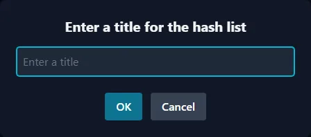

# DMM hash lists: adicione a biblioteca de alguém à sua {#dmm-hash-lists-add-someones-library-to-yours}

Uma hash list é uma lista de releases que alguém compartilhou da sua biblioteca de debrid pelo DMM. Abra uma, entre no DMM com o seu serviço de debrid e clique no botão do seu serviço: os releases vão para a sua própria conta. As listas compartilhadas ficam em [hashlists.debridmediamanager.com](https://hashlists.debridmediamanager.com), e você pode compartilhar a sua na aba **Library** do DMM, com **Share List**.

Uma lista guarda os nomes dos releases, os hashes e os tamanhos. Não tem arquivos nem contas.

## Encontrar uma lista {#find-a-list}

- Na página inicial do DMM, clique em **Hash lists**. Ela abre [hashlists.debridmediamanager.com](https://hashlists.debridmediamanager.com) com uma lista aleatória. **Previous hash list**, **Random hash list** e **Next hash list** trocam de lista.
- As pessoas postam listas no fórum **hashlists** do [Discord](https://discord.com/invite/7u4YjMThXP). Cada uma é um link como `https://hashlists.debridmediamanager.com/<id>.html`. Ao abrir, a lista abre no DMM.

## Adicionar uma lista à sua biblioteca {#add-a-list-to-your-library}

1. Abra a lista. Se aparecer **Login to RD/AD/TB/PM/OC/DL to download**, faça login no [DMM](https://debridmediamanager.com) no mesmo navegador primeiro (veja [como fazer login](index.md#sign-in)) e depois abra a lista de novo.
2. O DMM verifica quais releases o seu serviço já tem. Ele mostra só esses e deixa de fora o que já está na sua biblioteca. A caixa verde **hidden** conta o que ficou de fora.
3. Filtre se quiser:
   - **Movies** e **TV Shows** mostram um tipo só. Os números contam títulos, não arquivos.
   - **One per title** mantém o melhor release de cada título.
   - O chip verde **other files** ao lado de um título lista todos os releases dele.
   - **quick search on filename, hash, or id; supports regex** pesquisa na lista.
4. Clique no botão de uma linha (**RD**, **TB**, **AD**, **PM**, **OC** ou **DL**) para adicionar só esse release.
5. Ou clique em **RD Download** (**TB Download**, **PM Download** e assim por diante) para adicionar todos os releases mostrados. O número nele é a quantidade. O DMM pergunta antes, por exemplo **Add 11 releases to Premiumize?**: clique em **Add 11** para começar.

**Show All** também lista os releases que o seu serviço não tem, e **Show Instant** volta para os que estão em cache.

**RD Download** só adiciona releases que o Real-Debrid já tem, um por minuto, porque o Real-Debrid pausa contas que adicionam mais rápido que isso. Sessenta releases levam cerca de uma hora. As adições rodam na página, então mantenha a aba aberta até aparecer **Started 60 downloads.** TorBox e AllDebrid pulam tudo o que não estiver em cache.

## Compartilhe sua própria biblioteca {#share-your-own-library}

1. Na página inicial do DMM, clique em **Library**.
2. Pesquise ou marque as versões que você quer compartilhar. Se nada estiver marcado, tudo o que aparece na tela é compartilhado.
3. Clique em **Share List** (o botão mostra **Share (3)** quando você marca três). Digite um nome em **Enter a title for the hash list** e clique em **OK**.
4. O DMM abre o novo endereço da sua lista em hashlists.debridmediamanager.com. Pode aparecer um erro 404 por um ou dois minutos enquanto a lista é publicada. Atualize a página e então compartilhe esse endereço.

As listas compartilhadas são públicas. Qualquer pessoa com o endereço pode abrir, e o **Random hash list** pode mostrar a sua para desconhecidos. Só nomes, hashes e tamanhos são incluídos: nunca sua conta, sua chave ou um endereço de tracker.

Para compartilhar uma única versão sem publicar nada, clique no ícone de compartilhar no fim da linha dela na biblioteca (ou em **Hashlist** nos detalhes). O DMM abre uma lista com só essa versão. Copie o endereço dessa página e envie.

## Quando algo está errado {#when-something-is-wrong}

| O que você vê | O que fazer |
|---|---|
| **Login to RD/AD/TB/PM/OC/DL to download** | Você não está logado no DMM neste navegador. Faça login e abra a lista de novo. |
| Tudo está **hidden** e a lista parece vazia | Linhas hidden já estão na sua biblioteca, ou o seu serviço não as tem. Pressione **Show All**. |
| **This hash list is still being published; refresh in a minute or two.** | A lista foi compartilhada há pouco. Espere um ou dois minutos e atualize a página. |
| **0 files** e nenhuma linha | Essa lista está vazia. Pressione **Next hash list** ou **Random hash list**. |
| **Everything already downloaded** | Todos os releases mostrados já estão na sua biblioteca. |
| **Torrent not instant in TorBox; skipped.** ou **Torrent not instant in AD; skipped.** | O seu serviço não tem esse torrent em cache, então o DMM o pulou em vez de iniciar um download. |
| **Skipping 3 items with no info hash — they cannot be shared.** | Essas linhas (downloads web do TorBox, por exemplo) não têm hash para compartilhar. O resto da lista é compartilhado. |
| **Failed to generate hash list; try again soon.** | Não foi possível publicar a lista. Tente de novo mais tarde. |

Ficou com alguma dúvida? Pergunte no fórum **dmm-support** no [Discord](https://discord.com/invite/7u4YjMThXP).

## Perguntas {#questions}

### Como adiciono hash lists à minha própria biblioteca? {#how-do-i-add-hash-lists-to-my-own-library}

Abra a lista, faça login no DMM com seu serviço de debrid e depois clique no botão do seu serviço em uma linha, ou em **RD Download** (ou no **Download** do seu serviço) para tudo que estiver na tela. Veja [Add a list to your library](#add-a-list-to-your-library).

### Por que todos os itens da minha hash list estão ocultos? {#why-are-all-the-items-in-my-hash-list-hidden}

DMM esconde o que já está na sua biblioteca e o que o seu serviço não tem em cache. A caixa **hidden** mostra quantos são. **Show All** mostra o resto.

### Por que séries de TV não aparecem em uma hash list? {#why-dont-tv-shows-show-up-in-a-hash-list}

Clique em **TV Shows** no topo da lista. Se ela mostrar **0 TV Shows**, essa lista não tem séries: a maioria das listas compartilhadas é de filmes. Séries que o seu serviço não tem também ficam ocultas, então tente **Show All**.

### Por que adicionar uma hash list é tão lento? {#why-is-adding-a-hash-list-so-slow}

No Real-Debrid, o DMM adiciona um lançamento por minuto para que o Real-Debrid não pause sua conta. Os outros serviços são mais rápidos.

### Existe uma API para consultar as hash lists? {#is-there-an-api-to-query-the-hash-lists}

There's no search API. Every shared list is a file in the public [hashlists repository](https://github.com/debridmediamanager/hashlists) on GitHub. Each page points at DMM with the list packed into the link after `#` (lz-string compressed JSON of names, hashes and sizes). A very big list sits beside it as `lists/<id>.txt` instead.

### Compartilhar uma lista compartilha a minha conta? {#does-sharing-a-list-share-my-account}

Não recebi nenhum texto para traduzir. Por favor, cole o trecho da documentação que você quer que eu traduza.
