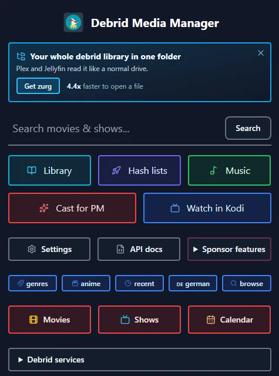

# O que é o DMM e como eu uso? {#what-is-dmm-and-how-do-i-use-it}

[Debrid Media Manager](https://debridmediamanager.com) (DMM) é um site gratuito para encontrar filmes e séries e adicioná-los à sua conta de debrid: Real-Debrid, AllDebrid, TorBox, Premiumize, Offcloud ou Debrid-Link. Você entra com essa conta, pesquisa um título e aperta **Instant RD** (ou o botão do seu serviço) em um lançamento. Ele fica na sua biblioteca na hora, pronto para assistir pelo DMM, no Stremio ou no Kodi, ou no Plex através do [zurg](../zurg/index.md).

O DMM é open source e não faz parte da Real-Debrid nem de qualquer outro serviço. Os arquivos continuam no seu serviço de debrid.

## Entrar {#sign-in}

1. Abra [debridmediamanager.com](https://debridmediamanager.com) e clique no seu serviço: **Login with Real Debrid**, **Login with AllDebrid**, **Login with Torbox**, **Login with Premiumize**, **Login with Offcloud** ou **Login with Debrid-Link**.
2. No Real-Debrid, clique em **Sign in with Real-Debrid**. O DMM mostra um código: clique em **Open real-debrid.com/device**, digite o código lá e aprove. A página do DMM termina sozinha. Você também pode colar o seu [API token](../guides/real-debrid-api-token.md) em **or paste an API key** e clicar em **Save API Key**.
3. Outros serviços: siga a página de login deles. Quando pedir uma API key, copie-a da sua conta nesse serviço, cole e clique em **Save API Key**.

Tem outro serviço também? Abra **Debrid services** na página inicial do DMM e clique no botão **Login** dele, por exemplo **AllDebrid Login**.

Só tem Easynews? Clique em **Login with Easynews**. Você pode pesquisar no Easynews e enviar para o Stremio, mas a biblioteca precisa de uma conta debrid. Apoiadores também podem entrar com **Login with DMM key**.

## Pesquise um filme ou série {#search-a-movie-or-show}

1. Digite um título em **Search movies & shows...** na página inicial. Escolha um dos resultados sugeridos, ou pressione **Search** para ver a lista completa.
2. Pressione o pôster. A página do título lista os lançamentos que o DMM encontrou.
3. Pressione o chip do seu serviço acima dos resultados (**RD**, **PM** e assim por diante) para mostrar apenas os lançamentos que ele já tem.

## O que significam os botões de um lançamento {#what-the-buttons-on-a-release-mean}

| Botão | O que faz |
|---|---|
| **Instant RD** (**Instant TB**, **Instant AD**, **Instant PM**, **Instant OC**, **Instant DL**) | Seu serviço já tem este release. Clique nele e ele vai pra sua biblioteca na hora. |
| **DL with RD** (**DL with TB** e assim por diante; **Add to DL** no Debrid-Link) | Seu serviço ainda não tem. Clicar nele adiciona mesmo assim, e o serviço baixa primeiro. Escolha um **Instant** se quiser assistir agora. [Por que isso acontece](../guides/torrent-being-downloaded-to-debrid.md). |
| **RD (100%)** (**PM (100%)** e assim por diante) | Está na sua biblioteca. O número mostra até onde o download chegou. Clique nele para remover da sua biblioteca. |
| **Check RD** (**Check AD**, **Check DL**) | Pergunta a esse serviço se ele tem este release em cache agora. |
| **Cast (RD)** (**Cast (PM)** e assim por diante) | Envia o release para o Stremio. Veja [DMM no Stremio](stremio.md). |
| **Watch** | Abre uma aba **Ready to play**. Clique em **Play** e seu player abre. Escolha o player em **Settings** → **Video player**. |
| **Copy** | Copia o magnet link do release e mostra **Magnet link copied.** Com **Download .magnet files instead of copy** marcado em **Settings**, o botão mostra **Download** e salva um arquivo .magnet. |
| **Report** | Sinaliza um release ruim: **XXX / Porn Content**, **Incorrect IMDB ID**, **Malware / Executable File** e, em séries, **Tagged for Wrong Season**. |

A aba **Usenet**, ao lado de **Torrents**, lista releases Usenet do mesmo título. **NZB** baixa um deles. Para enviá-los para sua biblioteca, é preciso ter Real-Debrid ou TorBox. Tem Easynews? Adicione em **Settings** e ele também será pesquisado aqui.

## Sua biblioteca {#your-library}

Pressione **Library** na página inicial. Ela lista tudo o que existe nas contas com as quais você entrou: nome, tamanho, status e quando foi adicionado.

- Pesquise com **search by filename/hash/id, supports regex**, ou filtre por **Movies**, **TV shows** e **Others**.
- Pressione uma linha para ver os detalhes dela e os botões **Hashlist**, **Delete**, **Cast** e **Copy**. Os ícones no fim de cada linha fazem o mesmo.
- **Backup** salva sua lista em um arquivo `.dmm.json`. **RD Restore** (**PM Restore** e assim por diante) adiciona de volta uma lista salva.
- **Share List** transforma o que está sendo mostrado, ou o que você selecionou, em uma [hash list](hashlists.md) que outras pessoas podem adicionar às próprias contas.
- **Delete List** apaga tudo o que está sendo mostrado, depois de uma confirmação com **Yes, delete!**. Pesquise ou selecione antes.

## Para onde ir depois {#where-to-go-next}

- [DMM no Stremio](stremio.md): assista ao que você encontrar no Stremio com o addon DMM Cast.
- [Listas de hashes](hashlists.md): adicione uma biblioteca compartilhada inteira à sua, ou compartilhe a sua.
- [TorBox no DMM](torbox.md): o que cada plano do TorBox faz no DMM, e como enviar releases de Usenet para o TorBox Pro.
- ["Torrent is being downloaded to debrid"](../guides/torrent-being-downloaded-to-debrid.md): o que aquela tela no Stremio significa e como o DMM mostra o que está em cache.
- [Botões do DMM no Safari](safari.md): a extensão do navegador adiciona um botão do DMM ao IMDb, Trakt e outros sites de filmes e séries.

O DMM também atende os outros projetos:

- **zurg** pergunta ao DMM qual filme ou episódio é cada arquivo. Um patrocinador recebe a chave de API do DMM em [gatekeeper](https://gatekeeper.debridmediamanager.com/). Sem ela, o zurg depende dos nomes dos arquivos e menos títulos batem. [rex com zurg](../rex/with-zurg.md#why-dmm-places-the-files) explica a diferença.
- **Sonarr Radarr e Prowlarr** podem pesquisar no DMM como um indexador de torrents Torznab ou um indexador de Usenet Newznab. Os dois precisam de uma patrocinação ativa e da chave de API do DMM. Configure-os nas páginas [Torznab](https://debridmediamanager.com/torznab) e [Newznab](https://debridmediamanager.com/newznab).
- **Sua lista de desejos**: pressione **Want** ou siga uma lista do Trakt ou do MDBList. O zurg busca a lista e os novos episódios conforme forem sendo exibidos. Requer patrocínio. Veja [lista de desejos do DMM](../zurg/guides/dmm-wanted.md).
- **Seerr Overseerr e Jellyseerr** podem usar o DMM como Radarr e Sonarr. Os pedidos então vão para a sua lista de desejos para o zurg buscar. Requer patrocínio. Veja [Seerr através do DMM](seerr.md).
- **rex-direct** dá a um rex reivindicado seu próprio endereço e certificado. Veja [rex-direct](../rex/any-source.md#rex-direct).

Tudo o que um patrocínio libera e onde cada coisa é configurada está em [O que um patrocínio oferece](../guides/sponsorship.md).

## Quando algo está errado {#when-something-is-wrong}

| O que você vê | O que fazer |
|---|---|
| **Real-Debrid rejected that API key.** | O token que você colou não funciona. Copie-o de novo em [real-debrid.com/apitoken](https://real-debrid.com/apitoken), ou clique em **Sign in with Real-Debrid**. Mais detalhes em [Your Real-Debrid API token](../guides/real-debrid-api-token.md). |
| **That code expired before it was approved. Try again.** | O código do Real-Debrid expirou. Clique em **Sign in with Real-Debrid** de novo e aprove o novo código mais rápido. |
| **Your TorBox account is on the free plan, which has no API access. DMM needs a paid TorBox plan.** | O plano gratuito do TorBox não pode ser usado com o DMM. Faça upgrade para um plano pago, ou entre com outro serviço. |
| Only **DL with RD** buttons, no **Instant RD** | Seu serviço não tem nenhum desses lançamentos em cache. Clique em um deles e espere baixar, ou tente outro lançamento. |

Ficou com dúvida? Pergunte no fórum **dmm-support** no [Discord](https://discord.com/invite/7u4YjMThXP). [Getting help](../guides/remote-help.md) explica o que incluir.

## Perguntas {#questions}

### O que é o DMM, afinal? {#what-actually-is-dmm}

Um site de busca para a sua conta de debrid. Ele encontra lançamentos de um filme ou série, mostra quais deles o seu serviço já tem e adiciona à sua conta o que você escolher. O próprio DMM não armazena nenhum arquivo.

### Como eu uso? {#how-do-i-use-it}

Faça login com seu serviço de debrid, pesquise um título, abra-o e clique em **Instant RD** (ou no botão **Instant** do seu serviço) em um lançamento. Depois clique em **Watch**, envie para o Stremio ou deixe o zurg colocar no Plex.

### O DMM é feito pela Real-Debrid? {#is-dmm-made-by-real-debrid}

Não. DMM é um projeto de código aberto que funciona com Real-Debrid e outros cinco serviços. As pessoas costumam pesquisar por ele como "Real-Debrid Media Manager".

### É de graça? {#is-it-free}

Sim. Você precisa de uma conta própria de debrid, que é um serviço pago. Um patrocínio do DMM adiciona extras como a lista de desejos e os indexadores: veja [O que um patrocínio oferece](../guides/sponsorship.md).

### Quais serviços funcionam? {#which-services-work}

Real-Debrid, AllDebrid, TorBox (planos pagos), Premiumize, Offcloud e Debrid-Link. O Easynews funciona para busca e transmissão, mas não para a biblioteca.
