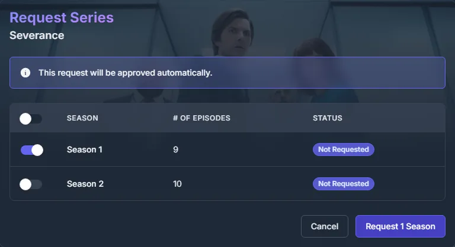

# Seerr via DMM {#seerr-through-dmm}

Adicione o DMM ao [Seerr](https://github.com/seerr-team/seerr) como Radarr e Sonarr. Pedidos aprovados
vão para a sua [lista de desejados do DMM](../zurg/guides/dmm-wanted.md) para o zurg buscar. Você não precisa do
Radarr nem do Sonarr. O Seerr só precisa acessar debridmediamanager.com. Overseerr e Jellyseerr funcionam
da mesma forma.

Isso é para patrocinadores. O Seerr faz login com a chave de API do DMM vinda do [gatekeeper](https://gatekeeper.debridmediamanager.com/).

## O que você precisa {#what-you-need}

- zurg lendo sua lista de desejados do DMM com `dmm_api_key` no `config.yml`. Veja [Fetch what you want from DMM](../zurg/guides/dmm-wanted.md#what-you-need).
- Seerr configurado com seu servidor Plex, Jellyfin ou Emby para que ele saiba quais episódios você tem.

## Adicionar o DMM como Radarr {#add-dmm-as-radarr}

No Seerr, abra **Settings → Services** e clique em **Add Radarr Server**. Preencha assim:

| Campo | Valor |
|---|---|
| Default Server | marcado |
| 4K Server | desmarcado |
| Server Name | `DMM`, ou qualquer nome |
| Hostname or IP Address | `debridmediamanager.com` |
| Port | `443` |
| Use SSL | marcado |
| API Key | sua chave de API do DMM |
| URL Base | `/api/arr/radarr` |

Clique em **Test**. Quando conectar, escolha **Any** em Quality Profile e **/dmm** em Root Folder.
Deixe Minimum Availability como está. Marque **Enable Scan** e clique em **Add Server**.

Se o Test falhar, confira a chave: ela é a que está na página [Settings](https://debridmediamanager.com/settings) do DMM. O DMM também recusa a chave quando sua contribuição (sponsorship) expira.

## Adicionar o DMM como Sonarr {#add-dmm-as-sonarr}

Clique em **Add Sonarr Server** e use `/api/arr/sonarr` como URL Base. Depois de **Test**, escolha **Any** e `/dmm` tanto para os perfis quanto para as pastas raiz. Marque **Enable Scan** e clique em **Add Server**.

## Fazendo pedidos {#requesting}

Faça o pedido normalmente. Um filme aprovado vai para a sua lista de desejados:

Para uma série, escolha as temporadas que você quer. Um pedido posterior pode adicionar mais temporadas. Para acompanhar a série inteira, incluindo as novas temporadas, pressione **Want all seasons** na página dela no DMM.

Sua [lista de desejados](https://debridmediamanager.com/wanted) mostra cada título em segundos. O zurg
pega o título em no máximo um minuto.

## O que o Seerr mostra {#what-seerr-shows}

Seerr lê a lista do DMM uma vez por dia em **Radarr Scan** e **Sonarr Scan**. Para rodar agora, abra
**Settings → Jobs & Cache** e clique em **Run Now** ao lado de cada um.

- **Um filme** que o zurg já baixou aparece como **Available**.

  

- **Uma série** fica em **Processing** até os episódios chegarem à sua biblioteca do Plex, Jellyfin ou Emby,
  e o scan do Seerr nesse servidor os encontrar. O DMM não sabe quais episódios o zurg tem.

## Removendo um título {#removing-a-title}

Abra o título no Seerr, clique no botão de engrenagem e depois em **Remove from Radarr** (ou **Remove from Sonarr**). Isso tira o título da sua lista de desejados. O que o zurg já baixou continua na sua biblioteca. **Open in Radarr** ao lado abre o título no DMM.

Travou? Pergunte no fórum **dmm-support** do [Discord](https://discord.com/invite/7u4YjMThXP). [Getting help](../guides/remote-help.md) explica o que incluir.

## Seerr via DMM ou a fonte Seerr própria do zurg {#seerr-through-dmm-or-zurgs-own-seerr-source}

zurg também consegue ler o próprio Seerr, com uma [fonte `seerr`](../zurg/guides/acquisition.md#configuration).
Use apenas uma das duas opções, não as duas:

- **Pelo DMM**, o Seerr só precisa acessar a internet. Os pedidos aparecem na sua lista de desejos, ao lado do que você adicionou com **Want**, e o scan diário do Seerr marca como disponíveis os filmes que o zurg baixou.
- **A fonte própria do zurg** trata um pedido em 4K separado de um pedido em 1080p, mas o zurg precisa conseguir acessar o Seerr.
