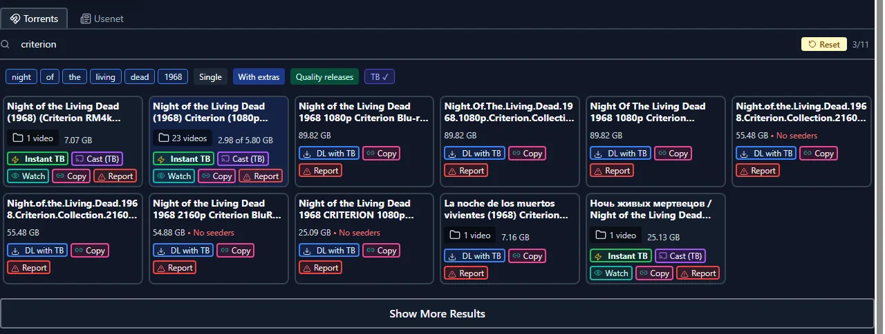
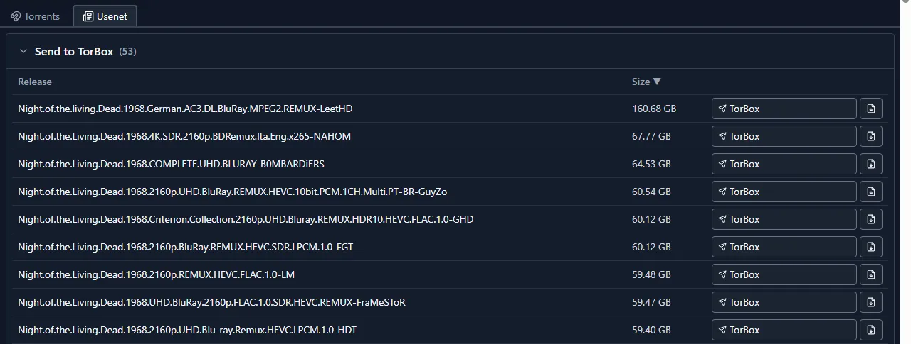

# TorBox no DMM {#torbox-in-dmm}

DMM funciona com um plano pago do TorBox: Essential, Standard ou Pro. Cole sua chave de API de [torbox.app/settings](https://torbox.app/settings) na página **Connect Torbox** do DMM e depois faça a busca: os lançamentos que o TorBox já tem recebem **Instant TB**. O plano gratuito não tem acesso à API, então o DMM não consegue usá-lo, e enviar lançamentos de Usenet para o TorBox exige o plano Pro.

## Entrar {#sign-in}

1. Em [debridmediamanager.com](https://debridmediamanager.com), pressione **Login with Torbox**. Já entrou com outro serviço? Abra **Debrid services** na página inicial e pressione **Torbox Login**.
2. Pressione **Get API Key from Torbox**. Ele abre [torbox.app/settings](https://torbox.app/settings), onde fica a sua API key.
3. Cole a chave em **API Key** e pressione **Save API Key**.

Depois que entrar, a página inicial mostra **Cast for TB** e **Requests**, e **Debrid services** lista a sua conta TorBox com um ✓. Pressione para ver o seu plano e quando ele acaba, ou para **Add another account** ou **Logout**.

## O que cada plano pode fazer {#what-each-plan-can-do}

| | Gratuito | Essential ou Standard | Pro |
|---|---|---|---|
| Entrar no DMM | Não | Sim | Sim |
| **Instant TB**, **DL with TB**, a biblioteca e **Cast (TB)** | Não | Sim | Sim |
| Enviar releases Usenet para o TorBox | Não | Não | Sim |
| Downloads ao mesmo tempo (slots ativos do TorBox) | 1 | 3 ou 5 | 10 |

Se você entrar com uma chave do plano gratuito, o DMM mostra **Your TorBox account is on the free plan, which has no API access. DMM needs a paid TorBox plan.** A [página de preços](https://torbox.app/pricing) do próprio TorBox diz que o acesso à API não está incluído no Gratuito, e que o Usenet só está disponível no Pro.

## Encontrar o que o TorBox já tem {#find-what-torbox-already-has}

1. Pesquise um filme ou série e abra o título.
2. O DMM pergunta ao TorBox quais versões ele já tem em cache. Essas aparecem com **Instant TB** e **Cast (TB)** e ficam listadas primeiro. O chip **TB ✓** acima dos resultados mostra só essas. Ele escreve `is:tb` na caixa de filtro; clique de novo para mostrar tudo.
3. Clique em **Instant TB**. A versão entra na sua biblioteca do TorBox na hora.

As versões que o TorBox não tem aparecem com **DL with TB**. Ao clicar, o TorBox baixa a versão primeiro, o que usa um dos seus slots ativos enquanto ela baixa. **No seeders** ao lado do tamanho significa que ninguém está compartilhando agora, então ela pode nunca terminar. O TorBox sempre adiciona a versão inteira: não é possível escolher arquivos individuais.

## Sua biblioteca {#your-library}

Pressione **Library**. Ela lista seus torrents e downloads da web no TorBox.

- **TB Add** abre **Add to your TB library**. Cole links magnet, envie arquivos `.torrent` ou cole links diretos de download, que o TorBox busca como downloads da web.
- **Backup** salva sua lista em um arquivo. **TB Restore** adiciona de volta uma lista salva.
- O resto funciona como em qualquer serviço: veja [your library](index.md#your-library).

Downloads de Usenet que você enviou ao TorBox não estão na biblioteca do DMM. Encontre-os no site do TorBox, na linha **DMM TB Library** do DMM Cast no Stremio, ou pelo [TorBox hosted Usenet](../zurg/providers/torbox-nzb.md) do zurg.

## Assistir no Stremio {#watch-in-stremio}

Clique em **Cast for TB** na página inicial e instale o addon por lá. Depois, clique em **Cast (TB)** em qualquer release que o TorBox tenha em cache. Todos os passos estão em [DMM in Stremio](stremio.md).

No Stremio, o addon se chama **DMM Cast for TorBox**. A linha **DMM TB Library** lista seus torrents do TorBox, além dos seus downloads web e Usenet concluídos.

## Enviar lançamentos Usenet para o TorBox (Pro) {#send-usenet-releases-to-torbox-pro}

1. Abra um filme ou uma série e clique na aba **Usenet**.
2. Com o TorBox Pro, a lista tem o título **Send to TorBox** e cada release tem um botão **TorBox**. Clique nele.
3. O DMM mostra o que o TorBox fez com ele:
   - **Usenet → TorBox: TorBox already had it, it is ready in your TorBox Usenet downloads.**
   - **Usenet → TorBox: TorBox is downloading it, usually ready within a few minutes.**
   - **Usenet → TorBox: queued, it starts when one of your TorBox active slots frees up.**

Também está conectado ao Real-Debrid? A lista tem o título **Send to Real-Debrid or TorBox** e mostra os dois botões. O ícone de arquivo no fim de cada linha salva o NZB. Nunca usou Usenet? Comece com [Usenet for beginners](../guides/usenet-for-beginners.md).

O TorBox apaga um download de Usenet 30 dias depois de o colocar em cache. Envie de novo para recuperá-lo.

## Preencher pedidos com o TorBox {#fill-requests-with-torbox}

Usuários do Real-Debrid pedem lançamentos no [quadro de pedidos](https://debridmediamanager.com/requests) do DMM. Clique em **Requests** na página inicial e depois em **Fulfil** em um lançamento que o TorBox tem em cache. Ele vai do seu TorBox para o Real-Debrid deles. A cada 10 envios você ganha 7 dias de vantagens de patrocinador do DMM: veja [ganhe sem pagar](../guides/sponsorship.md#earn-it-without-paying).

## Quando algo está errado {#when-something-is-wrong}

| O que você vê | O que fazer |
|---|---|
| **Your TorBox account is on the free plan, which has no API access. DMM needs a paid TorBox plan.** | Essa chave está no plano gratuito do TorBox. Faça upgrade ou renove no TorBox e depois entre de novo. |
| **Failed to refresh torbox: Your TorBox account is on the free plan, which has no API access. DMM needs a paid TorBox plan.** | Seu plano pago acabou desde que você entrou. Renove no TorBox. |
| **API Error: Request failed with status code 403. Status: 403** | O TorBox não aceitou essa chave. Copie de novo a partir de [torbox.app/settings](https://torbox.app/settings), tudo, sem faltar nada. |
| Nenhum botão **TorBox** na aba Usenet | Enviar releases de Usenet para o TorBox precisa do Pro. Os planos Essential e Standard não têm o botão. |
| **Usenet → TorBox: TorBox Usenet needs a Pro plan** | O TorBox recusou o NZB porque o plano não é Pro. |
| Só **DL with TB**, sem **Instant TB** | O TorBox não tem nenhum desses releases em cache. Clique em um e espere baixar, ou escolha outro release. |
| Só aparecem releases **Instant TB** | O chip **TB ✓** está ligado (`is:tb` na caixa de filtro). Clique nele de novo, ou clique em **Reset**. |
| **No torrents found yet. Use Want above to have zurg fetch it once one turns up, or try the Usenet tab.** | O DMM ainda não tem torrents para este título. Novos episódios podem demorar um pouco. Tente a aba **Usenet** ou volte mais tarde. |
| No Stremio: **⚠️ TorBox refused your account** | O TorBox aceita a chave do addon, mas não entrega o conteúdo da conta, geralmente porque o plano acabou. Confira em [torbox.app/settings](https://torbox.app/settings). Não é preciso mudar nada no DMM. |
| zurg: `Acquisition: dmm-torbox refused the search: No TorBox key linked.` | O feed patrocinado `tb/cached` na [página Torznab](https://debridmediamanager.com/torznab) do DMM precisa da sua chave do TorBox vinculada em **Link a provider key** nessa página. Estar logado no TorBox dentro do DMM não basta. O `api_key` no zurg continua sendo a sua chave de API do DMM. |

O próprio TorBox está fora do ar? Confira em [O TorBox está fora do ar ou é só comigo?](https://debridmediamanager.com/is-torbox-down-or-just-me). Travou? Pergunte no fórum **dmm-support** do [Discord](https://discord.com/invite/7u4YjMThXP). [Como pedir ajuda](../guides/remote-help.md) explica o que incluir.

## Perguntas {#questions}

### O suporte ao TorBox não está no plano gratuito do zurg? {#is-torbox-support-not-on-the-free-tier-of-zurg}

Certo. A build pública e gratuita do zurg só funciona com Real-Debrid. TorBox, os outros serviços e Usenet estão nas builds noturnas para patrocinadores. Seu plano do TorBox também precisa ser pago, porque o zurg não consegue ler uma conta gratuita. Para configurar, veja [TorBox com zurg](../zurg/providers/torbox.md).

### O zurg usa o plano errado do TorBox? {#zurg-uses-the-wrong-torbox-plan}

Nightlies do TorBox's Pro plan como Standard e permitiam 5 downloads ao mesmo tempo em vez de 10 antes de 3 de outubro de 2026. Atualize o zurg. Os [limites do TorBox com o zurg](../zurg/providers/torbox-limits.md) têm o resto.

### Sem resultados de busca com o TB? {#no-search-results-with-tb}

A busca do DMM é a mesma, independentemente do serviço em que você entra. O TorBox só define quais releases aparecem marcados como **Instant TB**. Se não aparecer nada, verifique se o chip **TB ✓** está desativado, recarregue a página ou clique em **Show More Results** no final. Um episódio muito recente pode ainda não ter torrents no DMM: tente a aba **Usenet**.

### Posso usar TorBox e Real-Debrid juntos? {#can-i-use-torbox-and-real-debrid-together}

Sim. Entre na sua conta nos dois serviços e cada release mostra os botões dos dois. Um release que o TorBox tem em cache e o Real-Debrid não tem ganha um botão **TB → RD**, que o envia do TorBox para o seu Real-Debrid.

### Qual plano do TorBox preciso para o DMM? {#which-torbox-plan-do-i-need-for-dmm}

Qualquer plano pago. Escolha o Pro se quiser enviar releases de Usenet para o TorBox ou quiser 10 downloads ao mesmo tempo.
