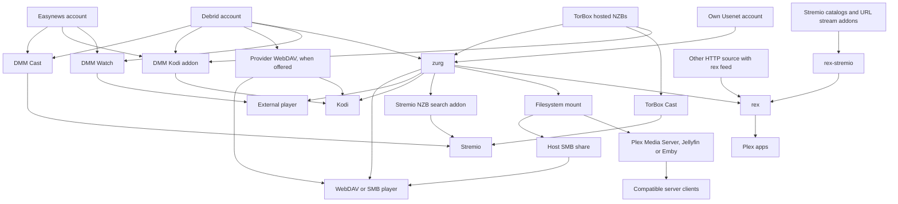
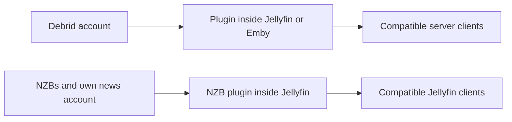
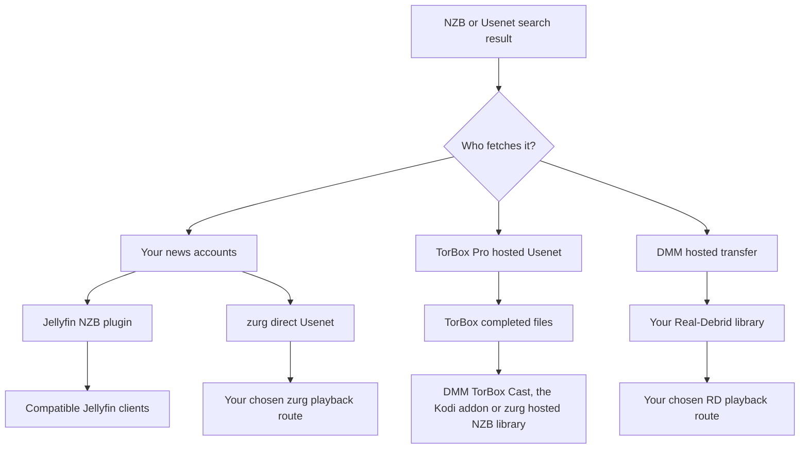

# Qual configuração devo usar? {#which-setup-should-i-use}

**[Encontre sua configuração com o questionário interativo](https://debridmediamanager.com/choose-your-setup).** Responda a algumas perguntas sobre suas contas de players e sua hospedagem. Ele devolve rotas, requisitos e links de configuração. Não precisa de login.

**Comece pelo app em que você quer assistir.** Você não precisa de todas as peças. O DMM ajuda você a escolher os lançamentos. Um provedor fornece os arquivos. O zurg pode transformá-los em uma biblioteca compartilhada. O rex apresenta uma biblioteca para os apps do Plex. Algumas rotas pulam uma peça.

Este mapa cobre rotas suportadas verificadas em **10 de novembro de 2026**. Ele inclui alternativas externas que eliminam uma etapa. Addons e dispositivos de terceiros ainda podem ser diferentes. Siga o guia vinculado e os limites testados nele.

## Escolha pelo que você já usa {#pick-by-what-you-already-use}

En um celular, deslize a tabela para o lado para ver todas as colunas.

| Eu tenho / quero… | Escolha esta rota | Por que escolher? | O que você assume |
|---|---|---|---|
| Stremio e uma conta de debrid ou Easynews; sem servidor para manter | **DMM Cast → Stremio**, ou seu addon de stream já existente | Assista pela sua conta sem rodar zurg, rex ou um servidor de mídia | O addon e o provedor precisam fornecer um stream reproduzível; o dispositivo cuida da reprodução |
| Kodi e uma conta de debrid, Easynews ou TorBox Pro | **Addon do DMM para Kodi → sua conta** | Navegue, pesquise e reproduza dentro do Kodi; pareie pelo seu celular. A biblioteca TorBox do addon inclui downloads de NZB hospedados | O Kodi faz a reprodução. A lista Wanted de um patrocinador ainda precisa do zurg para atender aos pedidos |
| Um filme para assistir no seu player habitual | **DMM Watch → player externo** | Não é preciso servidor de biblioteca | Instale um player compatível e escolha um arquivo que ele consiga reproduzir |
| Infuse, Kodi ou outro player WebDAV | **WebDAV do provedor** sem host; **zurg → player WebDAV** quando for possível manter um host ligado | Navegue por uma biblioteca na nuvem sem Plex, Jellyfin, Emby ou rex | Real-Debrid, AllDebrid, Premiumize, TorBox e Debrid-Link oferecem seu próprio WebDAV, com a estrutura de pastas deles. A Offcloud não tem, então precisa do zurg. O zurg precisa de um host que fique ligado enquanto você assiste |
| Servidor Plex Media Server já funcionando | **zurg → pasta montada → Plex Media Server → app Plex** | Mantenha seu servidor, suas bibliotecas e seus fluxos de trabalho atuais | Rode o zurg e um mount de sistema de arquivos junto com o servidor; as varreduras leem arquivos remotos |
| Apps Plex, mas sem vontade de manter uma biblioteca montada | **zurg → rex → app Plex** | O zurg fornece a biblioteca para o rex sem mount nem Plex Media Server | Os dois serviços ficam rodando; confira a compatibilidade de apps do rex e as orientações sobre contas |
| Addons do Stremio, mas prefiro apps Plex | **Addons → rex-stremio → rex → app Plex** | Transforme catálogos de addons em bibliotecas Plex; o zurg é opcional | Rode o rex e o rex-stremio; os addons de stream precisam retornar URLs reproduzíveis, não torrents brutos |
| Jellyfin é como meus players acessam a biblioteca | **Plugin do provedor dentro do Jellyfin → cliente compatível** | Sem serviço zurg separado nem mount | Jellyfin 12 e o(s) plugin(s) correspondente(s); os plugins têm seus próprios limites de arquivo |
| Emby é como meus players acessam a biblioteca | **Plugin do provedor dentro do Emby → cliente compatível** | Mantenha tudo dentro do servidor Emby que você já tem | Use uma versão compatível do Emby; esses seis plugins cobrem debrid, não Usenet direto |
| Jellyfin/Emby mais consumidores que precisam de acesso próprio a sistema de arquivos/WebDAV | **zurg → mount → Jellyfin/Emby** | Uma biblioteca pode atender mais de um consumidor | Mantenha o mount e os caminhos do servidor; outros consumidores podem usar o zurg diretamente |
| Arquivos NZB, minha própria conta Usenet e Jellyfin | **Plugin NZB dentro do Jellyfin → cliente compatível** | Transmita NZBs sem um serviço zurg separado | Acesso NNTP e a versão compatível do Jellyfin; o plugin exclui membros de arquivos compactados/criptografados e não repara com PAR2 |
| Um player de hardware que lê compartilhamentos SMB | **zurg → mount → compartilhamento SMB do host → player** | Mantenha o navegador de arquivos nativo do player e a reprodução | O host fornece o SMB; o próprio zurg fornece WebDAV, não um servidor SMB |
| Minha própria conta Usenet e Stremio | **Indexador Newznab → addon Stremio do zurg → Stremio** | Pesquise no momento da reprodução e transmita pela sua conta de notícias | Um zurg em execução, acesso ao indexador e credenciais NNTP; outro dispositivo precisa de um endereço HTTPS acessível do addon |
| Um dispositivo Android/Google TV, sem outro computador | **zurg+rex Android → player nesse dispositivo, ou os apps Plex nele e no resto da sua casa** | Rode o zurg e o rex em um dispositivo Android, seu próprio servidor Plex no celular ou na TV box, para essa tela e os apps Plex da sua casa | Acesso de patrocinador, sideloading e operação em segundo plano; Usenet exige Android de 64 bits; NZBs hospedados da TorBox não estão disponíveis no Android |
| Arquivos já em um disco/NAS | **Servidor de mídia existente ou player de rede**; **fonte HTTP → rex** se você quiser o rex | Continue usando os arquivos que você tem; não é preciso conta de debrid nem Usenet | O rex precisa de metadados enviados pela sua API de feed e acesso HTTP aos arquivos; o produtor do feed e o servidor de arquivos podem ser separados. O rex não varre discos |
| Mídia HTTP transmitível ou meu próprio servidor HTTP | **Fonte HTTP + feed do rex → rex → apps Plex**, ou um player compatível diretamente | Use uma fonte existente sem debrid nem zurg | O rex precisa de um produtor de feed para enviar a identidade e os detalhes da mídia; uma URL simples não fornece esses metadados |

Comece aqui: [DMM Cast](https://debridmediamanager.com/stremio/) · [Kodi](https://debridmediamanager.com/kodi) · [DMM Settings](https://debridmediamanager.com/settings) · [configuração do zurg](../zurg/setup/index.md) · [rex com zurg](../rex/with-zurg.md) · [rex com addons Stremio](../rex/stremio.md) · [plugins Jellyfin](https://debridmediamanager.com/jellyfin) · [plugins Emby](https://debridmediamanager.com/emby) · [addon Stremio do zurg](../zurg/guides/stremio.md) · [Android](../zurg/guides/android.md) · [rex com qualquer fonte](../rex/any-source.md).

O link do Cast começa com a Real-Debrid. Use a página de configuração da [TorBox](https://debridmediamanager.com/stremio-torbox/), da [AllDebrid](https://debridmediamanager.com/stremio-alldebrid/), da [Premiumize](https://debridmediamanager.com/stremio-premiumize/), da [Offcloud](https://debridmediamanager.com/stremio-offcloud/), da [Debrid-Link](https://debridmediamanager.com/stremio-debridlink/) ou da [Easynews](https://debridmediamanager.com/stremio-easynews/) quando você usar essa conta. Cast aqui significa o **addon do DMM**. Não significa Chromecast nem espelhamento de tela.

## O mapa de reprodução {#the-playback-map}

As setas significam "fornece uma biblioteca ou um stream reproduzível para". Elas não são um diagrama de roteamento de pacotes: dependendo da rota, o player pode buscar no provedor ou o servidor pode transportar os bytes.

[Abra o mapa de reprodução em tamanho real](../assets/setup-routes/playback.svg) para ampliar ou salvar.

O ramo de busca de NZB do Stremio precisa de uma conta NZB (`nzb`, ou `torbox_nzb` para releases que o TorBox já tem) e de um indexador Newznab. Os NZBs hospedados no TorBox também podem ser reproduzidos pelo TorBox Cast ou pelo addon do Kodi, sem o zurg. O ramo mount-to-SMB precisa de um compartilhamento separado configurado no host.

Duas rotas menores vale manter separadas:

[Abra o mapa de plugins em tamanho real](../assets/setup-routes/plugins.svg).

Os plugins são integrações separadas. "zurg" no nome de um plugin **não** significa que você precisa rodar o aplicativo zurg. Também não garante os mesmos recursos. A biblioteca de torrents do plugin do TorBox é separada do backend de NZB hospedado do zurg.

## Escolha de onde vêm os arquivos {#choose-where-the-files-come-from}

An **indexador** encontra os lançamentos. Um **torrent ou NZB** descreve como baixar um deles. Um **provedor** fornece os bytes. Um **player** decodifica o conteúdo. Ter acesso a um deles não inclui os outros.

| Entrada | O que obtém/serve o vídeo? | O que você precisa | Quando é útil |
|---|---|---|---|
| Torrent em cache, magnet ou arquivo torrent | Seu provedor debrid | Uma conta suportada pela integração escolhida | Muitas vezes é a espera mais curta quando o lançamento exato já está disponível |
| Torrent sem cache | O provedor debrid baixa primeiro | Uma conta que aceite o torrent, fontes disponíveis e espaço dentro dos limites | Um lançamento que você quer não está em cache; espere uma demora e possível falha |
| NZB, usando suas próprias contas de notícias | O backend **direct Usenet** do zurg, ou o plugin NZB do Jellyfin, lê os artigos conforme necessário | NZBs, acesso NNTP e a integração escolhida; acesso ao indexador se você quiser pesquisar | Escolha seus provedores/backbones, use contas de reserva, evite guardar vídeos inteiros localmente |
| NZB, usando o serviço hospedado da TorBox | **A TorBox baixa e repara o arquivo**, depois serve os arquivos concluídos | TorBox Pro; envie pelo DMM ou pelo backend **TorBox hosted NZB** do zurg | Você quer NZBs sem gerenciar credenciais de servidor de notícias nem decodificação local |
| Resultado Usenet do DMM enviado ao Real-Debrid | O serviço de transferência hospedado do DMM baixa e o envia para **sua biblioteca do Real-Debrid** | Real-Debrid e uma cota disponível de transferência do DMM | Você já assiste pelo RD e quer esse lançamento lá; não é necessária conta NNTP pessoal |
| Resultado de pesquisa na Easynews | A Easynews serve um download/stream HTTP direto | Sua própria conta Easynews | Assistir ou transmitir pelo DMM, ou usar a rota Easynews Cast/Kodi, sem montar uma biblioteca de NZB |
| Link direto de download HTTP(S) | Um player/fonte HTTP compatível, ou um provedor que suporte esse download | Acesso à URL real da mídia; uma conta de provedor adequada se for importar/desbloquear lá | Você já tem a URL de um arquivo em vez de um torrent/NZB |
| Arquivos no seu disco ou NAS | Seu servidor de arquivos/mídia | Armazenamento local e um player que consiga acessá-lo | Propriedade offline, vídeos caseiros ou para manter uma coleção existente |

O zurg suporta **Real-Debrid, AllDebrid, TorBox, Premiumize, Offcloud e Debrid-Link**. Você pode combinar contas em uma mesma biblioteca. Cotas de cache e disponibilidade de arquivos ainda variam. Um selo de "cached" é uma evidência, não uma garantia de reprodução. Veja [providers](../zurg/providers/index.md).

### “Usenet sem conta de Usenet”: qual caminho? {#usenet-without-a-usenet-account-which-route}

[Abra o mapa do Usenet em tamanho real](../assets/setup-routes/usenet.svg).

**Escolha NZBs hospedados no TorBox** quando quiser que o TorBox baixe e repare. O DMM envia o NZB para lá. Os nightlies atuais do zurg usam o tipo de provedor `torbox_nzb` e aceitam NZBs do diretório de observação e da interface SABnzbd. [Usenet hospedado no TorBox](../zurg/providers/torbox-nzb.md) tem a configuração do zurg. Quando o conteúdo não está em cache, o download precisa terminar antes de tocar. Os downloads dividem os slots com os torrents. Arquivos retidos podem expirar, e o zurg não garante buscar de novo um release expirado. Guarde o NZB para buscar outra vez.

**Escolha Usenet direto** quando o zurg deve ler pelas suas próprias contas de notícias, incluindo contas de fallback ou de bloqueio. Ele usa `nzb` com as credenciais NNTP. Um login de servidor de notícias do TorBox também entra aqui. É separado dos NZBs hospedados no TorBox. Veja [NNTP do TorBox](../zurg/providers/torbox-news-server.md) e [os planos dele](https://torbox.app/pricing).

**Uma instância do zurg usa `nzb` ou `torbox_nzb`, nunca os dois.** Ambos controlam o diretório de observação de NZBs. Rode os dois com instâncias e diretórios de trabalho separados. Com `dmm_api_key` nas duas, [desligue a fonte `dmm-wanted` em uma delas](../zurg/guides/dmm-wanted.md#two-zurgs-on-one-key), senão cada título da lista Wanted será buscado duas vezes. Qualquer um dos dois pode ficar junto com provedores de torrent. O addon Stremio do zurg envia a escolha dele para qualquer conta NZB que a instância tenha. Com `torbox_nzb`, só um release que o TorBox já tem começa dentro da espera do addon, e só quando não há outro envio de NZB na fila.

**Escolha DMM → Real-Debrid** quando quiser o release na sua biblioteca do RD. É uma transferência hospedada, com filas e cotas. Um job sem cache leva tempo. Isso não adiciona suporte NNTP nativo ao Real-Debrid nem a outros provedores debrid. O resultado no DMM e a [página Transfers](https://debridmediamanager.com/transfers) mostram o progresso.

No Easynews, **Watch** e **Cast** tocam os arquivos HTTP dele, e **Download NZB** salva o NZB do release. **Send to zurg** coloca esse NZB na sua lista Wanted de patrocinador. Isso exige um backend NZB configurado. Um login do Easynews no DMM não configura a conta NZB do zurg.

### E os links HTTP? {#what-about-http-links}

O diálogo **Add** do TorBox no DMM aceita links HTTP(S) diretos como downloads web. O zurg os expõe em `__downloads__`. Um item ali não vira automaticamente um item identificado na biblioteca do rex. Downloads sem restrição do Real-Debrid também podem aparecer ali. O DMM TorBox Cast inclui downloads web e Usenet concluídos, além de torrents. Uma página web pode ainda precisar de outra integração por causa de logins, URLs que expiram, DRM ou player próprio.

**O rex suporta mídia HTTP(S) em streaming pela sua API de feed.** Uma [fonte ou addon](../rex/any-source.md) envia o endereço da mídia e os metadados. Depois, o rex disponibiliza isso nos apps do Plex. O servidor de arquivos e o produtor do feed podem ser separados. Não é preciso ter conta no zurg nem em serviço debrid. O [rex-stremio](../rex/stremio.md) faz isso para addons compatíveis do Stremio. Magnets puros e streams só de torrent não funcionam. HLS precisa da configuração do FFmpeg no rex. O rex usa a identidade que a fonte fornece.

## Decida como os títulos são adicionados {#decide-how-titles-get-added}

Aquisição e reprodução são escolhas separadas. Você pode mudar a forma como um título é solicitado sem trocar o app em que assiste.

| Como você escolhe os títulos | Rota | Por que usar? |
|---|---|---|
| Escolha a versão exata | Busca/biblioteca do DMM → provedor; ou um NZB → seu backend NZB selecionado | Controle você mesmo a edição, o tamanho e a versão |
| Clique em Want, ou siga uma lista do Trakt/MDBList | [DMM Wanted](../zurg/guides/dmm-wanted.md) → aquisição pelo zurg | Filmes e novos episódios automáticos sem rodar Sonarr/Radarr; requer patrocínio |
| Pedidos da família no Seerr/Overseerr/Jellyseerr | [Seerr via DMM](../dmm/seerr.md) → Wanted → zurg | Interface de pedidos familiar, sem servidor arr; requer patrocínio. O Seerr precisa de um servidor Plex, Jellyfin ou Emby para ser configurado |
| Já tem watchlists do Plex ou outra pilha de pedidos | [aquisição pelo zurg](../zurg/guides/acquisition.md) | Mantenha a fonte de pedidos atual; configure a busca e os provedores alvo |
| Quer monitoramento detalhado e perfis de qualidade no Sonarr/Radarr | DMM ou seus indexadores → arr → interface de cliente de download do zurg → biblioteca | Mantenha as decisões e o fluxo de importação do arr; mais serviços e configuração de caminhos |
| Quer escolher só na hora de dar Play | DMM Cast/Kodi, outro addon de streaming ou a busca do zurg no Stremio | Não precisa montar antecipadamente uma biblioteca gerenciada com todos os títulos |

Para a rota arr recomendada com DMM + zurg, **o DMM é o indexador e o zurg é o cliente de download**. O DMM oferece [Torznab](https://debridmediamanager.com/torznab) e [Newznab](https://debridmediamanager.com/newznab). Os dois exigem patrocínio ativo. O Prowlarr é opcional. O zurg fornece interfaces [qBittorrent](../zurg/guides/sonarr-radarr-torrents.md) e [SABnzbd](../zurg/guides/sonarr-radarr.md). Você não precisa desses apps de download ao lado do zurg. [O zurg também pode buscar para o arr](../zurg/guides/sonarr-radarr-fetch.md).

Se você quer **cópias locais completas**, baixe os arquivos do seu provedor ou do zurg. Você também pode usar o recurso de download offline do player ou um downloader comum e uma biblioteca em disco. Confira as cotas e reproduza os arquivos salvos sem rede. Arquivos virtuais do zurg, links `.strm` e [catálogos debrid locais](../zurg/guides/local-libraries.md) não são cópias offline. Catálogos locais guardam só registros. A reprodução ainda depende do provedor.

## Os trade-offs que importam antes de instalar {#the-tradeoffs-that-matter-before-installing}

| Pergunta | O que muda a sua escolha |
|---|---|
| Outra máquina precisa ficar ligada? | As rotas hospedadas de Cast/Kodi, o WebDAV do provedor e o DMM Watch não precisam do seu próprio servidor. zurg, rex, rex-stremio e os plugins de media-server precisam do host ligado enquanto você assiste. zurg+rex Android pode usar um dispositivo Android como host do zurg e do rex; rex-stremio e os plugins de media-server ainda precisam de um host normal. Um host alugado/gerenciado muda quem o administra, não a rota em si. |
| Sua TV vai reproduzir o arquivo? | As rotas WebDAV e de addon dependem dos codecs, do áudio e das legendas do player. O zurg entrega os bytes; ele não é um transcodificador de vídeo. Plex Media Server, Jellyfin, Emby ou rex com FFmpeg podem converter quando necessário, com hardware e recursos de servidor/app adequados. |
| Quanto espaço em disco? | O streaming evita guardar a coleção inteira. Reserve espaço para bancos de dados, artes, caches e qualquer trabalho de reparo, transcodificação ou download offline. “Sem download completo antes” não significa zero uso de disco. |
| Quem paga a banda? | As cotas de tráfego do provedor continuam valendo. Um proxy de servidor carrega o tráfego de reprodução e usa a banda de saída dele; a reprodução direta transfere a conexão para quem assiste. A análise da biblioteca também pode ler arquivos remotos. |
| Vai funcionar fora de casa? | Addons hospedados evitam expor o seu próprio servidor. Serviços self-hosted precisam de um endereço acessível com segurança; um endereço de LAN sozinho não funciona remotamente. Veja [acesso remoto do rex](../rex/any-source.md#use-it-outside-your-home-optional) e o [guia de HTTPS do Stremio](../zurg/guides/stremio.md#installing-it-on-another-device). |
| A família pode usar ao mesmo tempo? | Confira as regras de IP/concorrência do seu provedor e o modelo de compartilhamento do servidor. O uso do Real-Debrid precisa ficar em um único IP público; links diretos para casas diferentes podem violar isso, mesmo quando uma biblioteca central os forneceu. Não ative redirects sem entender de onde os downloads se originam. |
| Pelo que eu pago? | Mantenha separados: assinaturas de provedores, acesso a indexadores, patrocínio do DMM, hospedagem e compras de player/servidor. O site básico do DMM e o rex para uso pessoal são gratuitos; também é o [rex para Android](https://github.com/debridmediamanager/rex-android). As nightlies atuais do zurg e a distribuição de plugins do DMM são benefícios de patrocinador; Wanted e as APIs de indexadores do DMM também exigem patrocínio. O rex-stremio não exige. [O que um patrocínio oferece](sponsorship.md) lista cada benefício e onde configurá-lo. |
| Um item do catálogo garante a reprodução? | Não. Catálogos de addons descrevem títulos; arquivos na nuvem podem expirar; torrents podem não ter fontes; artigos Usenet podem estar faltando. Escolha a rota cujo comportamento em caso de falha e de espera você aceita. |

Um cliente compatível com o servidor também pode ser um app de terceiros. [O Infuse se conecta ao Plex, Emby e Jellyfin](https://support.firecore.com/hc/en-us/articles/360006462093-Streaming-from-Plex-Emby-and-Jellyfin). Você pode não precisar de um mount separado do zurg. Confira o plugin e o cliente juntos.

O Infuse suporta [WebDAV e outros compartilhamentos de rede](https://support.firecore.com/hc/en-us/articles/215090977-Streaming-From-a-Mac-PC-or-NAS). Um arquivo `.strm` dá a um player compatível, como o Kodi, uma URL. Ele não é um substituto universal de mount. Confira o cliente e espere comportamentos diferentes de proxy e failover. Não use `.strm` como configuração normal do Plex Media Server.

Também existe uma [versão gratuita legada do zurg](https://github.com/debridmediamanager/zurg-public/releases). Ela funciona só com Real-Debrid e usa um formato de configuração diferente. As rotas multi-provedor de Usenet e Android descritas aqui usam as nightlies de patrocinador.

**O rex tem seus próprios limites de compatibilidade.** Ele é um servidor de app Plex independente. Não é o Plex Media Server nem um plugin do Plex. Use a [FAQ](../rex/faq.md) dele para ver os dispositivos testados, o uso remoto com transcodificação e a recomendação de conta nova. Um servidor Plex tradicional pode rodar junto com o rex.

## Necessidades que podem mudar o caminho {#needs-that-can-change-the-route}

| Também preciso… | O que escolher ou verificar |
|---|---|
| Arquivos locais e títulos da nuvem juntos | Mantenha seu servidor Plex/Jellyfin/Emby atual e adicione o mount ou o plugin correspondente. O rex pode combinar várias fontes de feed, incluindo uma fonte HTTP para arquivos locais; ainda assim, elas precisam dos metadados delas. |
| Legendas automáticas | Legendas fornecidas pelo player ou embutidas podem bastar. Para um fluxo com arr, [Bazarr com zurg](../zurg/guides/subtitles.md) grava arquivos de legenda locais ao lado dos vídeos virtuais; esses arquivos não chegam ao DMM Cast, ao addon do Kodi, ao DMM Watch nem ao addon Stremio do zurg; eles chegam ao Kodi como uma fonte WebDAV do zurg. O rex também tem Search Subtitles sem o Bazarr. |
| Meu histórico de itens assistidos ao trocar de servidor | Leia [migrando do Plex](../rex/from-plex.md) e [importando o estado de assistido](../rex/import-watched.md) antes de trocar; mudar a fonte não migra automaticamente o histórico de todos os apps. |
| Compartilhar uma seleção com alguém que tem conta própria | As hashlists do DMM compartilham escolhas de releases para que outras pessoas as adicionem às contas delas. Elas não transferem suas credenciais nem hospedam a reprodução. Compartilhar um servidor é outro caminho, sujeito às regras de compartilhamento e do provedor. |
| Uma VPS ou host remoto com banda limitada | Verifique se a rota faz proxy ou redirecionamento da reprodução. As [configurações de direct-download do rex](../rex/direct-download.md) explicam as opções; redirecionamentos mudam o IP público do downloader e podem expor URLs do provedor. |

## Outras mídias e configurações existentes {#other-media-and-existing-setups}

- **Música:** o [DMM Music](https://debridmediamanager.com/music/) oferece reprodução/downloads pelo navegador com Real-Debrid. As [fontes de música do rex](../rex/music.md) alimentam o Plexamp e os apps do Plex compatíveis. Uma fonte pode ser um addon ou um zurg configurado para música. Não presuma que um addon de filmes/séries também fornece música.
- **TV ao vivo:** a [rota de TV ao vivo do rex](../rex/live-tv.md) oferece canais e um guia nos apps documentados. Já os canais ao vivo do rex-stremio formam uma biblioteca de canais; essa não é a mesma interface de guia. Verifique a disponibilidade da fonte. O rex não oferece gravação DVR.
- **Vídeos caseiros, gravações e fotos:** use um servidor de mídia que você já tenha, ou uma [fonte do rex que você controla](../rex/addons.md). O [tutorial de vídeos caseiros](../rex/addon-home-videos.md) mostra essa segunda opção. O zurg também pode fornecer quadrinhos como fotos para o rex; o suporte varia de app para app.
- **Addons de Kodi/Stremio que você já usa:** se o seu já entrega a experiência que você quer, mantenha. O DMM pode ser o lugar onde você seleciona e gerencia os lançamentos sem substituir o seu player. O suporte a provedores, Usenet e HTTP varia entre addons; a rota do DMM não é uma garantia de compatibilidade com todos os addons.
- **Outro mount/downloader de debrid já instalado:** veja as [opções de migração](../zurg/migrate/index.md) antes de trocar. Uma configuração que funciona não precisa de mais uma camada só porque ela existe.
- **Apps nativos em desenvolvimento:** o Usenet TV não é uma configuração de app store lançada que eu recomende aqui. O Yomu TV é um projeto separado de leitura/audiolivros, não uma rota para essa pilha de filmes/séries. Nenhum dos dois é necessário para as rotas acima.

## Cinco pontos de partida comuns {#five-common-starting-points}

1. **“Tenho Stremio e RD.”** Comece com o DMM Cast. Adicione o zurg só quando quiser uma biblioteca compartilhada, automação ou outro consumidor que precise dele.
2. **“Tenho TorBox Pro e quero os NZBs desse post.”** Envie o NZB para o TorBox pelo DMM. Use o TorBox Cast para assistir no Stremio, o addon do Kodi para assistir no Kodi, ou o backend NZB hospedado do zurg para alimentar a rota de biblioteca/player que você escolher.
3. **“Já tenho Jellyfin.”** Comece com o plugin do seu provedor. Escolha o zurg separado quando precisar do sistema de arquivos compartilhado, automação ou de recursos de backend mais amplos.
4. **“Quero apps do Plex, sem montagens e com meus addons existentes.”** Use o rex-stremio com o rex. Use o zurg como fonte quando o que você quer expor for sua biblioteca gerenciada de debrid/Usenet. As duas fontes podem alimentar o mesmo rex.
5. **“Tenho contas de Usenet e quero Sonarr/Radarr.”** Use o DMM Newznab ou seus indexadores atuais, a rota NZB/SABnzbd do zurg e uma rota de reprodução da primeira tabela. Para arquivos locais permanentes, escolha um downloader comum ou salve cópias completas explicitamente; importações virtuais sozinhas não são arquivos offline.

Ainda em dúvida? Conte para nós **seu dispositivo ou player, suas contas atuais, se um host pode ficar ligado e se você quer reprodução sob demanda ou uma biblioteca automática**. Essas respostas geralmente definem o caminho. [Getting help](remote-help.md) indica onde perguntar.
