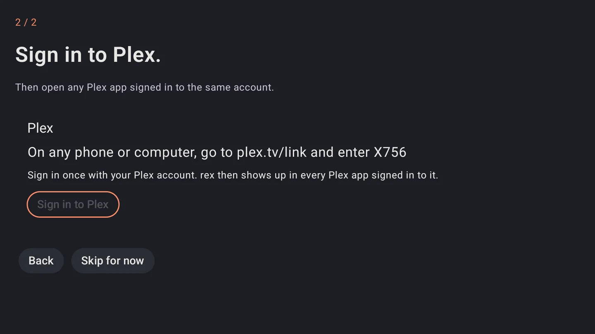

# rex para Android {#rex-for-android}

rex é um servidor de mídia para os apps do Plex que não possui nenhum arquivo. O rex para Android roda em um celular, tablet, Android TV, Google TV ou Fire TV, sem precisar de computador. Os apps do Plex nos seus dispositivos encontram o rex como qualquer outro servidor Plex e reproduzem a partir dele.

O que ele reproduz vem de **addons**. Ele começa com os filmes de domínio público do Internet Archive. Outros addons, como os seus addons do Stremio, YouTube e Spotify, são instalados dentro do app depois que você adiciona o repositório deles.

O rex para Android é gratuito. Quer colocar suas contas de debrid e Usenet nele também? O zurg+rex, um servidor Plex no seu celular com o zurg embutido, vem com um patrocínio: veja [zurg+rex para Android](../zurg/guides/android.md).

## Antes de começar {#before-you-start}

| Você precisa de | Por quê |
|---|---|
| Um dispositivo com Android 8.0 ou mais recente | Celular, tablet, Android TV, Google TV ou Fire TV |
| Uma conta no Plex | O rex aparece nos apps do Plex em que você está logado. Uma conta gratuita já basta |
| Um app do Plex no dispositivo em que você assiste | Plex para Android, Android TV, iPhone, uma smart TV, Plex Web, Plexamp |

Ele ainda não está no Google Play. Você mesmo instala o arquivo do app (APK).

## Passo 1. Baixe {#step-1-download-it}

No dispositivo, baixe o arquivo para o processador dele. Cada link sempre aponta para a versão mais nova:

| Seu dispositivo | Download |
|---|---|
| A maioria dos celulares, tablets e TV boxes (64 bits) | [rex-android-arm64-v8a.apk](https://github.com/debridmediamanager/rex-android/releases/latest/download/rex-android-arm64-v8a.apk) |
| TV boxes mais antigos ou baratos de 32 bits, incluindo os Fire TV Stick | [rex-android-armeabi-v7a.apk](https://github.com/debridmediamanager/rex-android/releases/latest/download/rex-android-armeabi-v7a.apk) |
| Emuladores em um PC | [rex-android-x86_64.apk](https://github.com/debridmediamanager/rex-android/releases/latest/download/rex-android-x86_64.apk) |

Todas as versões e suas mudanças estão na [página de releases](https://github.com/debridmediamanager/rex-android/releases).

Não tem certeza? Experimente `arm64-v8a` primeiro. Um único arquivo funciona tanto em celulares quanto em TVs.

## Passo 2. Instale {#step-2-install-it}

Abra o arquivo baixado. O Android pergunta primeiro:

1. Ele diz que **não é permitido instalar apps desconhecidos a partir desta fonte**. Toque em **Configurações**, ative **Permitir desta fonte** e volte.
2. Toque em **Instalar**.

Em uma TV box sem navegador, baixe o arquivo com um app de download que consiga abrir APKs.

**O que você deve ver.** **rex** na sua lista de apps.

## Passo 3. Inicie o rex {#step-3-start-rex}

**Abra o rex.** A primeira tela diz **Welcome to rex.**

1. Toque em **Allow notifications** e depois em **Allow**. O rex roda em segundo plano com uma notificação, e é por ela que você pode pará-lo.
2. Toque em **Let rex keep running in the background**. Na lista que abrir, escolha **rex** e selecione **Don't optimize**. Em versões mais novas do Android é **Allow background usage**, depois **Unrestricted**. Volte para o rex. Os dois botões agora começam com um ✓.
3. **Name** é como os apps do Plex chamam este servidor. Mude se quiser.
4. Deixe **Port** em `32400`. Se outro servidor Plex já estiver rodando neste dispositivo, o rex mostra **Another app here already uses this port, maybe a Plex server. Try 32500.** Digite `32500`.
5. Toque em **Start rex**.

**O que você deve ver.** **2 / 2** e **Sign in to Plex**.

| A primeira tela | A página do filme no app Plex (Passo 5) |
|---|---|
|  |  |

## Passo 4. Entre no Plex {#step-4-sign-in-to-plex}

Pressione **Sign in to Plex**. O rex mostra um código: **On any phone or computer, go to plex.tv/link and enter** it.

- **On a phone or tablet** o seu navegador também abre uma página do Plex que diz **rex for Android would like to sign in to your Plex account**. Entre por lá.
- **On a TV** acesse [plex.tv/link](https://plex.tv/link) no seu celular ou computador, entre na sua conta e digite o código.

Use a conta com a qual seus apps do Plex estão conectados. Você pode pressionar **Skip for now** e entrar depois em **Status**.

**O que você deve ver.** **Signed in. rex shows up in the Plex apps as** o nome do seu servidor. Pressione **Done**. **Status** mostra **RUNNING** e **Ready for the Plex apps.**

## Passo 5. Assista em um app do Plex {#step-5-watch-in-a-plex-app}

Abra qualquer app do Plex conectado à mesma conta. Se o Plex estiver neste dispositivo, **Status** tem um botão **Open Plex**.

No Plex para Android, abra **Libraries**, depois **All Libraries** e então **Movies**, sob o nome do seu servidor. Os outros apps do Plex também listam a biblioteca sob o nome do servidor.

A primeira sincronização do Internet Archive demora um pouco: cerca de meia hora no nosso dispositivo de teste, enquanto o rex verifica cada filme. **Status** mostra **Syncing** até terminar e depois a contagem, como **Ready · 97 titles**. Dê play em qualquer filme.

## Complementos {#addons}

**Addons** lista o que você instalou. Cada um mostra seus títulos e quando foi sincronizado pela última vez. Os botões são **Sync now**, **Settings**, **Log** e **Remove**; no celular, deslize a linha de botões para o lado para ver todos. A chave **Enabled** desativa um addon sem removê-lo.

Os addons vêm de **repositories**: repositórios git que guardam addons. O app já começa com o [rex-addons](https://github.com/debridmediamanager/rex-addons) adicionado, que oferece os filmes de domínio público do Internet Archive, instalados desde o início. Para mais, adicione o [rex-community-addons](https://github.com/debridmediamanager/rex-community-addons) (veja **Add a repository** abaixo), que oferece:

| Addon | O que traz |
|---|---|
| Stremio addons | Os catálogos de filmes e séries dos seus addons do Stremio, reproduzidos a partir dos streams que os seus addons de stream fornecem |
| YouTube | Suas playlists do YouTube. Você entra com um código |
| Spotify | Sua biblioteca do Spotify como música para o Plex e o Plexamp. Precisa do addon do YouTube, com login feito |

**Instale um.** Em **Repositories**, pressione **Addons** ao lado de um repositório e depois **Install** embaixo do addon. O rex mostra quais sites ele consegue acessar e pergunta mais uma vez, e então começa a sincronizá-lo.

**Entre na sua conta.** Um addon que precisa da sua conta diz **Sign in to start.** Pressione o botão **Sign in** dele: acesse a página que ele indica em qualquer dispositivo e digite o código mostrado.

**Adicione um repositório.** Em **Add a repository**, digite o link (`github.com/user/repo` já basta) e pressione **Add**. Instale apenas de pessoas em quem você confia. Para criar seu próprio addon, veja o [rex-addons](https://github.com/debridmediamanager/rex-addons).

## Assista em outros dispositivos em casa {#watch-on-other-devices-at-home}

Todo app do Plex conectado na mesma conta encontra o rex na sua rede doméstica pelo nome: sua TV, outro celular, o Plex Web em um computador. **Status** mostra o endereço do rex em casa, como `http://192.168.1.20:32400`.

Para deixar a família assistir com as próprias contas do Plex, veja [Compartilhe o rex com família e amigos](sharing.md).

## Mantenha rodando {#keep-it-running}

- rex roda enquanto o dispositivo estiver ligado. A **Stop** na notificação para o rex; em **Status** há **Start**, **Stop** e **Restart**.
- Em **Settings**, ative **Start when this device turns on**. Caso contrário, abra o rex e toque em **Start** depois de reiniciar.
- Alguns celulares ainda encerram apps em segundo plano. [Don't kill my app](https://dontkillmyapp.com/) explica o que o seu precisa.
- Para renomear o servidor, abra **Settings**, **General** em um app do Plex e altere **Friendly name**.

## Limites {#limits}

- **Funciona em casa.** Fora de casa, os apps do Plex precisam de um endereço HTTPS que chegue até o dispositivo, o que exige um port forward no seu roteador apontando para ele. Veja [Use it outside your home](any-source.md#use-it-outside-your-home-optional).
- **O dispositivo é o servidor.** Mantenha ele ligado, no Wi-Fi ou Ethernet, e na tomada. Converter vídeo para um player que não consegue reproduzir um arquivo usa o hardware do próprio dispositivo e pode ser lento em uma caixa barata.
- **Só o que os addons trazem.** Ele não tem uma biblioteca de arquivos no próprio dispositivo.
- **Ainda não está na Google Play.** Para atualizar, instale o arquivo novo de [the releases](https://github.com/debridmediamanager/rex-android/releases/latest) por cima do antigo, e o rex inicia de novo sozinho. Seu login e seus addons continuam.

## Solução de problemas {#troubleshooting}

| O que você vê | O que fazer |
|---|---|
| **App not installed as app isn't compatible with your phone.** | Você escolheu o arquivo errado para o processador. Tente o outro da tabela no Passo 1 |
| **Another app here already uses this port, maybe a Plex server. Try 32500.** | Digite `32500` como a porta |
| **Use a number from 1024 to 65535** | A porta precisa ser um número nessa faixa |
| O servidor não aparece no app do Plex | Entre no app do Plex com a mesma conta que você usou no Passo 4, e deixe os dois aparelhos na mesma rede doméstica |
| A biblioteca está vazia | A primeira sincronização ainda está rodando: espere até que **Status** mostre um número de títulos |
| **Sign in needed** em um addon | Pressione o botão **Sign in** dele e digite o código |
| **That isn't a repository link. Try github.com/user/repo.** | Digite o link do repositório, como `github.com/user/repo` |
| **no public git repository there (it asks for a login)** | O link está errado ou o repositório é privado. Confira no navegador |
| rex para quando a tela está desligada | Refaça a configuração de segundo plano do Passo 3, e veja [Don't kill my app](https://dontkillmyapp.com/) |

**Logs** mostra o que o rex e os addons disseram recentemente, com chaves e senhas ocultas. Se o suporte pedir os logs, pressione **Send logs to support**: você vê tudo antes de qualquer coisa ser enviada, depois pressione **Send** e poste o código que você receber.

O que o app envia e para onde vai está na sua [política de privacidade](android-privacy.md).

Travou? Pergunte no fórum **rex-support** no [Discord](https://discord.com/invite/7u4YjMThXP).
