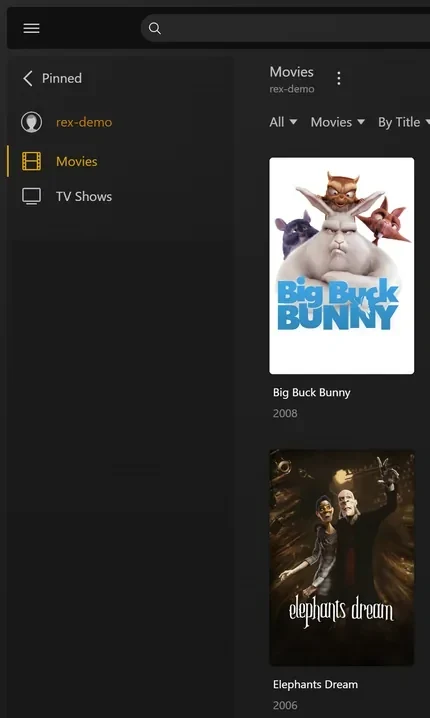

# rex com seu próprio app {#rex-with-your-own-app}

[rex](https://rex.debridmediamanager.com/pt/) é um servidor de mídia para os aplicativos oficiais do Plex, mas não guarda nenhum arquivo. Os aplicativos oficiais do Plex o veem como um servidor Plex normal. Outro programa, que esta página chama de **seu aplicativo**, informa ao rex o que tem na sua biblioteca e entrega os arquivos. Quando você aperta play, o rex transmite o arquivo direto do seu aplicativo. Nada é baixado antes.

Esta página leva você do zero até assistir a um filme, passo a passo. Ela não assume nenhum aplicativo específico. Ela explica exatamente o que o rex espera de um aplicativo, assim você pode verificar se o seu faz isso ou criar um. Cada passo diz o que ele faz, por que importa e o que você deve ver antes de seguir em frente.

Quatro coisas para saber antes de começar:

- **Seu aplicativo entrega os arquivos.** O rex busca todos os bytes do seu aplicativo por HTTP ou HTTPS, do mesmo jeito que um navegador baixa um arquivo. O rex não guarda arquivos e não precisa de disco nem de montagem para a mídia.
- **Seu aplicativo informa ao rex o que tem.** Ele envia ao rex uma lista de arquivos pela API de feed do rex, e todas as mudanças depois disso. O rex nunca lista uma pasta nem faz qualquer varredura.
- **Seu aplicativo decide o que cada arquivo é.** Ele diz se o arquivo é um filme ou um episódio, a qual título ele pertence (pelo id do IMDb e do TMDB) e, no caso de episódio, a temporada e o número. O rex nunca adivinha nada a partir do nome do arquivo.
- **O Plex descreve o conteúdo.** Depois que o rex estiver em uma conta Plex, ele mostra cada título com o nome, o pôster, a sinopse e os nomes dos episódios que os metadados próprios do Plex têm para esses ids. Para coisas que nenhum agente do Plex conhece, seu aplicativo mesmo dá os nomes: veja [Criando addons do rex](addons.md).

O rex é gratuito para uso pessoal (PolyForm Noncommercial): não há plano de patrocinador e você não precisa de conta para baixá-lo. Veja [rex.debridmediamanager.com](https://rex.debridmediamanager.com/pt/).

## Antes de começar {#before-you-start}

| Você precisa | Por quê |
|---|---|
| A versão noturna do rex com data 2026.10.25 ou mais nova | O passo 1 baixa a mais nova |
| Uma máquina que fique ligada: Linux (Ubuntu 22.04 ou mais novo), macOS ou Windows (64 bits) | O rex é um servidor: seus apps do Plex se conectam a ele sempre que você aperta play. Onde os comandos mudam, cada passo tem uma aba para cada sistema. [Docker](#run-rex-in-docker) aparece mais abaixo, para Linux |
| 1 GB de RAM | Com 4.062 filmes e 656 séries (34.678 episódios), o rex usou menos de 500 MB enquanto iniciava e cerca de 730 MB enquanto a biblioteca era navegada. Converter vídeo exige mais, e mais núcleos ou um chip gráfico |
| Um app que faça o que [O que seu app precisa fazer](#what-your-app-must-do) lista | É dele que vem a sua biblioteca |
| Seu app enviando dados a partir desta máquina, da sua rede doméstica ou do Tailscale | O rex só recebe o feed a partir desses lugares ([Mantenha a porta privada](#keep-the-port-private)). Um app em um seedbox ou em um servidor na nuvem não consegue enviar dados ao rex, a menos que esse servidor esteja na sua tailnet; os arquivos em si podem ser servidos de qualquer lugar que o rex alcance |
| Arquivos nos discos desta máquina? Algo que os sirva por HTTP e os envie | O rex nunca lê um disco. O [Passo 2](#step-2-see-it-work-by-hand) faz isso manualmente para um arquivo; para o resto, continue usando o Plex para eles |
| Usenet? Uma fonte que a leia, como o zurg | O rex nunca se comunica com um provedor de Usenet. O zurg é uma fonte que faz isso: veja [rex com zurg](with-zurg.md) |
| Uma conta nova do Plex, criada só para o rex | O rex recebe de o Plex todos os títulos, pôsteres, sinopses e nomes de episódios assim que ele é [adicionado a uma conta do Plex](#step-3-add-it-to-a-plex-account). Até lá, os títulos mantêm os nomes dos arquivos e não têm pôsteres |

## O que seu app precisa fazer {#what-your-app-must-do}

Passe esta lista para quem faz o seu app. A referência da API do próprio rex está em [docs/feed-api.md](https://github.com/debridmediamanager/rex/blob/main/docs/feed-api.md).

| Seu app precisa | Como | Se não fizer |
|---|---|---|
| Servir cada arquivo via HTTP | `GET <address>/<path>` responde com o arquivo. Requisições `Range` deixam a busca rápida; redirecionamentos são seguidos. Autenticação Basic ou token bearer são permitidos | Nada toca: o rex registra 502 |
| Registrar no rex | `PUT /rex/sources/<name>` (letras, dígitos, `-` e `_`) com `{"url": ...}` e, se tiver login, `"user"` e `"password"` ou `"bearer"`, nunca dentro da url. De novo sempre que iniciar | O rex não tem de onde ler |
| Enviar todos os arquivos que tiver | `POST /rex/feed/<name>/items`, algumas centenas de arquivos por requisição | O rex fica vazio |
| Enviar a saída do ffprobe de cada arquivo | O JSON do `-show_format -show_streams` do ffprobe, completo, como `media_info` | O arquivo fica **retido**: armazenado mas não mostrado, porque os apps do Plex se recusam a tocar um arquivo sem ele |
| Dizer o que cada arquivo é | `kind` (`movie`, `episode` ou `extra`) e `ids`: o `imdb` ou `tmdb` do filme ou da **série** (qualquer um basta), nunca o do episódio. Para um episódio, `season` e `episode` no próprio item (ao lado de `kind`, não dentro de `ids`), na numeração do TMDB; `episode_end` para um arquivo que tenha vários episódios | O arquivo fica sem correspondência: um filme com o título do arquivo, um episódio numa série com o nome do lançamento, numerado na ordem do arquivo |
| Manter o mesmo `id` para um arquivo para sempre | Mesmo quando ele for renomeado | Um arquivo renomeado vira um novo título e perde o histórico de exibição |
| Enviar as mudanças conforme acontecem | O mesmo `POST` para arquivos novos ou alterados, `DELETE /rex/feed/<name>/items` para os removidos | A biblioteca fica desatualizada |
| Enviar a biblioteca inteira de vez em quando | `PUT /rex/feed/<name>/snapshot`. O rex remove tudo o que o snapshot não citar | Arquivos que seu app perdeu de vista continuam no rex |
| Aceitar um `DELETE` do WebDAV para um arquivo | Quando alguém apaga um título num app do Plex, o rex pede ao seu app para apagar o arquivo primeiro | O título continua lá e o app do Plex diz que não foi possível apagar |

## Passo 1. Instale o rex {#step-1-install-rex}

**O que ele faz.** Baixa o rex para `~/rex` (`$HOME\rex` no Windows) e o inicia como serviço, com tudo que os próximos passos precisam. Os passos depois deste não precisam de reinício; só as seções opcionais mais abaixo precisam.

**Por que isso importa.** O rex é com quem os seus apps do Plex conversam. A primeira inicialização cria o `rex.db`, que guarda suas bibliotecas, tudo que o seu app envia e seu histórico de exibição.

No Linux você também pode rodar a imagem Docker do rex: veja [Rodar o rex no Docker](#run-rex-in-docker).

+++ Linux e macOS
```bash
mkdir -p ~/rex && cd ~/rex
TAG=$(curl -fsSL 'https://api.github.com/repos/debridmediamanager/rex/releases?per_page=1' | sed -n 's/.*"tag_name": *"\([^"]*\)".*/\1/p' | head -1)
P=$(uname -s | tr A-Z a-z)-$(uname -m | sed 's/x86_64/amd64/;s/aarch64/arm64/')
curl -fL "https://github.com/debridmediamanager/rex/releases/download/$TAG/rex-$TAG-$P.tar.gz" | tar xz --strip-components=1
```
+++ Windows
No PowerShell:

```powershell
New-Item -ItemType Directory -Force $HOME\rex | Out-Null; cd $HOME\rex
$tag = (Invoke-RestMethod 'https://api.github.com/repos/debridmediamanager/rex/releases?per_page=1')[0].tag_name
curl.exe -fLO "https://github.com/debridmediamanager/rex/releases/download/$tag/rex-$tag-windows-amd64.zip"
tar -xf "rex-$tag-windows-amd64.zip" --strip-components=1; Remove-Item "rex-$tag-windows-amd64.zip"
```
+++

Isso pega a build mais nova do rex, geralmente uma nightly, para a sua máquina.

Descubra o IP da LAN do rex, o endereço dele na sua rede doméstica. No Linux, `hostname -I` mostra vários: pegue o da sua rede doméstica, não um que começa com `172.17.` (Docker) ou `100.` (Tailscale). No macOS, `ipconfig getifaddr en0` mostra (use `en1` se não aparecer nada). No Windows, `ipconfig` lista ele como **IPv4 Address** no adaptador Wi-Fi ou Ethernet. **Esta página escreve ele como `192.168.1.20` em todo lugar: coloque o seu no lugar.** Os apps do Plex, o seu app e os seus próprios comandos chegam ao rex por ali.

**O Plex Media Server roda na mesma máquina?** Termine o comando de início do rex abaixo com `--port 32500` e use `32500` em todo lugar em que um comando ou configuração diz `32400`, inclusive na regra do firewall do Windows: o Plex já usa a porta 32400 e as portas que os apps usam para encontrar servidores, e em qualquer outra porta o rex deixa essas para o Plex. Depois, seus apps vão listar dois servidores com o nome da máquina: o rex é o que foi compartilhado com você, com o nome da conta nova ao lado. Quando o rex estiver na sua conta do Plex ([passo 3](#step-3-add-it-to-a-plex-account)), você pode renomeá-lo: logado no Plex com essa conta, abra o **Settings** do rex, **General**, mude o **Friendly name** e salve, depois reinicie o rex como abaixo. Os apps do Plex mostram ele com o novo nome depois do reinício.

Agora transforme ele em serviço:

+++ Linux
Crie `~/.config/systemd/user/rex.service`:

```bash
mkdir -p ~/.config/systemd/user
nano ~/.config/systemd/user/rex.service
```

```ini
[Unit]
Description=rex
After=network-online.target

[Service]
WorkingDirectory=%h/rex
EnvironmentFile=-%h/rex/rex.env
ExecStart=%h/rex/rex
Restart=always
RestartSec=5

[Install]
WantedBy=default.target
```

```bash
systemctl --user daemon-reload
systemctl --user enable --now rex
sudo loginctl enable-linger "$USER"
journalctl --user -u rex -f
```

O **comando de início** do rex é a linha `ExecStart`, e as chaves vão em `~/rex/rex.env`, uma `NAME=value` por linha. Depois de uma mudança, `systemctl --user daemon-reload && systemctl --user restart rex` reinicia o rex. `journalctl --user -u rex -f` mostra o log dele. `loginctl enable-linger` mantém o rex rodando quando você sai da sessão.
+++ macOS
`run.sh` inicia o rex na pasta dele, e um LaunchAgent inicia o `run.sh` quando você faz login:

```bash
cp ~/rex/examples/run.sh.example ~/rex/run.sh
mkdir -p ~/Library/LaunchAgents
cat > ~/Library/LaunchAgents/com.rex.plist <<PLIST
<?xml version="1.0" encoding="UTF-8"?>
<!DOCTYPE plist PUBLIC "-//Apple//DTD PLIST 1.0//EN" "http://www.apple.com/DTDs/PropertyList-1.0.dtd">
<plist version="1.0"><dict>
  <key>Label</key><string>com.rex</string>
  <key>ProgramArguments</key><array><string>/bin/bash</string><string>$HOME/rex/run.sh</string></array>
  <key>RunAtLoad</key><true/><key>KeepAlive</key><true/>
  <key>StandardOutPath</key><string>$HOME/rex/rex.log</string>
  <key>StandardErrorPath</key><string>$HOME/rex/rex.log</string>
</dict></plist>
PLIST
launchctl load ~/Library/LaunchAgents/com.rex.plist
tail -F ~/rex/rex.log
```

O **comando de início** do rex é a última linha de `~/rex/run.sh`, e as chaves vão em `~/rex/rex.env`, uma `NAME=value` por linha. Depois de uma mudança, `launchctl kickstart -k gui/$(id -u)/com.rex` reinicia o rex. `tail -f ~/rex/rex.log` mostra o log dele.

O rex roda enquanto você estiver logado no Mac. Para um Mac que reinicia sozinho, ative o login automático (**System Settings**, **Users & Groups**). Se o firewall do macOS estiver ligado, permita o rex quando o macOS perguntar, ou adicione `~/rex/rex` em **Options** do firewall.
+++ Windows
Abra o PowerShell **como administrador** e vá para a pasta do rex com `cd $HOME\rex`. Primeiro crie o `run.cmd`, que inicia o rex na pasta dele e grava o log em `rex.log`. O Bloco de Notas oferece para criar o arquivo:

```powershell
notepad run.cmd
```

```bat
@echo off
cd /d "%~dp0"
rex.exe 2>> rex.log
```

Salve. Depois libere sua rede no Windows Firewall para a porta do rex e para as duas portas de descoberta, e inicie o rex agora e sempre que você fizer login:

```powershell
New-NetFirewallRule -DisplayName rex -Protocol TCP -LocalPort 32400
New-NetFirewallRule -DisplayName "rex discovery" -Protocol UDP -LocalPort 32410,32414
$settings = New-ScheduledTaskSettingsSet -ExecutionTimeLimit 0 -AllowStartIfOnBatteries -DontStopIfGoingOnBatteries
Register-ScheduledTask rex -Action (New-ScheduledTaskAction -Execute "$HOME\rex\run.cmd") -Trigger (New-ScheduledTaskTrigger -AtLogOn -User $env:USERNAME) -Settings $settings
Start-ScheduledTask rex; Start-Sleep 3
Get-Content rex.log -Wait
```

O **comando de início** do rex é a linha `rex.exe` do `run.cmd`, e as chaves vão acima dela, uma `set NAME=value` por linha. Depois de uma mudança, `Stop-Process -Name rex; Start-Sleep 1; Start-ScheduledTask rex` reinicia o rex. `Get-Content $HOME\rex\rex.log -Wait` mostra o log dele.

Iniciou o rex manualmente no PowerShell? Então o log fica só naquela janela, sem `rex.log`, e nenhuma tarefa o inicia depois de reiniciar. O rex guarda o banco de dados e a vinculação na pasta em que é iniciado, então um rex iniciado de outra pasta é um servidor novo, sem vínculo. Pare com Ctrl+C e depois inicie de novo na pasta do rex com as mesmas flags ou, melhor ainda, configure a tarefa acima.

O rex roda enquanto você estiver logado no Windows, em uma janela própria: deixe-a aberta. No PowerShell, digite `curl.exe` onde esta página disser `curl`: o `curl` do próprio Windows PowerShell é outro comando.
+++

**O que você deve ver.** Entre as primeiras linhas:

```
INFO    seeded rex.db: an empty library named yourhost, machine=...
INFO    no source yet: a source registers itself once pointed at this server (PUT /rex/sources/{name}, docs/feed-api.md)
INFO    claim state: unclaimed
INFO    rex on http://192.168.1.20:32400  machine=...  items=0  parts=proxy
```

O rex se dá o nome da máquina; seus apps do Plex mostram esse nome. `no source yet` está certo: nenhum app se registrou ainda. Deixe o log aberto.

## Passo 2. Veja funcionando manualmente {#step-2-see-it-work-by-hand}

**O que faz.** Faz o papel do seu app para um único filme, com um servidor de arquivos descartável e dois comandos `curl`.

**Por que importa.** Ele prova que o rex funciona nesta máquina antes de o seu app entrar em cena. Se este passo funcionar e o seu app não, o problema está no seu app. Pule este passo se o seu app já estiver configurado.

Você precisa do `ffprobe`, de um servidorzinho web e de um arquivo de vídeo. Você registra a pasta do arquivo no rex com o nome `test` e depois envia o arquivo ao rex, dizendo que é o filme Sintel (IMDb `tt1727587`, TMDB `45745`) junto com a saída do ffprobe.

+++ Linux e macOS
Instale o `ffprobe` e o `jq` (`sudo apt install -y ffmpeg jq` no Linux, `brew install ffmpeg jq` no macOS). Coloque o arquivo onde um servidorzinho web consiga servi-lo:

```bash
mkdir -p ~/rex-test/movies/Sintel.2010
cp /path/to/any-video.mkv ~/rex-test/movies/Sintel.2010/Sintel.2010.mkv
cd ~/rex-test
python3 -m http.server 8099 --bind 127.0.0.1 &
```

Registre no rex:

```bash
curl -s -X PUT http://192.168.1.20:32400/rex/sources/test \
  -H 'Content-Type: application/json' -d '{"url": "http://127.0.0.1:8099"}'
```

Envie o arquivo para o rex:

```bash
P=movies/Sintel.2010/Sintel.2010.mkv
jq -n --arg p "$P" \
  --argjson probe "$(ffprobe -v quiet -print_format json -show_format -show_streams "$P")" \
  '{items: [{id: $p, path: $p, kind: "movie", ids: {imdb: "tt1727587", tmdb: 45745}, media_info: $probe}]}' \
| curl -s -X POST http://192.168.1.20:32400/rex/feed/test/items \
    -H 'Content-Type: application/json' --data-binary @-
```
+++ Windows
Instale o `ffprobe` e o Python com `winget install Gyan.FFmpeg` e `winget install Python.Python.3.13`, depois abra uma nova janela do PowerShell. Coloque o arquivo onde um servidorzinho web consiga servi-lo:

```powershell
New-Item -ItemType Directory -Force $HOME\rex-test\movies\Sintel.2010 | Out-Null
Copy-Item C:\path\to\any-video.mkv $HOME\rex-test\movies\Sintel.2010\Sintel.2010.mkv
cd $HOME\rex-test
$server = Start-Process py '-m http.server 8099 --bind 127.0.0.1' -WindowStyle Hidden -PassThru
```

Registre no rex:

```powershell
Invoke-RestMethod -Method Put http://192.168.1.20:32400/rex/sources/test -ContentType application/json -Body '{"url": "http://127.0.0.1:8099"}'
```

Envie o arquivo para o rex:

```powershell
$p = 'movies/Sintel.2010/Sintel.2010.mkv'
$probe = ffprobe -v quiet -print_format json -show_format -show_streams $p | Out-String | ConvertFrom-Json
$item = @{ id = $p; path = $p; kind = 'movie'; ids = @{ imdb = 'tt1727587'; tmdb = 45745 }; media_info = $probe }
Invoke-RestMethod -Method Post http://192.168.1.20:32400/rex/feed/test/items -ContentType application/json -Body (ConvertTo-Json @{ items = @($item) } -Depth 20)
```

O PowerShell mostra as respostas do rex como listas em vez de JSON.
+++

**O que você deve ver.** A resposta é `{"created":1,"updated":0,"held":0,"unchanged":0}` e o log do rex imprime:

```
INFO    FEED identified "Sintel.2010" -> movie tmdb:45745 (placed)
INFO    FEED test upsert: 1 created, 0 updated, 0 held, 0 unchanged, 0 rejected
```

O Sintel agora está em **Movies**, reproduzido pelo servidorzinho web. Nenhum app de Plex consegue abrir o rex antes do [passo 3](#step-3-add-it-to-a-plex-account), então este passo verifica só o feed.

**Limpeza** antes de seguir em frente: remover a fonte de teste remove tudo o que ela enviou. A primeira requisição responde com um caminho `confirm`; envie um `DELETE` para esse caminho em até cinco minutos.

+++ Linux e macOS
```bash
curl -s -X DELETE http://192.168.1.20:32400/rex/sources/test
curl -s -X DELETE "http://192.168.1.20:32400/rex/sources/test/confirm/<code from the answer>"
kill %1
```
+++ Windows
```powershell
Invoke-RestMethod -Method Delete http://192.168.1.20:32400/rex/sources/test
Invoke-RestMethod -Method Delete "http://192.168.1.20:32400/rex/sources/test/confirm/<code from the answer>"
Stop-Process -InputObject $server
```
+++

**Se não der certo.**

- `"held":1`: o `media_info` está faltando ou não tem streams. Confira se o `ffprobe` imprimiu JSON para o arquivo.
- Uma resposta com `rejected`: o arquivo não é um vídeo pela extensão, é uma amostra, não tem `id` ou `path`, tem um caminho malformado, ou outro `id` já usa o seu path. A resposta e o log do rex mostram cada motivo.
- `404 no such source`: o `PUT /rex/sources/test` não aconteceu antes.

## Passo 3. Adicione a uma conta Plex {#step-3-add-it-to-a-plex-account}

**O que faz.** Registra o rex em uma conta do Plex, como você faria com um Plex Media Server de verdade, e compartilha com a sua própria conta.

**Por que importa.** O rex pega o nome, o pôster, a sinopse e os nomes dos episódios de cada título a partir dos próprios metadados do Plex, e só consegue consultar o Plex depois que ele está em uma conta. Tudo o que o seu app envia antes da reivindicação recebe nome assim que chega, e o Fix Match não tem nada para oferecer até lá. Essa etapa também remove o aviso "unclaimed" e é necessária antes de [usar o rex fora da sua casa](#use-it-outside-your-home-optional).

**Use uma conta nova do Plex para isso, não a sua.** O rex não é feito pelo Plex, e o Plex pode tomar medidas contra uma conta que registre o rex. Mantenha a sua conta principal, com o histórico de exibição, os amigos e qualquer Plex Pass, fora do alcance: crie uma conta gratuita nova em [plex.tv](https://www.plex.tv) com um endereço de e-mail que você não use em outro lugar, registre o rex nessa conta e compartilhe o rex com a sua própria conta. Assim você assiste logado como você mesmo, do mesmo jeito que assistiria ao servidor de um amigo. O rex não reproduz nada enquanto essa etapa não estiver concluída.

### Registre o rex na conta nova {#register-rex-on-the-fresh-account}

1. Entre em [plex.tv](https://www.plex.tv) **com a conta nova**, abra [plex.tv/claim](https://www.plex.tv/claim) e copie o código. Ele expira em cerca de cinco minutos.
2. Na máquina do rex (`curl.exe` no Windows):

   ```bash
   curl -X POST "http://192.168.1.20:32400/myplex/claim?token=claim-xxxxxxxxxxxx"
   curl -s http://192.168.1.20:32400/identity
   ```

**O que você deve ver.** O segundo comando mostra `claimed="1"`, e o arquivo `claim_state.json` existe na pasta do rex. Faça um backup desse arquivo: sem ele, o rex precisa ser vinculado de novo, e o rex recusa uma segunda vinculação enquanto o arquivo estiver lá. A partir daí, os títulos chegam com nome e pôsteres, sem precisar reiniciar.

**Se não.**

- O primeiro comando responde `409` com `rex: already claimed`: o rex já está em uma conta do Plex.
- Ele responde `500 Internal Server Error` e o rex registra `claim exchange failed`: o código expirou ou já foi usado. Gere um novo em [plex.tv/claim](https://www.plex.tv/claim).

### Compartilhe com sua própria conta {#share-it-with-your-own-account}

1. Ainda logado com a conta nova, abra [app.plex.tv](https://app.plex.tv), depois **Settings** (a chave inglesa), **Manage Library Access** e **Grant Library Access**.
2. Digite o nome de usuário ou o e-mail da sua própria conta, escolha o servidor rex e as duas bibliotecas, **Movies** e **TV Shows**, e envie o convite.
3. Saia da conta, entre como **você mesmo** e aceite o convite. Ele chega por e-mail e também no app.plex.tv.


**O que você deve ver.** Logado como você mesmo, os apps do Plex listam o servidor rex ao lado dos seus próprios servidores, com as duas bibliotecas. O seu histórico de exibição no rex é só seu: ele fica separado do da conta nova. Compartilhe do mesmo jeito com qualquer outra pessoa da sua casa.

## Passo 4. Conecte seu app {#step-4-connect-your-app}

**O que faz.** Aponta seu app para o rex. Seu app se registra, envia a biblioteca inteira e depois cada mudança conforme acontece.

**Por que importa.** Esta é a única ligação entre os dois. O rex não tem nenhuma configuração para o seu app: é o seu app que encontra o rex, e não o contrário.

Informe ao seu app o endereço do rex, `http://192.168.1.20:32400`. Como você faz isso depende do seu app.

**O que você deve ver.** O log do rex mostra, sob o nome com que seu app se registrou:

```
INFO    SOURCES myapp registered at http://192.168.1.20:8080
INFO    SOURCES PUT /rex/sources/myapp -> 200
INFO    FEED myapp upsert: 0 created, 0 updated, 200 held, 0 unchanged, 0 rejected
INFO    FEED identified "Some.Movie.2019.1080p" -> movie tmdb:12345 (placed)
INFO    FEED myapp upsert: 180 created, 0 updated, 20 held, 0 unchanged, 0 rejected
```

O rex lê cada arquivo do endereço indicado na linha `registered at`, então ele precisa conseguir alcançar seu app ali. O rex registra essa linha de novo somente quando o endereço muda. Os arquivos `held` estão esperando a saída do ffprobe e aparecem assim que seu app a envia. Para conferir o que o rex tem a partir do seu app a qualquer momento (no Windows, `curl.exe` sem `| head -c 600`):

```bash
curl -s http://192.168.1.20:32400/rex/sources                # the apps that registered, and their addresses
curl -s http://192.168.1.20:32400/rex/feed/myapp/items | head -c 600   # what is shown
curl -s http://192.168.1.20:32400/rex/feed/myapp/held  | head -c 600   # what waits for ffprobe output
```

**Se não aparecer.**

- Nada no log do rex: seu app nunca chegou ao rex. Confira o endereço que você informou e se a porta do rex está aberta entre as duas máquinas.
- Os arquivos chegam, mas não aparecem linhas `identified`: seu app não envia `kind` nem `ids` (arquivos held e reenvios sem mudança também não mostram nada). Esses títulos ficam sem correspondência até isso acontecer. Mesmo assim, você pode corrigir um deles manualmente com **Fix Match** em um app Plex logado com a conta nova. A sua própria conta, com a qual o rex é compartilhado, é recusada.
- Os títulos aparecem, mas nada toca: o rex não consegue alcançar seu app no endereço indicado em `registered at`. A linha `upstream failed` de [Quando algo está errado](#when-something-is-wrong) verifica isso.

(Uma tradução anterior foi rejeitada: os trechos de código estavam diferentes. Mantenha a estrutura exatamente como está.)

## Passo 5. Assista algo {#step-5-watch-something}

**O que faz.** Abre o rex em um app do Plex, do mesmo jeito que você abriria qualquer servidor Plex.

**Por que importa.** Este é o ponto de toda a configuração. Também comprova o último elo: o rex lendo um arquivo do seu app enquanto você assiste.

Abra um app do Plex em um celular, TV ou computador **na mesma rede doméstica**. O rex aparece com o nome da máquina, com **Movies** e **TV Shows**. Escolha um filme e aperte play.



Em casa não precisa de mais nada: os apps do Plex encontram o rex pela descoberta local do próprio Plex e se conectam a ele pela sua rede. Isso exige que o dispositivo esteja na mesma rede do rex (não em uma rede de visitantes nem em uma VLAN separada). A descoberta usa as portas UDP 32410 e 32414, então um firewall na máquina do rex precisa deixá-las passar (no Windows, as regras de firewall do passo 1 fazem isso). O rex responde à descoberta quando usa a porta 32400. Se você mudou o rex para 32500 porque o Plex roda na mesma máquina, a descoberta fica com esse Plex, e os apps encontram o rex pela conta Plex com a qual ele está [compartilhado](#share-it-with-your-own-account). O app.plex.tv em um navegador também funciona em casa, pelo endereço HTTPS que [rex-direct](#rex-direct) dá ao rex depois que ele é reivindicado (rex nightly 2026.11.02 ou mais novo). Na primeira vez, o Chrome pergunta se o app.plex.tv pode acessar dispositivos na sua rede local: permita. `http://192.168.1.20:32400/web` não é o Plex Web: o rex não tem app web próprio, e essa página só informa se o rex está reivindicado e onde assistir.

**O que você deve ver.** Pôsteres, títulos e anos como em qualquer servidor Plex. A reprodução começa em poucos segundos.

Duas coisas que você pode encontrar:

- **"yourhost server is unclaimed and not secure".** Um app do Plex diz isso de qualquer servidor que não está em uma conta Plex, e o rex não reproduz nada até estar em uma. Faça o [passo 3](#step-3-add-it-to-a-plex-account).
- **"This server is not powerful enough to convert video".** Se todos os títulos falham em todos os dispositivos, veja o log do rex logo depois de apertar Play: `upstream failed` ou `502` ali significa que o rex não consegue acessar seu app, e o FFmpeg não vai resolver. A linha `upstream failed` de [Quando algo está errado](#when-something-is-wrong) diz o que fazer. Se só alguns arquivos falham, muitas vezes só em um navegador, o dispositivo não consegue reproduzi-los como estão, geralmente por causa do som AC3 ou DTS. Os apps do Plex em TVs e celulares reproduzem a maioria dos arquivos como estão. Para reproduzir tudo em todo lugar, configure a [Conversão de vídeo](#converting-video-optional).

**Apagar apaga no seu app.** Logado com a conta nova, **Delete** em um título de um app do Plex faz o rex pedir ao seu app que apague o arquivo, como diz [O que seu app precisa fazer](#what-your-app-must-do). As contas com as quais o rex está compartilhado não podem apagar. Para desligar a exclusão: no app.plex.tv, com a conta nova, abra **Settings**, a **Library** do servidor rex, **Show Advanced**, desmarque **Allow media deletion** e salve.


Um arquivo que seu app remove vai para a lixeira da biblioteca, como no Plex: ele fica ali, indisponível, com o histórico de exibição, e volta como estava se seu app o enviar de novo. **Empty Trash** na biblioteca o remove de vez, e **Empty trash automatically after every scan** (Settings, Library), que vem desligado, faz isso sozinho.

Cada arquivo vai para **Movies** ou **TV Shows** pelo `kind` que seu app enviou. Um arquivo sem ele segue a primeira pasta: `shows` vai para TV Shows, qualquer outra coisa vai para Movies.

Para dar a uma pasta bibliotecas próprias, seu app adiciona `directories` ao seu registro, indicando a primeira pasta dos caminhos dos arquivos e os títulos das bibliotecas: `{"url": ..., "directories": [{"name": "anime", "shows": "Anime", "movies": "Anime Movies"}]}`. Basta um dos títulos. O rex as cria quando seu app se registra e move para elas o que aquela pasta já tem, como estava: histórico de exibição, Fix Match e edições incluídos. Uma entrada malformada é pulada e listada em `ignored` na resposta, com o motivo. Renomeie-as em um app do Plex como quiser. Apague uma e ela continua apagada, com os arquivos voltando para Movies ou TV Shows, até você adicioná-la de novo com **Add Library**, cuja lista de pastas mostra as pastas do seu app. [Bibliotecas que uma fonte declara](https://github.com/debridmediamanager/rex/blob/main/docs/feed-api.md#libraries-a-source-declares) tem as regras.

**Faça backup** de `rex.db` na pasta do rex (ele guarda sua biblioteca, o histórico de exibição e o login do seu app, então mantenha-o privado), de `claim_state.json` e, quando o rex-direct tiver dado um nome ao rex, de `rex-direct.json` (a chave do certificado dele):

+++ Linux e macOS
```bash
sudo apt install -y sqlite3    # once, on Linux; macOS has it
mkdir -p ~/rex-backup
sqlite3 ~/rex/rex.db ".backup $HOME/rex-backup/rex.db"
cp ~/rex/*.json ~/rex-backup/
```
+++ Windows
Windows não tem `sqlite3`, então pare o rex por um momento e copie `rex.db` junto com os dois arquivos ao lado que começam do mesmo jeito:

```powershell
Stop-Process -Name rex; Start-Sleep 1
New-Item -ItemType Directory -Force $HOME\rex-backup | Out-Null
Copy-Item $HOME\rex\rex.db*, $HOME\rex\*.json $HOME\rex-backup
Start-ScheduledTask rex
```
+++

No Docker os arquivos ficam em `~/rex/config`, legíveis só pelo root. Faça o backup de dentro do container com `docker exec rex sqlite3 /config/rex.db ".backup /config/rex.db.bak"` e depois `mkdir -p ~/rex-backup && sudo cp ~/rex/config/rex.db.bak ~/rex/config/*.json ~/rex-backup/`.

[Restaurar um backup](#restore-a-backup) os coloca de volta.

Pronto, você terminou. As seções abaixo são opcionais.

## Use fora da sua casa (opcional) {#use-it-outside-your-home-optional}

**O que faz.** Dá ao rex um endereço HTTPS que os apps do Plex fora de casa conseguem acessar, e informa o plex.tv sobre ele.

**Por que importa.** Fora de casa, o app.plex.tv só se conecta a um endereço HTTPS, e os outros apps do Plex preferem um também. Um servidor Plex de verdade pode recorrer ao relay do Plex; o rex não pode, então você escolhe como ele será acessado. O rex precisa ser [reivindicado](#step-3-add-it-to-a-plex-account) primeiro. Um proxy que fica exposto à internet precisa bloquear `/rex/`: veja [Keep the port private](#keep-the-port-private).

**Plex Pass.** O Plex Web reproduz fora de casa sem Plex Pass ou Remote Watch Pass em nenhuma das contas. Os outros apps do Plex não foram testados fora de casa.

Seja qual for a opção escolhida, tudo o que você assistir fora de casa sai pela velocidade de **upload** da sua conexão de casa. Como referência rápida, um upload de 20 Mbit/s aguenta um WEB-DL 1080p, não um remux.

| Sua situação | Use | Por quê |
|---|---|---|
| Seu roteador tem IP público e você consegue fazer port forward | **[rex-direct](#rex-direct)** (mais simples) | Ativado por padrão: um único port forward. O DMM dá ao rex um nome e um certificado, e mantém o nome apontando para o seu IP de casa |
| Você consegue instalar o Tailscale nos dispositivos em que assiste | **[Tailscale serve](#tailscale-serve)** (melhor) | Nada para abrir no roteador, e funciona atrás de qualquer conexão com a internet. O certificado se renova sozinho, e ninguém fora da sua tailnet consegue acessar o rex |
| Dispositivos sem Tailscale (a TV de um amigo, um hotel), e seu roteador tem IP público | **[Caddy](#caddy)** com seu próprio domínio, ou com um nome `sslip.io` gratuito | Uma conexão direta, sem ninguém no meio, e um certificado gratuito que se renova sozinho. Você faz port forward da porta 443 |
| Sua conexão não tem IPv4 público (CGNAT ou DS-Lite, comum em cabo, celular e alguns provedores de fibra), mas tem IPv6 | **[rex-direct over IPv6](#rex-direct-over-ipv6)** | Sem port forward e sem nada para alugar: você libera a porta 32400 no IPv6. Os dispositivos em que você assiste também precisam de IPv6, o que a maioria das redes móveis tem |
| Sua conexão não tem IP público de jeito nenhum, ou você assiste em redes sem IPv6, e dispositivos sem Tailscale | **[A small VPS](#a-small-vps)** | O rex não tem relay e não vai ganhar um. Um VPS alugado tem o IP público e um túnel leva tudo até o rex, com a largura de banda total do VPS |

Não recomendado:

- **Cloudflare tunnel.** Cada byte passa pela Cloudflare, que também descarta o `Range` da primeira leitura de um arquivo, então cada início de reprodução baixa o arquivo inteiro para o seu app.
- **Tailscale Funnel, ngrok e outros túneis hospedados.** Eles limitam a largura de banda ou o volume mensal de dados, que um filme consome rapidamente. O Tailscale Funnel também publica todo o rex, incluindo a API de feed: qualquer pessoa na internet poderia adicionar ou apagar itens da sua biblioteca.
- **Fazer port forward da porta 32400 sem rex-direct ou um certificado próprio.** Os apps do Plex receberiam um endereço HTTP simples, que o app.plex.tv recusa.

### rex-direct

Depois que o rex for reivindicado, o DMM lhe dá dois nomes: `<hash>.rex-direct.debridmediamanager.com`, apontando para o IP público da sua casa, e `lan.<hash>.rex-direct.debridmediamanager.com`, apontando para o IP da LAN do rex, com um certificado para os dois. O primeiro certificado leva alguns minutos; o log do rex avisa que ele está sendo emitido e depois mostra cada nome em uma linha `rex-direct:`. Um novo IP de casa e as renovações de certificado são detectados automaticamente. Uma conta do Plex pode ter até dez nomes rex-direct. Em casa, os apps do Plex, incluindo o app.plex.tv, podem usar o nome `lan.`, que chega ao rex direto pela sua rede, então o redirecionamento de porta só serve para quando você está fora de casa. No app.plex.tv, permita o acesso a dispositivos da sua rede local quando o Chrome pedir; caso contrário, ele usa o nome público, que depende do redirecionamento de porta. [O que você deve ver](#what-you-should-see) verifica os dois nomes.

Se o seu roteador encaminhar para o rex uma porta externa diferente, adicione a chave `REX_DIRECT_PORT=<that port>` como mostra o [passo 1](#step-1-install-rex) para o seu sistema e reinicie o rex. O redirecionamento de porta não abre a API do feed: veja [Mantenha a porta privada](#keep-the-port-private).

### rex-direct sobre IPv6 {#rex-direct-over-ipv6}

Para uma conexão sem IPv4 público (CGNAT ou DS-Lite) que tenha IPv6. Quando o DMM se conectar ao rex pelo endereço IPv6 e encontrar o mesmo servidor ali, ele também aponta o nome rex-direct do rex para esse endereço. Você precisa do rex nightly 2026.11.08 ou mais recente e, no Docker, do modo de rede host.

O IPv6 não tem port forward nem port mapping: o rex precisa usar a mesma porta por dentro e por fora, então deixe `REX_DIRECT_PORT` sem definir. No firewall do seu roteador, permita conexões TCP de entrada na porta 32400 para a máquina do rex pelo IPv6. O rex publica o seu IPv6 um minuto depois de iniciar (ou de ser reivindicado) e, depois, a cada 6 horas. Por isso, adicione a regra antes de iniciar o rex, ou reinicie o rex depois de adicioná-la. Um minuto depois, mais ou menos, o log dele mostra os dois endereços:

```
rex-direct: https://<hash>.rex-direct.debridmediamanager.com:32400 -> <IPv4> and <IPv6>
```

Se nenhuma linha com `and <IPv6>` aparecer em alguns minutos, o DMM não conseguiu alcançar o rex por IPv6. Verifique a regra do firewall e se o rex no Docker está usando o modo de rede host. No Windows, o rex publica o endereço IPv6 temporário do Windows, que o sistema troca cerca de uma vez por dia. Para desligar os endereços temporários, rode `netsh interface ipv6 set privacy state=disabled` em um PowerShell como administrador e depois reinicie o rex para que ele publique o endereço estável. O `<IPv4>` dessa linha é o endereço compartilhado da sua operadora e não alcança o rex, então os dispositivos de onde você assiste também precisam de IPv6. A maioria das redes móveis tem IPv6. Uma rede de hotel ou de escritório só com IPv4 não consegue alcançar o rex dessa forma.

### Tailscale serve

Instale o [Tailscale](https://tailscale.com/download) na máquina do rex e nos dispositivos em que você assiste, conectados à mesma conta. Depois, na máquina do rex:

```bash
sudo tailscale serve --bg 32400
```

No Windows, execute isso no PowerShell como administrador, sem `sudo`. No macOS, use a [ferramenta de linha de comando](https://tailscale.com/kb/1080/cli) do app Tailscale, também sem `sudo`.

Ele mostra o endereço, por exemplo `https://myhost.tailnet.ts.net`. Passe esse endereço para o rex com `:443` no final: adicione `--announce-url https://myhost.tailnet.ts.net:443` ao comando de inicialização do rex do [passo 1](#step-1-install-rex) e reinicie o rex.

Todos na sua tailnet, incluindo quem você deixar usar esta máquina, podem acessar a API de feed do rex. Compartilhe a máquina só com pessoas em que você confia.

### Caddy

Você precisa encaminhar a porta 443 do seu roteador para a máquina do rex, e ter um nome para o IP da sua casa:

- **Seu próprio domínio:** um registro `A`, como `rex.example.com`, apontando para o IP da sua casa.
- **Sem domínio:** use `1-2-3-4.sslip.io` com os números do seu IP público (`curl -s ifconfig.me` mostra ele). Se o seu IP mudar, atualize o nome.

Instale o [Caddy](https://caddyserver.com/docs/install) e use este Caddyfile (`/etc/caddy/Caddyfile` com o pacote do Caddy para Linux; no macOS e no Windows, um arquivo chamado `Caddyfile` em uma pasta própria, que o `caddy run` lê quando é executado dentro dessa pasta):

```
rex.example.com {
	respond /rex/* 403
	reverse_proxy 192.168.1.20:32400
}
```

`respond /rex/* 403` impede que a API de feed fique exposta na internet; seu app continua acessando o rex diretamente. Depois, recarregue o Caddy (`sudo systemctl reload caddy` com o pacote do Linux). No macOS e no Windows, inicie o `caddy run` na pasta dele e mantenha-o rodando do mesmo jeito que o [passo 1](#step-1-install-rex) mantém o rex rodando; no Windows, libere também a porta TCP 443 no firewall, como o passo 1 faz com a 32400. Em seguida, termine o comando de inicialização do rex com `--announce-url https://rex.example.com:443` e reinicie o rex.

### Um VPS pequeno {#a-small-vps}

Para uma conexão sem nenhum IP público, ou quando você assiste em redes sem IPv6: nesse caso, a VPS carrega todo o streaming, no lugar do [rex-direct sobre IPv6](#rex-direct-over-ipv6). O rex não tem relay e não vai ter um, então um servidor que você aluga faz o papel do seu roteador: ele tem o IP público, e um túnel a partir da máquina do rex leva tudo até o rex. Qualquer VPS com IPv4 público serve, uns poucos euros por mês. **Escolha uma cujo tráfego mensal cubra o que você assiste fora de casa:** cada byte passa por ela, e um plano com limite de dados pequeno vai acabar.

Você precisa do IP da VPS (`1.2.3.4` abaixo), das portas 443, 80 e 7000 abertas nela, e de uma string aleatória longa para o túnel (`openssl rand -hex 32`).

**Na VPS**, instale o [frp](https://github.com/fatedier/frp/releases) (o programa `frps`) e o [Caddy](https://caddyserver.com/docs/install). Crie o `frps.toml`:

```toml
bindPort = 7000
auth.token = "your-long-random-string"
proxyBindAddr = "127.0.0.1"
```

O `proxyBindAddr` mantém a ponta do túnel no loopback da VPS, então a internet só chega ao rex pelo Caddy. Crie o `/etc/caddy/Caddyfile`, com o IP da VPS como `1-2-3-4.sslip.io` (um nome gratuito que sempre aponta para esse IP) ou com o seu próprio domínio apontado para ele:

```
1-2-3-4.sslip.io {
	respond /rex/* 403
	reverse_proxy 127.0.0.1:32400
}
```

`respond /rex/* 403` tira a API do feed da internet. Inicie o `frps -c frps.toml` como serviço e rode `sudo systemctl reload caddy`.

**Na máquina do rex**, instale o frp também (o programa `frpc`) e crie o `frpc.toml`:

```toml
serverAddr = "1.2.3.4"
serverPort = 7000
auth.token = "your-long-random-string"

[[proxies]]
name = "rex"
type = "tcp"
localIP = "192.168.1.20"
localPort = 32400
remotePort = 32400
```

Rode como serviço: no Linux, por exemplo, `~/.config/systemd/user/frpc.service` com `ExecStart=%h/frp/frpc -c %h/frp/frpc.toml` e `Restart=always`; no macOS e no Windows, inicie o `frpc -c frpc.toml` do mesmo jeito que o [passo 1](#step-1-install-rex) inicia o rex. Depois, termine o comando de início do rex com `--announce-url https://1-2-3-4.sslip.io:443`, adicione a chave `REX_DIRECT_URL=off` (atrás do CGNAT, o IPv4 do nome rex-direct não alcança o rex, então o plex.tv não deve listá-lo) e reinicie o rex. O app.plex.tv em casa passa a usar a VPS também; os outros apps do Plex em casa continuam se conectando ao rex diretamente.

### O que você deve ver {#what-you-should-see}

```bash
curl -s https://lan.<hash>.rex-direct.debridmediamanager.com:32400/identity
```

mostra uma página XML curta com o `machineIdentifier` do rex em um computador em casa; o `curl` não mostra nada quando o endereço ou o certificado dele está errado. Use o seu próprio endereço: o rex registra ele na inicialização como `rex-direct: https://lan.<hash>.rex-direct.debridmediamanager.com:32400 -> 192.168.1.20 (LAN)` (com `REX_DIRECT_URL=off` não aparece nenhuma linha). Abra o seu endereço externo com `/identity` no final, no navegador de um celular com o Wi-Fi desligado: com o rex-direct, use a outra linha `rex-direct:` que o rex mostra; com o Tailscale serve, use `https://myhost.tailnet.ts.net`, que o celular só abre com o Tailscale ligado. Ela mostra uma página XML curta, sem aviso de certificado.

Se o celular falhar, a porta não está encaminhada (ou, [em IPv6](#rex-direct-over-ipv6), não está liberada), a sua conexão está atrás de CGNAT sem IPv6, o rex só é alcançado por IPv6 e a rede do celular não tem IPv6, ou o certificado do rex-direct ainda está sendo emitido (o log do rex avisa quando isso acontece).

O log do rex mostra os endereços que ele anuncia:

```
INFO    heartbeat every 600s for machine ... -> https://myhost.tailnet.ts.net:443,http://192.168.1.20:32400
```

O rex imprime isso a cada inicialização. Problemas aparecem depois como `heartbeat failed` ou `announced but NOT visible`. Caso contrário, o servidor lista esses endereços no plex.tv, e o app do Plex fora de casa escolhe o que conseguir alcançar. Se o rex registrar `waiting for a claim`, faça antes o [passo 3](#step-3-add-it-to-a-plex-account).

## Seu histórico de exibição de outro servidor Plex (opcional) {#your-watch-history-from-another-plex-server-optional}

Já assistiu no outro servidor Plex antes? Depois que sua biblioteca estiver no rex, [Traga seu histórico de exibição](import-watched.md) copia o que você assistiu, onde parou e suas avaliações com estrelas de lá, para cada pessoa separadamente.

## Convertendo vídeo (opcional) {#converting-video-optional}

**O que faz.** Permite que o rex converta o que um dispositivo não consegue reproduzir, do mesmo jeito que o Plex faz.

**Por que importa.** Sem isso, um dispositivo que não consegue reproduzir um arquivo do jeito que ele está recebe "This server is not powerful enough to convert video". Navegadores web são os que mais sofrem com isso, por exemplo com som AC3 ou DTS. Quando todos os títulos falham em todos os dispositivos, a causa é outra: veja o [passo 5](#step-5-watch-something).

Instale o **jellyfin-ffmpeg** 8, não o `ffmpeg` que o seu sistema oferece. É a versão com que o rex é medido e a única que converte todos os arquivos Dolby Vision, faz o tone mapping do HDR na placa de vídeo e desenha as legendas por lá. Outro FFmpeg converte vídeos comuns, e o log do rex mostra o que ele não tem (o do Ubuntu 22.04 também erra a busca por alguns segundos). O rex encontra sozinho.

+++ Linux
O pacote vai para `/usr/lib/jellyfin-ffmpeg`, ao lado de qualquer outro FFmpeg. A primeira linha escolhe a versão para o seu sistema: há builds para Ubuntu 22.04, 24.04 e 26.04 e Debian 12 e 13, em amd64 ou arm64. Em qualquer outro, o `curl` para com um erro.

```bash
DEB=jellyfin-ffmpeg8_8.1.3-1-$(. /etc/os-release; echo "$VERSION_CODENAME")_$(dpkg --print-architecture).deb
curl -fLO "https://github.com/jellyfin/jellyfin-ffmpeg/releases/download/v8.1.3-1/$DEB"
sudo apt install -y "./$DEB" && rm "$DEB"
systemctl --user restart rex
```

Em outro Linux, descompacte o build portátil do jellyfin-ffmpeg em `~/rex/ffmpeg`, onde o rex procura, e reinicie o rex. Ele usa o driver de vídeo do próprio sistema, então num sistema mais antigo ele converte só no processador. Use o pacote sempre que houver um.

```bash
B=$( [ "$(uname -m)" = aarch64 ] && echo linuxarm64 || echo linux64 )
mkdir -p ~/rex/ffmpeg && curl -fL "https://github.com/jellyfin/jellyfin-ffmpeg/releases/download/v8.1.3-1/jellyfin-ffmpeg_8.1.3-1_portable_${B}-gpl.tar.xz" | tar xJ -C ~/rex/ffmpeg
```

Com uma placa de vídeo Intel ou AMD, também execute `sudo usermod -aG render "$USER"` e reinicie a máquina para que o serviço pegue o grupo. Em um LXC, repasse a GPU. O chip deixa a conversão rápida; sem ele, o rex usa o processador. Sem chip Intel ou AMD, o rex também tenta o encoder de uma placa NVIDIA. Na Intel, `sudo apt install intel-opencl-icd` também converte HDR e Dolby Vision no chip, em quase tempo real para 4K numa Intel pequena. Sem ele, esses arquivos são convertidos no processador, que uma Intel de baixo consumo não consegue fazer em tempo real em 4K.
+++ macOS
O build portátil vai para `~/rex/ffmpeg`, onde o rex procura:

```bash
B=$( [ "$(uname -m)" = arm64 ] && echo macarm64 || echo mac64 )
mkdir -p ~/rex/ffmpeg && curl -fL "https://github.com/jellyfin/jellyfin-ffmpeg/releases/download/v8.1.3-1/jellyfin-ffmpeg_8.1.3-1_portable_${B}-gpl.tar.xz" | tar xJ -C ~/rex/ffmpeg
launchctl kickstart -k gui/$(id -u)/com.rex
```

Em um Mac o rex sempre converte no processador, porque ele não tem como usar a placa de vídeo do Mac.
+++ Windows
O build portátil vai para uma pasta `ffmpeg` dentro da pasta do rex, onde ele procura:

```powershell
cd $HOME\rex
curl.exe -fLO https://github.com/jellyfin/jellyfin-ffmpeg/releases/download/v8.1.3-1/jellyfin-ffmpeg_8.1.3-1_portable_win64-clang-gpl.zip
Expand-Archive jellyfin-ffmpeg_8.1.3-1_portable_win64-clang-gpl.zip ffmpeg
Remove-Item jellyfin-ffmpeg_8.1.3-1_portable_win64-clang-gpl.zip
Stop-Process -Name rex; Start-Sleep 1; Start-ScheduledTask rex
```

No Windows o rex converte no encoder de uma placa NVIDIA quando há uma, e no processador caso contrário.
+++

**O que você deve ver.** O log do rex tem uma linha `transcoder:` com o FFmpeg e o hardware que ele encontrou (`hardware none` significa o processador). `transcoder off` no início significa que ele não encontrou nenhum. Um arquivo que falhava antes agora toca, e o log mostra o que foi convertido, por exemplo `video=copy h264 audio=ac3->aac`.

Legendas em um arquivo convertido: uma legenda em imagem é gravada na imagem, e uma legenda que você enviou vem junto. O Plex para Android e iOS também mantém uma legenda de texto como faixa; os outros apps a desenham na imagem. Downloads offline convertidos continuam sem as legendas de texto.

## Legendas {#subtitles}

**O que faz.** Search Subtitles em um app do Plex encontra legendas do provedor próprio do Plex depois que o rex é reivindicado. O rex verifica a que você escolher contra o arquivo e corrige o tempo dela quando ela está atrasada ou foi feita para outra taxa de quadros. Quando sua conta do Plex está configurada para mostrar legendas e um título não tem nenhuma no seu idioma, o rex procura uma por até 3 segundos antes de começar.

**Por que importa.** O primeiro resultado do próprio Plex costuma estar fora de sincronia com o arquivo.


Não há nada para configurar. O rex verifica uma legenda contra o texto de legenda do próprio arquivo, quando ele tem um. Um arquivo sem esse texto é verificado pelo som dele quando você aperta play, o que exige que [Converting video](#converting-video-optional) esteja configurado e lê seis pedaços de 90 segundos do arquivo.

**O que você deve ver.** O log do rex tem uma linha `SUBTITLE measured` para cada legenda que ele verifica, e `SUBTITLE applied ... corrected by` quando ele corrigiu uma.

## Recursos de filmes e séries {#movie-and-tv-capabilities}

Os downloads, a detecção de intro e créditos, as miniaturas de busca e os outros recursos de servidor Plex que o rex tem, junto com as suas configurações, estão no [guia de configuração do rex](https://github.com/debridmediamanager/rex/blob/main/docs/setup.md#movie-and-tv-capabilities). Música e TV ao vivo vêm de fontes que as enviam ([limites do rex](https://github.com/debridmediamanager/rex#limits)), como o [rex-live-sports](https://github.com/debridmediamanager/rex-live-sports) para canais ao vivo. Não existe DVR, então nada é gravado. Fotos só aparecem quando a fonte envia imagens ([API de feed](https://github.com/debridmediamanager/rex/blob/main/docs/feed-api.md#photos)), como quadrinhos vindos do zurg. O Plex Web mostra elas; o Plex para Android não mostra biblioteca de fotos.

Mantenha o modo proxy padrão para reprodução de debrid compartilhado. O Real-Debrid rastreia o IP público de cada downloader; usar vários IPs com uma mesma conta gera um aviso de compartilhamento, mesmo quando os downloads funcionam. As URLs de download do TorBox contêm a chave de API completa, então redirecionar dá acesso a todos os clientes e contas de usuário compartilhadas, inclusive para exclusão. Leia os [riscos e a configuração do redirecionamento](direct-download.md#before-you-start) antes de deixar os apps baixarem direto do provedor.

## Execute o rex no Docker {#run-rex-in-docker}

Estes passos são para uma máquina Linux. No macOS e no Windows, o Docker Desktop roda os containers dentro de uma máquina virtual. Por isso, o host networking, a descoberta na rede local e o chip gráfico não funcionam como no Linux. Use os passos acima.

Crie uma pasta, por exemplo `~/rex`, com este `compose.yml`:

```yaml
services:
  rex:
    image: ghcr.io/debridmediamanager/rex:nightly
    container_name: rex
    restart: unless-stopped
    network_mode: host
    volumes:
      - ./config:/config
```

- Chip gráfico Intel ou AMD? Adicione `devices: ["/dev/dri:/dev/dri"]` para que o rex converta vídeo com ele.
- `network_mode: host` permite que os apps do Plex na sua rede encontrem o rex sozinhos, e que o rex alcance seu app no endereço que ele registra, como se estivesse na própria máquina.
- `./config` recebe `rex.db` e, depois, `claim_state.json`. Eles só podem ser lidos pelo root, porque o `rex.db` guarda o login do seu app.
- Plex Media Server na mesma máquina? Adicione `command: --port 32500` e use `32500` sempre que um comando ou configuração disser `32400`.

```bash
docker compose up -d
docker compose logs -f rex
```

Você deve ver as mesmas linhas do [passo 1](#step-1-install-rex). Depois, faça os passos 2 a 5 como acima. Se o seu app também roda em um container, ele precisa registrar um endereço que o rex consiga alcançar a partir da máquina, e não um que só outros containers enxergam.

Para atualizar, use `docker compose pull && docker compose up -d`. A imagem já traz o jellyfin-ffmpeg, então para [converter vídeo](#converting-video-optional) basta passar o chip gráfico. HTTPS funciona como acima: Tailscale, Caddy e frp rodam na própria máquina, e o `--announce-url ...` vai no `command:` do arquivo compose.

## Mantenha a porta privada {#keep-the-port-private}

A API de feed do rex não pede senha. Ela só responde a essa API a partir desta máquina, da sua rede doméstica (10.x, 172.16-31.x, 192.168.x, 169.254.x e endereços IPv6 privados) e do Tailscale (100.64-127.x). Para todo mundo else, ela age como se a API nem existisse. Por isso, encaminhar a porta do rex para o [rex-direct](#rex-direct), ou deixar entrar por IPv6, não a abre. Um roteador que dá aos visitantes de fora o próprio endereço faz com que eles pareçam locais, e isso abre o feed para a internet. Por isso, seu app precisa enviar os dados a partir de uma dessas redes. Atrás de um roteador doméstico, um dispositivo com endereço IPv6 dentro da faixa da sua rede doméstica também conta, então um nome de host que resolve para o IPv6 do rex funciona em casa. Em um VPS, use um endereço de rede privada para se referir ao rex. Um proxy na máquina do rex parece local para o rex, então mantenha `/rex/*` bloqueado em qualquer proxy voltado para a internet, como faz o exemplo do [Caddy](#caddy).

## Atualizando {#updating}

O rex nunca se atualiza sozinho. Rode de novo o bloco de download do [passo 1](#step-1-install-rex) (ele substitui o programa e a pasta `data/`, e deixa `rex.db`, suas chaves, `claim_state.json` e `rex-direct.json` intactos) e depois reinicie o rex como o passo 1 mostra. No Windows, rode `Stop-Process -Name rex` antes do bloco de download, porque o Windows não deixa substituir um `rex.exe` em execução, e `Start-ScheduledTask rex` depois dele. Se o rex então sair com `unrecognized arguments`, apague do comando de inicialização do rex as flags que ele citar, porque o rex não tem mais essas flags.

## Depois: restaurar, mover, remover {#later-restore-move-remove}

### Restaure um backup {#restore-a-backup}

Pare o rex, apague `rex.db` e os arquivos `rex.db-wal` e `rex.db-shm` que estão ao lado dele, coloque os arquivos do seu backup na pasta do rex e inicie o rex de novo. Deixar o `rex.db-wal` antigo no lugar desfaz a restauração.

+++ Linux
```bash
systemctl --user stop rex
rm -f ~/rex/rex.db ~/rex/rex.db-wal ~/rex/rex.db-shm
cp ~/rex-backup/* ~/rex/
systemctl --user start rex
```
+++ macOS
```bash
launchctl unload ~/Library/LaunchAgents/com.rex.plist
rm -f ~/rex/rex.db ~/rex/rex.db-wal ~/rex/rex.db-shm
cp ~/rex-backup/* ~/rex/
launchctl load ~/Library/LaunchAgents/com.rex.plist
```
+++ Windows
```powershell
Stop-Process -Name rex; Start-Sleep 1
Remove-Item $HOME\rex\rex.db*
Copy-Item $HOME\rex-backup\* $HOME\rex
Start-ScheduledTask rex
```
+++ Docker
```bash
cd ~/rex && docker compose down
sudo rm -f config/rex.db config/rex.db-wal config/rex.db-shm
sudo cp ~/rex-backup/rex.db.bak config/rex.db && sudo cp ~/rex-backup/*.json config/
docker compose up -d
```
+++

### Mova o rex para outra máquina {#move-rex-to-another-machine}

Faça um backup como no [passo 5](#step-5-watch-something), depois pare o rex na máquina antiga de vez, como no primeiro bloco de [Remove rex](#remove-rex). Na nova, faça o [passo 1](#step-1-install-rex), mas copie os arquivos do seu backup para a pasta do rex antes de transformá-lo em serviço. É o mesmo servidor para os seus apps do Plex, continua vinculado e compartilhado. Depois:

- Atualize o seu app com o novo IP da LAN, como no [passo 4](#step-4-connect-your-app).
- Mova o redirecionamento de porta do seu roteador para a nova máquina, ou a regra de firewall do IPv6, antes de o rex iniciar lá. O nome rex-direct continua o mesmo e acompanha um novo IP público sozinho. O Tailscale serve e o Caddy são configurados de novo na nova máquina.

### Mova o rex para outra conta Plex {#move-rex-to-another-plex-account}

Se a conta com que o rex foi vinculado for perdida ou banida, ou se você quiser usar o rex em outra conta, crie uma conta nova, pare o rex, apague `claim_state.json` na pasta do rex, inicie o rex e refaça o [passo 3](#step-3-add-it-to-a-plex-account): vincular e depois compartilhar de novo com todo mundo. Se você ainda conseguir entrar na conta antiga, remova o rex por lá também: em app.plex.tv, abra **Settings**, **Authorized Devices**, filtre por **Servers** e remova o rex. Esses dois passos são todo o processo de desvincular. O rex não tem sign-out: a requisição de sign-out do Plex (`DELETE /myplex/account`) responde 200 e deixa o rex vinculado. A biblioteca, o Fix Match, as edições e o nome rex-direct continuam, e o histórico de exibição de cada pessoa volta assim que o rex for compartilhado de novo com a conta dela.

### Qual rex eu executo? {#which-rex-do-i-run}

rex não tem um comando de versão. A data da versão nightly está no nome do download (`2026.10.30.0040-nightly`), e o arquivo do programa traz a mesma data: `ls -l ~/rex/rex` (no Windows, `(Get-Item $HOME\rex\rex.exe).LastWriteTime`). A versão do Plex que os seus apps mostram não é a do rex: o rex informa de propósito a versão atual do Plex Media Server, para que os apps a tratem como atualizada, e o **Check for Updates** sempre diz que está.

### Remova o rex {#remove-rex}

Pare o rex de vez:

+++ Linux
```bash
systemctl --user disable --now rex && rm ~/.config/systemd/user/rex.service
```
+++ macOS
```bash
launchctl unload ~/Library/LaunchAgents/com.rex.plist && rm ~/Library/LaunchAgents/com.rex.plist
```
+++ Windows
No PowerShell como administrador:

```powershell
Unregister-ScheduledTask rex -Confirm:$false; Stop-Process -Name rex
Remove-NetFirewallRule -DisplayName rex, "rex discovery"
```
+++ Docker
```bash
cd ~/rex && docker compose down
```
+++

Depois, pare o seu app de enviar para o rex. Em app.plex.tv, com a conta nova, abra **Settings**, **Authorized Devices**, filtre por **Servers** e remova o rex. Remova o encaminhamento de porta do seu roteador (ou a regra de firewall do IPv6) e apague a pasta do rex.

### Obtendo ajuda {#getting-help}

Pergunte no fórum **rex-support** do [Discord](https://discord.com/invite/7u4YjMThXP) do DMM: [Pedindo ajuda](../guides/remote-help.md) explica o que incluir, e como os patrocinadores recebem ajuda remota.

## Quando algo está errado {#when-something-is-wrong}

| O que você vê | O que fazer |
|---|---|
| `/rex/sources` continua `{"size":0}` | Seu app não se registrou. Confira o endereço que ele recebeu e se ele consegue alcançar a porta do rex |
| Um push responde com `404 no such source` | Seu app fez o push antes de se registrar. Ele precisa fazer `PUT /rex/sources/<name>` primeiro |
| O log do rex mostra `held ... no media_info yet` | Seu app enviou o arquivo sem a saída do ffprobe. Ela aparece quando chegar |
| Os títulos mostram nomes de arquivo e sem pôsteres | O rex não está em uma conta do Plex. Faça o [passo 3](#step-3-add-it-to-a-plex-account). Se o rex foi reivindicado depois que seu app enviou a biblioteca, os títulos ganham nome sozinhos assim que a reivindicação for concluída |
| Um título está no programa errado, ou um filme aparece com o nome do arquivo | Seu app não enviou `kind` e `ids` para ele, ou enviou os errados. Corrija no seu app, ou use **Fix Match** em um app do Plex logado na conta nova. Um Fix Match fica como você definiu |
| Todos os títulos falham em todos os dispositivos, muitas vezes com "This server is not powerful enough to convert video", e o log do rex mostra `upstream failed` ou `502` logo depois que você aperta Play (com FFmpeg configurado, `TRANSCODE ... exited` com uma conexão recusada ou com timeout) | O rex não consegue alcançar seu app no endereço que ele registrou, e o FFmpeg não resolve isso. `curl -s http://192.168.1.20:32400/rex/sources` mostra esse endereço como o `url` do seu app. Na máquina do rex, rode `curl -I` nele: qualquer resposta HTTP, inclusive `401`, está ok; `Failed to connect` significa que o rex não consegue alcançar seu app ali. Seu app precisa registrar um endereço que funcione a partir da máquina do rex: um endereço `172.` é de um container, e o rex só o alcança a partir da mesma máquina Linux. Builds mais novas avisam isso diretamente: o rex loga `SOURCES <name>: cannot reach ... from this machine` |
| O log do rex mostra `upstream failed: no source ... configured` | O rex não tem nenhum registro do seu app. Faça ele se registrar de novo: reinicie o rex |
| O log do rex mostra `part ... is unavailable upstream` | Seu app respondeu 404 para esse arquivo: ele não tem mais o arquivo |
| Nada toca, 401 ou 403 | Seu app recusou o próprio login. Faça ele se registrar de novo com o login atual |
| Um snapshot responde 409 `would remove more than half` | É a proteção do rex contra um app que envia uma biblioteca pela metade. Se a remoção for real, seu app precisa enviar o snapshot inteiro de novo, a partir da parte 0, com `"force": true` na última parte. Reenviar só a última parte é recusado, e enviá-la como um snapshot novo com `force` remove tudo que as partes anteriores citaram |
| Apagar em um app do Plex falha e o rex loga `DELETE refused by the source` | Seu app não aceita um `DELETE` do arquivo. Remova o arquivo pelo próprio app |
| Só alguns arquivos falham com "This server is not powerful enough to convert video", muitas vezes só em navegador web | O dispositivo não consegue tocar o arquivo do jeito que está. Tente um app do Plex em uma TV ou celular, ou configure a [Conversão de vídeo](#converting-video-optional) |
| Um arquivo Dolby Vision falha e o log do rex diz `DoVi (Profile 5) color space is not supported` | O rex não tem FFmpeg, ou tem um que não é o jellyfin-ffmpeg. Instale o jellyfin-ffmpeg como mostra a [Conversão de vídeo](#converting-video-optional), e deixe **Enable HDR tone mapping** ligado (Settings, Transcoder) |
| O rex encerra com `cannot bind ...:32400 (another rex or Plex on this port? ...)` | Outro programa está usando a porta. Plex Media Server nesta máquina: use `--port 32500`, como diz o [passo 1](#step-1-install-rex). Outro rex, como um que você iniciou manualmente: pare esse |
| Um dispositivo em casa não consegue conectar, e a linha `heartbeat ... ->` do rex não mostra `http://192.168.1.20:32400` | O rex anuncia o endereço privado da rede pela qual ele acessa a internet; atrás de uma VPN ou de um exit node do Tailscale, essa não é a sua rede de casa. Termine o comando de início do rex ([passo 1](#step-1-install-rex)) com `--announce-url http://192.168.1.20:32400` e reinicie o rex |
| Em casa, o app.plex.tv não alcança o rex, e o endereço `lan.` de [O que você deve ver](#what-you-should-see) não responde | Alguns roteadores e filtros de DNS bloqueiam um nome público que aponta para um endereço de casa (proteção contra DNS rebind). Libere `rex-direct.debridmediamanager.com` aí, como usuários do Plex liberam `plex.direct` |
| Outra máquina não alcança o rex no Windows, mesmo com as regras de firewall do passo 1 criadas | Se você alguma vez clicou em **Cancel** quando o Windows perguntou se devia permitir o rex, ele salvou uma regra que bloqueia o programa, e essa regra vence as regras de porta. Remova-a no PowerShell como administrador: <code>Get-NetFirewallApplicationFilter -Program "$HOME\rex\rex.exe" &#124; Get-NetFirewallRule &#124; Where-Object Action -eq Block &#124; Remove-NetFirewallRule</code> (com o rex em outro lugar, use o caminho dele) |
| O rex não aparece nos apps do Plex fora de casa | O rex não foi reivindicado, ou o dispositivo não consegue alcançar o endereço HTTPS ([rex-direct sobre IPv6](#rex-direct-over-ipv6) precisa de IPv6 na rede desse dispositivo) |
| O rex encerra com `argument --announce-url: '...' is not an http:// or https:// address` | Passe para `--announce-url` só o endereço, como `https://myhost.tailnet.ts.net:443`: sem colchetes, aspas ou link em volta |
| O rex para quando você faz logout | No Linux, rode `sudo loginctl enable-linger "$USER"` (passo 1). No macOS e no Windows, o rex configurado como no passo 1 roda enquanto você estiver logado |
