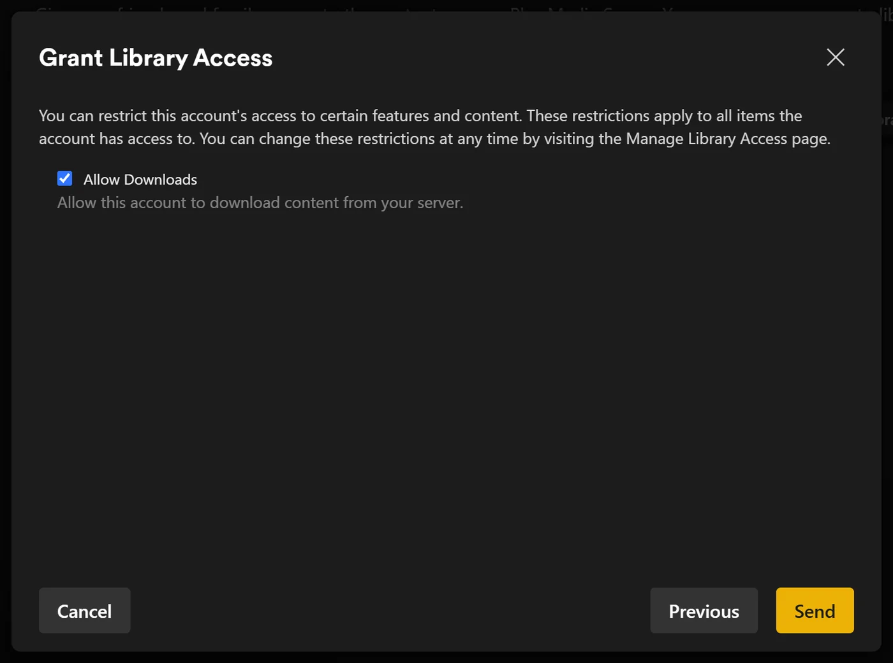
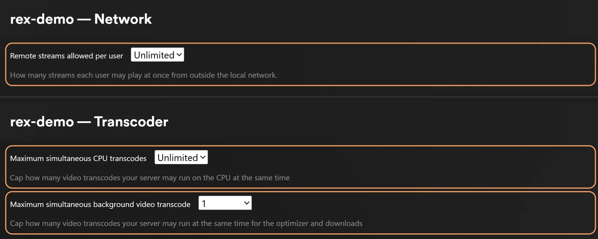

# Compartilhe o rex com família e amigos {#share-rex-with-family-and-friends}

Compartilhe o rex a partir da conta registrada dele pelo **Manage Library Access** do Plex. Cada pessoa entra no Plex como ela mesma e vê o rex ao lado dos outros servidores, com o próprio histórico de exibição.

Configure o rex primeiro em uma conta nova do Plex. Use [rex com seu próprio app](any-source.md), [rex com seus addons do Stremio](stremio.md) ou [rex com zurg](with-zurg.md). Abaixo, **o dono** se refere a essa conta.

## Quem é quem {#who-is-who}

| Conta | Para que serve |
|---|---|
| O dono, a conta nova em que o rex está registrado | Compartilhamento, configurações, **Fix Match** e exclusão. Você só entra com ela para isso |
| Sua conta pessoal | Onde você assiste. O rex é compartilhado com ela como com qualquer outra pessoa |
| Família e amigos | Contas próprias do Plex, ou usuários gerenciados para crianças (abaixo) |

Sua conta pessoal não recebe mais do que qualquer outra pessoa com quem você compartilha. Motivo: [Minha conta do Plex corre risco?](faq.md#is-my-plex-account-at-risk)

## Convide alguém {#invite-someone}

1. Entre no [app.plex.tv](https://app.plex.tv) **como dono**, depois abra **Settings** (a chave inglesa), **Manage Library Access** e **Grant Library Access**.
2. Digite o nome de usuário ou o e-mail do Plex da pessoa, escolha o servidor do rex e as bibliotecas que quer compartilhar, e envie o convite.
3. Ela aceita o convite entrando com a própria conta. O convite chega por e-mail e também no app.plex.tv. Cada convite precisa ser aceito separadamente.

**Uma biblioteca que você adiciona depois** (uma que uma fonte declara, como uma biblioteca **Anime** ou a de um catálogo do rex-stremio, ou uma criada com **Add Library**) ainda não está no compartilhamento de ninguém. Adicione-a em cada compartilhamento em Manage Library Access.

**O que a pessoa deve ver.** Logada com a própria conta, os apps do Plex dela mostram o rex junto com os servidores dela. Em casa, isso já basta. Fora de casa, continue lendo.

## Em casa e fora de casa {#at-home-and-away}

**Em casa**, os apps do Plex encontram o rex na sua rede sozinhos quando o rex usa a porta 32400.

**Fora de casa**, que é sempre o caso de um amigo em outra casa, os apps dele precisam do endereço HTTPS do rex. O rex não tem relay. O mais simples é o rex-direct: encaminhe a porta 32400 do seu roteador para a máquina do rex. Sem IPv4 público, mas com IPv6, [libere o acesso pelo IPv6](any-source.md#rex-direct-over-ipv6) em vez disso; a rede do seu amigo também precisará de IPv6. [Use fora de casa](any-source.md#use-it-outside-your-home-optional) traz essa opção e as outras formas.

**Sua velocidade de upload é o limite.** Todo stream assistido fora de casa sai pelo upload da sua conexão de casa, na bitrate do próprio arquivo, a menos que ele seja convertido. Então, duas pessoas assistindo ao mesmo tempo precisam do upload para as duas. Três coisas ajudam:

- **Qualidade menor.** Quem escolhe uma qualidade abaixo de Original no player recebe um stream convertido, que é menor. Isso exige FFmpeg na máquina do rex ([Convertendo vídeo](any-source.md#converting-video-optional)). Os apps do Plex no celular, com dados móveis, limitam a qualidade a 720p e 4 Mbps, então, sem FFmpeg, um título em 1080p é recusado ali até que eles mudem a qualidade móvel para Original.
  

- **Apps baixam do seu provedor.** Plezy e Plex para Android conseguem buscar um arquivo pelo link que a sua fonte fornece, como o do seu serviço debrid, então a sua conexão não carrega nada disso: [Apps baixam do seu provedor](direct-download.md). Nesse caso, seu provedor vê cada pessoa baixando do próprio endereço, então confira as regras dele antes de compartilhar desse jeito.
- **Um limite por pessoa** (abaixo).

**Não precisa de Plex Pass.** Seus amigos não precisam de Plex Pass nem de Remote Watch Pass para assistir fora de casa. Isso foi testado no Plex Web com contas gratuitas dos dois lados; outros apps não foram testados fora de casa.

## Crianças: usuários gerenciados {#children-managed-users}

Se o dono tiver um **Plex Home** com usuários gerenciados, um usuário gerenciado funciona no rex do mesmo jeito que em um servidor Plex. Compartilhe o rex com ele pelo Manage Library Access, como faria com qualquer outra pessoa, e depois limite o que ele vê (veja abaixo). Ele terá o próprio histórico de exibição. O rex foi testado com um compartilhamento de usuário gerenciado que incluía apenas Filmes, apenas títulos classificados como G e PG, e sem downloads.

## O que cada pessoa pode ver e fazer {#what-each-person-may-see-and-do}

Você escolhe isso para cada pessoa, na parte de compartilhamento dela em Manage Library Access, como em qualquer servidor Plex. O rex respeita essas configurações em todos os lugares: nas listas de bibliotecas, na busca, nas linhas da tela inicial e nas páginas de títulos.

| Setting | What it does on rex |
|---|---|
| Libraries | Elas veem só as bibliotecas que você compartilhou. As outras não existem para elas |
| Ratings | Só títulos com as classificações que você permite, como G e PG. Um título sem classificação também fica oculto |
| Labels | Oculta os títulos que você marcou com um label, ou mostra só esses |
| Downloads | Define se os apps Plex dela podem baixar para assistir offline |

O Plex mostra **Ratings** e **Labels** em um compartilhamento só quando a conta dona tem Plex Pass. Em uma conta gratuita nova, o compartilhamento oferece só **Allow Downloads**. Os limites próprios do rex, descritos abaixo, definem classificações e labels mesmo sem isso.

O rex fica sabendo de uma mudança pelo plex.tv assim que você a faz. Se ela não aparecer, reinicie o rex.

O rex também pode manter restrições próprias para um compartilhamento, além das do Plex. Elas só podem reduzir o que o Plex permite. São definidas com um comando, e não em um app do Plex: [Local owner controls](https://github.com/debridmediamanager/rex/blob/main/docs/setup.md#local-owner-controls).

## Quem pode fazer o quê {#who-can-do-what}

| | O dono | Todos os outros, você incluído |
|---|---|---|
| Assistir, com o próprio estado de assistido, Continue Watching, avaliações e playlists | Sim | Sim |
| Baixar para assistir offline | Sim | Se o compartilhamento deles permitir |
| **Fix Match** e editar um título | Sim | Não |
| Apagar um título (ele é apagado na origem, para todo mundo) | Sim | Não |
| Configurações do servidor, e quem está assistindo agora | Sim | Não |

Coleções e pôsteres pertencem ao servidor, então todo mundo vê os mesmos.

## Traga o histórico de cada pessoa {#bring-each-persons-history}

Qualquer pessoa com quem você compartilha pode copiar o que assistiu e avaliou em outro servidor Plex, cada uma com seus próprios tokens: [Traga seu histórico de exibição](import-watched.md). Executar isso não altera o histórico de mais ninguém.

## Quantos ao mesmo tempo {#how-many-at-once}

rex não define um limite próprio para o número de pessoas assistindo ao mesmo tempo. Quem define isso é a sua velocidade de upload, a sua máquina e a sua fonte. Cada conversão roda o FFmpeg na máquina do rex, e quantas delas a sua máquina aguenta ao mesmo tempo depende do hardware. Duas ao mesmo tempo ainda não foram medidas. Um vídeo copiado (só o áudio é convertido) quase não custa nada.

Para definir limites, entre como proprietário e abra as configurações do servidor:

| Setting | Where | Default |
|---|---|---|
| **Remote streams allowed per user** | Network, under the advanced settings | 0, no limit. Counts streams away from home only |
| **Maximum simultaneous CPU transcodes** | Transcoder | 0, no limit. Counts every video conversion, on the graphics chip too. A copied video is never counted |

O rex recusa a reprodução se ela passar do limite.

