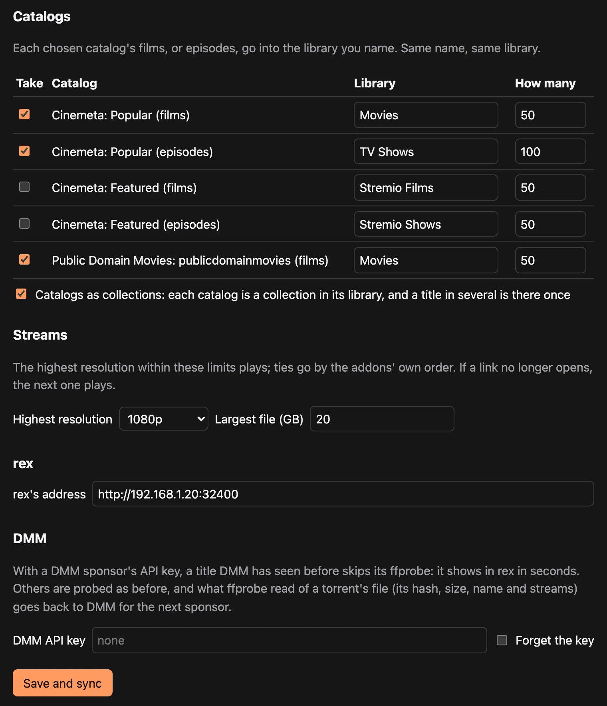

# rex com seus addons do Stremio {#rex-with-your-stremio-addons}

[rex-stremio](https://github.com/debridmediamanager/rex-stremio) transforma catálogos de addons do Stremio em bibliotecas do rex. Filmes, séries e canais ao vivo passam a tocar nos apps do Plex. Nada é baixado. Quando alguém aperta play, o rex-stremio pede um link ao stream addon e o rex toca esse link.

Não precisa de patrocínio do DMM. O rex e o rex-stremio são gratuitos. Você traz stream addons que retornam links, geralmente usando sua própria conta de debrid.

O que você ganha:

- **Bibliotecas.** Filmes vão para **Stremio Films**, séries para **Stremio Shows**, e os canais de um addon de TV ao vivo para uma biblioteca chamada **Live TV**, a menos que você dê um nome à biblioteca de um catálogo. Essa biblioteca é uma lista de canais; eles não aparecem no guia Live TV dos apps do Plex.
- **Coleções.** Dê a mesma biblioteca para vários catálogos de filmes e marque **Catalogs as collections**: você fica com uma biblioteca, uma coleção por catálogo, e um filme que vários deles listam aparece só uma vez.
- **O Plex usa o que ele conhece.** Filmes e episódios vão para o rex com seus ids do IMDb, então, quando o rex estiver em uma conta do Plex, os apps mostram os títulos, pôsteres e sinopses de sempre. Títulos que só um addon conhece, e canais ao vivo, mantêm os nomes e as imagens do addon.

## Antes de começar {#before-you-start}

| Você precisa | Por quê |
|---|---|
| Uma máquina que fique ligada, Linux ou macOS, para rex e rex-stremio juntos | rex-stremio é um programa Python só e roda ao lado do rex. O serviço abaixo é para Linux; [Docker](#in-docker) também funciona |
| Python 3.9 ou mais recente, `git` e `ffprobe` | rex-stremio verifica o stream de cada título uma vez com ffprobe, porque o rex precisa saber o que há em um arquivo antes de conseguir reproduzi-lo. Com uma chave de API do DMM, um stream debrid de um torrent que o DMM já tem verificado pula essa checagem; todo o resto é verificado com o probe |
| Addons de stream que dão links, não torrents | O rex reproduz arquivos. Configure seu serviço debrid no addon para ele entregar links |
| Uma conta nova do Plex, criada só para o rex | Igual ao setup do rex: o rex é reivindicado nela e compartilhado com a sua conta |

## Passo 1. Instale o rex e adicione-o a uma conta do Plex {#step-1-install-rex-and-add-it-to-a-plex-account}

Siga [rex com seu próprio app](any-source.md):

1. [Passo 1. Instale o rex](any-source.md#step-1-install-rex), incluindo a descoberta do IP da LAN do rex. Use esse nome em todos os comandos.
2. [Passo 3. Adicione ao uma conta do Plex](any-source.md#step-3-add-it-to-a-plex-account): registre o rex na conta nova e compartilhe com a sua.

Pule os passos 2 e 4 aqui: o rex-stremio é o seu app.

Canais ao vivo e addons cujos streams são playlists `.m3u8` só tocam pela conversão de vídeo do rex. Para esses, configure também [Converting video](any-source.md#converting-video-optional) na máquina do rex. Filmes e episódios servidos como arquivos (`.mkv`, `.mp4`) não precisam de mais nada.

## Passo 2. Instale o rex-stremio {#step-2-install-rex-stremio}

**O que faz.** Baixa o rex-stremio para `~/rex-stremio` na máquina do rex e o inicia como um serviço.

+++ Linux
```bash
sudo apt install -y git python3 ffmpeg
cd ~ && git clone https://github.com/debridmediamanager/rex-stremio
mkdir -p ~/.config/systemd/user
cp ~/rex-stremio/rex-stremio.service ~/.config/systemd/user/
systemctl --user daemon-reload && systemctl --user enable --now rex-stremio
journalctl --user -u rex-stremio -f
```
+++ macOS
```bash
brew install ffmpeg
cd ~ && git clone https://github.com/debridmediamanager/rex-stremio
cd ~/rex-stremio && python3 rex_stremio.py
```

Ele continua rodando enquanto aquela janela do Terminal estiver aberta.
+++

**O que você deve ver.** Uma linha parecida com esta:

```
... INFO relay and settings on http://127.0.0.1:9982/, 0 catalog(s), rex at http://127.0.0.1:32400
```

A página de configurações do rex-stremio e o endereço de onde o rex lê os vídeos estão ambos em `127.0.0.1:9982`, então só esta máquina consegue acessá-los.

## Passo 3. Adicione seus addons {#step-3-add-your-addons}

Abra `http://127.0.0.1:9982/` em um navegador na máquina do rex. Sem tela? No seu computador, rode `ssh -L 9982:127.0.0.1:9982 you@<rex's LAN IP>` e depois abra o mesmo endereço enquanto o SSH continua aberto.

1. Em **Addons**, cole o link do manifest de um addon, como faria no Stremio, e clique em **Add**. Faça isso para:
   - **Catalogs**, por exemplo o Cinemeta: `https://v3-cinemeta.strem.io/manifest.json`.
   - **Streams**: um addon que encontra releases e reproduz pelo seu serviço debrid. Abra a página de configuração dele, escolha seu serviço debrid, cole sua API key e copie o link de manifest que ele gerar. Se ele oferecer só resultados em cache, escolha essa opção. O link contém sua chave do debrid, então guarde para você.

   

2. Em **Catalogs**, marque os catálogos que quiser. Dê o nome da biblioteca onde cada um vai entrar e defina **How many** filmes, episódios ou canais para pegar. Para uma biblioteca só com uma coleção por catálogo, use a mesma biblioteca nos catálogos e marque **Catalogs as collections**.
3. Em **Streams**, defina o **Highest resolution** e o **Largest file** que você quer reproduzir, ou deixe em any.
4. Em **rex**, defina o endereço como `http://<rex's LAN IP>:32400`.
5. Se você apoia o DMM, cole sua API key do DMM em **DMM** ([gatekeeper](https://gatekeeper.debridmediamanager.com/) mostra a chave assim que você apoiar). Um stream debrid de um torrent que o DMM já tem um probe dele pula a verificação. Os demais são verificados, e o que o rex-stremio verifica nos arquivos de um torrent (nunca um stream HTTP comum ou uma playlist HLS) volta para o DMM para o próximo apoiador (`share_probes: false` no `config.json` impede isso). Clique em **Save and sync**.



**O que você deve ver.** No log do rex, como no [passo 4 de rex com seu próprio app](any-source.md#step-4-connect-your-app):

```
INFO    SOURCES PUT /rex/sources/stremio -> 200
INFO    FEED stremio upsert: ...
```

Os títulos aparecem no rex conforme cada um é verificado, e não quando o catálogo inteiro termina. O rex-stremio verifica vários de uma vez. Ele sincroniza de novo a cada seis horas e depois de cada save.

## Passo 4. Compartilhe as novas bibliotecas e assista {#step-4-share-the-new-libraries-and-watch}

As bibliotecas que o rex-stremio cria são novas, então sua própria conta ainda não consegue vê-las. Compartilhe-as com a sua conta, como no [passo 3](any-source.md#share-it-with-your-own-account), entrando com a conta nova, e com qualquer outra pessoa com quem você compartilhar o rex.

Depois, abra um app do Plex como você mesmo e dê play em algo. Nesse momento, o rex-stremio pede um link aos seus addons de stream, e o rex reproduz esse link. Para assistir fora de casa ou no app.plex.tv, dê ao rex um endereço próprio: [Use it outside your home](any-source.md#use-it-outside-your-home-optional).

## No Docker {#in-docker}

O [README](https://github.com/debridmediamanager/rex-stremio#set-up) do rex-stremio tem os comandos do Docker. Num container, o rex lê os vídeos pelo endereço do container na sua rede, e não pelo `127.0.0.1`, que o README mostra como configurar.

## Atualizando {#updating}

```bash
cd ~/rex-stremio && git pull && systemctl --user restart rex-stremio
```

No macOS, pare com Ctrl+C, rode `git pull` em `~/rex-stremio` e inicie de novo.

## O que ele não consegue fazer {#what-it-cannot-do}

- **Os episódios são numerados como o Cinemeta os numera.** Em alguns programas isso é diferente da numeração do TMDB, que o rex segue, então um episódio pode acabar no lugar errado.
- **O How many conta episódios** em um catálogo de séries, não programas.
- **Ligar ou desligar Catalogs as collections** envia os títulos ao rex de novo, como se fossem novos, então o que foi assistido neles pode não ser mantido. Decida antes de começar a assistir.
- **Só são listados catálogos de filmes, séries e canais**, e nenhum que precise de uma busca ou de um gênero antes.
- **Canais ao vivo** não podem ser pausados lá atrás, retomados depois nem marcados como assistidos, e só tocam em apps que pedem ao rex para converter (os apps do Plex e o Plezy; o Plex Web não foi testado). Canais sem stream funcionando, ou com DRM, ficam de fora.
- **Qualquer pessoa que consiga acessar o endereço do rex-stremio pode reproduzir por ele.** Deixe em `127.0.0.1`, a menos que o rex rode em outro lugar.

O README traz [os demais limites](https://github.com/debridmediamanager/rex-stremio#limits) e todas as configurações do `config.json`. Para criar um addon próprio, veja [Criando addons do rex](addons.md), que também explica como o rex-stremio funciona por dentro.
