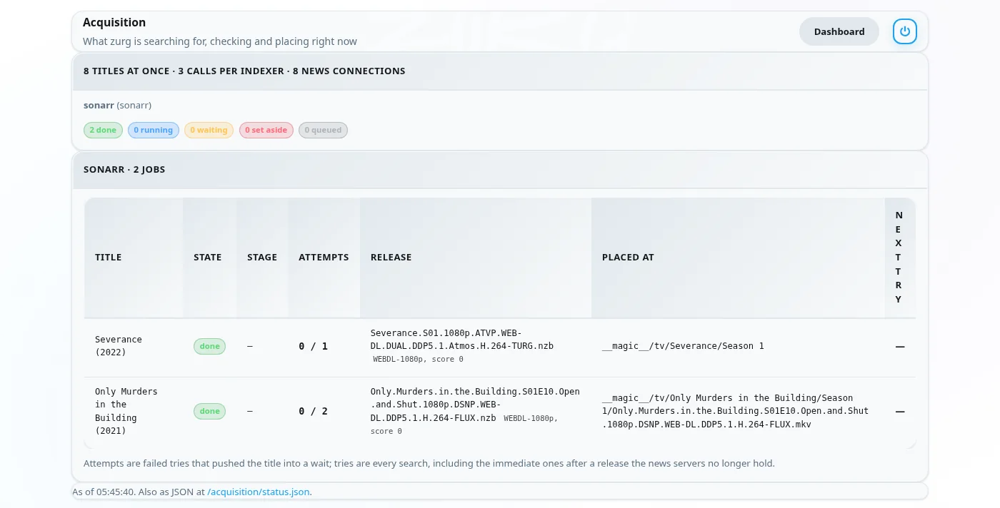
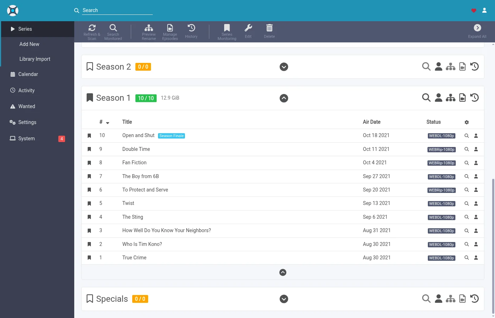

# Deixe o zurg buscar o que o Sonarr e o Radarr querem {#let-zurg-fetch-what-sonarr-and-radarr-want}

There are three ways to use Sonarr and Radarr with zurg. The real choice is who searches, zurg or the \*arrs: [which one to pick](#which-one-to-pick) compares them.

| Guide | Who searches | zurg acts as | You need |
|---|---|---|---|
| [Usenet](sonarr-radarr.md) | Sonarr and Radarr | a SABnzbd | a Usenet account (or TorBox Pro for the `torbox_nzb` backend) and Usenet indexers in Prowlarr or the \*arrs |
| [Torrents](sonarr-radarr-torrents.md) | Sonarr and Radarr | a qBittorrent | a debrid account and torrent indexers in Prowlarr or the \*arrs |
| [zurg searches](sonarr-radarr-fetch.md) | zurg | no download client at all | a Usenet, TorBox Pro or debrid account, and Newznab or Torznab indexers in zurg's own config |

Os dois primeiros podem rodar lado a lado. Eles compartilham a mesma pasta `__magic__`.

### Qual escolher {#which-one-to-pick}

| | zurg busca | Sonarr e Radarr buscam |
|---|---|---|
| Os indexadores vão em | no `config.yml` do zurg, e uma mudança exige reiniciar | no Prowlarr ou nos \*arrs, como de costume |
| Os \*arrs precisam de | apenas pastas raiz dentro de `__magic__`, nada mais | o zurg como cliente de download, com a pasta de download e as pastas raiz no mesmo volume |
| O primeiro arquivo é | o mais rápido de confirmar que o seu perfil permite, depois melhorado até o cutoff | o que o \*arr classifica como o melhor no seu perfil |
| Anime, programas diários e especiais | tratados a partir do nightly de 5 de novembro de 2026 | tratados |
| Busca manual, fila, histórico, blocklist | nenhum. O arquivo aparece e o \*arr faz uma nova varredura | funcionam como de costume |
| [`exclude_words`](acquisition.md#excluding-releases-by-name) do zurg | se aplica | não se aplica. Bloqueie as mesmas palavras no \*arr |

Os dois verificam um lançamento antes de o \*arr importá-lo. Uma postagem Usenet morta ou um torrent que a sua conta ainda não tem nunca é colocado.

Em uma instalação nova, comece com a busca pelo zurg. Dá menos trabalho para configurar e não há layout de volumes para acertar. Use a rota do cliente de download se quiser escolher os lançamentos manualmente. Se preferir esperar pelo melhor lançamento do seu perfil em vez de um primeiro arquivo rápido, ative o [`best_first`](acquisition.md#taking-the-profiles-best-first).

O Radarr e o Sonarr cuidam da lista e da biblioteca. Quem faz o download é o zurg. Adicione um filme ou uma série do jeito que você já faz, e o zurg encontra um lançamento nos seus indexadores. Ele verifica se um NZB ainda está nos servidores de notícias (para uma conta `torbox_nzb`, que o TorBox buscou), ou se a sua conta de debrid já tem um torrent. Depois coloca o arquivo na pasta dele dentro de `__magic__` e pede ao Radarr ou ao Sonarr para fazer uma nova varredura. Nada é baixado para importar e nada é copiado.

Para isso, o Radarr e o Sonarr não precisam de indexadores nem de cliente de download. Eles nunca buscam e nunca pegam nada. O seu perfil de qualidade continua decidindo o que o zurg pode pegar.

As capturas de tela vêm da build do zurg que sai como nightly de 26 de setembro de 2026, com Radarr 6.3.0.10514 e Sonarr 4.0.20.3014 no Docker. Os dois viram o mount do zurg em `/mnt/zurg` dentro dos seus containers. Nada neles foi alterado.

## Antes de começar {#before-you-start}

1. **O zurg precisa de uma conta de Usenet ou de debrid e de pelo menos um indexador Newznab ou Torznab.** Os indexadores vão no bloco `acquisition.indexers` da configuração do zurg. A página [Watchlist e Seerr](acquisition.md) explica esse bloco.
2. **`magic.enabled` precisa estar como `true`.** As fontes Radarr e Sonarr não iniciam sem ele, e o log avisa disso. Veja [`__magic__`](magic.md).
3. **O Radarr e o Sonarr precisam enxergar o mount do zurg.** Instalados como aplicativos comuns, cada sistema tem uma pegadinha, listada em [o guia de Usenet](sonarr-radarr.md#before-you-start). No Docker em um host Linux, isso significa montar o mount dentro dos contêineres deles. Monte o diretório pai do mount uma vez e acesse tudo por ele. Se eles também pegarem downloads do zurg como cliente de download, dois volumes para a pasta de download e para as root folders fazem cada importação ser copiada. Veja [um volume](sonarr-radarr.md#one-volume-for-the-download-folder-and-the-root-folders).
4. **Você precisa usar um nightly de 26 de setembro de 2026 ou posterior.** Builds mais antigos não conhecem as fontes `radarr` e `sonarr`.

## 1. Conte ao zurg sobre o Radarr e o Sonarr {#1-tell-zurg-about-radarr-and-sonarr}

Adicione uma fonte `radarr` e uma fonte `sonarr` em `acquisition` no `config.yml` e reinicie o zurg. Ainda não existe formulário no dashboard para esse bloco. Deixe de fora a que você não usa.

```yaml
acquisition:
  quality: best
  indexers:
    - name: my-indexer
      url: https://indexer.example
      api_key: YOUR_INDEXER_API_KEY
  sources:
    - name: radarr
      type: radarr
      enabled: true
      url: http://radarr:7878         # http://localhost:7878 when Radarr is an ordinary app beside zurg
      api_key: YOUR_RADARR_API_KEY
      library_path: /mnt/zurg/__magic__
      check_every_secs: 30
    - name: sonarr
      type: sonarr
      enabled: true
      url: http://sonarr:8989         # http://localhost:8989 likewise
      api_key: YOUR_SONARR_API_KEY
      library_path: /mnt/zurg/__magic__
      check_every_secs: 30
```

`url` e `api_key` são do próprio app. A API key fica em **Settings > General** nos dois. `check_every_secs` é a frequência com que o zurg pergunta o que eles querem. Cada consulta é uma única requisição para a lista. Os mesmos indexadores atendem às duas fontes.

`library_path` é o lugar onde o app enxerga o diretório `__magic__` do zurg. O zurg precisa dele para transformar uma pasta do Radarr em um lugar dentro de `__magic__`. Com a configuração acima, um filme que o Radarr mantém em `/mnt/zurg/__magic__/movies/Heat (1995)` vira `movies/Heat (1995)` dentro do `__magic__` do zurg. Caminhos do Windows, como `Z:\__magic__`, funcionam do mesmo jeito. Deixe `library_path` de fora só quando o app roda no mesmo host que o zurg e enxerga o mount onde o zurg monta.

`concurrency` é quantos títulos o zurg processa ao mesmo tempo, e o padrão é oito. Uma lista grande tudo bem com o padrão. Só demora mais.

## 2. Coloque as pastas raiz dentro de `__magic__` {#2-put-the-root-folders-inside-__magic__}

A pasta raiz precisa estar dentro de `__magic__` e um nível abaixo. `/mnt/zurg/__magic__/movies` para o Radarr e `/mnt/zurg/__magic__/tv` para o Sonarr é o formato a seguir (`/Volumes/Zurg/__magic__/movies` no macOS, `Z:\__magic__\movies` no Windows). Não use `__magic__` em si nem `__magic__/__all__`. Um título cuja pasta esteja em outro lugar é ignorado, e o zurg avisa sobre isso uma vez no log.

No Radarr, abra **Settings > Media Management** e adicione a pasta raiz.


O Sonarr tem a mesma página. Adicione a pasta raiz dele em **Root Folders**.


**Season Folder Format** na página do Sonarr é o nome que o zurg dá a uma nova pasta de temporada. Uma temporada que já tem arquivos mantém a pasta em que eles estão. O espaço livre que qualquer um dos apps mostra é o que o mount reporta. Nenhum dos dois grava nada ali.

## 3. Adicione títulos com a busca desligada {#3-add-titles-with-search-off}

Adicione filmes e séries do jeito que você já faz. À mão, a partir de uma lista ou de um app de pedidos. A única mudança é na busca. Quem faz a busca é o zurg, então os arrs não devem fazer isso.

### Radarr

Este passo a passo usa uma lista de importação. Abra **Settings > Import Lists** e adicione ou edite a sua.


Nas configurações da lista, deixe **Enable Automatic Add** ligado e desligue **Search on Add**. Escolha o perfil de qualidade e a pasta raiz do passo 2. Defina **Minimum Availability** para o que você quiser. O zurg espera o Radarr marcar um filme como disponível antes de procurá-lo.


Quando você adiciona um único filme manualmente, a opção se chama **Start search for missing movie**. Deixe essa desligada também.

### Sonarr

Ao adicionar uma série manualmente, deixe **Start search for missing episodes** e **Start search for cutoff unmet episodes** desmarcados. **Monitor** decide o que o zurg vai buscar. Esta série está configurada para a primeira temporada.


Uma lista de importação no Sonarr tem a mesma opção nas configurações. Desative a busca nela também.

## 4. Deixe os indexadores e os clientes de download vazios {#4-leave-indexers-and-download-clients-empty}

That is the whole setup on the arr side. A página de indexers pode ficar vazia.


A página de download clients também pode ficar vazia.


O Sonarr é igual. Se algum dos apps já tiver indexers e um download client de uma configuração anterior, eles continuam funcionando. Nesse caso, o app vai buscar junto com o zurg para os mesmos títulos. Desative a busca automática nesses indexers ou remova-os dos títulos que o zurg cuida.

## 5. Veja funcionando {#5-watch-it-work}

Abra o painel do zurg. **Acquisition** é uma nova entrada nos atalhos rápidos.


A página mostra todos os títulos que o zurg está processando e o que ele está fazendo agora. Os mesmos dados estão em `/acquisition/status.json` caso você queira lê-los a partir de um script.

### Filmes {#movies}

Esta é uma lista de dez filmes cerca de meio minuto depois que o Radarr os adicionou. Cinco já têm o arquivo e o Radarr está sendo avisado sobre eles. Os demais já estão prontos.


Cada linha é um filme. **State** mostra em que pé ele está. **Stage** mostra o que o zurg está fazendo com ele agora. Primeiro ele consulta os indexadores. Depois avalia os candidatos. Depois lê o NZB de um release e verifica a postagem nos servidores de notícias. Por fim, coloca o arquivo no lugar. **Release** é a postagem que o zurg pegou e o que o parser do Radarr entendeu dela. **Placed at** é o caminho dentro de `__magic__` onde o vídeo está agora. Se os servidores de notícias não tiverem mais um título, ele passa logo para o próximo candidato. Um título sem nada utilizável é posto de lado, com o motivo exibido.

Um minuto depois, tudo está concluído.


### Séries {#series}

Os seasons do Sonarr aparecem na mesma página. Cada linha é uma temporada ou um arquivo de episódio que o zurg está atualizando. Aqui estão duas séries com a primeira temporada monitorada meio minuto depois de terem sido adicionadas. As duas temporadas já tinham terminado de ser exibidas e não tinham arquivos, então o zurg tentou um season pack para cada uma. O pack de Severance está na pasta da temporada e o Sonarr está sendo avisado. O pack de Only Murders está sendo verificado nos servidores de notícias.


Cerca de dois minutos depois de terem sido adicionadas, as duas temporadas estão prontas. O pack de Only Murders estava com partes faltando nos servidores de notícias. O zurg deixou esse de lado e pegou os dez episódios um por um. A linha dele mostra o último episódio colocado.



## 6. O que o Radarr e o Sonarr mostram {#6-what-radarr-and-sonarr-show}

Os acervos vão se preenchendo conforme as varreduras terminam. Todo filme desta lista já tem o seu arquivo.


A página de um filme mostra o arquivo dentro da pasta dele em `__magic__`, com a qualidade que o Radarr identificou pelo nome.


No Sonarr, todos os dez episódios têm o arquivo na pasta da temporada, com a qualidade que o Sonarr identificou em cada nome.



**Activity** continua vazio nos dois. Não há nenhuma entrada na fila nem evento de captura ou importação, porque nada foi capturado. O arquivo simplesmente apareceu na pasta, e a nova varredura que o zurg pediu foi a que o encontrou.


Disso saem duas coisas. A lista de bloqueio dos arrs nunca é preenchida. O zurg mantém um registro próprio das postagens que os servidores de notícias não têm mais e não as escolhe de novo. E um título que você apaga no Radarr ou no Sonarr não é apagado da sua conta. O arquivo volta a aparecer em `__all__`, como qualquer outro lançamento.

## Como o zurg escolhe uma versão {#how-zurg-picks-a-release}

Seu perfil de qualidade é o portão. Cada release que o zurg está prestes a pegar passa primeiro pelo parser do próprio app. Ele precisa ser o título certo. A qualidade dele precisa ser permitida pelo perfil. A pontuação de custom format precisa atingir o mínimo do perfil. O tamanho precisa caber nos limites em **Settings > Quality**. Uma release que falhe em qualquer um desses pontos não é pega.

### Filmes {#movies-1}

Entre as versões que o perfil permite, o zurg pega primeiro a que for mais rápida de confirmar. Posts com um único arquivo de vídeo vêm primeiro, porque são os que mais costumam estar completos nos servidores de notícias. Releases web vêm antes das Blu-ray pelo mesmo motivo. Conjuntos de arquivos compactados em múltiplos volumes ficam como última opção.

A ordem de preferência do perfil é aplicada com upgrades. Quando o perfil permite upgrades e o arquivo colocado está abaixo do cutoff, o zurg procura uma release melhor depois que o filme ganha uma. Só uma release estritamente melhor substitui o arquivo. Qualidade menor nunca é pega.

Um filme com data futura espera até o Radarr marcá-lo como disponível. Uma busca que retorna o filme errado é recusada, porque o Radarr não associa o título a nenhum filme da sua biblioteca.

### Séries {#series-1}

A temporada é uma unidade de trabalho só. Quando todos os episódios de uma temporada estão faltando e a temporada já terminou de ser exibida, o zurg tenta primeiro um pacote da temporada. Caso contrário, ele pega os episódios faltantes um por um. Uma temporada que já tem alguns de seus arquivos nunca recebe um pacote. Isso colocaria uma segunda cópia desses episódios na pasta.

Um release precisa ser desta série e desta temporada. Um pacote precisa ser a temporada inteira. Um release de episódio precisa ser só aquele episódio. O limite de tamanho vale para a duração dos episódios que o release contém.

Quando um episódio de uma temporada não tem nada que o zurg possa pegar ainda, mas o resto continua sendo colocado, o Sonarr é avisado na mesma hora. O episódio faltante é procurado de novo depois, no cronograma normal de tentativas.

Um arquivo de episódio abaixo do corte é um upgrade quando o perfil permite upgrades. Abaixo do corte significa abaixo da qualidade de corte ou abaixo da pontuação de formato personalizado de corte. O zurg conta os dois do mesmo jeito que a regra de upgrade do Sonarr. A lista **Cutoff Unmet** do próprio Sonarr só mostra o primeiro. Um upgrade substitui só o seu próprio episódio, e o resto da pasta da temporada continua onde está.

## Coisas para saber {#things-to-know}

- **Qualquer mudança no bloco `acquisition` do `config.yml` precisa de reinício.** O zurg só lê o arquivo quando ele inicia.
- **A varredura é o último passo e fica na fila atrás do trabalho do próprio app.** Logo depois que uma lista adiciona muitos filmes, o Radarr atualiza cada um deles primeiro. Os arquivos já estão no lugar enquanto isso roda.
- **Analyse video files lê o início de cada arquivo pelo mount.** Funciona. Também é a parte mais lenta de uma lista grande. Deixe ativado, a menos que você saiba que não quer informações de mídia.
- **Títulos sem monitoramento são deixados de lado.** Isso vale para filmes, séries, temporadas e episódios. Também ficam de fora os títulos cuja pasta está fora de `__magic__`.
- **Animes, programas diários e especiais precisam de um nightly de 5 de novembro de 2026 em diante.** Os episódios de um programa diário são encontrados pelo dia em que foram ao ar, os de um anime pelo número com que a série os conta (`Jujutsu Kaisen - 30` é a sexta da segunda temporada), e os especiais são buscados como temporada 00. Um arquivo colocado para um anime ou um programa diário recebe o nome `JUJUTSU KAISEN - S02E06 - <the release's own name>`, porque a varredura do Sonarr lê um arquivo somente pelo nome e colocaria `2nd Season - 06` na temporada 1. Um especial identificado só pelo título, sem `S00Exx`, não pode ser encontrado, nem pelo Sonarr. Em uma build mais antiga, cada uma dessas séries é ignorada com uma linha no log.

A descrição completa das duas fontes está em [Watchlist e Seerr](acquisition.md).
