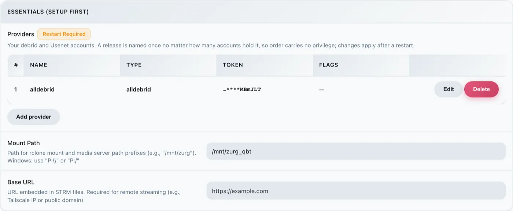
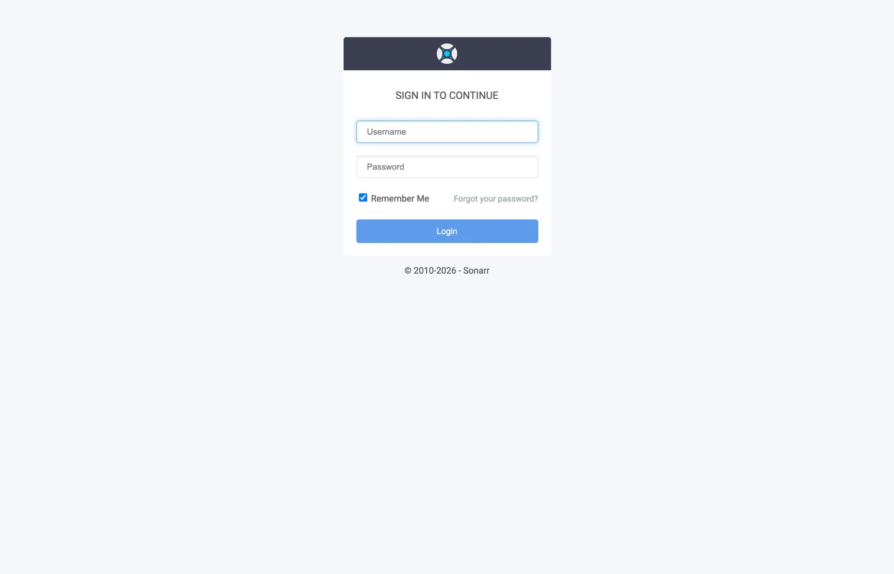
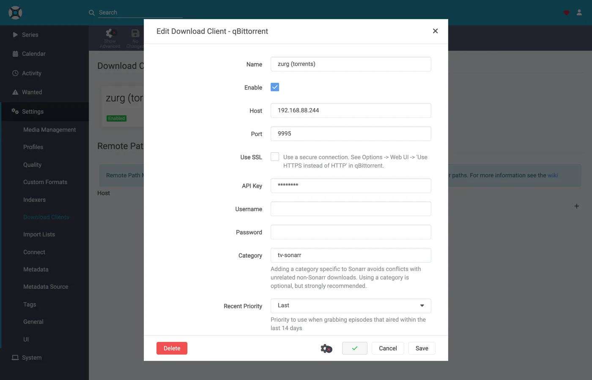
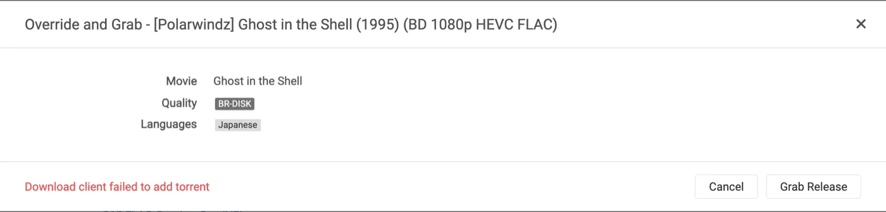
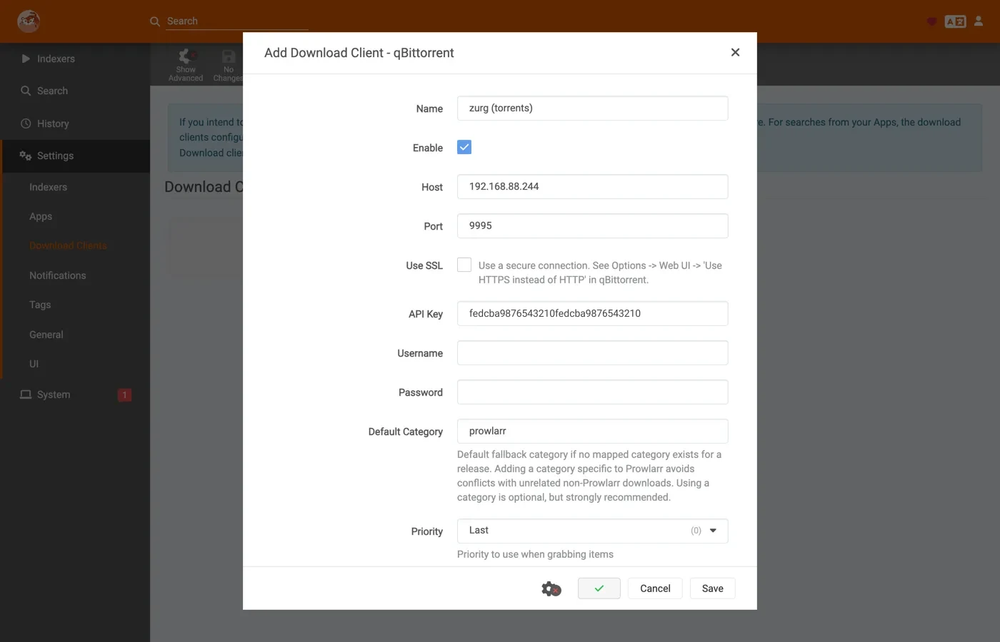

# Sonarr e Radarr com torrents, passo a passo {#sonarr-and-radarr-with-torrents-step-by-step}

Existem três formas de usar o Sonarr e o Radarr com o zurg. A escolha que realmente importa é quem faz a busca, o zurg ou os \*arrs: [qual escolher](sonarr-radarr-fetch.md#which-one-to-pick) compara as opções.

| Guia | Quem busca | O zurg atua como | Você precisa de |
|---|---|---|---|
| [Usenet](sonarr-radarr.md) | Sonarr e Radarr | um SABnzbd | uma conta Usenet (ou TorBox Pro para o backend `torbox_nzb`) e indexadores Usenet no Prowlarr ou nos \*arrs |
| [Torrents](sonarr-radarr-torrents.md) | Sonarr e Radarr | um qBittorrent | uma conta debrid e indexadores de torrent no Prowlarr ou nos \*arrs |
| [zurg faz a busca](sonarr-radarr-fetch.md) | zurg | nenhum cliente de download | uma conta Usenet, TorBox Pro ou debrid, e indexadores Newznab ou Torznab na configuração própria do zurg |

As duas primeiras podem rodar lado a lado. Elas compartilham a mesma pasta `__magic__`.

O [guia anterior](sonarr-radarr.md) apontou os \*arrs para o zurg no caso do Usenet, com o zurg respondendo como um SABnzbd. Esta é a outra metade: o zurg responde como um **qBittorrent**, os \*arrs entregam a ele um magnet ou um `.torrent` em vez de um NZB, e o lançamento vai para uma conta debrid em vez de um servidor de notícias. A importação é o mesmo truque — um rename dentro de `__magic__`, nada baixado para importar, nada copiado.

**Qual dos dois o \*arr envia não é um detalhe estético.** Um `.torrent` normalmente é enviado para a conta como o próprio arquivo; só um magnet é adicionado apenas pelo info hash. No modo somente em cache, o padrão, TorBox e Debrid-Link recebem o info hash, porque é assim que recusam um lançamento sem cache sem adicioná-lo. Um magnet faz a conta descobrir o que o torrent contém a partir do hash, e o hash de um tracker privado não tem um swarm público de onde tirar essa informação. O Real-Debrid falha com `magnet_error` sem arquivos, e o TorBox aceita e depois fica em `checking` sem lista de arquivos, sem tamanho e com uma estimativa de cem dias, então a captura nem falha nem termina. O arquivo `.torrent` faz a consulta de cache da conta pelo hash diretamente, então o conteúdo que a conta já tem é adicionado na hora, sem nenhuma resolução de magnet. É isso que faz os indexadores privados funcionarem aqui: os lançamentos deles podem ser adicionados exatamente quando a conta já tem o conteúdo, o que, para qualquer coisa que uma comunidade compartilha, é o caso comum. Aponte o \*arr para um indexador que entregue arquivos `.torrent` em vez de magnets. Os privados entregam.

Tudo abaixo foi capturado com o zurg `2026.08.30.0459-nightly-73-g5b4c9790`, Sonarr `4.0.19.2979`, Radarr `6.3.0.10514` e Prowlarr `2.5.2.5491`, em uma instalação real com uma conta AllDebrid de verdade. Nomes de host e de usuário foram alterados para `you@zurg-server`. Os nomes dos indexadores são `my-indexer`. Chaves de API e contagens da biblioteca são ilustrativas. Nada além disso na saída capturada foi alterado.

## Antes de começar {#before-you-start}

Três coisas precisam ser verdadeiras. Verifique as três agora. Cada uma delas falha depois com a cara de um problema não relacionado.

1. **o zurg tem uma conta que pode adicionar torrents** — Real-Debrid, AllDebrid, TorBox, Premiumize, Debrid-Link ou Offcloud. Todos os seis aceitam o próprio arquivo `.torrent` enviado, e é isso que permite adicionar o lançamento de um tracker privado. Uma conta de Usenet não aceita torrent de nenhuma forma: uma instalação cujo único provedor é `nzb` aceita todo pedido de download e depois o recusa. O zurg avisa isso na inicialização.
2. **`magic.enabled` está como `true`.** Sem isso, o caminho de salvamento não existe e todas as importações falham. Veja [`__magic__`](magic.md).
3. **O mount está visível para o \*arr** no caminho que o zurg informa. Se o \*arr roda em um container, leia o [passo 8](#8-if-your-arr-is-in-docker) antes de configurar qualquer coisa. Instalado como um app comum na mesma máquina, ele enxerga o mount onde o zurg o monta, com uma ressalva em cada sistema:
   - **Linux:** um \*arr que roda com outro usuário que o zurg vê uma pasta vazia até que `user_allow_other` esteja habilitado. Veja [Configuração no Linux](../setup/linux.md#1-install-fuse-3).
   - **macOS:** rode-o com o mesmo usuário do zurg. O mount fica em `/Volumes/Zurg`, a menos que você tenha alterado `mount_path`.
   - **Windows:** rode o Sonarr e o Radarr como app na bandeja, que o instalador oferece, e não como serviço do Windows. A unidade `Z:` do zurg pertence à sessão em que você está conectado, e um serviço roda fora dessa sessão, então ele não enxerga a unidade. Veja [as regras de sessão](../setup/windows.md#keeping-it-running-the-session-rules).

Verifique os dois primeiros direto no arquivo de configuração, no diretório de trabalho do zurg. No Windows, abra o `config.yml` no Bloco de Notas.

```bash
$ grep -A3 '^providers:' config.yml
providers:
- type: alldebrid
  token: <redacted>

$ grep -A3 '^magic:' config.yml
magic:
  enabled: true
  allow_delete: false
```

**A ordem da lista `providers:` importa aqui.** Um pedido de download é oferecido a todas as contas que aceitam torrents, nessa ordem, e uma conta que recusa ou trava nele é descartada, e a próxima é tentada. Se você tem duas contas, coloque primeiro a que você prefere gastar.

Duas chaves tiram uma conta dessa ordem. `watchlist: true` coloca uma conta na frente, independentemente de onde ela esteja no arquivo. `add_torrents: false` tira uma conta da rotação por completo, então ela continua servindo e lendo a sua biblioteca, mas nada novo é mais colocado nela: é o caso de uma conta de arquivo morto, ou de uma cuja cota já está comprometida. Uma conta de Usenet nunca recebe um torrent, em nenhum dos dois casos. Ambas estão descritas em [a referência de configuração](../reference/config.md#accounts).

## 1. Ligue o endpoint {#1-turn-the-endpoint-on}

Duas formas, mesmo resultado. As duas gravam no `config.yml` e as duas precisam de um reinício: as rotas que servem `__magic__` e o endpoint do qBittorrent são registradas uma única vez, quando o zurg inicia.

### Opção A — o painel {#option-a--the-dashboard}

Abra o painel do zurg, clique em **Config** e role até **\_\_magic\_\_ & Download Clients**. Ative **Serve \_\_magic\_\_** e **qBittorrent Endpoint**.


**Config** é onde a configuração fica; **Magic** é onde você vai acompanhar os grabs que chegarem depois.


Deixe **qBittorrent Save Path** vazio, a menos que o seu \*arr monte o zurg em um caminho diferente do que o próprio zurg usa — veja o [passo 8](#8-if-your-arr-is-in-docker). O chip laranja **Restart Required** está certo: nada aqui tem efeito até o zurg reiniciar.

### Opção B — `config.yml` {#option-b--configyml}

Adicione o bloco manualmente e reinicie o zurg.

```yaml
magic:
  enabled: true

qbittorrent:
  enabled: true
  api_key: ""                   # empty = zurg generates one and keeps it
  categories: [tv-sonarr, radarr]
  save_path: ""                 # empty = <mount_path>/__magic__/__all__
  cached_only: true             # the default: only take what an account already holds
```

**As categorias não são pastas.** Todas levam ao mesmo lugar: a pasta da própria release em `__magic__/__all__`. A lista só cria as categorias com antecedência: o **Test** de um cliente cria qualquer categoria que esteja faltando, e o zurg a guarda em `data/qbittorrent-categories.json`. O Prowlarr, se você usar, precisa de `prowlarr`. Veja o [passo 10](#10-prowlarr-manual-grabs).

Reinicie o zurg e depois confirme que o endpoint foi registrado e que o provedor foi aceito:



Uma linha `alldebrid` é tudo que o endpoint precisa: qualquer um dos seis tipos com suporte a torrent.

O log de inicialização diz as mesmas coisas, e vale a pena lê-lo uma vez:

```
INFO  router.qbittorrent  qBittorrent API on /api/v2 and /qbittorrent/api/v2, save path /mnt/zurg_qbt/__magic__/__all__, categories tv-sonarr, radarr
INFO  router.qbittorrent  qBittorrent: cached-only, so a grab is only accepted onto an account that already holds the content; anything else is refused and the *arr takes its next release. Set qbittorrent.cached_only: false to let accounts download
INFO  router.qbittorrent  qBittorrent: torrents are offered to alldebrid, in that order
```

## 2. Encontre a chave de API {#2-find-the-api-key}

The API key is the entire authentication on this endpoint, so get it right once and don't paste it anywhere public.

**If you left `api_key` empty**, zurg generated one on first start and wrote it to `data/qbittorrent-apikey`:

```bash
$ cat data/qbittorrent-apikey
fedcba9876543210fedcba9876543210

```

Illustrative key — yours will differ. The file survives restarts, so the key is stable once generated.

**If you set `api_key` yourself**, it is in `config.yml` and no file is written.

**This endpoint is outside zurg's basic auth.** The \*arrs authenticate to a download client the download client's own way, and their HTTP layer turns a basic-auth 401 into "unable to connect" with nothing actionable in it — so zurg deliberately exempts `/api/v2`. The API key is the whole gate. Treat the port the way you treat the rest of zurg's: on a trusted network, or behind something that is.

Three ways to present the key, all accepted:

- **`Authorization: Bearer <key>`** — what the client sends when its **API Key** field is filled in. This is the recommended one; it skips the login entirely.
- **The key as the password** on `auth/login`, with any username. Use this if you would rather fill in Username and Password.
- **zurg's own dashboard username and password**, if `username:` and `password:` are set in `config.yml`.

## 3. Confirme que ela responde {#3-prove-it-answers}

Faça isso antes de mexer no Sonarr. Leva dez segundos e, daqui pra frente, separa "o zurg está errado" de "o \*arr está errado".

+++ Linux and macOS

```bash
$ KEY=fedcba9876543210fedcba9876543210
$ ZURG=192.168.88.244:9995

$ curl -s "http://$ZURG/api/v2/app/webapiVersion"
Forbidden

$ curl -s -H "Authorization: Bearer $KEY" "http://$ZURG/api/v2/app/webapiVersion"
2.11.2

$ curl -s -H "Authorization: Bearer $KEY" "http://$ZURG/api/v2/app/version"
v5.0.4

$ curl -s -H "Authorization: Bearer $KEY" "http://$ZURG/api/v2/app/preferences" | jq .save_path
"/mnt/zurg_qbt/__magic__/__all__"
```

+++ Windows

No PowerShell. Digite `curl.exe`, não `curl`: o `curl` do Windows PowerShell é outro comando.

```powershell
PS> $KEY = "fedcba9876543210fedcba9876543210"
PS> $ZURG = "192.168.88.244:9995"

PS> curl.exe -s "http://$ZURG/api/v2/app/webapiVersion"
Forbidden

PS> curl.exe -s -H "Authorization: Bearer $KEY" "http://$ZURG/api/v2/app/webapiVersion"
2.11.2

PS> curl.exe -s -H "Authorization: Bearer $KEY" "http://$ZURG/api/v2/app/version"
v5.0.4

PS> (Invoke-RestMethod "http://$ZURG/api/v2/app/preferences" -Headers @{ Authorization = "Bearer $KEY" }).save_path
Z:/__magic__/__all__
```

+++

**O `Forbidden` puro é a resposta correta.** A primeira consulta dos clientes é um `GET /api/v2/app/webapiVersion` *sem autenticação*, e o qBittorrent de verdade responde `403` quando a API está lá mas ninguém fez login. Então é isso que o zurg responde, e o cliente entende como "suporta v2, agora autentique". Um **404** puro significa que `qbittorrent.enabled` ainda está false ou que o zurg não foi reiniciado depois que você mudou isso.

Depois, confira se uma chave errada é realmente recusada:

+++ Linux and macOS

```bash
$ curl -s -o /dev/null -w "%{http_code}\n" -H "Authorization: Bearer wrongkey" \
    "http://$ZURG/api/v2/torrents/info"
403
```

+++ Windows

```powershell
PS> curl.exe -s -o NUL -w "%{http_code}\n" -H "Authorization: Bearer wrongkey" "http://$ZURG/api/v2/torrents/info"
403
```

+++

`save_path` é o caminho que o zurg vai entregar aos clientes. Confira agora se é um caminho que *eles* conseguem abrir.

As duas formas de URL funcionam, então qualquer uma serve no campo **URL Base** do cliente:

| Caminho | URL Base no Sonarr / Radarr | Responde |
|---|---|---|
| `/api/v2/…` | *(deixe vazio)* | sim |
| `/qbittorrent/api/v2/…` | `/qbittorrent` | sim |

## 4. Crie as pastas raiz {#4-make-the-root-folders}

Crie-as antes de adicioná-las, porque o diálogo Add Root Folder dos \*arr navega pelo sistema de arquivos em tempo real e não vai oferecer uma pasta que não existe.

+++ Linux e macOS

```bash
$ mkdir -p /mnt/zurg_qbt/__magic__/tv /mnt/zurg_qbt/__magic__/movies

$ ls -d /mnt/zurg_qbt/__magic__/tv /mnt/zurg_qbt/__magic__/movies
/mnt/zurg_qbt/__magic__/movies
/mnt/zurg_qbt/__magic__/tv
```

+++ Windows

```powershell
PS> New-Item -ItemType Directory -Force Z:\__magic__\tv, Z:\__magic__\movies
```

Ou crie as duas pastas no Explorer.

+++

Substitua `/mnt/zurg_qbt` pelo seu próprio `mount_path`. Se não for definido, ele é `/mnt/zurg` no Linux, `/Volumes/Zurg` no macOS e `Z:` no Windows.

**A pasta raiz fica ao lado do save path, não nele e nem acima dele.** É a mesma regra do passo a passo de Usenet, pelo mesmo motivo: o zurg informa `__magic__/__all__` como save path, os dois clientes acusam um health check quando uma pasta raiz *é* a pasta de saída do cliente de download, o Radarr também acusa um quando a pasta raiz *contém* essa pasta, e pastas irmãs não causam nenhum dos dois. [Esse guia](sonarr-radarr.md#4-make-the-root-folders) tem as capturas de tela do que acontece quando se erra.

Há um segundo motivo, específico de torrents: uma movimentação cujo destino fica fora de `__magic__` é uma movimentação entre dois sistemas de arquivos, o que equivale a uma cópia, e uma cópia a partir de um mount de debrid lê a release inteira pela rede. Manter o `Remove Completed` ativado ([abaixo](#if-the-import-copies-instead-of-moving)) faz a importação continuar sendo um rename; uma pasta raiz fora do namespace desfaria isso de qualquer forma.

Uma movimentação entre dois volumes também é uma cópia. Isso importa no Docker. O passo 8 cobre esse ponto.

## 5. Adicione o cliente no Sonarr {#5-add-the-client-in-sonarr}

A Sonarr recém-instalado bloqueia tudo atrás de uma tela de primeira execução. Escolha **Forms (Login Page)**, defina um usuário e uma senha e clique em **Save**.


Ele não deixa você avançar até que **Authentication Method** esteja em outra opção que não seja None.


Depois de clicar em Save, você é desconectado uma vez e cai na página de login.



### Settings → Download Clients

Vá em **Settings → Download Clients**. Numa instalação nova, não há nada aqui além do card **+**.


Clique no **+** em "Download Clients", e não no que fica mais abaixo em "Remote Path Mappings".

Escolha **qBittorrent** na coluna **Torrents**.


O zurg se passa especificamente por qBittorrent, então nenhum outro item desta lista vai funcionar. As duas colunas mostram qual guia você está seguindo: o SABnzbd fica em Usenet, e o qBittorrent fica em Torrents.

O diálogo abre com os padrões do próprio qBittorrent: `localhost`, porta `8080`, sem chave.


### O que colocar em cada campo {#what-to-put-in-each-field}

| Field | Value | Why |
|---|---|---|
| Name | `zurg (torrents)` | Qualquer nome. É só um rótulo. |
| Enable | on | Deixe marcado. |
| Host | `192.168.88.244` | O host onde o zurg roda, como o *\*arr* consegue acessá-lo. `localhost` quando o \*arr é um app comum na mesma máquina. No Docker, veja o aviso abaixo. |
| Port | `9995` | A porta normal do zurg — `9999` em uma instalação padrão. |
| Use SSL | off | Só se você colocou o zurg atrás de TLS por conta própria. |
| URL Base | vazio | `/qbittorrent` também funciona — veja o passo 3. |
| API Key | do passo 2 | A chave que faz toda a diferença. É enviada como bearer token. |
| Username / Password | vazio | Deixe os dois vazios — a chave substitui os dois. |
| Category | `tv-sonarr` | O padrão do \*arr. O zurg já lista essa categoria, e o **Test** cria qualquer categoria que ele não tenha. |
| Initial State / Sequential / First-Last | padrões | Não existe swarm aqui; nenhuma dessas opções faz nada. |
| **Remove Completed** | **on** | **A que importa** — veja [Se a importação copia em vez de mover](#if-the-import-copies-instead-of-moving). |


A API key mostrada é apenas ilustrativa — cole a sua.

**No Docker, "localhost" e o hostname mentem.** Dentro de um container, `localhost` é o próprio container, e o hostname da máquina normalmente resolve para `127.0.1.1` — que também é o container. O host deste rig se chama `zurg-server`, e `zurg-server` dentro do container do Sonarr resolveu para `127.0.1.1`, enquanto o mesmo nome funcionava normalmente a partir do shell do host. Use o **IP da LAN ou do Tailscale** do host, nunca `localhost` e nunca o hostname puro.

Clique em **Test**. Um tique verde significa que as verificações do client passaram — versão da API, autenticação, a categoria e a lista de torrents.



Agora clique em **Save**.


## 6. Adicione a pasta raiz no Sonarr {#6-add-the-root-folder-in-sonarr}

Vá em **Settings → Media Management** e role até o final da página.


Clique em **Add Root Folder**. Abre um navegador de arquivos no sistema de arquivos do Sonarr, que no Docker é o do container.


Digite o caminho ou navegue até ele. Se o mount estiver realmente visível para o Sonarr, `__magic__` abre e mostra o que você criou no passo 4, ao lado do `__all__` que o zurg cria por conta própria. É a prova mais rápida de que o bind mount está correto.


Se estiver vazio ou der erro, pare e corrija o mount antes de seguir.


Termine o caminho em `__magic__/tv` (`Z:\__magic__\tv` no Windows) e clique em **Ok**.


**Free Space** mostrando `1 PiB` é o zurg informando um sistema de arquivos virtual, não um disco. Isso é esperado, e é o que atende à verificação de espaço livre do \*arr antes de um grab.

## 7. Faça o mesmo no Radarr {#7-do-the-same-in-radarr}

Idêntico, com dois valores alterados: a categoria é `radarr` e a pasta raiz é `__magic__/movies`.


A primeira execução do Radarr funciona do mesmo jeito: defina Forms auth e depois faça login.


**Settings → Download Clients → +**, depois **qBittorrent** em Torrents.


Mesmo host, mesma porta, mesma chave. Só o **Category** muda: `radarr`, não `tv-sonarr`.

**Test**, tique verde, **Save**.


Depois, **Settings → Media Management → Root Folders → Add Root Folder**, e adicione `/mnt/zurg_qbt/__magic__/movies`.

**Um zurg, dois clientes, uma fila.** A lista de torrents que cada cliente vê é filtrada só pela categoria, e nada mais. Dois Sonarrs usando `tv-sonarr` vão ver os downloads um do outro; já o Sonarr em `tv-sonarr` e o Radarr em `radarr` não. Mantenha um cliente por categoria e isso nunca vai acontecer.

## 8. Se o seu \*arr estiver no Docker {#8-if-your-arr-is-in-docker}

Esta etapa é para Docker em um host Linux. No macOS e no Windows, instale os \*arrs como aplicativos comuns, como descreve [Antes de começar](#before-you-start). O passo 8 do guia de Usenet explica o motivo.

São os mesmos três problemas do guia de Usenet, com as mesmas soluções, porque o mount continua sendo o mesmo. Então esta é a versão curta. [O passo 8 desse guia](sonarr-radarr.md#8-if-your-arr-is-in-docker) traz os detalhes.

**O caminho que o zurg informa precisa ser um caminho que o cliente consiga abrir.** Se o container montar a biblioteca em um lugar diferente de onde o zurg monta, toda importação falha com *download doesn't contain intermediate path* ou com uma verificação de saúde de remote path. Defina `qbittorrent.save_path` como o caminho que *o cliente* enxerga, ou adicione um remote path mapping:

```yaml
qbittorrent:
  save_path: "/data/zurg/__magic__/__all__"   # what the *arr sees, not what zurg sees
```

**Um único volume para o save path e para as root folders.** Não passe `__magic__/__all__` e `__magic__/tv` como dois volumes para o container. O rename entre eles falha dentro do container. Então o cliente copia cada importação da sua conta e grava no disco do zurg sem avisar. Use um único volume que contenha todo o mount do zurg e acesse as duas pastas por ele. O bind abaixo é esse volume.

**Faça bind do pai do mount, não do ponto de montagem.** Quando o zurg é reiniciado, ele desmonta e monta de novo. Um container que fez bind do próprio ponto de montagem fica com a conexão fuse morta, e todo read depois disso responde `Socket not connected`. Como os dois clientes verificam o espaço livre antes de enviar um grab, *todo release é rejeitado em silêncio*. Faça bind do pai com `rslave`, e a remontagem chega como um evento de sub-mount que o container acompanha. Os containers desta configuração foram iniciados antes de o zurg montar qualquer coisa, e mesmo assim o mount apareceu dentro deles:

```bash
$ docker exec sonarr df -h /mnt/zurg_qbt
Filesystem      Size  Used Avail Use% Mounted on
zurg{8amax}:    1.0P     0  1.0P   0% /mnt/zurg_qbt
```

## 9. Acompanhe um grab passando pelo sistema {#9-watch-one-grab-go-through}

Adicione um item, faça o grab dele manualmente e acompanhe tudo até o fim. Tudo abaixo é um grab real feito com a configuração acima: *Ghost in the Shell (1995)*, pego manualmente de um indexador.

### Grab it

Abra o filme, clique em **Interactive Search** e escolha um lançamento.


A coluna **Source** mostra `torrent` — esse é o protocolo que este endpoint aceita. Clique no botão de seta circular no fim da linha para baixar o lançamento. Se o cliente pedir para você confirmar o mapeamento antes:



**Override and Grab** aparece quando o lançamento não corresponde direitinho. Confira o mapeamento e clique em **Grab Release**. Um download normal nunca mostra isso.

### A conta pega o torrent {#the-account-takes-it}

Três linhas no log do zurg formam a adição inteira: a conta que recebe, o job registrado e `finished`. A captura abaixo é de uma build mais antiga, que registrava só as duas últimas:

```
INFO  router.qbittorrent  qBittorrent: [Polarwindz] Ghost in the Shell (1995) (BD 1080p HEVC FLAC) (0c5e4077…) added to alldebrid as 720824192
INFO  router.qbittorrent  qBittorrent: [Polarwindz] Ghost in the Shell (1995) (BD 1080p HEVC FLAC) (0c5e4077…) finished on alldebrid
```

O hash é o info hash que o cliente enviou. `added … as 720824192` é o id que a própria conta dá para ele. Esse release já estava em cache na conta, então `finished` aparece em cerca de um segundo. Se não estiver em cache, a conta baixa antes, e o intervalo entre as duas linhas é o tempo desse download. O que a conta está fazendo nesse intervalo é o que a fila do cliente mostra:

| O que a conta está fazendo | A fila mostra |
|---|---|
| Descobrindo o que o magnet aponta | *Loading metadata*, nada medido ainda |
| Esperando na fila da própria conta | *Queued* |
| Baixando. A velocidade, o swarm e o tempo restante são os números da própria conta | *Downloading*, com uma barra de progresso real |
| Todas as contas recusaram ou deram timeout | Um **warning**, com o motivo. Veja [Solução de problemas](#troubleshooting) |
| Na biblioteca, pasta pronta para importar | *Completed* |

Um swarm parado aparece como **Downloading**, com a velocidade e o número de seeds em zero, e não como um aviso de stall. `stalledDL` é um estado que os \*arrs usam para tratar downloads com falha. Um swarm sem seeds, porém, não diz nada sobre o release.

O magnet inteiro chega à conta. O zurg repassa o display name que o cliente pegou e os trackers que ele informou. Num indexador que publica só magnets, o display name é o único lugar onde o nome do release aparece. Sem ele, a TorBox lista um grab não resolvido pelo hash de quarenta caracteres enquanto os metadados continuarem sem resolver. Um `.torrent` já traz nome e trackers próprios, então nada é adicionado a ele. A exceção é o modo somente em cache (o padrão) na TorBox e na Debrid-Link, que são consultadas só pelo hash, já que um hit em cache volta com o nome real.

### A importação acontece {#the-import-happens}

**Activity → Queue**, depois **Activity → History**. Dois eventos, com segundos de diferença — **Grabbed**, depois **Movie Imported**:


Expanda a linha importada e leia os caminhos. **Source** é `/mnt/zurg_qbt/__magic__/__all__/[Polarwindz] …/[Polarwindz] ….mkv` e **Imported To** é `/mnt/zurg_qbt/__magic__/movies/Ghost in the Shell (1995)/…` — o arquivo nunca sai de `__magic__`, e é isso que faz a importação ser apenas um rename. A captura de tela foi feita antes de a biblioteca ser movida para dentro de `__all__`, então o caminho de origem dela fica um nível acima do que você vai ver.

Um grab que o cliente decide não importar fica na fila como um aviso. O que aparece na linha da fila nesta captura de tela é um upgrade que o perfil de qualidade recusou — visível, a um clique de *Remove*, e sem liberar nada por conta própria:


**Status: Downloaded, Size 17.2 GiB** — e nada foi baixado para que isso fosse verdade. Os bytes são lidos da conta quando algo reproduz o arquivo.

### Confirme que o arquivo é real {#prove-the-file-is-real}

+++ Linux e macOS

Se o seu shell não encontrar `ffprobe`, use `~/zurg/bin/ffprobe`: o setup coloca uma cópia dele ali quando nenhum foi instalado.

```bash
$ F="/mnt/zurg_qbt/__magic__/tv/One Piece/Season 23/[AnoZu] One Piece S23E21 1080p CR WEB-DL AAC 2.0 H.264.mkv"

$ ls -la "$F"
-rw-rw-r-- 1 you users 1446325722 Aug 31 00:44 …mkv

$ dd if="$F" bs=1M count=1 >/dev/null
1048576 bytes (1.0 MB, 1.0 MiB) copied, 0.00592934 s, 177 MB/s

$ ffprobe -v error -show_entries format=duration,size,format_name \
    -of default=noprint_wrappers=1 "$F"
format_name=matroska,webm
duration=1415.808000
size=1446325722
```

+++ Windows

No PowerShell, a partir da pasta do zurg. O setup colocou `bin\ffprobe.exe` lá, a menos que já existisse um `ffprobe` no seu PATH; nesse caso, digite `ffprobe` no lugar:

```powershell
PS> $F = Get-Item -LiteralPath "Z:\__magic__\tv\One Piece\Season 23\[AnoZu] One Piece S23E21 1080p CR WEB-DL AAC 2.0 H.264.mkv"
PS> $F.Length
1446325722

PS> bin\ffprobe.exe -v error -show_entries format=duration,size,format_name -of default=noprint_wrappers=1 $F.FullName
format_name=matroska,webm
duration=1415.808000
size=1446325722
```

+++

Esse é um download do Sonarr: um episódio pego do mesmo jeito, importado para `tv/One Piece/Season 23/`. Um Matroska de 23 minutos, lido direto da conta do debrid. Os bytes chegam quando alguma coisa os lê, e não quando o \*arr faz a importação.

### No Sonarr, parece igual {#from-sonarr-it-looks-the-same}


Os mesmos dois eventos do histórico, a mesma importação por renomeação, e uma fila que esvazia no instante em que a importação acontece. Um release em cache vai de grab até imported em alguns segundos, por isso não há aqui uma captura de tela do meio do download.

## 10. Prowlarr, grabs manuais {#10-prowlarr-manual-grabs}

O Prowlarr fala com o mesmo endpoint. Ele compartilha o código do cliente qBittorrent com os outros dois, mas não é um importador. Ele não tem biblioteca e nunca importa nada. O que ele faz é **enviar um release para a conta manualmente**, que é exatamente para isso que serve o cliente de download dele.

A primeira execução do Prowlarr mostra a mesma tela de autenticação Forms das outras duas.


Vá em **Settings → Download Clients → +** e escolha **qBittorrent**. No seletor do Prowlarr, todos os clientes ficam em uma única lista em ordem alfabética, e não em duas colunas como nos \*arrs. Use o mesmo host, porta e API key. Dois campos são diferentes dos \*arrs:


| Campo | Valor | Por quê |
|---|---|---|
| Default Category | `prowlarr` | É o padrão do próprio Prowlarr. Vale ler o texto de ajuda dele: *adding a category specific to Prowlarr avoids conflicts with unrelated non-Prowlarr downloads* (adicionar uma categoria específica do Prowlarr evita conflitos com downloads não relacionados ao Prowlarr). O **Test** cria a categoria no zurg, então não é preciso adicionar nada em `qbittorrent.categories`. |
| Priority | `Last` | Não há nada para aplicar isso. |


Clique em **Test**, espere o tique verde e depois em **Save**.




Depois clique em **Search**, digite o que você quer e envie uma linha para o cliente:


O release vai para a conta exatamente como um grab de \*arr: o mesmo caminho de adição, as mesmas categorias, a mesma pasta `__magic__`. Este ficou em cache e chegou a `finished` em menos de um segundo. Mas nada o importa. Ele fica na conta e é servido pelo mount, e é justamente esse o objetivo: o envio do Prowlarr serve para *colocar isto na minha conta de debrid agora*, e não para o pipeline automático de grab, importação e limpeza. Para isso, deixe Sonarr e Radarr apontados para o endpoint e deixe o Prowlarr cuidar dos indexadores.

## 11. Adicionando um release na mão {#11-adding-a-release-by-hand}

zurg não tem botão de adicionar no painel. Mesmo assim, você pode entregar um release para o zurg e enviá-lo para o Sonarr ou o Radarr certo. Adicione por este endpoint usando a categoria desse app. Cada app só olha para a sua própria categoria. Quatro apps com quatro categorias veem apenas os seus próprios adds.

+++ Linux e macOS

```bash
KEY=your-qbittorrent-api-key
curl -H "Authorization: Bearer $KEY" http://localhost:9999/api/v2/torrents/add \
  -F 'urls=magnet:?xt=urn:btih:<hash>&dn=Movie.Title.2012.1080p.WEB-DL' \
  -F category=radarr4k
```

+++ Windows

No PowerShell, com `curl.exe` em vez de `curl`:

```powershell
$KEY = "your-qbittorrent-api-key"
curl.exe -H "Authorization: Bearer $KEY" http://localhost:9999/api/v2/torrents/add `
  -F 'urls=magnet:?xt=urn:btih:<hash>&dn=Movie.Title.2012.1080p.WEB-DL' `
  -F category=radarr4k
```

+++

Um arquivo `.torrent` também funciona. Envie como `-F 'torrents=@Movie.Title.2012.1080p.WEB.torrent'` no lugar de `urls`.

Quatro coisas decidem se o app vai importar o release.

1. **O filme ou a série já precisa estar nesse app.** Ele importa apenas o que consegue associar a algo que ele gerencia.
2. **O nome precisa dizer o que é.** O nome de um magnet é o `dn` dele. O nome de um arquivo `.torrent` é o nome do próprio arquivo. O zurg ignora o campo `rename` do qBittorrent. O Radarr não conseguiu interpretar `Sintel` e o manteve como *Unable to parse download*. `Sintel.2010.1080p.WEB-DL` foi importado. Coloque um ano no nome.
3. **Acerte o nome antes que o app veja o release pela primeira vez.** Depois que o Radarr marca um download como não interpretável, ele mantém esse veredito até ser reiniciado. Adicionar de novo com um nome melhor não mudou nada. Depois de um reinício, ele importou.
4. **A categoria é só um rótulo.** Uma categoria que não está em `qbittorrent.categories` é aceita. Ela só não aparece na lista de categorias. Você pode mover um release para outro app depois. O app que é dono da nova categoria importa o release na próxima verificação dele.

```bash
curl -H "Authorization: Bearer $KEY" http://localhost:9999/api/v2/torrents/setCategory \
  -F hashes=<hash> -F category=radarr
```

No Windows, é o `curl.exe` em uma única linha, com `$KEY` definido como acima.

Um release que já está na sua conta funciona do mesmo jeito. Isso inclui um que você enviou para lá pelo DMM. O zurg vê que ele já está na biblioteca e o registra na categoria sem adicioná-lo de novo. Um release que você nunca adiciona por este endpoint continua invisível para o Sonarr e o Radarr. O zurg mostra a eles apenas o que passou por ele.

Medido em 2026-10-04 em uma conta AllDebrid com Radarr 6.3. Cada filme foi importado por renomeação para `__magic__/movies`, e nada foi copiado. Um Radarr configurado com outra categoria nunca o viu. O Sonarr não foi testado.

## 12. O Plex lê um conjunto de pastas {#12-plex-reads-one-set-of-folders}

An importação não tira um lançamento das pastas do próprio zurg. Um filme que o Radarr colocou em `__magic__/movies` continua em `movies` e em `__all__`. Por isso o Plex precisa ler um conjunto de pastas e nunca os dois.

| O Plex lê | Você recebe |
|---|---|
| `movies` e `shows` | Tudo o que está nas suas contas de debrid. Os downloads feitos pelos \*arrs também aparecem aqui. Os nomes são os que o lançamento tem. |
| `__magic__/movies` e `__magic__/tv` | Só o que o Sonarr e o Radarr importaram. Os nomes e as pastas são os que os \*arrs escolheram. |

Se suas bibliotecas do Plex já apontam para `movies` e `shows`, deixe como está. Os downloads dos \*arrs aparecem ali sem precisar mudar nada. Adicione as pastas `__magic__` ao Plex só se você quiser uma biblioteca feita apenas de importações dos \*arrs e, nesse caso, tire as outras pastas. Com as duas, o Plex encontra cada título duas vezes.

Nunca adicione também a raiz de `__magic__`. Ela contém `__magic__/__all__`, que é a biblioteca inteira de novo.

## 13. Indexadores, e o DMM para patrocinadores {#13-indexers-and-dmm-for-sponsors}

Sonarr e Radarr pesquisam pelo Prowlarr. Qualquer indexador público de torrent funciona aqui, porque o zurg adiciona o magnet à sua conta de debrid. Alguns sites públicos ficam atrás do Cloudflare, e o Prowlarr se recusa a adicioná-los sem o FlareSolverr. Pule esses.

Se você apoia o zurg, o DMM também é um indexador. Ele pesquisa em toda a biblioteca do DMM e coloca no topo o que a sua conta de debrid já tem. Esses downloads são instantâneos.

1. Pegue sua chave de API do DMM no [gatekeeper](https://gatekeeper.debridmediamanager.com): clique em **Connect GitHub** e, se você apoia pelo Patreon, vincule o Patreon depois disso. Copie a **DMM API key** que aparecer. Esta não é a chave do zurg do [passo 2](#2-find-the-api-key). Essa mesma chave também serve para o indexador Usenet do DMM, configurado em [debridmediamanager.com/newznab](https://debridmediamanager.com/newznab).
2. No Prowlarr, abra **Indexers → Add Indexer** e escolha **Generic Torznab**.
3. Coloque a URL da sua conta e a chave. Deixe o API Path como `/api`.

| Sua conta | URL |
|---|---|
| Real-Debrid | `https://debridmediamanager.com/api/torznab/rd` |
| AllDebrid | `https://debridmediamanager.com/api/torznab/ad` |
| TorBox | `https://debridmediamanager.com/api/torznab/tb` |
| Premiumize | `https://debridmediamanager.com/api/torznab/pm` |

TorBox e Premiumize precisam que a chave desse serviço esteja vinculada antes no DMM. A página do DMM mostra onde fazer isso. Adicione `/cached` no fim da URL para deixar de fora o que a sua conta ainda não tem.

O Prowlarr testa o indexador quando você salva. Se a chave for recusada, a sponsorship expirou ou a chave está errada, e o erro diz qual dos dois. Depois disso, o Prowlarr entrega o DMM para o Sonarr e o Radarr sozinho. Uma chave permite 20 pesquisas por minuto somando todos os seus apps.

## 14. Sua watchlist do Plex {#14-your-plex-watchlist}

Sonarr e Radarr conseguem seguir a sua watchlist do Plex. Tudo o que você adicionar no Plex é adicionado e pesquisado, e chega pelo zurg como qualquer outro download.

Em cada app, abra **Settings → Import Lists → + → Plex Watchlist** e clique em **Authenticate with Plex.tv**. Defina a root folder como sua pasta `__magic__` e ative o search on add. O Radarr pega os filmes da lista e o Sonarr pega as séries.

O zurg tem uma [watchlist própria](plex-watchlist.md) que baixa a partir de indexadores que você configura diretamente no zurg. Use uma ou outra. Com as duas ativas, o mesmo título é baixado duas vezes.

Para seguir outras listas, como uma lista por gênero, veja [Listas no Sonarr e Radarr](import-lists.md).

## Se a importação copiar em vez de mover {#if-the-import-copies-instead-of-moving}

Tudo acima depende de a importação ser um **rename** (renomear). Duas coisas decidem isso. Uma é como o container chega ao mount, e só você pode mudar isso. Um caminho de salvamento e as pastas raiz em dois volumes fazem uma cópia de cada importação, não importa o que mais esteja configurado. O [Passo 8](#8-if-your-arr-is-in-docker) explica. A outra é uma configuração no \*arr.

O cliente só move um arquivo importado quando acredita que pode remover o download depois, o que exige três coisas ao mesmo tempo: **Remove Completed** ligado, um torrent finalizado e pausado, e um limite de seed que ele consegue ver como atingido. O zurg informa os dois últimos exatamente como precisam ser: todo torrent concluído volta pausado, com ratio 0 contra um limite de ratio 0. **Remove Completed** é a que cabe a você.

Com ela desligada, o cliente copia. E, em um mount de debrid, copiar significa ler cada byte do release pela rede e gravá-lo no disco local. O release do passo 9 deixaria de ser um rename que não moveu nada e viraria um download de 17 GiB só para importar um arquivo que já estava lá.

**O zurg liga a opção de novo** quando tem a API key do \*arr, por meio de uma [fonte Radarr ou Sonarr](acquisition.md) (basta uma com `enabled: false`) ou pelo banner do dashboard que pede a chave. Ele verifica na inicialização, a cada dez minutos e quando o \*arr chama o zurg pela primeira vez, e liga **Remove Completed** pela própria API do \*arr. Um cliente que falha no próprio **Test** não pode ser alterado, e o zurg mantém um aviso com o motivo.

**O \*arr não informa se houve cópia.** A importação aparece como bem-sucedida de qualquer jeito. Um move aparece como uma linha `MOVE __magic__` no log do zurg. Uma cópia pelo mount próprio do zurg cai em `data/local`, e o zurg a encontra ali em cerca de dois minutos, transforma de volta em uma placement, apaga a cópia e registra `A client copied …` com um banner no dashboard. Uma cópia por um mount seu é um `PUT` com o número total de bytes do release, que o zurg recusa. O download que a cópia usou não tem como ser devolvido.

**Use Hardlinks instead of Copy** não substitui essa opção: o cliente só consulta essa configuração depois de já ter decidido copiar, então ela não consegue transformar uma cópia em um move.

## Timeouts e modo somente em cache {#timeouts-and-cached-only-mode}

Por padrão, o zurg só aceita um pedido se a conta já tiver o conteúdo em cache. Se você desligar isso, um pedido sem cache é baixado na conta, e um que para de avançar é removido dessa conta e passado para a próxima.

```yaml
qbittorrent:
  cached_only: true
  download_timeout_mins: 15
```

| Configuração | O que faz |
|---|---|
| `cached_only: true` | O padrão. Um pedido só é aceito em uma conta que já tem o conteúdo, e é recusado de cara caso contrário. `download_timeout_mins` não é usado. |
| `cached_only: false` | Um pedido sem cache é baixado na conta. Se ele ficar `download_timeout_mins` (padrão quinze) sem avançar, desistimos dele e tentamos a próxima conta. Um timeout negativo nunca desiste. |

**Configs antigas.** Antes de `cached_only` existir, o modo só com cache era escrito como `download_timeout_mins: 0`. Uma config que escreve `download_timeout_mins` e não `cached_only` mantém esse significado: `0` é só com cache e qualquer outro valor baixa. Quando as duas aparecem e não batem, `cached_only` prevalece e o zurg registra um aviso na inicialização.

**O que conta como avançar** é uma mudança de etapa ou um aumento no progresso, avaliado pela fração bruta que a conta informa, e não pela porcentagem inteira. Um por cento de um lançamento de 100 GB são um gigabyte. Um lançamento que a conta está descompactando fica fora do cronômetro: essa etapa fica no mesmo número pelo tempo que for preciso.

**Quinze foi medido, não escolhido.** A AllDebrid coloca um job saudável na própria fila com todos os contadores em zero. Em duas execuções de duas, ele ficou ali por 580 e 622 segundos antes de começar a baixar em segundos e terminar. Um padrão de dez minutos teria abandonado os dois. As capturas, e a tabela que mapeia as palavras de cada conta para os cinco estados que os \*arrs entendem, estão em [Ciclo de vida do torrent](../internals/torrent-lifecycle.md).

**O que um timeout apaga.** A instância nessa conta, e só ela: a remoção atinge uma instância que o zurg adicionou por conta própria para esse pedido e que nunca terminou, e mais nada. Quando não sobra nenhuma conta, o pedido é reportado com erro, com um motivo que cita todas as contas e o que aconteceu em cada uma.

**Um torrent que você apaga na mão, na conta,** passa o pedido para a próxima conta imediatamente. Os seis serviços avisam claramente quando um torrent sumiu.

**A adição inteira tem orçamento de 75 segundos.** Os \*arrs cancelam um `torrents/add` aos 100 segundos e informam o estouro como falha de conexão, sem jeito de aumentar esse limite. Todas as contas dividem o mesmo prazo, então três contas cabem com folga, e uma quarta recebe só o que as três primeiras não gastaram.

**O modo só com cache** recusa dentro da adição, e essa recusa é o único sinal em que os \*arrs agem: eles marcam o pedido como falho e passam para o próximo lançamento da lista. Tudo depois da adição chega até eles como um aviso de download em andamento, e eles ficam esperando. Veja como cada conta é consultada:

| Conta | Como o zurg pergunta |
|---|---|
| TorBox | Um magnet com `add_only_if_cached=true`, então uma falha não adiciona nada. Ainda assim usa uma das 60 adições sem cache por hora da TorBox. |
| Debrid-Link | O info hash puro, que a Debrid-Link recusa sem adicionar nada quando não tem o conteúdo. |
| AllDebrid, Offcloud | A própria adição responde: o serviço diz na resposta se já tinha o conteúdo, e uma falha é apagada logo em seguida. |
| Real-Debrid, Premiumize | O torrent é adicionado, os arquivos são selecionados e ele é observado por até cinco segundos. Conteúdo em cache termina quase na hora (de 0,4 a 1,5 segundo após a seleção de arquivos na Real-Debrid). Qualquer coisa que ainda esteja rodando aos cinco segundos é um download de verdade e é apagada de novo. |

O zurg não consulta o `checkcached` da TorBox nem as outras buscas de cache. Elas dizem se o serviço tem o conteúdo, não se a sua conta acaba com uma cópia utilizável.

## O que funciona e o que não funciona {#what-works-and-what-does-not}

**Funciona:**

- O teste de conexão nos três clientes: versão da API, autenticação, a categoria e a lista de torrents.
- Captura, fila, histórico, importação por renomeação e a limpeza pós-importação, no Sonarr e no Radarr.
- Recaptura de um release que a conta já tem. O \*arr recebe de volta o torrent concluído e o importa; a conta mantém uma única cópia.
- Várias contas: uma captura é oferecida a cada uma na ordem de `providers:`, e uma recusa ou um travamento passa para a próxima.
- Envio manual de um release a partir do Prowlarr.

**Não funciona:**

- **A interface Web do qBittorrent.** Isto é só a API; não há página para abrir.
- **Seeding, fila e prioridades.** Não existe swarm. Pausar, forçar início, reprioritizar, recheck, relocate e limites de compartilhamento são aceitos, mas não fazem nada.
- **Falha como estado de primeira classe.** A API do qBittorrent não tem como dizer que um download falhou, então um release que nenhuma conta aceita chega ao \*arr como um *warning*, nunca como entrada na lista de bloqueio. Ele aparece na fila com o motivo anexado, a um clique de *Remove → Blocklist and Search*, mas não se limpa sozinho e ninguém recaptura sem supervisão. Essa é a diferença real em relação ao endpoint do SABnzbd, que consegue informar que um job falhou e fazer o cliente reagir.
- **Adição por URL HTTP simples.** `torrents/add` aceita magnets e arquivos `.torrent` enviados. Os dois \*arrs enviam um desses; um `http://…/x.torrent` puro é recusado.
- **O desafio de login do painel do zurg no endpoint.** Ele não é aplicado; o endpoint aceita a chave de API (como token bearer, a senha de login ou um cabeçalho Basic) ou o usuário e a senha do painel do zurg.

**Uma captura some da fila em vez de mostrar aviso.** Se nenhuma conta chegou a pegar o release — nenhuma tem o hash e nenhuma o está buscando — ele é reportado com erro após dez minutos e removido da lista de torrents depois de um dia. Não há download para informar um estado, e uma entrada de fila para algo que não existe é pior do que nenhuma. Todas as outras falhas continuam visíveis.

**Nomes de release bloqueados, só no Real-Debrid.** O RD recusa alguns releases só pelo nome. Desde 14 de outubro de 2026 são onze strings. `WEB-DL`, `WEB.x264` e `WEB.H264` valem só exatamente nessa grafia, então `web-dl`, `Web-Dl` e o `WEB.h264` da scene são aceitos. `WEBRip`, `BDRip`, `HDRip`, `DVDRip`, `HDTV.x264`, `HDTV.XviD`, `BluRay.x264` e `p.BluRay.DTS` valem em qualquer grafia. Esse último precisa de um p logo antes, como em `1080p.BluRay.DTS`. Um release `2002.BluRay.DTS` é aceito. O zurg conhece os padrões e pula o Real-Debrid para esse nome sem consultá-lo, oferecendo a captura à próxima conta. Só com o Real-Debrid, a captura é recusada na hora e o cliente pega o próximo release. No TorBox e no AllDebrid o mesmo release é adicionado normalmente.

## Solução de problemas {#troubleshooting}

| O que o \*arr diz | O que significa |
|---|---|
| "Unable to connect to qBittorrent" | O zurg não está acessível nesse host e porta, ou algo na frente dele respondeu com um código diferente de 200. Verifique `qbittorrent.enabled`: enquanto estiver desligado, `/api/v2` retorna um 404 simples. No Docker, confira se você não usou `localhost` nem o nome de host puro. |
| O teste passa, mas as capturas falham com *Download client failed to add torrent* | O cliente alcançou o zurg, mas o zurg recusou a adição. O zurg registra toda recusa: procure no log por `qBittorrent: refusing`. A linha informa o motivo e todas as contas em que ele foi tentado. |
| `every account that takes torrents refused or timed out` no log do zurg | Nenhuma conta aceitou o lançamento. Se ele mencionar um limite de taxa onde você esperava uma conta saudável, conte as *outras* instâncias do zurg usando o mesmo token: a primeira captura deste equipamento falhou exatamente assim, enquanto um segundo zurg na mesma conta do Real-Debrid percorria uma biblioteca grande, e os dois estavam compartilhando um único orçamento de API. |
| "Category … does not exist" | O cliente ainda não a criou. Clique em **Test** no cliente de download, o que cria a categoria no zurg. |
| Uma captura fica em *Downloading* por muito tempo | A conta está realmente baixando. A fila mostra a taxa e o tempo restante da própria conta, quando ela informa esses dados; um lançamento sem seeds aparece como zero nos dois, o que não é um erro. |
| Um lançamento concluído fica na fila como aviso | Ou o cliente decidiu não importá-lo (um upgrade que o perfil recusa), ou todas as contas recusaram. A linha da fila traz o motivo. Ela não some sozinha: remova-a manualmente e use *Blocklist and Search* se o lançamento estiver ruim. |
| "Download client zurg places downloads in …/__magic__/__all__ but Radarr cannot see this directory" | O zurg ainda não terminou de carregar a biblioteca. O topo do mount lista, mas `__all__` e `__magic__/__all__` não, e o Plex também não vê nada. Procure no log do zurg por `rejected the API key`. Uma conta cuja chave ou plano parou de funcionar é a causa mais comum. Veja [TorBox](../providers/torbox.md#when-it-goes-wrong) para o plano gratuito. O aviso some quando a biblioteca carregar. |
| "Downloads in root folder" / "Remote path mapping" | As mesmas regras de root folder e de caminhos do endpoint Usenet: veja [passos 4](#4-make-the-root-folders) e [8](#8-if-your-arr-is-in-docker). |
| O navegador de root folder mostra o mount do zurg vazio, ou não aparece nenhum drive `Z:` | O \*arr não consegue ver o mount. No Linux ele roda como outro usuário sem `user_allow_other`; no Windows ele roda como serviço. Veja [Before you start](#before-you-start). |
| Todos os lançamentos rejeitados, nada no log | Um bind mount obsoleto. Execute `docker exec <client> df -h <mount>`; se disser `Socket not connected`, faça o bind do diretório pai com `rslave` e recrie o container. |
| As importações funcionam, mas cada uma baixa o lançamento inteiro | O \*arr está copiando em vez de renomear. O zurg registra `A client copied …` e mostra um aviso no dashboard. Ou **Remove Completed** está desligado no cliente de download, ou o container tem o save path e as root folders em dois volumes. Veja [If the import copies instead of moving](#if-the-import-copies-instead-of-moving) e [passo 8](#8-if-your-arr-is-in-docker). |

Ainda com problemas? Pergunte no fórum **zurg-support** no [Discord](https://discord.com/invite/7u4YjMThXP). [Getting help](../../guides/remote-help.md) explica o que incluir.

## Onde o estado fica guardado {#where-the-state-lives}

| Caminho | O que é |
|---|---|
| `data/qbittorrent-apikey` | Uma chave de API gerada. Não é gravada quando `qbittorrent.api_key` está definida. |
| `data/qbittorrent-jobs.json` | Os jobs que os clientes entregaram ao endpoint — qual conta detém cada um, sob qual categoria, e todas as contas que já foram tentadas. |
| `data/magic.json` | A tabela `__magic__` — todas as colocações e lápides que as importações criaram. |

A página `__magic__` no dashboard do zurg mostra os resultados das importações: colocações são arquivos que os clientes moveram, lápides são as pastas de jobs que eles apagaram depois, e os releases que o endpoint pegou aparecem como linhas ao lado das pastas de onde foram importados.


A [referência](../reference/config.md#qbittorrent-the-torrent-download-client-sonarr-and-radarr-see) tem todas as chaves `qbittorrent:`, e o [contrato do cliente](../internals/qbittorrent-client-contract.md) — escrito com base no código-fonte do Sonarr e do Radarr — é a especificação a que o endpoint responde, com o arquivo e a linha de cada afirmação.
