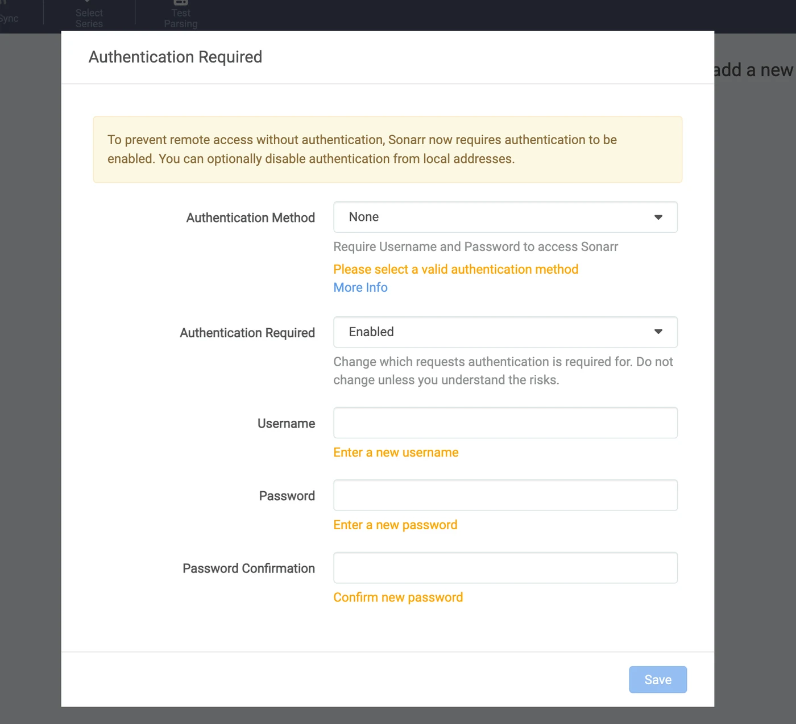
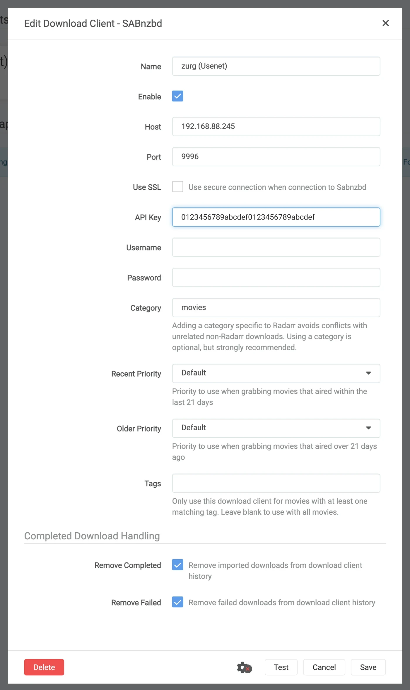
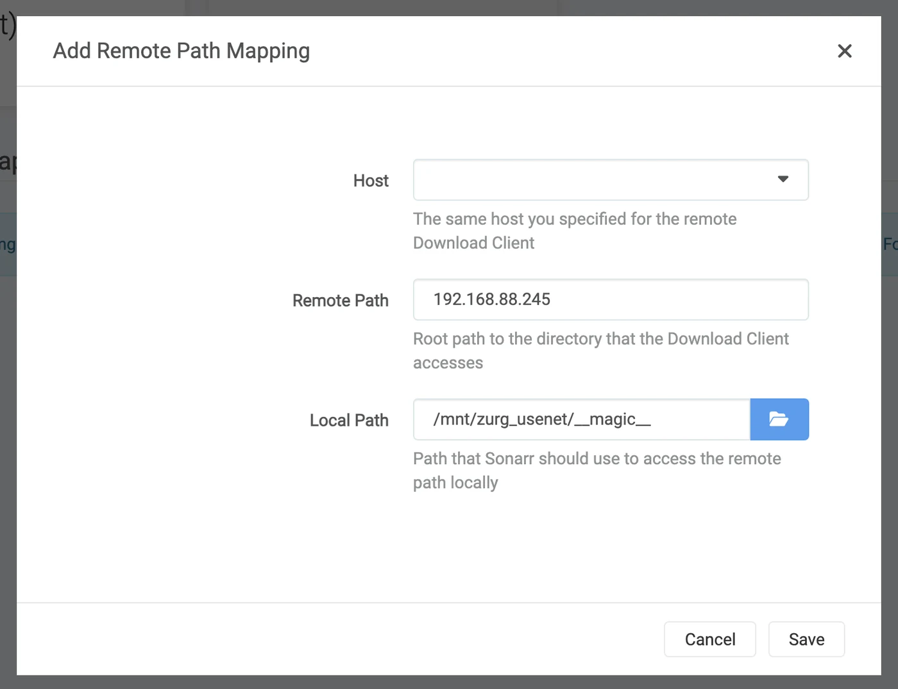
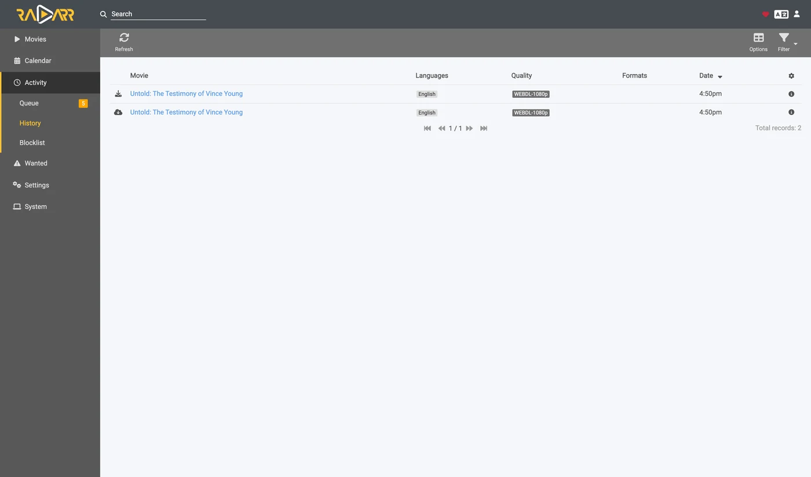
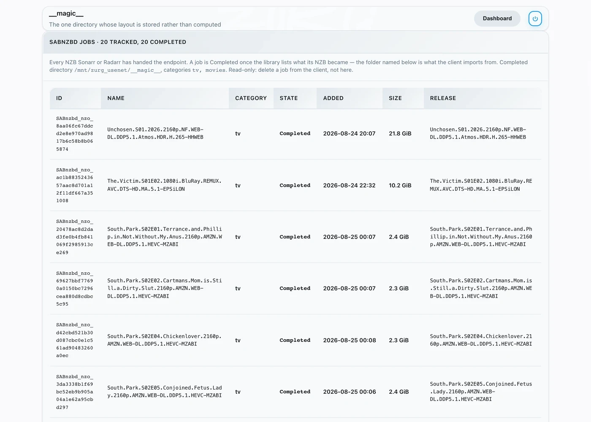

# Sonarr e Radarr, passo a passo {#sonarr-and-radarr-step-by-step}

Há três formas de usar o Sonarr e o Radarr com o zurg. Escolha quem pesquisa no zurg ou nos \*arrs. Veja [qual escolher](sonarr-radarr-fetch.md#which-one-to-pick).

| Guia | Quem pesquisa | O zurg funciona como | Você precisa de |
|---|---|---|---|
| [Usenet](sonarr-radarr.md) | Sonarr e Radarr | um SABnzbd | uma conta Usenet (ou TorBox Pro para o backend `torbox_nzb`) e indexadores Usenet no Prowlarr ou nos \*arrs |
| [Torrents](sonarr-radarr-torrents.md) | Sonarr e Radarr | um qBittorrent | uma conta debrid e indexadores de torrent no Prowlarr ou nos \*arrs |
| [Buscas pelo zurg](sonarr-radarr-fetch.md) | zurg | nenhum cliente de download | uma conta Usenet, TorBox Pro ou debrid, e indexadores Newznab ou Torznab na própria configuração do zurg |

As duas primeiras podem rodar lado a lado. Elas compartilham a mesma pasta `__magic__`.

Aponte o Sonarr e o Radarr para o zurg para pegar conteúdo do Usenet sem um cliente. Nenhum vídeo completo é baixado ou descompactado durante a captura. NZBs e caches ainda usam espaço em disco. Esta página cobre o Usenet. O endpoint de torrent usa os mesmos clientes e compartilha a pasta. Veja [Sonarr e Radarr para torrents](sonarr-radarr-torrents.md).

Tudo abaixo foi capturado com o zurg `nightly-993-g99bcf9a4`, o Sonarr `4.0.19.2979` e o Radarr `6.3.0.10514`, em uma instalação real com uma conta Usenet de verdade. Nomes de host e de usuário foram trocados por `you@zurg-server`. Os nomes dos indexadores são `my-indexer`. As chaves de API e as contagens da biblioteca são ilustrativas. Nada mais na saída capturada foi alterado. As linhas de log do `torbox_nzb` foram lidas do código-fonte do zurg em 2026-11-09, não capturadas ao vivo.

## Antes de começar {#before-you-start}

Três coisas precisam ser verdade. Verifique as três agora, porque cada uma delas falha depois com um sintoma que parece não ter nada a ver.

1. **O zurg tem um provider `nzb` ou um `torbox_nzb` (TorBox Pro).** Sem um deles, não há nada para ler o que o endpoint grava, e todo job é marcado como Failed depois de 30 minutos, quando o zurg desiste de esperar que ele apareça na biblioteca. Veja [Usenet](usenet.md), ou [Usenet hospedado na TorBox](../providers/torbox-nzb.md) para o `torbox_nzb`.
2. **`magic.enabled` está `true`.** Sem isso, o diretório de concluídos não existe e toda importação falha. Veja [`__magic__`](magic.md).
3. **O mount está visível para o \*arr no caminho que o zurg informa.** Se o Sonarr roda em um container, leia o [passo 8](#8-if-your-arr-is-in-docker) antes de configurar qualquer coisa. Instalado como um app comum na mesma máquina, ele enxerga o mount onde o zurg o monta, com uma ressalva em cada sistema:
   - **Linux:** um \*arr rodando com um usuário diferente do zurg vê uma pasta vazia até que `user_allow_other` esteja habilitado. Veja [Configuração no Linux](../setup/linux.md#1-install-fuse-3).
   - **macOS:** rode-o com o mesmo usuário do zurg. O mount fica em `/Volumes/Zurg`, a menos que você tenha alterado `mount_path`.
   - **Windows:** rode o Sonarr e o Radarr como app na bandeja, que o instalador oferece, e não como serviço do Windows. A unidade `Z:` do zurg pertence à sessão em que você está logado, e um serviço roda fora dela, então ele não enxerga a unidade. Veja [as regras de sessão](../setup/windows.md#keeping-it-running-the-session-rules).

Confira as duas primeiras direto no arquivo de configuração, no diretório de trabalho do zurg. No Windows, abra o `config.yml` no Bloco de Notas.

```bash
$ grep -A6 '^providers:' config.yml
providers:
- type: nzb
  nntp:
    host: news.example.com
    port: 563
    tls: true
    username: <redacted>
    password: <redacted>

$ grep -A4 '^magic:' config.yml
magic:
  enabled: true
  allow_delete: false
  sidecar_max_mb: 32
  sidecar_budget_mb: 2048
```

`allow_delete: false` é o padrão seguro e não afeta as importações. Uma exclusão dentro de `__magic__` apenas oculta a entrada, sem remover conteúdo da conta.

## 1. Ligue o endpoint {#1-turn-the-endpoint-on}

Duas formas, mesmo resultado. As duas gravam em `config.yml` e as duas exigem um reinício: as rotas que servem `__magic__` e o endpoint do SABnzbd são registradas uma única vez, quando o zurg inicia.

### Opção A — o painel {#option-a--the-dashboard}

Abra o painel do zurg, clique em **Config** e role até **\_\_magic\_\_ & Download Clients**. Ative **Serve \_\_magic\_\_** e **SABnzbd Endpoint**, depois defina **SABnzbd Categories** como `tv, movies`.


**Config** é onde a configuração fica; **Magic** é onde você vai acompanhar os grabs quando eles chegarem.


Deixe **SABnzbd Completed Directory** vazio, a menos que o seu \*arr monte o zurg em um lugar diferente de onde o zurg está montado. Veja o [passo 8](#8-if-your-arr-is-in-docker). O chip laranja **Restart Required** está dizendo a verdade: nada aqui faz efeito até o zurg reiniciar.

### Opção B — `config.yml` {#option-b--configyml}

Adicione o bloco manualmente e reinicie o zurg.

```yaml
magic:
  enabled: true

sabnzbd:
  enabled: true
  api_key: ""          # empty = zurg generates one and keeps it
  categories: [tv, movies]
  complete_dir: ""     # empty = <mount_path>/__magic__/__all__
```

**As categorias não são pastas.** Todas levam ao mesmo lugar: a pasta de um job é a própria pasta do release em `__magic__/__all__`. A lista existe só para que o Sonarr e o Radarr parem de avisar sobre uma categoria que não conseguem encontrar. Se a categoria do Sonarr for `tv`, então `tv` precisa estar nessa lista.

Reinicie o zurg e depois confirme que o provider foi aplicado:


Uma linha `nzb` ou `torbox_nzb` é suficiente para o endpoint.

## 2. Encontre a chave de API {#2-find-the-api-key}

A chave de API é toda a autenticação deste endpoint, então acerte ela uma vez e não a cole em nenhum lugar público.

**Se você deixou `api_key` vazio**, o zurg gerou uma na primeira inicialização e salvou em `data/sabnzbd-apikey`:

```bash
$ cat data/sabnzbd-apikey
0123456789abcdef0123456789abcdef

```

Chave ilustrativa, a sua será diferente. O arquivo continua existindo depois de reiniciar, então a chave é estável depois de gerada.

**Se você definiu `api_key` manualmente**, ela fica no `config.yml` e nenhum arquivo é criado. O dashboard mostra em qual dos dois casos você está, no final do bloco do passo 1. Ele exibe uma destas frases: *pinned in config.yml under `sabnzbd.api_key`* ou *generated and kept in `data/sabnzbd-apikey`*.

**Este endpoint fica fora da autenticação básica do zurg.** Nem o Sonarr nem o Radarr enviam autenticação básica para um cliente de download, e a camada HTTP deles transforma um 401 em "unable to connect", sem nenhuma informação útil. Por isso o zurg deixa `/api` de fora de propósito. A chave de API é o único portão. Trate essa porta como o resto do zurg: use em uma rede confiável ou atrás de algo que faça essa proteção.

## 3. Confirme que ela responde {#3-prove-it-answers}

Faça isso antes de mexer no Sonarr. Leva dez segundos e separa "o zurg está errado" de "o \*arr está errado" durante todo o resto da configuração.

+++ Linux e macOS

```bash
$ SAB=0123456789abcdef0123456789abcdef
$ ZURG=192.168.88.245:9996

$ curl -s "http://$ZURG/api?mode=version&apikey=$SAB&output=json"
{"version":"4.5.1"}

$ curl -s "http://$ZURG/api?mode=get_config&apikey=$SAB&output=json" \
    | jq '.config.misc.complete_dir, [.config.categories[].name]'
"/mnt/zurg_usenet/__magic__/__all__"
[ "*", "tv", "movies" ]
```

+++ Windows

No PowerShell. Digite `curl.exe`, não `curl`: o `curl` do Windows PowerShell é outro comando.

```powershell
PS> $SAB = "0123456789abcdef0123456789abcdef"
PS> $ZURG = "192.168.88.245:9996"

PS> curl.exe -s "http://$ZURG/api?mode=version&apikey=$SAB&output=json"
{"version":"4.5.1"}

PS> (Invoke-RestMethod "http://$ZURG/api?mode=get_config&apikey=$SAB&output=json").config.misc.complete_dir
Z:/__magic__/__all__
```

+++

`complete_dir` é o caminho que o zurg vai entregar aos clientes. Confira agora se é um caminho que *eles* conseguem abrir.

Depois, confira se uma chave errada é mesmo recusada (no Windows, use `curl.exe` com as mesmas URLs):

```bash
$ curl -s "http://$ZURG/api?mode=queue&apikey=wrongkey&output=json"
{"status":false,"error":"API Key Incorrect"}

$ curl -s "http://$ZURG/api?mode=queue&output=json"
{"status":false,"error":"API Key Required"}
```

**`mode=version` não é um teste de autenticação.** Ele responde `{"version":"4.5.1"}` mesmo com uma chave errada. É assim que o SABnzbd de verdade se comporta, e o zurg copia esse comportamento. Use `mode=queue` ou `mode=get_config` quando o que você quer testar é a chave.

As duas formas de URL funcionam, então qualquer uma serve no campo **URL Base** do cliente:

| Caminho | URL Base no Sonarr / Radarr | Responde |
|---|---|---|
| `/api` | *(deixe vazio)* | sim |
| `/sabnzbd/api` | `/sabnzbd` | sim |

Se `/api` retornar um **404** simples, `sabnzbd.enabled` ainda está como false ou o zurg não foi reiniciado depois que você mudou essa configuração.

## 4. Crie as pastas raiz {#4-make-the-root-folders}

+++ Linux e macOS

```bash
$ mkdir -p /mnt/zurg_usenet/__magic__/tv /mnt/zurg_usenet/__magic__/movies

$ ls -d /mnt/zurg_usenet/__magic__/tv /mnt/zurg_usenet/__magic__/movies
/mnt/zurg_usenet/__magic__/movies
/mnt/zurg_usenet/__magic__/tv
```

+++ Windows

```powershell
PS> New-Item -ItemType Directory -Force Z:\__magic__\tv, Z:\__magic__\movies
```

Ou crie as duas pastas no Explorer.

+++

Substitua `/mnt/zurg_usenet` pelo seu próprio `mount_path`. Se não definir, o padrão é `/mnt/zurg` no Linux, `/Volumes/Zurg` no macOS e `Z:` no Windows. Os nomes das pastas são você quem escolhe; `tv` e `movies` só combinam com as categorias.

**A pasta raiz fica ao lado do diretório de conclusão, nem nele nem acima dele.** O zurg entrega aos clientes `__magic__/__all__`, que é a sua biblioteca como `__all__` a lista. Suas pastas raiz ficam ao lado dela, em `__magic__/tv` e `__magic__/movies`. **Não** `__magic__/__all__`, **não** `__magic__` em si e **não** `/mnt/zurg_usenet`. Os dois clientes disparam um health check quando uma pasta raiz *é* a pasta de saída do cliente de download, e o Radarr também dispara quando uma pasta raiz *contém* ela. Pastas irmãs não causam nenhum dos dois, e uma importação manual apontada para o diretório de conclusão aí tem um único release para analisar, e não sua biblioteca inteira.

Isto é o que acontece quando você erra. Os dois exemplos são reais, dos dois clientes. Foram capturados antes de o diretório de conclusão ser movido para `__magic__/__all__`, então os caminhos neles estão um nível acima dos seus. As duas regras que mostram são as mesmas:


Sonarr com o próprio diretório de conclusão adicionado como pasta raiz — ele avisa porque a pasta raiz *é* a pasta de saída.


Radarr com `/mnt/zurg_usenet` adicionado — ele avisa também pelo pai, o que o Sonarr não faz. Mova a pasta raiz para ao lado do diretório de conclusão e os dois avisos somem.

## 5. Adicione o cliente no Sonarr {#5-add-the-client-in-sonarr}

Uma instalação nova do Sonarr bloqueia tudo atrás de uma tela de primeira execução. Escolha **Forms (Login Page)**, defina um nome de usuário e uma senha e clique em **Save**.



Ele não deixa você passar até que **Authentication Method** seja algo diferente de None.


Depois de salvar, você é desconectado uma vez e cai na página de login.


### Settings → Download Clients

Vá em **Settings → Download Clients**. Em uma instalação nova, só aparece o card **+**.


Clique no **+** em "Download Clients", e não no que fica mais embaixo, em "Remote Path Mappings".

Escolha **SABnzbd** na coluna **Usenet**.


O zurg imita especificamente o SABnzbd, então nada mais nessa lista vai funcionar.

A janela abre com os padrões do próprio SABnzbd: `localhost`, porta `8080`, sem chave.


### O que colocar em cada campo {#what-to-put-in-each-field}

| Field | Value | Why |
|---|---|---|
| Name | `zurg (Usenet)` | Qualquer nome. É só um rótulo. |
| Enable | on | Deixe marcado. |
| Host | `192.168.88.245` | O host onde o zurg roda, como o *the \*arr* consegue acessá-lo. `localhost` quando o \*arr é um app comum na mesma máquina. No Docker, veja o aviso abaixo. |
| Port | `9996` | A porta normal do zurg — `9999` em uma instalação padrão. |
| Use SSL | off | Só se você colocou o zurg atrás de TLS por conta própria. |
| API Key | do passo 2 | É a chave que libera o acesso. |
| Username | vazio | Não pode ser usado junto com a chave. Só a chave é aceita. |
| Password | vazio | Igual ao anterior. |
| Category | `tv` | Precisa aparecer em `sabnzbd.categories`. |
| Recent / Older Priority | Default | O zurg não tem nada onde aplicar uma prioridade. |
| Remove Completed | on | Deixa o cliente limpar os próprios registros de jobs. Deixe ativado. |
| Remove Failed | on | Igual ao anterior. |


A API key mostrada é apenas um exemplo — cole a sua.

**No Docker, tanto "localhost" quanto o hostname mentem.** Dentro de um container, `localhost` é o próprio container, e o hostname da máquina normalmente resolve para `127.0.1.1` — que também é o container. Use o **IP da LAN ou do Tailscale** do host, nunca `localhost` e nunca o hostname puro, mesmo que os dois funcionem bem no seu shell.

Clique em **Test**. Um tique verde significa que as quatro verificações do cliente passaram: versão, API key, configuração global e a categoria.


Agora clique em **Save**.


## 6. Adicione a pasta raiz no Sonarr {#6-add-the-root-folder-in-sonarr}

Vá em **Settings → Media Management** e role até o final da página.


Clique em **Add Root Folder**. Abre um navegador de arquivos com o sistema de arquivos do Sonarr, que no Docker é o do container.


Digite o caminho na caixa do topo. Se o mount estiver realmente visível para o Sonarr, o conteúdo de `__magic__` aparece enquanto você digita: `__all__` com todos os releases, e o que você tiver criado ao lado dele. Essa é a forma mais rápida de confirmar que o bind mount está correto.


Se isso aparecer vazio ou der erro, pare e corrija o mount antes de seguir em frente.


Termine o caminho em `__magic__/tv` (`Z:\__magic__\tv` no Windows) e clique em **Ok**.


Se **Free Space** mostrar um número plausível, o Sonarr consegue ler o mount. **Unmapped Folders** conta os releases que já estão ali.

## 7. Faça o mesmo no Radarr {#7-do-the-same-in-radarr}

Igual, com dois valores alterados: a categoria é `movies` e a pasta raiz é `__magic__/movies`.


A primeira execução do Radarr funciona do mesmo jeito: configure o Forms auth e depois faça login.


**Settings → Download Clients → +**, e depois **SABnzbd** em Usenet.



Mesmo host, mesma porta, mesma chave. Só o **Category** muda: `movies`, e não `tv`.


Clique em **Test**, espere o tique verde e depois em **Save**.


Depois vá em **Settings → Media Management → Root Folders → Add Root Folder** e adicione `/mnt/zurg_usenet/__magic__/movies`.

**Um zurg, dois clientes, uma fila.** A fila e o histórico do zurg são filtrados só pela categoria, e mais nada. Dois Sonarrs usando `tv` vão ver os jobs um do outro; o Sonarr em `tv` e o Radarr em `movies` não vão. Mantenha um cliente por categoria e esse problema nunca aparece.

## 8. Se o seu \*arr estiver no Docker {#8-if-your-arr-is-in-docker}

Esta etapa é para Docker em um host Linux. O Docker Desktop no macOS e no Windows roda os contêineres dentro de uma máquina virtual. O bind `rslave` abaixo depende da propagação de montagem do Linux (veja [Configuração do Docker](../setup/docker.md)), e passar o mount do zurg para um contêiner nesses sistemas não foi testado. No macOS e no Windows, instale o Sonarr e o Radarr como aplicativos comuns, como descrito em [Antes de começar](#before-you-start).

Três problemas separados. O segundo custa um download a cada importação. O terceiro só aparece na primeira vez que o zurg reiniciar.

### O caminho que o zurg informa precisa ser um caminho que o cliente consegue abrir {#the-path-zurg-reports-must-be-a-path-the-client-can-open}

Se o container monta a biblioteca em um lugar diferente do que o zurg usa, toda importação falha com *download doesn't contain intermediate path* ou com uma verificação de health check de remote path. Você pode corrigir de qualquer um dos dois jeitos, ambos funcionam:

- **Defina `sabnzbd.complete_dir`** com o caminho que *o cliente* enxerga. É mais simples quando há um só cliente, ou vários que concordam em montar a biblioteca no mesmo lugar.
- **Adicione um remote path mapping** no \*arr. Use isso quando clientes diferentes montam a biblioteca de formas diferentes.

```yaml
sabnzbd:
  complete_dir: "/data/zurg/__magic__/__all__"   # what the *arr sees, not what zurg sees
```

Para o segundo, vá em **Settings → Download Clients** e use o **+** em **Remote Path Mappings**, o de baixo da página, e não o que você usou no passo 5.



O **Host** precisa ser exatamente a string de host que você digitou no download client. O **Remote Path** é o que o zurg informa; o **Local Path** é onde o cliente enxerga esse caminho.

### Um único volume para a pasta de downloads e as pastas raiz {#one-volume-for-the-download-folder-and-the-root-folders}

Um import de `__magic__/__all__` para `__magic__/tv` é de graça porque é um rename. Um rename só funciona dentro de um mesmo mount. Se você der ao container as duas pastas como dois volumes, ele enxerga dois sistemas de arquivos. Os dois são o mount do zurg por baixo, e mesmo assim não importa.

```yaml
    volumes:                                        # do not do this
      - /mnt/zurg_usenet/__magic__/__all__:/downloads
      - /mnt/zurg_usenet/__magic__/tv:/tv
```

O kernel recusa o rename dentro do container. Aí o Sonarr e o Radarr copiam o arquivo e apagam o original sem avisar. Cada import baixa o release inteiro da sua conta e grava no disco do zurg. O import ainda dá certo, só que fica lento. Um episódio de 1,46 GB levou 50 segundos e gerou 2,9 GB de tráfego desse jeito. Com um volume só, levou um segundo e não leu nada.

Dê ao container um volume só, que tenha o mount inteiro do zurg. Acesse a pasta de download e as pastas raiz por ele. O bind da próxima seção faz exatamente isso. Um remote path mapping ou o `complete_dir` então aponta o cliente para o `__all__` dentro desse mesmo volume.

Um import manual com **Hardlink/Copy Files** também copia. Escolha **Move Files**.

### Monte o pai do ponto de montagem, não o próprio ponto de montagem {#bind-the-mounts-parent-not-the-mountpoint}

Reiniciar o zurg desmonta `/mnt/zurg_usenet` e monta de novo. Um container que montou **o próprio ponto de montagem** continua com a conexão fuse com que foi iniciado, e essa conexão agora está morta. Toda leitura então responde `Socket not connected`. Como os dois clientes verificam o espaço livre na pasta raiz antes de pegar um release, **todo release é rejeitado em silêncio**:

```
FreeSpaceSpecification: Socket not connected
```

Nada nos dois clientes diz que a montagem está obsoleta, a pasta ainda aparece dentro do container, e um grab interativo enviado direto ao cliente ainda funciona. O que você vê é um \*arr que simplesmente parou de buscar.

Monte o **diretório pai** com `rslave`, e a remontagem chega como um evento de sub-montagem que o container acompanha:

```yaml
    volumes:
      - type: bind
        source: /mnt          # the parent, not /mnt/zurg_usenet
        target: /mnt
        bind:
          propagation: rslave
```

Confira um container depois de qualquer reinício do zurg. Você quer ver um tamanho, não um erro:

```bash
$ docker exec radarr df -h /mnt/zurg_usenet
Filesystem      Size  Used Avail Use% Mounted on
zurg{PGSq4}:    1.0P     0  1.0P   0% /mnt/zurg_usenet
```

O petabyte é o zurg reportando um sistema de arquivos virtual, não um disco. Isso é esperado, e é justamente o que satisfaz a verificação de espaço livre do \*arr.

## 9. Acompanhe um grab passando pelo sistema {#9-watch-one-grab-go-through}

Não recebi nenhum texto para traduzir. Envie o trecho em inglês que você quer que eu traduza.

### Grab it

Abra um filme (ou um episódio), clique em **Interactive Search** e escolha um lançamento.


A coluna **Source** mostra `nzb`, que é o protocolo que o zurg consegue usar.

Clique no botão com a seta circular no fim da linha para pegar o lançamento. Se ele não corresponder direitinho, o cliente pede para você confirmar o mapeamento antes:


**Override and Grab** aparece quando o cliente quer que você confirme o que é o lançamento. Confira o mapeamento e clique em **Grab Release**. Um grab automático normal nunca mostra essa janela.

### Ele aparece na fila {#it-lands-in-the-queue}


**Activity → Queue** logo após o envio. Repare na barra de progresso: ela está cheia, e **Time Left** aparece como um traço. Não há download para medir, então um item está na fila ou já concluído, sem nada no meio. *As outras linhas aqui pertencem a um segundo Radarr apontado para o mesmo zurg e na mesma categoria* — veja a nota no passo 7.

### O zurg grava o NZB e o lê {#zurg-writes-the-nzb-and-reads-it}

```
Aug 25 14:44:03 zurg-server zurg[3034965]: INFO  nzb  Loaded NZB
  Last.Week.Tonight.with.John.Oliver.S13E22.480p.WEB.x264-RMTeam.nzb: 4 files
Aug 25 14:50:28 zurg-server zurg[3034965]: INFO  nzb  Loaded NZB
  Untold.The.Testimony.of.Vince.Young.2026.1080p.NF.WEB-DL.DD+5.1.Atmos.H.264-playWEB.nzb: 9 files
```

`Loaded NZB … : N files` é a linha que diz que o NZB foi analisado com sucesso. Se uma tarefa aparecer como Failed depois de 30 minutos, quando o zurg desiste de esperar que ela apareça na biblioteca, é justamente essa linha que está faltando.

### A importação acontece {#the-import-happens}



**Activity → History**. Dois eventos, com segundos de diferença: **Grabbed**, depois **Movie Imported**.


**Status: Downloaded**, **Size 4.7 GiB** — e nada foi baixado.

### Confirme que o arquivo é real {#prove-the-file-is-real}

A importação moveu o arquivo para a pasta raiz. Leia as duas pontas dele e pergunte ao ffprobe o que ele é:

+++ Linux e macOS

Se o seu shell não encontrar `ffprobe`, use `~/zurg/bin/ffprobe`: o setup coloca uma cópia dele ali quando nenhuma foi instalada.

```bash
$ ls -la "/mnt/zurg_usenet/__magic__/movies/Untold - The Testimony of Vince Young (2026)/"
-rw-r--r-- 1 you you 4920958828 Aug 25 14:53 Untold.The.Testimony…playWEB.mkv

$ dd if="$F" bs=1M count=1 >/dev/null
1048576 bytes (1.0 MB, 1.0 MiB) copied, 0.0429446 s, 24.4 MB/s

$ ffprobe -v error -show_entries format=duration,size,format_name \
    -of default=noprint_wrappers=1 "$F"
format_name=matroska,webm
duration=4709.440000
size=4920958828
```

+++ Windows

No PowerShell, a partir da pasta do zurg. O setup colocou `bin\ffprobe.exe` ali, a menos que um `ffprobe` já estivesse no seu PATH; nesse caso, digite `ffprobe` no lugar:

```powershell
PS> $F = Get-Item "Z:\__magic__\movies\Untold - The Testimony of Vince Young (2026)\*.mkv"
PS> $F.Length
4920958828

PS> bin\ffprobe.exe -v error -show_entries format=duration,size,format_name -of default=noprint_wrappers=1 $F.FullName
format_name=matroska,webm
duration=4709.440000
size=4920958828
```

+++

Um Matroska de 78 minutos, transmitido a partir de artigos Usenet sob demanda. Os bytes chegam quando algo os lê, não quando o \*arr importa.

## 10. Adicionando um lançamento manualmente {#10-adding-a-release-by-hand}

Às vezes o Sonarr ou o Radarr nunca pega o lançamento que você quer. Os indexadores que ele pesquisa podem não ter, ou um perfil de qualidade ou formato personalizado pode rejeitá-lo. Você pode entregar o NZB para o zurg por conta própria, na categoria do app que deve importar. Esse app então importa como se ele mesmo tivesse baixado.

Se o lançamento estiver em um indexador que o app pesquisa, tente o app primeiro. **Interactive Search** também lista os lançamentos rejeitados. Baixar um deles envia para o zurg como qualquer outro download. O Radarr baixou uma versão IMAX que o perfil dele tinha recusado, com pontuação 0 em um formato personalizado obrigatório, e importou.

+++ Linux e macOS

```bash
$ SAB=0123456789abcdef0123456789abcdef
$ ZURG=192.168.88.245:9996

# an NZB file you already have (the upload field is called name, as in SABnzbd)
$ curl -s "http://$ZURG/api?mode=addfile&apikey=$SAB&cat=movies" \
    -F 'name=@Movie.Title.2024.1080p.WEB-DL.nzb'
{"status":true,"nzo_ids":["SABnzbd_nzo_…"]}

# or a link to one, which zurg downloads itself
$ curl -s -G "http://$ZURG/api" \
    --data-urlencode mode=addurl --data-urlencode "apikey=$SAB" --data-urlencode cat=movies \
    --data-urlencode 'name=https://indexer.example/getnzb/<id>?r=<indexer-key>' \
    --data-urlencode nzbname=Movie.Title.2024.1080p.WEB-DL
{"status":true,"nzo_ids":["SABnzbd_nzo_…"]}
```

+++ Windows

No PowerShell, com `curl.exe` em vez de `curl`. Cada um responde `{"status":true,"nzo_ids":[…]}` como acima.

```powershell
$SAB = "0123456789abcdef0123456789abcdef"
$ZURG = "192.168.88.245:9996"

# an NZB file you already have (the upload field is called name, as in SABnzbd)
curl.exe -s "http://$ZURG/api?mode=addfile&apikey=$SAB&cat=movies" -F "name=@Movie.Title.2024.1080p.WEB-DL.nzb"

# or a link to one, which zurg downloads itself
curl.exe -s -G "http://$ZURG/api" `
  --data-urlencode mode=addurl --data-urlencode "apikey=$SAB" --data-urlencode cat=movies `
  --data-urlencode "name=https://indexer.example/getnzb/<id>?r=<indexer-key>" `
  --data-urlencode nzbname=Movie.Title.2024.1080p.WEB-DL
```

+++

`--data-urlencode` mantém o `?` e o `&` do próprio link dentro de `name`. O job aparece na fila do app na próxima verificação, em até um minuto.

Cinco coisas decidem o que acontece depois.

1. **O filme ou a série precisa já estar no app.** Ele só importa o que consegue associar a algo que ele gerencia.
2. **O nome precisa dizer do que se trata.** O job usa o nome do arquivo do NZB, ou `nzbname` se você passar. Sem `nzbname`, o `addurl` usa o nome de arquivo que o indexador entrega. Coloque o ano no nome.
3. **A categoria escolhe o app.** `cat=movies` chega ao Radarr cujo cliente de download usa `movies`. Cada app só olha para a própria categoria.
4. **O perfil de qualidade não bloqueia. O arquivo que você já tem pode bloquear.** O Radarr não verifica nem as qualidades permitidas nem a pontuação mínima de formato personalizado na importação. Ele importou um BluRay 720p com pontuação 0 para um perfil que só permite 2160p e exige pontuação 100. Também importou um WEBRip 1080p para um filme cujo perfil só permite 720p. Depois, pegou um BluRay 1080p por cima como upgrade e apagou o WEBRip. Um WEB-DL adicionado depois parou na Activity com o status *Not an upgrade for existing movie file*. **Activity → Queue → Manual Import** traz o arquivo mesmo assim e substitui o atual.
5. **Falha é coisa sua para resolver.** O app nunca coloca na blocklist nem remove um download que não foi ele quem baixou. Um lançamento cujos artigos já tinham saído dos servidores de notícias voltou como Failed do zurg e ficou na fila do Radarr com a mensagem *Download has failed wasn't grabbed by Radarr, skipping automatic download handling*. Remova da fila e escolha outro lançamento.

Medido em 2026-10-10 com o Radarr 6.3, usando `addfile` e `addurl`, inclusive com um perfil que exige um formato personalizado criado a partir de um nome de lançamento. Toda importação foi um rename para `__magic__/movies` e nada foi copiado. O Sonarr não foi testado.

Obrigado ao **.telmen** no Discord por perguntar como fazer isso com Usenet.

## Assistindo pelo lado do zurg {#watching-from-zurgs-side}

A página `/magic/` do zurg lista todos os NZB que o endpoint já recebeu. O Sonarr e o Radarr removem os jobs que pegaram, e o registro fica guardado por uma semana depois disso, para que uma consulta que coincida com uma exclusão responda sempre da mesma forma duas vezes.

Um job **Failed** ou **Stuck** (na fila há mais de uma hora) que nenhum cliente vai remover nunca, por exemplo depois que você para de usar o zurg como cliente de download, pode ser limpo aqui segurando o botão **Clear**. Ao limpar um job, o NZB dele é apagado, a menos que uma importação ainda o esteja usando.


**Placements** são os arquivos que os clientes moveram; **tombstones** são as pastas de job que eles apagaram depois.

Se um cliente copia em vez de mover, a página mostra uma tabela vermelha **Imports that were copies**. O zurg transforma essas cópias de volta em placements e as apaga, mas cada uma ainda foi um download completo, então corrija os volumes.



**State** é o que conta a história toda. **Queued** significa que o zurg ainda não terminou com o release, seja porque a biblioteca ainda não o listou, seja porque os tamanhos dos arquivos ainda não estabilizaram, seja porque os artigos ainda não foram verificados. **Completed** significa que está pronto para importar. **Release** mostra o nome da pasta de onde o cliente importa.

A coluna **Release** é lida da biblioteca a cada consulta, não fica armazenada. Renomeie o release no painel do zurg, deixe um repair reconstruí-lo, ou deixe o zurg adicionar um sufixo porque dois releases têm o mesmo nome: o job acompanha a mudança.

## O que funciona e o que não funciona {#what-works-and-what-does-not}

Funciona:

- O teste de conexão, todas as quatro verificações, nos dois clientes.
- Captura, fila, histórico, importação por renomeação e a limpeza pós-importação.
- Nova captura do mesmo release. Cada captura posterior recebe um job id próprio, para que o cliente aja sobre ele e não reutilize o resultado do job antigo. O release por baixo continua sendo o mesmo. Uma nova captura de um release que uma importação anterior já esvaziou é informada como **Failed**. A pasta dele em `__magic__/__all__` não tem mais nada para importar, e Failed faz o cliente colocar esse release na lista de bloqueio e pegar outro. A captura que fez o esvaziamento continua informando Completed até o cliente excluí-la.
- Remover um job da fila, com ou sem exclusão do NZB.
- `mode=addurl`, para uma pessoa ou uma automação que passa uma URL em vez de enviar o arquivo. Nenhum dos \*arr usa.

Não faz:

- **Sem progresso.** Um job está na fila ou concluído; não há porcentagem entre os dois, porque não há download para medir. A fila mostra o tamanho declarado do NZB para que a linha não fique em branco.
- **Sem pausar, retomar, limite de velocidade, prioridade ou script de pós-processamento.** O SABnzbd tem todos esses recursos; o zurg não tem nada para aplicá-los.
- **`del_files` em uma exclusão do histórico de um job concluído é ignorado.** (Para um job Failed, ele apaga o NZB quando nada foi importado dele.) O cliente quer dizer "a pasta do job é sua de novo", mas o arquivo que acabou de ser importado continua sendo servido a partir desse NZB. A pasta que ele queria remover já foi removida — ele mesmo a apagou, pelo mount.
- **Autenticação básica não consegue proteger este endpoint.** A chave de API é a única barreira.

**O sinal de falha.** Um release sem nada importável é informado como **Failed**, e os dois clientes o colocam na lista de bloqueio e capturam uma alternativa. Isso inclui um release cujos arquivos estão todos quebrados, apagados ou filtrados; um que contém só `.par2`, `.sfv` e arquivos auxiliares; um em que todo arquivo tem um formato que nada reproduz, que é o caso de um post ofuscado que nomeia o conjunto RAR como `.z001`…`.z133`; e um arquivo já aberto e que não tem mídia. Um conjunto RAR é conteúdo, não estrutura: o zurg transmite o vídeo diretamente dele. Se um release realmente traz algo para o qual o zurg não tem extensão, amplie `addl_playable_extensions` em vez de colocá-lo na lista de bloqueio.

**Os artigos são verificados antes de um job ser informado como concluído.** O zurg espera até a biblioteca listar o release e os tamanhos dos arquivos se estabilizarem. Depois pergunta aos servidores de notícias sobre o início e o fim de cada arquivo de conteúdo. São os primeiros dezesseis artigos e o último. Ele também baixa o primeiro artigo de cada arquivo. Isso dá até sessenta e quatro deles, mais alguns a mais em um release com poucos arquivos. Alguns servidores de notícias ainda dizem que um artigo existe depois que o conteúdo foi removido, e só um download mostra isso. Um artigo baixado também mostra se ele pertence a este post e não a outro upload. O job continua **Queued** até isso ser respondido. Danos que a amostra não alcança não são detectados aqui; eles aparecem na leitura que os alcança. Um release cujos artigos sumiram passa primeiro por um reparo PAR2 e é verificado de novo depois que o reparo roda. Um que volta a ficar completo segue em frente. Um que ainda tenha artigos faltando, ou que nada consiga reparar, é informado como **Failed** com a contagem do que falta. Isso é uma falha de *download*, que é a que os clientes tratam: eles colocam o release na lista de bloqueio e capturam uma alternativa sem intervenção, em vez de importar algo que não vai reproduzir. Com `torbox_nzb` não há servidores de notícias nem verificação de artigos: uma captura é verificada pelo fato de a TorBox ter baixado.

**Uma verificação que não consegue terminar não espera para sempre.** Às vezes a verificação simplesmente não consegue completar. O pool de conexões pode estar fora do ar, a conta pode estar limitada, ou a verificação pode estourar o tempo. Isso não é uma resposta. O job continua **Queued** e é consultado de novo um minuto depois. O zurg conta as tentativas no job para que um reinício não as esqueça. Depois de trinta tentativas falhas seguidas que abranjam pelo menos três horas, o job vai para o histórico como **Failed**. A mensagem traz a contagem, o período e o último erro. Uma queda com recusas diretas chega a trinta em menos de uma hora e não trava a fila por causa disso.

**Um release que sai da biblioteca faz o job falhar.** Um release pode ser apagado pelo painel, ter seu NZB removido da pasta de monitoramento ou ser descartado por todas as contas. O job continua **Queued** por quinze minutos e depois vai para o histórico como **Failed**. O cliente coloca o release na lista de bloqueio e captura outro. A espera existe por causa dos reinícios. A biblioteca desmarca todos os releases enquanto carrega, e isso não pode ser lido como exclusão. Nada falha por esse motivo nos primeiros quinze minutos depois que o zurg inicia. Um job cujo release a biblioteca nunca listou não é afetado, porque ele ainda está chegando.

## Solução de problemas {#troubleshooting}

| O que o \*arr diz | O que significa |
|---|---|
| "Unable to connect to SABnzbd" | O zurg não está acessível nesse host e porta, ou algo na frente dele respondeu com um código diferente de 200. Verifique `sabnzbd.enabled`: enquanto estiver desligado, `/api` retorna um 404 simples. No Docker, confira se você não usou `localhost` nem só o nome do host. |
| "API Key Incorrect" / "API Key Required" | A chave não confere. Ela está em `config.yml`, se você definiu uma, ou em `data/sabnzbd-apikey`, se o zurg a gerou. |
| "Test was aborted due to an error" | É algo diferente de falha de autenticação. O zurg registra cada requisição que recusou. Procure no log por `SABnzbd:`. |
| "Category … does not exist" | A categoria no \*arr não está em `sabnzbd.categories`. Adicione-a e reinicie o zurg. |
| "Downloads in root folder" | Uma pasta raiz está no mesmo nível do diretório de concluídos ou acima dele. Mova-a para o lado dele: `__magic__/tv`, não `__magic__/__all__`, não `__magic__` e não `/mnt/zurg_usenet`. |
| "Remote path mapping" / "download doesn't contain intermediate path" | O caminho que o zurg informa não é um caminho que o cliente consegue abrir. Veja o [passo 8](#8-if-your-arr-is-in-docker). |
| As importações dão certo, mas demoram tanto quanto um download, e a página `/magic/` do zurg as lista em **Imports that were copies** | O cliente está copiando de `__magic__/__all__` em vez de renomear. O contêiner dele tem a pasta de download e as pastas raiz em dois volumes. Ou então uma importação manual foi configurada para copiar. Veja [um volume para a pasta de download e as pastas raiz](#one-volume-for-the-download-folder-and-the-root-folders). |
| O navegador de pastas raiz mostra o mount do zurg vazio, ou nenhuma unidade `Z:` | O \*arr não consegue ver o mount. No Linux, ele roda com outro usuário sem `user_allow_other`; no Windows, roda como serviço. Veja [Antes de começar](#before-you-start). |
| Todas as releases rejeitadas, e nada no log | Um bind mount desatualizado. Rode `docker exec <client> df -h <mount>`; se aparecer `Socket not connected`, faça o bind do pai com `rslave` e recrie o contêiner. |
| Um job fica na fila por uma ou duas consultas depois que a release aparece | Esperado, e se resolve uma vez por release. Um NZB não informa quanto dura cada arquivo; a estimativa está sendo substituída pelo tamanho exato do índice PAR2 ou pelo cabeçalho de um artigo. Marcar como Completed cedo demais é o que faz o cliente lançar *File move incomplete, data loss may have occurred*. Um job `torbox_nzb` não lê artigos nem consulta servidores de notícias; ele fica na fila até o TorBox terminar de buscar a release, por no máximo 30 minutos (veja a próxima linha). |
| "zurg accepted the NZB but it never appeared in the library" | A release não apareceu na biblioteca 30 minutos depois do grab ou depois que o zurg iniciou, o que for mais tarde. Então o zurg desistiu de esperar e marcou o job como **Failed**. Verifique se um provedor `nzb` ou `torbox_nzb` está configurado e depois procure o NZB no log. Uma conta `nzb` escreve `Loaded NZB <name>: N files` quando faz o parse. Uma release `torbox_nzb` só aparece quando o TorBox termina de processá-la, então o job falha desse jeito sempre que o TorBox levar mais de 30 minutos: um download lento, uma espera por vaga livre ou um acúmulo atrás do único post por minuto do zurg. Uma conta `torbox_nzb` escreve `TorBox Usenet: posting <name>` e depois a resposta do TorBox. `TorBox answered <name> with download <id>` significa que o TorBox está buscando a release ou já a tem. `TorBox queued <name> as <id> for want of a free slot` significa que a conta não tem vaga livre; o post espera até uma vaga liberar. |
| "The Usenet account could not fetch the NZB" aparece e o job falha de imediato | A conta para a qual o NZB foi postado desistiu dele, então o zurg não espera os 30 minutos. Com `torbox_nzb`, `TorBox refused <name>, …` no log termina com o motivo dado pelo TorBox, e esse NZB não é postado de novo até o zurg reiniciar ou o arquivo mudar. |
| "The release holds no files that can be imported" | A biblioteca tem a release, mas não há nada nela que um cliente consiga importar. Um NZB só com volumes de recuperação é exatamente isso, e também um post ofuscado cujo conjunto RAR se chama `.z001`…`.z133`. Amplie `addl_playable_extensions` se a release realmente trouxer conteúdo com uma extensão que o zurg não conhece. |
| Releases concluídas ficam na fila durante uma rajada grande | Mais de sessenta jobs prontos ao mesmo tempo. Sonarr e Radarr só pedem as sessenta entradas mais recentes do histórico, então o zurg segura o excedente na fila e avança um item para o histórico toda vez que uma importação libera uma vaga. Esperado, e se resolve sozinho. |
| "The release could not be checked against the news servers" | A verificação de artigos falhou em terminar trinta vezes seguidas, durante pelo menos três horas. Nada foi encontrado faltando; não foi possível consultar a conta de notícias. A mensagem traz o último erro. Verifique a conta primeiro e faça o grab da release de novo quando ela responder. Uma conta `torbox_nzb` não tem servidores de notícias nem verificação de artigos, então o grab é checado pelo fato de o TorBox ter buscado a release. |
| "The release was in the library and has since been removed from it" | A biblioteca listou a release uma vez e não a lista há quinze minutos. Algo a apagou, e o log diz `Release <name> is gone from every account`. O cliente coloca a release na blocklist e faz o grab de outra, em vez de esperar por uma pasta que não vai voltar. |

Ainda travado? Pergunte no fórum **zurg-support** no [Discord](https://discord.com/invite/7u4YjMThXP). [Pedindo ajuda](../../guides/remote-help.md) explica o que incluir.

### Onde o estado fica guardado {#where-the-state-lives}

| Caminho | O que é |
|---|---|
| `nzbs/<name>.nzb` | O próprio NZB, nomeado uma vez e nunca renomeado — o backend Usenet tira a identidade do release desse nome de arquivo, então renomear deixa o release órfão e todas as colocações feitas a partir dele. |
| `data/sabnzbd-jobs.json` | Quais NZBs foram baixados, em qual categoria e quando. |
| `data/sabnzbd-apikey` | Uma chave de API gerada. Não é gravada quando `sabnzbd.api_key` está definida. |
| `data/magic.json` | A tabela `__magic__` — todas as colocações e lápides que as importações criaram. |
