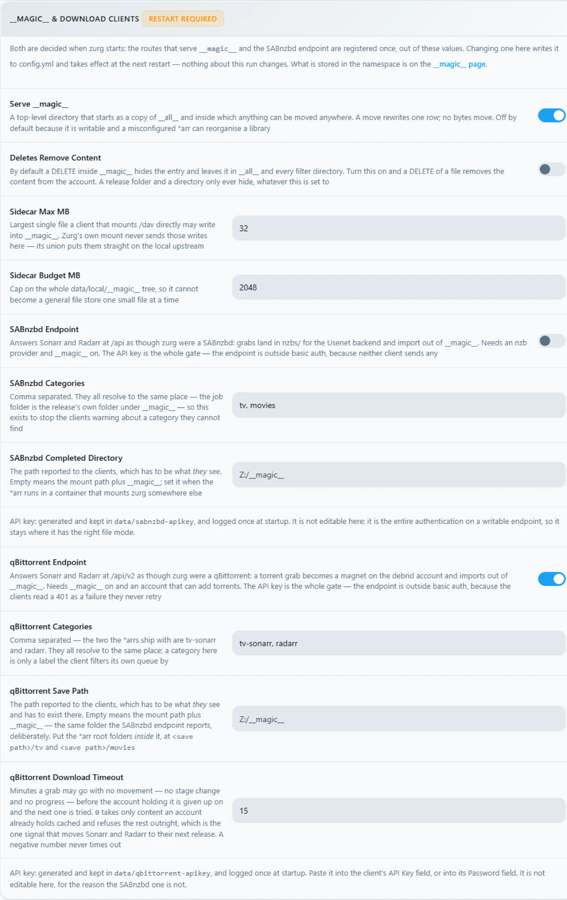
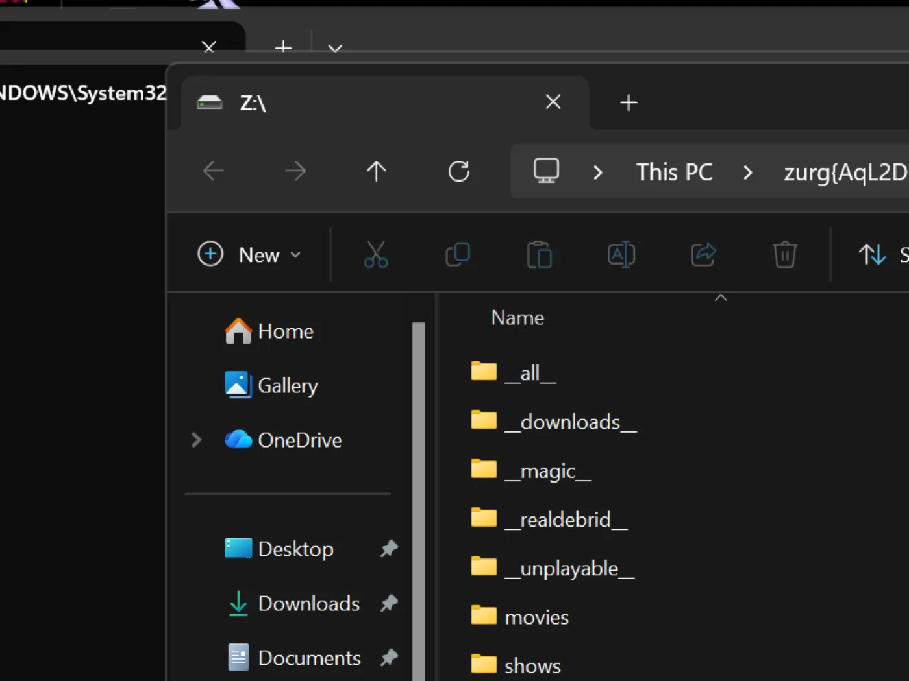

# Windows, o binário, do zero {#windows-the-binary-from-scratch}

## Opção de uma linha {#one-line-option}

Rode o bootstrap opcional de sponsor pelo PowerShell. Ele instala o WinFsp via UAC, baixa o zurg e roda o seletor de provedor e o diagnóstico:

```powershell
irm https://raw.githubusercontent.com/debridmediamanager/zurg-site/main/public/install.ps1 | iex
```

Ele usa o login no GitHub pelo navegador e instala em `$HOME\zurg`. Binários e configs que já existem continuam no lugar. Continue
abaixo para a rota manual.

Sem Docker, sem WSL: o `.exe` do zurg numa pasta, um `config.yml` que você escreve uma vez e um drive `Z:` no Explorador de Arquivos.
Esta página mostra tudo em duas etapas: primeiro o **RealDebrid com o endpoint do qBittorrent** e depois um reset completo e o **Usenet com o endpoint do SABnzbd**. Escolhi essas duas porque são as instalações que o pessoal realmente faz, e elas usam partes diferentes do zurg.

Tudo abaixo foi capturado numa instalação real: Windows 11 Pro 23H2 (build 22631), PowerShell 5.1, WinFsp 2.0.23075, zurg `2026.08.30.0459-nightly-73-g5b4c9790`, e uma conta Real-Debrid mais uma conta de news Usenet. Os nomes de usuário foram trocados. As API keys e as contagens da biblioteca são ilustrativas. As credenciais também são.

## O que você precisa {#what-you-need}

- **zurg.exe** — dos [releases de sponsor](https://github.com/debridmediamanager/zurg/releases). Seja sponsor no [gatekeeper](https://gatekeeper.debridmediamanager.com/) para dar acesso à sua conta do GitHub. Esta página assume que você já baixou o arquivo.
- **WinFsp** — o zurg monta a biblioteca pelo rclone, e o rclone precisa do WinFsp para usar uma letra de unidade no Windows. Instale em modo silencioso, ou pelo [instalador](https://github.com/winfsp/winfsp/releases):

  ```powershell
  $url = "https://github.com/winfsp/winfsp/releases/download/v2.1/winfsp-2.1.25156.msi"
  Invoke-WebRequest -Uri $url -OutFile "$env:TEMP\winfsp.msi" -UseBasicParsing
  Start-Process msiexec.exe -ArgumentList "/i", "$env:TEMP\winfsp.msi", "/qn", "/norestart" -Wait
  ```

- **Uma conta** — um token de API do Real-Debrid para a primeira etapa, e um servidor de notícias para a segunda.

Nada além disso. O instalador integrado baixa o rclone, e o ffprobe também, a menos que um deles já esteja no seu PATH.

## Recomendado: deixe o zurg concluir a configuração {#recommended-let-zurg-finish-the-setup}

Crie uma pasta, coloque o `zurg.exe` nela e execute o instalador pelo PowerShell:

```powershell
New-Item -ItemType Directory -Force "$HOME\zurg" | Out-Null
Set-Location "$HOME\zurg"
# Copy the downloaded zurg.exe here, then:
.\zurg.exe setup
.\zurg.exe doctor
```

O `setup` pergunta quais provedores você quer configurar. Escolha um ou vários entre Real-Debrid, TorBox, AllDebrid, Usenet, Premiumize, Debrid-Link e Offcloud, na ordem de prioridade. Ele pede apenas as credenciais dos provedores selecionados. Depois disso, ele:

1. Cria e valida o `config.yml`.
2. Restringe a ACL dele ao seu usuário, ao SYSTEM e aos Administradores.
3. Baixa o `bin\rclone.exe` e também o `bin\ffprobe.exe`, a menos que já exista um ffprobe no seu PATH (nesse caso, o `config.yml` fica com `ffprobe_binary: ffprobe`).
4. Ativa o mount do rclone em `Z:`.
5. Registra `\Zurg\zurg` como uma tarefa de logon interativo e a inicia quando um usuário da área de trabalho estiver conectado.

Se precisar, escolha outra letra de unidade livre:

```powershell
.\zurg.exe setup --mount-path "Y:"
```

Você pode rodar o setup de novo sem problemas. Ele atualiza a tarefa gerada, mas não substitui um `config.yml` já existente.

A tarefa interativa é de propósito. Os mounts de unidade do WinFsp pertencem à sessão de logon do Windows que os cria. Um serviço comum do Windows roda na sessão 0, e a unidade dele fica invisível para o Plex e para o Explorer na área de trabalho. Este comportamento do instalador foi verificado no Windows 11 em 4 de setembro de 2026.

O passo a passo abaixo mostra os arquivos e a configuração por trás do instalador e depois monta as configurações de cliente de download para Real-Debrid e Usenet. O primeiro run manual e a receita de tarefa agendada são úteis quando você quer montar essas peças por conta própria.

## 1. Primeira execução manual: o zurg cria a sua própria pasta {#1-manual-first-run-zurg-builds-its-own-home}

Crie uma pasta, coloque o binário nela e execute uma vez, sem arquivo de configuração:

```powershell
PS C:\Users\you> mkdir C:\Users\you\zurg
PS C:\Users\you\zurg> .\zurg.exe
```

O zurg cria uma configuração padrão neutra em relação a provedores, diz o que fazer em seguida e encerra:

```
INFO  setup  Config file not found, creating default from config.simple.yml
INFO  zurg   Default config created at config.yml
INFO  zurg   Run zurg setup to choose provider(s), or add a providers block to config.yml, then rerun zurg.
```

Execute `.\zurg.exe setup` para escolher os provedores e baixar os auxiliares. Depois do setup, a pasta fica assim:

```
C:\Users\you\zurg\
├── bin\                rclone.exe, and ffprobe.exe unless ffprobe was on your PATH
├── data\               library cache, keys, the __magic__ table
├── dump\
├── logs\               zurg.log, rclone.log
├── nzbs\               the Usenet watch directory (second pass)
├── strm\
├── config.yml
└── zurg.exe
```

O `config.yml` gerado começa com uma lista de provedores vazia e dois filtros de diretório. O setup preenche a lista com base nas suas escolhas. Os exemplos manuais abaixo substituem essa configuração pela de cada tutorial.

## 2. A etapa do RealDebrid {#2-the-realdebrid-pass}

### A configuração {#the-config}

Sobrescreva `config.yml` com isto: um token do Real-Debrid, o endpoint do qBittorrent ativado e o mount como `Z:`:

```yaml
zurg: v1
providers:
  - type: realdebrid
    token: YOUR_RD_API_TOKEN

directories:
  shows:
    group: media
    group_order: 10
    filters:
      - has_episodes: true
  movies:
    group: media
    group_order: 20
    only_show_the_biggest_file: true

ffprobe_binary: bin\ffprobe.exe   # or ffprobe, if that is what setup wrote
rclone_binary: bin\rclone.exe

rclone_enabled: true
mount_path: "Z:"
rclone_extra_args:
  - "--links"

magic:
  enabled: true

qbittorrent:
  enabled: true
  api_key: ""          # empty = zurg generates one and keeps it
  categories: [tv-sonarr, radarr]
```

Três detalhes específicos do Windows:

- **`--links` é opcional, mas vale a pena manter de qualquer forma.** O zurg serve a biblioteca como uma union do rclone, com uma metade local e uma metade remota, e o WinFsp pergunta à raiz do mount, assim que a unidade aparece, se ela é um link simbólico. Sem a flag, o rclone responde a essa verificação com `ERROR : symlinks not supported without the --links flag: /` e monta mesmo assim. Medido em 2026-08-31 com o zurg `2026.08.31.0443-nightly` e o rclone 1.74.2 e 1.75.0, a unidade, as duas metades da union e uma escrita em `__magic__` se comportaram do mesmo jeito com e sem a flag. Com a flag, a mesma verificação registra `NOTICE: union root '': Symlinks support enabled`, e o rclone vai carregar links simbólicos reais se você algum dia colocar algum em `data\local`. Mantendo a flag, o log fica limpo.
- **`mount_path: "Z:"`** é uma letra de unidade aqui, não um caminho POSIX. Qualquer letra livre funciona.
- **Mantenha `magic.enabled: true`** se algum dia você quiser que o Sonarr ou o Radarr importem a partir desta máquina. Uma importação é um rename dentro de `__magic__`, e sem isso cada importação vira um download completo. O mesmo vale para o passo de Usenet abaixo.

### Inicie e leia o log {#start-it-and-read-the-log}

Por enquanto, inicie o zurg do jeito simples: uma janela do PowerShell na pasta:

```powershell
PS C:\Users\you\zurg> .\zurg.exe --config config.yml
```

A primeira coisa que ele faz é o teste de rede do Real-Debrid: ele desbloqueia links de teste em todas as regiões de download e mede a latência, o que leva uns vinte segundos. Depois, as linhas que importam:

```
INFO  network_test  Network test completed!
INFO  zurg          Provider realdebrid ready (type=realdebrid)
INFO  router        __magic__ serves sidecar files from data\local\__magic__
INFO  router.qbittorrent  qBittorrent API on /api/v2 and /qbittorrent/api/v2, save path Z:/__magic__/__all__, categories tv-sonarr, radarr
INFO  router.qbittorrent  qBittorrent: generated an API key in data/qbittorrent-apikey — paste it into Sonarr or Radarr's API Key field, or pin one as qbittorrent.api_key in config.yml
INFO  zurg          Starting server on http://[::]:9999
INFO  rclone        rclone started with mount Z:, union local C:\Users\you\zurg\data\local
```

O log nunca mostra a chave em si. Ela fica em `data\qbittorrent-apikey`. Depois começa a varredura da biblioteca: na primeira vez, o zurg lê todos os torrents da conta, e em contas grandes isso demora um pouco. A varredura divide o limite de API do provedor com tudo o mais que roda na conta.

**Enquanto a varredura roda, `__magic__` responde *Library is still loading*.** Isso é esperado, não é um erro.

Um aviso que você pode ver, conhecido e não fatal:

| Aviso | O que é |
|---|---|
| `Debug logging is enabled` | A configuração gerada vem detalhada por padrão. Adicione `log_level: INFO` para deixar o log mais silencioso. |


### O painel {#the-dashboard}

`http://localhost:9999/` — tamanho da biblioteca aumentando conforme a varredura avança, tráfego servido, memória. Os **Quick Links** são toda a interface: Torrent Manager, Config, Directories, Magic, Logs.


**Config** é onde tudo fica depois da primeira execução. O bloco de providers mostra a única conta:


O bloco de download client, com as mesmas opções que você define no `config.yml`, editável aqui. Toda alteração aparece marcada como **Restart Required**, e isso é literal: os dois endpoints registram suas rotas uma única vez, na inicialização.



E o bloco de mount, mostrando a letra da unidade e a supervisão do rclone:


### A unidade Z: {#the-z-drive}

Quando o zurg está rodando, `Z:` é um sistema de arquivos de escala petabyte no Explorer:



**Mas só se o zurg rodar onde o Explorer consegue vê-lo, e essa é a única regra realmente específica do Windows nessa configuração.** Um mount com letra de unidade pertence à *sessão de logon* que o criou. Se você iniciar o zurg a partir de uma conexão SSH ou de um serviço, o mount existe, funciona e fica invisível para a sua área de trabalho. Não é um bug do WinFsp nem do rclone; é assim que o Windows delimita as letras de unidade. [A última seção](#keeping-it-running-the-session-rules) mostra a receita que funciona, uma tarefa agendada interativa, e o que foi medido testando as alternativas.

### Teste o endpoint do qBittorrent {#prove-the-qbittorrent-endpoint}

Mesmas sondagens de qualquer plataforma, em qualquer PowerShell:

```powershell
PS> $KEY = Get-Content data\qbittorrent-apikey
PS> Invoke-WebRequest "http://localhost:9999/api/v2/app/webapiVersion"

# the healthy unauthenticated answer is a 403 — "the API is here, log in"
PS> Invoke-RestMethod "http://localhost:9999/api/v2/app/version" -Headers @{ Authorization = "Bearer $KEY" }
v5.0.4
PS> (Invoke-RestMethod "http://localhost:9999/api/v2/app/preferences" -Headers @{ Authorization = "Bearer $KEY" }).save_path
Z:/__magic__/__all__
```

E adicione um torrent. Um arquivo `.torrent` é enviado com `curl.exe -F` (o `curl` simples no Windows PowerShell é `Invoke-WebRequest`, que não tem `-F`), ou qualquer cliente faz isso por você:

```
INFO  router.qbittorrent  qBittorrent: added op1176 (dc98af37…) to realdebrid as W7FRRMVJWUOMS
```

A release que esta instalação pegou não estava em cache na conta. Então a fila no estilo \*arr mostrou um download de verdade: o progresso subiu de 2% → 10% → 50% → 75% → 99% em cerca de seis minutos, com a velocidade que a Real-Debrid informou, e depois:

```
INFO  router.qbittorrent  qBittorrent: op1176 (dc98af37…) finished on realdebrid
```

Aí o torrent informou que terminou e apareceu uma pasta para importar:

```
"content_path": "Z:/__magic__/__all__/[NanakoRaws] One Piece S01E1176 (THK TV 1080p HEVC AAC)"
```

Ler o arquivo pelo `Z:` trouxe um megabyte em milissegundos. O read-ahead do VFS do rclone fica na frente do provedor, então as leituras já em cache ficam tão rápidas quanto o disco local, e os artigos vão chegando em seguida.

Um bloqueio que vale conhecer: a primeira release que esta instalação tentou se chamava `…WEBRip…`, e a Real-Debrid bloqueia alguns nomes de release direto. O zurg conhece esses padrões e recusa antes de gastar uma vaga de adição:

```
WARN  router.qbittorrent  qBittorrent: realdebrid will not take op1176: it refuses that name outright, so the next account is tried
```

Escolha uma release com outro nome e ela passa. O [guia de torrents](../guides/sonarr-radarr-torrents.md) cobre o endpoint inteiro em detalhes (timeouts, modo cached-only, semântica de falhas), e as configurações do cliente são as mesmas de lá, com duas observações para Windows: **Host** `localhost` quando o \*arr roda na mesma máquina, e o \*arr precisa rodar na mesma sessão de logon que o zurg para enxergar o `Z:`. Veja [as regras de sessão](#keeping-it-running-the-session-rules).

## 3. Reiniciar {#3-reset}

Trocar a instalação do Real-Debrid para o Usenet significa apagar tudo: pare o zurg, exclua tudo o que a primeira configuração criou e mantenha o binário e a pasta `bin\` para que os downloads auxiliares não se repitam.

```powershell
PS> cd C:\Users\you\zurg
PS> .\zurg.exe service uninstall      # removes the task setup made; or Unregister-ScheduledTask zurg for the manual one, or close the console window
PS> taskkill /IM zurg.exe /F ; taskkill /IM rclone.exe /F
PS> Get-ChildItem -Exclude zurg.exe, bin | Remove-Item -Recurse -Force
PS> Get-ChildItem

bin
zurg.exe
```

Esse `Get-ChildItem -Exclude … | Remove-Item` é o reset completo: `config.yml`, `data\`, `logs\`, `nzbs\`, tudo. O que sobra é exatamente o que uma instalação nova precisa.

## 4. A etapa do Usenet {#4-the-usenet-pass}

### A configuração {#the-config-1}

Mesma estrutura, outro provedor: uma conta de news em vez de um token de debrid, e o endpoint do SABnzbd em vez do qBittorrent:

```yaml
zurg: v1
providers:
  - type: nzb
    nntp:
      host: news.example.usenet.com
      port: 563
      tls: true
      username: YOUR_NEWS_USERNAME
      password: YOUR_NEWS_PASSWORD
      connections: 8

directories:
  shows:
    group: media
    group_order: 10
    filters:
      - has_episodes: true
  movies:
    group: media
    group_order: 20
    only_show_the_biggest_file: true

ffprobe_binary: bin\ffprobe.exe   # or ffprobe, if that is what setup wrote
rclone_binary: bin\rclone.exe

rclone_enabled: true
mount_path: "Z:"
rclone_extra_args:
  - "--links"

magic:
  enabled: true

sabnzbd:
  enabled: true
  api_key: ""          # empty = zurg generates one and keeps it
  categories: [tv, movies]
```

Oito conexões são mais do que suficiente para streaming; o plano da conta informa o próprio limite.

### Inicie {#start-it}

```powershell
PS C:\Users\you\zurg> .\zurg.exe --config config.yml
```

O contraste com a primeira passada é imediato: sem varredura. Uma biblioteca NZB começa vazia — não há nada para buscar em lugar nenhum até você colocar um NZB nela — então a inicialização é o teste de rede, as linhas de endpoint e a conexão com o servidor de notícias:

```
INFO  nzb       NZB articles are kept in memory for the life of the process (nzb_segments: resident)
INFO  zurg      Provider nzb ready (type=nzb)
INFO  router    __magic__ serves sidecar files from data\local\__magic__
INFO  router.sabnzbd  SABnzbd API on /api and /sabnzbd/api, completed directory Z:/__magic__/__all__, categories tv, movies
INFO  router.sabnzbd  SABnzbd: generated an API key in data/sabnzbd-apikey — paste it into Sonarr or Radarr, or pin one as sabnzbd.api_key in config.yml
INFO  zurg      Starting server on http://[::]:9999
INFO  rclone    rclone started with mount Z:, union local C:\Users\you\zurg\data\local
INFO  zurg      Usenet account nzb connected: nntps://news.example.com:563 (8 connections)
```

O zurg conecta ao servidor de notícias assim que inicia e mantém as conexões ativas, TLS e tudo. A chave do SABnzbd fica em `data\sabnzbd-apikey`.


O painel agora mostra uma biblioteca vazia, e isso é o esperado:


O bloco de providers traz a conta do servidor de notícias, e o bloco de clientes de download agora mostra a parte do SABnzbd:


### Coloque um NZB {#drop-an-nzb-in}

O diretório `nzbs\` é a entrada completa. Coloque um NZB ali, baixado de qualquer indexador, e o zurg o pega:

```powershell
PS> Copy-Item .\lanterns.nzb C:\Users\you\zurg\nzbs\
```

```
INFO  nzb  Loaded NZB lanterns.nzb: 8 files
```

Essa é a linha que diz que o NZB foi lido. O release aparece como uma pasta em `__magic__\__all__` no mount. Como um release de Usenet nomeia os arquivos do jeito que o postador quis, o arquivo interno pode ficar assim: `J8AZfuVQCD4yPpRIF566Bv0xKoEpYa3M.mkv`. A pasta do release leva o nome do NZB, e os arquivos levam o nome que o postador deu:


Nesse ponto, nada foi baixado, e nada será até que algo leia um arquivo. A primeira leitura do episódio, de 162 MB, buscou exatamente os artigos que cobrem o intervalo pedido, decodificou-os com yEnc e respondeu. As leituras seguintes foram instantâneas porque o VFS já tinha feito leitura antecipada ao redor delas. Um remux de 60 GB não ocupa nenhum espaço em disco, nem na Usenet nem no debrid.

O endpoint do SABnzbd responde às mesmas verificações de sempre:

```powershell
PS> $KEY = Get-Content data\sabnzbd-apikey
PS> Invoke-RestMethod "http://localhost:9999/api?mode=version&apikey=$KEY&output=json"
{"version":"4.5.1"}
PS> (Invoke-RestMethod "http://localhost:9999/api?mode=get_config&apikey=$KEY&output=json").config.misc.complete_dir
Z:/__magic__/__all__
```

Uma chave errada é recusada no corpo da resposta, com HTTP 200. É assim que o próprio SABnzbd se comporta, e o zurg copia esse comportamento:

```powershell
PS> Invoke-RestMethod "http://localhost:9999/api?mode=queue&apikey=wrong&output=json"
{"status":false,"error":"API Key Incorrect"}
```

Para o lado do cliente (Sonarr, Radarr, categorias, pastas raiz em `Z:\__magic__`), o [guia de Usenet com Sonarr e Radarr](../guides/sonarr-radarr.md) traz o passo a passo. Todos os caminhos dele são mapeados trocando `/mnt/zurg/__magic__` por `Z:\__magic__`. O [guia de Usenet](../guides/usenet.md) cobre contas de bloco, retenção e reparo.

## Mantendo tudo rodando: as regras de sessão {#keeping-it-running-the-session-rules}

Uma letra de unidade pertence à sessão de logon que a montou. Na prática, na máquina onde esta página foi capturada:

| Como o zurg foi iniciado | A montagem |
|---|---|
| Uma janela do PowerShell que você abriu | `Z:` no seu desktop |
| SSH (`ssh you@machine … zurg.exe`) | Funciona, serve, **invisível no desktop**: a sessão de logon do SSH não é a sua |
| `Invoke-CimMethod Win32_Process Create` a partir do SSH | Igual: o novo processo herda a sessão de logon de quem chamou |
| PsExec `-i 1` | Processo na sessão interativa, mas em uma **sessão de logon própria**: a montagem continua invisível para o desktop |
| **Uma tarefa agendada interativa** | **`Z:` no seu desktop** |

O `zurg setup` cria automaticamente a tarefa interativa que funciona. Gerencie-a a partir do diretório do zurg:

```powershell
.\zurg.exe service status
.\zurg.exe service restart
.\zurg.exe service stop
.\zurg.exe service start
.\zurg.exe service uninstall
```

Parar e reiniciar pedem ao zurg que encerre com calma primeiro, para que o processo filho rclone libere a unidade. O `uninstall` remove a tarefa, mas mantém o binário, a configuração, os dados, os logs e o cache.

O equivalente manual é uma tarefa agendada que roda como você, somente quando você estiver logado:

```powershell
$wdir = "C:\Users\you\zurg"
Set-Content "$wdir\start-zurg.cmd" "@echo off`ncd /d $wdir`nzurg.exe --config config.yml"

$action    = New-ScheduledTaskAction -Execute "cmd.exe" -Argument "/c $wdir\start-zurg.cmd"
$trigger   = New-ScheduledTaskTrigger -Once -At (Get-Date).AddSeconds(5)
$principal = New-ScheduledTaskPrincipal -UserId $env:USERNAME -LogonType Interactive
$settings  = New-ScheduledTaskSettingsSet -AllowStartIfOnBatteries -ExecutionTimeLimit ([TimeSpan]::Zero)
Register-ScheduledTask -TaskName "zurg" -Action $action -Trigger $trigger `
  -Principal $principal -Settings $settings -Force
Start-ScheduledTask -TaskName "zurg"
```

Um **gatilho de logon** (`New-ScheduledTaskTrigger -AtLogOn`) em vez de `-Once` faz ela voltar após reiniciar. `ExecutionTimeLimit ([TimeSpan]::Zero)` é importante: sem ele o Task Scheduler mata a tarefa depois de 72 horas.

Duas armadilhas que medi nesta máquina:

- **Um console com `-NoExit` trava o slot da tarefa.** Se o launcher deixar uma janela aberta depois que o zurg para, o agendador considera a tarefa ainda em execução, e todo `Start-ScheduledTask` seguinte é recusado com `0x800710E0`. Rode `Stop-ScheduledTask zurg` antes de iniciar de novo, ou execute o binário diretamente como acima, para que a tarefa termine quando o zurg terminar.
- **Um `Get-PSDrive` em uma janela não invalida a montagem.** A unidade fica visível para processos na *mesma sessão de logon*, ou seja, seus apps do desktop, e não para todo PowerShell que você abrir. Se o `Z:` sumir em uma janela, veja de onde veio a sessão dessa janela antes de concluir que a montagem caiu.

Se você não precisa do Explorer de jeito nenhum (uma máquina sem tela, ou clientes que falam HTTP), nada disso importa: rode o zurg do jeito que preferir e aponte as coisas para `http://localhost:9999/dav/` ou para os endpoints. A regra de sessão só vale para a letra da unidade.

## Acessando o zurg de outra máquina {#reaching-zurg-from-another-machine}

Os programas neste PC acessam o zurg em `localhost`. O Firewall do Windows bloqueia todo o resto da sua rede até você liberar. Para o Sonarr, Radarr, um servidor de mídia ou um navegador em outra máquina, execute isto uma vez no PowerShell como administrador (se você mudou a `port:` no `config.yml`, use esse número):

```powershell
New-NetFirewallRule -DisplayName zurg -Protocol TCP -LocalPort 9999
```

A outra máquina então usa o endereço IPv4 deste PC, que o `ipconfig` mostra, no lugar de `localhost`.

Se ainda não receber resposta, procure uma regra que bloqueie o zurg. Clicar em Cancel no prompt do Windows para permitir o zurg.exe cria uma dessas regras, e uma regra de bloqueio tem prioridade sobre a regra acima. Isto remove essas regras para `zurg.exe` em `$HOME\zurg`, também como administrador (troque o caminho se o zurg estiver em outro lugar):

```powershell
Get-NetFirewallApplicationFilter -Program "$HOME\zurg\zurg.exe" | Get-NetFirewallRule | Where-Object Action -eq Block | Remove-NetFirewallRule
```

## Mantendo o cache pequeno {#keeping-the-cache-small}

O mount salva inteiro, em disco, todo arquivo que toca, dentro da pasta `data\rclone-cache` do zurg (`$HOME\zurg\data\rclone-cache` se você usou a instalação em uma linha). Ele mantém esses arquivos depois que a reprodução termina e cresce até 256G por padrão.

Não conte com o limite de idade de 72h para fazer a limpeza. As tarefas agendadas do Plex leem os arquivos em cache todas as noites, o que reinicia a idade deles, então nada expira. O limite de tamanho é o que realmente funciona.

Para usar menos disco, diminua o limite em `config.yml`. `rclone_extra_args` é uma única lista, então adicione as novas linhas embaixo do `--links` que você já tem, em vez de escrever um segundo `rclone_extra_args:`:

```yaml
rclone_extra_args:
  - "--links"
  - "--vfs-cache-max-size"
  - "50G"
  - "--vfs-cache-min-free-space"
  - "20G"
```

`--vfs-cache-min-free-space` faz o rclone parar de fazer cache quando o drive chega perto de ficar cheio nessa medida. Depois, reinicie o zurg:

```powershell
.\zurg.exe service restart
```

O rclone reduz o cache até o novo limite depois do reinício. Para esvaziar tudo de uma vez, pare o zurg primeiro:

```powershell
.\zurg.exe service stop
Remove-Item -Recurse -Force .\data\rclone-cache\vfs\*, .\data\rclone-cache\vfsMeta\* -ErrorAction SilentlyContinue
.\zurg.exe service start
```

Para ver quanto espaço ele realmente ocupa, abra as Propriedades da pasta `rclone-cache` e veja **Size on disk**. Arquivos baixados só parcialmente são esparsos, então **Size** mostra muito mais do que o drive realmente guarda.

Mais detalhes estão em [Espaço em disco que o mount usa](../reference/config.md#disk-the-mount-uses).

## Atualizando o zurg {#updating-zurg}

A sponsor build se atualiza sozinho:

```powershell
cd $HOME\zurg
.\zurg.exe update
.\zurg.exe service restart
```

O `update` pega a nightly mais recente, verifica se o download informa a versão esperada antes de substituir qualquer coisa, e move o `zurg.exe` em execução para o lado para que o Windows deixe o novo ser gravado. Quando a build instalada já é a mais recente, ele avisa e não muda nada. O restart executa a nova build.

Em uma build antiga demais para ter o comando, o instalador faz o mesmo trabalho:

```powershell
$env:ZURG_INSTALL_MODE = "update"; irm https://raw.githubusercontent.com/debridmediamanager/zurg-site/main/public/install.ps1 | iex
```

## Solução de problemas {#troubleshooting}

| O que você vê | O que significa |
|---|---|
| `Z:` não aparece no Explorer | A regra de sessão, veja [acima](#keeping-it-running-the-session-rules). O mount provavelmente está bem; verifique `http://localhost:9999/http/` primeiro. |
| `zurg doctor` diz que a tarefa está pronta mas não está rodando | Nenhum usuário interativo está logado. Entre na área de trabalho e rode `.\zurg.exe service start`. |
| `symlinks not supported without the --links flag` | `--links` está faltando em `rclone_extra_args`. É só estético: o rclone respondendo à sondagem de symlink do WinFsp na raiz do mount, uma vez, quando o drive sobe. O mount funciona sem ele; adicione a flag para silenciar a linha. |
| `Library is still loading` em `__magic__` ou `/http/` | A primeira execução do Real-Debrid percorre a conta. Espere. Em uma conta grande, pode levar quase uma hora. Uma biblioteca NZB nunca mostra isso, ela começa vazia. |
| `realdebrid will not take <name>: it refuses that name outright` | O Real-Debrid bloqueia alguns nomes de release (`WEBRip` e similares). Pegue um release com outro nome; não há nada de errado com a configuração. |
| Uma adição falha com `could not read back id=…` ou texto de limite de requisições | O limite de API da conta acabou. A primeira varredura da biblioteca pode gastar tudo. Um segundo zurg com o mesmo token também pode. Deixe a varredura terminar. Não compartilhe um token entre instâncias. |
| Início da tarefa recusado, `0x800710E0` | A tarefa ainda está "rodando": uma janela do launcher nunca fechou. Rode `Stop-ScheduledTask zurg` e depois inicie. |
| `Get-PSDrive` não mostra `Z:` numa sessão SSH | Esperado, é outra sessão de logon. Veja a tabela de sessões. |
| `data\rclone-cache` continua crescendo | É o cache de reprodução do mount, limitado a 256G por padrão. Veja [Mantendo o cache pequeno](#keeping-the-cache-small). |

Ainda travado? Pergunte no fórum **zurg-support** no [Discord](https://discord.com/invite/7u4YjMThXP). [Como pedir ajuda](../../guides/remote-help.md) explica o que incluir.

## PowerShell via SSH, para quem gosta de remoto {#powershell-over-ssh-for-the-remote-minded}

O Windows PowerShell interpreta mal alguns hábitos do POSIX, e o SSH engole as aspas. `&&` não é separador; `2>/dev/null` não é redirecionamento; `$_.Property` dentro de um `-Command` em linha chega corrompido. Para qualquer coisa não trivial, coloque o código em um `.ps1`, copie para a máquina e rode `powershell -ExecutionPolicy Bypass -File C:\path\script.ps1`. Toda a configuração desta página foi executada exatamente assim.

## Veja também {#see-also}

- [Linux](linux.md), [Docker](docker.md) e [macOS](macos.md) — a mesma instalação em outras plataformas
- [Sonarr & Radarr para torrents](../guides/sonarr-radarr-torrents.md) — o endpoint do qBittorrent de ponta a ponta, incluindo as configurações do cliente
- [Sonarr & Radarr](../guides/sonarr-radarr.md) — o endpoint do SABnzbd, o mesmo
- [Usenet](../guides/usenet.md) — contas de notícias, retenção, reparo, o backend `nzb` em detalhes
- [`__magic__`](../guides/magic.md) — o diretório do qual os dois endpoints importam
