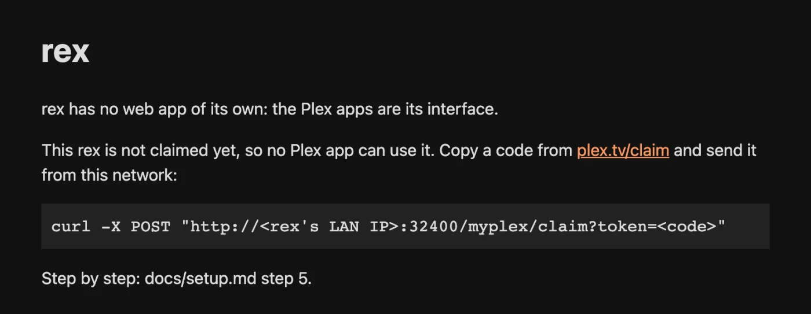

# rex questions

Short answers to what people ask before they install rex, and soon after. Each answer links to the guide that has the details.

## Before you install

### What is rex?

A media server for the official Plex apps that owns no files. Your apps see it as one more Plex server, with posters, seasons, watch history and Continue Watching. It keeps no movies: a **source** tells rex what is in your library and serves the files, and when you press play rex streams the file straight from that source. Nothing is downloaded first.

It is a server of its own, not a plugin for Plex Media Server, and it does not need one. It replaces your Plex server only if you want it to: it can run beside it, and your apps then list both. [Move from Plex to rex](from-plex.md) covers both ways.

### What does it cost?

rex is free for personal use, with no paid tier. Its source code is public under the PolyForm Noncommercial license, which does not allow commercial use. Every build is a public nightly on [GitHub Releases](https://github.com/debridmediamanager/rex/releases), and anyone can download it.

What may cost something is around it:

| | |
|---|---|
| [rex-stremio](stremio.md), your own app or an addon as the source | Free |
| zurg nightly, a source for a debrid or Usenet library | A perk for [DMM sponsors](https://gatekeeper.debridmediamanager.com) |
| A DMM API key, for DMM's exact matches in zurg | Optional, also from sponsoring DMM |
| rex's Docker image | Private, so a pull may be refused. The download works for everyone |

### Is my Plex account at risk?

rex is not made by Plex, and Plex could take action against an account that registers it. That is why every guide has you register rex on a **fresh free Plex account** made just for it, and share rex from there with your own account. Your own account then only accepts a share, the way it would from a friend's server, and your watch history, friends and any Plex Pass stay where they are. [Add it to a Plex account](any-source.md#step-3-add-it-to-a-plex-account) walks through it. You use rex at your own risk.

### Which Plex apps work?

How far each Plex app has been tried with rex:

| App | Tested |
|---|---|
| Plex Web (app.plex.tv) | The most: browsing, playback, converting, subtitles, and playback away from home with free accounts on both sides |
| Plex for Android (phone) | On a Pixel 6: playback, converting, and [downloading from your provider](direct-download.md) |
| Plex for iOS | On an iPad: playback and converting. Dolby Vision has an app bug (below) |
| Plex for Apple TV | Playback, live channels included |
| Plex Desktop | Plex for Mac: playback and converting |
| Plezy | On a Pixel 6: playback, and downloading from your provider |
| Plex HTPC | Not tested yet |
| Plex for Android TV, NVIDIA Shield, Google TV | Not tested yet |
| Plex for Roku | Not tested yet |
| Smart TV apps (Samsung, LG and others) | Not tested yet |
| Infuse | Not tested yet |

Away from home, only Plex Web has been tested.

### Does it play 4K, HDR and Dolby Vision?

Yes. Files play in their original quality: rex hands the app the file as it is, and the app decides what it can show. When an app cannot play a file as it is, rex converts it, if FFmpeg is set up ([Converting video](any-source.md#converting-video-optional)). A conversion turns HDR and Dolby Vision into a standard picture (Settings, Transcoder, **Enable HDR tone mapping**, on by default), on the graphics chip where it can. With Intel's OpenCL runtime installed, a small Intel machine (a J4105) converts 4K HDR10 and Dolby Vision profile 5 to 1080p at about real time. Without FFmpeg, a file the app cannot play shows "This server is not powerful enough to convert video".

**Plex for iOS and Dolby Vision.** Plex for iOS 2026.20.0 sits at 0:00 when it plays a Dolby Vision file as it is. A real Plex Media Server serving the same file stalls the same way, so the fault is in the app. HDR10 and SDR 4K files play.

### Do I need Plex Pass?

No. rex tells the Plex apps that the account it is registered on has Plex Pass, so playing away from home and converting video work with free accounts. Playing away from home was checked in Plex Web with a free account on both sides; other apps have not been tested away from home. Movie editions, the Dashboard, Downloads, intro and credits skipping and the rest of [Movie and TV capabilities](https://github.com/debridmediamanager/rex/blob/main/docs/setup.md#movie-and-tv-capabilities) work too. An app can still apply its own rules.

### Can I download for offline viewing?

The Plex apps' **Downloads** are there. rex prepares the download on its own machine, as the original file or converted with FFmpeg, and keeps it in a folder beside `rex.db` until the app fetches it. The account rex is registered on can always download; anyone you share with needs downloads allowed on their share ([Share rex](sharing.md#what-each-person-may-see-and-do)). The app can still apply its own rules. A converted download leaves text subtitles out. Saving a download on a phone and watching it offline has not been tested yet.

### Can several people use it, each with their own history?

Yes. Everyone you share rex with signs in as themselves and gets their own watched state, Continue Watching, ratings and playlists. Each can copy their history from an old Plex server ([Bring your watch history](import-watched.md)). [Share rex with family and friends](sharing.md) has the steps, managed users for children included.

### What hardware does it need?

A machine that stays on, running Linux (amd64 or arm64, glibc 2.35 or newer, so Ubuntu 22.04 and up), macOS (Intel or Apple Silicon) or 64-bit Windows.

**Memory:** give it 1 GB. On a library of 4,062 movies and 656 shows, rex used under 500 MB while it started and about 730 MB while the library was browsed. Converting video needs more on top.

**Disk:** none for movies. rex keeps its library in `rex.db`. Downloads and the images analysis makes (seek previews, chapter images) also go beside it, if you use them.

**Converting:** only with FFmpeg. A graphics chip makes it fast: a 1080p film converted on a small Intel chip starts in about 2 seconds. Which chips rex uses on each system is in [By platform](https://github.com/debridmediamanager/rex/blob/main/docs/setup.md#by-platform): on macOS it always converts on the processor.

### Does it read my local files?

No. rex never scans a folder or a disk and needs no mount. Every file comes from a source over HTTP. Files on your own disk can still go in: something has to serve them and tell rex about them, as [rex with your own app](any-source.md) shows.

### Does it work with Usenet?

Yes, through a source that reads Usenet, such as zurg. rex never talks to a Usenet provider: the source reads the files and serves them to rex like any other file. Set up zurg for it with [Usenet](../zurg/guides/usenet.md) and point it at rex as in [rex with zurg](with-zurg.md).

### Do I need zurg?

No. zurg is one source among others. rex takes its library from anything that speaks its feed API:

- [rex with zurg](with-zurg.md): your debrid account or Usenet
- [rex with your Stremio addons](stremio.md): catalogs from Stremio addons
- [rex with your own app](any-source.md): any app that serves files over HTTP
- [Building rex addons](addons.md): home videos, recordings or channels, with a program of your own

Several sources can fill the same Movies and TV libraries.

### What does it not do?

Movies and TV shows only. Music and photo libraries stay empty, and there is no Live TV guide or DVR: live channels come only as a library from a source, such as [rex-stremio](stremio.md). rex has no relay: to use it away from home it needs an address of its own ([Use it outside your home](any-source.md#use-it-outside-your-home-optional)).

## After you install

### Why does the app show a Plex version, and "Check for Updates"?

rex introduces itself to the apps and to plex.tv as a Plex Media Server, so the apps show a Plex Media Server version number. That number is not rex's. **Check for Updates** always answers that the server is up to date: rex never updates itself. To update rex, download a newer nightly as in [Updating](any-source.md#updating).

### Why does my browser at port 32400/web not open a library?

rex has no web app of its own. Opening `http://192.168.1.20:32400/web` (with rex's LAN IP in place of `192.168.1.20`) shows a short page that says what to do next. Watch in a Plex app, or in a browser at [app.plex.tv](https://app.plex.tv), which needs rex's HTTPS address even at home ([Use it outside your home](any-source.md#use-it-outside-your-home-optional)).

### What leaves my machine?

- **plex.tv, at start and once a day, registered or not:** the server's id, name and version, to read Plex's public list of releases for the newest version number.
- **plex.tv, once registered on a Plex account:** the claim, the server's addresses (its LAN address and its HTTPS address) and its library names.
- **Plex's metadata service, once registered:** the id of each title, to get its name, poster, summary and episodes. A subtitle search, by **Search Subtitles** or a person's automatic subtitle setting, sends the file's name and fingerprint.
- **Artwork hosts, when an app shows them:** requests for the posters and pictures your sources name.
- **DMM, for rex-direct, once registered and then every 6 hours:** the server's id and its token on the Plex account. DMM checks with plex.tv that the server is yours, sees your public IP and points your rex-direct name at it. Turn it off with `REX_DIRECT_URL=off`.
- **Your sources, when you play or delete:** requests for the files you play, and deletes (below).
- **Your old Plex server, only when you [bring your watch history](import-watched.md):** requests for your watch history.
- **Webhooks, only if you set any:** events, to the addresses you set.

rex asks no one what a release is: the source decides and tells rex. zurg, for one, asks DMM ([Why DMM places the files](with-zurg.md#why-dmm-places-the-files)).

### Does deleting in a Plex app delete the file?

Yes. Deleting a movie or episode in a Plex app, signed in as the account rex is registered on, deletes its files at the source, as a Plex server deletes files from its disk. A source on a debrid account, such as zurg, deletes them there. If the source refuses, the title stays and the app says it could not be deleted. People you share with cannot delete. [Deleting in a Plex app](any-source.md#step-5-watch-something) says how to turn it off.

### A title is matched wrong. How do I fix it?

The source decides what each file is, and rex shows that title. Sign in as the account rex is registered on and use **Fix Match**: rex keeps your pick, and a source can read it back to keep it as that release's match, as zurg does ([Why DMM places the files](with-zurg.md#why-dmm-places-the-files)).

### Where do I get help?

[Getting help](../guides/remote-help.md) says where to ask and what to include: the **rex-support** forum on [Discord](https://discord.com/invite/7u4YjMThXP), and remote help for sponsors.
