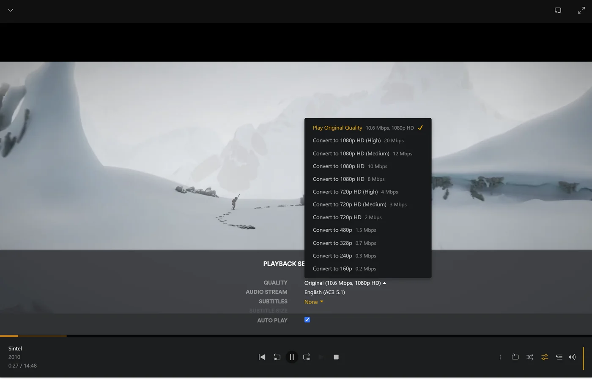
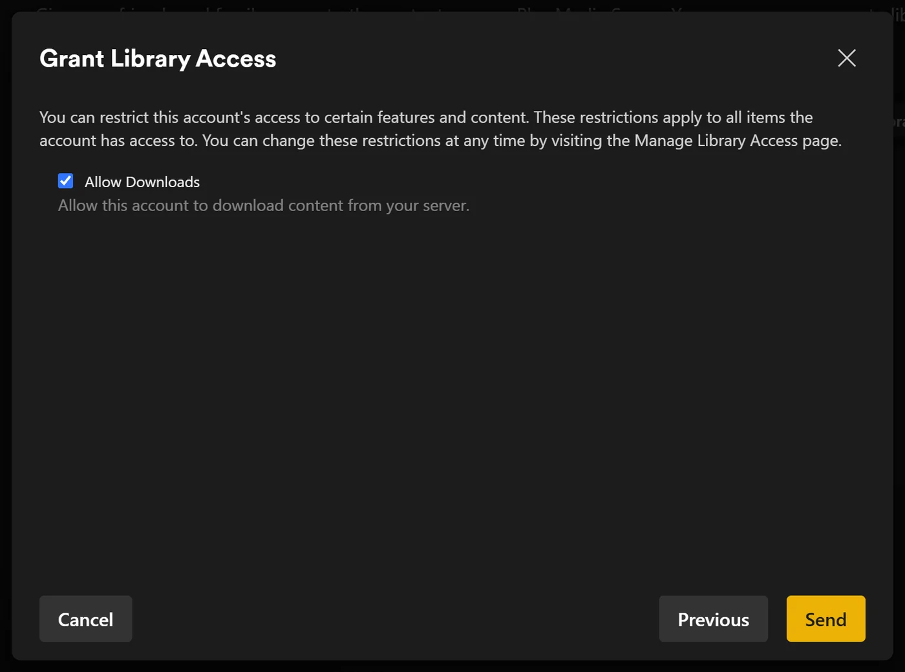
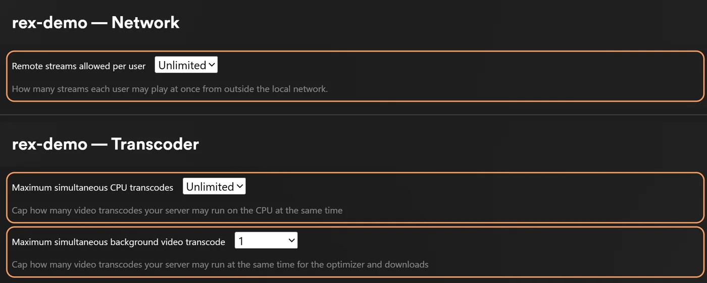

# Share rex with family and friends

rex is shared the way any Plex server is: from the account it is registered on, through Plex's own **Manage Library Access**. Everyone you share with signs in to their Plex apps as themselves and sees rex beside their other servers, with their own watch history.

This page needs rex set up and registered on a fresh Plex account, as in [rex with your own app](any-source.md), [rex with your Stremio addons](stremio.md) or [rex with zurg](with-zurg.md). Below, **the owner** is that fresh account.

## Who is who

| Account | What it is for |
|---|---|
| The owner, the fresh account rex is registered on | Sharing, settings, **Fix Match** and deleting. You sign in as it only for those |
| Your own account | Where you watch. rex is shared with it like with anyone else |
| Family and friends | Their own Plex accounts, or managed users for children (below) |

Your own account gets no more than anyone else you share with. Why: [Is my Plex account at risk?](faq.md#is-my-plex-account-at-risk)

## Invite someone

1. Sign in to [app.plex.tv](https://app.plex.tv) **as the owner**, then open **Settings** (the wrench), **Manage Library Access** and **Grant Library Access**.
2. Enter the person's Plex username or email, pick the rex server and the libraries to share, and send the invite.
3. They accept it, signed in as themselves. It arrives by email and in app.plex.tv. Each invite is accepted on its own.

**A library you add later** (one a source declares, such as an **Anime** library or a rex-stremio catalog's, or one made with **Add Library**) is not in anyone's share yet. Add it to each share in Manage Library Access.

**What they should see.** Signed in as themselves, their Plex apps list rex beside their own servers. At home that is enough. Away from home, read on.

## At home and away

**At home**, Plex apps find rex on your network by themselves when rex uses port 32400. app.plex.tv in a browser is the exception: it needs rex's HTTPS address even at home.

**Away from home**, which is always the case for a friend in another house, their apps need rex's HTTPS address. rex has no relay. The simplest is rex-direct: forward port 32400 on your router to the rex machine. [Use it outside your home](any-source.md#use-it-outside-your-home-optional) has it and the other ways.

**Your upload speed is the limit.** Every stream watched away from home leaves through your home connection's upload, at the file's own bitrate unless it is converted, so two people watching at once need the upload for both. Three things help:

- **Lower quality.** A person who picks a quality below Original in the player gets a converted stream, which is smaller. That needs FFmpeg on the rex machine ([Converting video](any-source.md#converting-video-optional)). The Plex phone apps on mobile data cap quality at 720p and 4 Mbps, so without FFmpeg a 1080p title there is refused until they set mobile quality to Original.
  

- **Apps download from your provider.** Plezy and Plex for Android can fetch a file from the link your source gives, such as your debrid service's, so your connection carries none of it: [Apps download from your provider](direct-download.md). Your provider then sees each person download from their own address, so check your provider's rules before sharing that way.
- **A limit per person** (below).

**No Plex Pass needed.** Your friends need no Plex Pass or Remote Watch Pass to watch away from home. That was checked in Plex Web with free accounts on both sides; other apps have not been tested away from home.

## Children: managed users

If the owner has a **Plex Home** with managed users, a managed user works on rex as on a Plex server. Share rex with them from Manage Library Access like anyone else, then limit what they see (below). They get their own watch history. rex was checked against a managed user's share of only Movies, only titles rated G and PG, and no downloads.

## What each person may see and do

You choose these per person, in their share in Manage Library Access, as on any Plex server. rex follows them everywhere: in library lists, search, the home screen rows and the title pages.

| Setting | What it does on rex |
|---|---|
| Libraries | They see only the libraries you shared. The others do not exist for them |
| Ratings | Only titles with the ratings you allow, such as G and PG. A title with no rating is hidden too |
| Labels | Hide the titles you gave a label, or show only those |
| Downloads | Whether their Plex apps may download for offline viewing |

Plex shows **Ratings** and **Labels** in a share only when the owner account has Plex Pass. On a free fresh account the share offers **Allow Downloads** alone; rex's own limits below set ratings and labels without it.

rex hears of a change from plex.tv as you make it. If one does not show, restart rex.

rex can also keep restrictions of its own for a share, on top of Plex's. They can only narrow what Plex allows. They are set with a command rather than in a Plex app: [Local owner controls](https://github.com/debridmediamanager/rex/blob/main/docs/setup.md#local-owner-controls).

## Who can do what

| | The owner | Everyone else, you included |
|---|---|---|
| Watch, with their own watched state, Continue Watching, ratings and playlists | Yes | Yes |
| Download for offline viewing | Yes | If their share allows it |
| **Fix Match** and editing a title | Yes | No |
| Delete a title (it is deleted at the source, for everyone) | Yes | No |
| Server settings, and who is watching now | Yes | No |

Collections and posters are the server's, so everyone sees the same ones.

## Bring each person's history

Everyone you share with can copy what they watched and rated on another Plex server, each with their own tokens: [Bring your watch history](import-watched.md). Running it changes nobody else's history.

## How many at once

rex sets no limit of its own on how many people watch at once. Your upload speed, your machine and your source set it. Each conversion runs FFmpeg on the rex machine; how many at once yours keeps up with depends on the machine, and two at once have not been measured. A copied video (only the sound converted) costs almost nothing.

To set limits, sign in as the owner and open the server's settings:

| Setting | Where | Default |
|---|---|---|
| **Remote streams allowed per user** | Network, under the advanced settings | 0, no limit. Counts streams away from home only |
| **Maximum simultaneous CPU transcodes** | Transcoder | 0, no limit. Counts every video conversion, on the graphics chip too. A copied video is never counted |

rex refuses a play over the limit.

