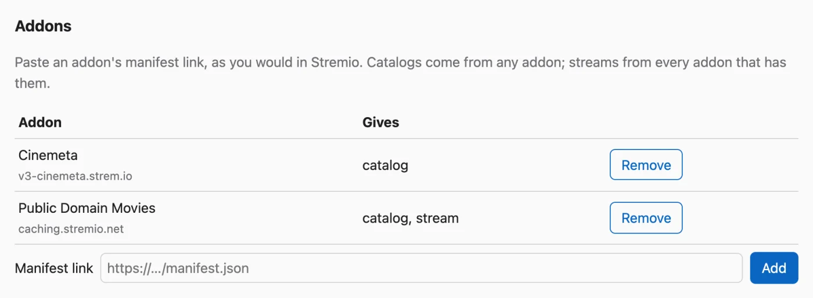
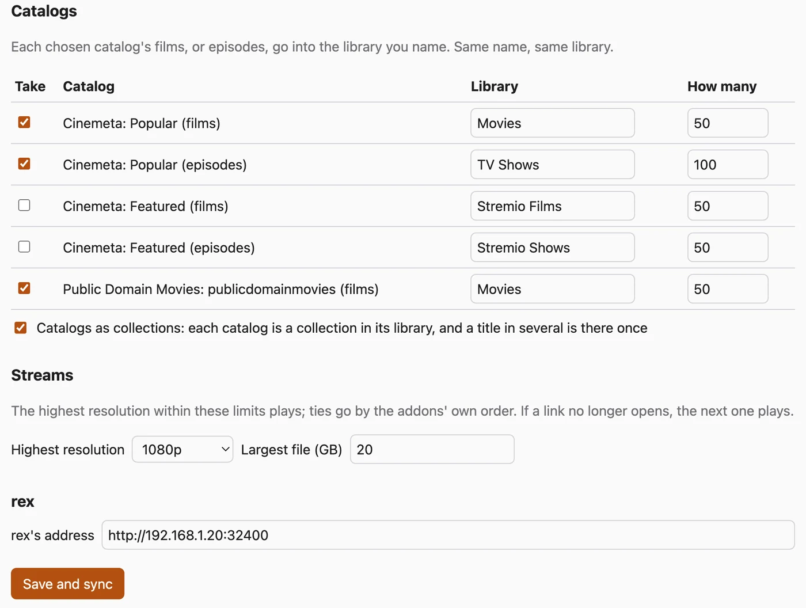

# rex with your Stremio addons

[rex-stremio](https://github.com/debridmediamanager/rex-stremio) turns the catalogs of your Stremio addons into rex libraries, so the films, shows and live channels they list play in the Plex apps. Nothing is downloaded: when someone presses play, rex-stremio asks your stream addons for a link, as Stremio does, and rex plays it.

This is the way to run rex with no zurg and no DMM sponsorship. rex and rex-stremio are free; you bring stream addons that give links, usually through a debrid account of your own.

What you get:

- **Libraries.** Films go into **Stremio Films**, series into **Stremio Shows** and a live TV addon's channels into **Live TV**, unless you name a catalog's library yourself.
- **Collections.** Give several film catalogs the same library and tick **Catalogs as collections**: one library, a collection per catalog, and a film several of them list is there once.
- **Plex names what it knows.** Films and episodes go to rex with their IMDb ids, so once rex is on a Plex account the apps show the usual titles, posters and summaries. Titles only an addon knows, and live channels, keep the addon's names and pictures.

## Before you start

| You need | Why |
|---|---|
| A machine that stays on, Linux or macOS, for rex and rex-stremio together | rex-stremio is one Python program and runs beside rex. The service below is for Linux; [Docker](#in-docker) works too |
| Python 3.9 or newer, `git` and `ffprobe` | rex-stremio checks each title's stream once with ffprobe, because rex needs to know what is in a file before it can play it |
| Stream addons that give links, not torrents | rex plays files. Set your debrid service in the addon so it gives links |
| A fresh Plex account, made just for rex | As in the rex setup: rex is claimed on it and shared with your own |

## Step 1. Install rex and add it to a Plex account

Follow [rex with your own app](any-source.md):

1. [Step 1. Install rex](any-source.md#step-1-install-rex), including finding rex's LAN IP. This page writes it as `192.168.1.20`: put yours in its place.
2. [Step 3. Add it to a Plex account](any-source.md#step-3-add-it-to-a-plex-account): register rex on the fresh account and share it with your own.

Skip steps 2 and 4 there: rex-stremio is your app.

Live channels, and addons whose streams are `.m3u8` playlists, play only through rex's video conversion. For those, also set up [Converting video](any-source.md#converting-video-optional) on the rex machine. Films and episodes served as files (`.mkv`, `.mp4`) need nothing more.

## Step 2. Install rex-stremio

**What it does.** Downloads rex-stremio into `~/rex-stremio` on the rex machine and starts it as a service.

+++ Linux
```bash
sudo apt install -y git python3 ffmpeg
cd ~ && git clone https://github.com/debridmediamanager/rex-stremio
mkdir -p ~/.config/systemd/user
cp ~/rex-stremio/rex-stremio.service ~/.config/systemd/user/
systemctl --user daemon-reload && systemctl --user enable --now rex-stremio
journalctl --user -u rex-stremio -f
```
+++ macOS
```bash
brew install ffmpeg
cd ~ && git clone https://github.com/debridmediamanager/rex-stremio
cd ~/rex-stremio && python3 rex_stremio.py
```

It runs while that Terminal window stays open.
+++

**What you should see.** A line like:

```
... INFO relay and settings on http://127.0.0.1:9982/, 0 catalog(s), rex at http://127.0.0.1:32400
```

rex-stremio's settings page and the address rex reads videos from are both on `127.0.0.1:9982`, so only this machine reaches them.

## Step 3. Add your addons

Open `http://127.0.0.1:9982/` in a browser on the rex machine. rex runs on a machine without a screen? From your computer, `ssh -L 9982:127.0.0.1:9982 you@192.168.1.20` and then open the same address in your own browser while that `ssh` stays open.

1. Under **Addons**, paste an addon's manifest link, as you would in Stremio, and press **Add**. Do it for:
   - **Catalogs**, for example Cinemeta: `https://v3-cinemeta.strem.io/manifest.json`.
   - **Streams**: an addon that finds releases and plays them through your debrid service. Open its configure page, pick your debrid service, paste its API key and copy the manifest link it makes. If it offers cached results only, pick that. The link holds your debrid key: keep it to yourself.

   

2. Under **Catalogs**, tick the catalogs you want. Name the library each goes into and set **How many** films, episodes or channels to take. For one library with a collection per catalog, give the catalogs the same library and tick **Catalogs as collections**.
3. Under **Streams**, set the **Highest resolution** and **Largest file** you want played, or leave them at any.
4. Under **rex**, set **rex's address** to `http://192.168.1.20:32400`, and press **Save and sync**.



**What you should see.** In rex's log, as in [step 4 of rex with your own app](any-source.md#step-4-connect-your-app):

```
INFO    SOURCES PUT /rex/sources/stremio -> 200
INFO    FEED stremio upsert: ...
```

The libraries appear in rex within a few minutes. rex-stremio syncs again every six hours and after every save.

## Step 4. Share the new libraries and watch

The libraries rex-stremio makes are new, so your own account cannot see them yet. Share them with your own account as in [step 3](any-source.md#share-it-with-your-own-account), signed in as the fresh account, and with anyone else you share rex with.

Then open a Plex app as yourself and press play on something. rex-stremio asks your stream addons for a link at that moment and rex plays it.

## In Docker

rex-stremio's [README](https://github.com/debridmediamanager/rex-stremio#set-up) has the Docker commands. In a container, rex reads the videos from the container's address on your network rather than `127.0.0.1`, which the README shows how to set.

## Updating

```bash
cd ~/rex-stremio && git pull && systemctl --user restart rex-stremio
```

On macOS, stop it with Ctrl+C, run `git pull` in `~/rex-stremio` and start it again.

## What it cannot do

- **Episodes are numbered as Cinemeta numbers them.** For a few shows that differs from TMDB's numbering, which rex follows, so an episode can land in the wrong place.
- **How many counts episodes** for a series catalog, not shows.
- **Turning Catalogs as collections on or off** sends the titles to rex again as new ones, so what was watched on them may not carry over. Decide before you start watching.
- **Only film, series and channel catalogs** are listed, and none that need a search or a genre first.
- **Live channels** cannot be paused far back, resumed later or marked watched, and play only in apps that ask rex to convert them (the Plex apps and Plezy; Plex Web is not tested). Channels with no working stream, or with DRM, are left out.
- **Anyone who can reach rex-stremio's address can play through it.** Leave it on `127.0.0.1` unless rex runs elsewhere.

The README lists the [rest of its limits](https://github.com/debridmediamanager/rex-stremio#limits) and every setting in `config.json`. To build an addon of your own, see [Building rex addons](addons.md), which also explains how rex-stremio works inside.
