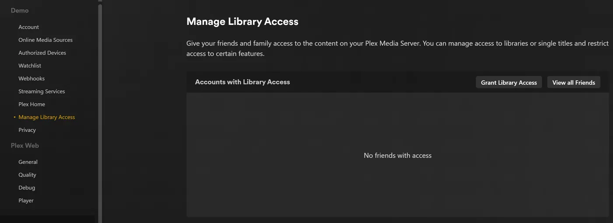
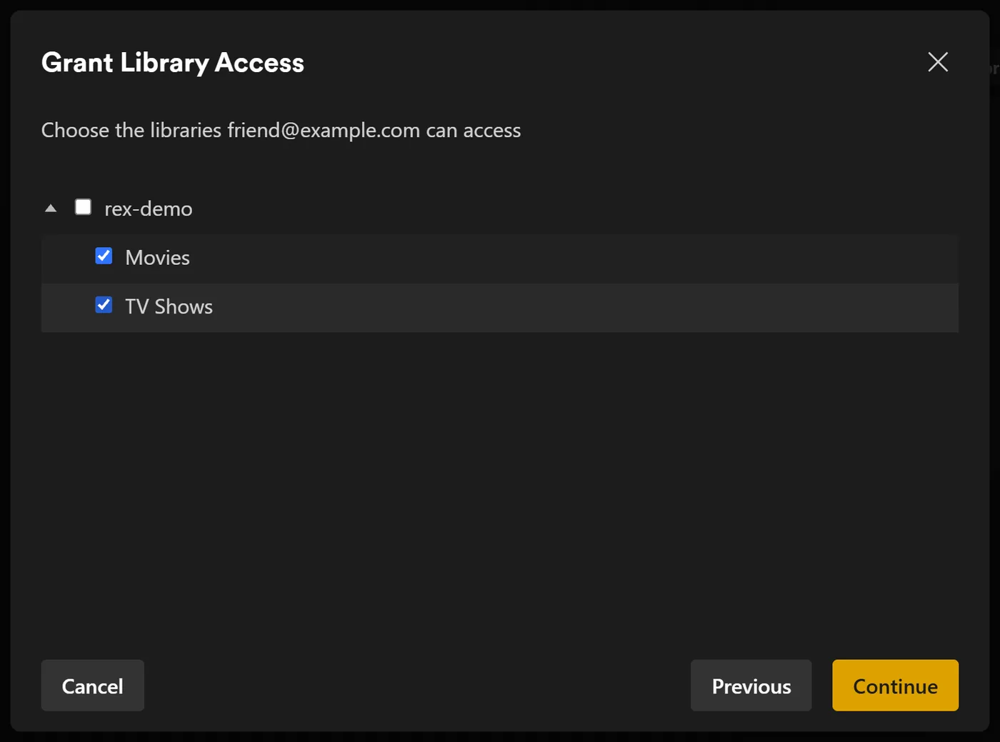
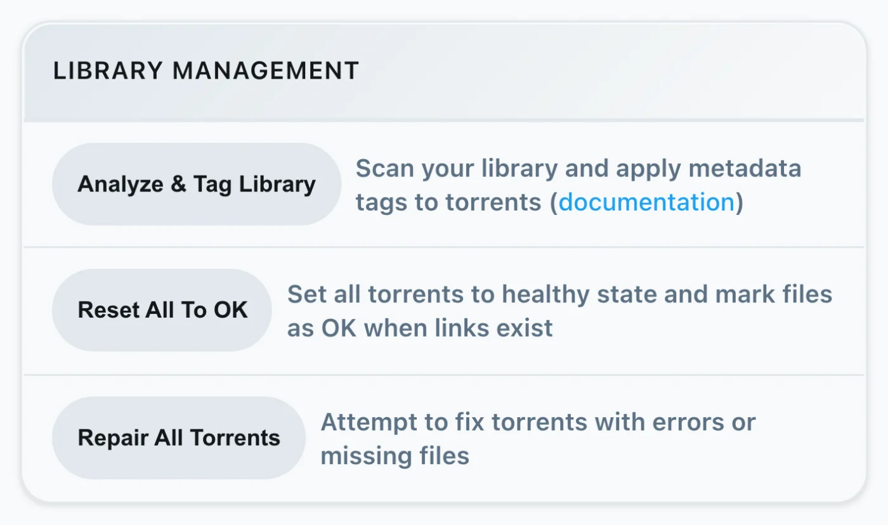
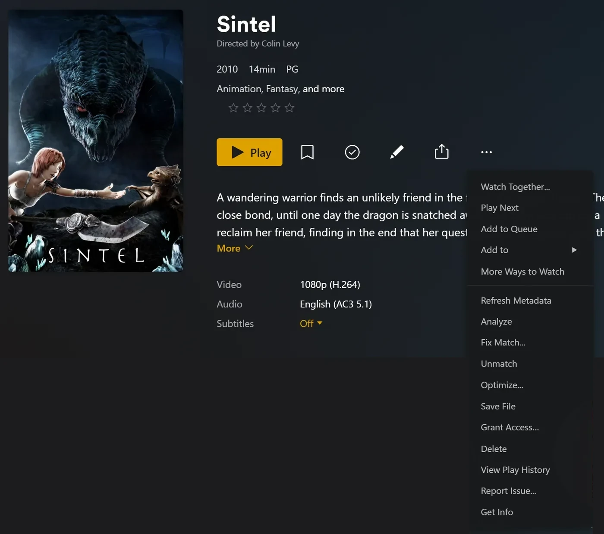
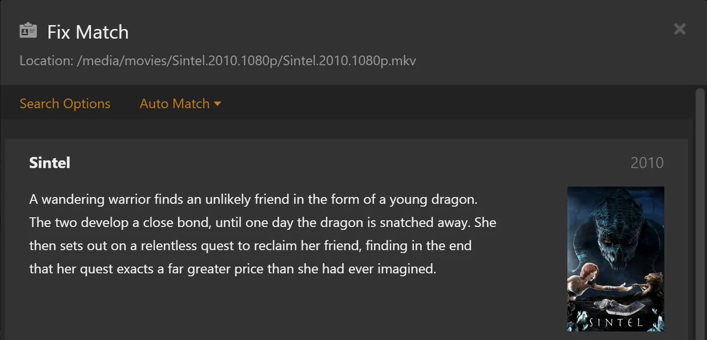
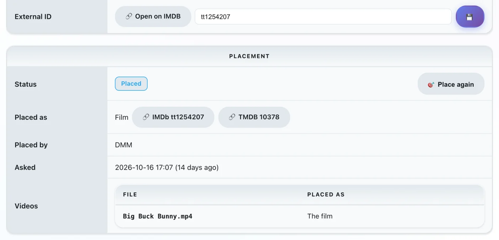
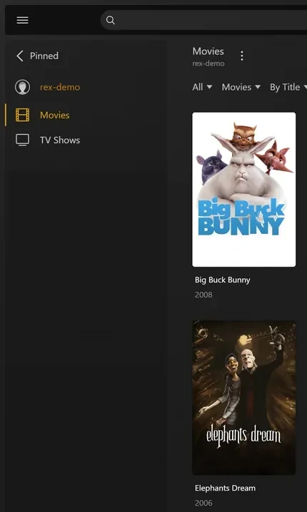
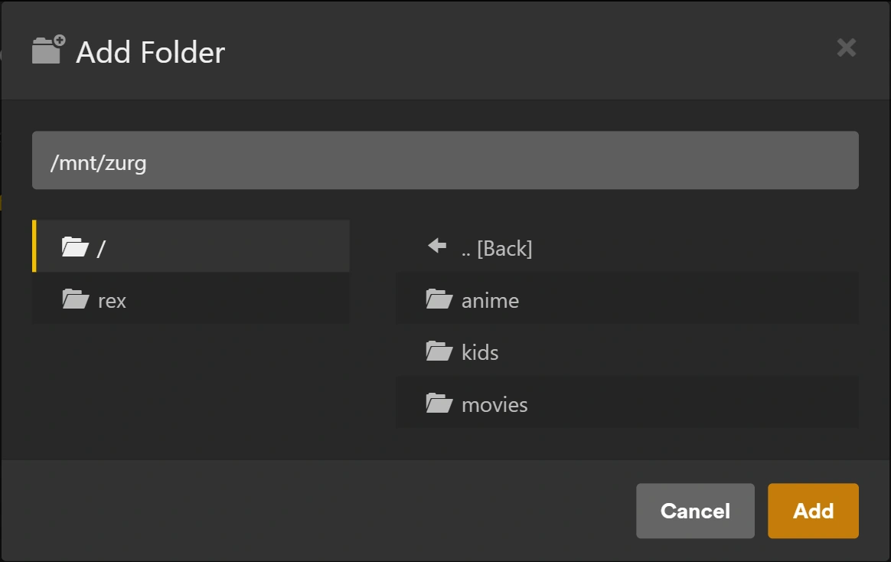
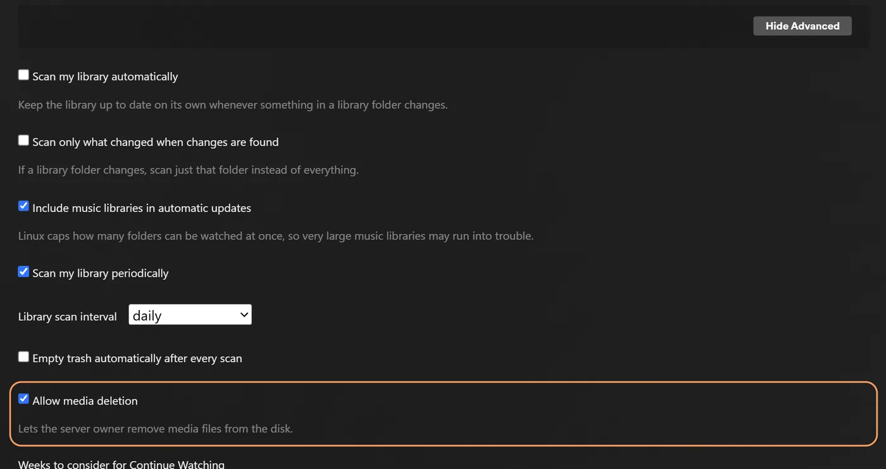

# rex with zurg

[rex](https://rex.debridmediamanager.com) is a media server for the official Plex apps that owns no files. The official Plex apps see it as a normal Plex server. Any app can fill it ([rex with your own app](any-source.md)); this page sets it up with zurg, which sends it your debrid library, and when you press play rex streams the file straight from zurg. Nothing is downloaded first.

This page takes you from nothing to playing a movie, one step at a time. Every step says what it does, why it matters and what you should see before you move on. If what you see does not match, stop there: the next step will not fix it.


Four things to know before you start:

- **zurg is the part that talks to your debrid service.** It lists what is in your account and serves the files.
- **rex is the part your Plex apps talk to.** It keeps no files and needs no disk for media. It does not need rclone or a mount.
- **zurg tells rex about itself.** You give zurg the address of rex, and zurg does the rest. You never type zurg's details into rex.
- **zurg and DMM decide what each file is; Plex describes it.** zurg asks DMM which movie or episode each file is, and rex shows that title with the posters and summaries Plex's own metadata gives it once rex is on a Plex account. rex never guesses from a file name.

rex is free for personal use (PolyForm Noncommercial): no sponsor tier and no account needed to download it. zurg's nightly, which this guide uses, stays a sponsor release; [rex with your own app](any-source.md) runs rex without it.

## Before you start

| You need | Why |
|---|---|
| A machine that stays on: Linux (Ubuntu 22.04 or newer), macOS, or Windows (64 bit). A Proxmox LXC works, unprivileged is fine, once FUSE is turned on for it (Options > Features > FUSE): zurg's installer stops without `/dev/fuse` | rex and zurg are servers: your Plex apps reach them whenever you press play. Where the commands differ, a step has a tab for each system. [Docker](#run-rex-in-docker) is further down, for Linux |
| 1 GB of RAM | With 4,062 movies and 656 shows (34,678 episodes), rex used under 500 MB while it started and about 730 MB while the library was browsed; converting video takes more. zurg needs little |
| A debrid account (Real-Debrid, TorBox, AllDebrid, Premiumize, Debrid-Link, Offcloud) or Usenet | That is where your movies and shows actually live |
| A GitHub account with access to zurg's sponsor releases | zurg's nightly is a private GitHub release. [gatekeeper](https://gatekeeper.debridmediamanager.com/) gives your account access when you sponsor. The zurg installer signs you in once |
| Your DMM API key, from [gatekeeper](https://gatekeeper.debridmediamanager.com/) once you sponsor (optional) | zurg asks DMM what each file is. Without it zurg works it out from the release name, through DMM's free title search: fewer titles match, and an anime numbered across the whole series stays in file order |
| A fresh Plex account, made just for rex | rex gets every title, poster, summary and episode name from Plex once it is [added to a Plex account](#step-3-add-it-to-a-plex-account). Until then titles keep their file names and have no posters |

This page needs rex nightly **2026.10.25 or newer** and zurg nightly **2026.10.27 or newer**.

## Step 1. Install zurg

**What it does.** Downloads zurg, asks for your debrid account and starts zurg as a service that comes back after a reboot.

**Why it matters.** Everything rex shows comes from zurg. If zurg cannot see your library, rex never will.

+++ Linux
```bash
curl -fsSL https://raw.githubusercontent.com/debridmediamanager/zurg-site/main/public/install.sh | bash
sudo loginctl enable-linger "$USER"
```

zurg goes into `~/zurg`. The second line keeps your services running when you log out.
+++ macOS
```bash
curl -fsSL https://raw.githubusercontent.com/debridmediamanager/zurg-site/main/public/install.sh | bash
```

zurg goes into `~/zurg`. The installer also installs macFUSE, which macOS may make you allow under **System Settings**, **Privacy & Security**, followed by a reboot: [zurg on macOS](../zurg/setup/macos.md).
+++ Windows
In PowerShell:

```powershell
irm https://raw.githubusercontent.com/debridmediamanager/zurg-site/main/public/install.ps1 | iex
```

zurg goes into `$HOME\zurg` (`C:\Users\you\zurg`). The installer also installs WinFsp, asking for administrator approval, and starts zurg whenever you log in to Windows: [zurg on Windows](../zurg/setup/windows.md).
+++

The installer asks which services you use (type `1` for Real-Debrid) and then for your API token. The token is hidden while you paste it.

**What you should see.** The installer ends with a list of `PASS` lines and `==> zurg is installed in` with zurg's folder. zurg then loads your library: a few seconds for a small account, about ten minutes for one with a thousand releases on Real-Debrid. Open zurg's dashboard at `http://<this machine>:9999`: **Library Size** counts your items once it is done.

Already run zurg? Update and restart it with `cd ~/zurg && ./zurg update && ./zurg service restart` (on Windows, `cd $HOME\zurg; .\zurg.exe update; .\zurg.exe service restart`).

## Step 2. Install rex

**What it does.** Downloads rex into `~/rex` (`$HOME\rex` on Windows) and starts it as a service, with everything the later steps need. The steps after this one need no restart; only the optional sections further down do.

**Why it matters.** rex is what your Plex apps talk to. The first start creates `rex.db`, which holds your libraries, everything zurg sends and your watch history.

+++ Linux and macOS
```bash
mkdir -p ~/rex && cd ~/rex
TAG=$(curl -fsSL 'https://api.github.com/repos/debridmediamanager/rex/releases?per_page=1' | sed -n 's/.*"tag_name": *"\([^"]*\)".*/\1/p' | head -1)
P=$(uname -s | tr A-Z a-z)-$(uname -m | sed 's/x86_64/amd64/;s/aarch64/arm64/')
curl -fL "https://github.com/debridmediamanager/rex/releases/download/$TAG/rex-$TAG-$P.tar.gz" | tar xz --strip-components=1
```
+++ Windows
In PowerShell:

```powershell
New-Item -ItemType Directory -Force $HOME\rex | Out-Null; cd $HOME\rex
$tag = (Invoke-RestMethod 'https://api.github.com/repos/debridmediamanager/rex/releases?per_page=1')[0].tag_name
curl.exe -fLO "https://github.com/debridmediamanager/rex/releases/download/$tag/rex-$tag-windows-amd64.zip"
tar -xf "rex-$tag-windows-amd64.zip" --strip-components=1; Remove-Item "rex-$tag-windows-amd64.zip"
```
+++

This takes rex's newest build, usually a nightly, for your machine.

Find rex's LAN IP, its address on your home network. On Linux `hostname -I` prints several: take the one on your home network, not one starting with `172.17.` (Docker) or `100.` (Tailscale). On macOS `ipconfig getifaddr en0` prints it (`en1` if that prints nothing). On Windows `ipconfig` lists it as **IPv4 Address** under your Wi-Fi or Ethernet adapter. **This page writes it as `192.168.1.20` everywhere: put yours in its place.** Plex apps, zurg and your own commands all reach rex there.

**Plex Media Server runs on the same machine?** End rex's start command below with `--port 32500` and use `32500` wherever this page says `32400`, the Windows firewall rule included: Plex already holds port 32400 and the ports apps use to find servers, and on any other port rex leaves those to Plex.

Now make it a service:

+++ Linux
Create `~/.config/systemd/user/rex.service`:

```bash
mkdir -p ~/.config/systemd/user
nano ~/.config/systemd/user/rex.service
```

```ini
[Unit]
Description=rex
After=network-online.target

[Service]
WorkingDirectory=%h/rex
EnvironmentFile=-%h/rex/rex.env
ExecStart=%h/rex/rust/target/release/rex
Restart=always
RestartSec=5

[Install]
WantedBy=default.target
```

```bash
systemctl --user daemon-reload
systemctl --user enable --now rex
journalctl --user -u rex -f
```

rex's **start command** is the `ExecStart` line, and keys go in `~/rex/rex.env`, one `NAME=value` a line. After a change, `systemctl --user daemon-reload && systemctl --user restart rex` restarts rex. `journalctl --user -u rex -f` shows its log.
+++ macOS
`run.sh` starts rex in its folder, and a LaunchAgent starts `run.sh` when you log in:

```bash
cp ~/rex/examples/run.sh.example ~/rex/run.sh
mkdir -p ~/Library/LaunchAgents
cat > ~/Library/LaunchAgents/com.rex.plist <<PLIST
<?xml version="1.0" encoding="UTF-8"?>
<!DOCTYPE plist PUBLIC "-//Apple//DTD PLIST 1.0//EN" "http://www.apple.com/DTDs/PropertyList-1.0.dtd">
<plist version="1.0"><dict>
  <key>Label</key><string>com.rex</string>
  <key>ProgramArguments</key><array><string>/bin/bash</string><string>$HOME/rex/run.sh</string></array>
  <key>RunAtLoad</key><true/><key>KeepAlive</key><true/>
  <key>StandardOutPath</key><string>$HOME/rex/rex.log</string>
  <key>StandardErrorPath</key><string>$HOME/rex/rex.log</string>
</dict></plist>
PLIST
launchctl load ~/Library/LaunchAgents/com.rex.plist
tail -F ~/rex/rex.log
```

rex's **start command** is the last line of `~/rex/run.sh`, and keys go in `~/rex/rex.env`, one `NAME=value` a line. After a change, `launchctl kickstart -k gui/$(id -u)/com.rex` restarts rex. `tail -f ~/rex/rex.log` shows its log.

rex runs while you are logged in to the Mac. For a Mac that restarts by itself, turn on automatic login (**System Settings**, **Users & Groups**). If the macOS firewall is on, allow rex when macOS asks, or add `~/rex/rust/target/release/rex` under the firewall's **Options**.
+++ Windows
Open PowerShell **as administrator** and go to rex's folder with `cd $HOME\rex`. First make `run.cmd`, which starts rex in its folder and writes its log to `rex.log`. Notepad offers to create the file:

```powershell
notepad run.cmd
```

```bat
@echo off
cd /d "%~dp0"
rust\target\release\rex.exe 2>> rex.log
```

Save it. Then let your network through Windows Firewall to rex's port and the two discovery ports, and start rex now and whenever you log in:

```powershell
New-NetFirewallRule -DisplayName rex -Protocol TCP -LocalPort 32400
New-NetFirewallRule -DisplayName "rex discovery" -Protocol UDP -LocalPort 32410,32414
$settings = New-ScheduledTaskSettingsSet -ExecutionTimeLimit 0 -AllowStartIfOnBatteries -DontStopIfGoingOnBatteries
Register-ScheduledTask rex -Action (New-ScheduledTaskAction -Execute "$HOME\rex\run.cmd") -Trigger (New-ScheduledTaskTrigger -AtLogOn -User $env:USERNAME) -Settings $settings
Start-ScheduledTask rex; Start-Sleep 3
Get-Content rex.log -Wait
```

rex's **start command** is the `rex.exe` line of `run.cmd`, and keys go above it, one `set NAME=value` a line. After a change, `Stop-Process -Name rex; Start-Sleep 1; Start-ScheduledTask rex` restarts rex. `Get-Content $HOME\rex\rex.log -Wait` shows its log.

rex runs while you are logged in to Windows, in a window of its own: leave it open. In PowerShell, type `curl.exe` wherever this page says `curl`: Windows PowerShell's own `curl` is a different command.
+++

**What you should see.** Among the first lines:

```
INFO    seeded rex.db: an empty library named yourhost, machine=...
INFO    no source yet: a source registers itself once pointed at this server (zurg: rex_url; others: PUT /rex/sources/{name}, docs/feed-api.md)
INFO    claim state: unclaimed
INFO    rex on http://192.168.1.20:32400  machine=...  items=0  parts=proxy
```

rex names itself after the machine; your Plex apps show that name. `no source yet` is right: zurg has not been told about rex. Leave the log open.

## Step 3. Add it to a Plex account

**What it does.** Registers rex on a Plex account, as you would a real Plex Media Server, and shares it with your own account.

**Why it matters.** rex gets every title's name, poster, summary and episode names from Plex's own metadata, and it may only ask Plex once it is on an account. Titles zurg sent before the claim are named as soon as it lands. It also makes Fix Match work, removes the "unclaimed" notice and is needed before [using rex outside your home](#use-it-outside-your-home-optional).

**Use a fresh Plex account for this, not your own.** rex is not made by Plex, and Plex could take action against an account that registers it. Keep your real account, with its watch history, friends and any Plex Pass, out of reach: make a new free account at [plex.tv](https://www.plex.tv) with an email address you do not use elsewhere, register rex on that one, and share rex with your own account. You then watch signed in as yourself, the way you would watch a friend's server. rex plays nothing until this step is done.

### Register rex on the fresh account

1. Sign in to [plex.tv](https://www.plex.tv) **as the fresh account**, open [plex.tv/claim](https://www.plex.tv/claim) and copy the code. It expires after about five minutes.
2. On the rex machine (`curl.exe` on Windows):

   ```bash
   curl -X POST "http://192.168.1.20:32400/myplex/claim?token=claim-xxxxxxxxxxxx"
   curl -s http://192.168.1.20:32400/identity
   ```

**What you should see.** The second command shows `claimed="1"`, and `claim_state.json` exists in rex's folder. Back that file up: without it you have to claim again with a new code. While it exists, rex refuses a second claim.

### Share it with your own account

1. Still signed in as the fresh account, open [app.plex.tv](https://app.plex.tv), then **Settings** (the wrench), **Manage Library Access** and **Grant Library Access**.
2. Enter your own account's username or email, pick the rex server and both libraries, **Movies** and **TV Shows**, and send the invite.
3. Sign out, sign in as **yourself**, and accept the invite. It arrives by email and in app.plex.tv.





**What you should see.** Signed in as yourself, Plex apps list the rex server beside your own servers, with both libraries, empty until the next step. Your watch history on rex is your own: it is kept apart from the fresh account's. Share it the same way with anyone else in your household.

## Step 4. Connect zurg to rex

**What it does.** Tells zurg where rex is. zurg introduces itself to rex, sends its whole library, reads each file's video and audio details and sends those too, then every change as it happens.

**Why it matters.** This is the only link between the two. rex has no setting for zurg: if `rex_url` is missing, rex stays empty. `rex_url` is always rex's plain `http://` address on your network, never an HTTPS one from [Use it outside your home](#use-it-outside-your-home-optional): rex takes zurg's pushes only from your own networks ([Keep the port private](#keep-the-port-private)). Your DMM key lets zurg ask DMM which movie or episode each file is; without one zurg works it out from the name, and fewer titles match.

zurg will not start with the same key twice, and zurg's dashboard writes `dmm_api_key` into its config when you enter your key there. Without a DMM key, leave `dmm_api_key` out.

+++ Linux and macOS
First check whether zurg's config already has either line:

```bash
grep -n '^rex_url:\|^dmm_api_key:' ~/zurg/config.yml
```

If it prints a line, that key is already set: change it there with `nano ~/zurg/config.yml` and leave it out of the `printf` below.

```bash
printf '\nrex_url: http://192.168.1.20:32400\ndmm_api_key: your_dmm_key\n' >> ~/zurg/config.yml
cd ~/zurg && ./zurg service restart
```
+++ Windows
Open zurg's config with `notepad $HOME\zurg\config.yml`. If it already has a `rex_url:` or `dmm_api_key:` line, change that line; add the others at the end:

```yaml
rex_url: http://192.168.1.20:32400
dmm_api_key: your_dmm_key
```

Save it and restart zurg:

```powershell
cd $HOME\zurg; .\zurg.exe service restart
```
+++

**What you should see.** Once zurg has loaded the library again, zurg's log (`~/zurg/logs/zurg.log`, on Windows `$HOME\zurg\logs\zurg.log`) says `DMM placed N releases` (without a DMM key: `Placed N releases by their names (no DMM sponsor key)`) and rex's log prints:

```
INFO    SOURCES PUT /rex/sources/zurg -> 200
INFO    FEED zurg upsert: 0 created, 0 updated, 200 held, 0 unchanged, 0 rejected
INFO    FEED identified "Sintel.mp4" -> movie tmdb:45745 (placed)
INFO    FEED zurg upsert: 2 created, 0 updated, 0 held, 0 unchanged, 0 rejected
```

`held` means zurg has not read that file's details yet. zurg starts reading them as soon as its library has loaded, one release at a time, and a season pack's episodes arrive together. With a DMM key, up to about 20 releases a minute come from DMM's stored details. A large library fills over several hours. Each title appears in rex as its details arrive. Anything you add to your debrid account later shows up by itself once zurg has read it.

**If not.**

- Nothing at all in rex's log: zurg is still loading its library, zurg is out of date (update it as in [step 1](#step-1-install-zurg)), or `rex_url` has a typo. `grep 'rex feed' ~/zurg/logs/zurg.log | tail -n 5` shows zurg's side (on Windows, `Select-String 'rex feed' $HOME\zurg\logs\zurg.log | Select-Object -Last 5`): with no `rex feed: pushing the library to ...` line zurg did not read `rex_url`, and `rex feed: snapshot failed, retrying in ...` means it cannot reach rex at that address.
- A title stays `held` and zurg logs `Cannot probe file ...`: the first read from the debrid service failed. zurg tries again by itself; **Analyze & Tag Library** under **Utilities** on zurg's dashboard tries at once.

  

- Titles arrive but no `identified` lines: zurg could not match them by name, and with `dmm_api_key` set it logs `DMM refused the API key for placement` when the key is not a sponsor's. zurg then matches by name and tries the key again a day later, or at once when it restarts.

Running several zurgs (one per debrid service)? Give each its own name with an extra line, `rex_source: rd`, `rex_source: tb` and so on. They fill the same libraries.

### Why DMM places the files

File names often number episodes differently from the episode lists Plex apps show. DMM knows where each file really belongs:

| Release | Named | Where it really is |
|---|---|---|
| `[Erai-raws] Hibike Euphonium 3 - 01` | season 1, episode 1 | Sound! Euphonium season 3, episode 1 |
| `[HorribleSubs] One Piece - 486` | episode 486 | season 13, episode 486 |
| `Firefly.S01E02.The.Train.Job` (DVD order) | episode 2 | episode 1, "The Train Job" |

A file zurg cannot place stays unmatched: a film titled as its file, or an episode in a show named after its release, numbered in file order. With a DMM key zurg asks DMM about it again a day later, and you can fix it yourself with **Fix Match** in a Plex app, signed in as the fresh account that owns rex (rex refuses it to the accounts it is shared with). A title you corrected with Fix Match stays as you set it.





zurg's dashboard shows what it did with each release: open the release in **Torrent Manager** and look at **Placement**. **Place again** asks DMM once more, and an IMDb id typed into **External ID** places it by that id.



## Step 5. Watch something

**What it does.** Opens rex in a Plex app, the same way you would open any Plex server.

**Why it matters.** This is the point of the whole setup. It also proves the last link: rex reading a file from zurg while you watch.

Open a Plex app (not a web browser) on a phone, TV or computer **on the same home network**. rex shows up on its own under the machine's name, with **Movies** and **TV Shows**. Pick a movie and press play.



At home nothing else is needed: Plex apps find rex with Plex's own local discovery and connect to it over your network. That needs the device on the same network as rex (not a guest Wi-Fi or a separate VLAN). Discovery runs on UDP ports 32410 and 32414, so a firewall on the rex machine must let those in (on Windows, step 2's firewall rules do). rex answers discovery when it uses port 32400. If you moved rex to 32500 because Plex runs on the same machine, discovery is left to that Plex, and apps find rex through the Plex account it is [shared with](#share-it-with-your-own-account). app.plex.tv in a web browser is the exception: it needs the HTTPS address from [Use it outside your home](#use-it-outside-your-home-optional), even at home. `http://192.168.1.20:32400/web` is not Plex Web: rex has no web app of its own, and that page only says whether rex is claimed and where to watch.

**What you should see.** Posters, titles and years as on any Plex server, and the movie plays.

Two things you may meet:

- **"yourhost server is unclaimed and not secure".** A Plex app says this about any server that is not on a Plex account, and rex plays nothing until it is on one. Do [step 3](#step-3-add-it-to-a-plex-account). Do not press **Claim it now** while signed in as yourself: it registers rex on your own account.
- **"This server is not powerful enough to convert video".** The app cannot play the file as it is, often a web browser meeting AC3 or DTS sound. Plex apps on TVs and phones play most files as they are. To play everything everywhere, set up [Converting video](#converting-video-optional).

zurg's folders other than `movies` and `shows`, such as `anime`, need nothing: each file goes to **Movies** or **TV Shows** by what zurg says it is. A file zurg cannot tell is an episode waits in **Movies**.

To give one of those folders libraries of its own, add both `rex_shows` and `rex_movies` under it in zurg's `config.yml`, beside its filters, then restart zurg as in [step 4](#step-4-connect-zurg-to-rex). DMM places some of a folder's files as films and some as episodes, and the kind with no title of its own goes to **Movies** or **TV Shows**:

```yaml
directories:
  anime:
    rex_shows: Anime
    rex_movies: Anime Movies
```

Once zurg has loaded, rex makes **Anime** and **Anime Movies** and moves what it already showed from `anime` into them as it was: watch history, Fix Match and edits included. An open Plex Web lists them at once under **More** in its sidebar, where you can pin them. Share them with your own account as in [step 3](#share-it-with-your-own-account). Rename them in a Plex app as you like. Delete one and it stays deleted, its files going back to **Movies** or **TV Shows**, until you add it again with **Add Library**, whose folder list shows zurg's folders. If a library does not appear, zurg's log or rex's says why.



!!!warning Deleting in a Plex app deletes from your debrid account
Signed in as the fresh account, **Delete** on a movie or episode deletes its file at zurg too, and zurg removes the torrent from your debrid account once none of its files is left. The accounts rex is shared with, yours included, cannot delete. To turn deleting off: in app.plex.tv as the fresh account, open **Settings**, the rex server's **Library**, **Show Advanced**, untick **Allow media deletion** and save. rex then refuses every delete.
!!!



A title that leaves your debrid account the other way, removed there or by zurg, goes to the library's trash in rex as it would in Plex: it stays, unavailable, with its watch history, and comes back as it was if zurg has it again. **Empty Trash** on the library removes it for good, and **Empty trash automatically after every scan** (Settings, Library) does that by itself; it is off.

**Back up** `rex.db` in rex's folder (it holds your library, watch history and zurg's login, so keep it private) and, once you have them, `claim_state.json` and `rex-direct.json` (the claim, and rex-direct's certificate key):

+++ Linux and macOS
```bash
sudo apt install -y sqlite3    # once, on Linux; macOS has it
mkdir -p ~/rex-backup
sqlite3 ~/rex/rex.db ".backup $HOME/rex-backup/rex.db"
cp ~/rex/*.json ~/rex-backup/
```
+++ Windows
Windows has no `sqlite3`, so stop rex for a moment and copy `rex.db` with the two files beside it that start the same way:

```powershell
Stop-Process -Name rex; Start-Sleep 1
New-Item -ItemType Directory -Force $HOME\rex-backup | Out-Null
Copy-Item $HOME\rex\rex.db*, $HOME\rex\*.json $HOME\rex-backup
Start-ScheduledTask rex
```
+++

In Docker the files sit in `~/rex/config`, readable by root only. Back up from inside the container with `docker exec rex sqlite3 /config/rex.db ".backup /config/rex.db.bak"`, then `mkdir -p ~/rex-backup && sudo cp ~/rex/config/rex.db.bak ~/rex/config/*.json ~/rex-backup/`.

[Restore a backup](#restore-a-backup) puts them back.

You are done. The sections below are optional.

## Use it outside your home (optional)

**What it does.** Gives rex an HTTPS address that Plex apps away from home can reach, and tells plex.tv about it.

**Why it matters.** app.plex.tv only connects to an HTTPS address, even at home, and the other Plex apps prefer one away from home. A real Plex server can fall back to Plex's relay; rex cannot, so you choose how it is reached. rex must be [claimed](#step-3-add-it-to-a-plex-account) first, and a proxy that faces the internet must block `/rex/` ([Keep the port private](#keep-the-port-private)).

**Plex Pass.** Plex Web plays away from home without a Plex Pass or Remote Watch Pass on either account. Other Plex apps have not been tested away from home.

Whichever you pick, every byte you watch away from home leaves through your home connection's **upload** speed. A 20 Mbit/s upload carries one 1080p WEB-DL comfortably, not a remux.

### Which one to use

| Your situation | Use | Why |
|---|---|---|
| Your router has a public IP and you can forward a port | **[rex-direct](#rex-direct)** (simplest) | On by default: one port forward. DMM gives rex a name and a certificate, and keeps the name pointed at your home IP |
| You can install Tailscale on the devices you watch on | **[Tailscale serve](#tailscale-serve)** (best) | Nothing to open on your router, and it works behind any internet connection. The certificate renews by itself, and nobody outside your tailnet can reach rex |
| Devices without Tailscale (a friend's TV, a hotel), and your router has a public IP | **[Caddy](#caddy)** with your own domain, or with a free `sslip.io` name | A direct connection with nobody in between, and a free certificate that renews by itself. You forward port 443 |
| Your connection has no public IP (CGNAT, common on mobile and some fibre providers), and devices without Tailscale | **[A small VPS](#a-small-vps)** | rex has no relay and will not get one. A VPS you rent has the public IP and a tunnel carries everything to rex, at the VPS's full bandwidth |

Not recommended:

- **Cloudflare tunnel.** Every byte goes through Cloudflare, which also drops the `Range` of a file's first read, so every play start pulls the whole file from your debrid service.
- **Tailscale Funnel, ngrok and other hosted tunnels.** They cap bandwidth or monthly data, which a film runs through quickly. Tailscale Funnel also publishes all of rex, including the API zurg pushes to: anyone on the internet could add to or delete from that library.
- **Forwarding port 32400 without rex-direct or a certificate of your own.** Plex apps would get a plain HTTP address, which app.plex.tv refuses.

### rex-direct

rex-direct is DMM's answer to plex.direct, and it is on by default. On your router, forward port 32400 (TCP) to the rex machine. That is all, with nothing to restart.

Once claimed, rex gets its own name from DMM, `<hash>.rex-direct.debridmediamanager.com`, pointed at your home's public IP, and a certificate for that name alone. The first certificate takes a few minutes; rex's log says it is being issued and then shows the name in a `rex-direct:` line. A new home IP and certificate renewals are picked up by themselves. One Plex account can hold up to ten rex-direct names. At home, Plex apps can pick this name over the LAN IP, and unless you also set up Tailscale serve or Caddy, app.plex.tv in a browser has no other address it can use. So at home your router has to send the connection straight back to rex, or your home DNS has to point the name at rex: [What you should see](#what-you-should-see) checks which.

If your router forwards a different outside port to rex, add the key `REX_DIRECT_PORT=<that port>` as [step 2](#step-2-install-rex) shows for your system and restart rex. The port forward does not open the API zurg pushes to: see [Keep the port private](#keep-the-port-private).

### Tailscale serve

Install [Tailscale](https://tailscale.com/download) on the rex machine and on the devices you watch on, signed in to the same account. Then on the rex machine:

```bash
sudo tailscale serve --bg 32400
```

On Windows, run it in PowerShell as administrator without `sudo`. On macOS, use the Tailscale app's [command-line tool](https://tailscale.com/kb/1080/cli) without `sudo`.

It prints the address, for example `https://myhost.tailnet.ts.net`. Give it to rex with `:443` added: end rex's start command from [step 2](#step-2-install-rex) with `--announce-url https://myhost.tailnet.ts.net:443`, and restart rex.

Tailscale connects your devices to each other directly, so the stream does not pass through Tailscale's servers except on networks that block that.

### Caddy

You need port 443 on your router forwarded to the rex machine, and a name for your home's IP address:

- **Your own domain:** an `A` record such as `rex.example.com` pointing at your home IP.
- **No domain:** use `1-2-3-4.sslip.io` with your public IP's numbers (`curl -s ifconfig.me` shows it). It always resolves to that IP. If your IP changes, update the name.

Install [Caddy](https://caddyserver.com/docs/install) and give it this Caddyfile (`/etc/caddy/Caddyfile` with Caddy's Linux package; on macOS and Windows a file named `Caddyfile` in a folder of its own, which `caddy run` in that folder reads):

```
rex.example.com {
	respond /rex/* 403
	reverse_proxy 192.168.1.20:32400
}
```

`respond /rex/* 403` keeps the API zurg pushes to off the internet. zurg still reaches it at `http://192.168.1.20:32400`. Then reload Caddy (`sudo systemctl reload caddy` with the Linux package). On macOS and Windows, start `caddy run` in its folder instead and keep it running the way [step 2](#step-2-install-rex) keeps rex; on Windows, also let TCP port 443 through the firewall as step 2 does for 32400.

Caddy fetches a certificate when it loads the file and renews it by itself. End rex's start command with `--announce-url https://rex.example.com:443`, and restart rex.

### A small VPS

For a connection with no public IP (CGNAT). rex has no relay and will not get one, so a server you rent stands in for your router: it has the public IP, and a tunnel from the rex machine carries everything to rex. Any VPS with a public IPv4 works, a few euros a month. **Pick one whose monthly traffic covers what you watch away from home:** every byte passes through it, and a plan with a small data cap will run out.

You need the VPS's IP (`1.2.3.4` below), ports 443, 80 and 7000 open on it, and a long random string for the tunnel (`openssl rand -hex 32`).

**On the VPS**, install [frp](https://github.com/fatedier/frp/releases) (the `frps` program) and [Caddy](https://caddyserver.com/docs/install). Make `frps.toml`:

```toml
bindPort = 7000
auth.token = "your-long-random-string"
proxyBindAddr = "127.0.0.1"
```

`proxyBindAddr` keeps the tunnel's end on the VPS's loopback, so the internet reaches rex only through Caddy. Make `/etc/caddy/Caddyfile`, with the VPS's IP as `1-2-3-4.sslip.io` (a free name that always points at that IP) or your own domain pointed at it:

```
1-2-3-4.sslip.io {
	respond /rex/* 403
	reverse_proxy 127.0.0.1:32400
}
```

`respond /rex/* 403` keeps the API zurg pushes to off the internet. Start `frps -c frps.toml` as a service and run `sudo systemctl reload caddy`.

**On the rex machine**, install frp too (the `frpc` program) and make `frpc.toml`:

```toml
serverAddr = "1.2.3.4"
serverPort = 7000
auth.token = "your-long-random-string"

[[proxies]]
name = "rex"
type = "tcp"
localIP = "192.168.1.20"
localPort = 32400
remotePort = 32400
```

Run it as a service: on Linux, for example `~/.config/systemd/user/frpc.service` with `ExecStart=%h/frp/frpc -c %h/frp/frpc.toml` and `Restart=always`; on macOS and Windows, start `frpc -c frpc.toml` the way [step 2](#step-2-install-rex) starts rex. Then end rex's start command with `--announce-url https://1-2-3-4.sslip.io:443`, add the key `REX_DIRECT_URL=off` (rex-direct cannot work without a public IP at home, so plex.tv should not list it), and restart rex.

### What you should see

```bash
curl -s https://myhost.tailnet.ts.net/identity
```

shows a short XML page with rex's `machineIdentifier` on a computer at home; `curl` shows nothing when the address or its certificate is wrong. Use your own address: with rex-direct it is the one in rex's `rex-direct: https://...` log line, with `/identity` added. Open the same address in a phone's browser with Wi-Fi off: it shows a short XML page with no certificate warning. With Tailscale serve, both the computer and the phone need Tailscale on.

With rex-direct or Caddy, if the phone gets it and the computer at home does not, your router does not send connections back inside. Point the name at rex's LAN IP in your home network's DNS (your router's, or Pi-hole's; a router with DNS rebind protection needs an exception for it) and the rex machine answers it at home with the same certificate. If the phone fails too, the port is not forwarded, your connection is behind CGNAT, or rex-direct's certificate is still being issued (rex's log says so while it is).

rex's log names the addresses it announces:

```
INFO    heartbeat every 600s for machine ... -> https://myhost.tailnet.ts.net:443,http://192.168.1.20:32400
```

rex prints this at every start. Trouble shows later as `heartbeat failed` or `announced but NOT visible`. Otherwise the server lists those addresses on plex.tv, and a Plex app away from home picks the one it can reach. If rex logs `waiting for a claim`, do [step 3](#step-3-add-it-to-a-plex-account) first.

## Your watch history from another Plex server (optional)

Watched on another Plex server before? Once your library is in rex, [Bring your watch history](import-watched.md) copies what you watched, where you stopped and your star ratings from it, for each person on their own.

## Sonarr, Radarr and Bazarr (optional)

rex needs no mount, but Sonarr and Radarr do: they import into zurg's mount, under `__magic__`. Set them up with zurg as [Sonarr & Radarr for torrents](../zurg/guides/sonarr-radarr-torrents.md) or [for Usenet](../zurg/guides/sonarr-radarr.md) shows; what they fetch reaches rex through zurg like anything else. Subtitles Bazarr saves beside those imports show up in rex within about a minute: [Subtitles with Bazarr](../zurg/guides/subtitles.md). One zurg can hold your debrid account and Usenet in one library ([Usenet](../zurg/guides/usenet.md)), and two copies of one film are one title in rex, with a version for each.

## Converting video (optional)

**What it does.** Lets rex convert what a device cannot play, the way Plex does.

**Why it matters.** Without it a device that cannot play a file as it is gets "This server is not powerful enough to convert video". Web browsers hit this most, for example with AC3 or DTS sound.

Install **jellyfin-ffmpeg** 8, not the `ffmpeg` your system offers: it is the build rex is measured with and the only one that converts every Dolby Vision file, tonemaps HDR on the graphics chip and draws subtitles there. Another FFmpeg converts ordinary video and rex's log says what it lacks (Ubuntu 22.04's own also seeks a few seconds off). rex finds it on its own.

+++ Linux
The package goes in `/usr/lib/jellyfin-ffmpeg` beside any other FFmpeg. The first line picks the build for your system: there are builds for Ubuntu 22.04, 24.04 and 26.04 and Debian 12 and 13, on amd64 or arm64, and on any other `curl` stops with an error.

```bash
DEB=jellyfin-ffmpeg8_8.1.3-1-$(. /etc/os-release; echo "$VERSION_CODENAME")_$(dpkg --print-architecture).deb
curl -fLO "https://github.com/jellyfin/jellyfin-ffmpeg/releases/download/v8.1.3-1/$DEB"
sudo apt install -y "./$DEB" && rm "$DEB"
systemctl --user restart rex
```

On another Linux, unpack jellyfin-ffmpeg's portable build into `~/rex/ffmpeg`, where rex looks for it, and restart rex. It uses your system's own graphics driver, so on an older system it converts on the processor only; use the package wherever there is one.

```bash
B=$( [ "$(uname -m)" = aarch64 ] && echo linuxarm64 || echo linux64 )
mkdir -p ~/rex/ffmpeg && curl -fL "https://github.com/jellyfin/jellyfin-ffmpeg/releases/download/v8.1.3-1/jellyfin-ffmpeg_8.1.3-1_portable_${B}-gpl.tar.xz" | tar xJ -C ~/rex/ffmpeg
```

With an Intel or AMD graphics chip, also run `sudo usermod -aG render "$USER"` and reboot so the service gets the group; in an LXC, pass the GPU through. The chip makes conversion fast; without one rex uses the processor. With no Intel or AMD chip, rex also tries an NVIDIA card's encoder. On Intel, `sudo apt install intel-opencl-icd` also converts HDR and Dolby Vision on the chip, at about real time for 4K on a small Intel; without it they are converted on the processor, which a low-power Intel cannot do in real time at 4K.
+++ macOS
The portable build goes into `~/rex/ffmpeg`, where rex looks for it:

```bash
B=$( [ "$(uname -m)" = arm64 ] && echo macarm64 || echo mac64 )
mkdir -p ~/rex/ffmpeg && curl -fL "https://github.com/jellyfin/jellyfin-ffmpeg/releases/download/v8.1.3-1/jellyfin-ffmpeg_8.1.3-1_portable_${B}-gpl.tar.xz" | tar xJ -C ~/rex/ffmpeg
launchctl kickstart -k gui/$(id -u)/com.rex
```

On a Mac rex always converts on the processor: it has no way to use a Mac's graphics chip.
+++ Windows
The portable build goes into an `ffmpeg` folder in rex's folder, where rex looks for it:

```powershell
cd $HOME\rex
curl.exe -fLO https://github.com/jellyfin/jellyfin-ffmpeg/releases/download/v8.1.3-1/jellyfin-ffmpeg_8.1.3-1_portable_win64-clang-gpl.zip
Expand-Archive jellyfin-ffmpeg_8.1.3-1_portable_win64-clang-gpl.zip ffmpeg
Remove-Item jellyfin-ffmpeg_8.1.3-1_portable_win64-clang-gpl.zip
Stop-Process -Name rex; Start-Sleep 1; Start-ScheduledTask rex
```

On Windows rex converts on an NVIDIA card's encoder when there is one, and on the processor otherwise.
+++

**What you should see.** rex's log has a `transcoder:` line naming the FFmpeg and the hardware it found (`hardware none` means the processor). A file that failed before now plays; the log shows what was converted, for example `video=copy h264 audio=ac3->aac 6ch`.

Subtitles in a converted file: an image subtitle is burned into the picture and a subtitle you uploaded comes along. Plex for Android and iOS also keep a text subtitle as a track; other apps get it drawn into the picture. Converted offline downloads still omit text subtitles.

## Subtitles

**What it does.** Search Subtitles in a Plex app finds subtitles from Plex's own provider once rex is claimed. rex checks the one you pick against the file and fixes its timing when it runs late or was made for another frame rate. When your Plex account is set to show subtitles and a title has none in your language, rex looks for one for up to 3 seconds before it starts.

**Why it matters.** Plex's own first result is often out of sync with the file.


There is nothing to set up. rex checks a subtitle against the file's own text subtitle when it has one. A file without one is checked against its sound when you press play, which needs [Converting video](#converting-video-optional) set up and reads six 90-second pieces of the file.

**What you should see.** rex's log has a `SUBTITLE measured` line for each subtitle it checks, and `SUBTITLE applied ... corrected by` when it fixed one.

## Movie and TV capabilities

Downloads, intro and credits skipping, seek thumbnails and the other server settings are in [rex's setup guide](https://github.com/debridmediamanager/rex/blob/main/docs/setup.md#movie-and-tv-capabilities). Music, Live TV and DVR are not supported.

## Run rex in Docker

The same setup with zurg and rex in containers on one Linux machine. The steps match the ones above; only how you start each part differs. On macOS and Windows, Docker Desktop runs containers inside a virtual machine, so host networking, LAN discovery and the graphics chip do not work there as they do on Linux: use the steps above instead.

### D1. Install zurg in Docker

**What it does.** Runs zurg in a container whose mount shows up on the machine at `/zurg_mnt/zurg`.

**Why it matters.** As in step 1, everything rex shows comes from zurg.

Follow [zurg's Docker setup](../zurg/setup/docker.md). The one-line installer there does it all, and may first ask you to approve the `read:packages` and `repo` scopes for your GitHub sign-in with a one-time code in your browser. The manual steps on the same page do the same thing by hand.

**What you should see.** `docker compose exec zurg /app/zurg doctor --working-dir /config` ends in `PASS` lines (`WARN service zurg is not installed` is expected: Docker restarts zurg, not systemd), and

```bash
ls /zurg_mnt/zurg/movies /zurg_mnt/zurg/shows
```

lists your library.

Already run zurg in Docker? Update it: `cd ~/zurg && docker compose pull zurg && docker compose up -d zurg`. If `ZURG_TAG` in `~/zurg/.env` names a dated build, set it to `latest` first.

### D2. Start rex in Docker

**What it does.** Runs rex from its image, keeping everything it saves in a folder beside the compose file.

**Why it matters.** It is [step 2](#step-2-install-rex) in one file: the image is the program and Docker keeps it running.

rex's Docker image is private, so pulling it may be refused. The download in [step 2](#step-2-install-rex) works for everyone: if the pull is refused, run rex that way, beside zurg's container.

If `docker ps` says permission denied, put `sudo` before every `docker` command on this page.

Make a folder, for example `~/rex`, with this `compose.yml`:

```yaml
services:
  rex:
    image: ghcr.io/debridmediamanager/rex:nightly
    container_name: rex
    restart: unless-stopped
    network_mode: host
    volumes:
      - ./config:/config
```

- `network_mode: host` lets Plex apps on your network find rex by themselves, and lets rex reach zurg's container.
- Intel or AMD graphics chip? Add `devices: ["/dev/dri:/dev/dri"]` so rex converts video on it.
- `./config` gets `rex.db` and, later, `claim_state.json`. They are readable by root only, because `rex.db` holds zurg's login.
- Plex Media Server on the same machine? Add `command: --port 32500` and use `32500` wherever this page says `32400`.

```bash
docker compose up -d
docker compose logs -f rex
```

**What you should see.** The same lines as [step 2](#step-2-install-rex), with `seeded /config/rex.db` and `no source yet`. Leave the log open.

### D3. Add it to a Plex account

**What it does.** [Step 3](#step-3-add-it-to-a-plex-account) for the container, done before zurg sends anything so titles arrive with their posters.

Follow step 3: its `curl` commands work as written on this machine. `claim_state.json` appears in `~/rex/config`.

### D4. Connect zurg to rex

**What it does.** Same as [step 4](#step-4-connect-zurg-to-rex). zurg's config sits in zurg's compose folder and belongs to root. Check it first, as in step 4:

```bash
cd ~/zurg
sudo grep -n '^rex_url:\|^dmm_api_key:' config.yml
```

If it prints a line, change that key there with `sudo nano config.yml` and leave it out of the `printf`. Then:

```bash
printf '\nrex_url: http://192.168.1.20:32400\ndmm_api_key: your_dmm_key\n' | sudo tee -a config.yml >/dev/null
docker compose restart zurg
```

**What you should see.** `SOURCES PUT /rex/sources/zurg -> 200` in rex's log, and `curl -s http://192.168.1.20:32400/rex/sources` shows zurg at its **container** address, for example `http://172.18.0.2:9999/dav`. That is right: rex runs on the same machine and reaches the container there.

**zurg and rex on different machines?** rex cannot reach that container address. Give the zurg container `network_mode: host` (and remove its `ports:` lines) so it registers the machine's LAN IP instead.

### D5. Watch

rex's log names each title as zurg reads it, as in [step 4](#step-4-connect-zurg-to-rex). Open a Plex app on your network as in [step 5](#step-5-watch-something).

**What you should see.** The titles appear in **Movies** and **TV Shows**, and `docker compose restart rex` brings them back with `state file /config/rex.db: restored` and `source zurg: registered`.

### D6. Update

```bash
cd ~/rex && docker compose pull && docker compose up -d
```

rex comes back with the same library. For zurg, see [Managing and updating zurg](../zurg/setup/docker.md#managing-and-updating-zurg).

The image carries jellyfin-ffmpeg, so [converting video](#converting-video-optional) needs only the graphics chip handed in. HTTPS works as above: Tailscale, Caddy and frp run on the machine itself, and `--announce-url ...` goes in the compose file's `command:`.

## Keep the port private

rex takes no password from zurg. It answers the API zurg pushes to only from this machine, your home network and Tailscale, so forwarding rex's port for [rex-direct](#rex-direct) does not open it. A router that gives outside visitors its own address makes them look local, and that opens the feed to the internet. A proxy on the rex machine looks local to rex, so keep `/rex/*` blocked in any proxy that faces the internet, as the [Caddy](#caddy) example does.

## Updating

- **zurg:** as in [step 1](#step-1-install-zurg).
- **rex:** rex never updates itself. Run the download block of [step 2](#step-2-install-rex) again (it replaces the program and `data/`, and leaves `rex.db`, your keys, `claim_state.json` and `rex-direct.json` alone), then restart rex as step 2 shows. On Windows, run `Stop-Process -Name rex` before the download block, as Windows does not let a running `rex.exe` be replaced, and `Start-ScheduledTask rex` after it. If rex then exits with `unrecognized arguments`, delete the flags it names from rex's start command: rex no longer has them.

## Later: restore, move, remove

### Restore a backup

Stop rex, delete `rex.db` and the `rex.db-wal` and `rex.db-shm` beside it, put your backup's files in rex's folder and start rex. Leaving the old `rex.db-wal` in place undoes the restore.

+++ Linux
```bash
systemctl --user stop rex
rm -f ~/rex/rex.db ~/rex/rex.db-wal ~/rex/rex.db-shm
cp ~/rex-backup/* ~/rex/
systemctl --user start rex
```
+++ macOS
```bash
launchctl unload ~/Library/LaunchAgents/com.rex.plist
rm -f ~/rex/rex.db ~/rex/rex.db-wal ~/rex/rex.db-shm
cp ~/rex-backup/* ~/rex/
launchctl load ~/Library/LaunchAgents/com.rex.plist
```
+++ Windows
```powershell
Stop-Process -Name rex; Start-Sleep 1
Remove-Item $HOME\rex\rex.db*
Copy-Item $HOME\rex-backup\* $HOME\rex
Start-ScheduledTask rex
```
+++ Docker
```bash
cd ~/rex && docker compose down
sudo rm -f config/rex.db config/rex.db-wal config/rex.db-shm
sudo cp ~/rex-backup/rex.db.bak config/rex.db && sudo cp ~/rex-backup/*.json config/
docker compose up -d
```
+++

### Move rex to another machine

Back up as in [step 5](#step-5-watch-something), then stop rex on the old machine for good, as the first block of [Remove rex](#remove-rex) does. On the new one, do [step 2](#step-2-install-rex), but copy your backup's files into rex's folder before you make it a service. It is the same server to your Plex apps, still claimed and shared. Then:

- Put the new LAN IP in zurg's `rex_url` and restart zurg ([step 4](#step-4-connect-zurg-to-rex)).
- Move your router's port forward to the new machine. The rex-direct name stays the same and follows a new public IP by itself. Tailscale serve and Caddy are set up again on the new machine.

### The fresh Plex account is gone

If the account rex is claimed with is lost or banned, make another fresh account, stop rex, delete `claim_state.json` in rex's folder, start rex and do [step 3](#step-3-add-it-to-a-plex-account) again: claim, then share with everyone again. The library, Fix Match, edits and the rex-direct name stay, and each person's watch history comes back once rex is shared with their account again.

### Which rex do I run?

rex has no version command. The nightly's date is in the name of the download (`2026.10.30.0040-nightly`), and the program file carries the same date: `ls -l ~/rex/rust/target/release/rex` (on Windows `(Get-Item $HOME\rex\rust\target\release\rex.exe).LastWriteTime`). The Plex version your apps show is not rex's: rex reports the current Plex Media Server version on purpose, so the apps treat it as up to date, and **Check for Updates** always says it is.

### Start over

To fill the library again from zurg, keeping the claim and shares: remove zurg as a source (`curl -s -X DELETE http://192.168.1.20:32400/rex/sources/zurg`, then a `DELETE` of the `confirm` path it answers, within five minutes) and restart zurg. That drops the watch history of what zurg sent. To start from nothing, stop rex, delete `rex.db`, `rex.db-wal`, `rex.db-shm`, `claim_state.json` and `rex-direct.json`, start rex, remove the old server from the fresh account as below, and do [step 3](#step-3-add-it-to-a-plex-account) and restart zurg.

### Remove rex

Stop rex for good:

+++ Linux
```bash
systemctl --user disable --now rex && rm ~/.config/systemd/user/rex.service
```
+++ macOS
```bash
launchctl unload ~/Library/LaunchAgents/com.rex.plist && rm ~/Library/LaunchAgents/com.rex.plist
```
+++ Windows
In PowerShell as administrator:

```powershell
Unregister-ScheduledTask rex -Confirm:$false; Stop-Process -Name rex
Remove-NetFirewallRule -DisplayName rex, "rex discovery"
```
+++ Docker
```bash
cd ~/rex && docker compose down
```
+++

Then delete the `rex_url` line from zurg's `config.yml` and restart zurg. In app.plex.tv as the fresh account, open **Settings**, **Authorized Devices**, filter by **Servers** and remove rex. Remove your router's port forward, and delete rex's folder.

### Getting help

Ask in the DMM [Discord](https://discord.com/invite/7u4YjMThXP)'s **rex-support** forum: [Getting help](../guides/remote-help.md) says what to include, and how sponsors get remote help.

## When something is wrong

| What you see | What to do |
|---|---|
| `/rex/sources` stays `{"size":0}` | zurg is out of date, `rex_url` is wrong, or zurg's library is still loading. Update zurg as in [step 1](#step-1-install-zurg) and look at the end of zurg's log ([step 4](#step-4-connect-zurg-to-rex)) |
| rex's log says `held ... no media_info yet` and the library stays empty | zurg has not read the files yet. Wait for its library to load; if zurg logs `segmentation fault`, update and restart it as in [step 1](#step-1-install-zurg) |
| Titles show file names and no posters | rex is not on a Plex account: do [step 3](#step-3-add-it-to-a-plex-account). If you claimed it after zurg sent them, they are named by themselves once the claim lands |
| A film is titled as its file, or an episode sits in a show named after its release | zurg could not place it. Without `dmm_api_key` that is a name its title search did not find; with it, DMM has not placed it yet and zurg asks again a day later. zurg's dashboard shows which: the release's page in **Torrent Manager** has a **Placement** row (**Unplaced**, **Not asked yet**) and **Place again**, and an unplaced release can be given its IMDb id there. **Fix Match** fixes it by hand |
| A title is in the wrong show or matched to the wrong film | DMM placed it wrong. With `dmm_api_key` set, zurg asks DMM again once a week, which helps once DMM has learned better. Until then, and always without a key, use **Fix Match** in a Plex app, signed in as the fresh account that owns rex; rex refuses it (403) to the accounts it is shared with |
| Nothing plays and rex's log shows 502 | rex cannot reach the address zurg gave it. Run `curl` on that URL from the rex machine. In Docker, see the Docker section |
| Nothing plays and rex's log shows `PART ... upstream 401` or `403` | zurg refused its own login. Restart zurg ([step 4](#step-4-connect-zurg-to-rex)) so it sends rex the current one |
| "This server is not powerful enough to convert video" | The device cannot play the file as it is. Try a Plex app on a TV or phone, or set up [Converting video](#converting-video-optional) |
| A device at home cannot connect, and rex's `heartbeat ... ->` line shows no `http://192.168.1.20:32400` | rex announces the private address of the network it reaches the internet through; behind a VPN or a Tailscale exit node that is not your home network. End rex's start command ([step 2](#step-2-install-rex)) with `--announce-url http://192.168.1.20:32400` and restart rex |
| Another machine cannot reach rex on Windows, although step 2's firewall rules exist | If you ever clicked **Cancel** when Windows asked whether to allow rex, Windows saved a rule that blocks it, and that wins over the port rules. Remove it in PowerShell as administrator: <code>Get-NetFirewallApplicationFilter -Program "$HOME\rex\rust\target\release\rex.exe" &#124; Get-NetFirewallRule &#124; Where-Object Action -eq Block &#124; Remove-NetFirewallRule</code> |
| rex is not in the Plex apps away from home | Not claimed, or the device cannot reach the HTTPS address (a tailnet-only address needs Tailscale on that device) |
| The log says `waiting for a claim` | Do [step 3](#step-3-add-it-to-a-plex-account) |
| rex exits with `argument --announce-url: '...' is not an http:// or https:// address` | Give `--announce-url` the address alone, such as `https://myhost.tailnet.ts.net:443`: no brackets, quotes or link around it |
| zurg stops when you log out | On Linux, run `sudo loginctl enable-linger "$USER"` (step 1) |
| zurg will not start after you edited `config.yml` | The key was already in the file and zurg reports `mapping key "..." already defined`: delete one of the two |
