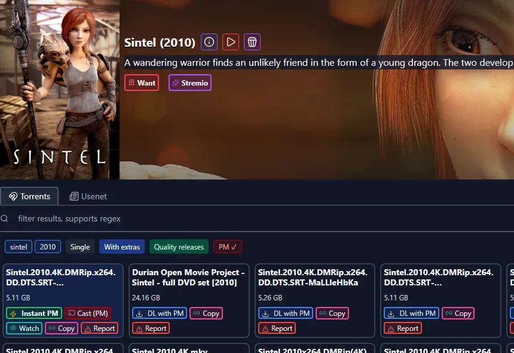

# Что такое DMM и как им пользоваться? {#what-is-dmm-and-how-do-i-use-it}

[Debrid Media Manager](https://debridmediamanager.com) (DMM) — это бесплатный сайт, на котором можно найти фильмы и сериалы и добавить их в ваш аккаунт debrid: Real-Debrid, AllDebrid, TorBox, Premiumize, Offcloud или Debrid-Link. Вы входите в этот аккаунт, ищете название и нажимаете **Instant RD** (или кнопку вашего сервиса) у нужного релиза. Он сразу появится в вашей библиотеке и будет готов к просмотру прямо в DMM, в Stremio или Kodi, либо в Plex через [zurg](../zurg/index.md).

DMM имеет открытый исходный код и не входит в состав Real-Debrid или других сервисов. Файлы хранятся в вашем debrid-сервисе.

## Вход {#sign-in}

1. Откройте [debridmediamanager.com](https://debridmediamanager.com) и нажмите на свой сервис: **Login with Real Debrid**, **Login with AllDebrid**, **Login with Torbox**, **Login with Premiumize**, **Login with Offcloud** или **Login with Debrid-Link**.
2. Для Real-Debrid нажмите **Sign in with Real-Debrid**. DMM покажет код: нажмите **Open real-debrid.com/device**, введите код там и подтвердите. Страница DMM завершит вход сама. Также можно вставить свой [API-токен](../guides/real-debrid-api-token.md) в поле **or paste an API key** и нажать **Save API Key**.
3. Для других сервисов следуйте их странице входа. Если там просят API-ключ, скопируйте его из своего аккаунта на этом сервисе, вставьте и нажмите **Save API Key**.

Есть ещё один сервис? Откройте **Debrid services** на главной странице DMM и нажмите его кнопку **Login**, например **AllDebrid Login**.

Есть только Easynews? Нажмите **Login with Easynews**. Искать в Easynews и отправлять в Stremio можно, но для библиотеки нужен аккаунт debrid. Спонсоры также могут войти через **Login with DMM key**.

## Поиск фильма или сериала {#search-a-movie-or-show}

1. Введите название в поле **Search movies & shows...** на главной странице. Выберите вариант из подсказок или нажмите **Search**, чтобы увидеть полный список.
2. Нажмите на постер. На странице фильма или сериала показаны релизы, которые нашёл DMM.
3. Нажмите на чип вашего сервиса над результатами (**RD**, **PM** и так далее), чтобы увидеть только релизы, которые уже есть у него.

## Что означают кнопки у релиза {#what-the-buttons-on-a-release-mean}

| Кнопка | Что делает |
|---|---|
| **Instant RD** (**Instant TB**, **Instant AD**, **Instant PM**, **Instant OC**, **Instant DL**) | Ваш сервис уже имеет этот релиз. Нажмите её, и он сразу окажется в вашей библиотеке. |
| **DL with RD** (**DL with TB** и так далее; **Add to DL** на Debrid-Link) | Сервиса этого релиза пока нет. Нажатие всё равно добавит его, и сервис сначала скачает его. Если хотите посмотреть сразу, выберите кнопку **Instant**. [Почему так происходит](../guides/torrent-being-downloaded-to-debrid.md). |
| **RD (100%)** (**PM (100%)** и так далее) | Релиз есть в вашей библиотеке. Число показывает, насколько продвинулась загрузка. Нажмите, чтобы удалить его из библиотеки. |
| **Check RD** (**Check AD**, **Check DL**) | Спрашивает у этого сервиса, есть ли у него этот релиз в кэше прямо сейчас. |
| **Cast (RD)** (**Cast (PM)** и так далее) | Отправляет релиз в Stremio. См. [DMM в Stremio](stremio.md). |
| **Watch** | Открывает вкладку **Ready to play**. Нажмите **Play**, и откроется ваш плеер. Выбрать плеер можно в **Settings** → **Video player**. |
| **Copy** | Копирует magnet-ссылку релиза и показывает **Magnet link copied.** Если в **Settings** отмечена опция **Download .magnet files instead of copy**, кнопка будет называться **Download** и сохранит файл .magnet. |
| **Report** | Отмечает плохой релиз: **XXX / Porn Content**, **Incorrect IMDB ID**, **Malware / Executable File**, а для сериалов ещё **Tagged for Wrong Season**. |

Вкладка **Usenet** рядом с **Torrents** показывает Usenet-релизы того же тайтла. **NZB** скачивает один из них. Чтобы отправить их в библиотеку, нужен Real-Debrid или TorBox. Есть Easynews? Добавьте его в **Settings**, и он тоже будет искаться здесь.

## Твоя библиотека {#your-library}

Нажмите **Library** на главной странице. Там показан весь список из аккаунтов, под которыми вы вошли: название, размер, статус и дата добавления.

- Ищите через **search by filename/hash/id, supports regex** или сузьте список кнопками **Movies**, **TV shows** и **Others**.
- Нажмите на строку, чтобы открыть её подробности и кнопки **Hashlist**, **Delete**, **Cast** и **Copy**. Значки в конце каждой строки делают то же самое.
- **Backup** сохраняет ваш список в файл `.dmm.json`. **RD Restore** (**PM Restore** и так далее) возвращает сохранённый список обратно.
- **Share List** превращает показанное или выбранное в [hash list](hashlists.md), которым другие люди могут добавить этот контент в свои аккаунты.
- **Delete List** удаляет всё показанное после подтверждения **Yes, delete!**. Сначала выполните поиск или выберите нужные элементы.

## Куда дальше {#where-to-go-next}

- [DMM в Stremio](stremio.md): смотрите то, что нашли в Stremio, с аддоном DMM Cast.
- [Хэш-списки](hashlists.md): добавьте в свою библиотеку целую общую коллекцию или поделитесь своей.
- [TorBox в DMM](torbox.md): какой тариф TorBox что даёт в DMM и как отправлять релизы Usenet в TorBox Pro.
- ["Torrent is being downloaded to debrid"](../guides/torrent-being-downloaded-to-debrid.md): что означает этот экран в Stremio и как DMM показывает, что уже закэшировано.
- [Кнопки DMM в Safari](safari.md): расширение для браузера добавляет кнопку DMM на IMDb, Trakt и другие сайты с фильмами и сериалами.

DMM также обслуживает другие проекты:

- **zurg** спрашивает у DMM, какой фильм или эпизод соответствует каждому файлу. Спонсор получает ключ API DMM в [gatekeeper](https://gatekeeper.debridmediamanager.com/). Без него zurg опирается на имена файлов, и совпадений находится меньше. Разницу объясняет [rex с zurg](../rex/with-zurg.md#why-dmm-places-the-files).
- **Sonarr Radarr и Prowlarr** могут искать в DMM как торрент-индексатор Torznab или Usenet-индексатор Newznab. Для обоих нужны активное спонсорство и ключ API DMM. Настройте их на страницах [Torznab](https://debridmediamanager.com/torznab) и [Newznab](https://debridmediamanager.com/newznab).
- **Ваш список желаемого**: нажмите **Want** или подпишитесь на список Trakt, MDBList или TMDB. zurg будет загружать его, как и новые эпизоды по мере выхода. Требуется спонсорство. См. [Список желаемого в DMM](../zurg/guides/dmm-wanted.md).
- **Seerr Overseerr и Jellyseerr** могут использовать DMM вместо Radarr и Sonarr. Тогда запросы попадают в ваш список желаемого, и zurg их загружает. Требуется спонсорство. См. [Seerr через DMM](seerr.md).
- **rex-direct** даёт заявленному rex собственный адрес и сертификат. См. [rex-direct](../rex/any-source.md#rex-direct).

Всё, что открывает спонсорство, и где что настраивается, описано на странице [Что даёт спонсорство](../guides/sponsorship.md).

## Если что-то не работает {#when-something-is-wrong}

| Что вы видите | Что делать |
|---|---|
| **Real-Debrid отклонил этот API-ключ.** | Токен, который вы вставили, не рабочий. Скопируйте его заново с [real-debrid.com/apitoken](https://real-debrid.com/apitoken) или нажмите **Sign in with Real-Debrid**. Подробнее в [Your Real-Debrid API token](../guides/real-debrid-api-token.md). |
| **That code expired before it was approved. Try again.** | Код Real-Debrid истёк. Нажмите **Sign in with Real-Debrid** ещё раз и подтвердите новый код быстрее. |
| **Your TorBox account is on the free plan, which has no API access. DMM needs a paid TorBox plan.** | Бесплатный тариф TorBox с DMM не работает. Перейдите на платный тариф или войдите через другой сервис. |
| Only **DL with RD** buttons, no **Instant RD** | В вашем сервисе нет кэша для этих релизов. Нажмите одну из кнопок и дождитесь загрузки или попробуйте другой релиз. |

Застряли? Спросите на форуме **dmm-support** в [Discord](https://discord.com/invite/7u4YjMThXP). В [Получение помощи](../guides/remote-help.md) описано, что нужно указать.

## Вопросы {#questions}

### Что такое DMM на самом деле? {#what-actually-is-dmm}

Поисковый сайт для вашего аккаунта в дебрид-сервисе. Он находит релизы фильма или сериала, показывает, какие из них уже есть в вашем сервисе, и добавляет выбранный вами в аккаунт. Сам DMM никакие файлы не хранит.

### Как им пользоваться? {#how-do-i-use-it}

Войдите в свой debrid-сервис, найдите тайтл, откройте его и нажмите **Instant RD** (или кнопку **Instant** вашего сервиса) у нужного релиза. Затем нажмите **Watch**, отправьте в Stremio или дайте zurg добавить его в Plex.

### DMM делает Real-Debrid? {#is-dmm-made-by-real-debrid}

Нет. DMM — это проект с открытым исходным кодом, который работает с Real-Debrid и пятью другими сервисами. Люди часто ищут его как «Real-Debrid Media Manager».

### Это бесплатно? {#is-it-free}

Да. Нужен свой аккаунт debrid, это платный сервис. Спонсорство DMM добавляет дополнительные возможности, например список желаемого и индексаторы: см. [Что даёт спонсорство](../guides/sponsorship.md).

### Какие сервисы работают? {#which-services-work}

Real-Debrid, AllDebrid, TorBox (платные тарифы), Premiumize, Offcloud и Debrid-Link. Easynews подходит для поиска и трансляции, но не для библиотеки.
