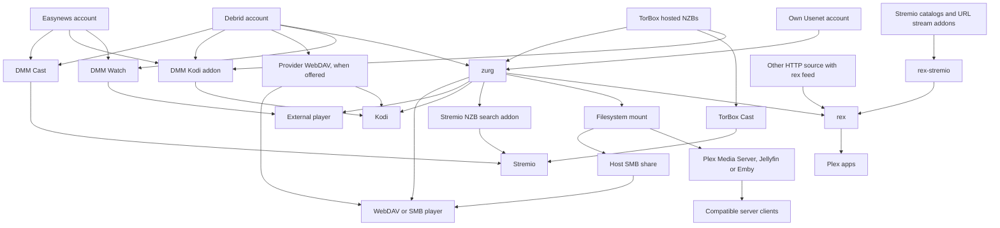
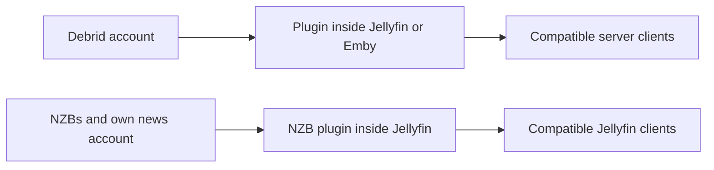
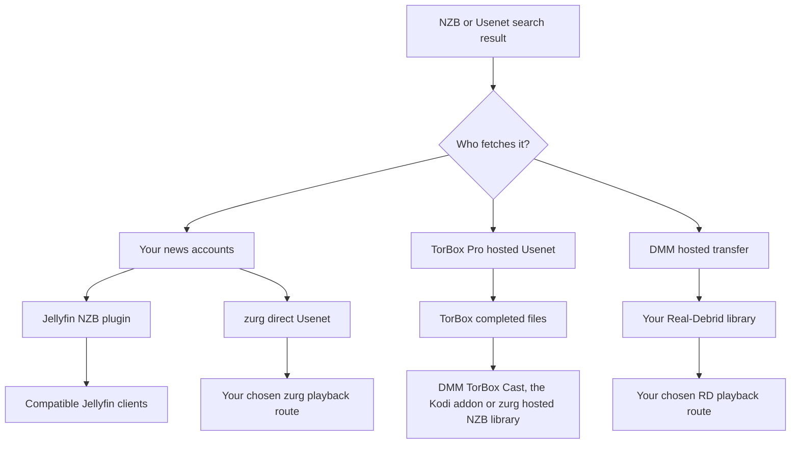

# Какую схему выбрать? {#which-setup-should-i-use}

**[Найдите свою настройку с помощью интерактивной анкеты](https://debridmediamanager.com/choose-your-setup).** Ответьте на несколько вопросов о ваших аккаунтах в плеерах и хостинге. Анкета подскажет подходящие маршруты, требования и ссылки на настройку. Вход в аккаунт не нужен.

**Начните с приложения, в котором хотите смотреть.** Вам не нужны все компоненты. DMM помогает выбирать релизы. Провайдер предоставляет файлы. zurg может превратить их в общую библиотеку. rex показывает библиотеку приложениям Plex. Некоторые маршруты обходятся без части компонентов.

Эта схема охватывает поддерживаемые маршруты, проверенные **10 ноября 2026**. Она включает внешние альтернативы, которые убирают один из шагов. Сторонние дополнения и устройства могут работать иначе. Следуйте по ссылке на руководство и его проверенным ограничениям.

## Выбирайте по тому, чем вы уже пользуетесь {#pick-by-what-you-already-use}

На телефоне прокручивайте таблицу влево и вправо, чтобы увидеть все столбцы.

| Что у меня есть / чего я хочу… | Выберите этот путь | Почему выбрать? | Что нужно учесть |
|---|---|---|---|
| Stremio и аккаунт debrid или Easynews; сервер не нужен | **DMM Cast → Stremio**, или ваш существующий стрим-аддон | Смотрите через свой аккаунт без запуска zurg, rex или медиасервера | Аддон и провайдер должны выдавать воспроизводимый поток; воспроизведение идёт на устройстве |
| Kodi и аккаунт debrid, Easynews или TorBox Pro | **Kodi-аддон DMM → ваш аккаунт** | Просматривайте, ищите и смотрите прямо в Kodi; подключайте через телефон. Библиотека TorBox в аддоне включает загрузки размещённых NZB | Воспроизведение идёт через Kodi. Список Wanted спонсора всё равно требует zurg для выполнения запросов |
| Один фильм, чтобы посмотреть в моём обычном плеере | **DMM Watch → внешний плеер** | Сервер библиотеки не нужен | Установите поддерживаемый плеер и выберите файл, который он может воспроизвести |
| Infuse, Kodi или другой WebDAV-плеер | **Provider WebDAV** без хоста; **zurg → WebDAV-плеер**, если хост может работать постоянно | Просматривайте облачную библиотеку без Plex, Jellyfin, Emby или rex | Real-Debrid, AllDebrid, Premiumize, TorBox и Debrid-Link предоставляют свой WebDAV со своей структурой папок. У Offcloud его нет, поэтому нужен zurg. zurg требует хост, который остаётся включённым во время просмотра |
| Plex Media Server уже работает | **zurg → смонтированная папка → Plex Media Server → приложение Plex** | Сохраните свой сервер, его библиотеки и привычные рабочие процессы | Запустите zurg и файловое монтирование рядом с сервером; сканирования читают удалённые файлы |
| Приложения Plex, но не хочется поддерживать смонтированную библиотеку | **zurg → rex → приложение Plex** | zurg передаёт библиотеку в rex без монтирования и Plex Media Server | Оба сервиса должны работать постоянно; проверьте совместимость rex с приложениями и инструкции по аккаунтам |
| Аддоны Stremio, но я предпочитаю приложения Plex | **Аддоны → rex-stremio → rex → приложение Plex** | Превращайте каталоги аддонов в библиотеки Plex; zurg необязателен | Запустите rex и rex-stremio; стрим-аддоны должны возвращать воспроизводимые URL, а не сырые торренты |
| Jellyfin — через него мои плееры получают доступ к библиотеке | **Плагин провайдера внутри Jellyfin → совместимый клиент** | Без отдельного сервиса zurg и без монтирования | Jellyfin 12 и подходящий плагин(ы); у плагинов свои ограничения на архивы |
| Emby — через него мои плееры получают доступ к библиотеке | **Плагин провайдера внутри Emby → совместимый клиент** | Всё остаётся внутри существующего сервера Emby | Используйте поддерживаемую версию Emby; эти шесть плагинов работают с debrid, но не с прямым Usenet |
| Jellyfin/Emby, плюс другим потребителям нужен собственный доступ к файловой системе/WebDAV | **zurg → монтирование → Jellyfin/Emby** | Одна библиотека может обслуживать несколько потребителей | Поддерживайте пути монтирования и сервера; другие потребители могут использовать zurg напрямую |
| Файлы NZB, мой собственный аккаунт Usenet и Jellyfin | **NZB-плагин внутри Jellyfin → совместимый клиент** | Стримьте NZB без отдельного сервиса zurg | Доступ NNTP и поддерживаемая версия Jellyfin; плагин исключает сжатые и зашифрованные элементы архивов и не восстанавливает файлы через PAR2 |
| Аппаратный плеер, который читает SMB-шары | **zurg → монтирование → SMB-шара хоста → плеер** | Сохраните родной файловый браузер плеера и воспроизведение | SMB предоставляет хост; сам zurg даёт WebDAV, а не SMB-сервер |
| Мой аккаунт Usenet и Stremio | **Индексатор Newznab → Stremio-аддон zurg → Stremio** | Поиск во время воспроизведения и стриминг через ваш новостной аккаунт | Работающий zurg, доступ к индексатору и учётные данные NNTP; другому устройству нужен доступный HTTPS-адрес аддона |
| Устройство Android/Google TV без другого компьютера | **zurg+rex на Android → плеер на этом устройстве, или приложения Plex на нём и вокруг вашего дома** | Запускайте zurg и rex на устройстве Android, свой сервер Plex на телефоне или ТВ-приставке. Это нужно для этого экрана и приложений Plex в вашем доме | Доступ спонсора, sideloading и фоновая работа; для Usenet нужен 64-битный Android; размещённые NZB TorBox на Android недоступны |
| Устройство Android/Google TV и аддоны Stremio, YouTube, Spotify или файлы на NAS | **rex для Android → приложения Plex на нём и вокруг вашего дома** | rex и его аддоны работают на устройстве, бесплатно и без компьютера | Sideloading и фоновая работа; стрим-аддоны должны возвращать воспроизводимые URL, а не сырые торренты; для файлов на NAS нужен аддон, который вы напишете сами. Для библиотеки debrid и Usenet спонсоры используют zurg+rex (строка выше) |
| Файлы уже на диске или NAS | **Существующий медиасервер или сетевой плеер**; **HTTP-источник → rex**, если хотите использовать rex | Продолжайте использовать свои файлы; аккаунт debrid или Usenet не нужен | rex нужны метаданные, переданные через его feed API, и HTTP-доступ к файлам; производитель фида и файловый сервер могут быть разными. rex не сканирует диски |
| Потоковое HTTP-медиа или мой собственный HTTP-сервер | **HTTP-источник + feed rex → rex → приложения Plex**, или совместимый плеер напрямую | Используйте существующий источник без debrid или zurg | rex нужен производитель фида, который передаст идентификатор и данные о медиа. Голый URL таких метаданных не даёт |

Начните здесь: [DMM Cast](https://debridmediamanager.com/stremio/) · [Kodi](https://debridmediamanager.com/kodi) · [Настройки DMM](https://debridmediamanager.com/settings) · [Настройка zurg](../zurg/setup/index.md) · [rex с zurg](../rex/with-zurg.md) · [rex с аддонами Stremio](../rex/stremio.md) · [Плагины Jellyfin](https://debridmediamanager.com/jellyfin) · [Плагины Emby](https://debridmediamanager.com/emby) · [Аддон Stremio для zurg](../zurg/guides/stremio.md) · [zurg+rex на Android](../zurg/guides/android.md) · [rex для Android](../rex/android.md) · [rex с любым источником](../rex/any-source.md).

Ссылка Cast начинается с Real-Debrid. Если вы используете [TorBox](https://debridmediamanager.com/stremio-torbox/), [AllDebrid](https://debridmediamanager.com/stremio-alldebrid/), [Premiumize](https://debridmediamanager.com/stremio-premiumize/), [Offcloud](https://debridmediamanager.com/stremio-offcloud/), [Debrid-Link](https://debridmediamanager.com/stremio-debridlink/) или [Easynews](https://debridmediamanager.com/stremio-easynews/), откройте страницу настройки для нужного аккаунта. Cast здесь означает **аддон DMM**. Это не Chromecast и не дублирование экрана.

## Карта воспроизведения {#the-playback-map}

Стрелки означают «поставляет библиотеку или воспроизводимый поток для». Это не схема маршрутизации пакетов: в зависимости от маршрута плеер может забирать данные у провайдера, а сервер может передавать байты сам.

[Открыть карту воспроизведения в полном размере](../assets/setup-routes/playback.svg), чтобы увеличить её или сохранить.

Ветке поиска NZB в Stremio нужен аккаунт NZB (`nzb` или `torbox_nzb` для релизов, которые уже есть у TorBox) и индексатор Newznab. Размещённые на TorBox NZB тоже воспроизводятся через TorBox Cast или аддон Kodi, без zurg. Ветке mount-to-SMB нужна отдельная общая папка, настроенная на хосте.

Два маленьких маршрута стоит держать отдельно:

[Открыть карту плагинов в полном размере](../assets/setup-routes/plugins.svg).

Плагины — это отдельные интеграции. «zurg» в названии плагина **не** означает, что нужно запускать приложение zurg. Также это не гарантирует те же возможности. Библиотека торрентов в плагине TorBox отделена от размещённого backend NZB в zurg.

## Выберите, откуда берутся файлы {#choose-where-the-files-come-from}

An **indexer** finds releases. A **torrent or NZB** describes how to fetch one. A **provider** supplies the bytes. A **player** decodes them. Access to one does not include the others.

| Input | What obtains/serves the video? | What you need | When it is useful |
|---|---|---|---|
| Cached torrent, magnet or torrent file | Your debrid provider | Аккаунт, который поддерживает выбранная тобой интеграция | Often the shortest wait when the exact release is already available |
| Uncached torrent | The debrid provider downloads it first | Аккаунт, который принимает торрент, доступные источники и место в его лимитах | A release you want is not cached; expect a wait and possible failure |
| NZB, using your own news accounts | zurg's **direct Usenet** backend, or Jellyfin's NZB plugin, reads articles as needed | NZB, доступ к NNTP и выбранная тобой интеграция; доступ к индексатору, если хочешь поиск | Choose your providers/backbones, use fallback accounts, avoid storing whole videos locally |
| NZB, using TorBox's hosted service | **TorBox fetches and repairs it**, then serves the completed files | TorBox Pro; отправь через DMM или через бэкенд zurg **TorBox hosted NZB** | You want NZBs without managing news-server credentials or local decoding |
| DMM Usenet result sent to Real-Debrid | DMM's hosted transfer service fetches it and passes it to **your Real-Debrid library** | Real-Debrid и доступный лимит передач DMM | You already watch through RD and want that release there; no personal NNTP account required |
| Easynews search result | Easynews serves a direct HTTP download/stream | Твой собственный аккаунт Easynews | Watch or Cast from DMM, or use its Easynews Cast/Kodi route, without building an NZB library |
| Direct HTTP(S) download link | A compatible player/HTTP source, or a provider supporting that download | Доступ к самому медиа-URL; подходящий аккаунт провайдера, если импортируешь или разблокируешь его там | You already have a file URL rather than a torrent/NZB |
| Files on your disk or NAS | Your file/media server | Локальное хранилище и плеер, который может до него достучаться | Offline ownership, home videos, or keeping an existing collection |

zurg supports **Real-Debrid, AllDebrid, TorBox, Premiumize, Offcloud and Debrid-Link**. You can combine accounts in one library. Caches quotas and file availability still differ. A cached badge is evidence, not a playback guarantee. See [providers](../zurg/providers/index.md).

### «Usenet без аккаунта Usenet»: какой путь выбрать? {#usenet-without-a-usenet-account-which-route}

[Открыть карту Usenet в полном размере](../assets/setup-routes/usenet.svg).

**Выбирайте TorBox hosted NZB**, когда хотите, чтобы TorBox сам скачивал и восстанавливал файлы. DMM отправляет туда NZB. Текущие ночные сборки zurg используют тип провайдера `torbox_nzb` и принимают NZB из каталога наблюдения и интерфейса SABnzbd. [TorBox hosted Usenet](../zurg/providers/torbox-nzb.md) описывает настройку zurg. Если релиза нет в кэше, перед воспроизведением нужно дождаться окончания загрузки. Загрузки делят слоты с торрентами. Сохранённые файлы могут истечь, и zurg не обещает загрузить истёкший релиз заново. Сохраните NZB на случай повторной загрузки.

**Выбирайте прямой Usenet**, когда zurg должен читать через ваши собственные аккаунты новостных серверов, включая резервные и блочные аккаунты. Для этого используется `nzb` с учётными данными NNTP. Сюда же относится логин на новостной сервер TorBox. Это отдельно от TorBox hosted NZB. См. [TorBox NNTP](../zurg/providers/torbox-news-server.md) и [его тарифы](https://torbox.app/pricing).

**Один экземпляр zurg использует либо `nzb`, либо `torbox_nzb`.** Оба управляют каталогом наблюдения за NZB. Запускайте оба с отдельными экземплярами и рабочими каталогами. Если `dmm_api_key` указан в обоих, [отключите источник `dmm-wanted` в одном из них](../zurg/guides/dmm-wanted.md#two-zurgs-on-one-key), иначе каждый релиз из Wanted будет загружаться дважды. Любой из них может работать вместе с торрент-провайдерами. Аддон zurg для Stremio отправляет свой выбор на тот NZB-аккаунт, который есть у экземпляра. При `torbox_nzb` запуск происходит только для релиза, который TorBox уже хранит, и только в пределах времени ожидания аддона и если нет другой ожидающей NZB-отправки.

**Выбирайте DMM → Real-Debrid**, когда хотите, чтобы релиз попал в вашу библиотеку RD. Это хостируемая передача с очередями и лимитами. Загрузка того, чего нет в кэше, занимает время. Real-Debrid и другие debrid-провайдеры не получают встроенной поддержки NNTP через это. Результат в DMM и [страница Transfers](https://debridmediamanager.com/transfers) показывают прогресс.

Easynews **Watch** и **Cast** воспроизводят его HTTP-файлы, а **Download NZB** сохраняет NZB релиза. **Send to zurg** отправляет этот NZB в ваш список Wanted спонсора. Для этого нужен настроенный NZB-бэкенд. Вход Easynews в DMM не настраивает NZB-аккаунт zurg.

### А что со ссылками HTTP? {#what-about-http-links}

DMM-диалог **Add** для TorBox принимает прямые ссылки HTTP(S) как веб-загрузки. zurg показывает их в `__downloads__`. Элемент там не становится автоматически распознанным элементом библиотеки rex. Там могут появляться и unrestricted-загрузки Real-Debrid. DMM TorBox Cast включает завершённые веб-загрузки, загрузки из Usenet и торренты. Веб-страницы всё равно могут требовать другую интеграцию из-за логинов, истекающих ссылок, DRM или собственного плеера.

**rex поддерживает потоковые медиафайлы по HTTP(S) через свой feed API.** [Источник или аддон](../rex/any-source.md) передаёт адрес медиафайла и метаданные. Затем rex делает его доступным в приложениях Plex. Файловый сервер и поставщик фида могут быть разными сервисами. Аккаунт zurg или debrid-сервиса не нужен. [rex-stremio](../rex/stremio.md) делает это для совместимых аддонов Stremio. Сырые магнет-ссылки и стримы, доступные только через торрент, не работают. Для HLS нужна настройка FFmpeg в rex. rex использует идентификацию, которую передаёт источник.

## Решите, как добавляются тайтлы {#decide-how-titles-get-added}

Получение и воспроизведение — это отдельные решения. Можно изменить способ запроса тайтла, не меняя приложение, в котором вы смотрите.

| Как вы выбираете тайтлы | Маршрут | Зачем это нужно? |
|---|---|---|
| Выберите точный релиз | DMM search/library → provider; или NZB → выбранный вами NZB-бэкенд | Сами контролируете издание, размер и релиз |
| Нажмите Want или подпишитесь на список Trakt/MDBList | [DMM Wanted](../zurg/guides/dmm-wanted.md) → zurg acquisition | Автоматические фильмы и новые серии без Sonarr/Radarr; нужно спонсорство |
| Семейные запросы в Seerr/Overseerr/Jellyseerr | [Seerr через DMM](../dmm/seerr.md) → Wanted → zurg | Знакомый интерфейс запросов без arr-сервера; нужно спонсорство. Seerr нужно настроить с сервером Plex, Jellyfin или Emby |
| Уже есть списки Plex или свой стек запросов | [zurg acquisition](../zurg/guides/acquisition.md) | Оставьте текущий источник запросов; настройте его поиск и целевые провайдеры |
| Нужны подробный мониторинг и профили качества в Sonarr/Radarr | DMM или ваши индексаторы → arr → интерфейс download-client zurg → библиотека | Решения arr и его workflow импорта остаются за ним; больше сервисов и настройки путей |
| Хотите выбирать только при нажатии Play | DMM Cast/Kodi, другой stream-аддон или поиск zurg в Stremio | Не нужно заранее собирать управляемую библиотеку всех тайтлов |

Для рекомендуемого маршрута DMM + zurg через arr **DMM — это индексатор, а zurg — клиент загрузки**. DMM предлагает [Torznab](https://debridmediamanager.com/torznab) и [Newznab](https://debridmediamanager.com/newznab). Оба требуют активного спонсорства. Prowlarr необязателен. zurg предоставляет интерфейсы [qBittorrent](../zurg/guides/sonarr-radarr-torrents.md) и [SABnzbd](../zurg/guides/sonarr-radarr.md). Отдельные приложения-загрузчики рядом с zurg не нужны. [zurg также умеет искать для arr](../zurg/guides/sonarr-radarr-fetch.md).

Если нужны **полные локальные копии**, скачайте файлы у провайдера или через zurg. Также можно использовать функцию офлайн-загрузки плеера или обычный загрузчик и дисковую библиотеку. Проверяйте квоты и воспроизводите сохранённые файлы без сети. Виртуальные файлы zurg, ссылки `.strm` и [локальные каталоги debrid](../zurg/guides/local-libraries.md) — не офлайн-копии. Локальные каталоги хранят только записи. Воспроизведение всё равно зависит от провайдера.

## Компромиссы, которые важно знать до установки {#the-tradeoffs-that-matter-before-installing}

| Вопрос | Что меняет ваш выбор |
|---|---|
| Должна ли другая машина оставаться включённой? | Размещённые маршруты Cast/Kodi, WebDAV провайдера и DMM Watch не требуют собственного сервера. zurg, rex, rex-stremio и плагины media-server нуждаются в своём хосте, пока вы смотрите. На устройстве Android zurg+rex запускает zurg и rex, а rex для Android запускает rex с его аддонами, включая аддоны Stremio. rex-stremio и плагины media-server всё равно нуждаются в обычном хосте. Арендованный или управляемый хост меняет того, кто его запускает, но не сам маршрут. |
| Сможет ли ваш телевизор проиграть файл? | Маршруты WebDAV и аддонов зависят от кодеков, звука и субтитров в плеере. zurg отдаёт байты, он не транскодирует видео. Plex Media Server, Jellyfin, Emby или rex с FFmpeg могут конвертировать при необходимости, если позволяют аппаратная часть и возможности сервера или приложения. |
| Сколько нужно места на диске? | Стриминг позволяет не хранить всю коллекцию целиком. Оставьте место для баз данных, постеров, кэшей и любой работы по восстановлению, транскодированию или офлайн-загрузке. «Без полной загрузки заранее» не значит «ноль использования диска». |
| Кто платит за трафик? | Квоты трафика провайдера всё равно действуют. Серверный прокси передаёт трафик воспроизведения и использует свою исходящую полосу. При прямом воспроизведении нагрузка на соединение ложится на зрителя. Анализ библиотеки тоже может читать удалённые файлы. |
| Будет ли это работать вне дома? | Размещённые аддоны позволяют не открывать ваш сервер. Самостоятельно развёрнутым сервисам нужен безопасно доступный адрес: одного адреса в локальной сети для удалённого доступа мало. См. [rex remote access](../rex/any-source.md#use-it-outside-your-home-optional) и [руководство по HTTPS для Stremio](../zurg/guides/stremio.md#installing-it-on-another-device). |
| Могут ли семья и друзья пользоваться одновременно? | Проверьте правила провайдера по IP и количеству одновременных подключений, а также модель совместного доступа на сервере. Real-Debrid нужно использовать с одного публичного IP. Прямые ссылки для разных домохозяйств могут нарушить это правило, даже если их выдала общая библиотека. Не включайте редиректы, пока не поняли, откуда берутся загрузки. |
| За что вы платите? | Подписки провайдеров, доступ к индексаторам, спонсорство DMM, хостинг и покупки плеера или сервера держите отдельно друг от друга. Базовый сайт DMM и rex для личного использования бесплатны, как и [rex для Android](../rex/android.md). zurg+rex, который также подключает вашу библиотеку debrid и Usenet к rex на Android, доступен только спонсорам. Актуальные ночные сборки zurg и распространение плагинов DMM — привилегии спонсоров. Для Wanted и API индексаторов DMM тоже нужно спонсорство. rex-stremio его не требует. В [What a sponsorship gives you](sponsorship.md) перечислены все преимущества и где их включить. |
| Гарантирует ли запись в каталоге воспроизведение? | Нет. Каталоги аддонов описывают тайтлы, облачные файлы могут истечь, у торрентов может не быть источников, а статьи Usenet могут отсутствовать. Выбирайте маршрут, при сбоях и ожидании которого вам комфортно. |

Совместимым клиентом сервера может быть и стороннее приложение. [Infuse подключается к Plex, Emby и Jellyfin](https://support.firecore.com/hc/en-us/articles/360006462093-Streaming-from-Plex-Emby-and-Jellyfin). Отдельное монтирование zurg может не понадобиться. Проверяйте плагин и клиент вместе.

Infuse поддерживает [WebDAV и другие сетевые шары](https://support.firecore.com/hc/en-us/articles/215090977-Streaming-From-a-Mac-PC-or-NAS). Файл `.strm` даёт совместимому плееру, например Kodi, URL. Это не универсальная замена монтированию. Проверяйте клиент и учитывайте, что прокси и переключение на резервный источник работают иначе. Не используйте `.strm` как обычную настройку для Plex Media Server.

Также есть [старый бесплатный релиз zurg](https://github.com/debridmediamanager/zurg-public/releases). Он работает только с Real-Debrid и использует другой формат конфигурации. Многопровайдерные маршруты Usenet и Android, описанные здесь, требуют ночные сборки для спонсоров.

**У rex есть собственные ограничения совместимости.** Это самостоятельный сервер приложений Plex. Он не является Plex Media Server и не является плагином Plex. Список протестированных устройств, удалённое воспроизведение с транскодированием и рекомендацию использовать новый аккаунт смотрите в [FAQ](../rex/faq.md). Обычный сервер Plex может работать рядом с rex.

## Потребности, которые могут изменить путь {#needs-that-can-change-the-route}

| Мне ещё нужно… | Что выбрать или проверить |
|---|---|
| Локальные файлы и облачные тайтлы вместе | Оставь свой текущий сервер Plex/Jellyfin/Emby и добавь маунт или подходящий плагин. rex умеет объединять несколько источников фидов, включая HTTP-источник для локальных файлов, но метаданные всё равно нужны им самим. |
| Автоматические файлы субтитров | Субтитров от плеера или встроенных может хватить. Если ты используешь arr-связку, [Bazarr с zurg](../zurg/guides/subtitles.md) записывает локальные сопутствующие файлы рядом с виртуальными видео. Эти файлы не доходят до DMM Cast, аддона Kodi, DMM Watch и аддона zurg для Stremio, но доходят до Kodi как источник zurg WebDAV. В rex есть Search Subtitles и без Bazarr. |
| История просмотров при смене сервера | Перед переключением прочитай [переход с Plex](../rex/from-plex.md) и [импорт статуса просмотра](../rex/import-watched.md). Смена источника сама по себе не переносит историю всех приложений. |
| Поделиться подборкой с человеком, у которого свой аккаунт | Хешлисты DMM позволяют делиться выбором релизов, чтобы другие добавили их в свои аккаунты. Они не передают твои учётные данные и не обеспечивают воспроизведение. Совместный доступ к серверу — это другой путь, и на него действуют свои правила шеринга и правила провайдера. |
| VPS или удалённый хост с ограниченной пропускной способностью | Проверь, проксирует ли маршрут воспроизведение или перенаправляет его. [Настройки rex для direct-download](../rex/direct-download.md) описывают доступные варианты. Перенаправления меняют публичный IP загрузчика и могут раскрыть URL провайдера. |

## Другие медиа и существующие настройки {#other-media-and-existing-setups}

- **Музыка:** [DMM Music](https://debridmediamanager.com/music/) даёт воспроизведение и загрузку с Real-Debrid прямо в браузере. [Источники музыки rex](../rex/music.md) подключаются к Plexamp и поддерживаемым приложениям Plex. Источником может быть аддон или zurg, настроенный для музыки. Не предполагайте, что аддон для фильмов и сериалов тоже даёт музыку.
- **Live TV:** [маршрут rex для Live TV](../rex/live-tv.md) даёт каналы и программу передач в поддерживаемых приложениях. Live-каналы из rex-stremio образуют библиотеку каналов, а это не тот же интерфейс программы передач. Проверьте, доступен ли источник. rex не поддерживает запись DVR.
- **Домашние видео, записи и фото:** используйте существующий медиасервер или [источник rex, которым вы управляете](../rex/addons.md). [Пошаговое руководство по домашним видео](../rex/addon-home-videos.md) показывает второй вариант. zurg также может передавать комиксы в rex как фото, но поддержка в приложениях различается.
- **Уже установленные аддоны Kodi/Stremio:** если ваш аддон уже даёт нужный вам опыт, оставьте его. DMM может стать местом, где вы выбираете и управляете релизами, не заменяя ваш плеер. Поддержка провайдеров, Usenet и HTTP в аддонах различается, и маршрут DMM не гарантирует совместимость со всеми аддонами.
- **Уже установлен другой монтировщик или загрузчик debrid:** прежде чем переключаться, посмотрите [варианты миграции](../zurg/migrate/index.md). Работающая настройка не требует дополнительного слоя только потому, что он существует.
- **Нативные приложения в разработке:** Usenet TV не является выпущенной настройкой из магазина приложений, которую здесь стоит рекомендовать. Yomu TV — отдельный проект для чтения и аудиокниг, а не маршрут для этого стека фильмов и сериалов. Ни то, ни другое не требуется для указанных выше маршрутов.

## Пять типичных стартовых вариантов {#five-common-starting-points}

1. **«У меня есть Stremio и RD.»** Начните с DMM Cast. Добавляйте zurg, только если нужна общая библиотека, автоматизация или другой клиент, которому он требуется.
2. **«У меня есть TorBox Pro, и я хочу NZB из этого поста.»** Отправьте NZB в TorBox через DMM. Для просмотра в Stremio используйте TorBox Cast, для Kodi — аддон Kodi, а для выбранного маршрута к библиотеке или плееру — размещённый бэкенд zurg для NZB.
3. **«У меня уже есть Jellyfin.»** Начните с плагина для вашего провайдера. Выбирайте отдельный zurg, если нужна его общая файловая система, автоматизация или более широкие возможности бэкенда.
4. **«Хочу приложения Plex, без монтирования и с моими текущими аддонами.»** Используйте rex-stremio вместе с rex. Используйте zurg как источник, если нужно открыть вашу управляемую библиотеку debrid/Usenet. Оба источника могут питать один и тот же rex.
5. **«У меня есть аккаунты новостных серверов, и я хочу Sonarr/Radarr.»** Используйте DMM Newznab или ваши текущие индексаторы, маршрут NZB/SABnzbd от zurg и маршрут воспроизведения из первой таблицы. Для постоянных локальных файлов выбирайте обычный загрузчик или явно сохраняйте полные копии: одни только виртуальные импорты не дают файлов для офлайн-доступа.

Всё ещё не уверены? Напишите **ваше устройство или плеер, существующие аккаунты, можно ли оставить хост включённым и нужно ли воспроизведение по запросу или автоматическая библиотека**. Обычно эти ответы определяют маршрут. В разделе [Getting help](remote-help.md) написано, где задать вопрос.
