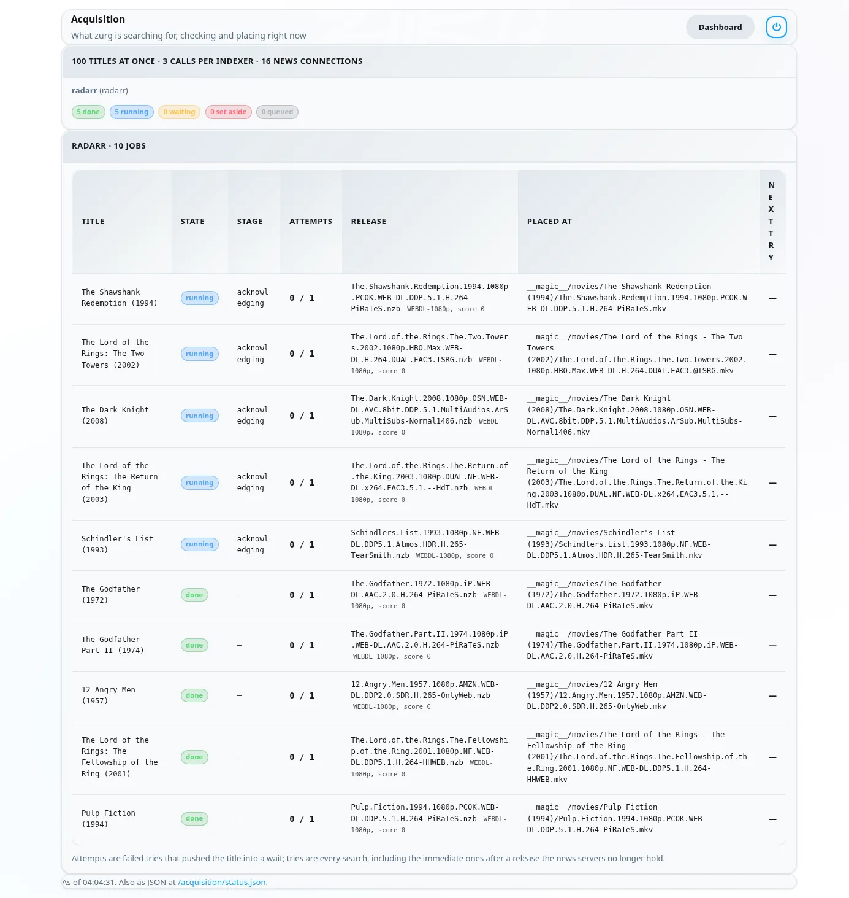

# Пусть zurg забирает то, что нужно Sonarr и Radarr {#let-zurg-fetch-what-sonarr-and-radarr-want}

Есть три способа использовать Sonarr и Radarr с zurg. Главный выбор — кто ищет: zurg или \*arrs. [Какой выбрать](#which-one-to-pick) — там они сравниваются.

| Guide | Who searches | zurg acts as | You need |
|---|---|---|---|
| [Usenet](sonarr-radarr.md) | Sonarr and Radarr | a SABnzbd | a Usenet account (or TorBox Pro for the `torbox_nzb` backend) and Usenet indexers in Prowlarr or the \*arrs |
| [Torrents](sonarr-radarr-torrents.md) | Sonarr and Radarr | a qBittorrent | a debrid account and torrent indexers in Prowlarr or the \*arrs |
| [zurg searches](sonarr-radarr-fetch.md) | zurg | no download client at all | a Usenet, TorBox Pro or debrid account, and Newznab or Torznab indexers in zurg's own config |

Первые два можно запускать вместе. Они используют одну и ту же папку `__magic__`.

### Какой вариант выбрать {#which-one-to-pick}

| | zurg ищет | Sonarr и Radarr ищут |
|---|---|---|
| Индексеры добавляются в | `config.yml` zurg, и после изменения нужен перезапуск | Prowlarr или сами \*arr, как обычно |
| Для \*arr нужны | корневые папки внутри `__magic__`, больше ничего | zurg в качестве клиента загрузки, с папкой загрузок и корневыми папками на одном томе |
| Первый файл — это | самый быстрый из тех, что разрешает ваш профиль, позже улучшается до cutoff | тот, который \*arr ставит выше всех в вашем профиле |
| Аниме, ежедневные шоу и спешлы | обрабатываются начиная с ночной сборки от 5 ноября 2026 | обрабатываются |
| Ручной поиск, очередь, история, черный список | нет. Файл появляется, и \*arr пересканирует | работают как обычно |
| [`exclude_words`](acquisition.md#excluding-releases-by-name) в zurg | действует | не действует. Заблокируйте те же слова в \*arr |

Оба варианта проверяют релиз до того, как \*arr его импортирует. Мёртвый пост Usenet или торрент, которого нет в вашем аккаунте, никогда не будет поставлен в очередь.

На свежей установке начните с поиска через zurg. Настраивать здесь меньше, и не нужно разбираться с раскладкой томов. Если хотите выбирать релизы вручную, используйте маршрут через клиент загрузки. Если вам важнее дождаться лучшего релиза по вашему профилю, а не взять быстрый первый файл, включите [`best_first`](acquisition.md#taking-the-profiles-best-first).

Radarr и Sonarr отвечают за список и библиотеку. Загрузкой занимается zurg. Добавьте фильм или сериал как обычно, и zurg найдёт релиз у ваших индексеров. Он проверит, что NZB ещё есть на новостных серверах (для аккаунта `torbox_nzb` его загрузил TorBox), или что торрент уже есть в вашем debrid-аккаунте. Затем он положит файл в его папку внутри `__magic__` и попросит Radarr или Sonarr пересканировать. Ничего не скачивается для импорта и ничего не копируется.

Radarr и Sonarr для этого не нужны ни индексеры, ни клиент загрузки. Они ничего не ищут и ничего не забирают. Ваш профиль качества по-прежнему решает, что zurg имеет право взять.

Скриншоты сделаны на сборке zurg, которая входит в ночную сборку от 26 сентября 2026, с Radarr 6.3.0.10514 и Sonarr 4.0.20.3014 в Docker. Оба видели монтирование zurg по пути `/mnt/zurg` внутри своих контейнеров. Ничего в них не изменялось.

## Перед началом {#before-you-start}

1. **zurg має акаунт Usenet або debrid і принаймні один індексатор Newznab або Torznab.** Індексатори вказуються в конфігурації zurg у `acquisition.indexers`. Про цей блок розповідається на сторінці [Watchlist and Seerr](acquisition.md).
2. **`magic.enabled` має бути `true`.** Джерела Radarr і Sonarr не запустяться без цього, і в логу про це буде написано. Див. [`__magic__`](magic.md).
3. **Radarr і Sonarr бачать mount zurg.** Якщо встановити їх як звичайні застосунки, у кожної системи є одна особливість, перелічена в [гайді про Usenet](sonarr-radarr.md#before-you-start). У Docker на Linux-хості це означає прив'язку mount до їхніх контейнерів. Прив'яжіть батьківську папку mount один раз і працюйте з усім через неї. Якщо вони також беруть завантаження від zurg як download client, то два volume для папки завантажень і кореневих папок призводять до копіювання кожного імпорту. Див. [один volume](sonarr-radarr.md#one-volume-for-the-download-folder-and-the-root-folders).
4. **Ви використовуєте nightly від 26 вересня 2026 або новішу.** Старіші збірки не знають джерел `radarr` і `sonarr`.

## 1. Расскажите zurg про Radarr и Sonarr {#1-tell-zurg-about-radarr-and-sonarr}

Добавь источник `radarr` и источник `sonarr` в блок `acquisition` в `config.yml` и перезапусти zurg. Для этого блока пока нет формы в дашборде. Убери тот, который не используешь.

```yaml
acquisition:
  quality: best
  indexers:
    - name: my-indexer
      url: https://indexer.example
      api_key: YOUR_INDEXER_API_KEY
  sources:
    - name: radarr
      type: radarr
      enabled: true
      url: http://radarr:7878         # http://localhost:7878 when Radarr is an ordinary app beside zurg
      api_key: YOUR_RADARR_API_KEY
      library_path: /mnt/zurg/__magic__
      check_every_secs: 30
    - name: sonarr
      type: sonarr
      enabled: true
      url: http://sonarr:8989         # http://localhost:8989 likewise
      api_key: YOUR_SONARR_API_KEY
      library_path: /mnt/zurg/__magic__
      check_every_secs: 30
```

`url` и `api_key` берутся из самого приложения. API-ключ находится в **Settings > General** в обоих. `check_every_secs` — это как часто zurg спрашивает, что им нужно. Каждый опрос — это один запрос списка. Оба источника используют одни и те же индексаторы.

`library_path` — это место, где приложение видит каталог `__magic__` zurg. zurg нужен этот путь, чтобы превратить папку Radarr в место внутри `__magic__`. При конфиге выше фильм, который Radarr хранит в `/mnt/zurg/__magic__/movies/Heat (1995)`, попадает в `movies/Heat (1995)` внутри `__magic__` zurg. Пути Windows, например `Z:\__magic__`, работают так же. Не указывай `library_path` только тогда, когда приложение работает на том же хосте, что и zurg, и видит тот маунт, куда zurg его монтирует.

`concurrency` — это сколько тайтлов zurg обрабатывает одновременно. По умолчанию это восемь. Большой список нормально работает и со значением по умолчанию. Просто будет дольше.

## 2. Положите корневые папки внутрь `__magic__` {#2-put-the-root-folders-inside-__magic__}

Корневая папка должна находиться внутри `__magic__` и на один уровень ниже. Правильный вид такой: `/mnt/zurg/__magic__/movies` для Radarr и `/mnt/zurg/__magic__/tv` для Sonarr (`/Volumes/Zurg/__magic__/movies` на macOS, `Z:\__magic__\movies` на Windows). Не `__magic__` целиком и не `__magic__/__all__`. Тайтл, чья папка находится в другом месте, пропускается, и zurg один раз пишет об этом в своём логе.

В Radarr откройте **Settings > Media Management** и добавьте корневую папку.


У Sonarr такая же страница. Добавьте его корневую папку в разделе **Root Folders**.


**Season Folder Format** на странице Sonarr — это имя, которое zurg даёт новой папке сезона. Сезон, в котором уже есть файлы, остаётся в той папке, где они лежат. Свободное место, которое показывает любое из приложений, — это то, что сообщает монтирование. Ни одно из приложений никогда туда не пишет.

## 3. Добавляйте тайтлы с отключённым поиском {#3-add-titles-with-search-off}

Добавляйте фильмы и сериалы так же, как и раньше: вручную, из списка или из приложения для запросов. Меняется только поиск. Искать будет zurg, поэтому arrs искать не должны.

### Radarr

Это руководство использует список импорта. Откройте **Settings > Import Lists** и добавьте или измените свой.


В настройках списка оставьте **Enable Automatic Add** включённым, а **Search on Add** выключите. Выберите профиль качества и корневую папку из шага 2. Установите **Minimum Availability** на нужное значение. zurg ждёт, пока Radarr сочтёт фильм доступным, и только потом начинает его искать.


Когда вы добавляете один фильм вручную, тот же переключатель называется **Start search for missing movie**. Его тоже оставьте выключенным.

### Sonarr

Когда вы добавляете сериал вручную, оставьте галочки **Start search for missing episodes** и **Start search for cutoff unmet episodes** снятыми. **Monitor** определяет, что zurg будет искать. Этот сериал настроен на первый сезон.


В настройках списка импорта в Sonarr есть такой же переключатель. Выключите и его.

## 4. Оставьте индексаторы и клиенты загрузки пустыми {#4-leave-indexers-and-download-clients-empty}

Вот и вся настройка на стороне arr. Страница Indexers может оставаться пустой.


Страницу download clients тоже можно оставить пустой.


С Sonarr то же самое. Если в любом из приложений уже есть indexers и download client от прошлой настройки, они продолжат работать. Тогда приложение будет искать раздачи параллельно с zurg для тех же тайтлов. Отключи автоматический поиск на этих indexers или удали их для тайтлов, за которые отвечает zurg.

## 5. Смотрите, как всё работает {#5-watch-it-work}

Откройте дашборд zurg. **Acquisition** — это новый пункт в быстрых ссылках.


На странице показаны все тайтлы, над которыми сейчас работает zurg, и что он с ними делает прямо сейчас. Те же данные доступны по адресу `/acquisition/status.json`, если хотите читать их из скрипта.

### Фильмы {#movies}

Это список из десяти фильмов примерно через полминуты после того, как Radarr их добавил. У пяти уже есть файл, и Radarr сообщают о них. Остальные готовы.



Каждая строка это один фильм. **State** показывает, на каком он этапе. **Stage** показывает, что zurg делает с ним прямо сейчас. Сначала он опрашивает индексаторы. Потом оценивает кандидатов. Затем читает NZB выбранного релиза и проверяет пост на новостных серверах. Наконец раскладывает файл по месту. **Release** это пост, который взял zurg, и то, что из него сделал парсер Radarr. **Placed at** это путь внутри `__magic__`, где сейчас лежит видео. Если новостные серверы больше не хранят раздачу, zurg сразу переходит к следующему кандидату. Если подходящего варианта нет, название откладывается, а причина показывается в строке.

Через минуту всё готово.


### Сериалы {#series}

Сезоны Sonarr появляются на той же странице. Одна строка — это один сезон или один файл эпизода, который zurg обновляет. Вот два сериала, у которых первый сезон стал отслеживаться через полминуты после добавления. Оба сезона уже вышли в эфир и файлов не было, поэтому zurg попробовал взять сезонный пак для каждого. Пак Severance уже лежит в папке своего сезона, и Sonarr об этом сообщили. Пак Only Murders проверяется на новостных серверах.


Примерно через две минуты после добавления оба сезона готовы. В паке Only Murders не хватало частей на новостных серверах. zurg отложил его и вместо этого взял десять эпизодов по одному. В его строке показан последний размещённый эпизод.


## 6. Что показывают Radarr и Sonarr {#6-what-radarr-and-sonarr-show}

Библиотеки заполняются по мере того, как проходят пересканирования. Каждый фильм из этого списка уже имеет свой файл.


На странице фильма виден файл в его папке внутри `__magic__`, с качеством, которое Radarr определил по названию.


В Sonarr все десять эпизодов имеют свои файлы в папке сезона, с качеством, которое Sonarr определил по каждому названию.


**Activity** в обоих приложениях остаётся пустой. Нет записей в очереди и нет событий grab или import, потому что ничего не захватывалось. Файл просто появился в папке, а пересканирование, которое запросил zurg, его подхватило.


Из этого следуют две вещи. Чёрный список arr-приложений никогда не заполняется. zurg ведёт собственный учёт публикаций, которых новостные серверы больше не хранят, и не выбирает их снова. А название, которое вы удаляете в Radarr или Sonarr, не удаляется из вашего аккаунта. Файл снова появляется в `__all__`, как любой другой релиз.

## Как zurg выбирает релиз {#how-zurg-picks-a-release}

Ваш профиль качества — это шлюз. Каждый релиз, который zurg собирается взять, сначала проходит через собственный парсер приложения. Название должно быть правильным. Качество должно быть разрешено профилем. Оценка пользовательского формата должна достигать минимума профиля. Размер должен укладываться в лимиты в разделе **Settings > Quality**. Релиз, который не проходит какую-либо из этих проверок, не берётся.

### Фильмы {#movies-1}

Среди релизов, которые разрешает профиль, zurg берёт первый, который быстрее всего проверить. Посты с одним видеофайлом идут первыми, потому что их чаще всего ещё можно получить полностью с новостных серверов. Веб-релизы идут раньше Blu-ray по той же причине. Многотомные архивы используются как запасной вариант.

Порядок предпочтений профиля вместо этого работает через апгрейды. Если профиль разрешает апгрейды, а размещённый файл ниже порога (cutoff), zurg ищет лучший релиз, когда у фильма он появляется. Заменить файл может только строго лучший релиз. Более низкое качество никогда не берётся.

Фильм с датой в будущем ждёт, пока Radarr не отметит его как доступный. Поиск, который находит не тот фильм, отклоняется, потому что Radarr не сопоставляет название ни с одним фильмом в вашей библиотеке.

### Сериалы {#series-1}

Сезон — это одна единица работы. Когда отсутствуют все серии сезона и сезон уже закончил выходить, zurg сначала пробует сезонный пак. Иначе он берёт недостающие серии по одной. Сезон, в котором уже есть какие-то файлы, никогда не получает пак. Иначе в папке появились бы вторые копии этих серий.

Релиз должен относиться к этому сериалу и этому сезону. Пак должен быть целым сезоном. Релиз одной серии должен содержать только эту серию. Ограничение по размеру относится к длительности серий, которые содержит релиз.

Когда для одной серии сезона у zurg ничего нет, а остальные всё равно размещены, Sonarr узнаёт о них сразу. Недостающую серию ищут снова позже, по обычному расписанию повторных попыток.

Файл серии ниже cutoff считается апгрейдом, если профиль разрешает апгрейды. Ниже cutoff означает ниже cutoff по качеству или ниже cutoff по оценке custom format. zurg считает оба случая так же, как это делает правило апгрейда Sonarr. Список **Cutoff Unmet** в Sonarr показывает только первый. Апгрейд заменяет только свою серию, а остальная папка сезона остаётся на месте.

## На что обратить внимание {#things-to-know}

**Любое изменение блока `acquisition` в `config.yml` требует перезапуска.** zurg читает файл только при запуске.

**Пересканирование — последний шаг, и оно стоит в очереди за собственной работой приложения.** Сразу после того, как список добавит много фильмов, Radarr сначала обновляет каждый из них. Файлы к этому моменту уже на месте, пока это идёт.

**Analyse video files читает начало каждого файла через монтирование.** Работает. Это также самая медленная часть большого списка. Оставь включённым, если только не знаешь, что тебе не нужна медиаинформация.

**Неотслеживаемые тайтлы не трогаются.** Это касается фильмов, сериалов, сезонов и серий. Также не трогаются тайтлы, папка которых находится вне `__magic__`.

**Аниме, ежедневные шоу и спешлы требуют nightly-сборки от 5 ноября 2026 года или новее.** Серии ежедневного шоу ищутся по дню выхода, серии аниме — по номеру, под которым шоу их считает (`Jujutsu Kaisen - 30` — это шестая серия второго сезона), а спешлы ищутся как сезон 00. Файл, положенный для аниме или ежедневного шоу, называется `JUJUTSU KAISEN - S02E06 - <the release's own name>`, потому что пересканирование Sonarr определяет файл только по имени и иначе отнесло бы `2nd Season - 06` к первому сезону. Спешл, названный только своим заголовком, без `S00Exx`, не сможет быть сопоставлен, и Sonarr тоже. На старой сборке каждый такой сериал пропускается с одной строкой в логе.

Полное описание обоих источников есть в [Watchlist и Seerr](acquisition.md).
