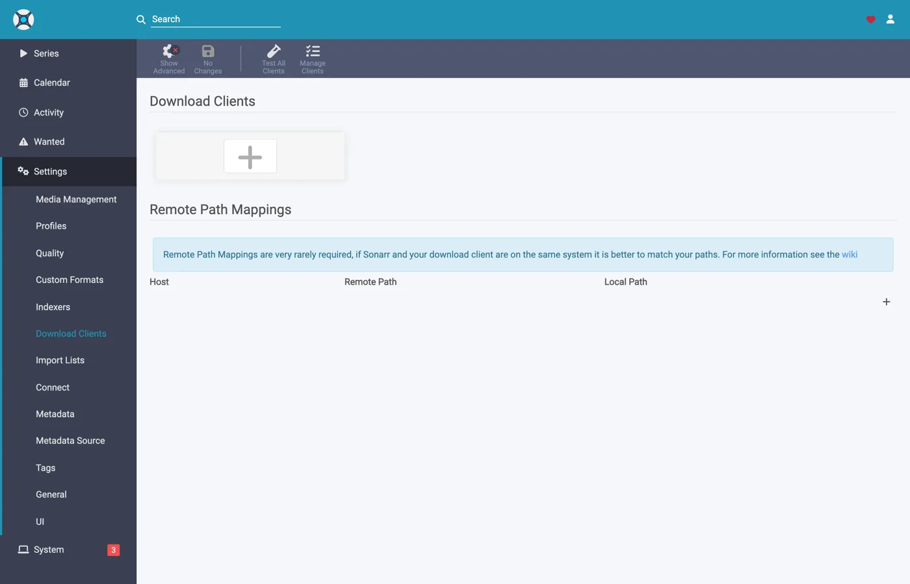
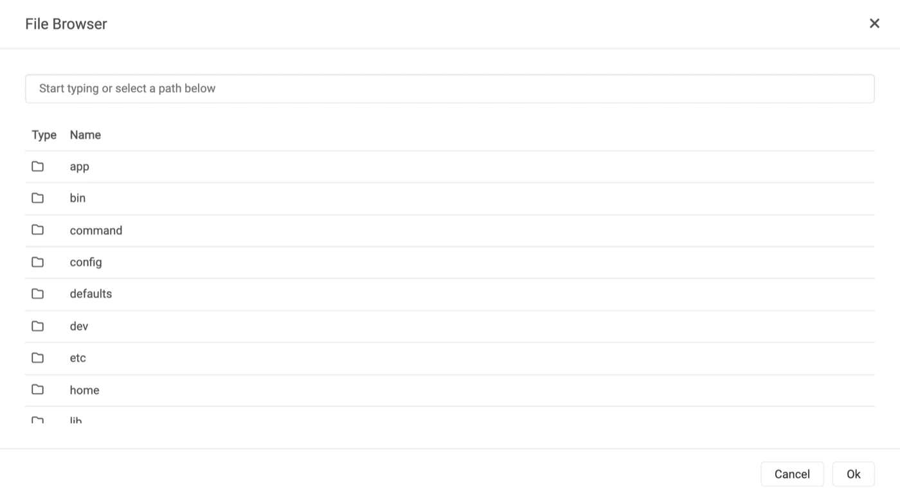
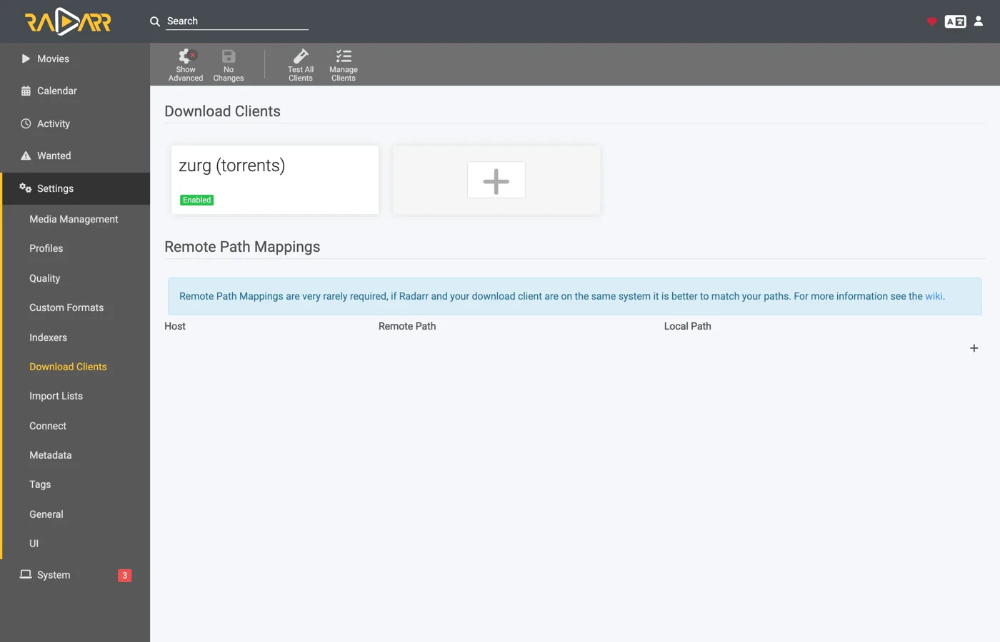
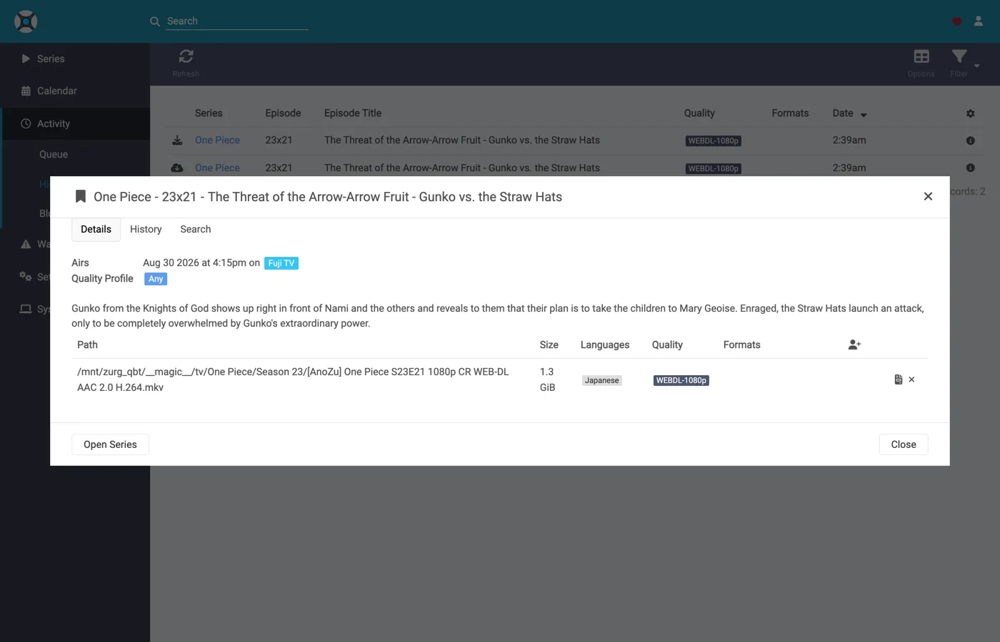
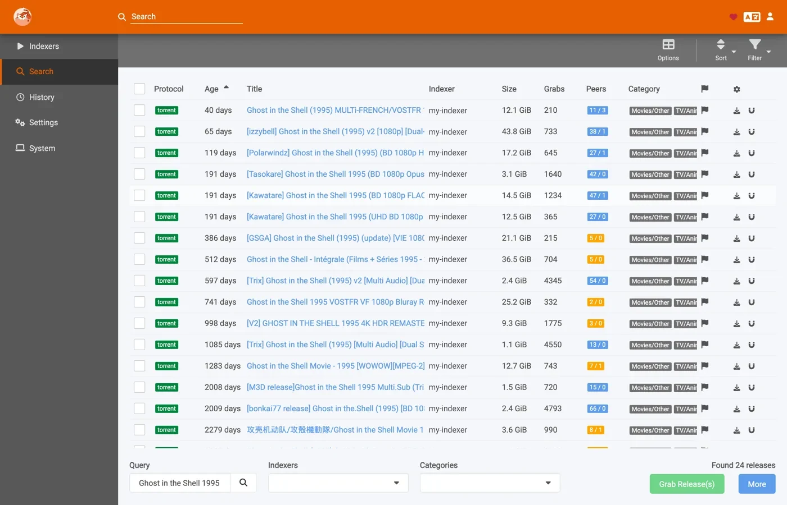

# Sonarr и Radarr с торрентами, пошагово {#sonarr-and-radarr-with-torrents-step-by-step}

Есть три способа использовать Sonarr и Radarr с zurg. Главный выбор: кто ищет, zurg или \*arrs. [Какой выбрать](sonarr-radarr-fetch.md#which-one-to-pick), там они сравниваются.

| Руководство | Кто ищет | zurg работает как | Что нужно |
|---|---|---|---|
| [Usenet](sonarr-radarr.md) | Sonarr и Radarr | SABnzbd | аккаунт Usenet (или TorBox Pro для бэкенда `torbox_nzb`) и Usenet-индексаторы в Prowlarr или \*arrs |
| [Torrents](sonarr-radarr-torrents.md) | Sonarr и Radarr | qBittorrent | аккаунт debrid и торрент-индексаторы в Prowlarr или \*arrs |
| [zurg searches](sonarr-radarr-fetch.md) | zurg | вообще никакого клиента загрузки | аккаунт Usenet, TorBox Pro или debrid, и индексаторы Newznab или Torznab в собственном конфиге zurg |

Первые два могут работать одновременно. Они используют одну и ту же папку `__magic__`.

[Предыдущая инструкция](sonarr-radarr.md) настраивала \*arrs на zurg для Usenet, где zurg отвечал как SABnzbd. Это вторая половина: zurg отвечает как **qBittorrent**, \*arrs отдают ему magnet или `.torrent` вместо NZB, а релиз уходит на аккаунт debrid, а не на новостной сервер. Импорт тот же трюк: переименование внутри `__magic__`, ничего не скачивается для импорта, ничего не копируется.

**Что именно отправляет \*arr, имеет значение.** `.torrent` обычно загружается в аккаунт как сам файл, а magnet добавляется только по info hash. В режиме только кэша (по умолчанию) TorBox и Debrid-Link получают info hash, потому что так они отказывают в релизе, которого нет в кэше, не добавляя его. Magnet заставляет аккаунт самому определить, что лежит в торренте, по хешу. У хеша приватного трекера нет публичного роя, по которому это можно выяснить. Real-Debrid падает с `magnet_error` без файлов, а TorBox принимает такой magnet и застревает в `checking` без списка файлов, без размера и с оценкой в сто дней, так что загрузка ни падает, ни завершается. Файл `.torrent` передает хеш напрямую в поиск по кэшу аккаунта, поэтому контент, который уже есть в аккаунте, добавляется сразу, без всякого разрешения magnet. Именно поэтому приватные индексаторы здесь работают: их релизы добавляются ровно тогда, когда контент уже есть в аккаунте, а для всего, чем делится сообщество, это обычный случай. Указывайте \*arr на индексатор, который отдает файлы `.torrent`, а не magnet. Приватные как раз так и делают.

Всё, что ниже, снято с zurg `2026.08.30.0459-nightly-73-g5b4c9790`, Sonarr `4.0.19.2979`, Radarr `6.3.0.10514` и Prowlarr `2.5.2.5491`, на рабочей установке с настоящим аккаунтом AllDebrid. Имена хоста и пользователя заменены на `you@zurg-server`. Имена индексаторов: `my-indexer`. API-ключи и количество элементов в библиотеке условные. Больше в захваченном выводе ничего не менялось.

## Перед началом {#before-you-start}

Нужно, чтобы выполнялись три условия. Проверь все три прямо сейчас: каждое из них потом ломается так, что похоже на совсем другую проблему.

1. **У zurg есть аккаунт, который умеет добавлять торренты** — Real-Debrid, AllDebrid, TorBox, Premiumize, Debrid-Link или Offcloud. Все шесть принимают сам загруженный файл `.torrent`, и именно поэтому релиз с приватного трекера можно добавить. Аккаунт Usenet не принимает торрент ни в одном из видов: установка, где единственный провайдер — `nzb`, принимает каждый граб, а потом его отклоняет. zurg сообщает об этом при запуске.
2. **`magic.enabled` стоит в `true`.** Без этого путь для сохранения не создаётся, и каждый импорт завершается ошибкой. См. [`__magic__`](magic.md).
3. **Монтирование видно \*arr** по тому пути, который сообщает zurg. Если \*arr работает в контейнере, прочитай [шаг 8](#8-if-your-arr-is-in-docker) до того, как что-либо настраивать. Если он установлен как обычное приложение на той же машине, он видит монтирование там, куда его монтирует zurg, но на каждой системе есть своя особенность:
   - **Linux:** \*arr, запущенный от другого пользователя, чем zurg, видит пустую папку, пока не включён `user_allow_other`. См. [настройку Linux](../setup/linux.md#1-install-fuse-3).
   - **macOS:** запускай его от того же пользователя, что и zurg. Монтирование находится в `/Volumes/Zurg`, если ты не менял `mount_path`.
   - **Windows:** запускай Sonarr и Radarr как приложение в трее, которое предлагает их установщик, а не как службу Windows. Диск `Z:` zurg принадлежит сессии, в которую ты вошёл, а служба работает вне её, поэтому диска она не видит. См. [правила сессий](../setup/windows.md#keeping-it-running-the-session-rules).

Первые два проверь прямо в файле конфигурации, в рабочей папке zurg. На Windows открой `config.yml` в Блокноте.

```bash
$ grep -A3 '^providers:' config.yml
providers:
- type: alldebrid
  token: <redacted>

$ grep -A3 '^magic:' config.yml
magic:
  enabled: true
  allow_delete: false
```

**Порядок в списке `providers:` важен.** Граб предлагается каждому аккаунту, который принимает торренты, в этом порядке. Если аккаунт отказывается или зависает на нём, от него отказываются и пробуют следующий. Если у тебя два аккаунта, ставь первым тот, который тебе важнее тратить.

Два ключа выводят аккаунт из этого порядка. `watchlist: true` ставит один аккаунт первым, где бы он ни стоял в файле; `add_torrents: false` вообще исключает его из очереди, так что он продолжает отдавать и читать свою библиотеку, но на него ничего нового не добавляется — например, архивный аккаунт или аккаунт, у которого квота уже занята. Аккаунт Usenet в любом случае торренты не получает. Оба ключа описаны в [справочнике по конфигурации](../reference/config.md#accounts).

## 1. Включите эндпоинт {#1-turn-the-endpoint-on}

Два способа, результат один и тот же. Оба записывают изменения в `config.yml`, и оба требуют перезапуска: маршруты, которые обслуживают `__magic__`, и эндпоинт qBittorrent регистрируются один раз, при запуске zurg.

### Вариант A — панель управления {#option-a--the-dashboard}

Открой дашборд zurg, нажми **Config** и прокрути до **\_\_magic\_\_ & Download Clients**. Включи **Serve \_\_magic\_\_** и **qBittorrent Endpoint**.


**Config** — это место, где живёт настройка; **Magic** — это место, где ты позже будешь смотреть, как приходят граббы.


Оставь **qBittorrent Save Path** пустым, если твой \*arr монтирует zurg в другое место, чем сам zurg — см. [шаг 8](#8-if-your-arr-is-in-docker). Оранжевый чип **Restart Required** говорит правду: ничего из этого не вступит в силу, пока zurg не перезапустится.

### Вариант B — `config.yml` {#option-b--configyml}

Добавь блок вручную и перезапусти zurg.

```yaml
magic:
  enabled: true

qbittorrent:
  enabled: true
  api_key: ""                   # empty = zurg generates one and keeps it
  categories: [tv-sonarr, radarr]
  save_path: ""                 # empty = <mount_path>/__magic__/__all__
  cached_only: true             # the default: only take what an account already holds
```

**Категории — это не папки.** Все они ведут в одно и то же место: в папку самого релиза внутри `__magic__/__all__`. Список только заранее создаёт категории: **Test** в клиенте создаст любую недостающую категорию, а zurg хранит её в `data/qbittorrent-categories.json`. Prowlarr, если ты им пользуешься, ожидает `prowlarr`. См. [шаг 10](#10-prowlarr-manual-grabs).

Перезапусти zurg, а затем убедись, что эндпоинт зарегистрировался и провайдер подхватился:


Эндпоинту нужна всего одна строка `alldebrid`. Подойдёт любой из шести типов, которые умеют работать с торрентами.

Лог запуска говорит то же самое, так что стоит прочитать его хотя бы раз:

```
INFO  router.qbittorrent  qBittorrent API on /api/v2 and /qbittorrent/api/v2, save path /mnt/zurg_qbt/__magic__/__all__, categories tv-sonarr, radarr
INFO  router.qbittorrent  qBittorrent: cached-only, so a grab is only accepted onto an account that already holds the content; anything else is refused and the *arr takes its next release. Set qbittorrent.cached_only: false to let accounts download
INFO  router.qbittorrent  qBittorrent: torrents are offered to alldebrid, in that order
```

## 2. Найдите API-ключ {#2-find-the-api-key}

Ключ API — это единственная защита этой конечной точки, так что настройте его правильно один раз и никуда публично не вставляйте.

**Если вы оставили `api_key` пустым**, zurg сгенерировал ключ при первом запуске и записал его в `data/qbittorrent-apikey`:

```bash
$ cat data/qbittorrent-apikey
fedcba9876543210fedcba9876543210

```

Пример ключа — у вас будет свой. Файл сохраняется после перезапусков, поэтому ключ остаётся постоянным после генерации.

**Если вы задали `api_key` сами**, он находится в `config.yml`, и файл никакой не создаётся.

**Эта конечная точка находится вне базовой аутентификации zurg.** Программы \*arr проходят аутентификацию в клиенте загрузки собственным способом, а их HTTP-слой превращает ошибку 401 из базовой аутентификации в «unable to connect» без какой-либо полезной информации, поэтому zurg намеренно исключает `/api/v2`. Ключ API — это единственная преграда. Относитесь к порту так же, как ко всему остальному в zurg: используйте его только в доверенной сети или за чем-то, что её защищает.

Есть три способа передать ключ, и все они поддерживаются:

- **`Authorization: Bearer <key>`** — то, что отправляет клиент, когда заполнено поле **API Key**. Это рекомендуемый вариант: он пропускает вход целиком.
- **Ключ как пароль** в `auth/login` с любым именем пользователя. Используйте его, если хотите заполнять поля Username и Password.
- **Собственные имя пользователя и пароль панели zurg**, если в `config.yml` заданы `username:` и `password:`.

## 3. Проверьте, что он отвечает {#3-prove-it-answers}

Сделайте это до того, как трогать Sonarr. Десять секунд, и вы сразу поймёте, в чём проблема: в zurg или в *arr. Это избавит от путаницы на всю дальнейшую настройку.

+++ Linux and macOS

```bash
$ KEY=fedcba9876543210fedcba9876543210
$ ZURG=192.168.88.244:9995

$ curl -s "http://$ZURG/api/v2/app/webapiVersion"
Forbidden

$ curl -s -H "Authorization: Bearer $KEY" "http://$ZURG/api/v2/app/webapiVersion"
2.11.2

$ curl -s -H "Authorization: Bearer $KEY" "http://$ZURG/api/v2/app/version"
v5.0.4

$ curl -s -H "Authorization: Bearer $KEY" "http://$ZURG/api/v2/app/preferences" | jq .save_path
"/mnt/zurg_qbt/__magic__/__all__"
```

+++ Windows

В PowerShell. Введите `curl.exe`, а не `curl`: `curl` в Windows PowerShell — это другая команда.

```powershell
PS> $KEY = "fedcba9876543210fedcba9876543210"
PS> $ZURG = "192.168.88.244:9995"

PS> curl.exe -s "http://$ZURG/api/v2/app/webapiVersion"
Forbidden

PS> curl.exe -s -H "Authorization: Bearer $KEY" "http://$ZURG/api/v2/app/webapiVersion"
2.11.2

PS> curl.exe -s -H "Authorization: Bearer $KEY" "http://$ZURG/api/v2/app/version"
v5.0.4

PS> (Invoke-RestMethod "http://$ZURG/api/v2/app/preferences" -Headers @{ Authorization = "Bearer $KEY" }).save_path
Z:/__magic__/__all__
```

+++

**Голый `Forbidden` — это нормальный ответ.** Клиенты сначала делают пробный запрос без авторизации, `GET /api/v2/app/webapiVersion`, и настоящий qBittorrent отвечает на него `403`, если API на месте, но никто не залогинен. Именно это отвечает и zurg, а клиент понимает это так: «v2 поддерживается, теперь нужно авторизоваться». Обычный ответ **404** означает, что `qbittorrent.enabled` всё ещё false или zurg не перезапускали после изменения этой настройки.

Затем проверьте, что неверный ключ действительно отклоняется:

+++ Linux and macOS

```bash
$ curl -s -o /dev/null -w "%{http_code}\n" -H "Authorization: Bearer wrongkey" \
    "http://$ZURG/api/v2/torrents/info"
403
```

+++ Windows

```powershell
PS> curl.exe -s -o NUL -w "%{http_code}\n" -H "Authorization: Bearer wrongkey" "http://$ZURG/api/v2/torrents/info"
403
```

+++

`save_path` — это путь, который zurg будет передавать клиентам. Проверьте сейчас, что по этому пути *они* могут открыть файлы.

Работают оба варианта URL, так что в поле **URL Base** клиента подойдёт любой:

| Path | URL Base in Sonarr / Radarr | Answers |
|---|---|---|
| `/api/v2/…` | *(оставить пустым)* | да |
| `/qbittorrent/api/v2/…` | `/qbittorrent` | да |

(Предыдущий перевод был отклонён: заголовки отличаются. Сохраняйте структуру в точности.)

## 4. Создайте корневые папки {#4-make-the-root-folders}

Создайте их, прежде чем добавлять, потому что диалог Add Root Folder в \*arr просматривает живую файловую систему и не предложит папку, которой не существует.

+++ Linux и macOS

```bash
$ mkdir -p /mnt/zurg_qbt/__magic__/tv /mnt/zurg_qbt/__magic__/movies

$ ls -d /mnt/zurg_qbt/__magic__/tv /mnt/zurg_qbt/__magic__/movies
/mnt/zurg_qbt/__magic__/movies
/mnt/zurg_qbt/__magic__/tv
```

+++ Windows

```powershell
PS> New-Item -ItemType Directory -Force Z:\__magic__\tv, Z:\__magic__\movies
```

Или создайте обе папки в Проводнике.

+++

Подставьте свой `mount_path` вместо `/mnt/zurg_qbt`. Если он не задан, по умолчанию это `/mnt/zurg` в Linux, `/Volumes/Zurg` в macOS и `Z:` в Windows.

**Корневая папка должна лежать рядом с путём сохранения, а не на нём и не выше него.** Это то же правило, что и в руководстве по Usenet, и по той же причине: zurg сообщает `__magic__/__all__` как путь сохранения. Оба клиента выдают проверку состояния, если корневая папка *совпадает* с папкой вывода клиента загрузок. Radarr тоже выдаёт её, если корневая папка *содержит* эту папку, а соседние папки не вызывают ни того, ни другого. [Это руководство](sonarr-radarr.md#4-make-the-root-folders) содержит скриншоты того, как делать не надо.

Есть и вторая причина, специфичная для торрентов: перемещение, у которого папка назначения находится вне `__magic__`, — это перемещение между двумя файловыми системами, а значит, копирование. А копирование с debrid-монтирования читает весь релиз обратно по сети. `Remove Completed`, оставленный включённым ([ниже](#if-the-import-copies-instead-of-moving)), делает импорт переименованием. Корневая папка вне пространства имён всё равно это сломает.

Перемещение между двумя томами тоже является копированием. Это важно в Docker. Шаг 8 описывает, как с этим быть.

## 5. Добавьте клиент в Sonarr {#5-add-the-client-in-sonarr}

Новый Sonarr блокирует всё за экраном первого запуска. Выберите **Forms (Login Page)**, задайте имя пользователя и пароль и нажмите **Save**.


Дальше не пустит, пока **Authentication Method** не будет установлен в значение, отличное от None.


После Save вас один раз выкинет из системы, и вы окажетесь на странице входа.


### Settings → Download Clients

Перейдите в **Settings → Download Clients**. На чистой установке здесь есть только карточка **+**.



Нажмите **+** под "Download Clients", а не тот, что ниже, под "Remote Path Mappings".

Выберите **qBittorrent** в колонке **Torrents**.


zurg притворяется именно qBittorrent, поэтому ничего другого из этого списка не сработает. По двум колонкам легко понять, какой гайд вы читаете: SABnzbd находится в разделе Usenet, а qBittorrent в разделе Torrents.

Диалог открывается со стандартными настройками qBittorrent: `localhost`, порт `8080`, без ключа.


### Что вписать в каждое поле {#what-to-put-in-each-field}

| Field | Value | Why |
|---|---|---|
| Name | `zurg (torrents)` | Что угодно. Это просто метка. |
| Enable | on | Оставьте включённым. |
| Host | `192.168.88.244` | Хост, на котором работает zurg, так, чтобы *the \*arr* мог до него достучаться. `localhost`, если *the \*arr* — обычное приложение на той же машине. В Docker см. предупреждение ниже. |
| Port | `9995` | Обычный порт zurg — `9999` в установке по умолчанию. |
| Use SSL | off | Включайте, только если вы сами поставили zurg за TLS. |
| URL Base | empty | `/qbittorrent` тоже работает — см. шаг 3. |
| API Key | из шага 2 | Это главный ключ доступа. Отправляется как bearer-токен. |
| Username / Password | empty | Оставьте оба пустыми — ключ их заменяет. |
| Category | `tv-sonarr` | Стандартная категория *the \*arr*. zurg её уже знает, а **Test** создаст любую категорию, которой нет. |
| Initial State / Sequential / First-Last | defaults | Здесь нет роя (swarm), так что ни одна из этих настроек ничего не делает. |
| **Remove Completed** | **on** | **Самая важная настройка** — см. [Если импорт копирует вместо перемещения](#if-the-import-copies-instead-of-moving). |


Показанный API-ключ приведён для примера — вставьте свой.

**В Docker и «localhost», и имя хоста вводят в заблуждение.** Внутри контейнера `localhost` — это сам контейнер, а собственное имя машины обычно резолвится в `127.0.1.1` — то есть тоже в контейнер. Хост в этой системе называется `zurg-server`: внутри контейнера Sonarr имя `zurg-server` резолвилось в `127.0.1.1`, хотя с оболочки хоста то же самое имя работало. Используйте **LAN- или Tailscale-IP** хоста, никогда не `localhost` и не голое имя хоста.

Нажмите **Test**. Зелёная галочка означает, что проверки клиента прошли — версия API, аутентификация, категория и список торрентов.


Теперь нажмите **Save**.


## 6. Добавьте корневую папку в Sonarr {#6-add-the-root-folder-in-sonarr}

Перейди в **Settings → Media Management** и прокрути вниз.


Нажми **Add Root Folder**. Откроется браузер файлов по файловой системе Sonarr. В Docker это файловая система контейнера.



Введи путь вручную или перейди по папкам. Если маунт действительно виден Sonarr, откроется `__magic__`, и там будет то, что ты создал на шаге 4, рядом с `__all__`, который zurg создаёт сам. Это самое быстрое подтверждение, что bind mount настроен правильно.


Если папка пустая или выдаёт ошибку, остановись и сначала исправь маунт, иначе дальше ничего не заработает.


Допиши путь до `__magic__/tv` (`Z:\__magic__\tv` на Windows) и нажми **Ok**.


Если в **Free Space** написано `1 PiB`, это zurg показывает виртуальную файловую систему, а не реальный диск. Так и должно быть. Именно это проходит проверку свободного места у \*arr перед отправкой на загрузку.

## 7. Сделайте то же самое в Radarr {#7-do-the-same-in-radarr}

Так же, но с двумя изменёнными значениями: категория — `radarr`, а корневая папка — `__magic__/movies`.


Первый запуск Radarr проходит так же: задайте Forms auth, затем войдите.


**Settings → Download Clients → +**, затем **qBittorrent** в разделе Torrents.


Тот же хост, тот же порт, тот же ключ. Отличается только **Category** — `radarr`, а не `tv-sonarr`.

**Test**, зелёная галочка, **Save**.



Затем **Settings → Media Management → Root Folders → Add Root Folder** и добавьте `/mnt/zurg_qbt/__magic__/movies`.

**Один zurg, два клиента, одна очередь.** Список торрентов, который видит каждый клиент, фильтруется только по категории и ни по чему больше. Если два Sonarr используют `tv-sonarr`, они будут видеть чужие загрузки; Sonarr на `tv-sonarr` и Radarr на `radarr` — нет. Держите по одному клиенту на категорию, и эта проблема не возникнет.

## 8. Если ваш \*arr работает в Docker {#8-if-your-arr-is-in-docker}

Этот шаг для Docker на Linux-хосте. На macOS и Windows установите \*arrs как обычные приложения, как описано в [Перед началом работы](#before-you-start); шаг 8 из руководства по Usenet объясняет почему.

Проблемы те же, что и в руководстве по Usenet, и решения тоже те же: маунт остаётся маунтом, поэтому здесь короткая версия. Подробности есть в [шаге 8 того руководства](sonarr-radarr.md#8-if-your-arr-is-in-docker).

**Путь, который сообщает zurg, должен быть путём, который клиент может открыть.** Если контейнер монтирует библиотеку в другом месте, чем zurg, каждый импорт завершится ошибкой *download doesn't contain intermediate path* или проверкой remote-path. Задайте `qbittorrent.save_path` равным пути, который видит *клиент*, или добавьте remote path mapping:

```yaml
qbittorrent:
  save_path: "/data/zurg/__magic__/__all__"   # what the *arr sees, not what zurg sees
```

**Один volume для save path и корневых папок.** Не давайте контейнеру два volume, `__magic__/__all__` и `__magic__/tv`. Переименование между ними внутри контейнера не работает. Клиент тогда копирует каждый импорт из вашего аккаунта и пишет его на диск zurg без предупреждения. Дайте один volume, который содержит весь маунт zurg, и открывайте обе папки через него. Bind-монтирование ниже как раз и есть такой volume.

**Монтируйте родителя маунта, а не сам mountpoint.** При перезапуске zurg размонтирует и снова монтирует его. Контейнер, который смонтировал сам mountpoint, сохраняет мёртвое fuse-соединение, и каждое чтение после этого отвечает `Socket not connected`. Поскольку оба клиента проверяют свободное место перед захватом релиза, *каждый релиз молча отклоняется*. Если смонтировать родителя с `rslave`, новое монтирование придёт как событие подмонтирования, которое контейнер отследит. Контейнеры этого стенда были запущены до того, как zurg смонтировался, и маунт всё равно появился внутри них:

```bash
$ docker exec sonarr df -h /mnt/zurg_qbt
Filesystem      Size  Used Avail Use% Mounted on
zurg{8amax}:    1.0P     0  1.0P   0% /mnt/zurg_qbt
```

## 9. Проследите один grab от начала до конца {#9-watch-one-grab-go-through}

Добавьте один тайтл, загрузите его вручную и проследите весь путь до конца. Всё, что ниже, — это реальная загрузка через настройку выше: *Ghost in the Shell (1995)*, загруженная вручную с индексатора.

### Grab it

Откройте фильм, нажмите **Interactive Search** и выберите релиз.


В колонке **Source** написано `torrent` — это протокол, который принимает этот эндпоинт. Нажмите кнопку со стрелкой в круге в конце строки, чтобы отправить релиз. Если клиент сначала просит подтвердить сопоставление:


**Override and Grab** появляется, когда релиз не совпадает чисто. Проверьте сопоставление и нажмите **Grab Release**. При обычной отправке это окно не появляется.

### Аккаунт забирает файл {#the-account-takes-it}

Три строки в логе zurg — это весь процесс добавления: аккаунт, который его принимает, задание, которое заводится, и `finished`. Снимок ниже сделан в более старой сборке, которая писала только последние две:

```
INFO  router.qbittorrent  qBittorrent: [Polarwindz] Ghost in the Shell (1995) (BD 1080p HEVC FLAC) (0c5e4077…) added to alldebrid as 720824192
INFO  router.qbittorrent  qBittorrent: [Polarwindz] Ghost in the Shell (1995) (BD 1080p HEVC FLAC) (0c5e4077…) finished on alldebrid
```

Хеш — это инфо-хеш, который отправил клиент. `added … as 720824192` — это собственный id аккаунта для этого релиза. Релиз уже был в кэше аккаунта, поэтому `finished` появляется примерно через секунду. Некэшированный релиз висит между двумя строками, пока аккаунт его скачивает. Что в этот промежуток делает аккаунт, видно в очереди клиента:

| Что делает аккаунт | Очередь показывает |
|---|---|
| Выясняет, на что ссылается магнет | *Loading metadata*, ничего не измерено |
| Стоит в собственной очереди аккаунта | *Queued* |
| Скачивает — скорость, рой и оставшееся время это собственные данные аккаунта | *Downloading*, с настоящим индикатором прогресса |
| Все аккаунты отказали или истекло время ожидания | **Предупреждение** с причиной — см. [Устранение неполадок](#troubleshooting) |
| В библиотеке, папка готова к импорту | *Completed* |

Застрявший рой показывает **Downloading** с нулевой скоростью и нулевым количеством сидов, а не предупреждение о зависании. `stalledDL` — это состояние, по которому \*arrs действуют при обработке неудачных загрузок, а рой без сидов ещё не означает, что релиз мёртв.

Магнет целиком доходит до аккаунта. zurg передаёт отображаемое имя, под которым его взял клиент, и все трекеры, которые он указал. На индексаторе, который публикует только магнеты, отображаемое имя — единственное место, где есть название релиза. Без него TorBox показывает нерешённый захват под его сорокасимвольным хешем, пока метаданные не разрешатся. `.torrent` сам несёт своё имя и трекеры, поэтому к нему ничего не добавляется. Исключение — режим только для кэша (по умолчанию) на TorBox и Debrid-Link: им передаётся только хеш, потому что попадание из кэша возвращается под своим настоящим именем.

### Происходит импорт {#the-import-happens}

**Activity → Queue**, потом **Activity → History**. Два события с разницей в секунды: **Grabbed**, затем **Movie Imported**:


Раскрой импортированную строку и посмотри пути. **Source** — это `/mnt/zurg_qbt/__magic__/__all__/[Polarwindz] …/[Polarwindz] ….mkv`, а **Imported To** — `/mnt/zurg_qbt/__magic__/movies/Ghost in the Shell (1995)/…`. Файл никуда не переезжает из `__magic__`, поэтому импорт здесь — это просто переименование. Скриншот сделан до того, как библиотека переехала вниз, в `__all__`, так что путь источника у тебя будет на один уровень глубже.

Релиз, который клиент решил не импортировать, остаётся в очереди с предупреждением. Строка в очереди на этом скриншоте — апгрейд, который профиль качества отклонил. Он виден, до кнопки *Remove* один клик, но сам по себе ничего не очищает:


**Status: Downloaded, Size 17.2 GiB** — и ничего не качалось, чтобы это стало правдой. Байты считываются с аккаунта, когда что-то проигрывает файл.

### Убедитесь, что файл настоящий {#prove-the-file-is-real}

Импорт переместил файл в корневую папку. Проверьте один из них с обоих концов и спросите у ffprobe, что это за файл:

+++ Linux и macOS

Если ваша оболочка не находит `ffprobe`, используйте `~/zurg/bin/ffprobe`: установщик сам кладёт свою копию туда, если ffprobe не был установлен.

```bash
$ F="/mnt/zurg_qbt/__magic__/tv/One Piece/Season 23/[AnoZu] One Piece S23E21 1080p CR WEB-DL AAC 2.0 H.264.mkv"

$ ls -la "$F"
-rw-rw-r-- 1 you users 1446325722 Aug 31 00:44 …mkv

$ dd if="$F" bs=1M count=1 >/dev/null
1048576 bytes (1.0 MB, 1.0 MiB) copied, 0.00592934 s, 177 MB/s

$ ffprobe -v error -show_entries format=duration,size,format_name \
    -of default=noprint_wrappers=1 "$F"
format_name=matroska,webm
duration=1415.808000
size=1446325722
```

+++ Windows

В PowerShell, из папки zurg. Установщик положил `bin\ffprobe.exe` туда, если `ffprobe` уже не был в вашем PATH; в этом случае введите просто `ffprobe`:

```powershell
PS> $F = Get-Item -LiteralPath "Z:\__magic__\tv\One Piece\Season 23\[AnoZu] One Piece S23E21 1080p CR WEB-DL AAC 2.0 H.264.mkv"
PS> $F.Length
1446325722

PS> bin\ffprobe.exe -v error -show_entries format=duration,size,format_name -of default=noprint_wrappers=1 $F.FullName
format_name=matroska,webm
duration=1415.808000
size=1446325722
```

+++

Это файл, который забрал Sonarr: эпизод, загруженный тем же способом и импортированный в `tv/One Piece/Season 23/`. Matroska на 23 минуты, читается прямо с аккаунта дебрид-сервиса. Байты приходят, когда что-то их читает, а не когда импортирует \*arr.

### В Sonarr это выглядит так же {#from-sonarr-it-looks-the-same}




Те же два события в истории, тот же импорт через переименование, и очередь, которая пустеет в тот же момент, как появляется импорт. Кэшированный релиз проходит путь от захвата до импорта за пару секунд, поэтому скриншота прямо во время загрузки здесь нет.

## 10. Prowlarr, ручные grab {#10-prowlarr-manual-grabs}

Prowlarr обращается к тому же эндпоинту и использует тот же клиентский код qBittorrent, что и два других, но импортёром он не является. У него нет библиотеки, и он ничего не импортирует. Зато он умеет **вручную отправить релиз на аккаунт**, ради этого и существует его download client.

Первый запуск Prowlarr показывает тот же экран входа Forms-auth, что и два других.


**Settings → Download Clients → +**, затем **qBittorrent**. В выборе Prowlarr все клиенты стоят в одном алфавитном списке, а не в двух колонках, как у \*arr. Хост, порт и API-ключ те же. Два поля отличаются от \*arr:


| Field | Value | Why |
|---|---|---|
| Default Category | `prowlarr` | Собственная категория по умолчанию у Prowlarr. Его текст подсказки стоит прочитать: *adding a category specific to Prowlarr avoids conflicts with unrelated non-Prowlarr downloads*. Кнопка **Test** создаёт категорию в zurg, так что добавлять что-то в `qbittorrent.categories` не нужно. |
| Priority | `Last` | Применять не к чему. |


**Test**, зелёная галочка, **Save**.


Затем нажмите **Search**, введите нужное и отправьте строку клиенту:



Релиз попадает на аккаунт точно так же, как при захвате из \*arr: тот же путь добавления, те же категории, та же папка `__magic__`. Этот оказался закэширован и стал `finished` меньше чем за секунду. Но импортом он не занимается. Он лежит в аккаунте и отдаётся из маунта, и в этом весь смысл: push у Prowlarr означает *положи это на мой debrid-аккаунт прямо сейчас*, а не автоматический конвейер grab-import-clean. Для этого оставьте Sonarr и Radarr указывающими на эндпоинт, а индексерами пусть управляет Prowlarr.

## 11. Добавление релиза вручную {#11-adding-a-release-by-hand}

Дашборд zurg не умеет добавлять релизы кнопкой. Но передать zurg релиз вручную всё равно можно, и он уйдёт в нужный Sonarr или Radarr. Добавляйте его через этот эндпоинт и указывайте категорию нужного приложения. Каждое приложение смотрит только на свою категорию. Если у четырёх приложений по четыре категории, каждое видит только свои добавления.

+++ Linux и macOS

```bash
KEY=your-qbittorrent-api-key
curl -H "Authorization: Bearer $KEY" http://localhost:9999/api/v2/torrents/add \
  -F 'urls=magnet:?xt=urn:btih:<hash>&dn=Movie.Title.2012.1080p.WEB-DL' \
  -F category=radarr4k
```

+++ Windows

В PowerShell используйте `curl.exe`, а не `curl`:

```powershell
$KEY = "your-qbittorrent-api-key"
curl.exe -H "Authorization: Bearer $KEY" http://localhost:9999/api/v2/torrents/add `
  -F 'urls=magnet:?xt=urn:btih:<hash>&dn=Movie.Title.2012.1080p.WEB-DL' `
  -F category=radarr4k
```

+++

Подойдёт и файл `.torrent`. Отправьте его как `-F 'torrents=@Movie.Title.2012.1080p.WEB.torrent'` вместо `urls`.

За то, импортирует ли приложение релиз, отвечают четыре вещи.

1. **Фильм или сериал уже должен быть в этом приложении.** Оно импортирует только то, что может сопоставить с чем-то из своей библиотеки.
2. **Имя должно говорить, что это за релиз.** Имя магнет-ссылки берётся из её `dn`. Имя файла `.torrent` — это его имя на диске. zurg игнорирует поле `rename` из qBittorrent. Radarr не смог разобрать `Sintel` и отложил его со статусом *Unable to parse download*. А `Sintel.2010.1080p.WEB-DL` импортировался. Добавьте в имя год.
3. **Поправьте имя до того, как приложение впервые увидит релиз.** Если Radarr один раз решил, что релиз не распознаётся, он будет держаться этого решения до перезапуска. Повторное добавление с нормальным именем ничего не меняло. После перезапуска релиз импортировался.
4. **Категория — это просто метка.** Категория, которой нет в `qbittorrent.categories`, всё равно принимается. Она просто не появится в списке категорий. Релиз можно позже перенести в другое приложение. Приложение, которому принадлежит новая категория, импортирует его при следующей проверке.

```bash
curl -H "Authorization: Bearer $KEY" http://localhost:9999/api/v2/torrents/setCategory \
  -F hashes=<hash> -F category=radarr
```

В Windows это `curl.exe` в одну строку, с `$KEY`, заданным, как показано выше.

Релиз, который уже есть на вашем аккаунте, обрабатывается так же. Это касается и релиза, который вы отправили туда из DMM. zurg видит, что он уже в библиотеке, и записывает его в категорию, не добавляя второй раз. Релиз, который вы никогда не добавляли через этот эндпоинт, остаётся невидимым для Sonarr и Radarr. zurg показывает им только то, что прошло через него.

Проверено 2026-10-04 на аккаунте AllDebrid с Radarr 6.3. Каждый фильм импортировался переименованием в `__magic__/movies`, без копирования. Radarr с другой категорией его не видел. Sonarr не тестировался.

## 12. Plex читает один набор папок {#12-plex-reads-one-set-of-folders}

Импорт не убирает релиз из собственных папок zurg. Фильм, который Radarr положил в `__magic__/movies`, остаётся в `movies` и в `__all__`. Поэтому Plex должен читать один набор папок, но не оба сразу.

| Plex читает | Что вы получаете |
|---|---|
| `movies` и `shows` | Всё, что есть на ваших debrid-аккаунтах. Загрузки, которые запросили \*arr, тоже здесь. Названия такие, как у самого релиза. |
| `__magic__/movies` и `__magic__/tv` | Только то, что импортировали Sonarr и Radarr. Названия и папки те, что выбрали \*arr. |

Если ваши библиотеки Plex уже указывают на `movies` и `shows`, ничего не меняйте. Загрузки от \*arr появятся там без всяких изменений. Добавляйте папки `__magic__` в Plex, только если хотите библиотеку, состоящую исключительно из импортов \*arr, и тогда уберите остальные папки. Если в Plex подключено и то, и другое, каждый тайтл будет найден дважды.

И никогда не добавляйте корень `__magic__`. В нём лежит `__magic__/__all__`, то есть вся библиотека целиком.

## 13. Indexers и DMM для спонсоров {#13-indexers-and-dmm-for-sponsors}

Sonarr и Radarr ищут через Prowlarr. Здесь подойдет любой публичный торрент-индексатор, потому что zurg сам добавляет магнет в твой debrid-аккаунт. Некоторые публичные сайты стоят за Cloudflare, и Prowlarr без FlareSolverr их не добавит. Такие сайты пропускай.

Если ты спонсируешь zurg, то DMM тоже становится индексатором. Он ищет по всей библиотеке DMM и ставит в начало то, что уже есть на твоем debrid-аккаунте. Такие загрузки происходят мгновенно.

1. Возьми свой DMM API key на [gatekeeper](https://gatekeeper.debridmediamanager.com): нажми **Connect GitHub**, а если спонсируешь через Patreon, подключи Patreon после этого. Скопируй **DMM API key**, который там появится. Это не ключ zurg из [шага 2](#2-find-the-api-key), и это тот же ключ, что нужен для Usenet-индексатора DMM. Его настраивают на [debridmediamanager.com/newznab](https://debridmediamanager.com/newznab).
2. В Prowlarr открой **Indexers → Add Indexer** и выбери **Generic Torznab**.
3. Вставь URL для своего аккаунта и ключ. Поле API Path оставь как `/api`.

| Твой аккаунт | URL |
|---|---|
| Real-Debrid | `https://debridmediamanager.com/api/torznab/rd` |
| AllDebrid | `https://debridmediamanager.com/api/torznab/ad` |
| TorBox | `https://debridmediamanager.com/api/torznab/tb` |
| Premiumize | `https://debridmediamanager.com/api/torznab/pm` |

Для TorBox и Premiumize сначала нужно привязать ключ этого сервиса в DMM. Где это сделать, написано на странице DMM. Чтобы не видеть то, чего пока нет на твоем аккаунте, добавь `/cached` в конец URL.

Prowlarr проверяет индексатор при сохранении. Если ключ отклонен, значит, спонсорство истекло или ключ неверный, и в ошибке будет написано, что именно. Дальше Prowlarr сам передает DMM в Sonarr и Radarr. Один ключ позволяет 20 поисков в минуту на все твои приложения вместе.

## 14. Ваш watchlist в Plex {#14-your-plex-watchlist}

Sonarr и Radarr могут следить за твоим списком желаемого в Plex. Всё, что ты добавишь в Plex, будет добавлено и найдено, а загрузка пойдёт через zurg, как и любая другая.

В каждом приложении открой **Settings → Import Lists → + → Plex Watchlist** и нажми **Authenticate with Plex.tv**. Установи корневую папку на свою папку `__magic__` и включи **search on add**. Radarr подхватит фильмы из списка, а Sonarr сериалы.

У zurg есть [собственный список желаемого](plex-watchlist.md), который ищет раздачи через индексаторы, которые ты подключаешь к zurg напрямую. Используй что-то одно. Если включить оба, одна и та же позиция будет загружена дважды.

Чтобы следить за другими списками, например жанровыми, см. [Списки в Sonarr и Radarr](import-lists.md).

## Если импорт копирует, а не перемещает {#if-the-import-copies-instead-of-moving}

Всё сказанное выше держится на том, что импорт — это **переименование**. Это решают две вещи. Первая — то, как контейнер попадает к монтированию; изменить её можете только вы. Путь сохранения и корневые папки на двух разных томах превращают каждый импорт в копирование, что бы ещё ни было настроено. [Шаг 8](#8-if-your-arr-is-in-docker) описывает это. Вторая — одна настройка в \*arr.

Клиент перемещает импортированный файл, только если считает, что потом может свободно удалить загрузку. Для этого сразу нужны три условия: включённый **Remove Completed**, торрент, который завершён и остановлен на паузе, и лимит сидирования, который клиент видит как достигнутый. zurg отдаёт последние два именно так, как нужно: каждый завершённый торрент приходит на паузе, с рейтингом 0 при лимите рейтинга 0. **Remove Completed** — единственное, что зависит от вас.

Если он выключен, клиент вместо этого копирует файл, а на debrid-монтировании копирование означает, что каждый байт релиза заново читается по сети и записывается на локальный диск. Релиз из шага 9 из переименования, которое ничего не перемещало, превратился бы в загрузку 17 GiB ради импорта файла, который и так уже был на месте.

**zurg сам включает его обратно**, когда у него есть API-ключ \*arr — через источник [Radarr или Sonarr](acquisition.md) (достаточно того, где стоит `enabled: false`) или через баннер на панели, который об этом просит. Проверка идёт при старте, каждые десять минут и при первом обращении \*arr к zurg. Он включает **Remove Completed** через собственный API \*arr. Если клиент не проходит собственный **Test**, изменить его нельзя, и zurg оставляет предупреждение с причиной.

**В \*arr ничего не говорит о том, что файл скопировали.** Импорт в любом случае показывается как успешный. Перемещение — это одна строка `MOVE __magic__` в логе zurg. Копия, сделанная через собственное монтирование zurg, попадает в `data/local`; zurg находит её там примерно за две минуты, превращает обратно в размещение, удаляет копию и пишет в лог `A client copied …` с баннером на панели. Копия через ваше собственное монтирование — это `PUT` с полным объёмом байт релиза, и zurg его отклоняет. Загрузку, которую забрало копирование, вернуть уже нельзя.

**Use Hardlinks instead of Copy** не заменяет это: клиент обращается к этой настройке, только когда уже решил копировать, поэтому превратить копирование обратно в перемещение она не может.

## Таймауты и режим cached-only {#timeouts-and-cached-only-mode}

По умолчанию zurg принимает загрузку только тогда, когда на аккаунте уже есть нужный контент в кэше. Если это выключить, некэшированная загрузка скачивается на аккаунт, а та, что перестала двигаться, снимается с этого аккаунта и передаётся следующему.

```yaml
qbittorrent:
  cached_only: true
  download_timeout_mins: 15
```

| Setting | What it does |
|---|---|
| `cached_only: true` | Значение по умолчанию. Загрузка принимается только на аккаунт, который уже держит нужный контент, а в остальных случаях отклоняется сразу. `download_timeout_mins` не используется. |
| `cached_only: false` | Некэшированная загрузка скачивается на аккаунт. Если она простояла `download_timeout_mins` (по умолчанию пятнадцать) без движения, от неё отказываются и пробуют следующий аккаунт. Отрицательный таймаут никогда не срабатывает. |

**Старые конфиги.** До появления `cached_only` режим «только кэш» записывался как `download_timeout_mins: 0`. Конфиг, в котором есть `download_timeout_mins` и нет `cached_only`, сохраняет прежний смысл: `0` означает «только кэш», любое другое значение означает скачивание. Если оба параметра заданы и расходятся, побеждает `cached_only`, а zurg при запуске выводит предупреждение.

**Что считается движением.** Движением считается смена стадии или рост прогресса. Оценивается сырая доля, которую сообщает аккаунт, а не целые проценты: один процент от релиза в 100 ГБ — это гигабайт. Релиз, который аккаунт распаковывает, от таймера освобождён: эта стадия держит одно и то же значение, сколько бы она ни длилась.

**Пятнадцать минут выбраны не наугад, а замерены.** AllDebrid ставит здоровую задачу в свою очередь, где все счётчики равны нулю. В двух прогонах из двух задача простояла 580 и 622 секунды, а потом скачалась за считанные секунды и завершилась. Таймаут в десять минут отбросил бы обе. Замеры и таблица, которая сопоставляет формулировки каждого аккаунта с пятью состояниями, понятными \*arrs, описаны в [Torrent lifecycle](../internals/torrent-lifecycle.md).

**Что удаляет таймаут.** Удаляется экземпляр на этом аккаунте и только он. Удаление касается лишь экземпляра, который zurg сам добавил для этой загрузки и который не был завершён, и ничего больше. Когда аккаунтов не осталось, загрузка помечается как ошибочная, а причина перечисляет все аккаунты и то, что с каждым из них произошло.

**Торрент, который вы удалили вручную на аккаунте,** сразу передаёт загрузку следующему аккаунту. Все шесть сервисов явно сообщают, когда торрент пропал.

**На всё добавление отводится 75 секунд.** \*arrs отменяют `torrents/add` через 100 секунд и показывают истечение времени как ошибку соединения, и изменить это нельзя. Все аккаунты делят один общий дедлайн, поэтому три аккаунта помещаются с запасом, а четвёртый получает то время, которое не потратили первые три.

**Режим «только кэш»** отказывает прямо внутри добавления, и этот отказ — единственный сигнал, на который реагируют \*arrs: они помечают загрузку как неудачную и переходят к следующему релизу в списке. Всё, что происходит после добавления, доходит до них как предупреждение о загрузке в процессе, и они ждут её завершения. Как к каждому аккаунту обращается zurg:

| Account | How zurg asks |
|---|---|
| TorBox | Magnet с `add_only_if_cached=true`, поэтому промах ничего не добавляет. Такой запрос всё равно расходует один из 60 некэшированных добавлений TorBox в час. |
| Debrid-Link | Голый info hash, который Debrid-Link отклоняет, ничего не добавив, если у него нет контента. |
| AllDebrid, Offcloud | Ответ на само добавление: сервис указывает в ответе, был ли у него контент, а при промахе запись сразу удаляется. |
| Real-Debrid, Premiumize | Торрент добавляется, его файлы выбираются, и за ним наблюдают до пяти секунд. Закэшированный контент завершается почти сразу (на Real-Debrid через 0,4–1,5 секунды после выбора файлов). Всё, что ещё качается на пятой секунде, — это настоящая загрузка, и оно удаляется. |

zurg не запрашивает у TorBox `checkcached` и другие проверки кэша. Они показывают, есть ли контент у сервиса, а не то, окажется ли в итоге у вашего аккаунта годная для использования копия.

## Что работает, а что нет {#what-works-and-what-does-not}

Работает:

- Тест подключения во всех трёх клиентах: версия API, аутентификация, категория и список торрентов.
- Захват релизов, очередь, история, импорт с переименованием и очистка после импорта в Sonarr и Radarr.
- Повторный захват релиза, который аккаунт уже держит. \*arr получает готовый торрент обратно и импортирует его, а аккаунт хранит одну копию.
- Несколько аккаунтов: захват предлагается каждому в порядке `providers:`, а отказ или зависание переводит его к следующему.
- Ручная отправка релиза из Prowlarr.

Не работает:

- **Веб-интерфейс qBittorrent.** Это только API, страницы, которую можно открыть, нет.
- **Раздача, очередь и приоритеты.** Роя (swarm) нет. Pause, force-start, reprioritise, recheck, relocate и share limits принимаются, но ничего не делают.
- **Сбой как полноценное состояние.** API qBittorrent не умеет сообщить, что загрузка не удалась, поэтому релиз, который ни один аккаунт не принял, попадает в \*arr как *warning*, а не как запись в blocklist. Он виден в очереди с указанной причиной, в одном клике от *Remove → Blocklist and Search*, но сам не сбрасывается, и ничего не захватывается повторно без участия пользователя. Это главное отличие от endpoint SABnzbd, который может сообщить о неудачной задаче, и клиент на это реагирует.
- **Добавление по простому HTTP URL.** `torrents/add` принимает магнет-ссылки и загруженные файлы `.torrent`. Оба \*arr отправляют одно из этого, а голый `http://…/x.torrent` отклоняется.
- **Проверка входа в панель zurg на endpoint.** Не применяется. Endpoint принимает API-ключ (как bearer-токен, пароль для входа или заголовок Basic) или имя пользователя и пароль панели zurg.

**Один захват всё же исчезает из очереди, а не выдаёт предупреждение.** Если ни один аккаунт так и не взял релиз, то есть ни у одного нет хеша и никто его не скачивает, через десять минут он помечается как errored, а через день удаляется из списка торрентов. Для загрузки, которой не существует, нет состояния, о котором можно сообщить, а запись в очереди о несуществующей загрузке хуже её отсутствия. Все остальные сбои остаются видимыми.

**Заблокированные имена релизов, только Real-Debrid.** RD отказывает некоторым релизам только по имени. С 14 октября 2026 года таких строк одиннадцать. `WEB-DL`, `WEB.x264` и `WEB.H264` считаются только в точно таком написании, поэтому `web-dl`, `Web-Dl` и scene-вариант `WEB.h264` в порядке. `WEBRip`, `BDRip`, `HDRip`, `DVDRip`, `HDTV.x264`, `HDTV.XviD`, `BluRay.x264` и `p.BluRay.DTS` считаются в любом регистре. Последний требует перед собой p, как в `1080p.BluRay.DTS`. Релиз `2002.BluRay.DTS` в порядке. zurg знает эти шаблоны, пропускает Real-Debrid для такого имени, не спрашивая его, и предлагает захват следующему аккаунту. Если есть только Real-Debrid, захват сразу отклоняется, и клиент берёт следующий релиз. На TorBox и AllDebrid тот же релиз добавляется обычным образом.

## Устранение неполадок {#troubleshooting}

| Что пишет \*arr | Что это значит |
|---|---|
| "Unable to connect to qBittorrent" | zurg не отвечает по этому хосту и порту, или что-то перед ним ответило не-200. Проверьте `qbittorrent.enabled`: пока он выключен, `/api/v2` просто отдаёт 404. В Docker убедитесь, что вы не использовали `localhost` или голое имя хоста. |
| Тест проходит, но грабы падают с *Download client failed to add torrent* | Клиент достучался до zurg, а zurg отказал в добавлении. zurg записывает каждый отказ в лог, так что поищите `qBittorrent: refusing`. В строке написана причина и все аккаунты, на которых была попытка. |
| `every account that takes torrents refused or timed out` в логе zurg | Ни один аккаунт не взял релиз. Если там написано про лимит запросов, хотя вы ждали рабочего аккаунта, посмотрите, нет ли других экземпляров zurg на том же токене. У меня первый граб упал именно так: второй zurg на том же аккаунте Real-Debrid сканировал большую библиотеку, и оба делили один лимит API. |
| "Category … does not exist" | Клиент ещё не создал её. Нажмите **Test** в настройках download client, и категория появится в zurg. |
| Граб долго висит в *Downloading* | Аккаунт реально качает релиз. Очередь показывает скорость и оставшееся время, если аккаунт их отдаёт. Релиз без сидов покажет ноль в обоих полях, это не ошибка. |
| Завершённый релиз висит в очереди с предупреждением | Либо клиент решил не импортировать его (апгрейд, который профиль не принимает), либо все аккаунты его отклонили. В строке очереди написана причина. Сама она не очищается: удалите вручную, а если релиз плохой, используйте *Blocklist and Search*. |
| "Download client zurg places downloads in …/__magic__/__all__ but Radarr cannot see this directory" | zurg ещё не закончил загрузку библиотеки. Верхний уровень маунта отображается, а `__all__` и `__magic__/__all__` нет, и Plex тоже ничего не видит. Поищите в логе zurg `rejected the API key`. Обычная причина: у аккаунта перестал работать ключ или тариф. Про бесплатный тариф см. [TorBox](../providers/torbox.md#when-it-goes-wrong). Предупреждение пропадёт, когда библиотека загрузится. |
| "Downloads in root folder" / "Remote path mapping" | Те же правила для корневых папок и путей, что и для Usenet-эндпоинта. См. [шаги 4](#4-make-the-root-folders) и [8](#8-if-your-arr-is-in-docker). |
| В обозревателе корневых папок маунт zurg пустой или диска `Z:` нет вообще | \*arr не видит маунт. В Linux он работает от другого пользователя без `user_allow_other`; в Windows он запущен как служба. См. [Before you start](#before-you-start). |
| Все релизы отклоняются, в логе ничего нет | Устаревший bind mount. Выполните `docker exec <client> df -h <mount>`; если там написано `Socket not connected`, сделайте bind родительской папки с `rslave` и пересоздайте контейнер. |
| Импорт проходит, но каждый раз качается весь релиз | \*arr копирует файлы, а не переименовывает. zurg пишет в лог `A client copied …` и показывает баннер на дашборде. Либо на download client выключен **Remove Completed**, либо путь сохранения и корневые папки лежат в разных томах контейнера. См. [If the import copies instead of moving](#if-the-import-copies-instead-of-moving) и [шаг 8](#8-if-your-arr-is-in-docker). |

Всё ещё не получается? Спросите на форуме **zurg-support** в [Discord](https://discord.com/invite/7u4YjMThXP). В [Getting help](../../guides/remote-help.md) написано, что стоит приложить.

## Где хранится состояние {#where-the-state-lives}

| Путь | Что это |
|---|---|
| `data/qbittorrent-apikey` | Сгенерированный API-ключ. Не записывается, если задан `qbittorrent.api_key`. |
| `data/qbittorrent-jobs.json` | Задачи, которые клиенты передали эндпоинту: какой аккаунт держит каждую, в какой категории и какие аккаунты уже пробовались. |
| `data/magic.json` | Таблица `__magic__`: все размещения и надгробия, которые создали импорты. |

Страница `__magic__` на дашборде zurg показывает результаты импортов: размещения — это файлы, которые клиенты переместили, надгробия — это папки задач, которые они удалили потом, а релизы, принятые эндпоинтом, перечислены строками напротив папок, из которых их импортировали.


В [справочнике](../reference/config.md#qbittorrent-the-torrent-download-client-sonarr-and-radarr-see) есть каждый ключ `qbittorrent:`, а [контракт клиента](../internals/qbittorrent-client-contract.md) — написанный по исходникам Sonarr и Radarr — это спецификация, которой отвечает эндпоинт, с указанием файла и строки для каждого утверждения.
