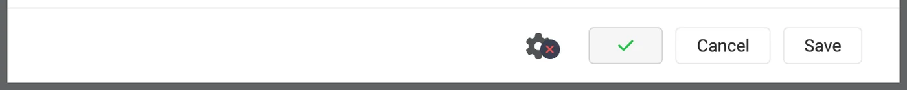
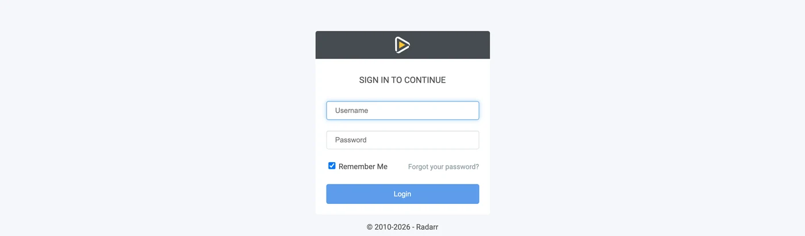
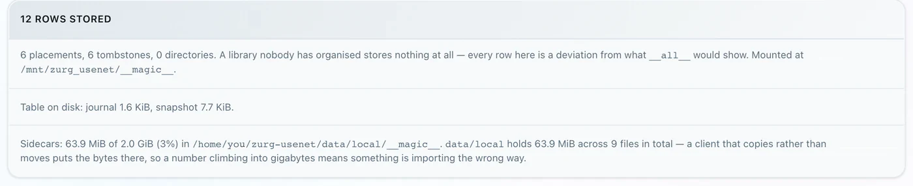

# Sonarr и Radarr, шаг за шагом {#sonarr-and-radarr-step-by-step}

Есть три способа использовать Sonarr и Radarr с zurg. Выбери, кто будет искать в zurg или в \*arrs. См. [как выбрать](sonarr-radarr-fetch.md#which-one-to-pick).

| Guide | Who searches | zurg acts as | You need |
|---|---|---|---|
| [Usenet](sonarr-radarr.md) | Sonarr and Radarr | a SABnzbd | аккаунт Usenet (или TorBox Pro для бэкенда `torbox_nzb`) и индексаторы Usenet в Prowlarr или в \*arrs |
| [Торренты](sonarr-radarr-torrents.md) | Sonarr and Radarr | a qBittorrent | аккаунт debrid и торрент-индексаторы в Prowlarr или в \*arrs |
| [Поиск через zurg](sonarr-radarr-fetch.md) | zurg | вообще без клиента загрузки | аккаунт Usenet, TorBox Pro или debrid, и индексаторы Newznab или Torznab в собственном конфиге zurg |

Первые два можно запускать одновременно. Они используют одну и ту же папку `__magic__`.

Укажи Sonarr и Radarr на zurg, чтобы забирать с Usenet без клиента. Во время захвата не скачивается и не распаковывается ни одно полное видео. NZB-файлы и кэши всё равно занимают место на диске. Эта страница про Usenet. Эндпоинт для торрентов использует те же клиенты и ту же папку. См. [Sonarr и Radarr для торрентов](sonarr-radarr-torrents.md).

Всё ниже записано на живой установке с zurg `nightly-993-g99bcf9a4`, Sonarr `4.0.19.2979` и Radarr `6.3.0.10514` и реальным аккаунтом Usenet. Имена хоста и пользователя заменены на `you@zurg-server`. Имена индексаторов: `my-indexer`. API-ключи и количество файлов в библиотеке приведены для примера. Больше ничего в снятом выводе не менялось. Строки лога `torbox_nzb` взяты из исходного кода zurg на 2026-11-09, а не записаны вживую.

## Перед началом {#before-you-start}

Три условия должны выполняться. Проверьте все три прямо сейчас: каждое из них потом ломается так, что выглядит как что-то совсем другое.

1. **В zurg есть провайдер `nzb` или `torbox_nzb` (TorBox Pro).** Без него некому прочитать то, что пишет эндпоинт, и каждая задача получает статус Failed через 30 минут, когда zurg перестаёт ждать её появления в библиотеке. См. [Usenet](usenet.md) или [TorBox: хостинг Usenet](../providers/torbox-nzb.md) для `torbox_nzb`.
2. **`magic.enabled` равен `true`.** Без этого не существует папки завершённых загрузок, и каждый импорт падает. См. [`__magic__`](magic.md).
3. **Монтирование видно \*arr по пути, который сообщает zurg.** Если Sonarr работает в контейнере, прочитайте [шаг 8](#8-if-your-arr-is-in-docker) перед любой настройкой. Если он установлен как обычное приложение на той же машине, он видит монтирование там, куда его монтирует zurg, но на каждой системе есть свой нюанс:
   - **Linux:** \*arr, запущенный от другого пользователя, чем zurg, видит пустую папку, пока не включён `user_allow_other`. См. [настройку Linux](../setup/linux.md#1-install-fuse-3).
   - **macOS:** запускайте его от того же пользователя, что и zurg. Монтирование находится в `/Volumes/Zurg`, если вы не меняли `mount_path`.
   - **Windows:** запускайте Sonarr и Radarr как приложение в трее, которое предлагает их установщик, а не как службу Windows. Диск `Z:` zurg принадлежит сеансу, в который вы вошли, а служба работает вне него, поэтому не видит диск. См. [правила сеанса](../setup/windows.md#keeping-it-running-the-session-rules).

Первые два проверьте прямо по конфигурационному файлу в рабочей папке zurg. В Windows откройте `config.yml` в Блокноте.

```bash
$ grep -A6 '^providers:' config.yml
providers:
- type: nzb
  nntp:
    host: news.example.com
    port: 563
    tls: true
    username: <redacted>
    password: <redacted>

$ grep -A4 '^magic:' config.yml
magic:
  enabled: true
  allow_delete: false
  sidecar_max_mb: 32
  sidecar_budget_mb: 2048
```

`allow_delete: false` — безопасное значение по умолчанию, и на импорт оно не влияет: удаление внутри `__magic__` лишь прячет запись, а не удаляет контент из аккаунта.

## 1. Включите эндпоинт {#1-turn-the-endpoint-on}

Два способа, результат один. Оба записывают в `config.yml` и оба требуют перезапуска: маршруты, которые отдают `__magic__`, и эндпоинт SABnzbd регистрируются один раз, при запуске zurg.

### Вариант A — панель управления {#option-a--the-dashboard}

Откройте дашборд zurg, нажмите **Config** и прокрутите до **\_\_magic\_\_ & Download Clients**. Включите **Serve \_\_magic\_\_** и **SABnzbd Endpoint**, затем задайте **SABnzbd Categories** значение `tv, movies`.


**Config** — это место, где находится настройка. **Magic** — это место, где вы позже будете видеть поступающие запросы.


Оставьте **SABnzbd Completed Directory** пустым, если ваш \*arr монтирует zurg в другое место, чем сам zurg, — см. [шаг 8](#8-if-your-arr-is-in-docker). Оранжевый значок **Restart Required** говорит правду: ничего из этого не начнёт работать, пока zurg не перезапустится.

### Вариант B — `config.yml` {#option-b--configyml}

Добавьте блок вручную и перезапустите zurg.

```yaml
magic:
  enabled: true

sabnzbd:
  enabled: true
  api_key: ""          # empty = zurg generates one and keeps it
  categories: [tv, movies]
  complete_dir: ""     # empty = <mount_path>/__magic__/__all__
```

**Категории — это не папки.** Все они ведут в одно и то же место: папка задания — это собственная папка релиза внутри `__magic__/__all__`. Список нужен только для того, чтобы Sonarr и Radarr перестали предупреждать о категории, которую они не могут найти. Если категория в Sonarr — `tv`, то `tv` должна быть в этом списке.

Перезапустите zurg, затем убедитесь, что провайдер подхватился:


Для эндпоинта достаточно одной строки `nzb` или `torbox_nzb`.

## 2. Найдите API-ключ {#2-find-the-api-key}

**Если ты оставил `api_key` пустым**, zurg сгенерировал ключ при первом запуске и записал его в `data/sabnzbd-apikey`:

```bash
$ cat data/sabnzbd-apikey
0123456789abcdef0123456789abcdef

```

Это пример, у тебя будет другой ключ. Файл сохраняется после перезапусков, так что ключ остаётся прежним после генерации.

**Если ты задал `api_key` сам**, он лежит в `config.yml`, и файл с ключом не создаётся. Дашборд подскажет, в каком ты варианте, внизу блока на шаге 1. Там будет либо *pinned in config.yml under `sabnzbd.api_key`*, либо *generated and kept in `data/sabnzbd-apikey`*.

**Этот эндпоинт не защищён базовой аутентификацией zurg.** Ни Sonarr, ни Radarr никогда не отправляют базовую аутентификацию download client, а их HTTP-слой превращает 401 в "unable to connect" без какой-либо полезной информации. Поэтому zurg намеренно исключает `/api` из проверки. API-ключ — единственная защита. Относись к этому порту так же, как ко всему остальному в zurg: держи его в доверенной сети или за чем-то, что его защищает.

## 3. Проверьте, что он отвечает {#3-prove-it-answers}

Сделайте это до того, как трогать Sonarr. Это займёт десять секунд, и на всю остальную настройку станет понятно, где проблема: в zurg или в \*arr.

+++ Linux и macOS

```bash
$ SAB=0123456789abcdef0123456789abcdef
$ ZURG=192.168.88.245:9996

$ curl -s "http://$ZURG/api?mode=version&apikey=$SAB&output=json"
{"version":"4.5.1"}

$ curl -s "http://$ZURG/api?mode=get_config&apikey=$SAB&output=json" \
    | jq '.config.misc.complete_dir, [.config.categories[].name]'
"/mnt/zurg_usenet/__magic__/__all__"
[ "*", "tv", "movies" ]
```

+++ Windows

В PowerShell. Введите `curl.exe`, а не `curl`: `curl` в Windows PowerShell — это другая команда.

```powershell
PS> $SAB = "0123456789abcdef0123456789abcdef"
PS> $ZURG = "192.168.88.245:9996"

PS> curl.exe -s "http://$ZURG/api?mode=version&apikey=$SAB&output=json"
{"version":"4.5.1"}

PS> (Invoke-RestMethod "http://$ZURG/api?mode=get_config&apikey=$SAB&output=json").config.misc.complete_dir
Z:/__magic__/__all__
```

+++

`complete_dir` — это путь, который zurg будет передавать клиентам. Проверьте сейчас, что это путь, который *они* могут открыть.

Затем убедитесь, что неверный ключ действительно отклоняется (в Windows — `curl.exe` с теми же URL):

```bash
$ curl -s "http://$ZURG/api?mode=queue&apikey=wrongkey&output=json"
{"status":false,"error":"API Key Incorrect"}

$ curl -s "http://$ZURG/api?mode=queue&output=json"
{"status":false,"error":"API Key Required"}
```

**`mode=version` не является проверкой аутентификации.** Он отвечает `{"version":"4.5.1"}` даже с неверным ключом. Так ведёт себя настоящий SABnzbd, и zurg это повторяет. Если вам нужно проверить именно ключ, используйте `mode=queue` или `mode=get_config`.

Работают оба варианта URL, так что в поле **URL Base** клиента подойдёт любой из них:

| Путь | URL Base в Sonarr / Radarr | Отвечает |
|---|---|---|
| `/api` | *(оставьте пустым)* | да |
| `/sabnzbd/api` | `/sabnzbd` | да |

Если `/api` возвращает обычную **404**, значит, `sabnzbd.enabled` всё ещё false или zurg не перезапускали после изменения этого параметра.

## 4. Создайте корневые папки {#4-make-the-root-folders}

Создайте их до того, как добавлять, потому что диалог Add Root Folder в *arr просматривает живую файловую систему и не предложит папку, которой не существует.

+++ Linux и macOS

```bash
$ mkdir -p /mnt/zurg_usenet/__magic__/tv /mnt/zurg_usenet/__magic__/movies

$ ls -d /mnt/zurg_usenet/__magic__/tv /mnt/zurg_usenet/__magic__/movies
/mnt/zurg_usenet/__magic__/movies
/mnt/zurg_usenet/__magic__/tv
```

+++ Windows

```powershell
PS> New-Item -ItemType Directory -Force Z:\__magic__\tv, Z:\__magic__\movies
```

Или создайте обе папки в Explorer.

+++

Замените `/mnt/zurg_usenet` на свой `mount_path`. Если он не задан, по умолчанию это `/mnt/zurg` на Linux, `/Volumes/Zurg` на macOS и `Z:` на Windows. Названия папок выбирайте сами; `tv` и `movies` просто соответствуют категориям.

**Корневая папка должна лежать рядом с каталогом completed, а не внутри него и не над ним.** zurg отдаёт клиентам `__magic__/__all__`, то есть вашу библиотеку, как её показывает `__all__`. Корневые папки располагаются рядом с ней, в `__magic__/tv` и `__magic__/movies`. **Не** `__magic__/__all__`, **не** сам `__magic__` и **не** `/mnt/zurg_usenet`. Оба клиента выдают health check, если корневая папка *является* выходной папкой download-клиента, а Radarr также выдаёт его, если корневая папка *содержит* эту папку. Соседние папки не вызывают ни того, ни другого, а ручной импорт, направленный на каталог completed, тогда видит один релиз, а не всю библиотеку.

Вот как выглядит ошибка. Оба скриншота настоящие, из двух клиентов. Они сделаны до того, как каталог completed переехал в `__magic__/__all__`, поэтому пути на них на один уровень выше ваших, но правила те же самые:


Sonarr с добавленным самим каталогом completed как корневой папкой. Он предупреждает, потому что корневая папка *является* выходной папкой.


Radarr с добавленной `/mnt/zurg_usenet`. Он предупреждает и о родительской папке, чего Sonarr не делает. Переместите корневую папку рядом с каталогом completed, и оба предупреждения исчезнут.

## 5. Добавьте клиент в Sonarr {#5-add-the-client-in-sonarr}

Новый Sonarr блокирует всё за экраном первого запуска. Выберите **Forms (Login Page)**, задайте имя пользователя и пароль и нажмите **Save**.


Дальше вы не пройдёте, пока **Authentication Method** не будет установлен в значение, отличное от None.


После Save вас один раз выбросит из сессии, и вы окажетесь на странице входа.


### Settings → Download Clients

Перейдите в **Settings → Download Clients**. На чистой установке здесь есть только карточка **+**.


Нажмите **+** под "Download Clients", а не тот, что ниже, под "Remote Path Mappings".

Выберите **SABnzbd** в колонке **Usenet**.


zurg притворяется именно SABnzbd, поэтому ничего другого из этого списка работать не будет.

Диалог откроется с настройками SABnzbd по умолчанию: `localhost`, порт `8080`, без ключа.


### Что вписать в каждое поле {#what-to-put-in-each-field}

| Поле | Значение | Зачем |
|---|---|---|
| Name | `zurg (Usenet)` | Любое. Это просто метка. |
| Enable | вкл | Оставьте включённым. |
| Host | `192.168.88.245` | Хост, на котором запущен zurg, доступный для \*arr. `localhost`, если \*arr — обычное приложение на той же машине. В Docker см. предупреждение ниже. |
| Port | `9996` | Обычный порт zurg — `9999` при стандартной установке. |
| Use SSL | выкл | Включайте, только если сами поставили zurg за TLS. |
| API Key | из шага 2 | Это и есть весь пропуск. |
| Username | пусто | Взаимоисключает ключ. Принимается только ключ. |
| Password | пусто | То же самое. |
| Category | `tv` | Должна присутствовать в `sabnzbd.categories`. |
| Recent / Older Priority | Default | zurg не может применить к ним приоритет. |
| Remove Completed | вкл | Позволяет клиенту очищать свои записи о задачах. Оставьте включённым. |
| Remove Failed | вкл | То же самое. |


Показанный API-ключ приведён для примера, вставьте свой.

**В Docker и "localhost", и имя хоста работают неправильно.** Внутри контейнера `localhost` — это сам контейнер, а имя хоста машины обычно резолвится в `127.0.1.1`, то есть тоже в контейнер. Используйте **LAN- или Tailscale-IP** хоста, никогда не `localhost` и не голое имя хоста, даже если они работают в вашей оболочке.

Нажмите **Test**. Зелёная галочка означает, что все четыре проверки клиента прошли: версия, API-ключ, глобальная конфигурация и категория.



Теперь нажмите **Save**.


## 6. Добавьте корневую папку в Sonarr {#6-add-the-root-folder-in-sonarr}

Откройте **Settings → Media Management** и прокрутите страницу вниз.


Нажмите **Add Root Folder**. Откроется файловый браузер по файловой системе Sonarr. В Docker это файловая система контейнера.


Введите путь в поле вверху. Если монтирование действительно видно Sonarr, то при вводе появится содержимое `__magic__`: `__all__` со всеми релизами и всё, что вы создали рядом с ним. Это самый быстрый способ убедиться, что bind mount настроен правильно.


Если папка пустая или выдаёт ошибку, остановитесь и исправьте монтирование, прежде чем идти дальше.


Допишите путь до `__magic__/tv` (`Z:\__magic__\tv` в Windows) и нажмите **Ok**.


Если в **Free Space** отображается правдоподобное число, значит Sonarr может получить информацию о монтировании. **Unmapped Folders** показывает количество релизов, которые уже лежат в этой папке.

## 7. Сделайте то же самое в Radarr {#7-do-the-same-in-radarr}

Такая же настройка, но с двумя изменёнными значениями: категория — `movies`, а корневая папка — `__magic__/movies`.



Первый запуск Radarr делается так же: сначала включите Forms auth, затем войдите.


**Settings → Download Clients → +**, затем **SABnzbd** в разделе Usenet.


Хост, порт и ключ те же. Отличается только **Category** — `movies`, а не `tv`.


**Test**, зелёная галочка, **Save**.


Затем **Settings → Media Management → Root Folders → Add Root Folder** и добавьте `/mnt/zurg_usenet/__magic__/movies`.

**Один zurg, два клиента, одна очередь.** Очередь и история zurg фильтруются только по категории, и больше ничему. Если два Sonarr используют `tv`, они будут видеть задачи друг друга; Sonarr с `tv` и Radarr с `movies` — не будут. Держите один клиент на каждую категорию, и эта проблема не возникнет.

## 8. Если ваш \*arr работает в Docker {#8-if-your-arr-is-in-docker}

Этот шаг для Docker на Linux-хосте. Docker Desktop на macOS и Windows запускает контейнеры внутри виртуальной машины. Привязка `rslave` ниже опирается на распространение монтирования в Linux (см. [Docker setup](../setup/docker.md)), а передача монтирования zurg контейнеру на этих системах не тестировалась. На macOS и Windows установите Sonarr и Radarr как обычные приложения, как описано в [Before you start](#before-you-start).

Три отдельные проблемы. Вторая стоит загрузки при каждом импорте. Третья проявляется только при первом перезапуске zurg.

### Путь, который сообщает zurg, должен быть путём, который клиент может открыть {#the-path-zurg-reports-must-be-a-path-the-client-can-open}

Если контейнер монтирует библиотеку в другое место, чем zurg, каждый импорт будет падать с *download doesn't contain intermediate path* или с ошибкой проверки remote-path. Исправить можно любым из двух способов, оба подходят:

- **Задайте `sabnzbd.complete_dir`** как путь, который видит *клиент*. Это проще всего, когда клиент один или несколько клиентов монтируют библиотеку в одно и то же место.
- **Добавьте remote path mapping** в *arr. Используйте это, когда разные клиенты монтируют её по-разному.

```yaml
sabnzbd:
  complete_dir: "/data/zurg/__magic__/__all__"   # what the *arr sees, not what zurg sees
```

Для второго способа откройте **Settings → Download Clients** и нажмите **+** под **Remote Path Mappings** — то есть нижний, а не тот, что вы использовали в шаге 5.


**Host** должен точно совпадать с строкой хоста, которую вы ввели в download client. **Remote Path** — это то, что сообщает zurg; **Local Path** — это место, где его видит клиент.

### Один volume для папки загрузок и корневых папок {#one-volume-for-the-download-folder-and-the-root-folders}

`__magic__/__all__` → `__magic__/tv` переносится бесплатно, потому что это переименование. Переименование работает только внутри одного монтирования. Если отдать контейнеру две папки как два volume, он увидит две файловые системы. Обе лежат поверх монтирования zurg, но это всё равно не помогает.

```yaml
    volumes:                                        # do not do this
      - /mnt/zurg_usenet/__magic__/__all__:/downloads
      - /mnt/zurg_usenet/__magic__/tv:/tv
```

Ядро внутри контейнера отказывает в переименовании. Sonarr и Radarr тогда молча копируют файл и удаляют оригинал. Каждый импорт качает весь релиз из твоего аккаунта и пишет его на диск zurg. Импорт при этом проходит успешно, просто медленно. Один эпизод на 1.46 GB занял 50 секунд и 2.9 GB трафика. С одним volume это заняло одну секунду и ничего не читало.

Отдай контейнеру один volume, в котором лежит всё монтирование zurg. Через него доступны папка загрузок и корневые папки. Bind из следующего раздела делает именно это. Удалённое сопоставление путей или `complete_dir` потом указывает клиенту на `__all__` внутри того же volume.

Ручной импорт с **Hardlink/Copy Files** тоже копирует. Выбери **Move Files**.

### Монтируйте родителя точки монтирования, а не саму точку {#bind-the-mounts-parent-not-the-mountpoint}

Перезапуск zurg размонтирует `/mnt/zurg_usenet` и монтирует его заново. Контейнер, который примонтировал **сам точку монтирования**, сохраняет fuse-соединение, с которым был запущен, и оно теперь мёртвое. Каждое чтение тогда отвечает `Socket not connected`, а так как оба клиента перед захватом проверяют свободное место в корневой папке, *каждый релиз молча отклоняется*:

```
FreeSpaceSpecification: Socket not connected
```

Ни один из клиентов не говорит, что маунт устарел. Папка внутри контейнера по-прежнему видна, а ручной захват, отправленный прямо клиенту, всё ещё работает. Выглядит это так, будто \*arr тихо перестал искать.

Примонтируй **родительскую** папку с `rslave`, и новое монтирование придёт как событие подмонтирования, которое контейнер подхватит:

```yaml
    volumes:
      - type: bind
        source: /mnt          # the parent, not /mnt/zurg_usenet
        target: /mnt
        bind:
          propagation: rslave
```

Проверяй контейнер после любого перезапуска zurg. Нужен размер, а не ошибка:

```bash
$ docker exec radarr df -h /mnt/zurg_usenet
Filesystem      Size  Used Avail Use% Mounted on
zurg{PGSq4}:    1.0P     0  1.0P   0% /mnt/zurg_usenet
```

Петабайт означает, что zurg показывает виртуальную файловую систему, а не диск. Так и должно быть, и именно это проходит проверку свободного места у \*arr.

## 9. Проследите один grab от начала до конца {#9-watch-one-grab-go-through}

I don't see any text below your message to translate. Please paste the page or doc you want translated into Russian, and I'll keep the structure exactly as it is.

### Grab it

Откройте фильм (или эпизод), нажмите **Interactive Search** и выберите релиз.


Столбец **Source** показывает `nzb` — это протокол, который zurg умеет принимать.

Нажмите кнопку со стрелкой в круге в конце строки, чтобы отправить релиз в загрузку. Если релиз не совпадает чисто, клиент сначала попросит подтвердить сопоставление:


**Override and Grab** появляется, когда клиент хочет, чтобы вы подтвердили, что это за релиз. Проверьте сопоставление и нажмите **Grab Release**. При обычной автоматической отправке это окно никогда не показывается.

### Он попадает в очередь {#it-lands-in-the-queue}


**Activity → Queue** сразу после захвата. Обратите внимание на полосу прогресса: она заполнена, а в **Time Left** стоит прочерк. Загружать тут нечего, поэтому задание либо в очереди, либо уже выполнено, и промежуточного состояния нет. *Остальные строки здесь относятся ко второму Radarr, который смотрит на тот же zurg и ту же категорию* — см. примечание в шаге 7.

### zurg записывает NZB и читает его {#zurg-writes-the-nzb-and-reads-it}

```
Aug 25 14:44:03 zurg-server zurg[3034965]: INFO  nzb  Loaded NZB
  Last.Week.Tonight.with.John.Oliver.S13E22.480p.WEB.x264-RMTeam.nzb: 4 files
Aug 25 14:50:28 zurg-server zurg[3034965]: INFO  nzb  Loaded NZB
  Untold.The.Testimony.of.Vince.Young.2026.1080p.NF.WEB-DL.DD+5.1.Atmos.H.264-playWEB.nzb: 9 files
```

`Loaded NZB … : N files` — это строка, которая говорит, что NZB распарсился. Если задача помечена как Failed через 30 минут, когда zurg перестаёт ждать её появления в библиотеке, то именно этой строки и не хватает.

### Происходит импорт {#the-import-happens}


**Activity → History**. Два события с разницей в несколько секунд: **Grabbed**, затем **Movie Imported**.


**Status: Downloaded**, **Size 4.7 GiB**, а ничего на самом деле не скачивалось.

### Убедитесь, что файл настоящий {#prove-the-file-is-real}

Импорт переместил файл в корневую папку. Прочитай оба его конца и спроси у ffprobe, что это за файл:

+++ Linux and macOS

Если твоя оболочка не находит `ffprobe`, используй `~/zurg/bin/ffprobe`: установка кладёт туда свою копию, если ни один ffprobe не был установлен раньше.

```bash
$ ls -la "/mnt/zurg_usenet/__magic__/movies/Untold - The Testimony of Vince Young (2026)/"
-rw-r--r-- 1 you you 4920958828 Aug 25 14:53 Untold.The.Testimony…playWEB.mkv

$ dd if="$F" bs=1M count=1 >/dev/null
1048576 bytes (1.0 MB, 1.0 MiB) copied, 0.0429446 s, 24.4 MB/s

$ ffprobe -v error -show_entries format=duration,size,format_name \
    -of default=noprint_wrappers=1 "$F"
format_name=matroska,webm
duration=4709.440000
size=4920958828
```

+++ Windows

В PowerShell, из папки zurg. Установка положила `bin\ffprobe.exe`, если только `ffprobe` не был уже в твоём PATH. В этом случае введи `ffprobe`:

```powershell
PS> $F = Get-Item "Z:\__magic__\movies\Untold - The Testimony of Vince Young (2026)\*.mkv"
PS> $F.Length
4920958828

PS> bin\ffprobe.exe -v error -show_entries format=duration,size,format_name -of default=noprint_wrappers=1 $F.FullName
format_name=matroska,webm
duration=4709.440000
size=4920958828
```

+++

Это 78-минутный Matroska, который стримится из статей Usenet по требованию. Байты приходят, когда что-то их читает, а не когда \*arr импортирует файл.

## 10. Добавление релиза вручную {#10-adding-a-release-by-hand}

+++ Linux и macOS

```bash
$ SAB=0123456789abcdef0123456789abcdef
$ ZURG=192.168.88.245:9996

# an NZB file you already have (the upload field is called name, as in SABnzbd)
$ curl -s "http://$ZURG/api?mode=addfile&apikey=$SAB&cat=movies" \
    -F 'name=@Movie.Title.2024.1080p.WEB-DL.nzb'
{"status":true,"nzo_ids":["SABnzbd_nzo_…"]}

# or a link to one, which zurg downloads itself
$ curl -s -G "http://$ZURG/api" \
    --data-urlencode mode=addurl --data-urlencode "apikey=$SAB" --data-urlencode cat=movies \
    --data-urlencode 'name=https://indexer.example/getnzb/<id>?r=<indexer-key>' \
    --data-urlencode nzbname=Movie.Title.2024.1080p.WEB-DL
{"status":true,"nzo_ids":["SABnzbd_nzo_…"]}
```

+++ Windows

В PowerShell, с `curl.exe`, а не `curl`. Каждая команда отвечает `{"status":true,"nzo_ids":[…]}`, как показано выше.

```powershell
$SAB = "0123456789abcdef0123456789abcdef"
$ZURG = "192.168.88.245:9996"

# an NZB file you already have (the upload field is called name, as in SABnzbd)
curl.exe -s "http://$ZURG/api?mode=addfile&apikey=$SAB&cat=movies" -F "name=@Movie.Title.2024.1080p.WEB-DL.nzb"

# or a link to one, which zurg downloads itself
curl.exe -s -G "http://$ZURG/api" `
  --data-urlencode mode=addurl --data-urlencode "apikey=$SAB" --data-urlencode cat=movies `
  --data-urlencode "name=https://indexer.example/getnzb/<id>?r=<indexer-key>" `
  --data-urlencode nzbname=Movie.Title.2024.1080p.WEB-DL
```

+++

`--data-urlencode` сохраняет собственные `?` и `&` ссылки внутри `name`. Задание появится в очереди приложения при следующей проверке, в течение минуты.

Дальше всё определяют пять вещей.

1. **Фильм или сериал уже должен быть в этом приложении.** Оно импортирует только то, что может сопоставить с чем-то из своей библиотеки.
2. **Имя должно говорить, что это за релиз.** Задание берёт имя файла NZB или `nzbname`, если вы его передали. Без `nzbname` `addurl` использует имя файла, которое отдаёт индексатор. Укажите в имени год.
3. **Категория выбирает приложение.** `cat=movies` попадает в тот Radarr, чей клиент загрузки использует `movies`. Каждое приложение смотрит только на свою категорию.
4. **Профиль качества не блокирует импорт. Блокировать может уже имеющийся файл.** При импорте Radarr не проверяет ни разрешённые качества, ни минимальную оценку пользовательского формата. Он импортировал 720p BluRay с оценкой 0 в профиль, который разрешает только 2160p и требует оценку 100. Он также импортировал 1080p WEBRip в фильм, чей профиль разрешает только 720p. Затем он заменил его 1080p BluRay как обновлением и удалил WEBRip. WEB-DL, добавленный после этого, остановился в Activity с сообщением *Not an upgrade for existing movie file*. **Activity → Queue → Manual Import** всё равно импортирует его и заменит файл.
5. **Ошибки придётся убирать самому.** Приложение никогда не блокирует и не удаляет загрузку, которую не взяло само. Релиз, чьи статьи устарели на новостных серверах, вернулся из zurg со статусом Failed и остался в очереди Radarr с сообщением *Download has failed wasn't grabbed by Radarr, skipping automatic download handling*. Уберите его из очереди и выберите другой релиз.

Проверено 2026-10-10 на Radarr 6.3 с использованием `addfile` и `addurl`, включая профиль, который требует пользовательский формат, построенный по имени релиза. Каждый импорт был переименованием в `__magic__/movies`, ничего не копировалось. Sonarr не тестировался.

Спасибо **.telmen** из Discord за вопрос о том, как это сделать с Usenet.

## Наблюдение со стороны zurg {#watching-from-zurgs-side}

Страница `/magic/` в zurg показывает каждый NZB, который когда-либо был передан эндпоинту. Sonarr и Radarr удаляют задания, которые они забрали, но запись хранится ещё неделю, чтобы опрос, пересекающийся с удалением, отвечал одинаково дважды. Задание со статусом **Failed** или **Stuck** (в очереди больше часа), которое никакой клиент уже не удалит, например после того как ты перестал использовать zurg как клиент загрузки, можно очистить, удерживая кнопку **Clear**. При очистке удаляется его NZB, если только импорт ещё его не использует.



**Placements** — это файлы, которые клиенты переместили; **tombstones** — это папки заданий, которые они потом удалили. Если клиент копирует вместо перемещения, страница показывает красную таблицу **Imports that were copies**. zurg превращает эти копии обратно в placements и удаляет их, но каждая из них всё равно была полной загрузкой, так что поправь тома.


**State** — это вся картина. **Queued** значит, что zurg ещё не закончил с релизом: библиотека его не показала, размеры файлов не устаканились или статьи не проверены. **Completed** значит, что он готов к импорту. **Release** — это папка, из которой клиент импортирует.

Столбец **Release** читается из библиотеки при каждом опросе, а не хранится. Переименуй релиз в панели zurg, дай repair пересобрать его или позволь zurg добавить суффикс, если два релиза называются одинаково, — задание всё равно будет следовать за ним.

## Что работает, а что нет {#what-works-and-what-does-not}

Работает:

- Тест подключения, все четыре проверки, в обоих клиентах.
- Захват (grab), очередь, история, импорт через переименование и очистка после импорта.
- Повторный захват того же релиза. Каждый последующий захват получает собственный job id, поэтому клиент работает с ним, а не переиспользует результат старой задачи. Релиз под капотом остаётся тем же. Повторный захват релиза, который предыдущий импорт уже опустошил, сообщается как **Failed**. В его папке в `__magic__/__all__` больше нечего импортировать, и Failed заставляет клиент занести его в чёрный список и взять другой. Захват, который опустошил папку, продолжает сообщать Completed, пока клиент его не удалит.
- Удаление задачи из очереди, с удалением NZB или без него.
- `mode=addurl` для человека или автоматизации, которые передают URL вместо загрузки файла. Ни один из \*arr его не использует.

Не работает:

- **Нет прогресса.** Задача либо в очереди, либо завершена. Процентов между ними нет, потому что нечего измерять: загрузки не происходит. Очередь показывает заявленный размер NZB, чтобы строка не была пустой.
- **Нет паузы, возобновления, ограничения скорости, приоритетов и скриптов постобработки.** У SABnzbd всё это есть, но zurg применять это не к чему.
- **`del_files` при удалении завершённой задачи из истории игнорируется.** (Для задачи Failed он удаляет NZB, если из него ничего не импортировано.) Клиент подразумевает «папка задачи снова твоя», но файл, который он только что импортировал, всё ещё отдаётся из этого NZB. Папка, которую он хотел удалить, уже удалена: он сам удалил её через монтирование.
- **Basic auth не может защитить этот эндпоинт.** Единственная защита — API-ключ.

**Сигнал об ошибке.** Релиз, в котором нет ничего пригодного для импорта, сообщается как **Failed**, и оба клиента заносят его в чёрный список и берут альтернативу. Сюда относятся: релиз, все файлы которого повреждены, удалены или отфильтрованы; релиз, состоящий только из `.par2`, `.sfv` и сопутствующих файлов; релиз, где все файлы имеют формат, который ничего не воспроизводит (так выглядит обфусцированный пост, у которого RAR-набор назван `.z001`…`.z133`); и архив, который уже открыт и в котором не найдено медиа. RAR-набор — это содержимое, а не вспомогательные файлы: zurg стримит видео прямо из него. Если в релизе действительно есть что-то, для чего у zurg нет расширения, расширьте `addl_playable_extensions`, а не добавляйте релиз в чёрный список.

**Статьи проверяются до того, как задача будет объявлена завершённой.** zurg ждёт, пока библиотека покажет релиз и размеры его файлов перестанут меняться. Затем он спрашивает новостные серверы о начале и конце каждого файла с содержимым, то есть о первых шестнадцати статьях и последней. Также он скачивает первую статью каждого файла. Это до шестидесяти четырёх статей плюс несколько дополнительных для релиза с небольшим количеством файлов. Некоторые новостные серверы всё ещё говорят, что статья существует, после того как её содержимое удалили, и это видно только при загрузке. Скачанная статья также показывает, что она принадлежит именно этому посту, а не другой загрузке. Задача остаётся **Queued**, пока это не будет выяснено. Повреждения, которые выборка не затрагивает, здесь не обнаруживаются: они всплывут при чтении, которое до них дойдёт. Релиз, у которого статьи пропали, сначала проходит восстановление PAR2, и после восстановления проверяется снова. Если он снова цел, работа продолжается. Если статьи всё ещё отсутствуют или восстановить их нечем, задача сообщается как **Failed** с количеством отсутствующих статей. Это ошибка *загрузки*, именно на неё реагируют клиенты: они без участия пользователя заносят такой релиз в чёрный список и берут альтернативу, вместо импорта того, что не будет воспроизводиться. При `torbox_nzb` новостных серверов и проверок статей нет: захват проверяется по тому, скачал ли его TorBox.

**Проверка, которая не может завершиться, не ждёт вечно.** Иногда проверка вообще не может завершиться: пул соединений может быть недоступен, аккаунт может быть ограничен по скорости, или истечёт таймаут. Это не ответ. Задача остаётся **Queued**, и проверка повторяется через минуту. zurg считает попытки для каждой задачи, чтобы перезапуск их не сбрасывал. После тридцати неудачных попыток подряд, охватывающих не менее трёх часов, задача переходит в историю со статусом **Failed**. Сообщение содержит количество попыток, временной промежуток и последнюю ошибку. Волна откровенных отказов доходит до тридцати за час и не блокирует очередь из-за этого.

**Релиз, который исчезает из библиотеки, проваливает свою задачу.** Релиз могут удалить из дашборда, убрать его NZB из каталога наблюдения или отбросить все аккаунты. Задача остаётся **Queued** пятнадцать минут, а затем переходит в историю со статусом **Failed**. Клиент заносит его в чёрный список и берёт другой. Ожидание нужно для перезапусков: библиотека скрывает все релизы во время загрузки, и это не должно восприниматься как удаление. В первые пятнадцать минут после запуска zurg ни одна задача по этой причине не падает. Задача, релиз которой библиотека ещё ни разу не показала, не затрагивается, потому что он ещё поступает.

## Устранение неполадок {#troubleshooting}

| Что пишет \*arr | Что это значит |
|---|---|
| "Unable to connect to SABnzbd" | zurg не отвечает по этому хосту и порту, либо что-то перед ним ответило не с кодом 200. Проверьте `sabnzbd.enabled`: пока он выключен, `/api` просто отдаёт 404. В Docker проверьте, не используете ли вы `localhost` или голое имя хоста. |
| "API Key Incorrect" / "API Key Required" | Ключ не совпадает. Если вы задавали его сами, он лежит в `config.yml`. Если ключ сгенерировал zurg, ищите его в `data/sabnzbd-apikey`. |
| "Test was aborted due to an error" | Причина не в авторизации. zurg записывает каждый отклонённый запрос: поищите в логе `SABnzbd:`. |
| "Category … does not exist" | Категории из \*arr нет в `sabnzbd.categories`. Добавьте её и перезапустите zurg. |
| "Downloads in root folder" | Корневая папка находится на уровне завершённой папки или выше её. Вынесите её рядом: `__magic__/tv`, а не `__magic__/__all__`, не `__magic__` и не `/mnt/zurg_usenet`. |
| "Remote path mapping" / "download doesn't contain intermediate path" | Путь, который сообщает zurg, клиент открыть не может. См. [шаг 8](#8-if-your-arr-is-in-docker). |
| Импорт проходит успешно, но занимает столько же времени, сколько загрузка, и страница `/magic/` в zurg показывает их в разделе **Imports that were copies** | Клиент копирует файлы из `__magic__/__all__` вместо того, чтобы переименовывать их. Причина в том, что в контейнере клиента папка загрузки и корневые папки находятся на двух разных томах. Либо ручной импорт был настроен на копирование. См. [один том для папки загрузки и корневых папок](#one-volume-for-the-download-folder-and-the-root-folders). |
| В обозревателе корневых папок смонтированный каталог zurg пуст или диска `Z:` нет вообще | \*arr не видит точку монтирования. В Linux он работает от другого пользователя без `user_allow_other`. В Windows он запущен как служба. См. [Перед началом работы](#before-you-start). |
| Все релизы отклоняются, в логе ничего нет | Устаревший bind mount. Выполните `docker exec <client> df -h <mount>`. Если вывод содержит `Socket not connected`, примонтируйте родительский каталог с `rslave` и пересоздайте контейнер. |
| Задание остаётся в очереди один-два опроса после того, как релиз появился | Так и должно быть: это устаканивается один раз для каждого релиза. Длина файла в NZB не указана. Оценка заменяется точной длиной из индекса PAR2 или из заголовка одной статьи. Если отметить задание как Completed раньше времени, клиент выдаст ошибку *File move incomplete, data loss may have occurred*. Задание `torbox_nzb` не читает статьи и не обращается к новостным серверам. Оно остаётся в очереди, пока TorBox не закончит получать релиз, но не дольше 30 минут (см. следующую строку). |
| "zurg accepted the NZB but it never appeared in the library" | Релиз не появился в библиотеке через 30 минут после захвата или после запуска zurg, что позже. zurg перестал ждать и пометил задание как **Failed**. Сначала проверьте, настроен ли вообще провайдер `nzb` или `torbox_nzb`. Затем найдите NZB в логе. Аккаунт `nzb` пишет `Loaded NZB <name>: N files`, когда разбирает файл. Релиз `torbox_nzb` появляется только тогда, когда TorBox закончит с ним работу. Поэтому задание падает с этой ошибкой, если TorBox тратит больше 30 минут: медленная загрузка, ожидание свободного слота или очередь за одной отправкой в минуту, которую делает zurg. Аккаунт `torbox_nzb` пишет `TorBox Usenet: posting <name>`, а затем ответ TorBox. `TorBox answered <name> with download <id>` значит, что TorBox уже получает релиз или уже его хранит. `TorBox queued <name> as <id> for want of a free slot` значит, что у аккаунта нет свободного слота. Отправка будет ждать, пока слот не освободится. |
| Задание сразу падает с ошибкой "The Usenet account could not fetch the NZB" | Аккаунт, на который отправлялся NZB, не смог его получить, поэтому zurg не ждёт 30 минут. Для `torbox_nzb` в логе строка `TorBox refused <name>, …` заканчивается причиной от TorBox. Этот NZB повторно не отправляется, пока zurg не перезапустят или пока файл не изменится. |
| "The release holds no files that can be imported" | Библиотека содержит релиз, но в нём нет ничего, что клиент мог бы импортировать. Так бывает, если NZB состоит только из томов восстановления. Так же бывает, если это обфусцированная публикация, где набор RAR назван `.z001`…`.z133`. Расширьте `addl_playable_extensions`, если в релизе действительно есть содержимое с расширением, которого zurg не знает. |
| Готовые релизы остаются в очереди во время большого наплыва | Сразу готово больше шестидесяти заданий. Sonarr и Radarr запрашивают только шестьдесят последних записей истории, поэтому zurg держит остальные в очереди и переносит одно в историю каждый раз, когда импорт освобождает слот. Так и должно быть, это рассасывается само. |
| "The release could not be checked against the news servers" | Проверка статей не удалась тридцать раз подряд, на протяжении как минимум трёх часов. Пропавших статей не найдено. Просто не удалось обратиться к новостному аккаунту. В сообщении указана последняя ошибка. Сначала проверьте аккаунт и заново захватите релиз, когда он начнёт отвечать. У аккаунта `torbox_nzb` нет новостных серверов и проверки статей, поэтому его захват проверяется тем, получил ли TorBox релиз. |
| "The release was in the library and has since been removed from it" | Библиотека один раз показала релиз и с тех пор не показывает его уже пятнадцать минут. Что-то его удалило, и в логе написано `Release <name> is gone from every account`. Клиент добавляет релиз в чёрный список и захватывает другой, вместо того чтобы ждать папку, которая не вернётся. |

Всё ещё застряли? Задайте вопрос в форуме **zurg-support** на [Discord](https://discord.com/invite/7u4YjMThXP). В [разделе о получении помощи](../../guides/remote-help.md) описано, что нужно указать.

### Где хранится состояние {#where-the-state-lives}

Вот таблица на русском, с сохранённой структурой и кодом.

| Путь | Что это |
|---|---|
| `nzbs/<name>.nzb` | Сам NZB-файл, получает имя один раз и больше не переименовывается. Бэкенд Usenet определяет идентичность релиза по этому имени файла, поэтому переименование оторвёт релиз от него и от всех размещений, созданных на его основе. |
| `data/sabnzbd-jobs.json` | Какие NZB были загружены, в какой категории и когда. |
| `data/sabnzbd-apikey` | Сгенерированный API-ключ. Не записывается, если задан `sabnzbd.api_key`. |
| `data/magic.json` | Таблица `__magic__` со всеми размещениями и надгробиями (tombstones), которые создали импорты. |
