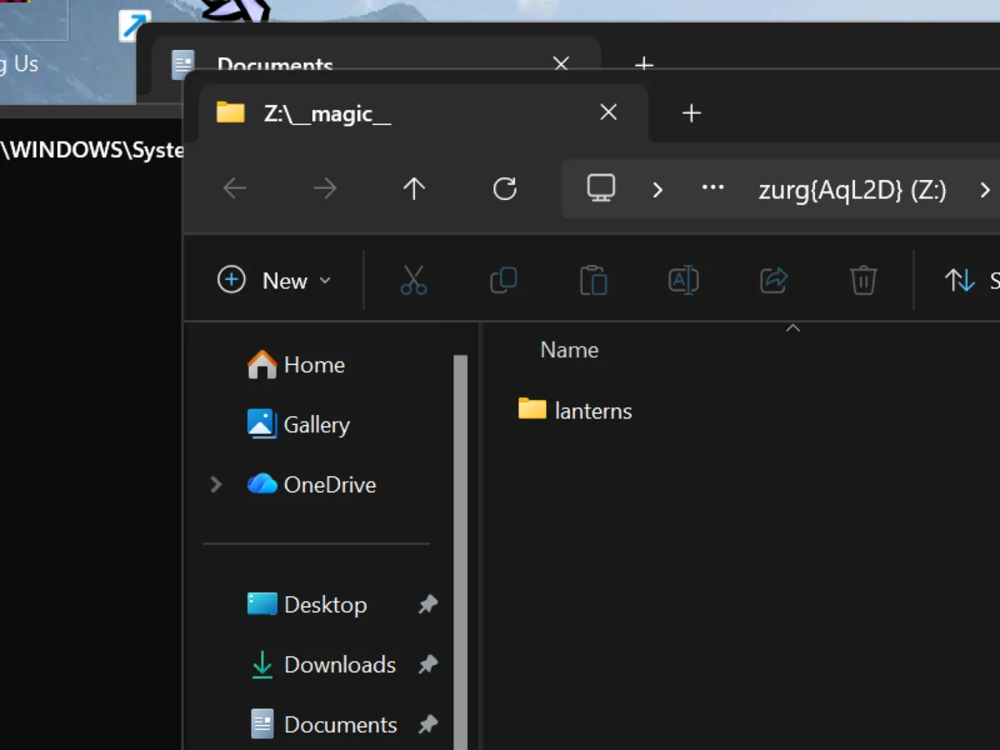

# Windows, бинарник, с нуля {#windows-the-binary-from-scratch}

## Вариант в одну строку {#one-line-option}

Запусти необязательный спонсорский bootstrap из PowerShell. Он ставит WinFsp через UAC, скачивает zurg и запускает
выбор провайдера и диагностику:

```powershell
irm https://raw.githubusercontent.com/debridmediamanager/zurg-site/main/public/install.ps1 | iex
```

Он использует вход через GitHub в браузере и ставит всё в `$HOME\zurg`. Существующие бинарники и конфиги остаются на месте. Дальше — ручной вариант.

Без Docker и без WSL: `.exe` zurg в папке, `config.yml`, который ты пишешь один раз, и диск `Z:` в Проводнике.
На этой странице весь процесс разобран в два прохода: сначала **RealDebrid с endpoint qBittorrent**, потом полный сброс и **Usenet с endpoint SABnzbd**. Именно эти две установки люди делают чаще всего, и они задействуют разные половины zurg.

Всё ниже снято на живой установке: Windows 11 Pro 23H2 (сборка 22631), PowerShell 5.1, WinFsp 2.0.23075, zurg `2026.08.30.0459-nightly-73-g5b4c9790`, а также аккаунт Real-Debrid и учётка новостного сервера Usenet. Имена пользователей изменены. API-ключи и количество файлов в библиотеке условные. Учётные данные тоже условные.

## Что понадобится {#what-you-need}

- **zurg.exe** — из [релизов для спонсоров](https://github.com/debridmediamanager/zurg/releases). Станьте спонсором на [gatekeeper](https://gatekeeper.debridmediamanager.com/), чтобы получить доступ к своему аккаунту GitHub. Эта страница предполагает, что вы уже скачали файл.
- **WinFsp** — zurg монтирует библиотеку через rclone, а rclone на Windows для буквы диска нужен WinFsp. Установите его тихо или возьмите [установщик](https://github.com/winfsp/winfsp/releases):

  ```powershell
  $url = "https://github.com/winfsp/winfsp/releases/download/v2.1/winfsp-2.1.25156.msi"
  Invoke-WebRequest -Uri $url -OutFile "$env:TEMP\winfsp.msi" -UseBasicParsing
  Start-Process msiexec.exe -ArgumentList "/i", "$env:TEMP\winfsp.msi", "/qn", "/norestart" -Wait
  ```

- **Аккаунт** — токен API Real-Debrid для первого этапа и новостной сервер для второго.

Больше ничего не нужно. Встроенный установщик скачает rclone, а также ffprobe, если его нет в вашем PATH.

## Рекомендуется: пусть zurg сам завершит настройку {#recommended-let-zurg-finish-the-setup}

Создай папку, положи в неё `zurg.exe` и запусти установщик из PowerShell:

```powershell
New-Item -ItemType Directory -Force "$HOME\zurg" | Out-Null
Set-Location "$HOME\zurg"
# Copy the downloaded zurg.exe here, then:
.\zurg.exe setup
.\zurg.exe doctor
```

`setup` спрашивает, каких провайдеров настроить. Выбери один или несколько из Real-Debrid, TorBox, AllDebrid, Usenet, Premiumize, Debrid-Link и Offcloud в порядке приоритета. Он запрашивает только учётные данные для выбранных сервисов. Затем он:

1. Создаёт и проверяет `config.yml`.
2. Ограничивает его ACL твоим пользователем, SYSTEM и Administrators.
3. Скачивает `bin\rclone.exe` и `bin\ffprobe.exe`, если ffprobe уже есть в PATH (тогда в `config.yml` будет `ffprobe_binary: ffprobe`).
4. Включает монтирование rclone на `Z:`.
5. Регистрирует `\Zurg\zurg` как задачу интерактивного входа и запускает её, когда на рабочем столе выполнен вход пользователя.

Если нужно, выбери другую свободную букву диска:

```powershell
.\zurg.exe setup --mount-path "Y:"
```

Установщик можно запускать повторно. Он обновит созданную задачу, но не заменит существующий `config.yml`.

Интерактивная задача сделана намеренно. Монтирования дисков WinFsp принадлежат сеансу входа в Windows, который их создаёт. Обычная служба Windows работает в сеансе 0, и её диск не виден Plex и Проводнику на рабочем столе. Это поведение установщика проверено на Windows 11 4 сентября 2026 года.

В руководстве ниже показаны файлы и конфигурация, которые стоят за установщиком, а затем настраиваются загрузочные клиенты для Real-Debrid и Usenet. Ручной первый запуск и рецепт запланированной задачи полезны, если хочешь собрать эти части сам.

## 1. Первый ручной запуск: zurg создаёт свой дом {#1-manual-first-run-zurg-builds-its-own-home}

Создайте папку, положите туда бинарный файл и запустите его один раз без файла конфигурации:

```powershell
PS C:\Users\you> mkdir C:\Users\you\zurg
PS C:\Users\you\zurg> .\zurg.exe
```

zurg создаст нейтральный к провайдеру конфиг по умолчанию, подскажет, что делать дальше, и завершит работу:

```
INFO  setup  Config file not found, creating default from config.simple.yml
INFO  zurg   Default config created at config.yml
INFO  zurg   Run zurg setup to choose provider(s), or add a providers block to config.yml, then rerun zurg.
```

Запустите `.\zurg.exe setup`, чтобы выбрать провайдеров и скачать вспомогательные программы. После setup папка будет выглядеть так:

```
C:\Users\you\zurg\
├── bin\                rclone.exe, and ffprobe.exe unless ffprobe was on your PATH
├── data\               library cache, keys, the __magic__ table
├── dump\
├── logs\               zurg.log, rclone.log
├── nzbs\               the Usenet watch directory (second pass)
├── strm\
├── config.yml
└── zurg.exe
```

Сгенерированный `config.yml` начинается с пустого списка провайдеров и двух фильтров директорий. Setup заполнит список на основе ваших выборов. Примеры ручной настройки ниже заменяют его конфигом для каждого руководства.

## 2. Проход с RealDebrid {#2-the-realdebrid-pass}

### Конфиг {#the-config}

Перезапишите `config.yml` этим содержимым: токен Real-Debrid, включённая точка доступа qBittorrent и монтирование как `Z:`:

```yaml
zurg: v1
providers:
  - type: realdebrid
    token: YOUR_RD_API_TOKEN

directories:
  shows:
    group: media
    group_order: 10
    filters:
      - has_episodes: true
  movies:
    group: media
    group_order: 20
    only_show_the_biggest_file: true

ffprobe_binary: bin\ffprobe.exe   # or ffprobe, if that is what setup wrote
rclone_binary: bin\rclone.exe

rclone_enabled: true
mount_path: "Z:"
rclone_extra_args:
  - "--links"

magic:
  enabled: true

qbittorrent:
  enabled: true
  api_key: ""          # empty = zurg generates one and keeps it
  categories: [tv-sonarr, radarr]
```

Три особенности Windows:

- **`--links` необязателен, но всё равно лучше оставить.** zurg отдаёт библиотеку как rclone union, состоящий из локальной и удалённой половин, и WinFsp в момент появления диска спрашивает у корня монтирования, является ли он символической ссылкой. Без флага rclone на этот запрос отвечает `ERROR : symlinks not supported without the --links flag: /` и всё равно монтирует диск. Замерено 31.08.2026 на zurg `2026.08.31.0443-nightly` с rclone 1.74.2 и 1.75.0: диск, обе половины union и запись в `__magic__` вели себя одинаково с флагом и без него. С флагом та же проверка пишет в лог `NOTICE: union root '': Symlinks support enabled`, и rclone будет корректно работать с настоящими символическими ссылками, если вы когда-нибудь положите их в `data\local`. Оставьте флаг, и лог будет чистым.
- **`mount_path: "Z:"`** здесь буква диска, а не путь POSIX. Подойдёт любая свободная буква.
- **Оставьте `magic.enabled: true`**, если когда-нибудь захотите, чтобы Sonarr или Radarr импортировали файлы с этой машины: импорт — это переименование внутри `__magic__`, и без этого каждый импорт превращается в полную загрузку. То же относится и к проходу Usenet ниже.

### Запусти и почитай лог {#start-it-and-read-the-log}

Запускайте zurg пока простым способом: откройте PowerShell в папке:

```powershell
PS C:\Users\you\zurg> .\zurg.exe --config config.yml
```

Первое, что он делает, это проверка сети Real-Debrid. Он разблокирует тестовые ссылки во всех регионах загрузки и измеряет задержку. Занимает это около двадцати секунд. Затем появляются важные строки:

```
INFO  network_test  Network test completed!
INFO  zurg          Provider realdebrid ready (type=realdebrid)
INFO  router        __magic__ serves sidecar files from data\local\__magic__
INFO  router.qbittorrent  qBittorrent API on /api/v2 and /qbittorrent/api/v2, save path Z:/__magic__/__all__, categories tv-sonarr, radarr
INFO  router.qbittorrent  qBittorrent: generated an API key in data/qbittorrent-apikey — paste it into Sonarr or Radarr's API Key field, or pin one as qbittorrent.api_key in config.yml
INFO  zurg          Starting server on http://[::]:9999
INFO  rclone        rclone started with mount Z:, union local C:\Users\you\zurg\data\local
```

Сам ключ в логе не выводится. Он лежит в `data\qbittorrent-apikey`. После этого начинается обход библиотеки. При первом запуске zurg читает все торренты на аккаунте, и на большом аккаунте это займёт некоторое время. Обход использует общий лимит API провайдера, так что на всё остальное на аккаунте его хватает меньше. **Пока идёт обход, `__magic__` отвечает *Library is still loading***. Это нормально, а не ошибка.

Может появиться одно предупреждение. Оно известное и не критичное:

| Warning | What it is |
|---|---|
| `Debug logging is enabled` | Сгенерированный конфиг по умолчанию очень подробный. Добавьте `log_level: INFO`, чтобы убрать лишнее. |


### Панель управления {#the-dashboard}

`http://localhost:9999/`: размер библиотеки растёт по мере обхода, а также видны объём трафика и использование памяти. **Quick Links** — это весь интерфейс: Torrent Manager, Config, Directories, Magic, Logs.


После первого запуска всё настраивается в **Config**. Блок providers показывает единственный аккаунт:


Блок download-client содержит те же переключатели, что вы задаёте в `config.yml`, но их можно менять прямо здесь. Каждое изменение помечается **Restart Required**, и это буквально: оба эндпоинта регистрируют свои маршруты один раз при запуске.


А вот блок mount, где видно букву диска и контроль rclone:


### Диск Z: {#the-z-drive}

Когда zurg запущен, `Z:` в Проводнике — это файловая система петабайтного масштаба:


**Но только если zurg запущен там, где Проводник его видит. И это единственное правило в этой настройке, которое действительно специфично для Windows.** Подключение к букве диска принадлежит *сеансу входа в систему*, который его создал. Если запустить zurg через SSH-подключение или как службу, подключение существует, работает и невидимо для вашего рабочего стола. Это не баг WinFsp или rclone, так Windows определяет область действия букв дисков. [В последнем разделе](#keeping-it-running-the-session-rules) описан рабочий способ: запланированная задача в интерактивном сеансе, а также результаты проверки альтернатив.

### Проверь эндпоинт qBittorrent {#prove-the-qbittorrent-endpoint}

Те же проверки, что и на любой платформе, из любого PowerShell:

```powershell
PS> $KEY = Get-Content data\qbittorrent-apikey
PS> Invoke-WebRequest "http://localhost:9999/api/v2/app/webapiVersion"

# the healthy unauthenticated answer is a 403 — "the API is here, log in"
PS> Invoke-RestMethod "http://localhost:9999/api/v2/app/version" -Headers @{ Authorization = "Bearer $KEY" }
v5.0.4
PS> (Invoke-RestMethod "http://localhost:9999/api/v2/app/preferences" -Headers @{ Authorization = "Bearer $KEY" }).save_path
Z:/__magic__/__all__
```

А теперь добавим в него торрент. Файл `.torrent` загружается через `curl.exe -F` (обычный `curl` в Windows PowerShell — это `Invoke-WebRequest`, у которого нет `-F`). Или же любой клиент сделает это за тебя:

```
INFO  router.qbittorrent  qBittorrent: added op1176 (dc98af37…) to realdebrid as W7FRRMVJWUOMS
```

Релиз, который забрала эта установка, не был закеширован на аккаунте, поэтому очередь в стиле \*arr показала настоящую загрузку: прогресс рос 2% → 10% → 50% → 75% → 99% примерно за шесть минут со скоростью, которую сообщал Real-Debrid. Потом:

```
INFO  router.qbittorrent  qBittorrent: op1176 (dc98af37…) finished on realdebrid
```

Когда торрент сообщил о завершении и появилась папка для импорта:

```
"content_path": "Z:/__magic__/__all__/[NanakoRaws] One Piece S01E1176 (THK TV 1080p HEVC AAC)"
```

Чтение файла через `Z:` выдернуло мегабайт за миллисекунды. VFS read-ahead в rclone стоит перед провайдером, поэтому прогретые чтения работают быстро, как с локального диска, а части потока подгружаются следом.

Один отказ, о котором стоит знать: первый релиз, который пробовала эта установка, назывался `…WEBRip…`, а Real-Debrid блокирует некоторые названия релизов полностью. zurg знает эти шаблоны и отказывает до того, как потратит слот добавления:

```
WARN  router.qbittorrent  qBittorrent: realdebrid will not take op1176: it refuses that name outright, so the next account is tried
```

Выбери релиз с другим названием, и он пройдёт. [Руководство по торрентам](../guides/sonarr-radarr-torrents.md) подробно описывает весь эндпоинт: таймауты, режим только закешированного, семантику ошибок. Настройки клиента там те же, с двумя замечаниями для Windows. **Host** `localhost`, если \*arr работает на той же машине. И \*arr должен работать в той же сессии входа, что и zurg, чтобы видеть `Z:`. См. [правила сессии](#keeping-it-running-the-session-rules).

## 3. Сброс {#3-reset}

Переход установки с Real-Debrid на Usenet — это полная очистка: останови zurg, удали всё, что создал первый проход, и оставь бинарник и `bin\`, чтобы помощники не скачивались повторно.

```powershell
PS> cd C:\Users\you\zurg
PS> .\zurg.exe service uninstall      # removes the task setup made; or Unregister-ScheduledTask zurg for the manual one, or close the console window
PS> taskkill /IM zurg.exe /F ; taskkill /IM rclone.exe /F
PS> Get-ChildItem -Exclude zurg.exe, bin | Remove-Item -Recurse -Force
PS> Get-ChildItem

bin
zurg.exe
```

Эта команда `Get-ChildItem -Exclude … | Remove-Item` и есть весь сброс — `config.yml`, `data\`, `logs\`, `nzbs\`, всё. Остаётся ровно то, что нужно для чистой установки.

## 4. Проход с Usenet {#4-the-usenet-pass}

### Конфиг {#the-config-1}

Тот же шаблон, другой провайдер: вместо токена debrid здесь аккаунт Usenet, а вместо эндпоинта qBittorrent используется эндпоинт SABnzbd:

```yaml
zurg: v1
providers:
  - type: nzb
    nntp:
      host: news.example.usenet.com
      port: 563
      tls: true
      username: YOUR_NEWS_USERNAME
      password: YOUR_NEWS_PASSWORD
      connections: 8

directories:
  shows:
    group: media
    group_order: 10
    filters:
      - has_episodes: true
  movies:
    group: media
    group_order: 20
    only_show_the_biggest_file: true

ffprobe_binary: bin\ffprobe.exe   # or ffprobe, if that is what setup wrote
rclone_binary: bin\rclone.exe

rclone_enabled: true
mount_path: "Z:"
rclone_extra_args:
  - "--links"

magic:
  enabled: true

sabnzbd:
  enabled: true
  api_key: ""          # empty = zurg generates one and keeps it
  categories: [tv, movies]
```

Восьми подключений для стриминга более чем достаточно. Точный лимит указан в тарифе вашего аккаунта.

### Запуск {#start-it}

```powershell
PS C:\Users\you\zurg> .\zurg.exe --config config.yml
```

Контраст с первым проходом сразу бросается в глаза: никакого обхода. Библиотека NZB начинается пустой. Пока вы не добавите в неё NZB, загружать неоткуда, поэтому при запуске идут проверка сети, строки с эндпоинтами и подключение к новостному серверу:

```
INFO  nzb       NZB articles are kept in memory for the life of the process (nzb_segments: resident)
INFO  zurg      Provider nzb ready (type=nzb)
INFO  router    __magic__ serves sidecar files from data\local\__magic__
INFO  router.sabnzbd  SABnzbd API on /api and /sabnzbd/api, completed directory Z:/__magic__/__all__, categories tv, movies
INFO  router.sabnzbd  SABnzbd: generated an API key in data/sabnzbd-apikey — paste it into Sonarr or Radarr, or pin one as sabnzbd.api_key in config.yml
INFO  zurg      Starting server on http://[::]:9999
INFO  rclone    rclone started with mount Z:, union local C:\Users\you\zurg\data\local
INFO  zurg      Usenet account nzb connected: nntps://news.example.com:563 (8 connections)
```

zurg подключается к новостному серверу сразу при запуске и держит соединения активными, включая TLS. Ключ SABnzbd сохраняется в `data\sabnzbd-apikey`.


Дашборд теперь показывает пустую библиотеку, и это правильно:


Блок providers содержит новостной аккаунт, а блок клиентов загрузки теперь показывает часть для SABnzbd:


### Закинь NZB {#drop-an-nzb-in}

Папка `nzbs\` — это единственный вход. Положите туда один NZB, скачанный с любого индексатора, и zurg его подхватит:

```powershell
PS> Copy-Item .\lanterns.nzb C:\Users\you\zurg\nzbs\
```

```
INFO  nzb  Loaded NZB lanterns.nzb: 8 files
```

Эта строка означает, что NZB успешно разобран. Релиз появится как папка в `__magic__\__all__` на маунте. Так как Usenet-релиз называет файлы как угодно, как захотел выкладывающий, внутренний файл может выглядеть так: `J8AZfuVQCD4yPpRIF566Bv0xKoEpYa3M.mkv`. Папка релиза носит имя NZB, а файлы получают имена от выкладывающего:



На этом этапе ничего не скачано, и не будет скачано, пока что-то не прочитает файл. Первое чтение эпизода (162 МБ) загрузило ровно те статьи, которые покрывают запрошенный диапазон, декодировало их из yEnc и отдало ответ. Последующие чтения были мгновенными, потому что VFS заранее прочитал данные вокруг них. Remux на 60 ГБ не занимает 60 ГБ дискового места ни в Usenet, ни в debrid.

Эндпоинт SABnzbd отвечает на те же запросы, что и всегда:

```powershell
PS> $KEY = Get-Content data\sabnzbd-apikey
PS> Invoke-RestMethod "http://localhost:9999/api?mode=version&apikey=$KEY&output=json"
{"version":"4.5.1"}
PS> (Invoke-RestMethod "http://localhost:9999/api?mode=get_config&apikey=$KEY&output=json").config.misc.complete_dir
Z:/__magic__/__all__
```

Неверный ключ отклоняется в теле ответа с HTTP 200. Так работает и сам SABnzbd, и zurg это повторяет:

```powershell
PS> Invoke-RestMethod "http://localhost:9999/api?mode=queue&apikey=wrong&output=json"
{"status":false,"error":"API Key Incorrect"}
```

Что касается клиентской стороны (Sonarr, Radarr, категории, корневые папки в `Z:\__magic__`), то [пошаговое руководство по Usenet](../guides/sonarr-radarr.md) описывает всё по шагам. Каждый путь в нём получается заменой `/mnt/zurg/__magic__` на `Z:\__magic__`. В [руководстве по Usenet](../guides/usenet.md) рассказано о блок-аккаунтах, retention и repair.

## Чтобы работало постоянно: правила сессии {#keeping-it-running-the-session-rules}

| Как запущен zurg | Диск |
|---|---|
| Окно PowerShell, которое вы открыли | `Z:` на рабочем столе |
| SSH (`ssh you@machine … zurg.exe`) | Работает, отдаёт файлы, но **не видно на рабочем столе**: сеанс входа SSH не твой |
| `Invoke-CimMethod Win32_Process Create` из SSH | То же самое: новый процесс наследует сеанс входа вызывающего |
| PsExec `-i 1` | Процесс в интерактивном сеансе, но в **своём** сеансе входа, поэтому диск всё равно не виден на рабочем столе |
| **Интерактивная запланированная задача** | **`Z:` на рабочем столе** |

`zurg setup` сам создаёт рабочую интерактивную задачу. Управляй ею из каталога zurg:

```powershell
.\zurg.exe service status
.\zurg.exe service restart
.\zurg.exe service stop
.\zurg.exe service start
.\zurg.exe service uninstall
```

Stop и restart сначала просят zurg завершиться штатно, чтобы его дочерний процесс rclone освободил диск. `uninstall` удаляет задачу, но оставляет бинарник, конфиг, данные, логи и кэш.

Ручной аналог — запланированная задача, которая запускается от твоего имени только когда ты вошёл в систему:

```powershell
$wdir = "C:\Users\you\zurg"
Set-Content "$wdir\start-zurg.cmd" "@echo off`ncd /d $wdir`nzurg.exe --config config.yml"

$action    = New-ScheduledTaskAction -Execute "cmd.exe" -Argument "/c $wdir\start-zurg.cmd"
$trigger   = New-ScheduledTaskTrigger -Once -At (Get-Date).AddSeconds(5)
$principal = New-ScheduledTaskPrincipal -UserId $env:USERNAME -LogonType Interactive
$settings  = New-ScheduledTaskSettingsSet -AllowStartIfOnBatteries -ExecutionTimeLimit ([TimeSpan]::Zero)
Register-ScheduledTask -TaskName "zurg" -Action $action -Trigger $trigger `
  -Principal $principal -Settings $settings -Force
Start-ScheduledTask -TaskName "zurg"
```

**Триггер входа** (`New-ScheduledTaskTrigger -AtLogOn`) вместо `-Once` заставит задачу снова запускаться после перезагрузки. `ExecutionTimeLimit ([TimeSpan]::Zero)` важен: без него Task Scheduler убьёт задачу через 72 часа.

Две ловушки, которые мы проверили на этой машине:

- **Консоль с `-NoExit` блокирует слот задачи.** Если лаунчер оставляет окно открытым после остановки zurg, планировщик считает задачу всё ещё запущенной, и каждый следующий `Start-ScheduledTask` отклоняется с ошибкой `0x800710E0`. Выполни `Stop-ScheduledTask zurg` перед повторным запуском или запускай бинарник напрямую, как показано выше, чтобы задача завершалась вместе с zurg.
- **`Get-PSDrive` в одном окне не опровергает монтирование.** Диск виден процессам в *том же сеансе входа*, то есть твоим приложениям на рабочем столе, а не каждому окну PowerShell, которое ты открыл. Если `Z:` нет в каком-то окне, сначала проверь, из какого сеанса оно запущено, и только потом решай, что монтирование пропало.

Если Explorer тебе вообще не нужен (сервер без монитора или клиенты, которые работают по HTTP), всё это не важно: запускай zurg как удобно и направляй клиенты на `http://localhost:9999/dav/` или на эндпоинты. Правило про сеанс касается только буквы диска.

## Доступ к zurg с другой машины {#reaching-zurg-from-another-machine}

Программы на этом ПК обращаются к zurg по адресу `localhost`. Брандмауэр Windows блокирует всё остальное в вашей сети, пока вы его не откроете. Для Sonarr, Radarr, медиасервера или браузера на другом компьютере выполните один раз в PowerShell от имени администратора (если в `config.yml` указан другой `port:`, используйте этот номер):

```powershell
New-NetFirewallRule -DisplayName zurg -Protocol TCP -LocalPort 9999
```

Другой компьютер тогда использует IPv4-адрес этого ПК, который выводит `ipconfig`, вместо `localhost`.

Если ответа по-прежнему нет, проверьте, нет ли правила, которое блокирует zurg. Если нажать Cancel в окне Windows с запросом на разрешение для zurg.exe, оно создаст такое правило, а правило блокировки важнее правила выше. Эта команда удаляет такие правила для `zurg.exe` в `$HOME\zurg`, тоже от имени администратора (измените путь, если zurg лежит в другом месте):

```powershell
Get-NetFirewallApplicationFilter -Program "$HOME\zurg\zurg.exe" | Get-NetFirewallRule | Where-Object Action -eq Block | Remove-NetFirewallRule
```

## Держим кэш маленьким {#keeping-the-cache-small}

Монтирование сохраняет каждый проигранный файл целиком в `data\rclone-cache` внутри папки zurg (`$HOME\zurg\data\rclone-cache`, если вы ставили одной командой). Эти файлы остаются после окончания воспроизведения и растут до 256G по умолчанию.

Не рассчитывайте, что ограничение в 72h по возрасту само всё очистит. Плановые задачи Plex каждую ночь читают закэшированные файлы, из-за чего их возраст обновляется, и поэтому ничего никогда не истекает. Работает только ограничение по размеру.

Чтобы занимать меньше места на диске, уменьшите лимит в `config.yml`. `rclone_extra_args` — это один список, поэтому добавьте новые строки под уже имеющимся `--links`, а не пишите второй `rclone_extra_args:`:

```yaml
rclone_extra_args:
  - "--links"
  - "--vfs-cache-max-size"
  - "50G"
  - "--vfs-cache-min-free-space"
  - "20G"
```

`--vfs-cache-min-free-space` заставляет rclone прекращать кэширование, когда на диске остаётся столько свободного места. Затем перезапустите zurg:

```powershell
.\zurg.exe service restart
```

После перезапуска rclone сам уменьшит кэш до нового лимита. Чтобы очистить его сразу, сначала остановите zurg:

```powershell
.\zurg.exe service stop
Remove-Item -Recurse -Force .\data\rclone-cache\vfs\*, .\data\rclone-cache\vfsMeta\* -ErrorAction SilentlyContinue
.\zurg.exe service start
```

Чтобы узнать, сколько места кэш реально занимает, откройте Properties папки `rclone-cache` и посмотрите **Size on disk**. Частично загруженные файлы разреженные, поэтому **Size** показывает намного больше, чем реально занимает диск.

Подробнее см. [Место на диске, которое занимает монтирование](../reference/config.md#disk-the-mount-uses).

## Обновление zurg {#updating-zurg}

A sponsor build replaces itself:

```powershell
cd $HOME\zurg
.\zurg.exe update
.\zurg.exe service restart
```

`update` takes the newest nightly, checks the download reports the version it expected before replacing anything, and moves the running `zurg.exe` aside so Windows will let the new one land. When the installed build is already the newest it says so and changes nothing. The restart runs the new build.

На сборке, которая слишком старая для этой команды, установщик делает то же самое:

```powershell
$env:ZURG_INSTALL_MODE = "update"; irm https://raw.githubusercontent.com/debridmediamanager/zurg-site/main/public/install.ps1 | iex
```

## Устранение неполадок {#troubleshooting}

| Что видишь | Что это значит |
|---|---|
| `Z:` нет в Explorer | Правило сессии, см. [выше](#keeping-it-running-the-session-rules). Монтирование, скорее всего, в порядке. Сначала проверь `http://localhost:9999/http/`. |
| `zurg doctor` говорит, что задача готова, но не запущена | Ни один интерактивный пользователь не вошёл в систему. Войди в рабочий стол и выполни `.\zurg.exe service start`. |
| `symlinks not supported without the --links flag` | В `rclone_extra_args` не хватает `--links`. Это косметика: rclone один раз отвечает на зонд символических ссылок WinFsp для корня монтирования, когда диск поднимается. Монтирование работает и без флага. Чтобы убрать строку, добавь флаг. |
| `Library is still loading` под `__magic__` или `/http/` | Первый прогон Real-Debrid обходит аккаунт. Просто подожди. На большом аккаунте это может занять почти час. Библиотека NZB такого никогда не покажет, она начинается пустой. |
| `realdebrid will not take <name>: it refuses that name outright` | Real-Debrid блокирует некоторые имена релизов (`WEBRip` и похожие). Возьми релиз с другим названием. С настройкой всё в порядке. |
| Добавление падает с `could not read back id=…` или текстом о лимите запросов | Бюджет API аккаунта исчерпан. Первый обход библиотеки может его выжечь, и второй zurg с тем же токеном тоже. Дай обходу закончиться. Не используй один токен на нескольких экземплярах. |
| Запуск задачи отклонён, `0x800710E0` | Задача всё ещё «running»: окно лаунчера так и не закрылось. Выполни `Stop-ScheduledTask zurg`, потом запускай снова. |
| `Get-PSDrive` не показывает `Z:` из SSH-сессии | Так и должно быть, это другая сессия входа. См. таблицу сессий. |
| `data\rclone-cache` продолжает расти | Это кэш воспроизведения монтирования, по умолчанию ограниченный 256G. См. [Как держать кэш небольшим](#keeping-the-cache-small). |

Всё ещё застрял? Спроси на форуме **zurg-support** в [Discord](https://discord.com/invite/7u4YjMThXP). В [Как попросить помощи](../../guides/remote-help.md) написано, что стоит указать.

## PowerShell через SSH, для тех, кто любит удалёнку {#powershell-over-ssh-for-the-remote-minded}

Windows PowerShell плохо разбирает некоторые привычки из POSIX, а SSH съедает кавычки. `&&` здесь не разделитель; `2>/dev/null` не перенаправление; `$_.Property` внутри однострочного `-Command` приходит искажённым. Если что-то сложнее простой команды, положи её в `.ps1`, скопируй на машину и запусти `powershell -ExecutionPolicy Bypass -File C:\path\script.ps1`. Всё, что на этой странице, было сделано именно так.

## См. также {#see-also}

- [Linux](linux.md), [Docker](docker.md) и [macOS](macos.md) — та же установка на других платформах
- [Sonarr и Radarr для торрентов](../guides/sonarr-radarr-torrents.md) — эндпоинт qBittorrent от начала до конца, включая настройки клиента
- [Sonarr и Radarr](../guides/sonarr-radarr.md) — эндпоинт SABnzbd, так же
- [Usenet](../guides/usenet.md) — новостные аккаунты, retention, repair, бэкенд `nzb` подробно
- [`__magic__`](../guides/magic.md) — каталог, из которого импортируют оба эндпоинта
