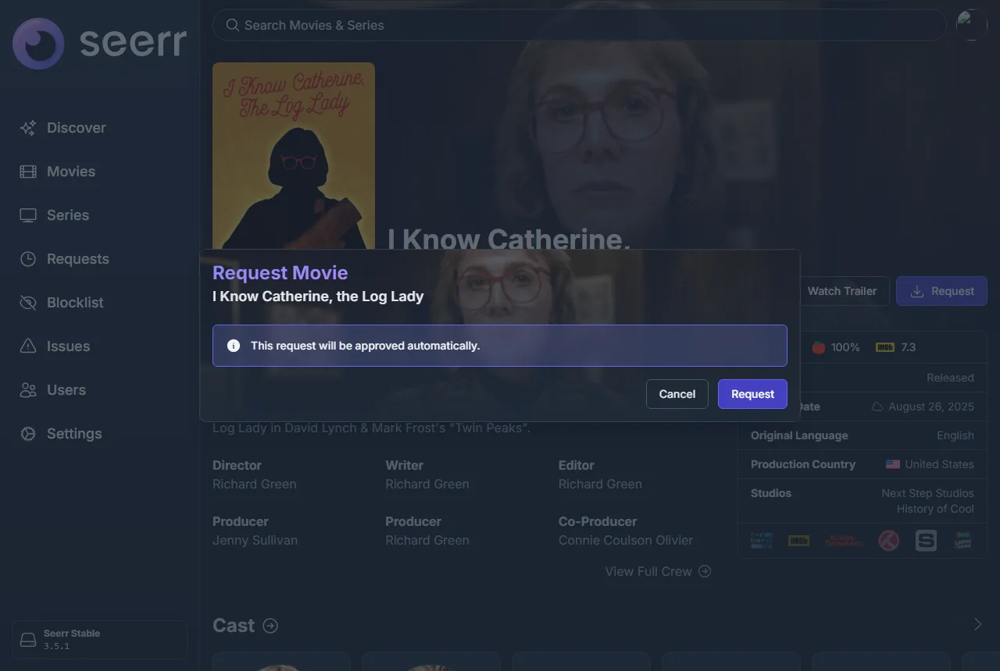

# 通过 DMM 使用 Seerr {#seerr-through-dmm}

把 DMM 添加到 [Seerr](https://github.com/seerr-team/seerr) 中，作为 Radarr 和 Sonarr 使用。已批准的请求会进入你的 [DMM 想看列表](../zurg/guides/dmm-wanted.md)，由 zurg 去获取。你不需要 Radarr 或 Sonarr。Seerr 只需要能访问 debridmediamanager.com。Overseerr 和 Jellyseerr 的工作方式相同。

此功能面向赞助者。Seerr 使用来自 [gatekeeper](https://gatekeeper.debridmediamanager.com/) 的 DMM API 密钥进行登录。

## 你需要准备 {#what-you-need}

- zurg 读取你的想看列表，需要在 `config.yml` 中配置 `dmm_api_key`。参见 [获取 DMM 中的想看内容](../zurg/guides/dmm-wanted.md#what-you-need)。
- 将 Seerr 与你的 Plex、Jellyfin 或 Emby 服务器配置好，这样它就能知道你已经有哪些剧集。

## 将 DMM 添加为 Radarr {#add-dmm-as-radarr}

在 Seerr 中打开 **Settings → Services**，然后点击 **Add Radarr Server**。按下面的方式填写：

| 字段 | 值 |
|---|---|
| Default Server | 勾选 |
| 4K Server | 不勾选 |
| Server Name | `DMM`，或者任意名称 |
| Hostname or IP Address | `debridmediamanager.com` |
| Port | `443` |
| Use SSL | 勾选 |
| API Key | 你的 DMM API 密钥 |
| URL Base | `/api/arr/radarr` |

点击 **Test**。连接成功后，Quality Profile 选 **Any**，Root Folder 选 **/dmm**。
Minimum Availability 保持默认。勾选 **Enable Scan**，然后点击 **Add Server**。

如果 Test 失败，检查一下密钥：它就是 DMM 的 [设置](https://debridmediamanager.com/settings)页面上显示的那个。另外，你的赞助过期后，DMM 也会拒绝这个密钥。

## 将 DMM 添加为 Sonarr {#add-dmm-as-sonarr}

按下 **Add Sonarr Server**，并把 URL Base 填成 `/api/arr/sonarr`。点 **Test** 之后，在配置文件（profiles）和根文件夹（root folders）里都选 **Any**，再选 `/dmm`。勾选 **Enable Scan**，然后按 **Add Server**。

## 请求 {#requesting}

请像平时一样发起请求。获批的电影会进入你的想看列表：

对于剧集，请选择你想要的季。之后的请求可以添加更多季。要跟踪整部剧（包括之后新增的季），请在其 DMM 页面上按下 **Want all seasons**。

你的[想看列表](https://debridmediamanager.com/wanted)会在几秒内显示每个标题。zurg 会在一分钟内将其取走。

## Seerr 显示的内容 {#what-seerr-shows}

Seerr 每天会在 **Radarr Scan** 和 **Sonarr Scan** 中读取一次 DMM 的列表。要立即运行它们，请打开 **Settings → Jobs & Cache**，然后在每一项旁边点击 **Run Now**。

- **电影**：zurg 获取到后，会显示为 **Available**。

  

- **剧集**：在其剧集进入你的 Plex、Jellyfin 或 Emby 媒体库，并且 Seerr 对该服务器的扫描找到它们之前，会一直显示为 **Processing**。DMM 不知道 zurg 持有哪些剧集。

## 删除标题 {#removing-a-title}

在 Seerr 中打开该标题，点击齿轮按钮，然后选择 **Remove from Radarr**（或 **Remove from Sonarr**）。这样会将其从你的想看列表中移除。zurg 已经获取的内容仍会保留在你的媒体库中。旁边的 **Open in Radarr** 会在 DMM 上打开该标题。

遇到问题？请在 [Discord](https://discord.com/invite/7u4YjMThXP) 的 **dmm-support** 论坛中提问。[获取帮助](../guides/remote-help.md) 中说明了需要提供哪些信息。

## 通过 DMM 使用 Seerr，还是使用 zurg 自带的 Seerr 源 {#seerr-through-dmm-or-zurgs-own-seerr-source}

zurg 也可以直接读取 Seerr，使用 [`seerr` 来源](../zurg/guides/acquisition.md#configuration)。
二者选其一，不要同时使用：

- **通过 DMM**：Seerr 只需要能访问互联网，请求会显示在你的想看列表中，与你用 **Want** 添加的内容并列。Seerr 每天的扫描会把 zurg 已获取的影片标记为可用。
- **zurg 自己的来源**：可以把 4K 请求与 1080p 请求区分开来，但 zurg 必须能够访问 Seerr。
