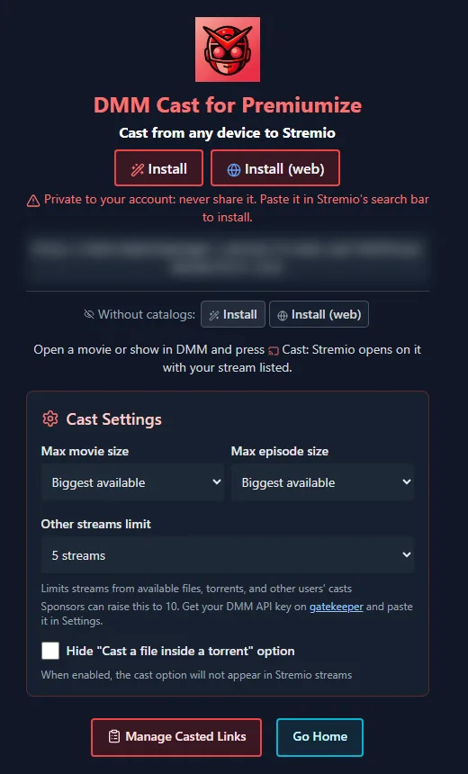
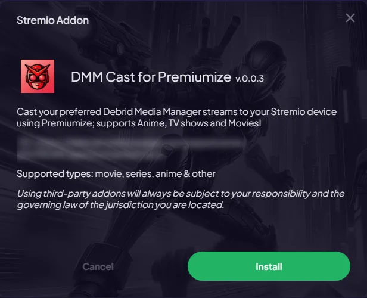
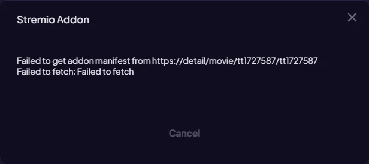

# 在 Stremio 中使用 DMM 与 DMM Cast {#use-dmm-in-stremio-with-dmm-cast}

DMM Cast 是 Debrid Media Manager 的 Stremio 插件。它让 DMM 出现在 Stremio 里:你在 DMM 上选一个资源,点击 **Cast**,Stremio 就会把它列为一个流媒体来源,从你自己的 debrid 或 Easynews 账号播放。简单来说:在 DMM 上登录,打开你的服务商的 Cast 页面,在 Stremio 中安装插件,然后在任意电影或剧集上点 **Cast**。

这里的 Cast 指的是 DMM 插件。它不是 Chromecast,也不是屏幕投屏。

## 你需要准备 {#what-you-need}

- 使用 Real-Debrid、TorBox、AllDebrid、Premiumize、Offcloud、Debrid-Link 或 Easynews 登录 DMM。
- Stremio。[Stremio Web](https://web.stremio.com) 无需 Stremio 账号也能用。

无需赞助。

## 设置方法 {#set-it-up}

1. Melde dich auf [debridmediamanager.com](https://debridmediamanager.com) mit deinem Anbieter an. Easynews meldest du unter **Settings** an.
2. Drück auf der Startseite von DMM auf **Cast for RD**, **Cast for TB** und so weiter. Wenn mehrere Konten angemeldet sind, gibt es eine Zeile **Cast** mit einem Button pro Anbieter. Jeder Anbieter hat eine eigene Cast-Seite:

   | Anbieter | Cast-Seite |
   |---|---|
   | Real-Debrid | [debridmediamanager.com/stremio](https://debridmediamanager.com/stremio) |
   | TorBox | [debridmediamanager.com/stremio-torbox](https://debridmediamanager.com/stremio-torbox) |
   | AllDebrid | [debridmediamanager.com/stremio-alldebrid](https://debridmediamanager.com/stremio-alldebrid) |
   | Premiumize | [debridmediamanager.com/stremio-premiumize](https://debridmediamanager.com/stremio-premiumize) |
   | Offcloud | [debridmediamanager.com/stremio-offcloud](https://debridmediamanager.com/stremio-offcloud) |
   | Debrid-Link | [debridmediamanager.com/stremio-debridlink](https://debridmediamanager.com/stremio-debridlink) |
   | Easynews | [debridmediamanager.com/stremio-easynews](https://debridmediamanager.com/stremio-easynews) |

   

3. Drück auf **Install (web)**. Stremio Web öffnet sich mit dem Addon. Drück dort auf **Install**.

   

   Für eine andere Stremio-App kopierst du die Adresse, die unter den Buttons angezeigt wird, und fügst sie dort ein. In Stremio Web geht das so: **Addons** → **Add addon** → einfügen → **Add** → **Install**. Die Adresse ist privat für dein Konto: teile sie niemals mit anderen.

4. Zurück bei DMM suchst du nach einem Film oder einer Serie und öffnest sie. Releases, die dein Anbieter schon hat, bekommen einen **Cast**-Button: **Cast (RD)**, **Cast (TB)**, **Cast (AD)**, **Cast (PM)**, **Cast (OC)** oder **Cast (DL)**. Drück darauf. DMM bestätigt mit **Cast started in Stremio** (bei einer Serie mit **Casting succeeded.** und der Anzahl der gecasteten Episoden) und versucht, den Titel in deiner Stremio-App zu öffnen.

   

5. Öffne den Titel in Stremio. Dein Cast wird als **DMM Cast PM (Yours)** angezeigt (bei anderen Anbietern entsprechend RD, TB und so weiter). Drück darauf, um abzuspielen.

   

## 在 Stremio 中还能做什么 {#what-else-you-get-in-stremio}

- **DMM Cast PM ✨ · Cast a file inside a torrent** 会出现在每部电影和每集剧集上。点它会在 DMM 中打开这个标题，你可以从那里投送某个资源。
- 另外最多可以多出 5 个来源，来自其他人的投送，以及你的服务商已经有的资源。在 Cast 页面的 **Other streams limit** 下设置数量。赞助者可以把数量提高到 10 个。
- Stremio 的 Board 上会有几行：**DMM PM Movies** 和 **DMM PM TV Shows** 存放你的投送。**DMM PM Library** 存放你账户里的所有内容，每个条目打开后会显示其文件。Easynews 没有 Library 行。
- 不想要这些行？改为点击 **Without catalogs** → **Install (web)** 来安装插件。来源依然会显示。
- Cast 页面上的 **Manage Casted Links** 会列出你的投送。勾选想删除的项目（或点 **Select All**），然后按 **Delete Selected**，就能把它们从 Stremio 中移除。
- 在 Cast 页面上启用 **Hide "Cast a file inside a torrent" option** 会去掉 ✨ 那一行。

在 Debrid-Link 上投送，会把这个资源添加到你的账户里。如果 Debrid-Link 还没有这个资源，投送会开始一次真正的下载，并占用你当天 50 个种子额度中的一个。

## 出现问题时 {#when-something-is-wrong}

| 你会看到什么 | 怎么做 |
|---|---|
| 按下 **Cast** 后，Stremio 显示 **Failed to get addon manifest from https://detail/movie/…** 和 **Failed to fetch: Failed to fetch** | 你的投递已经保存。Stremio 把 DMM 里的影片链接当成了要安装的插件。按 **Cancel**，自己在 Stremio 里打开这部影片，然后选择 **(Yours)** 的流。 |
| 只显示 **DMM Cast PM ✨ · Cast a file inside a torrent**（RD、TB 等），没有其他流 | 这部影片还没有投递过任何内容。点这一行，它会在 DMM 上打开这部影片。在某个版本上按 **Cast**，然后再次在 Stremio 里打开这部影片。 |
| 只显示 **⚠️ DMM Cast · Set up DMM Cast for Premiumize again**（或你的服务商）这一个流 | Stremio 里的插件和你的 DMM 登录信息对不上了。点它打开你的 Cast 页面，登录，然后从 Stremio 里删除旧插件，再从那个页面重新安装。 |
| 只显示 **Real-Debrid Required. You must be logged in with Real-Debrid to use the Stremio Cast feature.**（或 TorBox、Easynews 等） | 你没有在 DMM 上登录该服务，或者你打开了其他服务的 Cast 页面。按 **Login with …**，或者使用 DMM 首页上的 **Cast for …** 按钮。 |
| **No episodes in this release on Premiumize** | DMM 无法把这个版本的文件匹配到剧集。请投递另一个版本。 |
| 把插件地址粘贴到 Stremio Web 顶部的搜索栏后没有反应 | 那个栏只用来搜索。请使用 **Addons** → **Add addon**。 |

卡住了？可以在 [Discord](https://discord.com/invite/7u4YjMThXP) 的 **dmm-cast-support** 论坛里提问。[获取帮助](../guides/remote-help.md)里写了该提供哪些信息。

## 常见问题 {#questions}

### 我能在 Stremio 中搜索 DMM 吗？ {#can-i-search-dmm-in-stremio}

不，DMM Cast 不会在 Stremio 中添加搜索功能，Stremio 的搜索也不会显示其中的内容。请在 [debridmediamanager.com](https://debridmediamanager.com) 上搜索，然后点击 **Cast**。如果你已经在 Stremio 中打开了某个影片，✨ 行会带你跳转到 DMM 上的该影片。

### 能在电视、Fire TV 或手机上用吗？ {#does-it-work-on-my-tv-fire-tv-or-phone}

投屏记录保存在 DMM 上，而不是你投屏的设备上。所有填了你插件地址的 Stremio 都能看到这些记录。用手机或电脑投屏，然后在你观看的地方的 Stremio 里选择 **(Yours)** 流即可。

### 支持哪些服务商？ {#which-providers-work}

Real-Debrid、TorBox、AllDebrid、Premiumize、Offcloud、Debrid-Link 和 Easynews。每个服务都有自己的 Cast 页面和独立的插件。你想在 Stremio 里用几个账户，就分别安装几个插件。

### 为什么 Stremio 只显示 Cast 而没有播放源？ {#why-does-stremio-show-only-cast-and-no-stream}

没有为该影片选定任何资源。点击 ✨ 行，在 DMM 上选择一个版本，然后再次在 Stremio 中打开该影片。

### 我能在 Stremio 中播放我的整个 debrid 库吗？ {#can-i-play-my-whole-debrid-library-in-stremio}

是的。Stremio 的 Board 上的 **DMM Library** 一行会列出你账户里的所有内容（不包括 Easynews）。打开某个条目即可查看其中的文件。

### 需要赞助吗？ {#do-i-need-a-sponsorship}

不对。对于 DMM Cast，赞助只会把 **Other streams limit** 从 5 提高到 10。请在 [gatekeeper](https://gatekeeper.debridmediamanager.com/) 上获取你的 DMM API 密钥，然后粘贴到 DMM 的 **Settings** 中。
