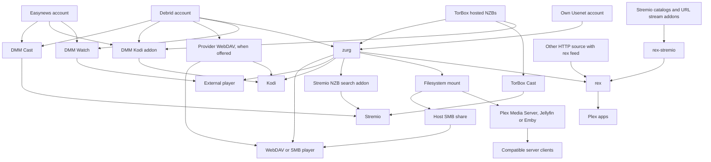
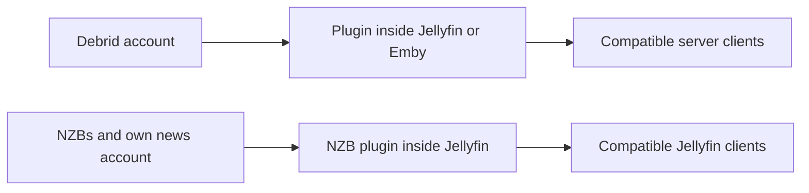
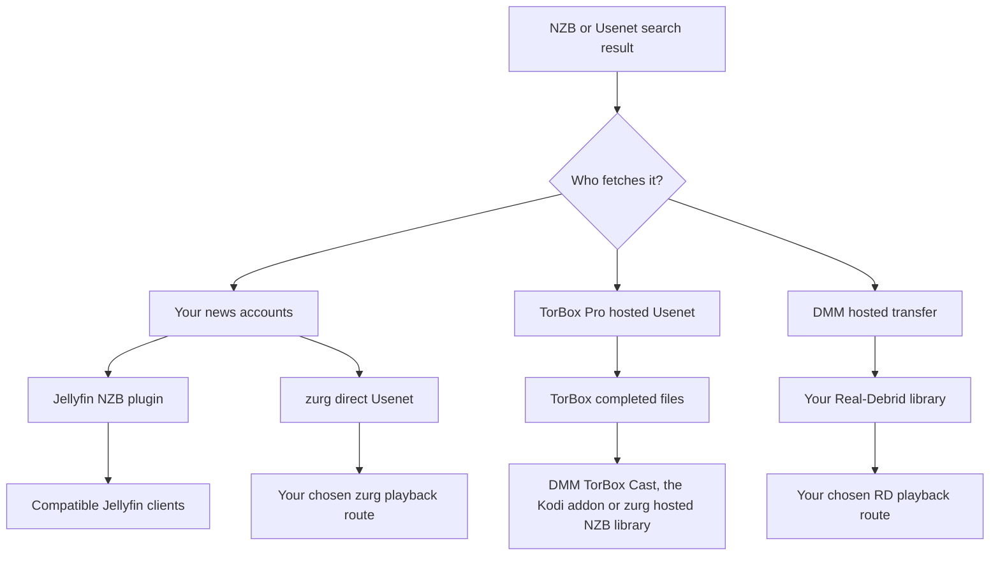

# 应该用哪种方案？ {#which-setup-should-i-use}

**[用互动问卷找到适合你的设置](https://debridmediamanager.com/choose-your-setup)。** 回答几个关于你的播放器账号和托管方式的问题。它会返回路线、要求和设置链接。无需登录。

**从你想观看的应用开始。** 你不需要每个组件都装。DMM 帮你挑选版本。提供商提供文件。zurg 可以把这些文件变成共享库。rex 把库呈现给 Plex 类应用。有些路线会跳过其中某个组件。

这张地图涵盖了 **2026 年 11 月 10 日** 检查过的受支持路线。它也包括能省掉某一步的外部替代方案。第三方插件和设备仍可能有所不同。请按照链接的指南及其测试过的限制来操作。

## 按你已经在用的东西来选 {#pick-by-what-you-already-use}

在手机上，把表格左右滑动即可看到所有列。

| 我有 / 想要… | 选择这条路线 | 为什么选它？ | 需要承担什么 |
|---|---|---|---|
| Stremio 和一个 debrid 或 Easynews 账号；不想维护服务器 | **DMM Cast → Stremio**，或你现有的流媒体插件 | 通过你的账号观看，无需运行 zurg、rex 或媒体服务器 | 插件和服务商必须提供可播放的流；播放由设备完成 |
| Kodi 和一个 debrid、Easynews 或 TorBox Pro 账号 | **DMM 的 Kodi 插件 → 你的账号** | 在 Kodi 内浏览、搜索和播放；可以用手机配对。插件的 TorBox 库包含托管的 NZB 下载 | 播放由 Kodi 完成。赞助者的 Wanted 列表仍需要 zurg 来处理请求 |
| 想用常用播放器看一部电影 | **DMM Watch → 外部播放器** | 无需媒体库服务器 | 安装受支持的播放器，并选择它能播放的文件 |
| Infuse、Kodi 或其他 WebDAV 播放器 | 没有主机时用**服务商 WebDAV**；主机能保持开机时用**zurg → WebDAV 播放器** | 无需 Plex、Jellyfin、Emby 或 rex 即可浏览云端库 | Real-Debrid、AllDebrid、Premiumize、TorBox 和 Debrid-Link 提供各自的 WebDAV，文件夹结构也各不相同。Offcloud 没有 WebDAV，因此需要 zurg。zurg 需要一台在你观看时保持开机的主机 |
| 已经在运行 Plex Media Server | **zurg → 挂载文件夹 → Plex Media Server → Plex 应用** | 保留你的服务器、媒体库和现有工作流 | 需要在服务器旁边运行 zurg 和文件系统挂载；扫描时会读取远程文件 |
| 想用 Plex 应用，但不想维护挂载的媒体库 | **zurg → rex → Plex 应用** | zurg 为 rex 提供媒体库，无需挂载或 Plex Media Server | 两个服务都需要持续运行；请查看 rex 的应用兼容性和账号说明 |
| 想用 Stremio 插件，但更喜欢 Plex 应用 | **插件 → rex-stremio → rex → Plex 应用** | 把插件目录转换为 Plex 媒体库；zurg 可选 | 需要运行 rex 和 rex-stremio；流媒体插件必须返回可播放的 URL，而不是原始种子 |
| Jellyfin 是我的播放器访问媒体库的方式 | **Jellyfin 内的服务商插件 → 兼容客户端** | 无需单独的 zurg 服务或挂载 | 需要 Jellyfin 12 和对应的插件；插件有各自的压缩包限制 |
| Emby 是我的播放器访问媒体库的方式 | **Emby 内的服务商插件 → 兼容客户端** | 所有内容都保留在现有的 Emby 服务器中 | 使用受支持的 Emby 版本；这六个插件只支持 debrid，不支持直接 Usenet |
| Jellyfin/Emby，同时还有需要自有文件系统或 WebDAV 访问的客户端 | **zurg → 挂载 → Jellyfin/Emby** | 一个媒体库可以同时服务多个客户端 | 需要维护挂载和服务器路径；其他客户端可以直接使用 zurg |
| NZB 文件、自己的 Usenet 账号和 Jellyfin | **Jellyfin 内的 NZB 插件 → 兼容客户端** | 无需单独的 zurg 服务即可播放 NZB | 需要 NNTP 访问和受支持的 Jellyfin 版本；插件会跳过压缩/加密的压缩包成员，且不使用 PAR2 修复 |
| 一台可以读取 SMB 共享的硬件播放器 | **zurg → 挂载 → 主机的 SMB 共享 → 播放器** | 保留播放器原生的文件浏览器和播放功能 | 由主机提供 SMB；zurg 本身提供的是 WebDAV，而不是 SMB 服务器 |
| 自己的 Usenet 账号和 Stremio | **Newznab 索引器 → zurg 的 Stremio 插件 → Stremio** | 播放时搜索，并通过你的新闻服务器账号流式播放 | 需要运行中的 zurg、索引器访问权限和 NNTP 凭据；其他设备需要能访问的 HTTPS 插件地址 |
| Android/Google TV 设备，且没有其他电脑 | **zurg+rex Android → 该设备上的播放器，或其上的 Plex 应用及你家里的其他设备** | 在 Android 设备上运行 zurg 和 rex，并在手机或电视盒子上使用你自己的 Plex 服务器，用于该屏幕及家中的 Plex 应用 | 需要赞助者访问权限、侧载和后台运行；Usenet 需要 64 位 Android；TorBox 托管的 NZB 在 Android 上不可用 |
| 文件已经在磁盘/NAS 上 | **现有的媒体服务器或网络播放器**；如果想用 rex，则使用 **HTTP 源 → rex** | 继续使用你拥有的文件；无需 debrid 或 Usenet 账号 | rex 需要通过其 feed API 提交元数据，并需要能通过 HTTP 访问文件；feed 生成器和文件服务器可以分开部署。rex 不会扫描磁盘 |
| 可流式播放的 HTTP 媒体或我自己的 HTTP 服务器 | **HTTP 源 + rex feed → rex → Plex 应用**，或直接使用兼容的播放器 | 无需 debrid 或 zurg 即可使用现有来源 | rex 需要 feed 生成器来提交身份和媒体详情；单独一个 URL 无法提供这些元数据 |

入门链接：[DMM Cast](https://debridmediamanager.com/stremio/) · [Kodi](https://debridmediamanager.com/kodi) · [DMM 设置](https://debridmediamanager.com/settings) · [zurg 安装指南](../zurg/setup/index.md) · [rex 与 zurg 配合使用](../rex/with-zurg.md) · [rex 与 Stremio 插件](../rex/stremio.md) · [Jellyfin 插件](https://debridmediamanager.com/jellyfin) · [Emby 插件](https://debridmediamanager.com/emby) · [zurg 的 Stremio 插件](../zurg/guides/stremio.md) · [Android](../zurg/guides/android.md) · [rex 支持任意来源](../rex/any-source.md)。

Cast 链接默认从 Real-Debrid 开始。如果你使用 [TorBox](https://debridmediamanager.com/stremio-torbox/)、[AllDebrid](https://debridmediamanager.com/stremio-alldebrid/)、[Premiumize](https://debridmediamanager.com/stremio-premiumize/)、[Offcloud](https://debridmediamanager.com/stremio-offcloud/)、[Debrid-Link](https://debridmediamanager.com/stremio-debridlink/) 或 [Easynews](https://debridmediamanager.com/stremio-easynews/) 账号，请使用对应的安装页面。这里的 Cast 指的是 **DMM 插件**，不是 Chromecast 或屏幕镜像。

## 播放示意图 {#the-playback-map}

箭头表示“为某个库或可播放的流提供来源”。它们不是数据包路由图：取决于路径，播放器可能直接从提供方获取内容，也可能由服务器负责传输数据。

[在全屏模式下打开播放路线图](../assets/setup-routes/playback.svg)，可放大或保存。

Stremio 的 NZB 搜索分支需要一个 NZB 账户（`nzb` 或 `torbox_nzb`，后者用于 TorBox 已经持有的发布内容）以及一个 Newznab 索引器。TorBox 托管的 NZB 也可以通过 TorBox Cast 或 Kodi 插件播放，无需 zurg。挂载到 SMB 的分支需要在主机上单独配置一个共享。

还有两条较小的路线值得单独了解：

[在全屏模式下打开插件路线图](../assets/setup-routes/plugins.svg)。

这些插件是各自独立的集成。插件名称中的“zurg”**并不**意味着你必须运行 zurg 应用程序，它也不保证具有相同的功能。TorBox 插件的种子库与 zurg 的托管 NZB 后端是分开的。

## 选择文件来源 {#choose-where-the-files-come-from}

**索引器**用来查找资源。**种子或 NZB** 描述如何获取资源。**提供商**提供实际的数据。**播放器**负责解码。访问其中一个并不代表包含其他的。

| 输入 | 什么获取或提供视频？ | 你需要什么 | 何时有用 |
|---|---|---|---|
| 已缓存的种子、磁力链接或种子文件 | 你的 debrid 提供商 | 所选集成支持的账户 | 当该资源已经可用时，通常等待时间最短 |
| 未缓存的种子 | debrid 提供商先下载它 | 接受该种子的账户、可用的来源，以及在其限制内的空间 | 你想要的资源没有缓存；需要等待，也可能失败 |
| NZB，使用你自己的新闻服务器账户 | zurg 的**直连 Usenet** 后端，或 Jellyfin 的 NZB 插件，按需读取文章 | NZB、NNTP 访问权限和你所选的集成；如果想搜索，还需要索引器访问权限 | 选择你的提供商或主干网络，使用备用账户，避免在本地存储整个视频 |
| NZB，使用 TorBox 的托管服务 | **TorBox 获取并修复它**，然后提供已完成的文件 | TorBox Pro；通过 DMM 或 zurg 的 **TorBox hosted NZB** 后端提交 | 你想使用 NZB，但不想管理新闻服务器凭据或在本地解码 |
| 发送到 Real-Debrid 的 DMM Usenet 结果 | DMM 的托管传输服务获取它，并将其交给**你的 Real-Debrid 库** | Real-Debrid 和可用的 DMM 传输配额 | 你已经通过 RD 观看，并希望该资源出现在那里；不需要个人 NNTP 账户 |
| Easynews 搜索结果 | Easynews 提供直接的 HTTP 下载/流媒体 | 你自己的 Easynews 账户 | 在 DMM 中观看或 Cast，或使用其 Easynews Cast/Kodi 途径，无需建立 NZB 库 |
| 直接的 HTTP(S) 下载链接 | 兼容的播放器/HTTP 来源，或支持该下载的提供商 | 能访问实际媒体 URL；如果要在那里导入或解除限制，需要合适的提供商账户 | 你已经有文件 URL，而不是种子/NZB |
| 磁盘或 NAS 上的文件 | 你的文件/媒体服务器 | 本地存储，以及能访问它的播放器 | 离线拥有、家庭视频，或保留现有收藏 |

zurg 支持 **Real-Debrid、AllDebrid、TorBox、Premiumize、Offcloud 和 Debrid-Link**。你可以在同一个库中组合多个账户。缓存配额和文件可用性仍然各不相同。显示“已缓存”标记只是一种迹象，并不保证能播放。参见 [providers](../zurg/providers/index.md)。

### “无需 Usenet 账号的 Usenet”：走哪条路线？ {#usenet-without-a-usenet-account-which-route}

[在全尺寸中打开 Usenet 路线图](../assets/setup-routes/usenet.svg)。

当你希望 TorBox 负责下载和修复时，请选择 **TorBox hosted NZBs**。DMM 会把 NZB 发送到那里。当前的 zurg 每夜构建版使用提供方类型 `torbox_nzb`，并接受来自 watch directory 和 SABnzbd 接口的 NZB。[TorBox hosted Usenet](../zurg/providers/torbox-nzb.md) 中有对应的 zurg 设置说明。缓存未命中时，必须先下载完成才能播放。下载与种子共用名额。已保留的文件可能会过期，zurg 也不保证会重新获取过期的版本。请保留 NZB，以便之后再次获取。

当你希望 zurg 通过你自己的新闻服务器账户读取内容（包括备用或区块账户）时，请选择**直接 Usenet**。它使用 `nzb` 加 NNTP 凭据。TorBox 的新闻服务器登录也属于这一类。它与 TorBox hosted NZBs 是分开的。请参阅 [TorBox NNTP](../zurg/providers/torbox-news-server.md) 和[它的套餐](https://torbox.app/pricing)。

**一个 zurg 实例只能使用 `nzb` 或 `torbox_nzb` 其中之一。** 两者都会占用 NZB watch directory。若要同时运行，请使用单独的实例和工作目录。如果两者都设置了 `dmm_api_key`，请[在其中一个上关闭 `dmm-wanted` 来源](../zurg/guides/dmm-wanted.md#two-zurgs-on-one-key)，否则每个 Wanted 标题都会被获取两次。两者都可以与种子提供方并存。zurg 的 Stremio 插件会把它选中的版本提交到该实例所配置的任一 NZB 账户。使用 `torbox_nzb` 时，只有 TorBox 已经持有的版本能在插件的等待时间内开始，并且只有在没有其他 NZB 提交正在等待时才会如此。

当你希望版本进入你的 RD 库时，请选择 **DMM → Real-Debrid**。这是一种托管式传输，有队列和配额限制。未缓存的任务需要一些时间。它并不会为 Real-Debrid 或其他 debrid 提供方添加原生 NNTP 支持。DMM 的结果和 [Transfers page](https://debridmediamanager.com/transfers) 会显示进度。

Easynews 的 **Watch** 和 **Cast** 可以播放其 HTTP 文件，**Download NZB** 则会保存该版本的 NZB。**Send to zurg** 会把该 NZB 放入你的赞助者 Wanted 列表。这需要已配置 NZB 后端。在 DMM 中登录 Easynews 并不会配置 zurg 的 NZB 账户。

### HTTP 链接怎么办？ {#what-about-http-links}

DMM 的 TorBox **Add** 对话框可以把直接的 HTTP(S) 链接当作网页下载来添加。zurg 会在 `__downloads__` 中显示这些内容。不过，那里的条目不会自动变成已识别的 rex 库条目。Real-Debrid 的无限制下载也可能出现在那里。DMM 的 TorBox Cast 会包含已完成的网页下载、Usenet 下载和种子。如果网页需要登录、链接会过期、有 DRM，或者用了自己的播放器，可能还需要其他集成方式。

**rex 通过其 feed API 支持可流式播放的 HTTP(S) 媒体。** [来源或插件](../rex/any-source.md)会发送媒体地址和元数据，然后 rex 让它们可以在 Plex 应用中播放。文件服务器和 feed 生产者可以是分开的。不需要 zurg 或 debrid 账户。[rex-stremio](../rex/stremio.md) 可以为兼容的 Stremio 插件实现这一点。原始磁力链接和仅限种子的流媒体无法使用。HLS 需要 rex 的 FFmpeg 设置。rex 使用来源提供的标识。

## 决定标题如何添加 {#decide-how-titles-get-added}

获取内容和播放是两件独立的事。你可以改变请求影片的方式，而无需更换你观看所用的应用。

| 你如何选择影片 | 路径 | 为什么用它？ |
|---|---|---|
| 精确选择某个发布版本 | DMM 搜索/库 → 提供商；或一个 NZB → 你所选的 NZB 后端 | 由你自己掌控版本、大小和发布组 |
| 点击 Want，或订阅 Trakt/MDBList 列表 | [DMM Wanted](../zurg/guides/dmm-wanted.md) → zurg 获取 | 无需运行 Sonarr/Radarr 即可自动获取电影和新剧集；需要赞助。 |
| 家人通过 Seerr/Overseerr/Jellyseerr 提出请求 | [通过 DMM 使用 Seerr](../dmm/seerr.md) → Wanted → zurg | 无需 arr 服务器即可使用熟悉的请求界面；需要赞助。Seerr 需要连接到 Plex、Jellyfin 或 Emby 服务器才能设置。 |
| 已经有 Plex 观看列表或请求系统 | [zurg 获取](../zurg/guides/acquisition.md) | 保留现有的请求来源；配置其搜索和提供商目标。 |
| 想在 Sonarr/Radarr 中进行详细监控和质量配置 | DMM 或你的索引器 → arr → zurg 下载客户端接口 → 库 | 保留 arr 的决策和导入流程；需要更多服务和路径设置。 |
| 只想在按下播放时再选择 | DMM Cast/Kodi、其他流媒体插件，或 zurg 的 Stremio 搜索 | 无需预先建立所有影片的受管库。 |

对于推荐的 DMM + zurg arr 路径，**DMM 是索引器，zurg 是下载客户端**。DMM 提供 [Torznab](https://debridmediamanager.com/torznab) 和 [Newznab](https://debridmediamanager.com/newznab)。两者都需要有效的赞助。Prowlarr 是可选的。zurg 提供 [qBittorrent](../zurg/guides/sonarr-radarr-torrents.md) 和 [SABnzbd](../zurg/guides/sonarr-radarr.md) 接口。你不需要在 zurg 旁边再安装那些下载应用。[zurg 也可以为 arr 搜索](../zurg/guides/sonarr-radarr-fetch.md)。

如果你想要**完整的本地副本**，请从提供商或 zurg 下载文件。你也可以使用播放器的离线下载功能，或普通下载器加磁盘库。请检查配额，然后在无网络时播放已保存的文件。zurg 虚拟文件、`.strm` 链接和[本地 debrid 目录](../zurg/guides/local-libraries.md)都不是离线副本。本地目录只保存记录。播放仍然依赖提供商。

## 安装前需要权衡的关键点 {#the-tradeoffs-that-matter-before-installing}

| 问题 | 什么情况会改变你的选择 |
|---|---|
| 另一台机器必须一直开着吗？ | 托管的 Cast/Kodi 路线、网盘服务商 WebDAV 和 DMM Watch 不需要你自己的服务器。zurg、rex、rex-stremio 和媒体服务器插件在你观看时确实需要它们的主机运行。zurg+rex Android 可以让一台 Android 设备充当 zurg 和 rex 的主机；rex-stremio 和媒体服务器插件仍然需要普通主机。租用或托管的主机只改变由谁来运行，不改变底层路线。 |
| 你的电视能播放这个文件吗？ | WebDAV 和插件路线取决于播放器支持的编解码器、音频和字幕。zurg 只负责传输字节，它不是视频转码器。需要时，Plex Media Server、Jellyfin、Emby，或者带 FFmpeg 的 rex 可以转码，但要有合适的硬件以及服务器和应用的相应能力。 |
| 需要多少磁盘空间？ | 流式播放避免了把整个收藏都存下来。你需要为数据库、封面图、缓存，以及任何修复、转码或离线下载的工作留出空间。“不必先完整下载”并不代表完全不占用磁盘。 |
| 谁来承担带宽？ | 服务商的流量配额依然有效。服务器代理会转发播放流量，占用它的上行带宽；直接播放则把连接转移到观看者那边。媒体库分析也可能读取远程文件。 |
| 在外面能用吗？ | 托管插件不需要暴露你自己的服务器。自托管服务需要一个安全可达的地址，仅有局域网地址在外面是用不了的。参见 [rex 远程访问](../rex/any-source.md#use-it-outside-your-home-optional) 和 [Stremio HTTPS 指南](../zurg/guides/stremio.md#installing-it-on-another-device)。 |
| 家人能同时使用吗？ | 请查看你的服务商的 IP 和并发规则，以及服务器的共享方式。Real-Debrid 的使用必须固定在同一个公网 IP 上；即使直链是由集中式媒体库提供的，把它们发给不同住户也可能违反这一规则。在没弄清下载来源之前，不要开启重定向。 |
| 我要为什么付费？ | 请把服务商订阅、索引器访问、DMM 赞助、托管以及播放器/服务器的购买分开看待。DMM 的基础网站和个人使用的 rex 是免费的；rex 的 Android 版本只包含在仅限赞助者使用的 zurg+rex 应用中。当前的 zurg 夜间构建版和 DMM 的插件分发属于赞助者福利；Wanted 和 DMM 的索引器 API 也需要赞助。rex-stremio 不需要赞助。[赞助能获得什么](sponsorship.md) 列出了所有福利以及在哪里设置。 |
| 目录里有某个条目，就一定能播放吗？ | 不能。插件目录只是描述影片名称；云端文件可能会过期；种子可能没有来源；Usenet 文章可能缺失。请选择你能接受其失败情况和等待方式的路线。 |

兼容的服务器客户端也可以是第三方应用。[Infuse 支持连接 Plex、Emby 和 Jellyfin](https://support.firecore.com/hc/en-us/articles/360006462093-Streaming-from-Plex-Emby-and-Jellyfin)。你可能不需要单独挂载 zurg。请同时检查插件和客户端。

Infuse 支持 [WebDAV 和其他网络共享](https://support.firecore.com/hc/en-us/articles/215090977-Streaming-From-a-Mac-PC-or-NAS)。`.strm` 文件可以为 Kodi 等兼容播放器提供一个 URL。它不能替代通用的挂载方式。请检查客户端，并注意它在代理和故障切换上的行为可能不同。不要把 `.strm` 用作 Plex Media Server 的常规设置。

还有一个 [旧版免费 zurg 发布版](https://github.com/debridmediamanager/zurg-public/releases)。它只支持 Real-Debrid，并且使用不同的配置格式。这里介绍的多服务商 Usenet 和 Android 路线使用的是赞助者夜间构建版。

**rex 有它自己的兼容性边界。** 它是一个独立的 Plex 应用服务器，不是 Plex Media Server，也不是 Plex 插件。关于经过测试的设备、远程转码和全新账户建议，请查阅其 [常见问题](../rex/faq.md)。传统的 Plex 服务器可以与 rex 一起运行。

## 可能改变路线的需求 {#needs-that-can-change-the-route}

| 我还需要… | 该选择或检查什么 |
|---|---|
| 本地文件和云端影片一起用 | 保留你现有的 Plex/Jellyfin/Emby 服务器，再添加挂载或对应的插件。rex 可以合并多个 feed 来源，包括用于本地文件的 HTTP 来源，但这些文件仍然需要它们自己的元数据。 |
| 自动字幕文件 | 播放器自带的或视频内嵌的字幕可能就够用了。如果用 arr 工作流，[Bazarr 配合 zurg](../zurg/guides/subtitles.md) 会把本地字幕文件写在虚拟视频旁边；这些旁挂字幕不会出现在 DMM Cast、Kodi 插件、DMM Watch 或 zurg 的 Stremio 插件里；但它们能通过 WebDAV 来源被 Kodi 读取。rex 也有不需要 Bazarr 的 Search Subtitles 功能。 |
| 换服务器时保留观看记录 | 切换前先阅读 [从 Plex 迁移](../rex/from-plex.md) 和 [导入观看状态](../rex/import-watched.md)；更换来源并不会自动迁移每个应用的观看记录。 |
| 与拥有自己账号的人分享选择 | DMM hashlist 可以分享资源选择，让别人添加到他们自己的账号里。它们不会传输你的凭据，也不会托管播放。分享服务器是另一种方式，要遵守其分享和服务商的规则。 |
| 带宽有限的 VPS 或远程主机 | 检查该路由是代理还是重定向播放。[rex 直接下载设置](../rex/direct-download.md)说明了相关选项；重定向会改变下载器的公网 IP，还可能暴露服务商的 URL。 |

## 其他媒体和已有的搭建 {#other-media-and-existing-setups}

- **音乐：** [DMM Music](https://debridmediamanager.com/music/) 提供 Real-Debrid 的网页播放和下载。[rex 音乐来源](../rex/music.md) 可以供 Plexamp 和支持的 Plex 应用使用。来源可以是专为音乐配置的插件或 zurg。别以为电影/剧集插件也会提供音乐。
- **直播电视：** [rex 的直播电视路线](../rex/live-tv.md) 在文档中列出的应用里提供频道和节目指南。而 rex-stremio 的直播频道会形成一个频道库，这和节目指南界面并不是一回事。使用前先确认来源是否可用。rex 不提供 DVR 录制功能。
- **家庭视频、录像和照片：** 用你现有的媒体服务器，或者一个你自己掌控的 [rex 来源](../rex/addons.md)。[家庭视频教程](../rex/addon-home-videos.md) 演示的就是后一种做法。zurg 也可以把漫画作为照片提供给 rex，不过各应用的支持情况不同。
- **已经在用的 Kodi/Stremio 插件：** 如果你现有的插件已经提供了你想要的体验，就保留它。DMM 可以作为你选择和管理资源的地方，而不必替换你的播放器。各插件对供应商、Usenet 和 HTTP 的支持程度不一，DMM 这条路线并不保证所有插件都兼容。
- **已安装其他 debrid 挂载/下载工具：** 切换前请先看看 [迁移选项](../zurg/migrate/index.md)。能正常运行的配置，不需要仅仅因为“已经存在”就再加一层。
- **正在开发的原生应用：** Usenet TV 还不是已正式发布、可在应用商店获取的方案，这里不作推荐。Yomu TV 是另一个独立的阅读/有声书项目，不属于这套电影/剧集方案的路线。以上两者对于前面列出的路线来说都不是必需的。

## 五种常见的起步方案 {#five-common-starting-points}

1. **“我有 Stremio 和 RD。”** 先从 DMM Cast 开始。只有当你需要共享库、自动化或其他需要它的客户端时，再添加 zurg。

2. **“我有 TorBox Pro，想用那篇帖子里的 NZB。”** 通过 DMM 把 NZB 发送到 TorBox。想在 Stremio 里观看就用 TorBox Cast，想在 Kodi 里观看就用 Kodi 插件，或者用 zurg 的托管 NZB 后端，为你选择的库/播放器路线提供内容。

3. **“我已经有 Jellyfin。”** 先从你所用服务商的插件开始。当你需要 zurg 的共享文件系统、自动化或更广泛的后端功能时，再选择单独的 zurg。

4. **“我想要 Plex 应用、不需要挂载，并且保留现有插件。”** 使用 rex-stremio 配合 rex。如果你想输出的是你自己托管的 debrid/Usenet 库，就改用 zurg 作为源。两个源都可以为同一个 rex 提供内容。

5. **“我有 Usenet 账户，想用 Sonarr/Radarr。”** 使用 DMM Newznab 或你现有的索引器、zurg 的 NZB/SABnzbd 路线，以及第一张表中的某条播放路线。如果需要永久保存的本地文件，请选择普通下载器，或明确保存完整副本；仅有虚拟导入并不是离线文件。

还是拿不准？告诉我们**你的设备或播放器、现有账户、主机能否一直开机，以及你想要按需播放还是自动同步库**。这些答案通常能决定该走哪条路线。[获取帮助](remote-help.md) 说明了可以在哪里提问。
