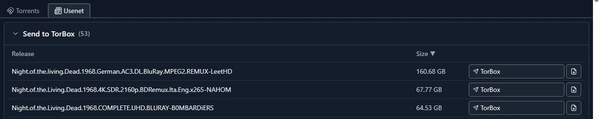

# Usenet 新手入门：该买什么，以及它如何与 zurg 配合 {#usenet-for-beginners-what-to-buy-and-how-it-fits-with-zurg}

要用 zurg 串流 Usenet，你需要一个 **Usenet provider** 账号（它存放文件），以及 **NZB files**（它记录每个版本的位置）。**indexer** 是搜索 NZB 的网站，但你不必自己购买：DMM 的 **Usenet** 标签页可以为任何电影或剧集找到 NZB。之后 zurg 会直接从你的 provider 播放该版本，无需先下载。

## 三个组成部分 {#the-three-pieces}

| 组成部分 | 它是什么 | 要花钱吗？ |
|---|---|---|
| Provider 或 news server | 存放帖子的服务。你会拿到服务器地址、用户名、密码和连接数。zurg 从它那里读取内容。 | 要。这是你唯一必须买的东西。 |
| NZB | 一个小文件，列出某个版本的所有分片，就像 `.torrent` 文件对 torrent 所做的那样。 | 不用。 |
| Indexer | 一个生成 NZB 的搜索网站。Sonarr、Radarr 和 Prowlarr 都会搜索它。 | 可选。 |

Usenet 上的一个版本会被发布成成千上万个小分片。NZB 把这些分片列出来，你的 provider 提供它们，zurg 再把它们拼回播放器要请求的视频。

## 你需要准备 {#what-you-need}

1. **一个 zurg 赞助**。Usenet 功能在 zurg 的每日构建版中，需要[赞助](sponsorship.md)才能使用。免费的公共版 zurg 只支持 Real-Debrid。
2. **一个 Usenet 服务商账户**。比较套餐时有两个数字很重要：
   - **Retention（保留天数）**：服务器保存帖子的天数。越老的电影和剧集需要越长的保留期。
   - **Connections（连接数）**：套餐允许同时使用的连接数。zurg 会按这个数字读取数据，所以请在配置里填写你套餐的实际数值。
3. **NZB 文件**。你可以从 DMM 的 Usenet 标签页保存，从自己的索引站获取，或者让 Sonarr、Radarr 或 zurg 帮你找。

你不需要：

- **下载客户端**，比如 SABnzbd 或 NZBGet。zurg 直接串流资源。对于 Sonarr 和 Radarr，zurg 本身就扮演 SABnzbd 的角色：请参阅 [Sonarr 和 Radarr 的 Usenet 配置](../zurg/guides/sonarr-radarr.md)。
- **存放完整资源的磁盘空间**。zurg 只获取覆盖正在播放内容的部分。一个 60 GB 的 remux 不需要 60 GB 的磁盘空间。
- **解压或修复的工具**。zurg 可以直接从 RAR 分卷内部播放，并利用资源自带的 PAR2 文件自行重建缺失的分段。
- **debrid 账户**。Usenet 可以单独使用，也可以和 Real-Debrid、TorBox 一起放在同一个 zurg 库中。
- **索引站会员资格**，至少在开始时不需要。请参阅下面的[索引站问题](#do-you-have-to-have-lifetime-memberships-with-the-usenet-indexers)。

以后值得添加的是**第二个服务商**。一个服务商丢失的帖子，往往还能在另一个服务商那里找到。当一个服务商没有某个分段时，zurg 会去问下一个。如果只有一个服务商，zurg 就必须读取整个资源才能重建那个分段。请参阅[第二个新闻服务器](../zurg/providers/usenet.md#a-second-news-server-is-worth-more-than-it-looks)。

## zurg 如何使用它 {#how-zurg-plays-it}

1. 一个 NZB 文件放进 zurg 的 `nzbs/` 文件夹。可以是你自己放的，也可以是 Sonarr、Radarr 或 zurg 本身放的。
2. 一两秒内 zurg 就会读取它，并把这个版本列入库中，名字与 NZB 相同。
3. 你在 Plex、Jellyfin 或 rex 里点击播放。zurg 会从你的提供商那里抓取该位置对应的分段，再交给播放器。拖动到后面的位置时，它会从那里开始抓取。

无需等待下载完成。想一步步设置，请参考 [Usenet with zurg](../zurg/guides/usenet.md)。提供商设置和 Docker 相关细节见 [Usenet provider](../zurg/providers/usenet.md)。

## DMM 在其中的位置 {#where-dmm-fits}

每个电影和剧集页面在 [DMM](https://debridmediamanager.com) 上,**Torrents** 旁边都有一个 **Usenet** 标签页。这里列出 DMM 索引源中该片的 Usenet 资源。只要登录了 DMM,任何人都能使用。

每一行能做什么,取决于你登录时用的账号:

| 按钮 | 作用 | 需要 |
|---|---|---|
| 最右边的文件图标,或者当它是唯一按钮时的 **NZB** | 保存 NZB 文件,文件名取自资源名,并去掉索引源的水印。把它放进 zurg 的 `nzbs/` 文件夹。 | DMM 登录 |
| **Send** | DMM 从 Usenet 获取该资源,并把它添加到你的 Real-Debrid 库中。这一步不需要 Usenet 账号。 | Real-Debrid |
| **TorBox** | 把 NZB 发送到 TorBox,由它替你下载资源。 | TorBox Pro,见 [DMM 中的 TorBox](../dmm/torbox.md) |

赞助者还能用到另外两个功能:

- **zurg 替你搜索 DMM 的索引源。** 如果你在 zurg 配置中把 DMM API 密钥填为 `dmm_api_key`,并且没有自己的索引源,那么 zurg 在获取你的 [DMM 想看列表](../zurg/guides/dmm-wanted.md) 或 [关注列表](../zurg/guides/acquisition.md) 时,会搜索 DMM 的索引源。
- **把 DMM 当作 Sonarr、Radarr 和 Prowlarr 的 Newznab 索引源。** 在 DMM 的 [Newznab 页面](https://debridmediamanager.com/newznab) 上设置即可。每个密钥每分钟可以搜索 30 次、抓取 15 次,每天可以抓取 250 次。

## 出现问题时 {#when-something-is-wrong}

| 你看到的内容 | 你该怎么做 |
|---|---|
| zurg 日志：`Cannot reach the news server for nzb` | zurg 无法登录你的服务商。请检查服务器地址、用户名和密码。端口 `563` 对应 `tls: true`，端口 `119` 对应 `tls: false`。 |
| zurg 日志：`Usenet account <name> is not reachable` | 有一个账户失败了，其他账户仍然正常工作。请修正该账户的详细信息。 |
| 服务商拒绝连接，例如 `502 Too many connections` | zurg 配置中的 `connections` 高于你套餐允许的数量，或者有其他应用在使用同一个登录信息。请把它降到套餐允许的数字。 |
| 某个资源显示为 `indexer_download_48213` 之类的名称 | zurg 会用 NZB 文件的名字来命名资源。把 `.nzb` 文件重命名为资源名称即可。 |
| 资源中的某个文件名是随机的 | 发布者隐藏了文件名，zurg 无法将其还原。请换一个资源。 |
| zurg 日志：`rar: RAR4 header-encrypted archives are not supported` | 该资源的压缩包使用了 zurg 无法打开的旧加密格式。请换一个资源。 |
| 播放卡顿，或者某段播放时没有声音 | 资源的部分数据已从你的服务商处消失。如果发布内容中包含 PAR2 文件，zurg 会用它重建缺失的数据。使用第二个服务商可以解决大部分此类问题。 |
| DMM：**No Usenet results found.** | DMM 的索引器里没有该影片的结果。可以试试 **Torrents** 标签页，或者你自己的索引器。 |

完整的故障排除表在 [Usenet with zurg](../zurg/guides/usenet.md#troubleshooting)。还是搞不定？请到 [Discord](https://discord.com/invite/7u4YjMThXP) 上的 **zurg-support** 论坛提问。[Getting help](remote-help.md) 说明了提问时应该包含哪些信息。

## 常见问题 {#questions}

### 能给我解释一下 Usenet 系统吗？ {#can-someone-explain-the-usenet-system-to-me}

Usenet 是一个由新闻服务器组成的网络,用来存放帖子。一个发布版本会被拆成成千上万个小块来发布。服务商把自己服务器的访问权卖给你,NZB 列出了某个发布版本的所有小块,而索引站就是你搜索 NZB 的地方。zurg 读取 NZB 后,直接从你的服务商那里播放这个发布版本。

### 使用 Usenet 索引站是否必须购买终身会员？ {#do-you-have-to-have-lifetime-memberships-with-the-usenet-indexers}

不需要任何索引器就能开始。DMM 的 Usenet 标签页会帮你找 NZB。赞助者的 zurg 也可以直接搜索 DMM 自己的索引器。如果想要更多结果，可以接入自己的索引器，任何 Newznab 索引器都能在 zurg、Sonarr 和 Radarr 里使用，不管你选哪个方案。

### Usenet 的文件应该如何命名？ {#how-are-the-files-supposed-to-be-named-for-usenet}

请按发布名称为 NZB 文件命名，比如 `Some.Movie.2024.2160p.UHD.BluRay.x265-GROUP.nzb`。zurg 会用这个名字作为该发布的文件夹名，Plex 等播放器也是靠它来匹配的。如果 NZB 文件内部自带名称，则会优先使用内部的名称。DMM 的 NZB 按钮保存文件时，已经会使用发布名称了。

### zurg 支持 Usenet 吗？ {#does-zurg-do-usenet}

是的，在赞助者可用的每日构建版本中。填入你的服务商信息，把 NZB 放进 `nzbs/` 目录，它们就能播放了。[Usenet 与 zurg](../zurg/guides/usenet.md) 一文有详细步骤。

### 什么是 TorBox NNTP？ {#what-is-torbox-nntp}

TorBox 的 Pro 套餐有两个 Usenet 功能。其定价页面显示 Usenet 仅在 Pro 套餐中提供(检查于 2026 年 11 月 14 日)。

- **托管 Usenet 下载。** TorBox 会替你下载整个发布内容,并像其他 TorBox 下载一样提供服务。从 DMM 的 Usenet 标签页或 zurg 的 `torbox_nzb` 提供方发送 NZB 即可。你不需要新闻服务器登录信息。详见 [TorBox 托管 Usenet](../zurg/providers/torbox-nzb.md)。
- **新闻服务器登录(NNTP)。** 在 zurg 中像使用其他提供方一样使用它。它允许 10 个连接。2026 年 9 月的测试显示,它能找到的真实资源库内容比其他三个付费提供方少,所以它最适合作为备用。详见 [TorBox 新闻服务器](../zurg/providers/torbox-news-server.md)。

### 一个 Usenet 账号可以在两个地方同时使用吗？ {#can-i-use-one-usenet-account-in-two-places}

最好别这样做。两个应用共用同一个登录，会共享同一批连接，并且会互相挤掉：服务器可能会断开较旧的连接，让较新的连接进来。有些服务商的条款也禁止共享账号。请为每个 zurg 分配各自的账号。
