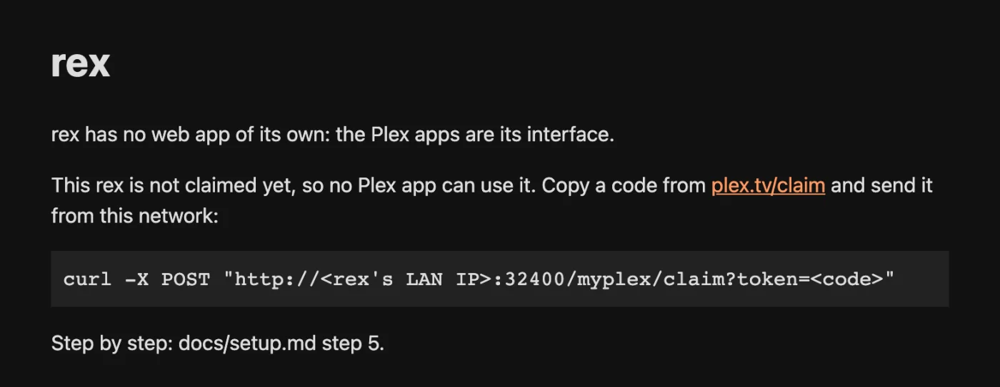

# rex 常见问题 {#rex-questions}

在安装 rex 之前，以及安装之后不久，大家最常问的问题。每个答案都链接到包含详细信息的指南。

## 安装前 {#before-you-install}

### 什么是 rex？ {#what-is-rex}

A 媒体服务器，供官方 Plex 应用使用，本身不存储任何文件。你的应用会把它看作又一个 Plex 服务器，能看到海报、季、观看历史和“继续观看”。**source**（源）负责告诉 rex 库里有什么，并提供每个文件。按下播放时，rex 直接串流播放，无需先下载。

它是一个独立的服务器，不是 Plex Media Server 插件，也不需要 Plex Media Server。如果你想两者并用，可以把它和 Plex 一起运行。[安装 rex](any-source.md#step-1-install-rex) 解释了各个名称，[从 Plex 迁移到 rex](from-plex.md) 则介绍了两种方式。

### 多少钱？ {#what-does-it-cost}

rex 对个人使用免费，没有付费版本。它的源代码以 PolyForm Noncommercial 许可证公开。不允许商业使用。每个版本都公开发布在 [GitHub Releases](https://github.com/debridmediamanager/rex/releases) 上，Android 版应用是 [rex for Android](android.md)。

周边的一些东西可能需要花钱：

| | |
|---|---|
| [rex-stremio](stremio.md)，你自己的应用或以它为来源的插件 | 免费 |
| zurg nightly，debrid 或 Usenet 库的一个来源 | [DMM 赞助者](https://gatekeeper.debridmediamanager.com)的福利 |
| DMM API 密钥，用于在 zurg 中获取 DMM 的精确匹配 | 可选，同样需要赞助 DMM 获取 |
| rex 的 Docker 镜像 | 免费且公开，适用于 Linux：[在 Docker 中运行 rex](any-source.md#run-rex-in-docker) |

### 我的 Plex 账号有风险吗？ {#is-my-plex-account-at-risk}

rex 不是 Plex 开发的，Plex 可能会对注册它的账号采取措施。请使用一个**专门为 rex 新建的免费 Plex 账号**，然后再把它共享给你自己的账号。你的观看历史、好友和 Plex Pass 都保留在你自己的账号上。[将它添加到 Plex 账号](any-source.md#step-3-add-it-to-a-plex-account)中有详细步骤。使用 rex 风险自负。

### 哪些 Plex 应用可以用？ {#which-plex-apps-work}

| 应用 | 测试情况 |
|---|---|
| Plex Web (app.plex.tv) | 测得最多：浏览、播放、转码、字幕、音乐、Live TV，以及两端都用免费账号时在外面看片 |
| Plex for Android（手机） | 在 Pixel 6 上：播放、转码和[从你的提供商下载](direct-download.md)。在模拟器上：音乐和 Live TV |
| Plexamp | 在 Android 模拟器上：浏览和播放音乐库，包括艺人图片和播放列表 |
| Plex for iOS | 在 iPad 上：播放和转码。Dolby Vision 有应用 bug（见下文） |
| Plex for Apple TV | 播放，包括库中的直播频道 |
| Plex Desktop | Mac 版 Plex：播放和转码 |
| Plezy | 在 Pixel 6 上：播放，以及从你的提供商下载 |
| Plex HTPC | 尚未测试 |
| Plex for Android TV、NVIDIA Shield、Google TV | 尚未测试 |
| Plex for Roku | 尚未测试 |
| 智能电视应用（Samsung、LG 等） | 尚未测试 |
| Infuse | 尚未测试 |

不在家时的使用，目前只测试过 Plex Web。

### 能播放 4K、HDR 和杜比视界吗？ {#does-it-play-4k-hdr-and-dolby-vision}

是的。文件会以原始画质播放：rex 把文件原样交给播放应用，由应用决定能否显示。当应用无法原样播放某个文件时，如果已经设置好 FFmpeg，rex 就会转码（[转码视频](any-source.md#converting-video-optional)）。转码会把 HDR 和 Dolby Vision 转成标准画面（设置，Transcoder，**Enable HDR tone mapping**，默认开启），并尽可能使用显卡来完成。安装了 Intel 的 OpenCL 运行时后，一台小型 Intel 机器（J4105）可以把 4K HDR10 和 Dolby Vision profile 5 转成 1080p，速度大约接近实时。没有 FFmpeg 时，应用无法播放的文件会显示 "This server is not powerful enough to convert video"。如果每个标题在每台设备上都显示这条信息，那么问题不在 FFmpeg：请参阅 [Nothing plays](#nothing-plays-or-every-app-says-it-is-not-powerful-enough)。

**Plex for iOS 与 Dolby Vision。** 当 Plex for iOS 2026.20.0 原样播放 Dolby Vision 文件时，进度停在 0:00。真正的 Plex Media Server 提供同一文件时也会以同样方式卡住，所以问题出在应用上。HDR10 和 SDR 4K 文件可以正常播放。

### 需要 Plex Pass 吗？ {#do-i-need-plex-pass}

不对。rex 会告诉 Plex 应用，它所注册的账户拥有 Plex Pass，因此使用免费账户也可以在外出时播放和转换视频。外出播放已在 Plex Web 上测试过，双方都使用免费账户；其他应用尚未在外出时测试。电影版本、Dashboard、Downloads、片头和片尾跳过，以及 [Movie and TV capabilities](https://github.com/debridmediamanager/rex/blob/main/docs/setup.md#movie-and-tv-capabilities) 中的其余功能也都可以使用。应用仍可能有自己的规则。

### 可以下载离线观看吗？ {#can-i-download-for-offline-viewing}

Plex 应用里有 **Downloads**。rex 会在自己所在的机器上准备下载内容，可以是原始文件，也可以用 FFmpeg 转换后的文件。这些文件会保存在 `rex.db` 旁边的文件夹里，直到应用来拉取。注册了 rex 的账号随时都能下载。分享给别人的话，对方需要在分享设置里允许下载（[Share rex](sharing.md#what-each-person-may-see-and-do)）。应用本身还可能有它自己的规则。转换后的下载会去掉文本字幕。在手机上保存下载并离线观看，目前还没有测试过。

### 多人可以同时用，各自保留观看记录吗？ {#can-several-people-use-it-each-with-their-own-history}

是的。你和家人、朋友共享 rex 后，每个人都用自己的账号登录，各自拥有独立的观看状态、继续观看、评分和播放列表。每个人还可以从旧的 Plex 服务器导入自己的观看记录（[导入观看记录](import-watched.md)）。[与家人和朋友共享 rex](sharing.md) 里有具体步骤，也包括为孩子设置的受管用户。

### 需要什么硬件？ {#what-hardware-does-it-need}

A cheap, always-on machine running Linux (amd64 or arm64, glibc 2.35 or newer, so Ubuntu 22.04 and up), macOS (Intel or Apple Silicon) or 64-bit Windows. On an Android phone, tablet or TV box, [rex for Android](android.md) runs rex and its addons for free, and the sponsor-only zurg+rex app, a Plex server on your phone, runs zurg and rex together (see the [Android guide](../zurg/guides/android.md)).

**Memory:** give it 1 GB. On a library of 4,062 movies and 656 shows, rex used under 500 MB while it started and about 730 MB while the library was browsed. Converting video needs more on top.

**Disk:** none for movies. rex keeps its library in `rex.db`. Downloads and the images analysis makes (seek previews, chapter images) also go beside it, if you use them.

**Converting:** only with FFmpeg. A graphics chip makes it fast: a 1080p film converted on a small Intel chip starts in about 2 seconds. Which chips rex uses on each system is in [By platform](https://github.com/debridmediamanager/rex/blob/main/docs/setup.md#by-platform): on macOS it always converts on the processor.

### 它会读取我本地的文件吗？ {#does-it-read-my-local-files}

不对。rex 从不扫描文件夹或磁盘，也不需要挂载。每个文件都通过 HTTP 从来源获取。你自己磁盘上的文件也可以加入，但需要有东西来提供这些文件，并告诉 rex 它们的信息，具体见 [rex 配合你自己的应用](any-source.md)。

### 支持 Usenet 吗？ {#does-it-work-with-usenet}

是的，可以通过能读取 Usenet 的来源来实现，比如 zurg。rex 从不直接与 Usenet 提供商通信：来源读取文件，然后像处理其他文件一样把它们提供给 rex。请按照 [Usenet](../zurg/guides/usenet.md) 为 zurg 完成设置，然后按 [rex with zurg](with-zurg.md) 中的说明将 rex 指向 zurg。

### 需要 zurg 吗？ {#do-i-need-zurg}

不，zurg 只是众多来源之一。rex 接受任何支持其 feed API 的来源：

- [在 rex 中使用你自己的应用](any-source.md)：任何通过 HTTP 提供文件的应用
- [在 rex 中使用你的 Stremio 插件](stremio.md)：来自 Stremio 插件的目录
- [在 rex 中使用 zurg](with-zurg.md)：你的 debrid 账户或 Usenet
- [编写 rex 插件](addons.md)：家庭视频、录像或频道，使用你自己的程序，并附有三个[教程](addon-home-videos.md)可供入门

多个来源可以同时填充同一个 Movies 和 TV 媒体库。

### 需要做端口转发吗？ {#do-i-need-to-forward-a-port}

不在家时？家庭网络中的 Plex 应用无需更改路由器设置即可找到 rex。app.plex.tv 也可以通过 [rex-direct](any-source.md#rex-direct) 给出的已认领 rex 的 HTTPS 地址访问。

rex 需要自己的地址，才能在外面观看或供其他家庭使用。最简单的方法是做一次端口转发（[rex-direct](any-source.md#rex-direct)）。如果你有 IPv6 但没有公网 IPv4，请使用 [rex-direct over IPv6](any-source.md#rex-direct-over-ipv6)。在运行 Tailscale 的设备上，[Tailscale serve](any-source.md#tailscale-serve) 无需端口转发。[在家以外使用](any-source.md#use-it-outside-your-home-optional) 对这些方案做了比较。

### 它不能做什么？ {#what-does-it-not-do}

没有调谐器，也没有 DVR。音乐、直播电视和照片需要有对应的来源提供。参见 [在 rex 中使用音乐](music.md) 和 [在 rex 中使用直播电视](live-tv.md)。zurg 会把漫画以照片的形式发送，Plex Web 可以显示。Plexamp 的电台混音和电台目前缺失。rex 没有中继功能，因此远程使用需要它自己的地址（[在家庭网络之外使用](any-source.md#use-it-outside-your-home-optional)）。

## 安装后 {#after-you-install}

### 为什么应用里会显示 Plex 版本，还有“Check for Updates”？ {#why-does-the-app-show-a-plex-version-and-check-for-updates}

rex 向应用和 plex.tv 的自我介绍是 Plex Media Server，所以应用里显示的 Plex Media Server 版本号并不是 rex 自己的版本。**Check for Updates** 总是会回复服务器已是最新版本，因为 rex 从不自动更新。要更新 rex，请按照 [Updating](any-source.md#updating) 中的说明下载更新的 nightly 版本。

### 为什么我在浏览器里打开 port 32400/web 看不到媒体库？ {#why-does-my-browser-at-port-32400web-not-open-a-library}

rex 本身没有网页应用。打开 `http://<rex's LAN IP>:32400/web` 会显示一个简短的状态页面。请在 Plex 应用中观看，或在浏览器中访问 [app.plex.tv](https://app.plex.tv)。

### 哪些数据会离开我的设备？ {#what-leaves-my-machine}

- **plex.tv，启动时以及每天一次，无论是否注册：** 服务器的 id、名称和版本，用于读取 Plex 公开的发布列表，查找最新版本号。
- **plex.tv，注册到 Plex 账户后一次：** 认领码（claim）、服务器的地址（局域网地址和 HTTPS 地址）以及库名称。
- **Plex 的元数据服务，注册后：** 每个影片的 id，用于获取其名称、海报、简介和剧集。通过 **Search Subtitles** 或某人的自动字幕设置进行字幕搜索时，会发送文件名和指纹。
- **图片托管服务器，应用显示图片时：** 请求你的来源指定的海报和图片。
- **DMM，用于 rex-direct，注册后每 6 小时一次：** 服务器的 id、它在 Plex 账户上的令牌（token）以及它的局域网 IP。DMM 会向 plex.tv 核实该服务器属于你，查看你的公网 IP，并将你的 rex-direct 名称指向该公网 IP 和局域网 IP。如果机器有全局 IPv6 地址，rex 也会发送它：启动（或认领）后一分钟发送一次，之后每 6 小时一次；每次 DMM 连接它以确认能到达同一台服务器时也会发送。使用 `REX_DIRECT_URL=off` 可关闭此功能。
- **你的来源，在播放或删除时：** 请求你播放的文件，以及删除操作（见下文）。
- **你的旧 Plex 服务器，仅当你[导入观看历史](import-watched.md)时：** 请求你的观看历史。
- **Webhook，仅当你设置了它们时：** 事件，发送到你设置的地址。

rex 不会询问任何人某个发布是什么。来源自行判断并告知 rex。以 zurg 为例，它会向 DMM 询问（[为什么由 DMM 放置文件](with-zurg.md#why-dmm-places-the-files)）。

### 在 Plex 应用里删除，会删掉文件吗？ {#does-deleting-in-a-plex-app-delete-the-file}

是的。在以 rex 注册的账户登录的 Plex 应用中删除电影或剧集，会像 Plex 服务器从磁盘删除文件一样，删除其源端的文件。如果源位于 zurg 等调试账户上，则会在那里删除。如果源拒绝删除，该标题会保留，应用会提示无法删除。与您共享的用户无法删除。[在 Plex 应用中删除](any-source.md#step-5-watch-something) 说明了如何关闭此功能。

### 播放不了，或者所有应用都提示性能不足 {#nothing-plays-or-every-app-says-it-is-not-powerful-enough}

在点击 Play 之后，马上看一下 rex 的日志。如果那里出现 `upstream failed` 或 `502`，说明 rex 无法通过来源提供的地址连接到你的源，安装 FFmpeg 也解决不了这个问题。最常见的原因是在 Windows 或 macOS 上通过 Docker Desktop 运行的 zurg。[rex 与 zurg](with-zurg.md#when-something-is-wrong) 或 [rex 与你自己的应用](any-source.md#when-something-is-wrong) 中的 `upstream failed` 那一行会检查地址，并告诉你该改什么。如果只有部分文件失败，而且常常只在网页浏览器里出现，说明设备无法直接播放这些文件：请设置[视频转换](any-source.md#converting-video-optional)。

### 某个影片匹配错了，怎么修正？ {#a-title-is-matched-wrong-how-do-i-fix-it}

来源决定每个文件是什么，rex 就显示该标题。请使用 rex 注册时所用的账号登录，然后使用 **Fix Match**：rex 会保留你的选择，来源也可以读取回来，把它保存为该发布的匹配结果，zurg 就是这样做的（[DMM 为什么会放置这些文件](with-zurg.md#why-dmm-places-the-files)）。

### 去哪里获取帮助？ {#where-do-i-get-help}

[获取帮助](../guides/remote-help.md) 说明了去哪里提问以及需要提供什么信息：[Discord](https://discord.com/invite/7u4YjMThXP) 上的 **rex-support** 论坛，以及面向赞助者的远程帮助。
