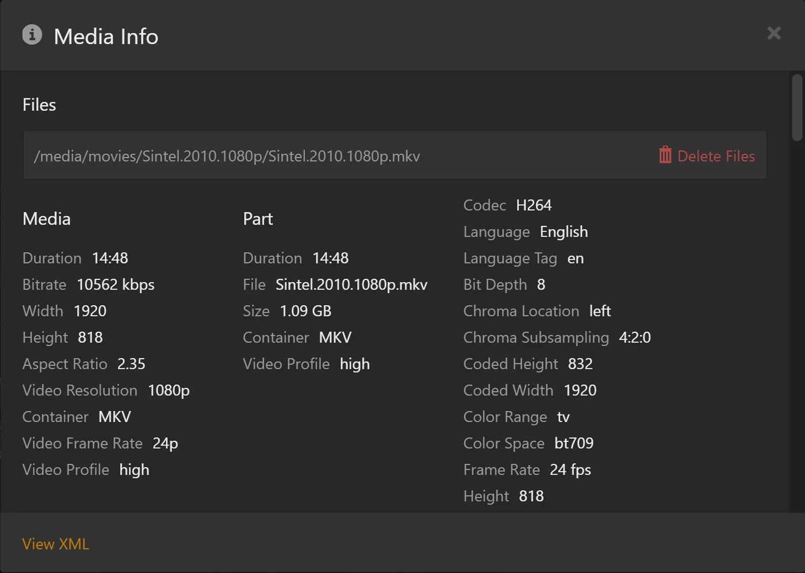

# 把你的观看历史带到 rex {#bring-your-watch-history-to-rex}

rex 启动时没有任何观看历史。它可以从另一台 Plex 服务器复制已观看的影片、续播进度和星级评分。
已看完的影片仍然保持已观看状态。看了一半的影片会回到 **Continue Watching**（继续观看）。剧集和季会重新统计集数。

在家里任意一台电脑上运行一次即可。每位使用 rex 的人都可以导入自己的观看历史。

## 开始之前 {#before-you-start}

| 你需要 | 原因 |
|---|---|
| 已设置好 rex，并且你的库已加入其中，参见 [rex 搭配你自己的应用](any-source.md)、[rex 搭配你的 Stremio 插件](stremio.md) 或 [rex 搭配 zurg](with-zurg.md) | rex 只会把历史记录复制到它已有的条目上。如果你的库还在填充中，稍后再运行一次导入即可：它只会添加新内容 |
| rex nightly **2026.10.31 或更新版本** | 按照 [rex 的 Updating 部分](any-source.md#updating) 进行更新 |
| 你的旧 Plex 服务器处于运行状态 | rex 从它那里读取历史记录。如果你在迁移到 rex 时关掉了它，请重新启动 |
| 一台位于家庭网络中、装有 `curl` 的电脑 | 导入只能在你的家庭网络中运行。Windows 10 和 11、macOS 与 Linux 都自带 `curl` |

## 1. 复制你旧服务器的地址 {#1-copy-your-old-servers-address}

1. 在浏览器中打开 [app.plex.tv](https://app.plex.tv)，并以**你自己**的身份登录，也就是你想要保留其观看记录的那个账号。
2. 选择你的旧服务器，然后打开其中任意一部电影。
3. 点击 **⋯**（More），然后点击 **Get Info**。
4. 在弹出的 **Media Info** 框左下角点击 **View XML**。浏览器会打开一个新标签页，里面全是文字。

   
5. 从该标签页的地址栏复制**完整地址**。

它看起来是一整行，结尾是 `X-Plex-Token=` 加一串代码：

```
https://192-168-1-5.0123456789abcdef.plex.direct:32400/library/metadata/1234?checkFiles=1&includeAllConcerts=1&X-Plex-Token=AbCdEfGh1234567890xy
```

这串代码就是该服务器的 **Plex token**。它的作用相当于你 Plex 账号的密码，所以千万不要把它粘贴到 Discord、支持帖子或截图里。

**第 4 步没有 View XML？** Plex Web 只会在你自己拥有的服务器上显示它，所以别人共享给你的服务器上没有这个选项。这时请在旧服务器上使用浏览器的开发者工具，方法与[第 2 步](#2-get-your-token-on-rex)相同，然后选择一个发往旧服务器的请求（其地址中包含 `plex.direct`）。右键点击它并复制地址：Chrome 和 Edge 中选 **Copy**，再选 **Copy URL**；Firefox 中选 **Copy Value**，再选 **Copy URL**。你需要的就是这个地址。它包含 `X-Plex-Token=` 和代码，以及其他若干 `X-Plex-` 部分：把整段都粘贴下来。

## 2. 在 rex 上获取你的 token {#2-get-your-token-on-rex}

rex 是别人分享给你的，所以 rex 上的 **Get Info** 没有 **View XML**：Plex Web 只向服务器的所有者显示它。请改从浏览器中读取令牌，即 app.plex.tv 发送给 rex 的那个令牌：

1. 在 app.plex.tv 上，仍以你自己的账号登录，打开浏览器的开发者工具：按 **F12**，或在 Mac 上按 **⌥ ⌘ I**。在 Safari 中，先在 **Settings**、**Advanced** 里打开 **Show features for web developers**。
2. 打开 **Network** 标签页，在其过滤框中输入 `X-Plex-Token`。
3. 在 **rex** 服务器上打开任意一部电影。列表中会出现大量请求。
4. 点击一个地址属于 rex 的请求：使用 rex-direct 时，地址中含有 `rex-direct.debridmediamanager.com`，或者是你自己设置的 HTTPS 地址。不要点击发往 `plex.tv` 的请求。
5. 复制 `X-Plex-Token` 的值：Chrome 和 Edge 在 **Payload** 下显示它，Firefox 则在 **Request** 下显示。或者复制该请求的地址，取 `X-Plex-Token=` 之后、下一个 `&` 之前的部分。

它与第 1 步中的令牌不同：每个服务器都会为你的账号分配各自的令牌。rex 通过这个令牌来识别观看历史属于谁。

## 3. 运行导入 {#3-run-the-import}

在家里的电脑上，把你的两个值填进去后运行这条命令。`192.168.1.20` 代表 rex 的局域网 IP，和设置指南里的写法一样，把它换成你自己的 IP。

```bash
curl -d "ADDRESS-FROM-STEP-1" "http://192.168.1.20:32400/rex/import-watched?X-Plex-Token=TOKEN-FROM-STEP-2"
```

在 Windows 上，打开 **PowerShell**，把 `curl` 换成 `curl.exe` 来输入。两对双引号都要保留：第 1 步中的地址包含 `&` 字符，没有引号的话命令会出错。

大约需要几秒钟，如果库很大会更久，因为 rex 要读取旧服务器上的每部电影和每一集。

**你应该看到的结果。** 会出现一行类似这样的输出：

```json
{"watched":412,"inProgress":7,"rated":38,"alreadyHere":0,"notInRex":55}
```

| 数字 | 含义 |
|---|---|
| `watched` | rex 标记为已观看的影片，包含旧服务器上的播放次数和日期 |
| `inProgress` | 你看到一半的影片：会从你停下的地方继续播放 |
| `rated` | 获得了星级评分的影片 |
| `alreadyHere` | 你已经在 rex 上看过或开始看过的影片。rex 会保留已有的内容，并且不改动这些记录 |
| `notInRex` | 旧服务器有观看记录，但 rex 里没有对应的影片，或者不是同一部影片 |

再次打开你的 Plex 应用（或重新加载 app.plex.tv）即可查看结果。

## 随时可以再次运行 {#run-it-again-any-time}

再次运行不会改动你已有的内容,所以等你的库里又到了一些新内容时再运行即可。紧接着第一次运行之后再跑一次,会看到 `"watched":0`,而之前那些条目会出现在 `alreadyHere` 下面。

## 不会被复制的内容 {#what-is-not-copied}

- 旧服务器上其他人的历史记录。每个人都要用自己的两个 token 运行导入。
- 服务器的播放历史列表、播放列表和收藏集。
- 整部剧和整季的星级评分。电影和剧集的评分会被复制。
- 媒体库中，旧服务器上代理不是 **Plex Movie** 或 **Plex TV Series** 的条目（较旧的代理，例如 Plex Movie (Legacy) 和 TheTVDB）。rex 通过 Plex 当前代理赋予的 id 查找条目，而旧代理赋予的是另一个 id，所以这些条目会计入 `notInRex`。

## 如果无法正常工作 {#if-it-does-not-work}

| 你看到的内容 | 该怎么做 |
|---|---|
| `that address has no X-Plex-Token: copy it whole from the tab View XML opens` | 粘贴的地址在 token 之前就断了。请从地址栏或开发者工具里重新复制，并把完整地址都粘贴过来 |
| `send the address View XML opens on your old Plex server, starting http:// or https://` | `-d` 后面的引号里放进了地址以外的内容 |
| `... refused the token: copy the address from View XML again` | 旧服务器没有接受这个 token。请重新执行第 1 步；如果服务器是别人分享给你的，就用开发者工具来获取 |
| `could not reach https://...` | rex 连不上你的旧服务器。旧服务器必须在运行，而且 **rex 所在的机器** 必须能访问它，因为是 rex 从它那里读取数据，而不是你的电脑 |
| `run the import from your home network` | 你把命令发到了 rex 的外网地址。请改用 rex 的局域网 IP，就像第 3 步那样 |
| 一个 `Unauthorized` 页面 | rex 没有接受第 2 步的 token。请重新复制，并且要从发给 rex 的请求中复制，而不是从 `plex.tv` 复制 |
| `notInRex` 比你预期的高很多 | 你的大部分库还没有进入 rex，或者你的旧库用的是 Plex 较早的 agent。等库全部到达 rex 之后再运行一次 |

还是解决不了？请到 [Discord](https://discord.com/invite/7u4YjMThXP) 上的 **rex-support** 论坛提问。[Getting help](../guides/remote-help.md) 里写明了该提供哪些信息。
