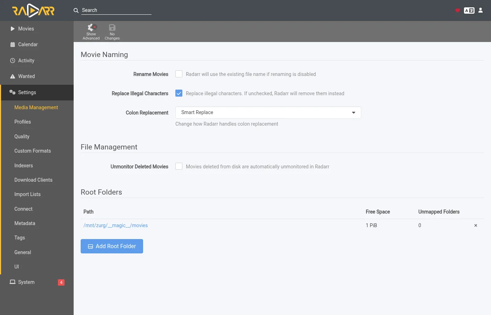
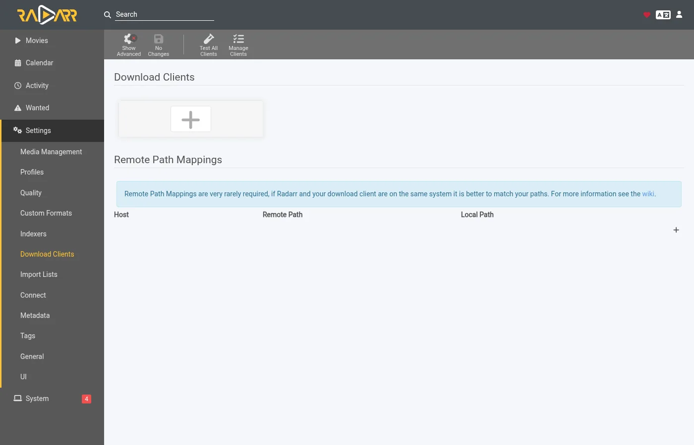
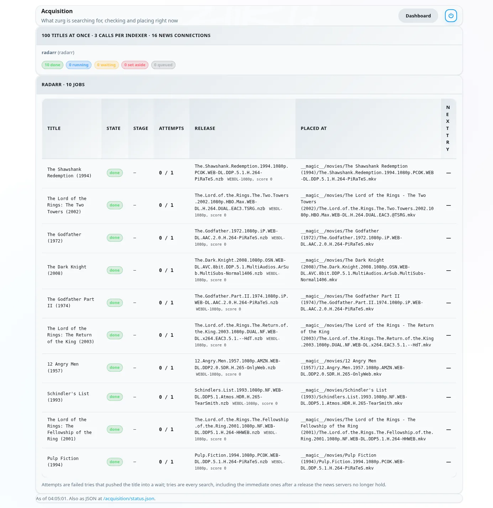
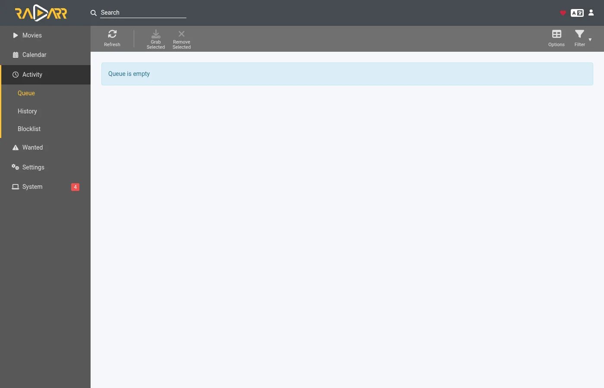

# 让 zurg 获取 Sonarr 和 Radarr 想要的内容 {#let-zurg-fetch-what-sonarr-and-radarr-want}

zurg 支持三种使用 Sonarr 和 Radarr 的方式。真正需要做的选择是由谁来搜索：zurg 还是 \*arrs。[选哪一种](#which-one-to-pick)一节对它们做了比较。

| 指南 | 谁来搜索 | zurg 扮演 | 你需要 |
|---|---|---|---|
| [Usenet](sonarr-radarr.md) | Sonarr 和 Radarr | 一个 SABnzbd | 一个 Usenet 账户（如果用 `torbox_nzb` 后端，则需要 TorBox Pro），以及 Prowlarr 或 \*arrs 里的 Usenet 索引器 |
| [种子](sonarr-radarr-torrents.md) | Sonarr 和 Radarr | 一个 qBittorrent | 一个 debrid 账户，以及 Prowlarr 或 \*arrs 里的种子索引器 |
| [zurg 搜索](sonarr-radarr-fetch.md) | zurg | 完全不需要下载客户端 | 一个 Usenet、TorBox Pro 或 debrid 账户，以及 zurg 自己配置里的 Newznab 或 Torznab 索引器 |

前两种可以同时运行，它们共用同一个 `__magic__` 文件夹。

### 如何选择 {#which-one-to-pick}

| | zurg 搜索 | Sonarr 和 Radarr 搜索 |
|---|---|---|
| 索引器设置在 | zurg 的 `config.yml` 里，改动后需要重启 | Prowlarr 或 \*arr 里，和平常一样 |
| \*arr 需要 | `__magic__` 里面的根文件夹，别的都不需要 | zurg 作为下载客户端，下载文件夹和根文件夹要在同一个卷上 |
| 第一个文件是 | 你的配置文件允许的最快那个，之后再升级到 cutoff | \*arr 按你的配置文件排名最靠前的那个 |
| 动画、每日节目和特别篇 | 从 2026 年 11 月 5 日的 nightly 开始支持 | 支持 |
| 手动搜索、队列、历史记录、黑名单 | 没有。文件出现后 \*arr 重新扫描即可 | 和平常一样工作 |
| zurg 的 [`exclude_words`](acquisition.md#excluding-releases-by-name) | 生效 | 不生效。请在 \*arr 里屏蔽同样的词 |

两种方式在 \*arr 导入之前都会检查资源。失效的 Usenet 帖子，或者你的账户还没有持有的种子，都不会被放入。

全新安装的话，建议先用 zurg 搜索。需要设置的东西更少，也不用去折腾卷的布局。如果你想手动挑选资源，就用下载客户端的方式。如果你宁可等配置文件里最好的资源，也不想先拿一个快速的文件，请打开 [`best_first`](acquisition.md#taking-the-profiles-best-first)。

Radarr 和 Sonarr 负责管理列表和资料库，zurg 负责获取文件。像平常一样添加电影或剧集，zurg 会在你的索引器上找到资源。它会检查 NZB 是否还在新闻服务器上（如果是 `torbox_nzb` 账户，则检查 TorBox 是否已经抓取了它），或者你的 debrid 账户是否已经持有该种子。然后它会把文件放进 `__magic__` 里对应的文件夹，并通知 Radarr 或 Sonarr 重新扫描。导入时无需下载，也不会复制任何东西。

这种方式下，Radarr 和 Sonarr 不需要索引器，也不需要下载客户端。它们从不搜索，也从不抓取。你的质量配置文件仍然决定 zurg 被允许获取哪些资源。

这些截图来自 zurg 的构建版本，该版本随 2026 年 9 月 26 日的 nightly 发布，运行在 Docker 中的 Radarr 6.3.0.10514 和 Sonarr 4.0.20.3014 上。两者在各自容器内看到的 zurg 挂载点都是 `/mnt/zurg`。截图内容未作任何修改。

## 开始之前 {#before-you-start}

1. **zurg 需要有一个 Usenet 或 debrid 账号，以及至少一个 Newznab 或 Torznab 索引器。** 索引器写在 zurg 配置的 `acquisition.indexers` 下。[Watchlist 和 Seerr](acquisition.md) 页面介绍了这个配置块。
2. **`magic.enabled` 设为 `true`。** 如果没有它，Radarr 和 Sonarr 来源无法启动，日志里也会说明这一点。参见 [`__magic__`](magic.md)。
3. **Radarr 和 Sonarr 能访问 zurg 的挂载点。** 把它们作为普通应用安装时，每个系统都有一个需要注意的地方，列在 [Usenet 指南](sonarr-radarr.md#before-you-start) 中。如果你在 Linux 主机上用 Docker，就需要把挂载点绑定到它们的容器里。只绑定挂载点的上一级目录即可，然后通过它访问所有内容。如果它们还把 zurg 当作下载客户端来接收抓取任务，那么下载文件夹和根文件夹各用两个卷，会导致每次导入都复制一份。参见 [下载文件夹和根文件夹共用一个卷](sonarr-radarr.md#one-volume-for-the-download-folder-and-the-root-folders)。
4. **你运行的 nightly 版本需要是 2026 年 9 月 26 日或之后发布的。** 更早的版本不认识 `radarr` 和 `sonarr` 来源。

## 1. 告诉 zurg Radarr 和 Sonarr 的信息 {#1-tell-zurg-about-radarr-and-sonarr}

在 `config.yml` 的 `acquisition` 下添加 `radarr` 源和 `sonarr` 源，然后重启 zurg。这个配置块目前还没有对应的仪表盘表单。用不到的那个就不用写。

```yaml
acquisition:
  quality: best
  indexers:
    - name: my-indexer
      url: https://indexer.example
      api_key: YOUR_INDEXER_API_KEY
  sources:
    - name: radarr
      type: radarr
      enabled: true
      url: http://radarr:7878         # http://localhost:7878 when Radarr is an ordinary app beside zurg
      api_key: YOUR_RADARR_API_KEY
      library_path: /mnt/zurg/__magic__
      check_every_secs: 30
    - name: sonarr
      type: sonarr
      enabled: true
      url: http://sonarr:8989         # http://localhost:8989 likewise
      api_key: YOUR_SONARR_API_KEY
      library_path: /mnt/zurg/__magic__
      check_every_secs: 30
```

`url` 和 `api_key` 是应用自己的。两边的 API 密钥都在 **Settings > General** 里。`check_every_secs` 表示 zurg 多久问一次它们想要什么。每次轮询只发一个请求来获取列表。两个源共用同一批索引器。

`library_path` 是应用看到 zurg 的 `__magic__` 目录的位置。zurg 需要它把 Radarr 的文件夹转换成 `__magic__` 里的一个位置。按上面的配置，Radarr 保存在 `/mnt/zurg/__magic__/movies/Heat (1995)` 的电影，会被放到 zurg 的 `__magic__` 里的 `movies/Heat (1995)`。`Z:\__magic__` 这样的 Windows 路径也是同样的道理。只有当应用和 zurg 运行在同一台主机上，并且能看到 zurg 挂载的位置时，才可以不写 `library_path`。

`concurrency` 表示 zurg 同时处理多少个标题，默认是 8。列表很大也没关系，用默认值就行，只是会慢一些。

## 2. 把根文件夹放进 `__magic__` {#2-put-the-root-folders-inside-__magic__}

根文件夹必须位于 `__magic__` 之内，并且只能再深一层。为 Radarr 使用的路径是 `/mnt/zurg/__magic__/movies`，为 Sonarr 使用的路径是 `/mnt/zurg/__magic__/tv`，照着这个格式设置即可（macOS 上是 `/Volumes/Zurg/__magic__/movies`，Windows 上是 `Z:\__magic__\movies`）。不要直接指向 `__magic__`，也不要指向 `__magic__/__all__`。文件夹位于其他位置的标题会被跳过，zurg 会在日志中提示一次。

在 Radarr 中打开 **Settings > Media Management**，然后添加根文件夹。



Sonarr 的页面结构相同。在 **Root Folders** 下添加它的根文件夹。


Sonarr 页面上的 **Season Folder Format** 是 zurg 为新季度文件夹命名时使用的名称。已经有文件的季度会保留它们所在的文件夹。两个应用报告的可用空间，都是挂载点所报告的空间。两个应用都不会写入该位置。

## 3. 关闭搜索后添加影片 {#3-add-titles-with-search-off}

像你平时一样添加电影和剧集：手动添加、从列表添加，或从请求应用添加。唯一需要改的是搜索。搜索由 zurg 负责，所以 *arr 工具不能再自己搜索。

### Radarr

This walkthrough uses an import list. Open **Settings > Import Lists** and add or edit yours.


In the list's settings keep **Enable Automatic Add** on and turn **Search on Add** off. Pick the quality profile and the root folder from step 2. Set **Minimum Availability** to what you want. zurg waits for Radarr to call a movie available before it looks for it.


When you add a single movie by hand the same switch is called **Start search for missing movie**. Leave it off too.

### Sonarr

当你手动添加剧集时，请保持 **Start search for missing episodes** 和 **Start search for cutoff unmet episodes** 未勾选。**Monitor** 决定 zurg 会去抓取哪些内容。这部剧集被设置为第一季。


Sonarr 中的导入列表（import list）设置里也有同样的开关。把它的搜索也关掉。

## 4. 索引器和下载客户端留空 {#4-leave-indexers-and-download-clients-empty}

这就是 arr 这一侧的全部设置了。Indexers 页面可以保持为空。


Download clients 页面也可以保持为空。



Sonarr 也是一样。如果这两个应用之前就已经有了 indexers 和 download client，它们会继续工作。不过这样应用就会和 zurg 同时为同一批剧集抓取资源。请关闭这些 indexers 的自动搜索，或者把它们从 zurg 负责的剧集里移除。

## 5. 看它如何运作 {#5-watch-it-work}

打开 zurg 的仪表盘。快速链接里多了一个 **Acquisition**。


这个页面会列出 zurg 正在处理的每个标题，以及它此刻在做什么。如果你想用脚本读取，同样的数据也在 `/acquisition/status.json` 里。

### 电影 {#movies}

这是 Radarr 添加这十部电影大约半分钟后的列表。其中五部已经拿到文件,Radarr 正在被通知。其余的都已完成。


每一行是一部电影。**State** 表示当前进度。**Stage** 表示 zurg 此刻正在为它做什么。它先读取索引站。然后判断候选项。接着读取发布的 NZB,并用新闻服务器检查帖子。最后放置文件。**Release** 是 zurg 选中的帖子,以及 Radarr 解析器对它的解读。**Placed at** 是视频现在所在的 `__magic__` 内路径。新闻服务器已不再保存的标题,会立即转到下一个候选项。没有可用内容的标题会被搁置,并显示原因。

再过一分钟,全部完成。



### 剧集 {#series}

Sonarr 的季也会显示在同一个页面上。每一行是一个季，或者是 zurg 正在升级的一个剧集文件。这里有两部剧，它们的第一季在添加后半分钟被设为监控。两季都已播完且没有任何文件，所以 zurg 为每季尝试了一个季包。Severance 的季包已经放进了它的季文件夹，Sonarr 也已收到通知。Only Murders 的季包正在与新闻服务器核对。


添加后大约两分钟，两季都处理完了。Only Murders 的季包在新闻服务器上缺了几个分片。zurg 把它放到一边，改为逐集获取这十集。它那一行显示的是最后放置好的一集。


## 6. Radarr 和 Sonarr 显示的内容 {#6-what-radarr-and-sonarr-show}

electron

Use the rest of this message to rewrite the translation below.

The libraries fill in as the rescans land. Every movie in this list has its file.


A movie's page shows the file in its folder inside `__magic__` with the quality Radarr read from the name.


In Sonarr all ten episodes have their file in the season folder with the quality Sonarr read from each name.


**Activity** stays empty in both. There is no queue entry and no grab or import event because nothing was grabbed. The file simply appeared in the folder and the rescan zurg asked for picked it up.



Two things follow from that. The arrs' blocklist is never written. zurg keeps its own record of posts the news servers no longer hold and does not pick them again. And a title you delete in Radarr or Sonarr is not deleted from your account. The file goes back to being listed under `__all__` like any other release.

## zurg 如何挑选资源 {#how-zurg-picks-a-release}

你的质量配置文件是守门人。zurg 即将接收的每个版本，都会先经过应用自带的解析器。它必须是正确的标题，画质必须被配置文件允许，自定义格式分数必须达到配置文件的最低要求，大小必须符合 **Settings > Quality** 下的限制。任何一项不符合的版本都不会被接收。

### 电影 {#movies-1}

以下是 zurg 的选择规则。在配置文件允许的版本中，zurg 会先选择最快能确认的那一个。只包含单个视频文件的帖子优先，因为它们在新闻服务器上通常仍然完整。同一内容下，Web 版本优先于 Blu-ray 版本，原因相同。多卷压缩包集作为备选。

配置文件的优先顺序则通过升级来实现。当配置文件允许升级，并且已放置的文件低于 cutoff 时，zurg 会在影片有更好的版本后再去查找。只有严格更好的版本才会替换现有文件。质量更低的版本永远不会被采用。

上映日期在未来的电影会等到 Radarr 将其标记为可用后才处理。如果搜索结果对应的是错误的影片，则会被拒绝，因为 Radarr 无法将该标题与你的任何电影匹配。

### 剧集 {#series-1}

一个季是一项完整的工作。当某季的每一集都缺失，并且该季已经播完时，zurg 会先尝试整季合集。否则，它会逐集查找缺失的剧集。已经有部分文件的季永远不会取整季合集，因为那样会在文件夹里再放一份相同剧集的副本。

资源必须是对应的剧集和对应的季。合集必须是整季。单集资源必须只包含那一集。大小限制针对的是资源所含剧集的播放时长。

如果某季中有一集暂时没有 zurg 能获取的资源，而其他剧集已经成功入库，那么这些已入库的剧集会立即通知 Sonarr。缺失的那一集会在之后按照常规的重试计划再次查找。

当配置文件允许升级时，低于截止线的剧集文件就会被升级。"低于截止线"指的是低于截止画质，或低于截止自定义格式分数。zurg 对这两种情况的判断方式与 Sonarr 的升级规则一致。Sonarr 自己的 **Cutoff Unmet** 列表只显示前一种情况。升级只会替换对应的那一集，该季文件夹的其他内容保持不变。

## 注意事项 {#things-to-know}

- **对 `config.yml` 中 `acquisition` 块的任何修改都需要重启。** zurg 只在启动时读取该文件。
- **重新扫描是最后一步，并且会排在应用自身任务之后。** 一个列表刚添加大量电影后，Radarr 会先逐个刷新它们。这段时间里，文件其实已经放到位了。
- **Analyse video files 会读取每个文件在挂载上的开头部分。** 它能正常工作，但在大型列表中这是最慢的环节。除非你确定不需要媒体信息，否则请保持开启。
- **未监控的剧集会被忽略。** 这包括电影、剧集、季和单集。位于 `__magic__` 之外文件夹中的剧集同样会被忽略。
- **从 2026 年 11 月 5 日起，动画、日播剧和特别篇需要 nightly 版本。** 日播剧的单集按播出日期查找，动画按剧集自己计数的编号查找（`Jujutsu Kaisen - 30` 是第二季的第 6 集），特别篇则按第 00 季搜索。为动画或日播剧放置的文件会命名为 `JUJUTSU KAISEN - S02E06 - <the release's own name>`，因为 Sonarr 的重新扫描只根据文件名读取文件，否则会把 `2nd Season - 06` 归到第 1 季。只用标题命名、没有 `S00Exx` 的特别篇无法匹配，Sonarr 也一样。在旧版本上，每个这样的剧集都会被跳过，并在日志中留下一行记录。

关于这两个来源的完整说明，请参阅 [Watchlist and Seerr](acquisition.md)。
