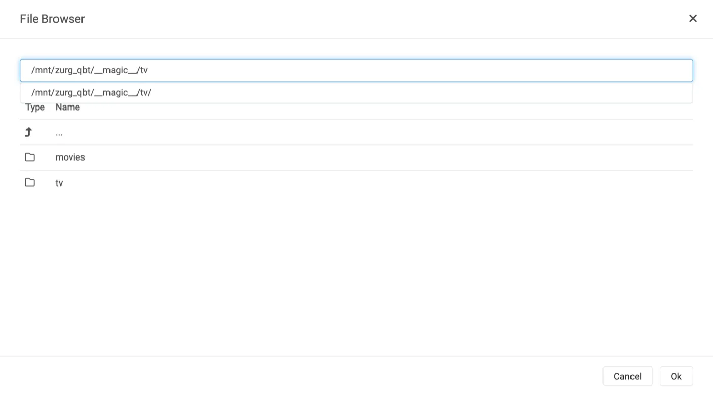
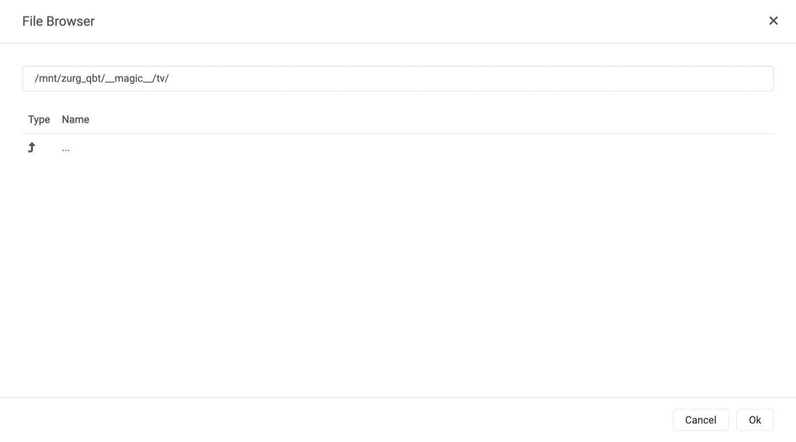
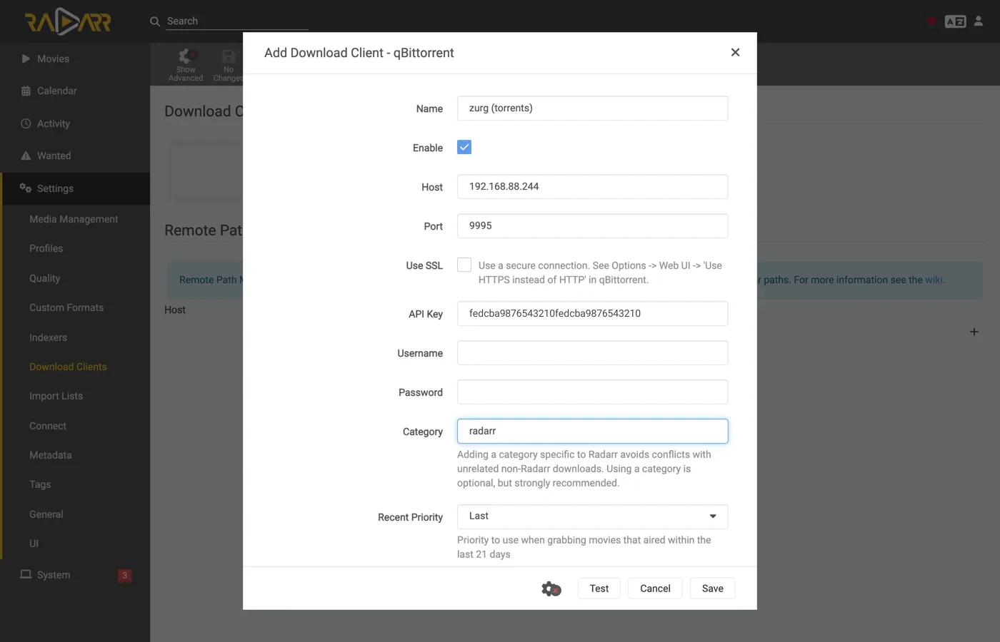
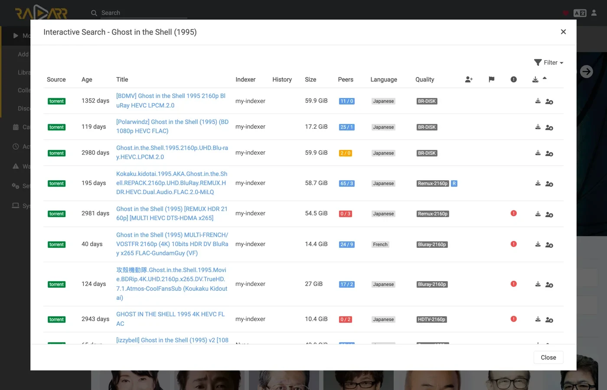
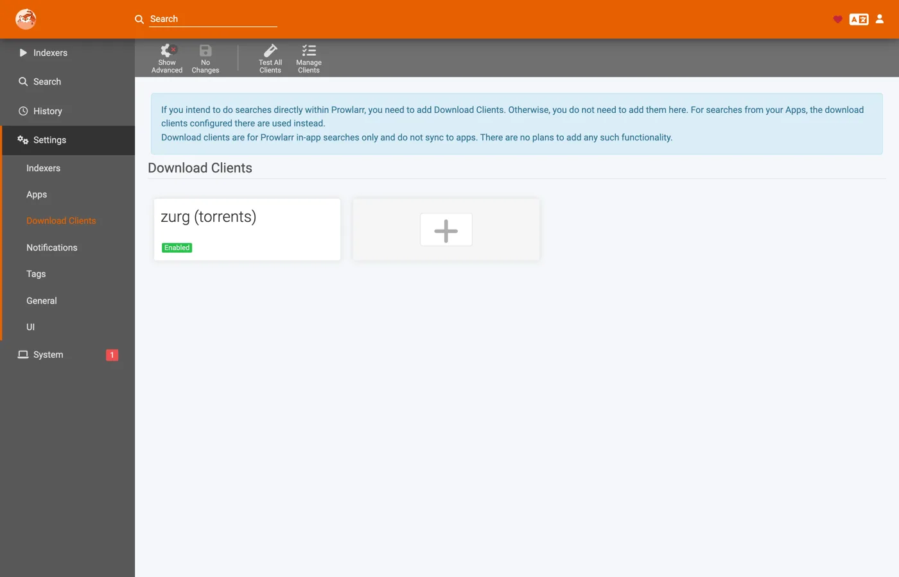

# Sonarr 和 Radarr 配合种子使用，手把手教程 {#sonarr-and-radarr-with-torrents-step-by-step}

三种方式可以把 Sonarr 和 Radarr 接到 zurg 上。真正的选择在于由谁来搜索：zurg 还是 \*arr。[选哪一种](sonarr-radarr-fetch.md#which-one-to-pick)一节对比了两者。

| 指南 | 谁来搜索 | zurg 扮演 | 你需要 |
|---|---|---|---|
| [Usenet](sonarr-radarr.md) | Sonarr 和 Radarr | 一个 SABnzbd | 一个 Usenet 账号（或用于 `torbox_nzb` 后端的 TorBox Pro），以及 Prowlarr 或 \*arr 里的 Usenet 索引器 |
| [种子](sonarr-radarr-torrents.md) | Sonarr 和 Radarr | 一个 qBittorrent | 一个网盘账号，以及 Prowlarr 或 \*arr 里的种子索引器 |
| [zurg 搜索](sonarr-radarr-fetch.md) | zurg | 完全不需要下载客户端 | 一个 Usenet、TorBox Pro 或网盘账号，以及 zurg 自身配置里的 Newznab 或 Torznab 索引器 |

前两种可以同时使用，它们共用同一个 `__magic__` 文件夹。

[上一篇教程](sonarr-radarr.md)讲的是让 \*arr 通过 Usenet 连接 zurg，此时 zurg 扮演 SABnzbd。这篇讲的是另一半：zurg 扮演 **qBittorrent**，\*arr 交给它的是磁力链接或 `.torrent` 文件，而不是 NZB，资源会被放到网盘账号里，而不是新闻服务器上。导入的方式是一样的，都是在 `__magic__` 里改个名字，不需要下载任何东西来导入，也不需要复制。

**\*arr 发送的是哪一种，并不只是外观上的差别。** `.torrent` 通常会把文件本身上传到账号；只有磁力链接才是仅凭信息哈希添加的。在仅缓存模式（默认设置）下，TorBox 和 Debrid-Link 拿到的是信息哈希，因为这是它们在不添加未缓存资源的情况下拒绝该资源的方式。磁力链接会让账号根据哈希去推算种子里有什么内容，而私有种子的哈希在公共 swarm 里找不到可用于推算的信息。Real-Debrid 会因 `magnet_error` 报错，且没有任何文件；TorBox 则会接受它，然后卡在 `checking` 状态，没有文件列表、没有大小，还给出一个百天的预估时间，所以这次抓取既不会失败，也不会完成。`.torrent` 文件会直接用哈希去查询账号的缓存，因此账号里已经有的内容会立即添加，完全不需要解析磁力链接。这也正是私有索引器在这里能用的原因：只要账号里已经有相应内容，它们的资源就能添加，而对于社区共享的内容来说，这通常就是常见情况。请把 \*arr 指向那些提供 `.torrent` 文件而不是磁力链接的索引器，私有索引器一般都是这样。

下面的所有内容，都是在一台实际运行的服务器上、使用真实的 AllDebrid 账号捕获的，对应的版本为 zurg `2026.08.30.0459-nightly-73-g5b4c9790`、Sonarr `4.0.19.2979`、Radarr `6.3.0.10514` 和 Prowlarr `2.5.2.5491`。主机名和用户名已改为 `you@zurg-server`。索引器名称写作 `my-indexer`。API 密钥和库数量均为示例。捕获的输出中，除此之外没有改动任何内容。

## 开始之前 {#before-you-start}

1. **zurg 需要一个能添加种子的账号**：Real-Debrid、AllDebrid、TorBox、Premiumize、Debrid-Link 或 Offcloud。这六家都直接接收上传的 `.torrent` 文件，这正是私有 tracker 上的资源能够添加的原因。Usenet 账号两种形式都不接受：如果安装时唯一的提供方是 `nzb`，它会接受每一次抓取，然后拒绝它们。zurg 启动时会明确提示这一点。
2. **`magic.enabled` 必须为 `true`。** 没有它，保存路径就不存在，每次导入都会失败。参见 [`__magic__`](magic.md)。
3. **挂载点必须能被 \*arr 看到，路径为 zurg 报告的路径。** 如果 \*arr 运行在容器里，请先阅读[第 8 步](#8-if-your-arr-is-in-docker)，再进行任何配置。如果它作为普通应用安装在同一台机器上，它能看到 zurg 挂载的位置，但每个系统都有一个需要注意的地方：
   - **Linux：** 如果 \*arr 与 zurg 以不同用户运行，在启用 `user_allow_other` 之前它会看到一个空文件夹。参见 [Linux 安装](../setup/linux.md#1-install-fuse-3)。
   - **macOS：** 请以与 zurg 相同的用户运行它。除非你修改了 `mount_path`，否则挂载点为 `/Volumes/Zurg`。
   - **Windows：** 请将 Sonarr 和 Radarr 以托盘应用的方式运行（其安装程序会提供此选项），而不是作为 Windows 服务。zurg 的 `Z:` 盘属于你登录的会话，而服务运行在该会话之外，因此看不到这个盘。参见[会话规则](../setup/windows.md#keeping-it-running-the-session-rules)。

前两项直接在 zurg 的工作目录中的配置文件里检查。在 Windows 上，请改用记事本打开 `config.yml`。

```bash
$ grep -A3 '^providers:' config.yml
providers:
- type: alldebrid
  token: <redacted>

$ grep -A3 '^magic:' config.yml
magic:
  enabled: true
  allow_delete: false
```

**`providers:` 列表的顺序在这里很重要。** 一次抓取会按此顺序提供给每个能接收种子的账号；如果某个账号拒绝或卡住，就放弃它，并尝试下一个。如果你有两个账号，请把你更想优先使用的那个放在前面。

有两个配置项可以让账号脱离这一顺序。`watchlist: true` 会把某个账号排到最前面，无论它在文件中的位置如何；`add_torrents: false` 则会把它完全移出轮换，使其继续提供服务并读取其资料库，但不会再添加任何新内容，适用于归档账号，或配额已被占用的账号。无论哪种设置，Usenet 账号都不会被提供种子。两者的说明都见[配置参考](../reference/config.md#accounts)。

## 1. 打开端点 {#1-turn-the-endpoint-on}

两种方式效果相同。两者都会写入 `config.yml`，而且都需要重启：提供 `__magic__` 的路由和 qBittorrent 端点只会在 zurg 启动时注册一次。

### 方案 A — 仪表盘 {#option-a--the-dashboard}

打开 zurg 的控制面板，点击 **Config**，然后滚动到 **\_\_magic\_\_ & Download Clients**。打开 **Serve \_\_magic\_\_** 和 **qBittorrent Endpoint**。


设置在 **Config** 里；以后抓取的内容到达时，你在 **Magic** 里看。


除非你的 \*arr 把 zurg 挂载到了和 zurg 自己不同的位置，否则 **qBittorrent Save Path** 保持为空，具体见[第 8 步](#8-if-your-arr-is-in-docker)。橙色的 **Restart Required** 标签说的是实话：这里的任何设置都要等 zurg 重启后才会生效。

### 方案 B — `config.yml` {#option-b--configyml}

手动添加这段配置，然后重启 zurg。

```yaml
magic:
  enabled: true

qbittorrent:
  enabled: true
  api_key: ""                   # empty = zurg generates one and keeps it
  categories: [tv-sonarr, radarr]
  save_path: ""                 # empty = <mount_path>/__magic__/__all__
  cached_only: true             # the default: only take what an account already holds
```

**分类不是文件夹。** 它们都指向同一个地方，也就是 `__magic__/__all__` 下该发布资源自己的文件夹。列表只是提前创建分类：客户端点击 **Test** 时会创建缺少的任何分类，zurg 会把它保存在 `data/qbittorrent-categories.json` 中。如果你使用 Prowlarr，它需要 `prowlarr` 这个分类，参见 [第 10 步](#10-prowlarr-manual-grabs)。

重启 zurg，然后确认端点已注册，并且提供方已生效：


端点只需要一行 `alldebrid`，六种支持种子的类型中任意一种都可以。

启动日志也说明了同样的内容，值得花点时间读一读：

```
INFO  router.qbittorrent  qBittorrent API on /api/v2 and /qbittorrent/api/v2, save path /mnt/zurg_qbt/__magic__/__all__, categories tv-sonarr, radarr
INFO  router.qbittorrent  qBittorrent: cached-only, so a grab is only accepted onto an account that already holds the content; anything else is refused and the *arr takes its next release. Set qbittorrent.cached_only: false to let accounts download
INFO  router.qbittorrent  qBittorrent: torrents are offered to alldebrid, in that order
```

## 2. 找到 API key {#2-find-the-api-key}

API 密钥是这个端点唯一的认证手段，所以请一次就设置正确，并且不要把它贴到任何公开的地方。

**如果你把 `api_key` 留空**，zurg 会在第一次启动时自动生成一个密钥，并写入 `data/qbittorrent-apikey`：

```bash
$ cat data/qbittorrent-apikey
fedcba9876543210fedcba9876543210

```

这只是示例，你的密钥会不一样。这个文件在重启后仍然保留，所以密钥生成后就不会变。

**如果你自己设置了 `api_key`**，密钥就在 `config.yml` 里，不会再写入其他文件。

**这个端点不在 zurg 的基本认证范围内。** \*arrs 会用下载客户端自己的方式进行认证。它们的 HTTP 层会把基本认证返回的 401 变成“unable to connect”，而这个提示没有任何可操作的信息。所以 zurg 特意把 `/api/v2` 排除在外。API 密钥就是唯一的门槛。请像对待 zurg 的其他部分一样对待这个端口：只在可信网络上使用，或者放在某种防护之后。

有三种方式提供密钥，都可以使用：

- **`Authorization: Bearer <key>`**：客户端在 **API Key** 字段里填了值时发送的就是这个。这是推荐的方式，可以跳过登录步骤。
- **在 `auth/login` 中把密钥作为密码**，用户名随意填。如果你更想填写 Username 和 Password，就用这种方式。
- **zurg 自己的仪表盘用户名和密码**，前提是 `config.yml` 里设置了 `username:` 和 `password:`。

## 3. 验证它能正常响应 {#3-prove-it-answers}

在碰 Sonarr 之前先做这一步。只需十秒钟，就能在接下来的整个设置过程中分清问题出在 zurg 还是 \*arr 上。

+++ Linux 和 macOS

```bash
$ KEY=fedcba9876543210fedcba9876543210
$ ZURG=192.168.88.244:9995

$ curl -s "http://$ZURG/api/v2/app/webapiVersion"
Forbidden

$ curl -s -H "Authorization: Bearer $KEY" "http://$ZURG/api/v2/app/webapiVersion"
2.11.2

$ curl -s -H "Authorization: Bearer $KEY" "http://$ZURG/api/v2/app/version"
v5.0.4

$ curl -s -H "Authorization: Bearer $KEY" "http://$ZURG/api/v2/app/preferences" | jq .save_path
"/mnt/zurg_qbt/__magic__/__all__"
```

+++ Windows

在 PowerShell 中执行。请输入 `curl.exe`，而不是 `curl`：Windows PowerShell 里的 `curl` 是另一个命令。

```powershell
PS> $KEY = "fedcba9876543210fedcba9876543210"
PS> $ZURG = "192.168.88.244:9995"

PS> curl.exe -s "http://$ZURG/api/v2/app/webapiVersion"
Forbidden

PS> curl.exe -s -H "Authorization: Bearer $KEY" "http://$ZURG/api/v2/app/webapiVersion"
2.11.2

PS> curl.exe -s -H "Authorization: Bearer $KEY" "http://$ZURG/api/v2/app/version"
v5.0.4

PS> (Invoke-RestMethod "http://$ZURG/api/v2/app/preferences" -Headers @{ Authorization = "Bearer $KEY" }).save_path
Z:/__magic__/__all__
```

+++

**只返回 `Forbidden` 才是正常的结果。** 客户端的第一次探测是一个*未认证*的 `GET /api/v2/app/webapiVersion` 请求。真正的 qBittorrent 在 API 存在但没有人登录时，就会返回 `403`。所以 zurg 也会返回同样的结果，客户端据此判断为"支持 v2，请进行认证"。如果返回的是普通的 **404**，则说明 `qbittorrent.enabled` 仍为 false，或者你修改后还没有重启 zurg。

接着检查错误的密钥是否确实会被拒绝：

+++ Linux 和 macOS

```bash
$ curl -s -o /dev/null -w "%{http_code}\n" -H "Authorization: Bearer wrongkey" \
    "http://$ZURG/api/v2/torrents/info"
403
```

+++ Windows

```powershell
PS> curl.exe -s -o NUL -w "%{http_code}\n" -H "Authorization: Bearer wrongkey" "http://$ZURG/api/v2/torrents/info"
403
```

+++

`save_path` 是 zurg 交给客户端的路径，现在就检查一下*客户端*是否能打开这个路径。

两种 URL 形式都可以用，所以在客户端的 **URL Base** 字段中填哪种都行：

| 路径 | Sonarr / Radarr 中的 URL Base | 是否响应 |
|---|---|---|
| `/api/v2/…` | *(留空)* | 是 |
| `/qbittorrent/api/v2/…` | `/qbittorrent` | 是 |

## 4. 创建根文件夹 {#4-make-the-root-folders}

在添加之前先把文件夹建好。\*arr 的 Add Root Folder 对话框会浏览实时文件系统，不存在的文件夹不会出现在选项里。

+++ Linux 和 macOS

```bash
$ mkdir -p /mnt/zurg_qbt/__magic__/tv /mnt/zurg_qbt/__magic__/movies

$ ls -d /mnt/zurg_qbt/__magic__/tv /mnt/zurg_qbt/__magic__/movies
/mnt/zurg_qbt/__magic__/movies
/mnt/zurg_qbt/__magic__/tv
```

+++ Windows

```powershell
PS> New-Item -ItemType Directory -Force Z:\__magic__\tv, Z:\__magic__\movies
```

或者在资源管理器里手动创建这两个文件夹。

+++

把 `/mnt/zurg_qbt` 换成你自己的 `mount_path`。如果没有设置，Linux 上默认是 `/mnt/zurg`，macOS 上是 `/Volumes/Zurg`，Windows 上是 `Z:`。

**根文件夹应该放在保存路径旁边，既不能是保存路径本身，也不能在它上层。** 这和 Usenet 教程的规则一样，原因也相同：zurg 把 `__magic__/__all__` 报告为保存路径。如果根文件夹就是下载客户端的输出文件夹，两个客户端都会触发健康检查；如果根文件夹包含了输出文件夹，Radarr 也会触发。而并列放置则不会触发任何一个。[那份指南](sonarr-radarr.md#4-make-the-root-folders)里有做错时的截图。

种子还有另一个专门的原因：如果移动的目标位置在 `__magic__` 之外，这就是两个文件系统之间的移动，实际上是复制。而从网盘挂载点复制，会通过网络把整个发布内容重新读取一遍。保持 `Remove Completed` 开启（[见下文](#if-the-import-copies-instead-of-moving)），导入就只是重命名。根文件夹放在命名空间之外，会让这个优势失效。

两个卷之间的移动同样是复制。这在 Docker 中尤其要注意，第 8 步会讲到。

## 5. 在 Sonarr 中添加客户端 {#5-add-the-client-in-sonarr}

全新的 Sonarr 会在首次启动时用一个界面挡住所有操作。选择 **Forms (Login Page)**，设置用户名和密码，然后点击 **Save**。


在 **Authentication Method** 不是 None 之前，它不会让你继续。


点击 Save 后，你会被退出一次，并进入登录页面。


### Settings → Download Clients

前往 **Settings → Download Clients**。全新安装后，这里只有一个 **+** 卡片。


点击 "Download Clients" 下面的 **+**，不要点further 下面 "Remote Path Mappings" 里的那个。

在 **Torrents** 列中选择 **qBittorrent**。


zurg 专门模仿 qBittorrent，所以列表里其他选项都不管用。这两列能告诉你正在看哪份指南：SABnzbd 在 Usenet 下，qBittorrent 在 Torrents 下。

对话框会打开 qBittorrent 的默认值：`localhost`、端口 `8080`、没有密钥。


### 每个字段该填什么 {#what-to-put-in-each-field}

| 字段 | 值 | 原因 |
|---|---|---|
| Name | `zurg (torrents)` | 随便取。它只是一个标签。 |
| Enable | on | 保持勾选。 |
| Host | `192.168.88.244` | zurg 所在的主机，*the \*arr* 需要能访问到它。如果 \*arr 和 zurg 在同一台机器上运行的是普通应用，就填 `localhost`。在 Docker 中的情况见下方的警告。 |
| Port | `9995` | zurg 的常用端口，默认安装时是 `9999`。 |
| Use SSL | off | 只有当你自己在 zurg 前面配置了 TLS 时才开启。 |
| URL Base | 留空 | `/qbittorrent` 也可以用，见第 3 步。 |
| API Key | 来自第 2 步 | 整个认证的关键。它会以 bearer token 的形式发送。 |
| Username / Password | 留空 | 两项都留空，API 密钥会替代它们。 |
| Category | `tv-sonarr` | \*arr 的默认值。zurg 已经列出了它，如果没有这个分类，**Test** 会自动创建。 |
| Initial State / Sequential / First-Last | 保持默认 | 这里没有 swarm，这些选项都不会起作用。 |
| **Remove Completed** | **on** | **最重要的一项**，见 [如果导入是复制而不是移动](#if-the-import-copies-instead-of-moving)。 |


图中的 API 密钥只是示例，请粘贴你自己的密钥。

**在 Docker 中，"localhost" 和主机名都会出错。** 在容器内部，`localhost` 指的是容器本身，而机器自己的主机名通常会解析为 `127.0.1.1`，这同样是容器自己。这台机器的主机名是 `zurg-server`，在 Sonarr 容器里 `zurg-server` 解析成了 `127.0.1.1`，但同样的名字在宿主机的 shell 里却能正常使用。请使用宿主机的 **局域网或 Tailscale IP**，不要用 `localhost`，也不要只用裸主机名。

点击 **Test**。绿色的对勾表示客户端的检查通过了，包括 API 版本、认证、分类和种子列表。


现在点击 **Save**。


## 6. 在 Sonarr 中添加根文件夹 {#6-add-the-root-folder-in-sonarr}

前往 **Settings → Media Management**，然后滚动到底部。


点击 **Add Root Folder**。会打开一个文件浏览器，显示 Sonarr 的文件系统。如果你用的是 Docker，这里显示的是容器内的文件系统。


直接输入路径，或者一层层点进去找。如果 Sonarr 真的能看到这个挂载，就能打开 `__magic__`，里面会显示你在第 4 步创建的内容，以及 zurg 自己放在那里的 `__all__`。这是确认绑定挂载是否正确的最快办法。



如果这里是空的或者报错，先停下来，把挂载修好再继续。



把路径补全为 `__magic__/tv`（Windows 上是 `Z:\__magic__\tv`），然后点击 **Ok**。


**Free Space** 显示 `1 PiB`，这是 zurg 报告的虚拟文件系统容量，并不是真实的磁盘。这是正常的。它也正是为了通过 \*arr 在抓取前的可用空间检查。

## 7. 在 Radarr 中做同样的操作 {#7-do-the-same-in-radarr}

除了两个值改了，其他都一样：分类是 `radarr`，根文件夹是 `__magic__/movies`。


Radarr 的首次运行也一样：先设置 Forms auth，然后登录。


**Settings → Download Clients → +**，然后在 Torrents 下选 **qBittorrent**。



主机和端口不变，密钥也不变。只有 **Category** 不一样，填 `radarr`，不是 `tv-sonarr`。

点 **Test**，看到绿色对勾后，点 **Save**。


然后进入 **Settings → Media Management → Root Folders → Add Root Folder**，添加 `/mnt/zurg_qbt/__magic__/movies`。

**一个 zurg，两个客户端，一个队列。** 每个客户端看到的种子列表只按分类过滤，没有别的条件。两个 Sonarr 都用 `tv-sonarr` 的话，会互相看到对方的抓取记录；Sonarr 用 `tv-sonarr`、Radarr 用 `radarr` 则不会。每个分类只配一个客户端，就不会遇到这个问题。

## 8. 如果你的 \*arr 运行在 Docker 中 {#8-if-your-arr-is-in-docker}

这一步适用于 Linux 主机上的 Docker。在 macOS 和 Windows 上，请把 \*arrs 当作普通应用来安装，具体见[开始之前](#before-you-start)。Usenet 教程的第 8 步说明了原因。

这里遇到的三个问题和 Usenet 教程一样，修复方法也一样：挂载点就是挂载点。所以这里只给简短版本。详细内容见[该指南的第 8 步](sonarr-radarr.md#8-if-your-arr-is-in-docker)。

**zurg 报告的路径，必须是客户端能打开的路径。** 如果容器挂载库的位置和 zurg 不同，每次导入都会失败，并出现 *download doesn't contain intermediate path*，或者远程路径健康检查报错。请把 `qbittorrent.save_path` 设为*客户端*看到的路径，或者添加远程路径映射：

```yaml
qbittorrent:
  save_path: "/data/zurg/__magic__/__all__"   # what the *arr sees, not what zurg sees
```

**保存路径和根文件夹共用一个卷。** 不要给容器挂载 `__magic__/__all__` 和 `__magic__/tv` 两个卷。两者之间的重命名会在容器内失败。这时客户端会把每次导入的内容从你的账户复制一份，写到 zurg 所在的磁盘上，而且不会给出任何提示。请只挂载一个卷，让它包含 zurg 的整个挂载内容，然后通过这个卷访问两个文件夹。下面的 bind 挂载就是这个卷。

**绑定挂载的父目录，而不是挂载点本身。** 重启 zurg 时会先卸载再重新挂载。如果容器绑定的是挂载点本身，它会保留已失效的 fuse 连接，之后的每次读取都会返回 `Socket not connected`。而且两个客户端在抓取前都会检查可用空间，所以*每个版本都会被静默拒绝*。请用 `rslave` 绑定父目录，这样重新挂载时会作为子挂载事件到达，容器能够跟随。本环境中的容器是在 zurg 挂载之前启动的，但挂载点仍然出现在了容器内：

```bash
$ docker exec sonarr df -h /mnt/zurg_qbt
Filesystem      Size  Used Avail Use% Mounted on
zurg{8amax}:    1.0P     0  1.0P   0% /mnt/zurg_qbt
```

## 9. 跟踪一次抓取的完整过程 {#9-watch-one-grab-go-through}

添加一个内容，手动抓取，然后完整跟踪它的整个过程。下面的所有内容，都是按照上面的设置进行的一次真实抓取：*Ghost in the Shell (1995)*，从索引站手动抓取的。

### 抓取 {#grab-it}

打开电影,点击 **Interactive Search**,然后选一个版本。



**Source** 列显示 `torrent`,这就是这个接口使用的协议。点击该行末尾带圆圈箭头的按钮即可抓取它。如果客户端要求你先确认映射关系:


当版本与库不能完全匹配时,会出现 **Override and Grab**。检查映射关系,然后点击 **Grab Release**。正常抓取时永远不会出现这个对话框。

### 账户接管下载 {#the-account-takes-it}

zurg 日志里，一次添加操作由三行组成：接收它的账户、被提交的任务，以及 `finished`。下面这段截图来自旧版本，只记录了后两行：

```
INFO  router.qbittorrent  qBittorrent: [Polarwindz] Ghost in the Shell (1995) (BD 1080p HEVC FLAC) (0c5e4077…) added to alldebrid as 720824192
INFO  router.qbittorrent  qBittorrent: [Polarwindz] Ghost in the Shell (1995) (BD 1080p HEVC FLAC) (0c5e4077…) finished on alldebrid
```

hash 是客户端发来的 info hash。`added … as 720824192` 是账户给它分配的自身 ID。这个版本已经在账户上缓存过，所以 `finished` 大约一秒后就出现。没有缓存的版本会在这两行之间停留一段时间，因为账户正在下载它。这段时间里账户在做什么，客户端的队列会显示出来：

| 账户正在做什么 | 队列显示 |
|---|---|
| 解析 magnet 指向的内容 | *Loading metadata*，还没有任何测量数据 |
| 在账户自己的队列中等待 | *Queued* |
| 下载中。速率、swarm 和剩余时间都是账户自己给出的数据 | *Downloading*，并显示真实的进度条 |
| 所有账户都拒绝或超时 | **警告**，并附上原因，详见 [故障排除](#troubleshooting) |
| 已入库，文件夹可以导入 | *Completed* |

如果 swarm 卡住了，会显示 **Downloading**，速率和做种数都是零，而不是卡住的警告。`stalledDL` 是 \*arrs 用来处理下载失败的状态，而一个没有做种者的 swarm 并不能说明这个资源有问题。

完整的 magnet 都会传给账户。zurg 会转发客户端抓取时使用的显示名称，以及它指定的所有 tracker。对于只发布 magnet 的索引器来说，显示名称是唯一能找到发布名称的地方。如果没有它，只要元数据一直没有解析，TorBox 就会把未解析的抓取项显示成四十字符的哈希。`.torrent` 自带名称和 tracker，所以不会额外添加任何内容。例外是 TorBox 和 Debrid-Link 上的仅缓存模式（默认设置）。这两个服务只按哈希查询，因为缓存命中时会返回真实名称。

### 导入过程 {#the-import-happens}

**Activity → Queue**，然后是 **Activity → History**。两条事件只相隔几秒，依次是 **Grabbed**，然后是 **Movie Imported**：


展开已导入的那一行，看看路径。**Source** 是 `/mnt/zurg_qbt/__magic__/__all__/[Polarwindz] …/[Polarwindz] ….mkv`，**Imported To** 是 `/mnt/zurg_qbt/__magic__/movies/Ghost in the Shell (1995)/…`。文件其实从没离开 `__magic__`，所以这次导入本质上就是一次重命名。这张截图是在资源库移到 `__all__` 下面之前拍的，所以它的来源路径比你那边看到的少一层。

客户端决定不导入的抓取结果，会以警告的形式留在队列里。这张截图队列中的那一行，是质量配置文件拒绝的一次升级。它可见，点一下 *Remove* 就能删掉，但它本身不会清除任何东西：


**Status: Downloaded，Size 17.2 GiB**。但为了让它显示成这样，并没有下载任何东西。文件的字节是在有东西播放该文件时，从账户里实时读取的。

### 确认文件是真实的 {#prove-the-file-is-real}

刚才导入把文件移到了根文件夹。读取其中一个文件的首尾两端，然后让 ffprobe 告诉你它是什么：

+++ Linux 和 macOS

如果你的 shell 找不到 `ffprobe`，就用 `~/zurg/bin/ffprobe`：安装程序在没有安装过的情况下会在那里放一份自己的副本。

```bash
$ F="/mnt/zurg_qbt/__magic__/tv/One Piece/Season 23/[AnoZu] One Piece S23E21 1080p CR WEB-DL AAC 2.0 H.264.mkv"

$ ls -la "$F"
-rw-rw-r-- 1 you users 1446325722 Aug 31 00:44 …mkv

$ dd if="$F" bs=1M count=1 >/dev/null
1048576 bytes (1.0 MB, 1.0 MiB) copied, 0.00592934 s, 177 MB/s

$ ffprobe -v error -show_entries format=duration,size,format_name \
    -of default=noprint_wrappers=1 "$F"
format_name=matroska,webm
duration=1415.808000
size=1446325722
```

+++ Windows

在 PowerShell 里，从 zurg 的文件夹运行。除非你的 PATH 里已经有 `ffprobe`，否则安装程序会把 `bin\ffprobe.exe` 放在那里；如果已经有，就直接输入 `ffprobe`：

```powershell
PS> $F = Get-Item -LiteralPath "Z:\__magic__\tv\One Piece\Season 23\[AnoZu] One Piece S23E21 1080p CR WEB-DL AAC 2.0 H.264.mkv"
PS> $F.Length
1446325722

PS> bin\ffprobe.exe -v error -show_entries format=duration,size,format_name -of default=noprint_wrappers=1 $F.FullName
format_name=matroska,webm
duration=1415.808000
size=1446325722
```

+++

这个是 Sonarr 抓取的文件——一集以同样方式拉取，导入到 `tv/One Piece/Season 23/`。这是一个 23 分钟的 Matroska，直接从 debrid 账户读取。字节是在有东西读取它们时才传过来的，而不是在 \*arr 导入时。

### 在 Sonarr 中看起来也一样 {#from-sonarr-it-looks-the-same}


还是那两条历史事件，还是通过重命名完成导入，队列在导入完成的那一刻就清空了。缓存的资源从抓取到导入只需要几秒钟，所以这里没有下载中的截图。

## 10. Prowlarr，手动抓取 {#10-prowlarr-manual-grabs}

Prowlarr 与其他两个工具连接的是同一个端点，它和它们共用 qBittorrent 客户端代码，但它不是导入工具。它没有媒体库，也从不导入任何内容。它能做的是**手动把一个资源推送到账户里**，这正是它的下载客户端的用途。

Prowlarr 首次运行时，显示的也是和另外两个工具相同的 Forms-auth 界面。


进入 **Settings → Download Clients → +**，然后选择 **qBittorrent**。在 Prowlarr 的选择器里，所有客户端都排在同一个按字母排序的列表中，而不是 \*arr 那样的两列。主机、端口和 API 密钥都和其他工具一样填写。有两个字段和 \*arr 不同：


| Field | Value | Why |
|---|---|---|
| Default Category | `prowlarr` | 这是 Prowlarr 的默认值，它的帮助文字值得一读：*adding a category specific to Prowlarr avoids conflicts with unrelated non-Prowlarr downloads*（为 Prowlarr 添加专用分类，可以避免与其他非 Prowlarr 下载冲突）。点击 **Test** 时会在 zurg 中自动创建该分类，所以不需要把它添加到 `qbittorrent.categories` 里。 |
| Priority | `Last` | 没有需要它处理的内容。 |


点击 **Test**，出现绿色对勾后，再点 **Save**。




然后点 **Search**，输入你想要的内容，再把某一行推送给客户端：


这个资源会和 \*arr 的抓取一样被添加到账户里，使用同样的添加路径、同样的分类和同样的 `__magic__` 文件夹。我测试的这一个是已缓存的，不到一秒就变成了 `finished`。但没有任何东西会导入它。它就留在账户里，通过挂载点提供播放，这正是重点所在：Prowlarr 的推送功能是*现在就把这个放到我的 debrid 账户上*，而不是用于自动化的抓取、导入、清理流程。如果要用那套流程，请继续让 Sonarr 和 Radarr 指向该端点，并由 Prowlarr 来管理索引器。

## 11. 手动添加一个资源 {#11-adding-a-release-by-hand}

zurg 的仪表盘没有添加按钮。你仍然可以自己把一个发布版本交给 zurg，并发送到正确的 Sonarr 或 Radarr。通过这个端点添加它，并带上该应用的分类。每个应用只查看自己的分类。四个应用各用一个分类，每个只能看到自己添加的内容。

+++ Linux 和 macOS

```bash
KEY=your-qbittorrent-api-key
curl -H "Authorization: Bearer $KEY" http://localhost:9999/api/v2/torrents/add \
  -F 'urls=magnet:?xt=urn:btih:<hash>&dn=Movie.Title.2012.1080p.WEB-DL' \
  -F category=radarr4k
```

+++ Windows

在 PowerShell 中使用 `curl.exe` 而不是 `curl`：

```powershell
$KEY = "your-qbittorrent-api-key"
curl.exe -H "Authorization: Bearer $KEY" http://localhost:9999/api/v2/torrents/add `
  -F 'urls=magnet:?xt=urn:btih:<hash>&dn=Movie.Title.2012.1080p.WEB-DL' `
  -F category=radarr4k
```

+++

`.torrent` 文件也可以。用 `-F 'torrents=@Movie.Title.2012.1080p.WEB.torrent'` 发送，代替 `urls`。

有四件事决定应用是否会导入它。

1. **影视作品必须已经在该应用中。** 它只会导入能与其管理的内容匹配的条目。
2. **名称必须能说明内容是什么。** 磁力链接的名称是它的 `dn`，`.torrent` 文件的名称是它的文件名。zurg 会忽略 qBittorrent 的 `rename` 字段。Radarr 无法解析 `Sintel`，并将其保留为 *Unable to parse download*。`Sintel.2010.1080p.WEB-DL` 则成功导入。名称里要带上年份。
3. **在应用第一次看到之前就把名称改对。** 一旦 Radarr 判定某个下载无法解析，它会一直保留这个结论，直到 Radarr 重启。用更好的名称再次添加也不会改变结果。重启后它就导入成功了。
4. **分类只是一个标签。** 不在 `qbittorrent.categories` 中的分类也会被接受，只是不会出现在分类列表中。之后你可以把发布版本转到另一个应用。拥有新分类的应用会在下次检查时导入它。

```bash
curl -H "Authorization: Bearer $KEY" http://localhost:9999/api/v2/torrents/setCategory \
  -F hashes=<hash> -F category=radarr
```

在 Windows 上，就是把 `curl.exe` 写在一行里，并像上面一样设置 `$KEY`。

你账户里已经有的发布版本也是同样的方式。这包括你从 DMM 发送过去的版本。zurg 会发现它已经在库中，于是把它记录到该分类下，而不会重复添加。你从未通过这个端点添加的发布版本，对 Sonarr 和 Radarr 来说是不可见的。zurg 只会向它们展示经由此端点进入的内容。

测试时间为 2026-10-04，使用 AllDebrid 账户和 Radarr 6.3。每部影片都通过重命名的方式导入到 `__magic__/movies`，没有复制任何文件。设置了其他分类的 Radarr 从未看到它。Sonarr 未经测试。

## 12. Plex 只读取一组文件夹 {#12-plex-reads-one-set-of-folders}

An import does not take a release out of zurg's own folders. A film Radarr placed in `__magic__/movies` is still in `movies` and in `__all__`. So Plex has to read one set of folders and never both.

| Plex reads | You get |
|---|---|
| `movies` and `shows` | Everything on your debrid accounts. Grabs by the \*arrs show up there too. Names are whatever the release is called. |
| `__magic__/movies` and `__magic__/tv` | Only what Sonarr and Radarr imported. Names and folders are the ones the \*arrs chose. |

If your Plex libraries already point at `movies` and `shows` then leave them. The \*arr grabs appear there without any change. Add the `__magic__` folders to Plex only if you want a library made of nothing but \*arr imports and then take the other folders out. Plex with both finds every title twice.

Never add the root of `__magic__` either. It holds `__magic__/__all__` which is the whole library again.

## 13. 索引器，以及面向赞助者的 DMM {#13-indexers-and-dmm-for-sponsors}

Sonarr 和 Radarr 通过 Prowlarr 搜索。这里任何公开的 torrent 索引站都能用，因为 zurg 会把磁力链接添加到你的 debrid 账户里。有些公开站点挂在 Cloudflare 后面，Prowlarr 没有 FlareSolverr 就不肯添加它们，这些就跳过吧。

如果你赞助了 zurg，那 DMM 也能当索引站用。它会搜索 DMM 的整个资源库，并把你的 debrid 账户里已经有的内容排在最前面。这种抓取是即时完成的。

1. 从 [gatekeeper](https://gatekeeper.debridmediamanager.com) 拿到你的 DMM API key：点 **Connect GitHub**，如果你在 Patreon 上赞助，之后再关联 Patreon。然后复制页面上显示的 **DMM API key**。这不是 [第 2 步](#2-find-the-api-key) 里的 zurg key。同一个 key 也能用于 DMM 的 Usenet 索引站，设置地址在 [debridmediamanager.com/newznab](https://debridmediamanager.com/newznab)。
2. 在 Prowlarr 里打开 **Indexers → Add Indexer**，选择 **Generic Torznab**。
3. 填入你账户对应的 URL 和 key。**API Path** 保持为 `/api`。

| 你的账户 | URL |
|---|---|
| Real-Debrid | `https://debridmediamanager.com/api/torznab/rd` |
| AllDebrid | `https://debridmediamanager.com/api/torznab/ad` |
| TorBox | `https://debridmediamanager.com/api/torznab/tb` |
| Premiumize | `https://debridmediamanager.com/api/torznab/pm` |

TorBox 和 Premiumize 需要先在 DMM 里关联该服务的 key，DMM 页面上有对应位置。如果想排除你账户里还没有的内容，就在 URL 末尾加上 `/cached`。

保存索引站时，Prowlarr 会自动测试它。如果 key 被拒绝，说明赞助已经过期或者 key 填错了，报错信息会告诉你是哪一种。测试通过后，Prowlarr 会自己把 DMM 提供给 Sonarr 和 Radarr。所有应用共用一个 key，每分钟最多 20 次搜索。

## 14. 你的 Plex 观看列表 {#14-your-plex-watchlist}

Sonarr 和 Radarr 可以跟随你的 Plex 观看列表。你在 Plex 上添加的任何内容都会被加入、搜索，并像其他任何获取内容一样通过 zurg 到达。

在每个应用中打开 **Settings → Import Lists → + → Plex Watchlist**，然后按下 **Authenticate with Plex.tv**。把根文件夹设置为你的 `__magic__` 文件夹，并开启添加时搜索。Radarr 会获取列表中的电影，Sonarr 会获取其中的剧集。

zurg 有自己的 [观看列表](plex-watchlist.md)，它会从你直接提供给 zurg 的索引器中获取内容。二者选其一即可。两者同时使用的话，同一个标题会被获取两次。

如果要跟随其他列表，例如类型列表，请参阅 [Sonarr 和 Radarr 中的列表](import-lists.md)。

## 如果导入是复制而不是移动 {#if-the-import-copies-instead-of-moving}

上面所有内容都依赖导入是一次**重命名**（rename）。有两件事决定这一点。一是容器如何访问挂载点，这只有你能改。把保存路径和根文件夹放在两个卷上，那么无论其他设置如何，每次导入都会变成复制。[第 8 步](#8-if-your-arr-is-in-docker)讲了这个。另一件是 \*arr 里的一个设置。

只有当客户端认为下载完成后可以安全删除它时，才会移动已导入的文件。这需要三个条件同时满足：**Remove Completed** 已开启，种子已完成且处于暂停状态，并且客户端能看到做种限制已达到。zurg 会如实报告后两项：每个已完成的种子都会以暂停状态返回，分享率为 0，而分享率限制也是 0。**Remove Completed** 则需要你自己来设置。

如果它是关闭的，客户端就会改为复制。而在 debrid 挂载上，复制意味着要通过网络把整个发行版的每个字节读回来，再写入本地磁盘。第 9 步中的那个发行版原本是一次几乎没有移动任何数据的重命名，现在却会变成一次 17 GiB 的下载，只为导入一个本来就已经存在的文件。

**当 zurg 拿到 \*arr 的 API 密钥时，它会自动重新开启 Remove Completed。** 拿到密钥的途径有两种：通过 [Radarr 或 Sonarr 源](acquisition.md)（设置 `enabled: false` 即可），或者通过仪表盘上要求填写密钥的横幅。zurg 会在启动时检查一次，之后每十分钟检查一次，并且在 \*arr 第一次调用 zurg 时也会检查。它会通过 \*arr 自身的 API 把 **Remove Completed** 打开。如果客户端没有通过自己的 **Test**，就无法被修改，此时 zurg 会保留一条警告并注明原因。

**\*arr 不会告诉你它进行了复制。** 无论哪种方式，导入都会显示为成功。移动操作在 zurg 的日志中只会留下一行 `MOVE __magic__`。通过 zurg 自带挂载进行的复制会落在 `data/local` 中。zurg 大约两分钟内就会发现它，把它转换回一次放置（placement），删除这个副本，并记录 `A client copied …`，同时在仪表盘上显示一条横幅。通过你自己挂载进行的复制则是一次 `PUT`，并且携带该发行版的完整字节数，zurg 会拒绝它。那次复制所耗费的下载流量无法找回。

**使用 Use Hardlinks instead of Copy 并不能替代它。** 客户端只有在已经决定复制之后才会查看这个选项，因此它无法把复制改回移动。

## 超时与仅缓存模式 {#timeouts-and-cached-only-mode}

```yaml
qbittorrent:
  cached_only: true
  download_timeout_mins: 15
```

| Setting | What it does |
|---|---|
| `cached_only: true` | 默认值。只有账号上已经有这份内容时才接受抓取，否则直接拒绝。`download_timeout_mins` 不会生效。 |
| `cached_only: false` | 未缓存的抓取会在账号上下载。如果超过 `download_timeout_mins`（默认十五分钟）都没有进展，就放弃它，改试下一个账号。负数的超时时间表示永不放弃。 |

**旧版配置。** `cached_only` 出现之前，"只接受缓存"是用 `download_timeout_mins: 0` 来写的。如果配置里只写了 `download_timeout_mins`、没有 `cached_only`，它的含义保持不变：`0` 表示只接受缓存，其他任何值都表示允许下载。两者都写了但互相矛盾时，以 `cached_only` 为准，zurg 启动时会记录一条警告。

**什么算"有进展"。** 阶段变化，或进度上升，才算有进展。判断依据是账号返回的原始小数比例，而不是取整后的百分比。比如 100 GB 的资源，1% 就是 1 GB。账号正在解压的资源不计时：这个阶段的数字会一直停在那里，直到解压完成。

**十五分钟是实测出来的，不是随便定的。** AllDebrid 会把一个正常的任务放进它自己的队列里，所有计数都是零。我们测了两次，它分别停了 580 秒和 622 秒，之后才开始下载，几秒钟就下完了。如果默认值是十分钟，这两次都会被放弃。抓取数据，以及把各个账号自己的说法映射到 \*arrs 能理解的五种状态上的对照表，都在 [Torrent lifecycle](../internals/torrent-lifecycle.md) 里。

**超时会删除什么。** 只删除那个账号上的实例，而且仅限于 zurg 为这次抓取自己添加、且一直没有完成的那个实例。其他东西都不动。如果所有账号都试过了，抓取会被报告为出错，并附上原因，列出每个账号以及它做了什么。

**如果你在账号上手动删除了某个 torrent**，抓取会立刻转到下一个账号。六个服务都会明确说明 torrent 已经不存在了。

**整个添加过程的时限是 75 秒。** \*arrs 会在 100 秒时取消 `torrents/add`，并把超时报告为连接失败，而且没有办法调高这个时限。所有账号共用同一个截止时间，所以三个账号完全够用，第四个账号只能用前三个没花完的时间。

**仅缓存模式**会在添加阶段就拒绝，而这个拒绝是 \*arrs 唯一会处理的信号：它们会判定这次抓取失败，然后转到列表中的下一个资源。添加之后的所有情况，在 \*arrs 看来都只是"下载进行中"的警告，它们会一直等下去。各账号的请求方式如下：

| 账号 | zurg 的请求方式 |
|---|---|
| TorBox | 带 `add_only_if_cached=true` 的磁力链接，没有缓存时什么都不会添加。不过它仍会占用 TorBox 每小时 60 次未缓存添加中的一次。 |
| Debrid-Link | 只传 info hash。如果 Debrid-Link 没有这份内容，它会直接拒绝，不会添加任何东西。 |
| AllDebrid, Offcloud | 添加请求本身就能给出答案：服务会在响应中说明它之前是否已经有这份内容。没有的话，会立刻删除刚添加的记录。 |
| Real-Debrid, Premiumize | 先添加 torrent、选择文件，然后最多观察 5 秒。缓存内容几乎立刻就能完成（在 Real-Debrid 上，文件选择后 0.4 到 1.5 秒内完成）。5 秒后仍在进行的，说明是真正的下载，会被删除。 |

zurg 不会去调用 TorBox 的 `checkcached` 或其他缓存查询接口。这些接口只能说明服务端有没有这份内容，并不能说明你的账号最终能不能拿到可用的副本。

## 哪些可用，哪些不行 {#what-works-and-what-does-not}

**可用：**

- 三个客户端的连接测试，包括 API 版本、身份验证、分类和种子列表。
- 在 Sonarr 和 Radarr 中抓取、队列、历史记录、通过重命名导入，以及导入后的清理。
- 重新抓取账户已经持有的资源。\*arr 会取回已完成的种子并导入，账户只保留一份副本。
- 多个账户：抓取请求会按 `providers:` 中的顺序依次发给每个账户，遇到拒绝或卡住时转给下一个。
- 在 Prowlarr 中手动推送资源。

**不支持：**

- **qBittorrent Web UI。** 这里只提供 API，没有可以打开的页面。
- **做种、排队和优先级。** 这里没有 swarm。暂停、强制开始、调整优先级、重新校验、移动位置和分享率限制都会被接受，但不会产生任何效果。
- **把失败作为一种正式状态。** qBittorrent 的 API 无法表示下载失败，所以没有任何账户能接收的资源会以*警告*的形式返回给 \*arr，而不会加入黑名单。它会在队列中显示，并附上原因，只需点一下 *Remove → Blocklist and Search* 即可处理，但它不会自动清除，也不会在无人值守时重新抓取。这正是它与 SABnzbd 端点的真正区别：后者可以报告任务失败，并让客户端做出响应。
- **通过普通 HTTP URL 添加。** `torrents/add` 只接受磁力链接和上传的 `.torrent` 文件。两个 \*arr 发送的都是其中之一，直接的 `http://…/x.torrent` 会被拒绝。
- **在端点上启用 zurg 仪表盘的登录验证。** 此功能没有生效。端点接受 API 密钥（作为 bearer token、登录密码或 Basic 请求头），或者 zurg 仪表盘的用户名和密码。

**有一种抓取会直接从队列中消失，而不是显示为警告。** 如果从来没有任何账户接收过该资源，即没有账户持有该哈希，也没有账户在获取它，那么十分钟后它会被标记为错误，并在一天后从种子列表中移除。因为没有可以报告状态的下载任务，而队列中出现一个不存在的任务，比完全没有更糟。其他所有失败仍然会保持可见。

**被屏蔽的资源名称，仅限 Real-Debrid。** RD 会仅凭名称拒绝某些资源。自 2026 年 10 月 14 日起，共有十一个这样的字符串。`WEB-DL`、`WEB.x264` 和 `WEB.H264` 只在大小写完全一致时才会生效，因此 `web-dl`、`Web-Dl` 和场景命名中的 `WEB.h264` 都没有问题。`WEBRip`、`BDRip`、`HDRip`、`DVDRip`、`HDTV.x264`、`HDTV.XviD`、`BluRay.x264` 和 `p.BluRay.DTS` 则无论大小写如何都会生效。最后这一个要求前面紧跟一个 p，例如 `1080p.BluRay.DTS`。`2002.BluRay.DTS` 这样的资源没有问题。zurg 知道这些模式，遇到此类名称时会跳过 Real-Debrid，不再询问它，而是把抓取请求转给下一个账户。如果只使用 Real-Debrid，抓取会立即被拒绝，客户端则会转向它的下一个资源。在 TorBox 和 AllDebrid 上，同一个资源会正常添加。

## 故障排除 {#troubleshooting}

| \*arr 显示的内容 | 含义 |
|---|---|
| "Unable to connect to qBittorrent" | zurg 在该主机和端口上无法访问，或者前面的某个东西返回了非 200 的结果。检查 `qbittorrent.enabled`，它关闭时，`/api/v2` 只会返回普通的 404。在 Docker 里，确认你没有用 `localhost` 或者只写主机名。 |
| 测试通过，但抓取时报 *Download client failed to add torrent* | 客户端已经连上 zurg，但 zurg 拒绝了添加。zurg 会记录每一次拒绝，在日志里搜索 `qBittorrent: refusing`。这一行会写明原因，以及尝试过的每个账号。 |
| zurg 日志中的 `every account that takes torrents refused or timed out` | 没有任何账号愿意接收这个版本。如果它提示速率限制，而你期望的是一个正常的账号，那就数一下同一个 token 上的*其他* zurg 实例。这台机器的第一次抓取就是这样失败的：当时同一个 Real-Debrid 账号上的第二个 zurg 正在遍历一个大型库，两者共用同一个 API 配额。 |
| "Category … does not exist" | 客户端还没有创建它。点击下载客户端上的 **Test**，它会在 zurg 里创建该分类。 |
| 抓取后长时间停在 *Downloading* | 账号确实在下载。队列会在有数据时显示账号自己的速率和剩余时间；没有做种源的版本两者都显示为零，这不是错误。 |
| 已完成的版本在队列里显示为警告 | 要么客户端决定不导入（配置文件不允许的升级），要么所有账号都拒绝了它。队列行会给出原因。它不会自己清除，需要手动移除；如果版本有问题，就用 *Blocklist and Search*。 |
| "Download client zurg places downloads in …/__magic__/__all__ but Radarr cannot see this directory" | zurg 还没加载完库。挂载点顶层能列出内容，但 `__all__` 和 `__magic__/__all__` 列不出来，Plex 也什么都看不到。在日志里搜索 `rejected the API key`。通常是某个账号的密钥或套餐失效了。免费套餐参见 [TorBox](../providers/torbox.md#when-it-goes-wrong)。库加载完成后警告就会消失。 |
| "Downloads in root folder" / "Remote path mapping" | 与 Usenet 端点相同的根文件夹和路径规则，参见[步骤 4](#4-make-the-root-folders)和[步骤 8](#8-if-your-arr-is-in-docker)。 |
| 根文件夹浏览器里 zurg 挂载是空的，或者根本没有 `Z:` 盘 | \*arr 看不到这个挂载。在 Linux 上它以其他用户运行，且没有开启 `user_allow_other`；在 Windows 上它以服务方式运行。参见[开始之前](#before-you-start)。 |
| 所有版本都被拒绝，日志里什么都没有 | 失效的 bind mount。运行 `docker exec <client> df -h <mount>`；如果输出是 `Socket not connected`，就用 `rslave` 绑定父目录，然后重建容器。 |
| 导入成功，但每次都会下载整个版本 | \*arr 在复制而不是重命名。zurg 会记录 `A client copied …`，并在仪表盘上显示横幅。要么下载客户端上的 **Remove Completed** 没有开启，要么容器的保存路径和根文件夹挂在两个不同的卷上。参见[如果导入是复制而不是移动](#if-the-import-copies-instead-of-moving)和[步骤 8](#8-if-your-arr-is-in-docker)。 |

还是搞不定？去 [Discord](https://discord.com/invite/7u4YjMThXP) 上的 **zurg-support** 论坛问。[获取帮助](../../guides/remote-help.md)里写了要提供哪些信息。

## 状态数据存放在哪里 {#where-the-state-lives}

| 路径 | 作用 |
|---|---|
| `data/qbittorrent-apikey` | 自动生成的 API 密钥。设置了 `qbittorrent.api_key` 时不会写入。 |
| `data/qbittorrent-jobs.json` | 客户端交给端点的任务，记录每个任务由哪个账户持有、使用哪个分类，以及已经尝试过的所有账户。 |
| `data/magic.json` | `__magic__` 表，记录导入过程创建的每一条 placement 和 tombstone。 |

zurg 仪表盘上的 `__magic__` 页面显示导入的结果。placements 是客户端移动过的文件，tombstones 是它们之后删除的任务文件夹。端点接收的发布会以行的形式列在它们所导入的文件夹下面。


[参考文档](../reference/config.md#qbittorrent-the-torrent-download-client-sonarr-and-radarr-see)列出了每个 `qbittorrent:` 键。[客户端约定](../internals/qbittorrent-client-contract.md)基于 Sonarr 和 Radarr 的源码编写，是端点需要遵守的规范，其中每一条说明都附有对应的文件和行号。
