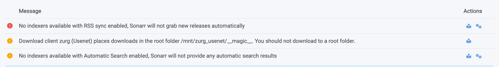
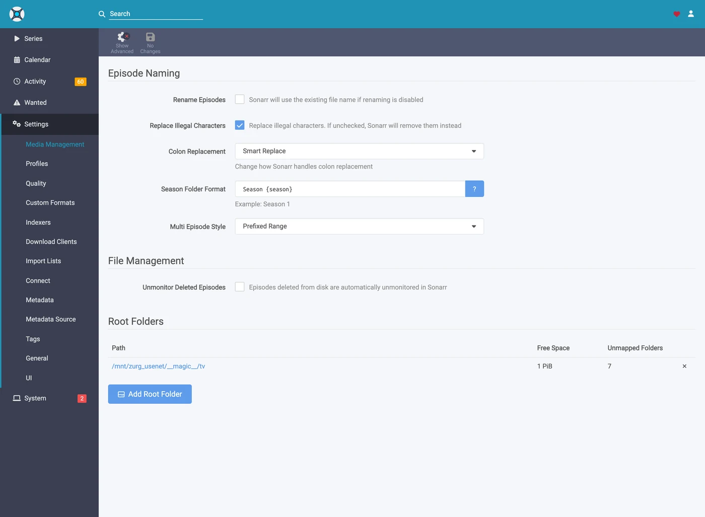
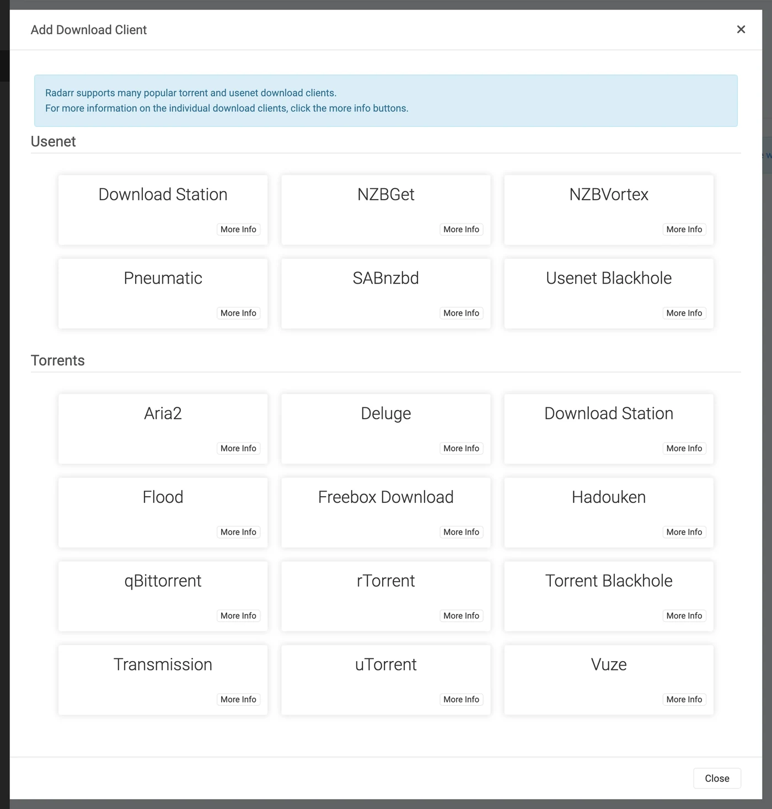

# Sonarr 和 Radarr 分步指南 {#sonarr-and-radarr-step-by-step}

有三种方式可以把 Sonarr 和 Radarr 与 zurg 配合使用。选择由谁来搜索 zurg 或 \*arrs。参见
[选哪一种](sonarr-radarr-fetch.md#which-one-to-pick)。

| 指南 | 谁来搜索 | zurg 扮演 | 你需要 |
|---|---|---|---|
| [Usenet](sonarr-radarr.md) | Sonarr 和 Radarr | 一个 SABnzbd | 一个 Usenet 账户（或者用于 `torbox_nzb` 后端的 TorBox Pro），以及 Prowlarr 或 \*arrs 中的 Usenet 索引器 |
| [Torrents](sonarr-radarr-torrents.md) | Sonarr 和 Radarr | 一个 qBittorrent | 一个 debrid 账户，以及 Prowlarr 或 \*arrs 中的 torrent 索引器 |
| [zurg 搜索](sonarr-radarr-fetch.md) | zurg | 完全不需要下载客户端 | 一个 Usenet、TorBox Pro 或 debrid 账户，以及 zurg 自身配置中的 Newznab 或 Torznab 索引器 |

前两种可以同时运行。它们共用同一个 `__magic__` 文件夹。

让 Sonarr 和 Radarr 指向 zurg，就能无需客户端从 Usenet 抓取。抓取过程中不会下载或解压完整的视频。NZB 和缓存仍然会占用磁盘。本页介绍 Usenet。torrent 端点使用相同的客户端并共享该文件夹。参见
[Sonarr 与 Radarr 用于 torrents](sonarr-radarr-torrents.md)。

下面的所有内容都是在 zurg `nightly-993-g99bcf9a4`、Sonarr `4.0.19.2979` 和 Radarr `6.3.0.10514` 上、使用真实 Usenet 账户的正式安装中捕获的。主机名和用户名已改为 `you@zurg-server`。索引器名称为 `my-indexer`。API 密钥和库数量仅为示例。捕获的输出中其他内容均未改动。`torbox_nzb` 的日志行是于 2026-11-09 从 zurg 源代码中读取的，并非实时捕获。

## 开始之前 {#before-you-start}

三件事都必须成立。缺任何一件，之后都会表现为看起来无关的问题，所以现在就检查。

1. **zurg 里有 `nzb` provider，或者有 `torbox_nzb`（TorBox Pro）。** 没有它，就没有东西去读取端点写入的内容。每个任务都会在 30 分钟后被标记为 Failed，因为 zurg 会一直等它出现在库里，等到放弃为止。参见 [Usenet](usenet.md)；如果用的是 `torbox_nzb`，参见 [TorBox 托管的 Usenet](../providers/torbox-nzb.md)。
2. **`magic.enabled` 是 `true`。** 没有它，completed 目录就不存在，每次导入都会失败。参见 [`__magic__`](magic.md)。
3. **\*arr 能在 zurg 报告的路径上看到挂载。** 如果 Sonarr 运行在容器里，先看 [第 8 步](#8-if-your-arr-is-in-docker)，再做任何配置。如果它是装在同一台机器上的普通应用，就能看到 zurg 挂载的位置，但每个系统各有一个需要注意的地方：
   - **Linux：** 如果 \*arr 的运行用户和 zurg 不同，在启用 `user_allow_other` 之前，它看到的会是一个空文件夹。参见 [Linux 设置](../setup/linux.md#1-install-fuse-3)。
   - **macOS：** 让它和 zurg 用同一个用户运行。除非你改过 `mount_path`，挂载点是 `/Volumes/Zurg`。
   - **Windows：** 把 Sonarr 和 Radarr 作为托盘应用运行，安装程序里有这个选项，不要作为 Windows 服务运行。zurg 的 `Z:` 盘属于你登录的会话，而服务运行在会话之外，所以看不到这个盘。参见[会话规则](../setup/windows.md#keeping-it-running-the-session-rules)。

前两项直接在配置文件里检查，就在 zurg 的工作目录中。在 Windows 上，改用记事本打开 `config.yml`。

```bash
$ grep -A6 '^providers:' config.yml
providers:
- type: nzb
  nntp:
    host: news.example.com
    port: 563
    tls: true
    username: <redacted>
    password: <redacted>

$ grep -A4 '^magic:' config.yml
magic:
  enabled: true
  allow_delete: false
  sidecar_max_mb: 32
  sidecar_budget_mb: 2048
```

`allow_delete: false` 是安全的默认值，不会影响导入。在 `__magic__` 里删除条目只会隐藏它，并不会从你的账户中删除内容。

## 1. 打开端点 {#1-turn-the-endpoint-on}

两种方式效果相同。两者都会写入 `config.yml`，并且都需要重启：提供 `__magic__` 的路由和 SABnzbd 端点只会在 zurg 启动时注册一次。

### 方案 A — 仪表盘 {#option-a--the-dashboard}

打开 zurg 的仪表盘，点击 **Config**，然后滚动到 **\_\_magic\_\_ & Download Clients**。打开 **Serve \_\_magic\_\_** 和 **SABnzbd Endpoint**，再把 **SABnzbd Categories** 设为 `tv, movies`。


**Config** 是设置所在的位置；**Magic** 是你之后查看抓取内容到达情况的地方。


除非你的 \*arr 挂载 zurg 的路径与 zurg 自身不同，否则把 **SABnzbd Completed Directory** 留空，具体见 [第 8 步](#8-if-your-arr-is-in-docker)。橙色的 **Restart Required** 标签说的是实话：这里的任何设置都要等 zurg 重启后才会生效。

### 方案 B — `config.yml` {#option-b--configyml}

手动添加该配置块，然后重启 zurg。

```yaml
magic:
  enabled: true

sabnzbd:
  enabled: true
  api_key: ""          # empty = zurg generates one and keeps it
  categories: [tv, movies]
  complete_dir: ""     # empty = <mount_path>/__magic__/__all__
```

**分类并不是文件夹。** 它们都指向同一个位置：任务的文件夹就是该发布资源自己在 `__magic__/__all__` 下的文件夹。这个列表只是为了让 Sonarr 和 Radarr 不再因为找不到某个分类而发出警告。如果 Sonarr 的分类是 `tv`，那么 `tv` 就必须在这个列表里。

重启 zurg，然后确认 provider 已经生效：


端点只需要一行 `nzb` 或 `torbox_nzb`。

## 2. 找到 API key {#2-find-the-api-key}

API key 是这个端点的全部认证，所以只需要正确设置一次，并且不要把它贴到任何公开的地方。

**如果你把 `api_key` 留空**，zurg 会在第一次启动时自动生成一个，并写入 `data/sabnzbd-apikey`：

```bash
$ cat data/sabnzbd-apikey
0123456789abcdef0123456789abcdef

```

这只是示例密钥，你的会不一样。这个文件在重启后会保留，所以密钥一旦生成就是固定的。

**如果你自己设置了 `api_key`**，它就写在 `config.yml` 里，不会生成任何文件。仪表盘会告诉你属于哪种情况：在第 1 步那个代码块的底部，它会显示 *pinned in config.yml under `sabnzbd.api_key`*，或者 *generated and kept in `data/sabnzbd-apikey`* 之一。

**这个端点不在 zurg 的基本认证范围内。** Sonarr 和 Radarr 从来不会向下载客户端发送基本认证，而且它们的 HTTP 层会把 401 变成一句“无法连接”，并且没有任何可操作的提示。所以 zurg 特意把 `/api` 排除在外。API key 就是唯一的防线。请像对待 zurg 的其他部分一样对待这个端口：只在可信网络中使用，或者放在其他防护措施之后。

## 3. 验证它能正常响应 {#3-prove-it-answers}

+++ Linux 和 macOS

```bash
$ SAB=0123456789abcdef0123456789abcdef
$ ZURG=192.168.88.245:9996

$ curl -s "http://$ZURG/api?mode=version&apikey=$SAB&output=json"
{"version":"4.5.1"}

$ curl -s "http://$ZURG/api?mode=get_config&apikey=$SAB&output=json" \
    | jq '.config.misc.complete_dir, [.config.categories[].name]'
"/mnt/zurg_usenet/__magic__/__all__"
[ "*", "tv", "movies" ]
```

+++ Windows

在 PowerShell 中操作。输入 `curl.exe`，而不是 `curl`：Windows PowerShell 里的 `curl` 是另一个命令。

```powershell
PS> $SAB = "0123456789abcdef0123456789abcdef"
PS> $ZURG = "192.168.88.245:9996"

PS> curl.exe -s "http://$ZURG/api?mode=version&apikey=$SAB&output=json"
{"version":"4.5.1"}

PS> (Invoke-RestMethod "http://$ZURG/api?mode=get_config&apikey=$SAB&output=json").config.misc.complete_dir
Z:/__magic__/__all__
```

+++

`complete_dir` 是 zurg 交给客户端的路径，现在就确认一下 *它们* 能不能打开这个路径。

然后确认错误的 key 确实会被拒绝（在 Windows 上，用同样的 URL 配合 `curl.exe`）：

```bash
$ curl -s "http://$ZURG/api?mode=queue&apikey=wrongkey&output=json"
{"status":false,"error":"API Key Incorrect"}

$ curl -s "http://$ZURG/api?mode=queue&output=json"
{"status":false,"error":"API Key Required"}
```

**`mode=version` 不是认证测试。** 即使 key 错误，它也会返回 `{"version":"4.5.1"}`。真正的 SABnzbd 就是这样运行的，zurg 也照做了。如果你真正想测试的是 key，请使用 `mode=queue` 或 `mode=get_config`。

两种 URL 形式都可以用，所以在客户端的 **URL Base** 字段里填哪一种都行：

| 路径 | Sonarr / Radarr 中的 URL Base | 是否有响应 |
|---|---|---|
| `/api` | *（留空）* | 是 |
| `/sabnzbd/api` | `/sabnzbd` | 是 |

如果 `/api` 返回普通的 **404**，说明 `sabnzbd.enabled` 仍为 false，或者你修改后还没有重启 zurg。

## 4. 创建根文件夹 {#4-make-the-root-folders}

先创建这些文件夹，再添加它们，因为 \*arr 的 Add Root Folder 对话框会浏览实时文件系统，不会列出不存在的文件夹。

+++ Linux 和 macOS

```bash
$ mkdir -p /mnt/zurg_usenet/__magic__/tv /mnt/zurg_usenet/__magic__/movies

$ ls -d /mnt/zurg_usenet/__magic__/tv /mnt/zurg_usenet/__magic__/movies
/mnt/zurg_usenet/__magic__/movies
/mnt/zurg_usenet/__magic__/tv
```

+++ Windows

```powershell
PS> New-Item -ItemType Directory -Force Z:\__magic__\tv, Z:\__magic__\movies
```

或者在资源管理器中创建这两个文件夹。

+++

将 `/mnt/zurg_usenet` 替换为你自己的 `mount_path`。如果不设置，默认值在 Linux 上是 `/mnt/zurg`，在 macOS 上是 `/Volumes/Zurg`，在 Windows 上是 `Z:`。文件夹名称由你自行决定；`tv` 和 `movies` 只是与分类对应。

**根文件夹应放在已完成目录旁边，而不是放在它上面，也不是它的上级目录。** zurg 会把 `__magic__/__all__` 提供给客户端，它就是 `__all__` 列出的你的整个媒体库。你的根文件夹应紧挨着它，位于 `__magic__/tv` 和 `__magic__/movies`。**不要**设为 `__magic__/__all__`，**也不要**设为 `__magic__` 本身，**更不要**设为 `/mnt/zurg_usenet`。两个客户端在根文件夹*就是*下载客户端的输出文件夹时都会发出健康检查警告；Radarr 在根文件夹*包含*输出文件夹时也会发出警告。同级文件夹两者都不会触发警告；这样，手动导入指向已完成目录时，只需查看一个发布版本，而不是整个媒体库。

下面是配置错误时的样子。两张都是真实截图，来自这两个客户端。它们是在已完成目录迁移到 `__magic__/__all__` 之前拍摄的，所以截图中的路径比你的路径高一级，但它们展示的是同样的两条规则：



Sonarr 中把已完成目录本身添加为根文件夹。因为根文件夹*就是*输出文件夹，所以它发出警告。


Radarr 中添加了 `/mnt/zurg_usenet`。它对上级目录也会发出警告，Sonarr 则不会。把根文件夹移到已完成目录旁边，两个警告都会消失。

## 5. 在 Sonarr 中添加客户端 {#5-add-the-client-in-sonarr}

全新的 Sonarr 会把所有页面都挡在首次运行的设置界面后面。选择 **Forms (Login Page)**，设置用户名和密码，然后点击 **Save**。


在 **Authentication Method** 设为 None 以外的选项之前，它不会让你继续。


点击 Save 之后，你会被登出一次，并进入登录页面。


### Settings → Download Clients

前往 **Settings → Download Clients**。全新安装后，这里只有一个 **+** 卡片。


点击 "Download Clients" 下面的 **+**，别点下面 "Remote Path Mappings" 那个。

从 **Usenet** 这一列里选 **SABnzbd**。


zurg 模拟的是 SABnzbd，所以这个列表里别的选项都用不了。

弹窗会打开 SABnzbd 自带的默认值，也就是 `localhost`、端口 `8080`，没有 key。


### 每个字段该填什么 {#what-to-put-in-each-field}

| 字段 | 值 | 说明 |
|---|---|---|
| Name | `zurg (Usenet)` | 随便填。它只是一个标签。 |
| Enable | 开 | 保持勾选。 |
| Host | `192.168.88.245` | zurg 运行所在的主机，要让 *the \*arr* 能够访问到它。如果 *the \*arr* 和 zurg 在同一台机器上，且是普通应用，就填 `localhost`。在 Docker 中，请看下面的警告。 |
| Port | `9996` | zurg 的常用端口，默认安装时是 `9999`。 |
| Use SSL | 关 | 只有当你自己在 zurg 前面配置了 TLS 时才开启。 |
| API Key | 来自第 2 步 | 这是整个访问控制的关键。 |
| Username | 留空 | 与 key 互斥。只接受 key。 |
| Password | 留空 | 同上。 |
| Category | `tv` | 必须出现在 `sabnzbd.categories` 中。 |
| Recent / Older Priority | 默认 | zurg 没有可以应用优先级的地方。 |
| Remove Completed | 开 | 让客户端清理它自己的任务记录。保持开启。 |
| Remove Failed | 开 | 同上。 |


图中显示的 API key 只是示例，请粘贴你自己的。

**在 Docker 中，"localhost" 和主机名都会出错。** 在容器内部，`localhost` 指的是容器本身；而机器自己的主机名通常会解析为 `127.0.1.1`，这同样是容器本身。请使用主机的**局域网或 Tailscale IP**，不要用 `localhost`，也不要用单纯的主机名，即使它们在你的 shell 里能正常工作。

点击 **Test**。绿色的勾表示客户端的四项检查全部通过：版本、API key、全局配置和分类。


现在点击 **Save**。


## 6. 在 Sonarr 中添加根文件夹 {#6-add-the-root-folder-in-sonarr}

前往 **Settings → Media Management**，然后滚动到底部。


点击 **Add Root Folder**。会打开一个文件浏览器，显示的是 Sonarr 的文件系统。在 Docker 中，这是容器内的文件系统。


在顶部的输入框中输入路径。如果 Sonarr 确实能看到这个挂载，你在输入时就会看到 `__magic__` 里的内容，比如里面的 `__all__`（包含所有发布资源），以及你在它旁边建的其他文件夹。这是确认绑定挂载是否正确的最快方法。


如果这里是空的或者报错，先停下来，把挂载修好再继续。


把路径补全为 `__magic__/tv`（Windows 上为 `Z:\__magic__\tv`），然后点击 **Ok**。



**Free Space** 显示一个合理的数字，说明 Sonarr 能读取该挂载的信息。**Unmapped Folders** 则会统计这里已经存在的发布资源数量。

## 7. 在 Radarr 中做同样的操作 {#7-do-the-same-in-radarr}

和上面一样，只改两个值：分类是 `movies`，根文件夹是 `__magic__/movies`。


Radarr 首次运行的方式相同：先设置 Forms auth，然后登录。



依次点击 **Settings → Download Clients → +**，然后在 Usenet 下选择 **SABnzbd**。


主机、端口、密钥都一样。只有 **Category** 不同：填 `movies`，不要填 `tv`。


点 **Test**，看到绿色对勾后，再点 **Save**。


然后依次点击 **Settings → Media Management → Root Folders → Add Root Folder**，添加 `/mnt/zurg_usenet/__magic__/movies`。

**一个 zurg，两个客户端，一个队列。** zurg 的队列和历史记录只按分类过滤，没有别的条件。两个 Sonarr 都用 `tv` 的话，会看到彼此的任务；Sonarr 用 `tv`、Radarr 用 `movies` 则不会。每个分类只配一个客户端，就不会遇到这个问题。

## 8. 如果你的 \*arr 运行在 Docker 中 {#8-if-your-arr-is-in-docker}

この步骤适用于 Linux 主机上的 Docker。Docker Desktop 在 macOS 和 Windows 上会把容器运行在虚拟机里。下面的 `rslave` 绑定依赖 Linux 的挂载传播（参见 [Docker 设置](../setup/docker.md)），而在这些系统上把 zurg 的挂载交给容器使用，目前还没有经过测试。在 macOS 和 Windows 上，请按照 [开始之前](#before-you-start) 中的说明，把 Sonarr 和 Radarr 作为普通应用安装。

三个独立的问题。第二个问题每次导入都会多消耗一次下载。第三个问题要等到 zurg 第一次重启时才会显现。

### zurg 报告的路径必须是客户端能够打开的路径 {#the-path-zurg-reports-must-be-a-path-the-client-can-open}

如果容器挂载媒体库的位置和 zurg 的不一样，每次导入都会失败，并报 *download doesn't contain intermediate path*，或者远程路径健康检查失败。两种方法都可以修复：

- **设置 `sabnzbd.complete_dir`**，填客户端看到的路径。如果只用一个客户端，或者几个客户端挂载位置一致，这样最简单。
- **在 \*arr 中添加远程路径映射**。当不同客户端的挂载位置不一样时，用这种方法。

```yaml
sabnzbd:
  complete_dir: "/data/zurg/__magic__/__all__"   # what the *arr sees, not what zurg sees
```

用第二种方法的话，进入 **Settings → Download Clients**，点击 **Remote Path Mappings** 下面的 **+**。是页面下方那个，不是第 5 步用的那个。


**Host** 必须和你在下载客户端里填的主机名完全一致。**Remote Path** 是 zurg 报告的路径；**Local Path** 是客户端看到的路径。

### 为下载文件夹和根文件夹使用同一个卷 {#one-volume-for-the-download-folder-and-the-root-folders}

从 `__magic__/__all__` 导入到 `__magic__/tv` 是免费的，因为这只是重命名。重命名只能在同一个挂载内进行。如果你给容器两个文件夹，分别作为两个卷挂载，它会把它们看成两个文件系统。两者底层其实都是 zurg 的挂载，但这依然没用。

```yaml
    volumes:                                        # do not do this
      - /mnt/zurg_usenet/__magic__/__all__:/downloads
      - /mnt/zurg_usenet/__magic__/tv:/tv
```

内核会在容器里拒绝这次重命名。Sonarr 和 Radarr 随后会复制文件、删除原文件，而且不会提示你。每次导入都会从你的账户把整个资源下载一遍，写入 zurg 的磁盘。导入虽然会成功，只是很慢。一个 1.46 GB 的剧集这样导入花了 50 秒，流量达到 2.9 GB。如果只用一个卷，只花了 1 秒，也没有读取任何数据。

给容器一个包含 zurg 整个挂载的卷。通过它访问下载文件夹和根文件夹。下一节的绑定正是这样做的。然后用远程路径映射或 `complete_dir` 把下载客户端指向同一卷里的 `__all__`。

手动导入时如果选择 **Hardlink/Copy Files**，同样会复制。请选择 **Move Files**。

### 挂载父目录，而不是挂载点 {#bind-the-mounts-parent-not-the-mountpoint}

这是最耗费一下午的问题，也是上面那一节特别要求的一个卷。重启 zurg 会卸载 `/mnt/zurg_usenet`，然后重新挂载。绑定了**挂载点本身**的容器会保留启动时的 fuse 连接，而这个连接现在已经失效。之后每次读取都会返回 `Socket not connected`。两个客户端在抓取前都会检查根目录的可用空间，所以**每个 release 都会被悄悄拒绝**：

```
FreeSpaceSpecification: Socket not connected
```

两个客户端都不会提示挂载已经失效。容器里仍然能看到这个文件夹，而且直接把交互式抓取推给客户端时，它还能正常工作。表现出来就像是某个 \*arr 悄无声息地停止了搜索。

请改为使用 `rslave` 绑定**父目录**，这样重新挂载时，容器会以子挂载事件的形式跟随变化：

```yaml
    volumes:
      - type: bind
        source: /mnt          # the parent, not /mnt/zurg_usenet
        target: /mnt
        bind:
          propagation: rslave
```

每次重启 zurg 后，都检查一下容器。你应该看到一个大小数值，而不是错误：

```bash
$ docker exec radarr df -h /mnt/zurg_usenet
Filesystem      Size  Used Avail Use% Mounted on
zurg{PGSq4}:    1.0P     0  1.0P   0% /mnt/zurg_usenet
```

那个 PB 级的数字表示 zurg 报告的是一个虚拟文件系统，而不是真实磁盘，这是正常的。正是它让 \*arr 的可用空间检查得以通过。

## 9. 跟踪一次抓取的完整过程 {#9-watch-one-grab-go-through}

添加一项内容，手动抓取它，然后全程跟踪它的进度。下面的所有内容，都是通过上面的设置完成的一次真实抓取。

### 抓取 {#grab-it}

打开一部电影（或一集剧集），点击 **Interactive Search**，然后选择一个版本。


**Source** 列显示 `nzb`，这就是 zurg 能够处理的协议。

点击该行末尾的循环箭头按钮即可抓取。如果版本没有完全匹配，客户端会先要求你确认映射关系：


当客户端需要你确认该版本是什么时，会出现 **Override and Grab**。检查映射无误后，点击 **Grab Release**。正常的自动抓取不会出现这个对话框。

### 它会进入队列 {#it-lands-in-the-queue}


**Activity → Queue**（活动 → 队列）中抓取后马上显示的界面。注意进度条：它是满的，**Time Left** 显示为一个破折号。这里没有需要测量的下载，任务要么在排队，要么已完成，中间没有过渡状态。*这里其他的几行属于第二个指向同一个 zurg、使用同一分类的 Radarr* ——见第 7 步的说明。

### zurg 写入 NZB 并读取它 {#zurg-writes-the-nzb-and-reads-it}

```
Aug 25 14:44:03 zurg-server zurg[3034965]: INFO  nzb  Loaded NZB
  Last.Week.Tonight.with.John.Oliver.S13E22.480p.WEB.x264-RMTeam.nzb: 4 files
Aug 25 14:50:28 zurg-server zurg[3034965]: INFO  nzb  Loaded NZB
  Untold.The.Testimony.of.Vince.Young.2026.1080p.NF.WEB-DL.DD+5.1.Atmos.H.264-playWEB.nzb: 9 files
```

`Loaded NZB … : N files` 是表示 NZB 解析成功的那一行日志。如果某个任务在 30 分钟后被标记为 Failed（zurg 等待它出现在库中而放弃时），通常就是缺了这一行。

### 导入过程 {#the-import-happens}


**Activity → History**。两条事件，相隔几秒：先是 **Grabbed**，然后是 **Movie Imported**。


**Status: Downloaded**，**Size 4.7 GiB**，但其实什么都没有下载。

### 确认文件是真实的 {#prove-the-file-is-real}

导入操作已把文件移入根文件夹。请读取它的首尾两端,并用 ffprobe 检查它是什么:

+++ Linux 和 macOS

如果你的 shell 找不到 `ffprobe`,请使用 `~/zurg/bin/ffprobe`:如果之前没有安装,安装程序会把它自己的副本放在那里。

```bash
$ ls -la "/mnt/zurg_usenet/__magic__/movies/Untold - The Testimony of Vince Young (2026)/"
-rw-r--r-- 1 you you 4920958828 Aug 25 14:53 Untold.The.Testimony…playWEB.mkv

$ dd if="$F" bs=1M count=1 >/dev/null
1048576 bytes (1.0 MB, 1.0 MiB) copied, 0.0429446 s, 24.4 MB/s

$ ffprobe -v error -show_entries format=duration,size,format_name \
    -of default=noprint_wrappers=1 "$F"
format_name=matroska,webm
duration=4709.440000
size=4920958828
```

+++ Windows

在 PowerShell 中,从 zurg 的文件夹运行。除非你的 PATH 中已经有 `ffprobe`,否则安装程序会把 `bin\ffprobe.exe` 放在那里;如果已有,请直接输入 `ffprobe`:

```powershell
PS> $F = Get-Item "Z:\__magic__\movies\Untold - The Testimony of Vince Young (2026)\*.mkv"
PS> $F.Length
4920958828

PS> bin\ffprobe.exe -v error -show_entries format=duration,size,format_name -of default=noprint_wrappers=1 $F.FullName
format_name=matroska,webm
duration=4709.440000
size=4920958828
```

+++

这是一个 78 分钟的 Matroska 文件,按需从 Usenet 文章中流式读取。字节是在有东西读取它们时才到达的,而不是在 \*arr 导入时到达。

## 10. 手动添加一个发布版本 {#10-adding-a-release-by-hand}

有时候 Sonarr 或 Radarr 就是抓不到你想要的版本。可能是它搜索的索引器里没有这个资源，也可能是质量配置或自定义格式把它筛掉了。这时你可以自己把 NZB 交给 zurg，并指定应该导入它的那个应用的分类。该应用会像自己抓取的一样把它导入。

如果资源在应用会搜索的索引器上，先试试应用本身。**Interactive Search** 也会列出被拒绝的资源。抓取其中一个，它会和其他抓取一样发送给 zurg。Radarr 就抓到过一个 IMAX 版本。它的配置文件因为必需的自定义格式得分为 0 而拒绝了它，但最后还是被它导入了。

+++ Linux 和 macOS

```bash
$ SAB=0123456789abcdef0123456789abcdef
$ ZURG=192.168.88.245:9996

# an NZB file you already have (the upload field is called name, as in SABnzbd)
$ curl -s "http://$ZURG/api?mode=addfile&apikey=$SAB&cat=movies" \
    -F 'name=@Movie.Title.2024.1080p.WEB-DL.nzb'
{"status":true,"nzo_ids":["SABnzbd_nzo_…"]}

# or a link to one, which zurg downloads itself
$ curl -s -G "http://$ZURG/api" \
    --data-urlencode mode=addurl --data-urlencode "apikey=$SAB" --data-urlencode cat=movies \
    --data-urlencode 'name=https://indexer.example/getnzb/<id>?r=<indexer-key>' \
    --data-urlencode nzbname=Movie.Title.2024.1080p.WEB-DL
{"status":true,"nzo_ids":["SABnzbd_nzo_…"]}
```

+++ Windows

在 PowerShell 中使用 `curl.exe`，而不是 `curl`。两者都会返回上面那样的 `{"status":true,"nzo_ids":[…]}`。

```powershell
$SAB = "0123456789abcdef0123456789abcdef"
$ZURG = "192.168.88.245:9996"

# an NZB file you already have (the upload field is called name, as in SABnzbd)
curl.exe -s "http://$ZURG/api?mode=addfile&apikey=$SAB&cat=movies" -F "name=@Movie.Title.2024.1080p.WEB-DL.nzb"

# or a link to one, which zurg downloads itself
curl.exe -s -G "http://$ZURG/api" `
  --data-urlencode mode=addurl --data-urlencode "apikey=$SAB" --data-urlencode cat=movies `
  --data-urlencode "name=https://indexer.example/getnzb/<id>?r=<indexer-key>" `
  --data-urlencode nzbname=Movie.Title.2024.1080p.WEB-DL
```

+++

`--data-urlencode` 会保留链接本身的 `?` 和 `&`，让它们留在 `name` 里。任务会在应用下一次检查时（一分钟之内）出现在它的队列中。

之后会发生什么，取决于以下五点。

1. **电影或剧集必须已经在该应用里。** 它只会导入能和它管理的内容匹配上的文件。
2. **名字要能说明它是什么。** 任务会使用 NZB 的文件名，如果你传了 `nzbname`，则使用它。没有 `nzbname` 时，`addurl` 会使用索引器提供的文件名。名字里要带上年份。
3. **分类决定交给哪个应用。** `cat=movies` 会交给下载客户端用 `movies` 的那个 Radarr。每个应用只看自己的分类。
4. **质量配置不会阻止它，但你已有的文件可能会。** Radarr 在导入时既不检查允许的质量，也不检查最低自定义格式分数。它曾把一个得分为 0 的 720p BluRay 导入到只允许 2160p、且要求分数为 100 的配置里。它还把一个 1080p WEBRip 导入到只允许 720p 的电影里。之后它又用一个 1080p BluRay 作为升级替换了它，并删除了 WEBRip。再之后添加的一个 WEB-DL 则在 Activity 中停了下来，显示为 *Not an upgrade for existing movie file*。**Activity → Queue → Manual Import** 仍然可以把它导入，并替换原文件。
5. **失败要你自己清理。** 应用从不会拉黑或删除它没有抓取的下载。有一个资源的文章已经从新闻服务器上过期，zurg 把它返回为 Failed，结果它一直留在 Radarr 的队列里，显示为 *Download has failed wasn't grabbed by Radarr, skipping automatic download handling*。这时请把它从队列里移除，再挑选另一个资源。

以上结果是 2026-10-10 在 Radarr 6.3 上测得的，测试同时使用了 `addfile` 和 `addurl`，还包括一个要求由资源名构成的自定义格式的配置。每次导入都是重命名到 `__magic__/movies` 中，没有复制任何文件。Sonarr 没有测试。

感谢 Discord 上的 **.telmen** 询问如何用 Usenet 做到这一点。

## 从 zurg 端观看 {#watching-from-zurgs-side}

zurg 的 `/magic/` 页面会列出端点曾经收到过的每一个 NZB。Sonarr 和 Radarr 会删除它们抓取过的任务，而记录会在之后保留一周，这样轮询和删除恰好同时发生时，两次返回的结果也一致。如果某个 **Failed** 或 **Stuck**（排队超过一小时）的任务已经没有客户端会再删除它，比如你停止把 zurg 当作它们的下载客户端之后，可以按住它的 **Clear** 按钮清除。清除时会删除它的 NZB，除非某次导入仍在使用它。


**Placements** 是客户端移动过的文件；**tombstones** 是它们之后删除的任务文件夹。如果某个客户端是复制而不是移动，页面会显示一个红色的 **Imports that were copies** 表格。zurg 会把这些复制件转回 placements 并删除它们，但每一个都还是完整下载过一次，所以请检查一下卷的设置。


**State** 决定了一切。**Queued** 表示 zurg 还没有处理完这个版本，可能是因为库还没列出它、文件大小还没稳定，或者文章还没检查完；**Completed** 表示可以导入了；**Release** 则是客户端导入时所用的文件夹名。

**Release** 这一列是每次轮询时从库里实时读取的，并不存储。在 zurg 的仪表盘里重命名版本、让修复重建它，或者因为两个版本重名而让 zurg 加上后缀，任务都会跟着它走。

## 哪些可用，哪些不行 {#what-works-and-what-does-not}

可以正常工作的部分：

- 连接测试，四项检查全部通过，两个客户端都是如此。
- 抓取、队列、历史记录、按重命名导入，以及导入后的清理。
- 重新抓取同一个发布版本。之后每次抓取都会获得自己的 job id，因此客户端会按这次抓取来处理，而不是复用旧任务的结果。底层的发布版本仍然是同一个。如果重新抓取的发布版本已被之前的导入清空，则会报告 **Failed**。它在 `__magic__/__all__` 下的文件夹里已经没有可导入的内容，Failed 会让客户端把它加入黑名单并换一个。执行清空操作的那次抓取会一直报告 Completed，直到客户端将其删除。
- 从队列中移除任务，可以选择是否同时删除 NZB。
- `mode=addurl`，供人工或自动化脚本传入 URL 而非上传文件时使用。两个 \*arr 都不使用它。

不支持的部分：

- **没有进度。** 任务只有排队中或已完成两种状态，中间没有百分比，因为没有可以测量的下载过程。队列会显示 NZB 声明的大小，这样该行就不会是空白的。
- **没有暂停、恢复、限速、优先级或后处理脚本。** SABnzbd 都有这些功能，但 zurg 没有可供它们作用的下载过程。
- **对已完成任务从历史记录中删除时，`del_files` 会被忽略。**（对于 Failed 任务，如果没有任何内容从中导入，则会删除 NZB。）客户端的意思是“任务文件夹归你了”，但它刚导入的文件仍然是从该 NZB 提供的。客户端想让其消失的文件夹确实没了，是它自己通过挂载点删除的。
- **Basic 认证无法保护此端点。** API 密钥是唯一的访问关卡。

**失败信号。** 如果发布版本中没有任何可导入的内容，会报告为 **Failed**，两个客户端都会将其加入黑名单并抓取替代版本。这包括：所有文件都损坏、被删除或被过滤掉的发布版本；只包含 `.par2`、`.sfv` 及附属文件的发布版本；每个文件都是无法播放格式的发布版本，混淆过的帖子把 RAR 分卷命名为 `.z001`…`.z133`，就是这种情况；以及已打开检查过、发现不含媒体的压缩包。RAR 分卷属于内容而非辅助文件：zurg 会直接从中串流视频。如果某个发布版本确实包含 zurg 没有对应扩展名的文件，请扩展 `addl_playable_extensions`，而不是把它加入黑名单。

**任务报告完成前会检查文章。** zurg 会等到库列出该发布版本且其文件大小稳定后，再向新闻服务器询问每个内容文件开头和结尾的文章，即前十六篇和最后一篇。它还会下载每个文件的第一篇文章。总共最多六十四篇，如果发布版本只有少量文件，则会再加上几篇。有些新闻服务器在内容被下架后仍会声称文章存在，只有下载才能发现这一点。下载的文章还能显示它是否属于此帖子，而不是另一次上传。在得到结果之前，任务保持 **Queued**。样本未覆盖到的损坏不会在这里被发现，而会在读取到该部分时出现。文章已丢失的发布版本会先尝试 PAR2 修复，修复运行后再次检查。修复完整的会继续处理。仍缺少文章或无法修复的，会报告为 **Failed** 并附上缺失数量。这属于*下载*失败，也是客户端会据此行动的失败类型：它们会将其加入黑名单，并在无人值守的情况下抓取替代版本，而不是导入一个无法播放的文件。使用 `torbox_nzb` 时，没有新闻服务器，也没有文章检查：抓取是否成功取决于 TorBox 是否已获取该 NZB。

**无法完成的检查不会一直等下去。** 有时检查根本无法完成，例如连接池不可用、账户被限流，或检查超时。这不是一个结果。任务保持 **Queued**，并在一分钟后再次检查。zurg 会记录任务上的尝试次数，因此重启不会丢失计数。连续三十次失败且跨度至少三小时后，任务会以 **Failed** 状态移入历史记录。消息中包含次数、时间跨度以及最后一次错误。纯粹的拒绝性故障会在一小时内达到三十次，但不会因此让整个队列失败。

**离开库的发布版本会让其任务失败。** 发布版本可能从仪表板中被删除，其 NZB 可能从监视目录中被移除，或者被所有账户丢弃。其任务会保持 **Queued** 十五分钟，然后以 **Failed** 状态移入历史记录。客户端会将其加入黑名单并抓取另一个版本。设置这段等待时间是为了应对重启。库在加载时会暂时取消列出所有发布版本，这不应被视为删除。zurg 启动后的头十五分钟内，不会因为这一理由导致任何任务失败。库从未列出过其发布版本的任务不受影响，因为它仍在到达中。

## 故障排除 {#troubleshooting}

| What the \*arr says | What it means |
|---|---|
| "Unable to connect to SABnzbd" | zurg 无法通过该主机和端口访问，或者前面的某个组件返回了非 200 的结果。请检查 `sabnzbd.enabled`。它关闭时，`/api` 只会返回普通的 404。在 Docker 中，请确认你没有使用 `localhost` 或裸主机名。 |
| "API Key Incorrect" / "API Key Required" | 密钥不匹配。如果你自己设置过，它在 `config.yml` 里；如果是 zurg 自动生成的，它在 `data/sabnzbd-apikey` 里。 |
| "Test was aborted due to an error" | 这不是身份验证失败，而是其他错误。zurg 会记录它拒绝的每一个请求，请在日志里搜索 `SABnzbd:`。 |
| "Category … does not exist" | \*arr 中的分类不在 `sabnzbd.categories` 里。把它加进去，然后重启 zurg。 |
| "Downloads in root folder" | 根文件夹位于已完成目录本身或其上层。把它移到已完成目录旁边，例如 `__magic__/tv`，而不是 `__magic__/__all__`、`__magic__` 或 `/mnt/zurg_usenet`。 |
| "Remote path mapping" / "download doesn't contain intermediate path" | zurg 报告的路径，客户端无法打开。请参阅[第 8 步](#8-if-your-arr-is-in-docker)。 |
| 导入成功，但耗时和下载一样长，并且 zurg 的 `/magic/` 页面把它们列在 **Imports that were copies** 下 | 客户端是从 `__magic__/__all__` 复制文件，而不是重命名。通常是因为它的容器把下载文件夹和根文件夹放在了两个卷上；或者手动导入被设置成了复制。请参阅[下载文件夹和根文件夹使用同一个卷](#one-volume-for-the-download-folder-and-the-root-folders)。 |
| 根文件夹浏览器里 zurg 的挂载点是空的，或者根本没有 `Z:` 盘 | \*arr 看不到这个挂载点。在 Linux 上，它以其他用户身份运行，且没有设置 `user_allow_other`；在 Windows 上，它以服务方式运行。请参阅[开始之前](#before-you-start)。 |
| 所有资源都被拒绝，日志里却没有任何内容 | 挂载的绑定已失效。运行 `docker exec <client> df -h <mount>`；如果输出中有 `Socket not connected`，请用 `rslave` 绑定父目录，然后重新创建容器。 |
| 资源出现后，任务仍会排队一两次轮询 | 这是正常的，每个资源只会结算一次。NZB 不会说明文件有多长；系统会先用估算值，然后替换为 PAR2 索引或单个文章自身头信息中的精确长度。如果过早报告 Completed，客户端就会抛出 *File move incomplete, data loss may have occurred*。`torbox_nzb` 任务不会读取文章，也不会请求新闻服务器；它会一直排队，直到 TorBox 完成资源抓取，最长 30 分钟（见下一行）。 |
| "zurg accepted the NZB but it never appeared in the library" | 在抓取之后或 zurg 自身启动之后（以较晚者为准）的 30 分钟内，资源仍未出现在库中，因此 zurg 放弃等待，并把任务报告为 **Failed**。请先确认已配置 `nzb` 或 `torbox_nzb` 提供方，然后在日志中查找该 NZB。`nzb` 账户会在解析后写入 `Loaded NZB <name>: N files`。`torbox_nzb` 资源只有在 TorBox 完成处理后才会出现，因此只要 TorBox 耗时超过 30 分钟，任务就会以这种方式失败：例如抓取缓慢、在等待空闲槽位，或者在 zurg 每分钟一次的发布队列后面排队。`torbox_nzb` 账户会写入 `TorBox Usenet: posting <name>`，然后写入 TorBox 的回复。`TorBox answered <name> with download <id>` 表示 TorBox 正在抓取它，或者已经持有它。`TorBox queued <name> as <id> for want of a free slot` 表示该账户没有空闲槽位；发布会等待，直到有空位为止。 |
| 任务立即失败，并显示 "The Usenet account could not fetch the NZB" | 发布该 NZB 的账户放弃了它，因此 zurg 不会再等待 30 分钟。对于 `torbox_nzb`，日志中的 `TorBox refused <name>, …` 末尾会给出 TorBox 的原因，并且在 zurg 重启或文件变化之前，该 NZB 不会再次发布。 |
| "The release holds no files that can be imported" | 库中有这个资源，但其中没有客户端可以导入的内容。如果一个 NZB 只包含恢复卷，就正是这种情况；如果一个混淆过的发布，其 RAR 集合命名为 `.z001`…`.z133`，也是这种情况。如果资源确实包含 zurg 没有对应扩展名的内容，请扩大 `addl_playable_extensions`。 |
| 大量资源集中到达时，已完成的资源一直处于队列中 | 一次有超过六十个任务准备就绪。Sonarr 和 Radarr 只会请求最新的六十条历史记录，因此 zurg 会把多余的任务留在队列中，每当一次导入释放出一个槽位，就把其中一个推进到历史记录。这是正常的，队列会自行消化。 |
| "The release could not be checked against the news servers" | 文章检查在至少三小时内连续三十次未能完成。没有发现任何缺失内容，只是无法查询新闻账户。该消息会附带最后一次的错误。请先检查账户，等它恢复响应后再重新抓取该资源。`torbox_nzb` 账户没有新闻服务器，也不做文章检查，因此它的抓取是通过 TorBox 是否已抓取该资源来判断的。 |
| "The release was in the library and has since been removed from it" | 库曾列出过这个资源，但之后十五分钟内都没有再列出。有东西删除了它，日志中会显示 `Release <name> is gone from every account`。客户端会将其加入黑名单并抓取另一个资源，而不是一直等待一个不会再出现的文件夹。 |

还是没解决？请到 [Discord](https://discord.com/invite/7u4YjMThXP) 上的 **zurg-support** 论坛提问。[获取帮助](../../guides/remote-help.md)里说明了应该提供哪些信息。

### 状态数据存放在哪里 {#where-the-state-lives}

| 路径 | 说明 |
|---|---|
| `nzbs/<name>.nzb` | NZB 文件本身，只命名一次，之后不再重命名——Usenet 后端会从这个文件名推导出资源的身份，所以一旦重命名，资源和由它生成的所有放置记录都会变成孤立状态。 |
| `data/sabnzbd-jobs.json` | 抓取了哪些 NZB、属于哪个分类以及抓取时间。 |
| `data/sabnzbd-apikey` | 自动生成的 API 密钥。设置了 `sabnzbd.api_key` 时不会写入。 |
| `data/magic.json` | `__magic__` 表，记录导入过程中创建的每一条放置记录和墓碑（tombstone）记录。 |
